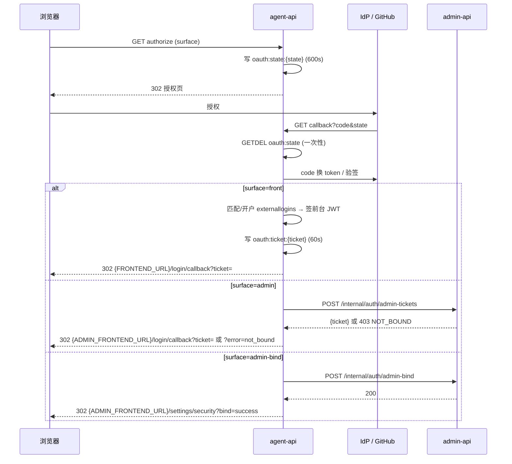

# 第三方登录（OAuth/OIDC）REST 流程契约

**版本**：v1.0
**关联提案**：`docs/engineering/proposals/20261113-feat-oidc-github-oauth-login.md`
**关联 GraphQL 契约**：`contracts/auth.graphql`、`contracts/admin-auth.graphql`、`contracts/admin-auth-provider.graphql`

本契约定义 agent-api 承载的 **OAuth/OIDC 授权与回调唯一入口**，以及 admin-api 内部票据/绑定端点。
所有回跳均为 HTTP 302（浏览器场景），错误不返回 JSON，而是 `?error=<code>` 回登录页由前端映射文案。

## 1. 公开端点（agent-api）

| 端点 | 说明 |
|------|------|
| `GET /api/auth/oauth/:providerId/authorize?surface=front` | 前台登录：校验 provider 存在/启用/允许前台 → 生成 state（OIDC 含 PKCE + nonce）→ 302 到 IdP/GitHub 授权页 |
| `GET /api/auth/oauth/:providerId/authorize?surface=admin` | 后台登录：同上，校验允许后台登录 |
| `GET /api/auth/oauth/:providerId/authorize?surface=admin-bind&ticket=<bindTicket>` | 后台绑定：`bindTicket` 由 admin-api `createAdminBindTicket` 签发（600s），必须携带 |
| `GET /api/auth/oauth/callback?code=&state=` | 唯一回调：验 state → code 换 token → 归一身份 → 按 surface 分流并 302 回前端 |

### 1.1 `surface` 语义

- `front`：前台登录。首次外部身份自动开户（account + user + personal tenant + 计费账户 + 全局工作区），
  签前台 JWT 后经一次性 ticket 302 `{FRONTEND_URL}/login/callback?ticket=...`。
- `admin`：后台登录。调 admin-api `POST /internal/auth/admin-tickets` 校验绑定并换取一次性 ticket，
  302 `{ADMIN_FRONTEND_URL}/login/callback?ticket=...`；未绑定 302 `{ADMIN_FRONTEND_URL}/login?error=not_bound`。
- `admin-bind`：后台绑定。调 admin-api `POST /internal/auth/admin-bind` 落绑定，
  302 `{ADMIN_FRONTEND_URL}/settings/security?bind=success`；失败 `?bind=error&error=<code>`。

`surface` 仅允许以上三值；`admin-bind` 缺 `ticket` → `invalid_request`。provider 不存在/未启用/未开对应 surface
→ `provider_unavailable`。

### 1.2 回调分流



## 2. 内部端点（admin-api）

鉴权：`Authorization: Bearer <INTERNAL_API_TOKEN>`，`crypto.timingSafeEqual` 恒定时间比较；
未配置 token 或校验失败一律 `401 { error: 'UNAUTHORIZED' }`。

### 2.1 `POST /internal/auth/admin-tickets`

后台登录换票：校验外部身份已绑定管理员 → 签发 admin JWT → 写一次性 ticket。

请求体：

```json
{
  "providerId": "<authproviders._id>",
  "issuer": "<OIDC issuer 或 null>",
  "subject": "<OIDC sub / GitHub user id>",
  "profile": { "externalUsername": "octo", "displayName": "Octo" }
}
```

响应：

- `200 { "ticket": "<32-byte hex>" }`（Redis `oauth:ticket:{ticket}` → `{token, admin}`，TTL 60s）
- `403 { "error": "NOT_BOUND" }`：未绑定任何管理员
- `400 { "error": "INVALID_BODY" }`

### 2.2 `POST /internal/auth/admin-bind`

绑定票据消费 + upsert 绑定关系。

请求体：

```json
{
  "bindTicket": "<ticket>",
  "providerId": "<authproviders._id>",
  "issuer": "<OIDC issuer 或 null>",
  "subject": "<外部身份>",
  "profile": { "externalUsername": "octo", "displayName": "Octo" }
}
```

响应：

- `200 { "ok": true }`
- `400 { "error": "INVALID_BIND_TICKET" }`（票据不存在/过期/已消费/与 provider 不匹配）
- `400 { "error": "INVALID_BODY" }`

## 3. Redis 键与 TTL

| Key | TTL | 说明 |
|-----|-----|------|
| `oauth:state:{state}` | 600s | `{providerId, surface, codeVerifier?, nonce?, bindTicket?}`；GETDEL 一次性 |
| `oauth:ticket:{ticket}` | 60s | `{token, user?\\|admin?}`；GETDEL 一次性（前后台共用前缀，载荷互斥） |
| `oauth:bind-ticket:{ticket}` | 600s | `{adminUserId, providerId}`；admin-api 签发、admin-bind 消费（GETDEL） |
| `oidc:discovery:{issuer}` | 3600s | OIDC discovery 文档缓存 |
| `oidc:jwks:{issuer}` | 3600s | JWKS 缓存（验签失败强刷一次） |

`state` / `ticket` 均为 `crypto.randomBytes(32).toString('hex')`；**JWT 不进入浏览器 URL**。

## 4. 错误码

回调一律 302：前台 → `{FRONTEND_URL}/login?error=<code>`；后台 → `{ADMIN_FRONTEND_URL}/login?error=<code>`；
绑定 → `{ADMIN_FRONTEND_URL}/settings/security?bind=error&error=<code>`。

| code | 含义 | 前端文案 |
|------|------|---------|
| `access_denied` | 用户在授权页取消 | 已取消授权 |
| `invalid_state` | state 无效/过期/重放 | 登录状态已过期，请重试 |
| `provider_error` | IdP/GitHub 不可达或返回错误 | 第三方登录服务不可用，请稍后重试 |
| `provider_unavailable` | provider 停用/删除/不允许该 surface | 该登录方式已停用 |
| `not_bound` | 外部身份未绑定任何管理员账户 | 该身份未绑定任何管理员账户 |
| `provision_failed` | 前台自动开户失败（如计费不可达） | 账户开通失败，请联系管理员 |
| `invalid_request` | 非法请求（如 admin-bind 缺 ticket） | 非法的登录请求 |

未识别 code 原样兜底展示。

## 5. 身份归一

回调将外部身份归一为 `{ providerId, issuer?, subject, profile: { externalUsername, displayName? } }`：

- OIDC：`subject = sub`，`issuer = provider.issuer`；`externalUsername = preferred_username ?? email 本地段 ?? sub 前 8`；
  `displayName = name ?? preferred_username`。**身份锚点是 `{providerId, issuer, subject}`，不以 email 为锚点**。
- GitHub：`subject = String(user.id)`，`issuer = null`；`externalUsername = login`；`displayName = name ?? login`。

## 6. 配置缺口

`PUBLIC_BASE_URL`（agent-api）是 `redirect_uri = {PUBLIC_BASE_URL}/api/auth/oauth/callback` 的唯一事实源；
`ADMIN_FRONTEND_URL` 前后台 302 目标（缺省 `http://localhost:5174`）。配置保存不做连通性校验，
discovery 在 authorize 时按需执行，失败 → `provider_error`。
