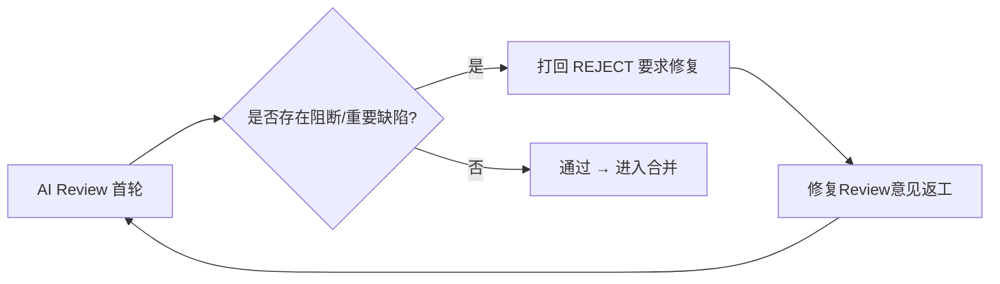

# 费用中心（credits-billing）+ Aspire 工作负载代理 integration 验收报告（2026-10-19）

> **状态**: 🔴 **第一轮 AI Review：打回（REJECT）**——本 PR 引入「事件→计量→定价→账单→支付→收据」六段计费管线与 RabbitMQ 事件骨干，代码体量大、测试较完备，但代码审查发现 **4 项阻断级缺陷**（凭空造钱、MQ 消费进程崩溃、结算链路指数放大、计费事件错误投递）与 **约 20 项重要缺陷**，涉及资金正确性、消息可靠性、计费事件源头一致性与安全边界，**不可带病合并**。本轮结论：**打回返工**，要求修复「五、阻断项」全部 + 「六、重要项」资金/可靠性/安全相关项后重新提交复核。详见「五、阻断项」与「六、重要项」。

## 关联文档

- PRD：`docs/product/draft/20261018-credits-billing.md`、`docs/product/draft/20261019-aspire-workload-proxy.md`
- 技术方案：`docs/engineering/proposals/20261018-feat-credits-billing.md`、`docs/engineering/proposals/20261019-feat-aspire-workload-proxy.md`
- 实现计划：`docs/engineering/plan/20261018-feat-credits-billing.md`、`docs/engineering/plan/20261019-feat-aspire-workload-proxy.md`
- 分支：`integration`（@ `c1a10f6`，PR #237 → release，MERGEABLE）
- 上游产物：节点「修复Review意见」确认 PR #237 无任何 Review 评论、无人类打回（reworkCount=0）——本轮为**首次 AI 代码评审**。
- 验收方式：AI 代码评审（diff：`origin/release...origin/integration`，29 commits，163 文件，+18077/-34；含 `origin/integration..origin/release` 反向对照，release 侧 6 commits 需合并时留意）+ 关键缺陷逐条人工复核代码
- 验收日期：2026-10-19

## 一、验收范围与方法

本 PR 核心变更（两大特性）：

1. **费用中心（credits-billing，主体）**：契约先行（`contracts/billing.graphql`、`admin-billing.graphql`、`billing-openai.openapi.yaml`、`billing-events.asyncapi.yaml`）；`admin-api` 计费域（六段管线 `services/billing/*`、Mongo 模型 `models/billing-*`、计费网关 `routes/billing-openai.ts`、内部 REST `routes/internal-billing.ts`、GraphQL resolver）+ RabbitMQ 事件骨干（`mq/*`：outbox + confirm + DLQ + 重连/退避）；`cloud-controller` 计费源头（字段/outbox/事件投递/带原因强拆 + Aspire RabbitMQ 编排）；`agent-api` 前台「我的费用」（internal REST 转发 + myBilling GraphQL）；`admin-web` 费用中心/对账中心/模型定价、`agent-web` 我的费用界面。
2. **Aspire 工作负载下载代理**：`admin-api` 迁移 `004-aspire-cli-source.ts`（直连内网代理 + `aspire_cli_url` 参数）+ `cloud-workload` 契约扩展 + worker 镜像 `BUILD.md`。

验收方法：按域并行深度代码评审（计费核心管线 / MQ 事件骨干 / API 与鉴权面 / cloud-controller 计费源头 / 前端·契约·部署·迁移），并对最关键的 4 项结论**逐条人工复核源码确认属实**（见「五、阻断项」复核标注）。

## 二、已验证（✅）

| 项目 | 结果 | 说明 |
|---|---|---|
| 鉴权覆盖（API/GraphQL） | ✅ | 全部计费 GraphQL resolver 均 `assertAdmin`/`requireUser`；`/v1/*` 均挂 `billingKeyAuth`；`/internal/billing/*` 由 fail-closed token 中间件保护；未发现缺鉴权或 IDOR（用户侧一律从登录主体解析 `accountId`，非客户端传入） |
| NoSQL 注入 | ✅ | GraphQL 强类型参数阻断对象注入；REST 查询参数 typeof 守卫（拒绝数组）、`isValidObjectId` 校验、`keyword` 正则转义 |
| API-Key 校验 | ✅ | 前缀索引查找 + `bcrypt.compare`（定时安全）、`status:'active'` 过滤（支持吊销）、仅存 `keyHash` 不存明文、secret 仅返回一次 |
| 契约/实现一致性（GraphQL） | ✅ | `billing.graphql`↔agent-api、`admin-billing.graphql`↔admin 逐字段一致（类型/枚举/可空/`ModelPricingInput.isBillable` 默认值）；`updateModelPricing` 的 `productId`（`model.<id>.token`）与 `pricing.priceModel` 读取路径一致 |
| markOnline 原子写计费起点（`27ba8d6`） | ✅ | `container-service.ts` 用单条 `findOneAndUpdate` + `requireNullFields:['billingStartedAt']` CAS，并发 `markOnline` 仅一个赢家 → 恰好一个 `container.ready`（另有 `eventId` 唯一索引兜底）；重连不重置起点。**该修复正确** |
| 事件信封/字段（AsyncAPI↔代码） | ✅ | `eventType` 路由键、`BillingEvent` 必填字段、`x-event-id`/`x-retry-count` 头、`SettlementCycleMessage` 均与 `billing-events.asyncapi.yaml` 一致（消费端去重语义除外，见问题 2/3） |
| 迁移 004 幂等性 | ✅ | 在 001 之后注册执行、`initScript ∈ {V1,V2}` + key 存在性检查保证可重跑、不覆盖管理员自定义脚本、`env>param>fail` 优先级与 `bash -n` 均有测试 |
| 前端安全 | ✅ | 无 `dangerouslySetInnerHTML`；无前端 secret（API key secret 仅一次性展示）；React key 稳定；金额展示 `toFixed(2)` 与「分」口径一致 |

## 三、总体结论

代码设计思路（六段管线 + outbox/confirm/DLQ + 三线对账兜底）合理，测试覆盖（真实 Mongo，行覆盖率报告称 94%+）较完备，若干关键修复（markOnline 原子写、append-only、幂等键）方向正确。**但**作为资金系统，存在多处「资金正确性 / 消息可靠性 / 计费事件源头一致性 / 安全边界」的实质缺陷，其中 4 项为阻断级（已在源码逐条复核确认）。按验收规范「有问题立即打回」，本轮**打回返工**。



## 四、问题严重度汇总

| 严重度 | 数量 | 处理 |
|---|---|---|
| 🔴 阻断（BLOCKER） | 4 | 必须修复，构成打回 |
| 🟠 重要（MAJOR） | ~20 | 资金/可靠性/安全项须一并修复；其余强烈建议 |
| 🟡 次要（MINOR）/ ⚪ 建议（NIT） | ~25 | 不阻断，建议修复或记录 |

---

## 五、阻断项（BLOCKER——必须全部修复）

### 问题 1（🔴 阻断·资金正确性）对账 `reconcileAccount` 口径错误 → 含赠送/授信余额的账户**凭空造钱**，且每日自动执行

**问题描述**：`servers/admin-api/src/services/billing/account-service.ts:186-218`（**已人工复核确认**）。对账把「各池合计」的 ledger 余额与「仅现金」的钱包余额比较，并用前者覆盖后者：

```ts
const rows = await BillingLedger.aggregate([{ $match:{accountId} }, { $group:{ _id:null, balance:{ $sum:'$deltaBalance' } } }]);
const ledgerCash = Math.round(rows[0]?.balance ?? 0);        // Σ deltaBalance = 现金+赠送+授信 合计
const walletCash = Math.round(account.cashBalance ?? 0);      // 仅现金
const mismatch = walletCash !== ledgerCash || ...;
if (mismatch) {
  await BillingAccount.updateOne({ _id: accountId }, { $set: { cashBalance: ledgerCash, ... } }); // 现金 ← 各池合计
}
```

**根因分析**：`models/billing-ledger.ts:22` 明确「`deltaBalance` 为各池合计」，`payment.charge` 对整额写 `deltaBalance:-amount`、同时用 `giftDelta` 单独扣赠送（`payment.ts:273-278`）。真实不变式是 `Σ deltaBalance == cashBalance + giftBalance (+ credit)`。当前实现拿 `ΣdeltaBalance` 与 `cashBalance` 单独比较：

- 只要账户 `giftBalance>0`（或授信占用）就**恒判 mismatch**；
- 「修复」把 `cashBalance` 覆盖为**各池合计**，而 `giftBalance` 原封不动 → `availableBalance = cash + gift + credit - frozen` **凭空增加 giftBalance 额度**，且可消费（`allocatePools` 优先扣现金，虚增现金先被花掉）。

**影响**：`scheduler.ts` → `ReconciliationService.reconcileFunds` → `reconcileAccount` **每日对所有账户自动执行**，另有 `reconcileBillingAccount` 管理端 mutation 触发——即每天都在系统性制造可用余额，是资金安全红线。

**修复方案**：
1. 按池对账：断言 `cashBalance + giftBalance (+ credit) === ΣdeltaBalance`，并用 `allocations`（`Σ allocations[gift]` vs `giftBalance` 等）分池核对，**绝不把赠送/授信折叠进现金**。
2. 补单测：`giftBalance>0` 且有赠送池 ledger 行时，对账不得放大 `availableBalance`（现 `account-service.test.ts:72-94`、`billing-flow.test.ts` 仅覆盖 `giftBalance=0`）。

### 问题 2（🔴 阻断·消息可靠性）MQ 消费 `void consumeWithRetry(...)` 无 `.catch` → broker 重启/连接抖动时**进程崩溃**

**问题描述**：`servers/admin-api/src/services/billing/mq/consumers.ts:108-111`、`:163-165`（**已人工复核确认**）。消费回调以 fire-and-forget 调用：

```ts
channel.consume(METERING_QUEUE, (msg) => {
  if (!msg) return;
  void consumeWithRetry(channel, msg, { ... });   // ← 无 .catch()，返回的 rejection 被丢弃
});
```

`consumeWithRetry` 内部 catch 路径的 `channel.publish`/`channel.ack`（`consumers.ts:80-85, 92-98`）**无 try/catch 保护**：

```ts
} catch (err) {
  ...
  channel.publish(BILLING_DLX, options.dlq, msg.content, {...});  // channel 已关闭时同步抛出
  channel.ack(msg);
  ...
  channel.publish(BILLING_RETRY_EXCHANGE, ...);                    // 同上
  channel.ack(msg);
}
```

**根因分析**：amqplib 在 channel 关闭时 `ack`/`publish` **同步抛出**（`Channel closed`）。broker 重启/连接抖动且有在途消息的序列：handler 完成 → `channel.ack` 抛出 → 被 catch → catch 内 `channel.publish` 再抛出 → `consumeWithRetry` 返回 rejected promise → `void` 丢弃 → **unhandled rejection**。`index.ts` 无 `process.on('unhandledRejection')`，Node 默认**终止进程**。

**影响**：恰在 `BillingMqRuntime` 宣称要扛住的场景（"broker 重启后计费不静默停摆"，`runtime.ts:16-19`）——本应重连，却**每次 broker 抖动都崩溃**；优雅停机 `runtime.stop()` 关 channel 时同样触发。

**修复方案**：
1. catch 路径内的 `channel.publish`/`channel.ack` 全部 try/catch 保护（或整体包裹）。
2. `void consumeWithRetry(...)` 附 `.catch(err => logger.error(...))`。
3. 建议先 ack 原消息再重投，使重投失败时原消息保留在 unacked（可重投）而非抛异常。

### 问题 3（🔴 阻断·消息可靠性）结算链路**指数级放大** + 消费端去重缺失 → 队列/负载无界膨胀

**问题描述**：`servers/admin-api/src/services/billing/mq/consumers.ts:170-183` + `services/billing/reservation.ts:147-264`（**已人工复核确认**）。

- `handleSettlementCycle` 在重放时仍返回 `settled:true`，消费端据此**再投递下一 cycle**：
  ```ts
  const result = await deps.billing.handleSettlementCycle(message.reservationId, message.cycleSeq);
  if (!result.shouldDestroy && result.settled) {
    await deps.publishSettlement(message.reservationId, message.accountId, result.nextCycleSeq);
  }
  ```
- `settleCycle` **无「该 cycle 已结算」去重门**，仅早退于 `status!=='ACTIVE'` 与 `settleTo>now()`；`BillingReservationCycle` 记录（`reservation.ts:212`）只是「结果标记」，**从不作为去重判据**。
- 消费端 `event-ingest` 的去重结果被丢弃：`await deps.ingest.ingest({ eventId, ... })` 未使用返回的 `{ created }`（`consumers.ts:118`）——`event-ingest.ts:14-35` 明明返回 `created:false` 表示重复。

**根因分析**：at-least-once 下重复投递是常态（问题 2 的 ack 失败、broker 重启在途重投、outbox 双发）。cycle-N 被投递两次 → 每份都 `settled:true` → 各投一份 cycle-(N+1) → 2 份 → 4 份 → **2^k**。金额受 ledger/invoice 幂等键保护不重复扣费，但延迟队列与消费负载按 cycle 指数增长，长寿容器（默认 60s cycle = 1440 cycle/天）会把 broker/队列打满。

**影响**：与 `contracts/billing-events.asyncapi.yaml:8-11`「`eventId` 唯一索引去重」承诺**不符**（唯一索引只去重事实行，不去重副作用），是指数放大的根因。

**修复方案**：
1. `settleCycle` 依据 `BillingReservationCycle` 记录对重复 `cycleSeq` 返回「已结算」（`settled:false`），门控副作用。
2. 消费端使用 `const { created } = await ingest(...)`，`created===false` 时跳过副作用；或按 `x-event-id: settlement:{reservationId}:{cycleSeq}` 对「投递下一 cycle」去重（持久化 outbox）。

### 问题 4（🔴 阻断·计费事件源头）cloud-controller `destroyed` 事件错误投递——**提前投递/漏投**，导致少计费与账期错位

**问题描述**：两个缺陷叠加（**已人工复核确认**）：

- **4a. CAS-miss 提前投递**：`servers/cloud-controller/src/services/container-service.ts:191-200` 的 `updateGuarded` 在 CAS 未命中时**回读当前记录并返回**：
  ```ts
  private async updateGuarded(containerId, patch) {
    const updated = await this.repo.update(containerId, patch, { fromStatuses:[...ACTIVE_STATUSES] });
    if (updated) return updated;
    return this.repo.findById(containerId);   // ← CAS-miss 也返回非空
  }
  ```
  而 `markExited`/`markFailed`（`:385-409`）仅凭 `if (updated)` 就 `emitDestroyedIfBilled(updated)`——**无法区分「发生了转移」与「什么都没做」**。用陈旧快照（`list()`/`reconcile()`/`scanTimeouts`）调用 `markFailed` 而记录正处 `destroying` 时：CAS 未命中 → 回读到 `destroying` 记录 → 提前投递 destroyed，`index.ts:101` 用 `exitedAt ?? new Date()` → 取到**提前时刻的 `new Date()`**。该行先入 outbox；destroy 路径随后要投的精确事件（`:541`）因 `eventId=container.destroyed:<id>` 撞 E11000 被**静默丢弃** → 计费时长**少算整个拆除窗口（最多 ~100s）**，且因计量按分钟取整可移动账单边界。
- **4b. 终态漏投**：`workload-dispatcher.ts:344-366` 的 `forceDestroy` 失败兜底用裸 `repo.update` 写终态 `failed`，**绕过 `markFailed`，不投 destroyed**——恰是「非 destroy 终态补投 destroyed」修复要覆盖的路径；记录停在 `failed` 且 `billingStartedAt` 非空，计费会话一直挂到人工/三线对账。

**根因分析**：`updateGuarded` 的 CAS-miss 回读设计与「emit 仅应在真实转移时触发」冲突；dispatcher 兜底未走统一终态钩子。

**修复方案**：
1. `markExited`/`markFailed` 直接用 `this.repo.update(...)`（如 `destroyLocked`），**仅在 CAS 命中返回非空时** `emitDestroyedIfBilled`；回读记录仅用于返回值。
2. dispatcher 兜底改走 `containerService.markFailed`（或等价补投 destroyed）；或由 `reclaimResidualJob`/扫视为「`billingStartedAt` 非空但缺 `container.destroyed:<id>` outbox 行」的 `failed` 记录补投。
3. 补测试：`billing-events.test.ts` 覆盖 `markExited`/`markFailed` 终态补投（现仅覆盖 destroy 路径）与并发 `markOnline`。

---

## 六、重要项（MAJOR——资金/可靠性/安全项须一并修复）

> 每项含「问题—根因—修复」。标注 💰（资金）/ 🔁（可靠性）/ 🔐（安全）/ 🧩（功能正确性）。

### A. 计费核心（`servers/admin-api/src/services/billing/`、`models/`）

| # | 类 | 位置 | 问题与根因 | 修复 |
|---|---|---|---|---|
| A1 💰 | 预留/漏计费 | `reservation.ts:85-141`、`billing-service.ts:87-124` | `start()` 建 `PENDING` 预留后，冻结押金/周期估算为**独立无保护步骤**，任一 `payments.freeze` 抛错即卡死 `PENDING`：`resourceId` 唯一索引挡住新预留、重试返回陈旧 `PENDING` 不再冻结、`settleCycle` 对非 `ACTIVE` 早退→**整生命周期无周期计费/无欠费检测**、`PENDING` 不进对账扫描。零余额用户可跑容器而无押金/无周期扣费/无强拆——**信用滥用** | `start()` 可重入（11000 时若为 `PENDING` 重驱冻结再激活）或失败回滚（解冻+置 `FAILED`）；`PENDING` 纳入资源对账 |
| A2 💰 | 乱序/重放 | `reservation.ts:227-245` | `settleCycle` 的 `$set` 里 `lastSettleAt`/`lastCycleSeq` 有 `$max` 守卫，但 **`status:'ACTIVE'` 与 `expectedEndAt` 无守卫**：延迟/重复 cycle 消息把已 `SETTLED` 的预留**复活**继续计费；旧 cycle 重放把 `expectedEndAt` **回拨**，`settlement-tick.ts:57-58`/`reconciliation.ts:114-116` 据此判 `staleByTimeout` → **提前 finalize 在跑容器**，剩余时长永不计费 | `$max`/`$cond` 守卫 `expectedEndAt`；仅当 `status==='ACTIVE'` 才迁移状态（或不改 status） |
| A3 💰 | 并发/拆池 | `payment.ts:35-54,231-244`、`billing-service.ts:296` | `charge()` 用陈旧账户快照算 `allocatePools`（cash→gift→credit）再原子 `$add`；同账户并发 model_call（唯一锁 `billingMutex` key 是 `model:${resourceId}`，**同账户不串行**）双双分配同一赠送额 → `giftBalance` 可为**负**、现金少扣、拆池明细错 | 按账户串行（账户级互斥）或在原子更新内用 pipeline 计算分配 |
| A4 💰 | 非原子 | `payment.ts:122-278` | ledger 落账后 `applyWallet`，**无 Mongo 事务/session**；中途崩溃后重试命中幂等键返回 `applied:false` **永久跳过 `applyWallet`** → 已记账未扣钱（收入漏）/已记充值未到账。当前靠 `reconcileAccount` 修复漂移，而后者有阻断项 1 的口径 bug | ledger+wallet 事务包裹，或钱包更新可恢复（两阶段 applied 标记/由 ledger 派生+修复环） |
| A5 💰 | 幂等 | `billing-service.ts:378-387`、`resolvers/billing.ts:208-223` | `recharge` 幂等键 `recharge:{account}:{newObjectId}` **每次调用唯一**，等于无幂等；`rechargeBillingAccount` 无客户端幂等键，重试/双击**重复加钱** | 接受调用方幂等键/操作 ID 作 `idempotentKey` |
| A6 💰 | 索引/幂等 | `models/billing-invoice.ts:34`、`invoicing.ts:68-118` | `idempotentKey` 唯一+sparse 但显式写 `null` 被索引 → 第二张无键发票撞 E11000；`createInvoice` 对 11000 **盲目重试 5 次、每次烧一个 seq**（违反「seq 连续」），再抛误导性重复键错 | `partialFilterExpression:{idempotentKey:{$type:'string'}}`（或缺字段不写 null）；重试前识别冲突索引 |
| A7 💰 | 边界/溢出 | `money.ts:17-40` | `creditsToCents`/`parseRechargeCents` 对极大有限 Float：`credits*100` 溢出 `Infinity`，精度校验退化为 `NaN>1e-6===false` **放行**，返回 `Infinity` → `recharge`/`creditLimit`/定价写入 `Infinity`，资金数据损坏 | 乘后校验 `Number.isFinite`，并设上界（`<= Number.MAX_SAFE_INTEGER`） |
| A8 💰 | 隐藏默认 | `pricing.ts:96-133`、`billing-service.ts:322` | 模型无价格行 → `priceModel` 无兜底（容器有）→ `amountCents=0`，`>0` 才扣费/开票 → **消费免费消失**于账单 | 无价模型告警/拒绝，或补 `priceModel` 兜底 |
| A9 💰 | 估算口径 | `billing-service.ts:97` | 周期冻结估算硬编码 `1 credit/分钟`，不查价格表；定价高于默认时冻结**少保护** | 用 `pricingService.priceContainer` 的单价 |
| A10 💰 | 不可变 | `billing-ledger/invoice/receipt` hooks | append-only 不完整：`rejectMutation` 死代码、未覆盖 `replaceOne`/`findOneAndDelete`/`bulkWrite`/`load→save`，无 `immutable:true` | 补 `immutable:true` + 覆盖剩余操作 |
| A11 🧩 | 单实例约束 | `keyed-mutex.ts:26`、`credit-check.ts:62` | `billingMutex`、`PreCheck` store 均为**进程内 Map**；多副本/多消费者下 A3 竞态可达、`preCheck required` 失败 → 计费消息落 DLQ **静默停摆** | 文档化单实例硬约束，或迁移 Mongo（预检令牌/账户级锁） |
| A12 🧩 | 尾项 | `receipt.ts:24-27,42-44`、`mappers.ts:117`、`api-key-service.ts:102` | 收据号仅账户后 4 hex + 账户内 seq → 多账户收据号**碰撞**且 11000 被吞（悬空 `receiptId`）；`mappers.ledgerCount` 硬编码 0；`revoke` 未 `isValidObjectId` → CastError 500 | 收据号含全账户 hash/全局序；`ledgerCount` 真实计算；`revoke` 入参校验 |

### B. MQ 事件骨干（`servers/admin-api/src/services/billing/mq/`）

| # | 类 | 位置 | 问题与根因 | 修复 |
|---|---|---|---|---|
| B1 🔁 | 重试拓扑 | `topology.ts:74,79` | 重试交换机以 `#` 绑定**两个**重试队列 → 每条重试复制到两队列，其一 TTL 到期死信到无绑定交换机**静默丢弃**；且 per-message-TTL 队头阻塞，长 TTL 幽灵排头**拖延真实重试** | 按流分路由键（`retry.metering.*`/`retry.settlement.*`）或独立交换机，配合 `x-dead-letter-routing-key` 还原 |
| B2 🔁 | 连接泄漏 | `runtime.ts:42-76` | 失败/替换的 `MqConnection` **从不 close**：`createChannel` 后 `declareTopology`/`startConsumer` 抛错仅调度重连不关连接；channel 级 `close` 触发重连覆盖旧连接。持续故障（如拓扑 406）**每 5s 泄漏一条连接** | 替换/失败前 `await prev.close()`；catch 内关闭新建连接 |
| B3 🔁 | 停机竞态 | `runtime.ts:39-107` | `connect()` 仅入口查 `stopped`；`stop()` 期间在途 `connect()` 继续启动消费者并赋值，停机后仍在消费、连接不关，随后 `mongoose.disconnect`/`process.exit` 把在途变重投 | 每个 `await` 后复核 `stopped` 并拆除；`stop()` 等待在途 connect 完成 |
| B4 🔁 | outbox | `publisher.ts:55-94`、`models/billing-outbox.ts` | outbox 中继**无原子认领**（无 `findOneAndUpdate` 租约）→ 多副本**双发**；`attempts` 只增不封顶/不隔离，毒消息**每 2s 无限重投** | 按行原子认领/租约；`attempts>=MAX` 置 `failed` 告警并纳入费用中心可见 |
| B5 🧩 | 退避 | `runtime.ts:79-88` | 连接重连**固定 5s，无指数退避/抖动**（消息级有退避，连接级反而没有） | 指数退避 + 上限 + 抖动 |
| B6 🔁 | 归档/丢信 | `topology.ts:39-47`、`consumers.ts:54-56` | DLQ 拷贝 7 天 TTL 静默过期；Mongo 留档失败被 `catch {}` **不打日志** → 唯一幸存拷贝无痕蒸发 | 留档失败告警；监控 DLQ 深度 |
| B7 🧩 | 拓扑漂移 | `topology.ts:82-89`、`config/index.ts:40` | 队列级 TTL 烘焙进 `assertQueue`，改 `BILLING_CYCLE_SECONDS`/常量对既有 broker 触发 406 → channel 永久坏、每 5s 重连泄漏（合 B2） | 队列参数视为不可变/版本化队列名；406 显式失败不空转 |
| B8 🧩 | 其它 | `index.ts:19-22`、`publisher.ts:80,112-118`、`connection.ts:19-58`、`consumers.ts:80-84` | 死导入 `startMeteringConsumer/startSettlementConsumer`；`waitForConfirms` 逐条（50 行 50 次往返）；`stop()` 不 drain 在途中继；`MqConnection.close()` 竞态在途 `getModel` 泄漏；DLQ 重投丢 `messageId` | 见位置逐项清理 |

### C. API/鉴权面（`routes/`、`middleware/`、GraphQL、`agent-api`）

| # | 类 | 位置 | 问题与根因 | 修复 |
|---|---|---|---|---|
| C1 🧩 | 中断计费 | `routes/billing-openai.ts:313-318` | `req.on('close')` **误用**：Node 16+ 的 request `close` 在**请求消息完成**即触发（非连接断开），且监听器在 4-5 次 Mongo 往返**之后**才注册 → 实为死代码，**客户端中断永不被检测**，中断调用按 `completed` 计费（违反 PRD §3.5「中断按已产生用量出账、标注中断」）；且注册时机一旦前移即把**所有**请求误判 `client_aborted` 并 abort 上游 | 改 `res.on('close', () => { if (!res.writableEnded) ... })`；补流式/中断 E2E 断言 `model_call.aborted` + 部分用量 |
| C2 🔐 | 信息泄漏 | `routes/internal-billing.ts:61` → `agent-api/billing-client.ts:141-149` → `agent-api/resolvers/billing.ts:16-20` | Mongo/驱动内部错误信息经 GraphQL error **原样吐给终端用户**；网关 `billing-openai.ts:308` 同样泄漏 `err.message` 给外部 API-key 持有者；客户端 400 被误标 `BILLING_UNAVAILABLE` | 内部 REST 返回通用 `INTERNAL_ERROR`（服务端记 detail）；agent-api 按状态码映射稳定脱敏消息；网关固定文案 |
| C3 🧩 | 数据错误 | `mappers.ts:117`、`internal-billing.ts:59`、`agent-api/resolvers/billing.ts:26-27` | `toBillingAccountWire` 硬编码 `ledgerCount:0`，admin GraphQL 覆盖为真实值但内部 REST `/account`（agent-api「我的费用」用）恒返回 0 | `/account` 计算真实 ledger 计数 |
| C4 🧩 | 分页/校验 | `internal-billing.ts:71-123`、`resolvers/billing.ts:99-180`、`rollup-service.ts:53-59` | `page/pageSize` 未整数校验（`page=Infinity` → `.skip(Infinity)`、`page=1e9` 大 skip 慢查询 DoS）；rollup 无 `from<to`/上限；GraphQL `accountId` 未 `isValidObjectId` → CastError | `Number.isInteger`+上界；GraphQL 层补 ObjectId 校验；rollup 限范围 |
| C5 🔐 | 限流/恒定 | `billing-key-auth.ts:17-43`、`internal-billing.ts:21`、`billing-openai.ts:38` | 401 路径无节流（可触发 bcrypt CPU/DB 消耗）；`/v1/models` 无限流（契约有 429）；内部 token 比较**非恒定时间**；`rateBuckets` Map 不清理、进程内 | 401 前限流；补 `/v1/models` 限流；`crypto.timingSafeEqual`；清理 buckets |
| C6 🧩 | 其它 | `billing-openai.ts:202-205,230-243`、`agent-api/billing-client.ts:185-191`、`internal-billing.ts:212-217` | 非计费冻结门忽略 `NOT_FOUND`、`NOT_FOUND` 误报「余额不足」；`BillingApiCall` 先写 `completed` 再调上游，崩溃留幽灵记录且 `failed` 从不写入、`finalize` 先置 `finalized` 再写、失败丢事件；`myBillingReceipt` 大写 hex `invoiceId` 大小写比较返回 null；DELETE 全部失败映射 404 | 见位置逐项 |

### D. cloud-controller / 前端 / 部署 / 契约 / 迁移

| # | 类 | 位置 | 问题与根因 | 修复 |
|---|---|---|---|---|
| D1 🔁 | 传输 | `cloud-controller/billing-event-publisher.ts:162-191` | `RabbitMqTransport` **缺 `channel.on('error')`**：channel 级异常被 `safeEmit` 重抛→升级为 `frameError`→**撕裂整条 AMQP 连接**；channel-only close 时 `ensureChannel` 覆盖旧 `this.connection` 泄漏 | 加 `channel.on('error',log)`；替换连接前 close 旧的 |
| D2 🧩 | 审计 | `container-service.ts:457-468,582-593` | 卡死 `destroying` 恢复把调用方传入的强拆 reason（如「余额不足…」）**覆盖**为硬编码「强制销毁」，破坏 A.2.3 审计承诺 | 已有 `exitReason` 时保留，仅空值默认 |
| D3 🔁 | 幂等前提 | `cloud-controller/index.ts:179-183` | `BillingOutbox.syncIndexes()` 失败被当非致命吞掉，但 `enqueue` 去重**完全依赖** `eventId` 唯一索引；无索引→重复事件 | `eventId` 唯一索引创建失败应 fail-fast/重试 |
| D4 🧩 | 前端 | `apps/admin-web/src/pages/BillingPage.tsx:67-94` | 收据查询复用 `invoicePage` 分页且按 `issuedAt:-1`，与发票按 `seq:-1` 不同步 → 查看某账单收据跨页时 `receipt=null` 误报「该账单暂无收据」（`ReceiptDrawer.tsx:19`），而 `invoice.receiptId` 已存在却未用 | 按 `receiptId`/`invoiceId` 查询（依赖 D6 契约）；或至少回退 `receiptInvoice.receiptId` |
| D5 🧩 | 前端 | `apps/admin-web/src/pages/BillingPage.tsx:48,96-131` | `selected` 为陈旧快照：冻结/对账/充值后 `refetch` 刷新列表但 `selected` 不更新 → 详情卡/按钮显示旧状态、二次切换算错方向 | 只存 `selectedId`，`selected` 由列表派生（`useMemo`） |
| D6 🧩 | 契约 | `contracts/admin-billing.graphql:183` | 无「按发票取收据」查询（`billing.graphql` 有 `myBillingReceipt(invoiceId)`），导致 D4 靠页面扫描 | 增 `adminBillingReceipt(id/invoiceId)` 并镜像到 schema |
| D7 🧩 | 契约漂移 | `contracts/admin-billing.graphql:215-270`、`billing-openai.openapi.yaml:210-225` | `admin-billing.graphql` 重复声明 `Model/ModelPricing/Provider` 等（与 `admin-llm.graphql` 重复，合并进单一 schema 会抛错）；网关错误 `type/code` 超出契约枚举（`invalid_request`/`account_frozen`/`server_error` 等），且未文档化 402/502 | 共享类型改引用；扩展契约枚举或映射回既有枚举 |
| D8 🧩 | 契约漂移 | `billing-events.asyncapi.yaml:18-43,145-151`、`cloud-controller-websocket.md` A.3.1 | AsyncAPI 未记录交换机/队列/DLQ 拓扑；`billing.settlement.cycle` 不在 `eventType` 枚举；`container.destroyed` 触发条件文档（仅 `destroying→exited`）与补投实现不符 | 拓扑写入 AsyncAPI；标注 `SettlementCycle` 为控制消息；更新触发条件列 |
| D9 🧩 | 部署 | `aspire/AgentGear.AppHost/AppHost.cs:114,189-191` vs `manifest/docker-compose.yaml:91` | publish 模式 `agentApi` 的 `ADMIN_API_URL` 指向浏览器地址 `http://localhost:8002`（server-side 调用应指向 admin-api 容器 DNS）；手工 compose 改对了，但 `aspire publish` 重新生成会**回退坏值** | publish 模式用 `adminApi.GetEndpoint("http")`，`admin-api-url` 参数仅供 `admin-web` 的 `config.js` |
| D10 🔁 | 部署 | `manifest/docker-compose.yaml:29-39`、`AppHost.cs:55-60` | RabbitMQ **无持久卷**（Mongo 有）→ 重启丢 DLQ 毒消息与 `billing.settlement.cycle` 延迟消息（二者仅存 broker），结算链断裂 | 给 `/var/lib/rabbitmq` 加命名卷 + `WithDataVolume()` |
| D11 🧩 | 迁移 | `migrations/models.ts:11`、`runner.ts:8-19` | 迁移锁 `_lock` **非 unique**（并发双跑可重复执行 004 建重复 `Aspire` preset）；`expiresAt` 从不生效，崩溃留永久锁→未来迁移冻结 | `_lock` 加唯一索引 + TTL/过期清扫 |
| D12 🧩 | 迁移 | `004-aspire-cli-source.ts:99-103,153` | 下载 Aspire CLI tarball **无 checksum/签名校验**；「存量脚本」检测对 `001` 代码常量**逐字节比对**，未来改动 001 使存量行被判「管理员自定义」而永久跳过（留 v1 公网 `curl\|bash` 脚本） | 加 `sha256` 参数校验；用哈希/指纹固定 v1 判定 |
| D13 🧩 | 前端 | `admin-web/ReceiptDrawer.tsx:18-20`、`BillingPage.tsx:252-276`、`agent-web/BillingPage.tsx` 多处 | 加载/错误态被渲染为「暂无…」（仅 agent-web 账户查询有错误态）；账户搜索不重置页码；充值成功不刷新账单列表/详情；`ModelPricingSection`/`MyApiKeyManager` 无 loading/error | `loading && !data` 门控 + 错误展示（对齐 agent-web 修复）；搜索 `setPage(1)`；充值 `onSuccess` 刷新 |

---

## 七、次要（MINOR）与建议（NIT）——不阻断，建议修复/记录

- **MINOR**：`payment.ts:85-87`/`account-service.ts:197` 过度解冻被 `Math.max(0,...)` 静默钳制，漂移不可见（应标记错误）；`settlement-tick.ts:40-54` 每 tick 至多补 1 个滞后 cycle（改 `while`）；`money.ts:46-49` 极大 token 溢出 `MAX_SAFE_INTEGER`；`invoicing.ts` 重试烧 seq；`ProductPrice` 无 `{productId,effectiveFrom}` 唯一；`billing-openai.ts` `stream_options` 死代码、口径 `cost` 与账单定价来源不一（`productprices` 才是真相）。
- **NIT**：`deterministicObjectId` 用 MD5（FIPS 扫描器告警，改 SHA-256）；`rabbitmqUrl` 默认内嵌 `guest:guest`（生产应强制 env）；`internal-billing.ts:172`/`mappers.ts:9` 格式；`OutboxRepository.enqueue(event,producer)` 的 `producer` 形参被两实现忽略、`InMemoryOutboxRepository.markFailed` 把 `lastError` 写进 payload 与 Mongo 实现不一致；`x-retry-count` 恒 0；DELETE `reason` 未限长；`billingAccountId` 允许纯空白；`ModelPricingSection.tsx:38` 草稿 merge 用 render 作用域；rollup `range` 挂载时固定跨天不刷新；`Sidebar.tsx:331-346` 移动端双分隔线；`admin-web` 缺 `BillingPage`/`ReconciliationPage` 页面级测试；`billing-openai.openapi.yaml` 服务器端口注记、`ChatMessage.content` 无法表达 null tool-call。
- **测试缺口**（关键）：对账 `giftBalance>0` 用例、双无键 `createInvoice`、崩溃后 ledger/wallet 重放、同账户并发 `charge`（断言 gift≥0）、乱序/重复 cycle（断言 `expectedEndAt` 不回拨、`SETTLED` 不复活）、`start()` 中途 freeze 抛错重试、`recharge` 双提交、`markExited/markFailed` 终态补投、流式/中断 gateway（`model_call.aborted`）。

---

## 八、修复总览表

| # | 问题 | 根因 | 状态 | 修复 commit |
|---|---|---|---|---|
| 1 | 对账凭空造钱（阻断） | Σ各池合计 vs 仅现金口径错 | ⬜ 待修复 | |
| 2 | MQ 消费进程崩溃（阻断） | `void consumeWithRetry` 无 `.catch` + catch 内 channel 操作裸抛 | ⬜ 待修复 | |
| 3 | 结算链指数放大（阻断） | `settleCycle` 无去重门 + 丢弃 ingest `created` | ⬜ 待修复 | |
| 4 | destroyed 事件错投（阻断） | CAS-miss 提前投递 + dispatcher 兜底漏投 | ⬜ 待修复 | |
| A1–A12 | 计费核心重要项 | 见「六、A」 | ⬜ 待修复 | |
| B1–B8 | MQ 事件骨干重要项 | 见「六、B」 | ⬜ 待修复 | |
| C1–C6 | API/鉴权面重要项 | 见「六、C」 | ⬜ 待修复 | |
| D1–D13 | 源头/前端/部署/契约/迁移 | 见「六、D」 | ⬜ 待修复 | |
| — | 次要/建议项 | 见「七」 | ⬜ 建议修复 | |

> 本轮为**首轮打回**，各问题「修复 commit」「验证结果」待返工后回填。

## 九、最终验证表格

| 项目 | 结果 | 说明 |
|---|---|---|
| 后端类型检查 | ⏸️ | `servers/admin-api` 未安装 `typescript`（`node_modules/.bin/tsc` 缺失），本地无法跑 `tsc`；返工后 CI/`npm run build` 校验 |
| 后端单测 | ⏸️ | 待返工后执行（含新增阻断项回归用例） |
| API 集成/E2E | ⏸️ | 待返工后执行 |
| 代码评审 | 🔴 不通过 | 4 阻断 + ~20 重要缺陷，打回 |

## 十、经验总结

1. **资金对账口径**是资金系统红线：`deltaBalance`（各池合计）与 `cashBalance/giftBalance` 分池不变式必须在代码注释、契约与测试三处钉死；对账「修复」动作本身要先证明不变式，否则会把漂移放大成造钱。
2. **fire-and-forget 的异步**（`void promise`）在消息消费里必须配 `.catch`，且 catch 路径的 channel 操作要自保护——否则 broker 抖动=进程崩溃。
3. **at-least-once 下副作用必须门控**：`eventId` 唯一索引只去重事实行，不去重副作用；「结算后再投下一 cycle」这类链式副作用要靠去重键/状态门断开，否则重复投递指数放大。
4. **CAS 更新要能区分「命中转移」与「未命中回读」**，事件投递只应在真实转移（CAS 命中）时触发，否则确定性 `eventId` 会让精确事件被提前的错误事件永久顶替（计费少算）。
5. **进程内 Map（互斥/预检）不是分布式原语**，多副本即失效；要么文档化单实例硬约束，要么落库。
6. **Node 请求中断检测**用 `res.on('close')` + `!res.writableEnded`，`req.on('close')` 语义易误用且注册时机敏感。
7. **发布工件与手工 manifest 不能漂移**：`AppHost.cs` 与 `docker-compose.yaml` 的服务地址/卷/凭据要单一事实来源，否则 `aspire publish` 重新生成即回退。
