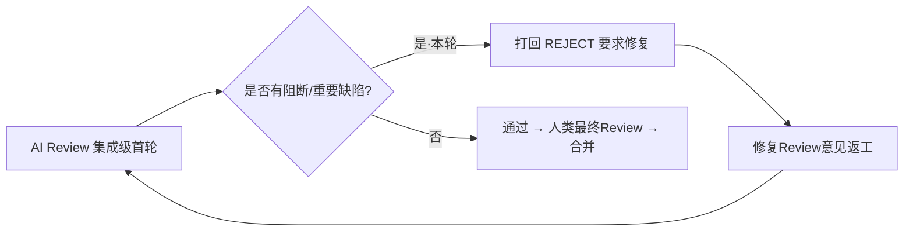

# integration→release 集成验收报告（2026-10-19，AI Review）

> **状态**: ❌ **首轮 AI Review 打回（REJECT）**（后续进展见 [第八节·第二轮复核](#八第二轮-ai-review-复核2026-10-19ai-review-节点打回)）——评审范围 `integration..release`（PR #238，35 提交 / 172 文件 / +20528 −70）。**3 项 🔴 阻断**（① 计费事件乱序 → 同一容器会话重复计费；② 预留回滚无「冻结是否发生」守卫 → 蚕食他人担保资金并污染 ledger 真值；③ `appliedLedgerIds` 水位只留 1000 条 → 重放二次记账（幻影扣费可致误强拆 / 幻影加钱成坏账））+ **13 项 🟠 重要**（计费事件丢失兜底残缺、双定价源漏计费、stale 误终结致活容器免费、heldFrozen 全表扫+正则注入、跨账户纵深防御缺失、admin 错误映射缺失、2 项测试假绿/名实不符、4 项前端财务展示与状态操作缺陷、RabbitMQ 镜像未走内网源）+ 40 项 🟡 建议。按验收红线「有阻断/重要问题立即打回并要求修复」，首轮**打回返工**；返工（`70990a9`）后第二轮复核**再次打回**（见第八节）。

## 关联文档

- PRD：`docs/product/draft/20261018-credits-billing.md`、`docs/product/draft/20261019-aspire-workload-proxy.md`
- 技术方案：`docs/engineering/proposals/20261018-feat-credits-billing.md`、`docs/engineering/proposals/20261019-feat-aspire-workload-proxy.md`
- 实现计划：`docs/engineering/plan/20261018-feat-credits-billing.md`、`docs/engineering/plan/20261019-feat-aspire-workload-proxy.md`
- 前四轮模块级验收：`docs/engineering/acceptance/20261019-credits-billing-acceptance-report.md`（首轮 4 阻断 + 约 20 重要 → 四轮通过）
- 分支：`integration` @ `9531916`（= `origin/main`），目标分支 `release` @ `283e542`；PR #238 `OPEN / MERGEABLE / CLEAN`
- 上游产物：节点「修复Review意见」确认无人类 Review 意见（`rejectInfo` 为空、`reworkCount=0`）→ 本轮为**集成级首次 AI 代码评审**
- 验收方式：AI 代码评审（`git diff origin/release..integration`，35 提交 / 172 文件 / +20528 −70；含 `integration..origin/release` 反向对照）+ 4 域并行深度评审（计费核心管线/MQ、API 面与迁移、cloud-controller+agent-api+契约、前端+编排+部署）+ **实机独立验证**（不采信历史报告与返工自报数据）
- 验收日期：2026-10-19

## 一、验收范围与方法

### 1.1 变更范围

| 特性 | 内容 | 主要落点 |
|---|---|---|
| 费用中心（credits-billing，主体） | 契约先行（`contracts/billing.graphql`、`admin-billing.graphql`、`billing-openai.openapi.yaml`、`billing-events.asyncapi.yaml`）；admin-api 计费域（六段管线「事件→计量→定价→账单→支付→收据」+ RabbitMQ outbox/confirm/DLQ 事件骨干 + `/v1` OpenAI 兼容计费网关 + `/internal/billing`）；cloud-controller 计费源头（outbox/事件投递/带原因强拆/计费起点）；agent-api 前台「我的费用」；admin-web 费用中心/对账中心/模型定价；agent-web 我的费用 | `servers/admin-api/src/services/billing/**`、`models/billing-*`、`servers/cloud-controller/**`、`servers/agent-api/**`、`apps/{admin,agent}-web/**` |
| Aspire 工作负载下载代理 | 迁移 `004-aspire-cli-source`（脚本 v2 直连内网缓存代理下载解压，弃用官方 `curl\|bash`）、`aspire_cli_url` 参数化（`ASPIRE_CLI_URL` > 参数 > 快速失败）、BUILD.md 口径同步 | `servers/admin-api/src/migrations/004-*`、`deploy/images/worker/BUILD.md` |
| 编排/部署 | Aspire 新增 RabbitMQ 资源并注入 admin-api / cloud-controller；docker-compose manifest 补齐 rabbitmq 与相关环境变量 | `aspire/AgentGear.AppHost/**`、`aspire/manifest/docker-compose.yaml` |
| 文档 | PRD / 提案 / 实现计划 / 验收报告与 `AGENTS.md` 索引同步 | `docs/**` |

### 1.2 评审与验证方法

1. **分域并行深度代码评审**（4 域，逐行阅读非抽查）：① admin-api 计费核心管线 + MQ 事件骨干；② admin-api API/鉴权面 + 数据模型 + 迁移；③ cloud-controller 计费源头 + agent-api 前台 + 契约一致性；④ 前端（admin-web / agent-web）+ Aspire 编排 + 部署文档。
2. **独立实机验证**：按 `tests/api/AGENTS.md` 用 Aspire 起全套服务（agent-api / admin-api / controller-api / cloud-controller + MongoDB / Redis / RabbitMQ）后实跑 API 集成套件与费用相关 E2E；三套后端 + 两套前端 `tsc`/`eslint`/单测本机复跑。
3. **反向对照**：`integration..origin/release` 侧 6 个提交均为 `main→release` 合并提交，release 树与其合并的 main 父提交**树差异为空**；两分支树差异与三点差异一致，合并无内容冲突面（PR #238 `MERGEABLE / CLEAN`）。
4. **安全扫描**：全量新增行做 secret/凭据硬编码、`dangerouslySetInnerHTML`、敏感信息 `console.log`、TODO/FIXME 残留扫描。
5. **关键结论人工复核**：阻断项与重要项均逐条回读源码确认属实（不采信分域评审结论）。

### 1.3 判定红线（与前四轮一致）

- 🔴 阻断 / 🟠 重要 → **打回返工**（本轮命中）
- 🟡 建议 → 记录并随修复项一并收口，不单独构成打回

## 二、独立验证结果（本机实跑，不采信自报）

| 服务/包 | 类型检查 | Lint | 测试 | 备注 |
|---|---|---|---|---|
| servers/admin-api | ✅ `tsc --noEmit` 0 | — | ✅ **500 passed / 1 skipped** | 与前四轮声称一致 |
| servers/agent-api | ✅ | — | ✅ **658 passed** | 一致 |
| servers/cloud-controller | ✅ | — | ✅ **195 passed** | 一致 |
| apps/admin-web | ✅ `tsc -b` 0 | ✅ 0 error | ✅ **207 passed** | — |
| apps/agent-web | ✅ `tsc -b` 0 | ✅ 0 error / 6 warning（均为本次变更外的存量文件） | ✅ **429 passed** | — |
| tests/api（实机集成套件） | — | — | ✅ **448 passed / 3 skipped / 0 failed** | Aspire 全栈实跑；⚠️ 3 项 skipped 中含 `cloud-controller/billing-events.test.ts`，属**问题 T-1 假绿**（见下），非真实通过 |
| tests/api `billing-events.test.ts`（补跑） | — | — | ✅ 2 passed | 显式注入其实际读取的 `INTERNAL_API_TOKEN` 后通过——证明套件内容有效、但按文档口径永不执行 |
| tests/e2e（费用 3 例） | — | — | ✅ **3 passed** | `admin-billing.spec.ts` 2 例 + `billing.spec.ts` 1 例（此前四轮该层为 ⏸️） |

**合计独立复跑：1989 项单测/组件测试 + 448 项 API 集成 + 3 项 E2E 全绿。**

> tests/api 首轮 13 例失败均为评审环境注入问题（评审进程用未鉴权 `MONGODB_URI` 直连开启 SCRAM 的 MongoDB，`MongoServerError: Command ... requires authentication`），换用带凭据 URI + 内部 token 后全部通过，**非代码缺陷**。

## 三、已验证（✅）

| 项目 | 结果 | 证据 |
|---|---|---|
| 后台计费 GraphQL 鉴权 | ✅ | `admin-api/graphql/resolvers/billing.ts` 18 个 resolver 逐个首行 `assertAdmin(context)`，无缺鉴权入口 |
| 前台计费 GraphQL 鉴权 | ✅ | `agent-api/graphql/resolvers/billing.ts` 全部经 `requireUser` + `run()`；`accountId` 一律派生自登录主体（`getAccount('front_user', user.id, …)`），无 IDOR 形态 |
| 内部 REST 鉴权 | ✅ | `internal-billing.ts:24-27` Bearer token 恒定时间比较；`billing-openai.ts` 挂 `billingKeyAuth` |
| NoSQL/正则注入 | ✅ | `account-service.ts:181-182` 转义后 `$regex`；GraphQL 强类型阻断对象注入；未发现 `$where` |
| 前端 XSS / secret 落盘 | ✅ | 无 `dangerouslySetInnerHTML`/`innerHTML` 写入；secret 不落 localStorage、不打日志 |
| 资金运算口径 | ✅ | `money.ts` 全链路整数分、`Number.isSafeInteger` 溢出守卫、token 计费向上取整；**人工复核** `payment.ts:86-140` 账户水位原子推进（单条 `findOneAndUpdate` + 聚合管道，`appliedLedgerIds` 过滤 + `$add` 余额 + `$setUnion/$slice` 水位同写）——崩溃重放不重复扣、不丢扣 |
| 事件源头幂等 | ✅ | `container-service.ts` `markOnline` 以 `requireNullFields:['billingStartedAt']` CAS 原子写计费起点，重连不重置；`markExited/markFailed` 严格「CAS 命中才投递」 |
| outbox 投递可靠性 | ✅ | `admin-api/mq/publisher.ts:139-156` 使用 ConfirmChannel + publish 回调（等 broker confirm）后才置 `published:true`；`cloud-controller` relay 按行原子认领 + 租约 + attempts 封顶 + `failed` 隔离 |
| MQ 不阻断启动 | ✅ | `mq/runtime.ts:134-137` 连接失败仅告警 + 指数退避重连，broker 不可用时 API 正常启动（实测验证注释与实现一致） |
| 迁移 004 | ✅ | 幂等（严格相等判定「未定制」/缺 key 才补参/失败不记账可重跑）、不覆盖管理员定制、`env>param>fail` 用真实 bash 实测、数组传参无 shell 注入面 |
| 契约一致性 | ✅ | `admin-billing.graphql`↔admin、`billing.graphql`↔agent-api 逐字段一致（枚举/可空性/默认值）；`admin-llm`/`llm` 的 `ModelPricing` 双侧一致；前端 `graphql/types.ts` 与契约对齐 |
| 集成分支健康度 | ✅ | PR #238 `OPEN / MERGEABLE / CLEAN`；release 侧无分叉内容 |
| 秘密信息 | ✅ | 全量新增行无硬编码凭据；`AppHost.cs` 敏感参数不落字面量默认值 |
| 文档一致性 | ✅ | `docs/engineering/AGENTS.md`、`docs/product/AGENTS.md` 索引补齐；`BUILD.md` 与迁移 004 口径逐条对齐 |

## 四、验收结论

❌ **打回返工**。存在 **3 项阻断（资金红线）+ 13 项重要**，命中「有阻断/重要问题立即打回」红线。

四轮模块级评审已把「错账/消息可靠性/越权」主线收敛（本报告第三节可证），但**集成级复核在事件时序、故障回滚、重放幂等、丢失兜底、定价口径、错误语义、测试可信度、前端财务交互八条线上查出残留缺陷**，其中 3 项阻断均落在「故障/重放」这一资金正确性的核心承诺面，且都是最近几轮返工新引入或自带工具暴露的路径（A1 回滚代码、R1 水位机制 + 自带 resetCursor/DLQ 重放工具、outbox 失败继续发布的顺序语义）。必须在合入 release 前闭环。

## 五、问题清单

### 5.1 🔴 阻断（必须修复，构成打回）

#### R-1 计费事件乱序（destroyed 先于 ready 被消费）→ 同一容器会话重复计费（双重/三重）

| 项 | 内容 |
|---|---|
| 位置 | `servers/cloud-controller/src/services/billing-event-publisher.ts:381-395`；`servers/admin-api/src/services/billing/billing-service.ts:87-131`（`handleContainerReady`）、`:141-146` + `:466-512`（`handleContainerDestroyed` → `billLegacyContainer`） |
| 问题 | `container.destroyed` 先于 `container.ready` 被消费时，同一会话被计两次以上 |
| 复现路径 | ① outbox relay 逐条发布，**单条失败仅 `markFailed` 后 `continue` 发布下一条**（`billing-event-publisher.ts:386-395`）——broker 抖动时 ready 发布失败、destroyed 经 `ensureChannel` 重连后发布成功，**顺序翻转**；多副本 30s 认领租约过期同样可翻转。 ② destroyed 先到 → `findByResource` 无预留 → `billLegacyContainer` 按 `payload.billingStartedAt → occurredAt` **全额开票**（幂等键 `charge:container:${resourceId}:final` / `invoice:container:${resourceId}:final`）。 ③ 迟到的 ready 到 → `existing` 仍为 null → **无条件建预留**（保证金冻结 + 首期）并启动结算链 → 周期结算再次计费（`invoice:container-cycle:${reservationId}:${cycleSeq}`）。 ④ 资源对账随后以 `handleContainerDestroyed` 收尾 → `finalSettle` **第三次**计费（`invoice:container-final:${reservationId}`）。 |
| 为什么是问题 | 三组幂等键分属不同族（`charge:container:…:final` / `invoice:container-cycle:…` / `invoice:container-final:…`），**互相不去重**；用户被重复扣费。触发条件正是 outbox 重试机制自身要覆盖的「broker 抖动」主场景；直接违反 `contracts/billing-events.asyncapi.yaml` 「重复/乱序安全」的契约承诺 |
| 修复要求 | 消费端按 `resourceId` 做时序门控：`handleContainerReady` 建预留前检查该 `resourceId` 是否已摄入 `container.destroyed` / 已存在 legacy 终结计费（`charge:container:${resourceId}:final`），命中则跳过建预留与结算链（或反向：destroyed 无预留时不立即 legacy 开票，先登记待补事件、与 ready 归并后统一走一条计费路径）；补乱序集成测试（ready/destroyed 逆序投递断言**只产生一笔**计费） |
| 复核标注 | 主评审已逐条回读上述 4 处源码确认：relay 失败继续、ready 无门控建预留、destroyed 无预留即全额 legacy 开票、三族幂等键互不相同 ✅ 属实 |

#### A-1 预留 `start` 失败回滚「无条件解冻」，无 freeze-exists 守卫 → 蚕食同账户其他预留的冻结额并污染 ledger 真值

| 项 | 内容 |
|---|---|
| 位置 | `servers/admin-api/src/services/billing/reservation.ts:138-160`（回滚）；对照同文件 `:236-247`（`settleCycle` 有正确守卫）；`payment.ts:108-110`（账户全局 `$max:[0,…]` 钳制） |
| 问题 | 回滚只判断 `amountCents > 0`，**未判断对应 freeze 是否真的发生**。`settleCycle` 已用 `BillingLedger.exists({ idempotentKey: freezeKey })` 守卫（「仅当该周期确实冻结过才解冻，避免欠费周期无冻结却释放、蚕食保证金」——注释自陈红线），回滚路径漏掉了同一守卫 |
| 复现路径 | `freeze(deposit)` 因瞬时 DB 错误抛出（未落 ledger 行）→ 回滚仍执行 `unfreeze:deposit-rollback:${reservationId}`（全额 −deposit，**无对应 freeze 行**）→ `applyLedgerDelta` 的 `$max: [0, …]` 是**账户全局**下限：若同账户因预留 B 正冻结 500 分，`max(0, 500−500)=0` 不触发钳制 → **B 的保证金被静默释放**；且该条 `−500` unfreeze 行进入 append-only ledger，`deriveWalletFromLedger`/`reconcileAccount` 会把污染后的 `ΣdeltaFrozen` 当真值回写 → **对账确认污染而非修复** |
| 为什么是问题 | 回滚恰是故障路径，故障路径上资金账必须平；后果是用户可用余额虚高（挪用本应锁定的担保资金）+ 资金真相表被污染。现有测试 `review-fixes.test.ts:203` 只断言 `unfreezeCalled ≥ 1`（mock 掉 PaymentService），**未断言「解冻金额 ≤ 该预留已冻金额」**，测不出来 |
| 修复要求 | 与 `settleCycle:239` 对齐：回滚前先 `BillingLedger.exists({ idempotentKey: 'freeze:deposit:${reservationId}' / 'freeze:cycle:${reservationId}:0' })`，仅对真正冻结过的键解冻对应金额（或按 `heldFrozen(reservationId)` 取值）；补回归：同账户并存预留 B 时，A 回滚不得改变 B 的冻结额与账户 `frozenAmount` |
| 复核标注 | 主评审已回读 `reservation.ts:115-160` 与 `:236-247` 比对确认：回滚分支确实无 `freezeExists` 守卫，`settleCycle` 确实有 ✅ 属实 |

#### A-2 `appliedLedgerIds` 水位仅保留最近 1000 条，淘汰后重放同一幂等键会二次应用资金变动

| 项 | 内容 |
|---|---|
| 位置 | `payment.ts:105-117`（`$slice: […, -1000]`）+ `:74-76, 101-122`（幂等性完全依赖 `{ appliedLedgerIds: { $ne: ledgerId } }`）；`account-service.ts:269-275`（`reconcileAccount` 同样只回填最近 1000 条） |
| 问题 | `charge`/`recharge` 在 E11000 冲突后 `loadLedger` → `applyLedgerDelta`（`payment.ts:283-291, 343-350`），**唯一**的防重复机制就是账户水位数组；水位被 `$slice: -1000` 截断后，旧水位被挤出 → 同一 `idempotentKey` 重放会再次 `$inc` 余额 |
| 复现路径 | ① at-least-once 重投：消费者重复投递同一事件 → `handleModelCallEvent` 以同一 `charge:model:${resourceId}` 再次 `charge`（`billing-service.ts:355-357`）→ 命中 E11000 → 重放；② `metering.ts:70-73` `resetCursor()`（注释：「重放：对账/修复用」）重扫事件；③ DLQ 重放（`billing-dead-letter.ts`：「费用中心可见并可对账/重放」）；④ 后台充值同幂等键重提。任一路径在该账户已累积 ≥1000 条更新流水后触发 |
| 为什么是问题 | 幻影扣费把可用余额压低 → `markInsufficient`（`reservation.ts:307-312`）→ 10 分钟后 `forceDestroyAccountContainers` **误强拆用户容器**；幻影加钱可被消费掉，成为真实坏账。注释「更早的重放由对账兜底」只对了一半：对账能把钱包拉回 ledger 真值，但**瞬时错误余额照样触发强拆/拒付**，且窗口无界。修复工具（resetCursor / DLQ 重放）本身变成重复记账器 |
| 修复要求 | 水位淘汰前必须有等价幂等保障，三选一：(a) 不淘汰——`appliedLedgerIds` 改独立集合 `billing_applied_ledger(accountId, ledgerId)` 唯一索引；(b) `loadLedger` 命中后加兜底校验（比较 `walletApplied` / 重放金额 ≤ 已入账）；(c) 重放路径先 `deriveWalletFromLedger` 对齐再判定。补回归：同账户灌 1001 条流水后重放旧键，断言余额不再变动 |
| 复核标注 | 主评审已回读 `payment.ts:74-140, 255-360` 确认：E11000 → `loadLedger` → `applyLedgerDelta` 路径存在、水位 `$slice: -1000`、`recharge`/`charge` 均如此 ✅ 属实（本项由主评审独立发现的 🟡-26 与分域评审结论交叉确认后升级为阻断） |

### 5.2 🟠 重要（须一并修复）

| # | 问题 | 位置 | 为什么是问题 | 修复要求 |
|---|---|---|---|---|
| O-1 | **计费事件丢失窗口与残缺的对账兜底** | `cloud-controller/services/container-service.ts:157-168`（`emitHook` fire-and-forget，catch 仅 warn）；`cloud-controller/src/index.ts:86-110`（hook 内 `enqueue` 与 CAS 状态写是两次独立写）；`billing-event-publisher.ts:414-420`（`stop()` 不排空在途 enqueue）；`admin-api/services/billing/reconciliation.ts:76-148`（对账无反向扫描） | CAS 写成功后、outbox insert 前崩溃/瞬时 Mongo 故障/优雅停机竞争 → **事件永久丢失**。契约 `cloud-controller-websocket.md` A.3.1 称「丢失由对账兜底」但覆盖残缺：ready 单丢有 `billLegacyContainer` 兜底 ✅、destroyed 单丢有 resources 线兜底（终点被推迟，多计对账间隔）⚠️、**两者都丢则完全无发现、静默漏计费** ❌ | ① 状态 CAS 与 outbox insert 用事务包裹，或 enqueue 失败落补偿记录而非 warn 后丢弃；② `stop()`/SIGTERM 前排空在途 hook；③ 增加反向对账线（扫 `billingStartedAt≠null` 且无对应事件行的容器补投）；④ 同步修正契约 A.3.1 措辞为实际覆盖范围 |
| O1 | **admin 计费 resolver 缺统一 GraphQL 错误映射，生产环境预期校验错误被掩码** | `admin-api/graphql/resolvers/billing.ts`（对照同应用 `cloud-container.ts:26-34` 的 `toGraphQLError`）；`index.ts:51-60` Yoga 未配置 `maskedErrors`/`errorFormat` | 服务层业务错误（`MoneyError('充值金额必须为正数')`、`Error('账户不存在')`、`Error('API Key 名称不能为空')`、`ApiKeyNotFoundError`、`creditsToCents` 溢出 `MoneyError`）原样穿透，**非 `GraphQLError` 在 Yoga 默认掩码下生产只显示 `Unexpected error.`**，且无稳定 `extensions.code` 供前端分支；与 cloud-container、与 agent-api（P2 已统一映射）口径不一致 | billing.ts 增加与 `cloud-container.ts` 同款 `toGraphQLError` 映射（识别 `MoneyError`/`ApiKeyNotFoundError`/已知业务错误），或 Yoga 层统一 `maskError`；校验类错误补 `extensions.code`；补错误映射断言测试 |
| T-1 | **测试假绿：`tests/api/src/cloud-controller/billing-events.test.ts:4` 环境变量名错误，按文档口径永不执行** | 该文件 `const TOKEN = process.env.INTERNAL_API_TOKEN \|\| ''`，而套件约定（`tests/api/AGENTS.md:74`、同目录 `internal-api.test.ts:5-7`）为 `CLOUD_CONTROLLER_INTERNAL_TOKEN` | 按文档命令跑 cloud-controller 套件时该文件 `describe.skip` 恒不执行（本轮实机 448 passed 中即含此 3 项 skipped），**计费事件/强拆原因的真实链路断言从未被跑过**——比「被空实现骗过」更糟；另其 2 条用例与 `internal-api.test.ts` 内容重复，且 `tests/api/AGENTS.md` 测试清单未登记 3 个新增文件 | 改为 `CLOUD_CONTROLLER_INTERNAL_TOKEN`；去重并补真实事件链路断言（ready→destroyed 后 outbox 两条记录）；`AGENTS.md` 清单补齐 `billing-events`/`agent-api/billing`/`admin-api/billing-gateway` |
| T-2 | **计费网关核心分支零覆盖、断言与标题名实不符** | `tests/api/src/admin-api/billing-gateway.test.ts:33-44`（T-B22）、`:54-69`（T-B23） | T-B23 标题含「未定价模型 400」但未断言 `model_not_priced` 分支（`billing-openai.ts:169-190`）；T-B22 只断言响应形状，**把过滤逻辑删掉返回全部模型测试照样通过**（可被空实现骗过） | T-B23 补第三段（直写 `pricing` 缺失/全 0 模型断言 400 + `model_not_priced`）；T-B22 断言列表不含 `isBillable=false`/未定价模型 |
| D-1 | **后台收据查询复用 `invoicePage` 且与账单排序不同步 → 对已开具凭证误报「该账单暂无收据」** | `apps/admin-web/src/pages/BillingPage.tsx:67-70, 94`；`components/billing/ReceiptDrawer.tsx:18-20`；`admin-api/graphql/resolvers/billing.ts:126-130, 142-146` | 账单按 `seq` 倒序分页、收据按 `issuedAt` 倒序分页，且收据仅 `charge` 账单存在——账单流混入充值/调整后两分页 rank 必然错位（20 充值 + 20 消费即复现：账单第 2 页的收据全在收据第 1 页 → 取空 → 显示「暂无收据」）；`invoice.receiptId` 已取回却被忽略；agent-web 已用 `myBillingReceipt(invoiceId)` 直查修掉同类问题，admin 侧无对应查询 | 契约补 `adminBillingReceipt(invoiceId: ID!)` 按单直查（即前几轮 D6）；短期用 `receiptInvoice.receiptId` 回退；`ReceiptDrawer` 补 loading/error 三态；补 admin 端测试 |
| D-2 | **`selected` 为点击时刻陈旧快照：充值/冻结/授信/对账后显示旧值，二次冻结方向可翻转** | `apps/admin-web/src/pages/BillingPage.tsx:48, 96-101, 207-230, 120-131` | mutation 成功后只 `accountsQuery.refetch()`，`selected` 不更新；`next = selected.status === 'frozen' ? 'active' : 'frozen'` 按快照定方向 → 连续两次点「冻结/恢复」时**方向翻转**（点冻结实际发 `active`）；保存授信后卡上仍是旧值，用户误判失败重复提交；充值后余额不体现 | 只存 `selectedId`，`selected` 由 `useMemo(() => accounts.find(...))` 派生，或 mutation 后用返回值 merge；补交互测试 |
| D-3 | **收据「用量与单价快照」等式对 token 段算术不成立** | `apps/admin-web/src/components/billing/ReceiptDrawer.tsx:63-65`；`apps/agent-web/src/pages/BillingPage.tsx:403-405`；对照 `pricing.ts:105-126`、`money.ts:56-66` | 展示 `quantity × unitPrice = amount`，但 token 段 `unitPrice` 是「分/百万 token」、`amount = ceil(tokens × rate/1e6)`——500 token × 3 credits/百万 显示为「500 × 3.0000 = 0.01」，单价无单位且恒等式不成立；与容器分钟段（/分钟）混排一张表 | 按 `productId`/`segment` 标注单位（`credits/百万 token` vs `credits/分钟`）或改为 `tokens × 单价(每百万) ÷ 1e6 ≈ 金额`；避免 `toFixed(4)` 把极小费率显示成 0.0000 |
| D-4 | **加载/错误态被渲染成「暂无…」假空态；充值成功不刷新账单列表** | `apps/agent-web/src/pages/BillingPage.tsx:167-168, 234-235`；`apps/admin-web/src/pages/BillingPage.tsx:276-277, 252`；`components/billing/RechargeDialog.tsx:44` | 账单/调用记录区无 loading/error 三态 → 网络或上游错误时用户看到「暂无账单/暂无调用记录」，在财务场景误导性强；充值成功后 `invoicesQuery` 不刷新、`selected` 不更新 | 统一 `loading && !data` + error 三态（对齐 agent-web 账户卡写法）；充值成功回调里 `invoicesQuery.refetch()` 并更新选中账户 |
| D-5 | **RabbitMQ 镜像未走内网镜像源，受限网络部署拉取失败** | `aspire/manifest/docker-compose.yaml:30`、`aspire/AgentGear.AppHost/AppHost.cs:55-60` | 同文件 mongo/redis 均改写为 `registry.cn-hangzhou.aliyuncs.com/zero-tools/...`，唯 `rabbitmq:3-management` 直连 Docker Hub；本批次主题即「统一走内网代理/受限出网」，目标环境拉不到 → rabbitmq 起不来 → **计费事件骨干（计量/结算/DLQ）整体空转** | 与 mongo/redis 同口径改写内网镜像（或 `RABBITMQ_IMAGE` 参数化），`PublishAsDockerComposeService` 同步；补 `healthcheck` 与 `depends_on` |
| A-3 | **settlement-tick 用快照 `expectedEndAt` 判 stale 且提前 finalize 不核对存活、不销毁容器 → 活着的容器 SETTLED 后永久免费跑** | `admin-api/services/billing/settlement-tick.ts:33-70`；`reconciliation.ts:125-145`；`reservation.ts:383-387`（SETTLED 早退） | ① 同一次 tick 内刚完成的补结算不会刷新后续 stale 判定所用的 `expectedEndAt`（`list({status:'ACTIVE'})` 是扫描开始的快照）——积压追赶场景（PRD §4.4 明确要支持）会让 `now > expectedEndAt+stale` 成立而**当场 finalize**；② finalize 后预留进 `SETTLED` 终态，容器仍在跑时真实的 `container.destroyed` 到达后 `finalSettle` 因 CAS 失败 + `SETTLED` 早退 → **finalize 之后到真正销毁之间的时长永不计费**；③ 两个入口都不调用 `destroyContainer`，容器继续免费跑还占资源；`reconciliation.ts` 的 `staleByTimeout` 对 `alive===true` 同病 | stale 判定改读最新 `expectedEndAt`（或并入本次 settle 的返回值）；finalize 前复核控制面存活，存活则只补结算不置 `SETTLED`（或走「结算+销毁」组合）；补「刚刷新 expectedEndAt 的预留不被同一 tick finalize」与「SETTLED 后 destroy 事件缺额被识别」测试 |
| A-4 | **双定价源不一致：网关用 `model.pricing` 放行预检、管线用 `productprices` 扣费 → 只写前者时消费免费** | `routes/billing-openai.ts:169-190`（`pricingFromModel` 预检）；`services/billing/pricing.ts:101`（`getPrice('model.${id}.token')`）；`billing-service.ts:330-338`（`amountCents===0` 只 `console.warn` 后跳过扣费） | 两套价源仅在 `updateModelPricing` 双写同步；任何只写 `models.pricing` 的路径（模型创建/导入/直改库）都会：预检通过 → 上游真实消耗 → 管线 `amountCents=0` → **既不扣费也不出账**，只剩一行 warn。前几轮 A8 的修复要求是「告警/拒绝，或补兜底」，代码只做了告警 | `priceModel` 缺价目时回落 `model.pricing`（与预检同价源）或直接拒绝调用（billable 模型无价目即 402）；加对账线「`BillingApiCall.cost>0` 但无对应 invoice」；补测试：仅设 `model.pricing` 时断言仍扣费（或断言拒绝） |
| A-5 | **`heldFrozen` 聚合不过滤 `accountId`、`bizId` 正则未转义 → billingledgers 全表 COLLSCAN + 正则注入面** | `reservation.ts:447-457`（`$match: { bizId: { $regex: '^reservation:${reservationId}:' } }`）、`:462` | `billingledgers` 仅 `{accountId,createdAt}` 与 `idempotentKey` 索引，`bizId` 无索引 → 每次 `finalSettle` 全表扫，流水只增不删，性能随时间恶化（资金热路径）；`reservationId` 直接插值进正则未 `escapeRegExp`，而 `mq/consumers.ts:250` 直接把消息体里的 `reservationId` 传入 `handleSettlementCycle`——上游可影响时 `reservationId=.*` 即可跨预留求和、多解冻他人担保 | `$match` 加 `accountId`；`bizId` 改结构化字段（`reservationId` 独立列 + 索引）或至少 `escapeRegExp`；补 `{reservationId:1}` 索引 |
| A-6 | **`loadLedger`/`applyLedgerDelta` 不校验 `ledger.accountId === accountId`（资金域纵深防御缺失）** | `payment.ts:74-76`（只按 `idempotentKey` 查）、`:187/:234/:290/:347`（把查到的 ledger 应用到调用方账户） | E11000 冲突后回读的 ledger 可能属于**另一账户**，随后按其 `allocations`/`deltaFrozen` 对调用方账户做 `$inc`（水位按账户过滤必然命中）。当前幂等键内嵌 requestId/`reservationId`，碰撞不可达，故未列阻断；但把「幂等键全局唯一」当安全边界是脆的——任何未来开放 `idempotentKey` 入参的入口即成跨账户造钱/销账漏洞 | `loadLedger` 增加 `accountId` 条件；`applyLedgerDelta` 断言 `String(ledger.accountId) === accountId`，不符即抛错；补跨账户同键回归 |

### 5.3 🟡 建议（随修复项一并收口，不单独构成打回）

**admin-api / 契约**
1. `updateModelPricing` 未强制 `scope=global`（`billing.ts:312`），且 `ProductPrice` upsert filter 含 `effectiveFrom: new Date()` → 每次调用必插新档、价目行无限累积。
2. `adminBillingReservations` 无分页/上限（`billing.ts:165-174`），与其余列表钳制口径不一致。
3. 对账 `line` 参数未白名单校验（`billing.ts:175-188, 282-296` → `reconciliation.ts:44-45` 任意串照单执行）。
4. API Key `name` 无长度上限（`api-key-service.ts:62-63` 仅 trim 非空）。
5. 迁移锁唯一索引（`migrations/models.ts:13`）：存量库若残留多条 `_lock` 文档，索引构建失败仅告警 → 锁互斥静默失效；`releaseLock`（`runner.ts:27-29`）无归属校验。
6. 分页钳制语义（page≤100000 / pageSize≤200 静默钳制）未写入 `admin-billing.graphql` 契约。
7. `billingAccountId: ""` 静默回落默认账户（`cloud-container.ts:139` falsy 判断）。
8. `isBillable` 只在网关单点生效（`pricing.ts:96-133` 不读取），事件从网关外进入计价仍会扣费。
9. 新装库 001 先落 V1（公网 `curl|bash`）再由 004 刷 V2，004 首跑失败时存在停留窗口。

**cloud-controller / agent-api / 计费网关**
10. `OutboxRepository.enqueue(event, producer)` 接口声明两参，实现只收一参，`BillingEventPublisher.enqueue` 第二参静默丢弃（`billing-event-publisher.ts:36/61/176/365`）。
11. relay `claim` 每轮最多 50 次串行 `findOneAndUpdate` 往返、`intervalMs` 默认 2s 空转也跑满循环。
12. `relayOnce:382-384` 对已超 `maxAttempts` 的行再 `markFailed`，`attempts` 越界（cosmetic）。
13. 缺并发测试：「并发 `markOnline` 只产生一个计费起点」依赖 `requireNullFields` CAS，但无 `Promise.all` 双并发用例锚定。
14. `billing-openai.ts:303-304` 恒把 `estimatedInput/OutputTokens` 填为 usage 值，与 asyncapi「计量缺失时提供」语义不符。
15. 输出兜底过窄（`billing-openai.ts:275` 仅在 `input+output===0` 时兜底）：中断时 input 有值、output 为 0 而 `outputText` 非空 → 输出计 0 少计。
16. broker 重投不补投结算链：`billing-event-publisher.ts:310` 发布头 `x-retry-count` 恒 0，进程崩溃后 broker 重投保留 retry=0 → `consumers.ts:202/257` 的 `retry>0` 补投判据失效。
17. agent-api 每个列表查询先 `myAccount` 再业务查询（2 次上游往返、最坏 20s）。
18. `internal-billing.ts` `/invoices` 对 `from>to` 静默返回空、`/rollups` 却 400，口径不一致。

**前端 / 编排**
19. 分页无上界钳制（`disabled={list.length < pageSize}` 启发式），总数恰为整页倍数时「下一页」得空页误报「暂无…」；搜索不重置页码、无防抖；空输入被 `Number('')===0` 悄悄置 0（授信/单价编辑）。
20. Rollup UTC 分桶 vs 本地时区展示错位（`rollup-service.ts:13-21` + `lib/format.ts:3-8`），UTC+8 下「天」桶按自然日对不上账。
21. secret「仅显示一次」在 Apollo `InMemoryCache` 层不成立（mutation 结果含 `secret` 入缓存，「我已保存」只清 React state，DevTools 可取回到刷新）。
22. 契约漂移残留：`billing-openai.openapi.yaml` 未文档化 500/502（实现会返回）、`servers` 端口注记与实际不符。
23. compose 的 RabbitMQ 无 healthcheck/启动顺序、`RABBITMQ_PASSWORD` 无 `.env` 文档、`RABBITMQ_DISABLED` 逃生门未写入 `AppHost/AGENTS.md`。
24. 死代码：`admin-web/graphql/queries.ts:230/:265`、`agent-web/graphql/queries.ts:492` 无消费方。
25. 测试缺口：admin-web 无 `BillingPage`/`ReconciliationPage` 页面级测试（正是 D-1/D-2 层问题两轮未被发现的原因）；`billing-dialogs.test.tsx` 无充值成功路径断言；`BillingPage.test.tsx` 未 mock `MY_BILLING_ROLLUPS`。

**计费核心管线（payment / reservation / pricing / invoicing）**
- 三段 token 单价各自 `Math.ceil` 到 ≥1 分（`pricing.ts:105-127` + `money.ts:56-66`）：1+1 token 的调用最多收 3 分，「整单 ceil」应为 1 分，方向是**多收用户钱**；建议整单求和后取整或文档化政策并固化断言。
- 乱序高 seq 消息产生反转窗口（`reservation.ts:214-233`）：`settleTo < windowFrom` 时 `minutes` 被强制 ≥1 → 对空窗口收 1 分钟并写下 `windowFrom > windowTo` 的 cycle 行；建议 `settleTo <= windowFrom` 直接返回 `settled:false`。
- A10「append-only」声称未完全闭环：`billing-ledger.ts:50-71`、`billing-invoice.ts:52-72`、`billing-receipt.ts:17-37` 只挂 query 级 pre hook，未加 `immutable: true`、未覆盖 `load→save` 路径。
- `receipt.ts:48-50` 对 11000 盲目吞掉：`receiptNo` 碰撞时静默返回未插入的 `_id` → `invoice.receiptId` 悬空；建议区分 `_id` 冲突（重放）与 `receiptNo` 冲突（告警 + 重排）。
- `billing-openai.ts:248-261` vs `:347-353`：凭据解密失败路径 `BillingApiCall` 永久停留 `started`（P3-④ 只覆盖 `finalize` 双败）。
- `billing-openai.ts:371-376` 死代码（`stream_options` 加了又删，流式路径 `:432` 重新加回）。
- `payment.ts:297` `BillingPayment.pools` 在传入 `pool` 时记单池，与真实拆池不一致，审计数据误导；建议落 `allocations`。
- `rollup-service.ts:34-44` + `invoicing.ts:96-101` rollup 失败仅告警且三条对账线均不含 rollup 校准 → 汇总视图永久偏差。
- `topology.ts:71-85` per-message TTL 队头阻塞残留、`:87-100` 队列级 TTL 积压后一次性涌出可乱序；`mq/publisher.ts:192-198` `stop()` 不 drain 在途 relay。
- `invoicing.ts:67-69` `allocateSeq` `$inc` 后 create 失败即烧掉 seq，「seq 连续递增」在故障下不成立。

**沿用前几轮口径的既有待办**（不阻断，本轮复核仍成立）：前端 D4/D5/D13 已在本轮升级为 D-1/D-2/D-4；契约 D7/D8 → 第 22 条；迁移 D12 checksum；`B8` `stop()` drain 与 `MqConnection.close` 竞态；`B1` per-message TTL 队头阻塞残留；`reconcileAccount` 水位 `$set` 整组替换与在途 `applyLedgerDelta` 毫秒级竞态；`clientIpFromNode`/失败节流无单测。

**本轮新增记录（主评审人工复核发现）**
26. `payment.ts:106-110` 账户水位 `appliedLedgerIds` 仅保留最近 1000 条（`$slice: -1000`）：若同一账户在重复投递前累积 >1000 条新流水，旧水位被挤出后重放会**重复应用**该条 ledger。窗口极窄（需 MQ 重复投递 + 单账户超千条流水叠加）且有每日对账收敛，判 🟡；建议改为按 `ledgerId` 去重集合 + 定期归档，或在 `chargeAndInvoice` 处按 `idempotentKey` 唯一索引兜底复核。

## 六、返工要求（打回理由）

1. **必须修复（阻断）**：
   - R-1 事件乱序重复计费——补 `resourceId` 级时序门控 + 乱序集成测试（断言只产生一笔计费）；
   - A-1 预留回滚补 `freezeExists` 守卫（对齐 `settleCycle`）+ 回归（同账户并存预留 B 不受影响）；
   - A-2 水位淘汰前补等价幂等保障（独立集合唯一索引 / 重放兜底校验 / 先对齐再判定）+ 回归（灌 1001 条流水后重放不二扣）。
2. **必须修复（重要）**：A-3 stale 误终结（活容器免费）、A-4 双定价源漏计费、A-5 `heldFrozen` 全表扫+正则注入、A-6 跨账户纵深防御、O-1 事件丢失兜底（含契约措辞修正）、O1 错误映射统一、T-1/T-2 测试假绿与名实不符、D-1/D-2/D-3/D-4 前端财务展示与状态操作缺陷、D-5 RabbitMQ 镜像源。
3. **随修**：5.3 清单中与上述同域的条目（优先 1/3/5/15/16/19/21/26）。
4. **复核口径**：返工需给出「修复声明 ↔ 实现」逐条对账（file:line），覆盖同一缺陷模式的**全部实现副本**（admin-api / cloud-controller 各一份 outbox 与消费逻辑）；本轮起 API/E2E 层须实跑（本轮已建立 Aspire 全栈实跑方法，可直接复用），返工后由 AI Review 复核不采信自报数据。

## 七、经验总结

1. **幂等键分族 ≠ 幂等**：同一业务事实走多条补偿路径（legacy 全额 / 周期结算 / 最终结算）时，若幂等键分属不同族，乱序或重复投递即重复计费；**幂等键必须覆盖「同一事实的全部表达路径」**，或在入口按业务键做时序/状态门控。
2. **outbox 的顺序性是弱保证**：「失败继续发布下一条」会在 broker 抖动时翻转顺序；消费端必须假设乱序，尤其 ready/destroyed 这类有因果依赖的事件对。
3. **fire-and-forget 的事件投递没有兜底就等于丢事件**：`emitHook` 吞异常 + 与状态写非原子 + 停机不排空，任一环缺失都会静默丢计费事件；「对账兜底」的承诺必须逐条对上实际扫描范围（正向扫描 ≠ 反向扫描）。
4. **测试的环境变量契约也是契约**：套件读 `INTERNAL_API_TOKEN`、文档写 `CLOUD_CONTROLLER_INTERNAL_TOKEN`，结果是该套件**从未真正执行**；断言标题与断言内容不符（T-B22/T-B23）会让「核心分支零覆盖」被绿灯掩盖。评审必须把「skipped」当作一等信号追查。
5. **前端财务交互的三态与派生态**：`loading/error` 渲染成「暂无…」在财务场景是误导；`selected` 存快照会导致**操作方向翻转**（冻结→发成 active）——列表选择态应派生自查询结果而非落副本。
6. **财务凭证的展示也要算术自洽**：`数量 × 单价 = 金额` 在「单价是每百万 token」时不成立，收据这类凭证给出错误等式比不展示更伤信任。
7. **部署口径要与批次主题一致**：同一批「内网受限」改造里，mongo/redis 走内网源而 rabbitmq 直连 Docker Hub，等于把新引入的关键依赖放在最不可靠的路径上。
8. **集成级评审的价值在于「跨模块缝」**：模块内四轮已收敛，但事件时序（跨 cloud-controller↔admin-api）、错误语义（跨 resolver↔Yoga）、分页语义（跨 resolver↔前端）这类跨边界问题只能在集成视角暴露。
9. **验证要走到最外层**：本轮实跑 API 集成（448）与 E2E（3）补齐了前四轮的 ⏸️ 空白，也正是这一步暴露了 T-1 假绿——**「跑过了」必须以「按文档口径跑过且无条件跳过」为准**。
10. **回滚路径要与正向路径同守卫**：`settleCycle` 有 `freezeExists` 守卫（注释自陈「避免蚕食保证金」），`start` 的失败回滚却没有——**异常分支是资金账最容易破的地方，回滚金额必须以「已实际发生」为准**，不能以「本应发生」为准。
11. **幂等标记不能被截断**：用账户内数组做「已应用水位」时，`$slice: -1000` 让幂等性有了有效期；一旦系统自带重放工具（resetCursor / DLQ 重放 / at-least-once 重投），**幂等标记的有效期必须 ≥ 重放的最大时间跨度**，否则修复工具本身会变成重复记账器。
12. **「免费跑」比「多收钱」更容易被漏掉**：双定价源不一致（预检看 `model.pricing`、扣费看 `productprices`）、stale 误终结后活容器继续跑，都是**漏计费**方向的缺陷；评审要对「amountCents===0 只 warn」「SETTLED 早退」这类静默分支保持和「多扣钱」同等的警觉。

---

## 八、第二轮 AI Review 复核（2026-10-19，AI Review 节点·打回）

> **状态**: ❌ **第二轮复核打回（REJECT）**。复核对象：返工提交 `70990a9`（基线 `integration` @ `9cea3c8`）。R-1/A-1 真修复 ✅，但复核发现 **1 项 🔴 阻断级修复不完整**（R2-1：A-2 `claimedAt` 缺失使租约/自愈状态机成死代码，崩溃窗口二次记账仍可复现，且回归测试空转——已本机探针实证）+ **5 项 🟠 重要**（R2-2 O-1 反向对账被隔离行/DLQ 逃逸致静默漏计费、R2-3 修复声明与实现多处不符、R2-4 A-4 对账线缺失、R2-5 O1 错误映射收尾缺失、R2-6 T-2 名实不符本体未修）。按红线「🔴/🟠 → 打回」，本轮再次打回。

### 8.1 复核方法与独立验证（不采信自报）

1. **修复声明 ↔ 实现逐条对账**：对 `20261019-integration-release-review-fixes.md` 全部对账行（3 阻断 + 13 重要 + 随修）逐条回读源码核验（`git diff 9cea3c8..70990a9` 为返工增量），4 域并行深度评审 + 主评审对阻断项逐行人工复核。
2. **独立实机验证**（本机实跑，全部与自报一致）：

| 层 | 命令 | 结果 |
|---|---|---|
| admin-api 单测/tsc | `MONGOMS_SYSTEM_BINARY=/usr/bin/mongod npx vitest run` / `tsc --noEmit` | ✅ 514 passed / 1 skipped，tsc 0 |
| cloud-controller 单测/tsc | `npx vitest run` / `tsc --noEmit` | ✅ 197 passed，tsc 0 |
| agent-api 单测 | `npx vitest run` | ✅ 658 passed |
| admin-web | `tsc -b` / `eslint src` / `vitest run` | ✅ 0 / 0 error / 207 passed |
| agent-web | `tsc -b` / `eslint src` / `vitest run` | ✅ 0 / 0 error（6 存量 warning）/ 429 passed |
| tests/api（Aspire 全栈干净实例 + 注入已知凭据） | `npx vitest run` | ✅ 453 passed / 1 skipped |
| billing-events 假绿复核 | 单独复跑 `cloud-controller/billing-events.test.ts` | ✅ 3/3 实际执行（含 T-CC-B11 outbox 断言）——T-1 核心假绿属实已修 |
| 费用 E2E | `playwright test admin-billing.spec.ts billing.spec.ts` | ✅ 3 passed |

3. **安全扫描**：返工增量无硬编码凭据、无 `dangerouslySetInnerHTML`/`innerHTML`、无敏感信息日志 ✅。
4. **PR 健康度**：PR #238 `OPEN / MERGEABLE / CLEAN` ✅。

### 8.2 复核确认属实（✅ 真修复，不再构成打回）

| 项 | 结论 | 关键证据 |
|---|---|---|
| R-1 事件乱序重复计费 | ✅ 真修复 | `billing-service.ts:100-135` 门控在 `container:{rid}` 锁内（`destroyed` 事件存在或 `charge:container:<rid>:final` 落账 → 迟到 ready `skipped:true` 不建预留）；`:178-186` destroyed 锁内重读预留；两份 outbox `relayOnce` 失败即停本轮 + 释放认领（`billing-event-publisher.ts:420-422`、`mq/publisher.ts:181-182`）；`mq/consumers.ts:202-208` `!skipped && (created||retry>0)` 才投结算链；`billing-flow.test.ts:79-133` 真实断言乱序下 `charge` 恒 1 笔、不建预留 |
| A-1 回滚蚕食冻结额 | ✅ 真修复 | `reservation.ts:179-211` `rollbackFreeze` 按 `{accountId, idempotentKey}` 查 freeze 落账、仅解冻 `min(deltaFrozen, amount)`、未落账零解冻；`settleCycle` `:276` 同口径补 accountId；回归断言「仅解冻落账额」「并存预留 B 不受影响」真实 |
| A-2 水位淘汰二次记账 | ⚠️ 部分修复（**阻断级残留，见 R2-1**） | 不淘汰幂等集合 `{accountId,ledgerId}` 唯一索引属实（`billing-applied-ledger.ts:24`），覆盖新流水重放；但声明的租约/自愈状态机因 schema 缺 `claimedAt` **整体失效**（实证见 R2-1），回归测试空转 |
| A-3 stale 误终结 | ✅ 真修复 | `settlement-tick.ts:45-85` 回读最新 `expectedEndAt` + `isAlive` 存活跳过 finalize；`reconciliation.ts:149-162` 存活只上报；`reservation.ts:504-568` SETTLED 后 `settleTailAfterSettled` 补结缺额（`charge:final-gap:<rid>:<from>`） |
| A-6 跨账户纵深防御 | ✅ 真修复 | `payment.ts:84-93` `loadLedger` 归属不符即抛 + `:112-116` `applyLedgerDelta` 双重断言 |
| D-1~D-5 前端/编排 | ✅ 真修复 | `adminBillingReceipt(invoiceId)` 直查 + 三态（`resolvers/billing.ts:192-201`）；`selected` 派生态消除方向翻转（`BillingPage.tsx:50,94-97,150`）；`billing-format.ts` 单位标注与自洽等式、双前端副本零漂移；三态空态修复 + 充值刷新；RabbitMQ 内网镜像 + healthcheck + depends_on + AGENTS 同步 |
| token 整单 ceil | ✅ 真修复 | `money.ts:76-100` 最大余数法（和==整单 ceil、无负数、零段不分成），测试锚定 |
| A10 / 迁移锁 / #15 / #16 / 对账白名单 / #19 / #21 | ✅ 真修复 | 三模型 `pre('save')` 守卫覆盖 load→save；`deleteMany` 过期清理 + `owner` 归属释放；finalize 按已产生文本估算输出；两份 publisher 携带真实 `x-retry-count`；`RECONCILIATION_LINES` 白名单双层拦截；搜索重置页码/空输入校验/空页提示；secret `fetchPolicy:'no-cache'` |

**R-1 补投攻防复核**：反向对账补投与 R-1 门控交互安全（补投 ready 命中 `legacyCharged`/destroyed 门控即跳过），双丢/乱序/legacy 先行三条路径均不会双重计费 ✅。

### 8.3 复核发现问题（❌ 打回项）

#### R2-1（🔴 阻断·A-2 修复不完整且声明失实）`claimedAt` 缺失使租约状态机成死代码，崩溃窗口二次记账仍可复现

| 项 | 内容 |
|---|---|
| 位置 | `servers/admin-api/src/models/billing-applied-ledger.ts:14-22`（schema 仅 `accountId/ledgerId/walletApplied/appliedAt`，**无 `claimedAt`**）；对照 `payment.ts:165-212`（`claimLedgerApplication` 以 `claimedAt` 做 CAS/租约过滤与接管） |
| 问题 | mongoose 严格模式把非 schema 字段从 update 中剥离：`$set:{claimedAt}` **不落库**，filter `claimedAt:null` 恒真 → `tryClaim` 每次都拿到「claimed」，`in-flight`（`:204-205`）与 `stale`（`:206-212`）分支**不可达**，`healWalletFromLedger`（`:227-248`）永不执行，`LEDGER_APPLY_LEASE_MS=60s` 无效。修复声明「pending 在途→不重复；pending 租约过期→按 ledger 真值绝对校准自愈」**不成立** |
| 实证 | 本评审以 mongodb-memory-server + 同构 schema 探针复现（`MONGOMS_SYSTEM_BINARY=/usr/bin/mongod`）：`tryClaim #1 → CLAIMED`；原始文档 `{...walletApplied:false, appliedAt:null, __v:0}` **无 claimedAt**（`claimedAt persisted? false`）；`tryClaim #2 → CLAIMED AGAIN`（租约失效） |
| 后果 | `incWalletByLedger`（`:145`）与 `markLedgerApplied`（`:146`）之间崩溃、或 `markLedgerApplied` 吞 DB 错误（`:220` `.catch(()=>undefined)`）→ 标记永停 pending → 重放重新 claimed → 仅靠 `appliedLedgerIds` 水位（`$slice:-1000`）防重；同账户其后 >1000 笔钱包更新把该行挤出水位后重放**再次 `$inc`** → 幻影扣费 → `markInsufficient` → 10 分钟误强拆——**A-2 原后果类在崩溃窗口重现，而声明的兜底正是为堵这个窗口** |
| 回归空转 | `review-fixes.test.ts:366-412`「水位淘汰（>1000 条）后重放」的 1001 条灌入是裸 `BillingLedger.create`（`:390-398`，`deltaBalance:0`），**从不经过 `applyLedgerDelta`**，水位（只含 `wm-key` 一条）从未被淘汰——返工前代码同样通过该测试，**测不出 A-2 缺陷也锚不住修复** |
| 修复要求 | ① `claimedAt` 纳入 schema（或删去租约/自愈声明并明示仅靠水位+日对账、接受窗口风险）；② 回归改为真实挤出水位（经 `payments.charge/freeze` 灌 >1000 笔或直接构造被挤出的账户态），断言该测试**在修复前失败**；③ `markAllLedgerApplied` 移至钱包校准回写**之后**（现调用点 `account-service.ts:279` 在校准前，违反其自身不变量 `:333-335`），并考虑与 `accountMutex` 互斥 |

#### R2-2（🟠 重要·资金正确性兜底残缺）O-1 反向对账对「隔离行/DLQ」不补投 → 静默漏计费盲区

| 项 | 内容 |
|---|---|
| 位置 | `servers/admin-api/src/services/billing/reconciliation.ts:302-307`（`eventRecorded` 只判 `BillingEvent`/`BillingOutbox` 行存在）；对照 `cloud-controller/src/services/billing-event-publisher.ts:156-166`（`attempts≥maxAttempts` 置 `failed:true` 隔离后行仍存）、`repairEvent:310-337`（撞 eventId 唯一索引只 11000 返回 false） |
| 问题 | outbox 毒消息被隔离（`failed:true`）或消费失败进 DLQ 后，事件**永不投递**，但 `eventRecorded` 见行存在即判「已记录」→ events 线不补投；`resources` 线只扫 ACTIVE/PENDING 预留，ready 未消费则无预留 → **完全无发现、静默漏计费** |
| 复现路径 | broker 长时间不可用：R-1 修复后 relay 失败即停本轮，队头行逐轮烧 `attempts` 至上限隔离，随后下一行成为队头继续烧——**一次长故障可顺序隔离整窗事件**（每 ~maxAttempts 轮隔离一条）；broker 恢复后被隔离行永不重发。ready+destroyed 双双隔离的容器：无预留、无 legacy 键、`eventRecorded` 判已记录 → 三条对账线全盲，容器已计费起点（`billingStartedAt`）却永不计费。DLQ 同理（消费重试耗尽进死信，outbox 行 `published:true`） |
| 为什么是问题 | 与原 O-1「两者都丢则完全无发现、静默漏计费」是**同一失败类**，只是入口从「进程内丢事件」换成「broker 侧隔离/死信」；本轮修复声明「长期丢失由 admin-api 反向对账线补投」对该场景不成立，兜底承诺未兑现。反向对账正是为此而建，却在最需要它的长故障场景失效 |
| 修复要求 | `eventRecorded` 不得把 `failed:true` 隔离行/死信视为已投递：补投需可执行（`repairEvent` 撞 eventId 时提供代偿路径，如重置隔离行重新入列、或以 `…:repair:<ts>` 新 eventId 补投并依赖消费端业务幂等）；补回归（ready+destroyed 双双隔离 → 对账后各补投一次且**不重复计费**） |
| 复核标注 | 主评审已回读 `reconciliation.ts:302-337` 与 `billing-event-publisher.ts:156-166` 确认盲区属实 ✅ |

#### R2-3（🟠 重要·对账纪律）多处「修复声明 > 实现」，违反「修复声明 ↔ 实现逐条对账」硬性要求

| 声明 | 实际 | 位置 |
|---|---|---|
| O-1「失败记 **error** 日志」 | 实为 `logger.warn`，且与同文件注释「记 error 日志」自相矛盾 | `container-service.ts:186` vs `:164` |
| O-1「重试 3 次（200/500/1000ms）」（注释与契约同步该口径） | 实为 `delays=[0,100,250]` 共 3 次尝试 = 2 次重试 | `container-service.ts:175`、`contracts/cloud-controller-websocket.md:420` |
| T-1「去重并补真实事件链路断言」 | 被指重复的两条用例（`billing-events.test.ts` T-CC-B4/B8、T-CC-B7）**原样保留**，`internal-api.test.ts` 零改动 | `git diff 9cea3c8..70990a9` |
| O1「与 cloud-container `toGraphQLError` 同口径」 | cloud-container 未知错误透传原文无 code，billing 掩码 + `INTERNAL_SERVER_ERROR`；agent-api 用 `BAD_REQUEST` 而 admin 用 `INVALID_ARGUMENT`，跨应用仍不一致 | `cloud-container.ts:26-34` vs `billing.ts:39-55` |
| T-2「T-B22 断言语义；T-B23 补 `model_not_priced`」 | 被点名「名实不符」的**本体原样保留**（旧 T-B22 仍只断言形状、旧 T-B23 标题仍含「未定价模型 400」但无对应断言），另起新测试补覆盖；文件内出现 2 个 T-B22、3 个 T-B23 重复 ID | `billing-gateway.test.ts:33,54` vs `:163,182` |

**为什么是问题**：首轮返工要求明文「给出『修复声明 ↔ 实现』逐条对账」，对账表必须可信；声明与实现不符会让复核失去事实基础，且「名实不符测试」「未做的去重」正是 T-1/T-2 原问题本体。
**修复要求**：逐条要么补实现、要么在对账表如实标注「未完成/部分完成」；旧 T-B22/T-B23 处置（改标题/补断言/删除）并消除重复测试 ID；O-1 日志级别与重试参数统一声明、注释、契约、实现四者口径。

#### R2-4（🟠 重要·原修复要求未落实）A-4 对账线缺失

| 项 | 内容 |
|---|---|
| 位置 | `reconciliation.ts:32`（五线 `funds/metering/resources/events/rollups`，无比对 `BillingApiCall` 的线） |
| 问题 | A-4 修复要求三件套：① 价源回落 ② 告警/拒绝 ③ **对账线「`BillingApiCall.cost>0` 但无对应 invoice」**——①② 已做（`pricing.ts:81-107` 回落属实、与预检同单位同 `isBillable` 口径），③ 未实现，「13/13 重要项闭环」入账失实 |
| 为什么是问题 | 回落只覆盖「productprices 缺档」；零费率价目档、网关外事件等残余免费路径（`billing-service.ts:402-407` 仍 `amountCents===0` 仅 warn）没有任何发现机制，正是 A-4 担心的「静默免费」残留 |
| 修复要求 | 补对账线（`BillingApiCall.cost>0` 且无对应 invoice → 报告差异）；顺带覆盖「productprices 存在全 0 档时不回落也不告警」的静默免费（`pricing.ts:138-142` 只在缺档回落） |

#### R2-5（🟠 重要·原修复要求未落实）O1 错误映射收尾缺失

| 项 | 内容 |
|---|---|
| 位置 | `resolvers/billing.ts:77,83,140,212,214,301,312,371,385`（9 处裸 `GraphQLError` 无 `extensions.code`，`toBillingGraphQLError` 对 `instanceof GraphQLError` 直接放行 `:40`）；全仓无错误映射断言测试 |
| 问题 | 修复要求「校验类错误补 `extensions.code`；补错误映射断言测试」两件均未落实；启发式正则也不覆盖「已存在」「余额不足」类消息 → 被掩码为 `INTERNAL_SERVER_ERROR`，可预期校验错误降级 500 语义 |
| 修复要求 | 9 处补稳定 `extensions.code`（建议直接构造时即带 code）；补错误映射断言测试（MoneyError/ApiKeyNotFoundError/业务消息/未知错误四类各至少一断言） |

#### R2-6（🟠 重要·测试可信度延续）T-2 名实不符本体未修

见 R2-3 表末行。旧 T-B22/T-B23 仍以误导性标题通过空断言（可被空实现骗过），重复 ID 使报告引用无法唯一定位。修复要求：处置旧用例 + 消除 ID 重复 + POST 侧补「全 0 价目」400 `model_not_priced` 断言（现仅覆盖 `pricing:null` 一半）。

### 8.4 🟡 建议（随返工一并收口，不单独构成打回）

1. `reconciliation.ts:253` rollup 校准线窗口与小时桶错位：`bucketStart >= from` 排除 `floor_hour(from)` 桶，每次运行最多误报 1 小时漂移；`count` 计算未参与比对。
2. `reservation.ts:437-446` `charge:final` 幂等键窗口无关 + `!claimed` 回退穿行：崩溃后以更晚 `endedAt` 重试可致缺额永不收取、ledger/账单金额不一致（窄窗口）；`settleTailAfterSettled:534-536` CAS 失败静默丢尾差。
3. A-5 余项：`{reservationId:1}` 索引/结构化字段未做（`bizId` `$regex` 已收窄到账户内 + 转义，符合「或至少 escapeRegExp」底线，性能形态留待优化）；`heldFrozen` 的 `accountId` 参数建议改必填。
4. `reconciliation.ts:210` `billingStartedAt=null` 的容器不在补投范围——若 CAS 写本身失败，容器视作未计费（设计语义可接受，建议在契约 A.3.1 明示该边界）。
5. resources 线 legacy 计费与 events 线补投 destroyed 各建一条 MeteringRecord：资金不重复（幂等键兜底）但用量统计双计。
6. 网关侧估算 `billing-openai.ts:290-294` 仍逐段 ceil（仅中间展示值，最终账实一致）。
7. 测试缺口：A10 `pre('save')` 守卫、#15 输出兜底、`deleteMany` 过期清理、发布头 `x-retry-count` 均无锚定；`adminBillingReceipt` 无 API 测试；admin `BillingPage` 无页面级测试；`reconciliation.test.ts:91`「不重复补投」为空断言。
8. `apps/admin-web/src/pages/BillingPage.tsx:176-179` `receiptQuery.refetch()` 无 `receiptInvoice` 守卫（空 `invoiceId` 必败请求）；`toggleStatus` refetch 失败把「mutation 已成功」误报为「更新失败」且方向翻转窗口在故障模式下仍在。
9. `aspire/manifest/docker-compose.yaml` 的 rabbitmq healthcheck/`service_healthy` 疑为生成物手工补丁，`AppHost.cs` 未固化 → 下次 `aspire publish` 可能漂移。
10. 沿用首轮 5.3 未收口 🟡（per-message TTL 队头阻塞、UTC 桶本地时区展示、契约 500/502 文档化、死代码清理等）。
11. A-1 余项：`settleCycle` 解冻额取 `reservation.cycleEstimateCents`（`reservation.ts:280`）而非 ledger 实际 `deltaFrozen`，与 `rollbackFreeze` 口径不一致，偏差时会超解冻；`rollbackFreeze` 全量吞错（`:208-210`）仅靠对账收口；「仅解冻实际冻结额」缺 `deltaFrozen ≠ amountCents` 的独立锚定用例。
12. A-2 余项（R2-1 之外）：`markLedgerApplied` 全量吞错（`payment.ts:220`）；历史行缺口（上线前无标记流水被挤出水位后按未应用处理 → 二次 `$inc`，窗口至日对账）；`billing-ledger.ts:38` 注释仍称水位原子推进，与新机制不符。
13. R-1 正确性依赖**单实例部署**：`billingMutex` 为进程内锁（`keyed-mutex.ts:4-7` 自陈「必须单实例运行」），多副本下 ready/destroyed 并发仍可绕过门控双计费（既有 A11 部署红线而非新引入）；修复声明与契约应显式标注该前提。outbox 认领按 `createdAt` 排序，同毫秒并列不保证 ready 先于 destroyed（消费端门控兜底，无资金风险）。

### 8.5 返工要求（第二轮打回理由）

1. **必须修复（阻断）**：R2-1——`claimedAt` 入 schema（或删去租约声明并明示残余风险）+ 回归测试改为真实挤出水位（须在修复前失败）+ `markAllLedgerApplied` 移至校准回写之后。
2. **必须修复（重要）**：R2-2（隔离行/DLQ 补投盲区 + 双隔离回归）、R2-3（声明↔实现对账失实逐条纠正，未做子项如实标注「部分修复」，不得以「13/13」整单入账）、R2-4（A-4 对账线 + 零费率档告警）、R2-5（9 处 `extensions.code` + 映射断言测试）、R2-6（旧 T-B22/T-B23 处置 + ID 去重 + 全 0 档 POST 断言）。
3. **复核口径**：继续不采信自报数据；**声明的状态机/守卫必须给出可自证的回归**（测试须能区分修复前后），对账表逐子项打勾。
4. 🟡 清单（8.4）随返工一并收口优先项 1/2/7/8。

### 8.6 经验总结（第二轮新增）

1. **兜底机制的覆盖面要按「行的状态」而非「行的存在」判定**：outbox 隔离行/死信在库里「存在」但永不投递，`eventRecorded` 这类存在性检查会把死信当成已投递——**对账兜底必须对「未完成投递」状态敏感**。
2. **长故障会把 fail-stop 变成顺序清障**：relay「失败即停」保住了顺序性，却让队头行逐轮烧 attempts 直至隔离，长 broker 故障 = 按队列顺序批量丢事件；fail-stop 必须配「隔离行可恢复重投」才算闭环。
3. **修复声明本身是交付物**：对账表里一句「失败记 error」（实为 warn）、「去重」（实为未做）都会让复核失去锚点；**声明、注释、契约、实现四者口径一致**应作为返工的 Definition of Done。
4. **「另起新测试」不等于「修掉被点名的测试」**：旧的名实不符用例原样保留、新增测试并列存在，绿灯数量涨了但误导源还在，且重复测试 ID 让追溯失效——被点名的用例必须处置（改名/补断言/删除）。
5. **「13/13 闭环」不能整单入账**：A-4 三件套只做两件、A-5 索引未做（好在要求含「或至少」兜底），复核必须按修复要求的**子项清单**逐条打勾，而不是按问题编号打勾。
6. **schema 字段就是状态机的一部分**：`claimedAt` 不在 schema 里，围绕它的 CAS/租约/接管分支就是永不执行的死代码，声明的「崩溃自愈」整个失效——复核状态机类修复必须核对**每个被读写的字段都真实落库**（一条 raw 文档探针即可证伪）。
7. **回归测试必须能证明「修复前失败」**：A-2 的「灌 1001 条」测试根本没触发水位淘汰，返工前照样通过——构造出缺陷的**前置条件**（挤出水位、崩溃窗口、隔离行）是回归的一部分；空转的回归比没有回归更危险，它给了「已修」的错觉。
