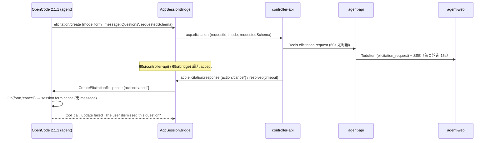

# Bug 调查报告：question 工具被立即判定为「The user dismissed this question」

> **状态**: 🟡 **已复现（真实 Agent 进程级）+ 根因链已定位**。`cancel` 分支可秒级复现该文案；`accept` 分支对照可用；无响应时 65s 自动 cancel 后同样得到该文案。**触发到具体分支（是否真的弹过窗、为何如此快）仍需人类确认**（见 §七）。
>
> 分支：`bugfix/agent-question-dismissed`（基 `origin/main` @ `34745215`）；调查日期：2026-10-28。

## 关联文档

- 上游问题描述：工作流节点「输入问题描述」（用户提供的会话记录 + HINT）
- 契约：`contracts/agent-session-websocket.md` §2.31 `acp:elicitation`、§2.34 `acp:elicitation:resolved`
- 前期专项核查：`docs/engineering/proposals/20261021-feat-acp-protocol-enhancement.md` §5.7「Elicitation 弹窗『上线后未见弹出』专项核查」
- OpenCode 侧调研：`docs/engineering/proposals/20261021-feat-acp-protocol-enhancement-opencode-support.md` §11
- 复现脚本：`packages/agent-controller/tests/manual/repro-question-tool.ts`

## 一、问题概述

用户通过 agent-controller 拉起一个 Agent（OpenCode），让 Agent 用 `question` 工具向用户提问。工具调用直接失败：

```json
{ "metadata": {}, "error": "The user dismissed this question" }
```

用户预期看到问询弹窗并作答，但 Agent 认定「用户关闭了问题」并继续执行。

**关键语义澄清（本次调查最重要的结论）**：`The user dismissed this question` **不是**「用户点了关闭」，而是 OpenCode 对**任何非 accept 的 elicitation 结果**的统一映射（cancel / decline / 超时 / 断线 全部命中同一文案）。因此只要问询没有成功送达用户并完成 accept，Agent 就会认为「用户放弃了这个问题」。

## 二、环境与版本

| 项 | 值 |
|---|---|
| agent-gear（agent-controller 包） | `2.11.0`（`packages/agent-controller/package.json`） |
| OpenCode CLI | `2.1.1`（`@opencode/cli`，`opencode acp`） |
| `@agentclientprotocol/sdk` | `^1.3.0` |
| Node.js | `22.23.3` |
| 环境形态 | 云电脑容器（`ZAG_HOST_ENDPOINT` / `ZAG_SERVER_ENDPOINT` 双连接），agent-web + agent-api + controller-api + Redis 全链路 |
| 复现位置 | 本仓库 worktree，真实 `opencode acp` 子进程 + 真实 `AcpSessionBridge`（不依赖 controller-api） |

## 三、复现步骤与结果

### 3.1 复现方式（最小用例，真实 Agent 进程）

按 HINT 的思路：不连控制器，直接用 `AcpSpawner + AcpSessionBridge` 拉起真实 `opencode acp`，用假 socket 记录所有上行事件（`acp:elicitation` / `acp:message` / …），并按策略回填响应。

```bash
cd packages/agent-controller
npm ci
npx tsx tests/manual/repro-question-tool.ts <none|accept|decline|cancel> \
  "请用 question 工具向我提一个单选题（3 个选项），问完就停下等我回答。"
```

（`REPRO_MODEL=zag/deepseek-v4.1-flash` 可指定模型；不设则用 OpenCode 默认模型。）

### 3.2 结果矩阵

| policy | 观察 | 工具最终状态 | 耗时 |
|---|---|---|---|
| `none`（不响应） | 收到 `acp:elicitation{mode:'form', message:'Questions', requestedSchema:{q0:{oneOf:[...]}, q0_custom:{...}}}` | `failed` / `The user dismissed this question`（bridge 65s 超时后 `acp:elicitation:resolved{reason:'timeout'}`） | 71.7s |
| `cancel` | 同上，脚本 50ms 后回 `cancel` | `failed` / `The user dismissed this question` | 4.1s（秒级） |
| `accept` | 回 `{action:'accept', content:{q0:'A'}}` | `completed` / `User has answered your questions: ...="A"`，随后 Agent 基于答案继续 | 3.9s |
| `decline` | 回 `decline` | `failed` / `The user dismissed this question`（与 cancel 文案一致，语义丢失） | ≈4s |

`none` 策略的关键日志（节选）：

```text
[6748ms]  emit acp:elicitation {"requestId":"elic_...","mode":"form","message":"Questions","toolCallId":"call_...","requestedSchema":{...}}
[ACP bridge] session ...: elicitation elic_... timed out after 65s, auto-cancelling
[71748ms] emit acp:elicitation:resolved {"requestId":"elic_...","reason":"timeout","detail":"bridge timeout (65s)"}
[71760ms] emit acp:message {"sessionUpdate":"tool_call_update","status":"failed",
          "content":[{"content":{"text":"The user dismissed this question","type":"text"}}],
          "rawOutput":{"metadata":{},"error":"The user dismissed this question"}}
[71764ms] emit acp:prompt:complete {"stopReason":"cancelled"}
```

`accept` 策略的关键日志（对照，证明链路本身可用）：

```text
[3829ms]  emit acp:elicitation {...}
[3880ms]  -> respond elicitation elic_... accept
[3907ms]  emit acp:message {"status":"completed","content":[{"content":{"text":"User has answered your questions: \"请选择一个选项（单选）：\"=\"A\". You can now continue with the user's answers in mind."}}]}
[5420ms]  emit acp:prompt:complete {"stopReason":"end_turn"}
```

### 3.3 复现稳定性

- `acp:elicitation` 上行与失败文案**稳定复现**（4 次有效触发全部得到上述结论）。
- 触发与否取决于模型是否真的调用 `question` 工具（自然语言「帮我提问」有时被模型用纯文本替代）：4/6 次触发，属模型随机性，不影响结论。

## 四、根因分析（含证据）

### 4.1 证据链总览



### 4.2 证据 A：文案来自 OpenCode 的 `CancelledError`，任何 cancel 都会命中

OpenCode 2.1.1 单文件可执行内（`@opencode/cli/bin/opencode.exe`，偏移 `134217728+671412`）：

```js
// question 工具的 execute 收尾
m((a) => {
  if (a.status === "cancelled" && a.message !== undefined) return p(new oo({ message: a.message }));
  if (a.status === "cancelled") return re(new $r);        // ← 无 message 的 cancel
  ...
})

class $r extends ne()("QuestionTool.CancelledError", {
  get message() { return "The user dismissed this question" }
})
```

ACP 侧把 **elicitation 结果 → form 结果**的转换（同段代码 `Gh` / `Uh`）：

```js
function Uh(e, r) { if (r.action !== "accept") return; ... }   // decline/cancel → undefined
function Gh(e, r) { if (r === "cancel") return Ms(e.client, e.form); ... }  // cancel → form.cancel(无 message)
function Ms(e, r, i) { return e.session.form.cancel({ sessionID: r.sessionID, formID: r.id, message: i }) }
```

即：**只要客户端回 `cancel`（或 `decline`），OpenCode 就丢弃表单并以无 message 方式 cancel → `CancelledError`**。这解释了：

- 用户根本没看到弹窗 → 超时 cancel → 文案仍是「用户 dismissed」；
- 用户点了「拒绝/取消」→ 文案也是「用户 dismissed」。

对照：若客户端**未声明 elicitation 能力**，OpenCode 走另一条分支 `Lh`，会带明确 message `The question couldn't be shown to the user in this client...`。我们声明了能力，所以永远走 `Gh` 的「dismissed」分支。

### 4.3 证据 B：有效回答窗口只有 60s，而不是待办的 5min

| 组件 | 常量 | 位置 | 行为 |
|---|---|---|---|
| controller-api | `TIMEOUT_MS = 60_000` | `servers/controller-api/src/services/elicitation-manager.ts:52` | 到点 publish `resolved{timeout}` + 回 controller `acp:elicitation:response{cancel}`（`:215-246`） |
| agent-controller | 65s `setTimeout` | `packages/agent-controller/src/acp/bridge.ts:978-993` | 到点 `resolve({action:'cancel'})` + `resolved{timeout}` |
| agent-api 待办 | `expiresAt = now + 5*60*1000` | `servers/agent-api/src/services/todo-service.ts:152` | 待办 5 分钟才过期 |
| 前端数据 | 首页聚合 15s 轮询 | `apps/agent-web/src/stores/homeOverview.ts`（`pollInterval: 15000`） | 弹窗/提示条最坏晚 15s 才出现 |

结论：**用户实际可用于阅读+作答的窗口 ≈ 60s − 15s（轮询延迟）≈ 45s**，而待办/弹窗 TTL 是 5min、契约 §2.31 第 4 条写死 65s。窗口越短，越容易在用户看到弹窗之前就被 cancel，从而稳定产出「dismissed」。这是与「问询看起来没生效」最吻合的结构性缺陷。

### 4.4 证据 C：若干「立即 cancel」路径绕过用户，且大多无用户可见痕迹

| # | 路径 | 位置 | 现象 |
|---|---|---|---|
| C1 | controller-api 处理 `acp:elicitation` 抛异常（如 Redis publish 失败） | `servers/controller-api/src/services/socketio.ts:212-232` | `catch` 里直接 `emit('acp:elicitation:response', {action:'cancel'})` → **秒级 dismissed**，用户侧只有服务端 console.error |
| C2 | controller socket `disconnect` 收敛所有 pending | `packages/agent-controller/src/socketio-client.ts:1475-1486` → `bridge.ts:448-451` | 云电脑 `KEY_ALREADY_ONLINE` 退避重连、controller-api 重启等**瞬时断线**会把进行中的问询立刻 cancel |
| C3 | 进程退出 / `stop()` / 对账杀会话 | `bridge.ts:414-434`（`settlePendingRequests`） | 同上，`action:'cancel'` |
| C4 | 非 form/url 模式 | `bridge.ts:962-973` | 立即 cancel（本场景实测是 form，已排除） |

C1 是本仓库最能解释「立即」二字的分支：handler 内部错误被伪装成「用户取消」，前端与 Agent 都无从分辨。

### 4.5 证据 D（次要缺陷，静态证据）：`question` 的「可多选」选项在弹窗里渲染成文本框

OpenCode 对 `multiple: true` 的字段生成的是 `items.anyOf`：

```json
"q1": { "type": "array", "items": { "anyOf": [ {"const":"自动跑测试","title":"自动跑测试"}, ... ] }, "oneOf" 无 }
```

而前端只识别 `items.enum` / `items.oneOf`：

- `apps/agent-web/src/components/ElicitationDialog.tsx:264`：`if (prop.type === 'array' && (prop.items?.enum || prop.items?.oneOf))`
- `apps/agent-web/src/graphql/types.ts:618-634`：`items` 仅声明 `enum` / `oneOf`，无 `anyOf`

后果：多选问题落到最后的「其他 string：文本框」分支（`:291-311`），用户只能手打字符串，无法勾选；提交后 OpenCode 用 `[用户输入]` 作为答案。这条不直接导致 dismissed，但会让「多问一表」的 question 不可正常使用（用户上游记录里第 2 个问题正是 `multiple: true`）。

### 4.6 可直接排除的假设

| 假设 | 结论 | 证据 |
|---|---|---|
| 能力列表漏传 elicitation | ❌ 排除 | `capabilities.ts:34-37` 声明 `elicitation:{form:{},url:{}}`；实测收到 `elicitation/create` |
| 平台不转发 elicitation | ❌ 排除 | 实测 `acp:elicitation` 正常上行（`bridge.ts:1003-1022`）；`tests/e2e/src/elicitation.spec.ts` 全链路用例存在 |
| 本端拒绝（unsupported_mode） | ❌ 排除 | 实测 `mode:'form'` 被识别；`bridge.ts:962` 分支未触发、无 `unsupported_mode` 事件 |
| 答案内容映射错误导致失败 | ❌ 排除 | `accept` 对照实验成功（一个问题 + 一道多选问题均可用 `q0` 回填） |
| question 权限被拒 | ❌ 排除 | 实测未产生 `acp:permission`（permission denied 会得到另一条文案 `Permission denied: question`） |

## 五、影响范围

1. **所有 Agent 发起的 `question` 问询**（OpenCode 下 form elicitation 的主要来源）：长时间思考/慢响应/轮询延迟都会退化为「用户 dismissed」，Agent 会带着「用户拒绝回答」的误解继续执行 —— 这是本 bug 最严重的后果（错误上下文进入后续推理）。
2. **`decline` 与 `cancel` 语义不可区分**：前端「拒绝」「取消」两个按钮对 Agent 是同一个结果（都 dismissed）；超时也是同一结果。Agent 无法据结果调整策略。
3. **`multiple: true` 的问询无法正常作答**（§4.5），多问一表的使用体验降级为手打文本。
4. **断线/重启/内部异常**（C1–C3）会把「基础设施问题」显示成「用户行为」，影响可观测性与问题归因；云电脑环境断线概率高于本地，风险放大。
5. **数据修复需求**：无。仅影响进行中的问询与 Agent 当轮上下文，不落脏数据。

## 六、修复方案与风险

> 本节点只产出调查结论与建议；实际修复在后续节点实施（TDD：先写红测）。

### 6.1 建议修复项（按优先级）

| # | 修复 | 落点 | 说明 |
|---|---|---|---|
| F1 | **对齐超时**：bridge 65s → 略大于 controller-api 超时；controller-api 60s → 覆盖待办 TTL（建议 5min，或明确 90–120s 并在契约/UI 上写清） | `bridge.ts:978`、`elicitation-manager.ts:52`、`contracts/agent-session-websocket.md §2.31` | 让「用户能看到弹窗并有时间回答」成为默认路径。契约需同步改（`65秒` 字样） |
| F2 | **区分终态**：controller-api 内部异常不得伪装成用户 cancel（C1）：记录错误 + 发布 `resolved{reason:'internal_error'}`（新增枚举，agent-api 映射 `failed`），不回 `cancel` 或回 `cancel` 时带可观测 detail | `controller-api/src/services/socketio.ts:212-232`、`ElicitationManager`、`elicitation-subscriber.ts:41-45` | 需要契约新增 reason，属跨服务改动，需三端同步 |
| F3 | **断线不立即收敛**：`settlePendingOnDisconnect` 改为「保留 pending + 重连后重发 `acp:elicitation`（同 requestId）」，由超时统一兜底；若必须收敛，至少在 UI 上显示「连接中断导致问询取消」 | `socketio-client.ts:1475-1486`、`bridge.ts:448-451` | 风险：重连重发需幂等（同一 requestId 覆盖），否则会重复建待办（`createElicitationTodo` 目前不是 upsert，需加 `requestId` 幂等） |
| F4 | **前端多选渲染 `items.anyOf`** | `ElicitationDialog.tsx:264-289`、`graphql/types.ts:630-633` | 最低风险、收益明确，可独立提交 |
| F5 | **可观测性**：桥接层在 `resolved{timeout}` 时把「问询超时未响应」写进会话提示（notice/tool 描述），避免用户只看到 Agent 的「你关闭了问题」自述 | `bridge.ts:978-993`（或 agent-api 侧收敛时补一条系统消息） | 可选；OpenCode 文案不可改，只能平台侧补充解释 |

### 6.2 风险

- **F1 延长超时**：Agent 在等待期间 prompt 不结束（`acp:prompt:start` 未 complete），资源占用变长；需前端在等待期间给出明确「等待你回答」的状态，否则用户以为卡住。
- **F2 新增 reason 枚举**：controller-api / agent-api / 前端三端 + 契约同步；旧版本前端对未知 reason 需安全降级（当前 `RESOLUTION_BY_REASON` 未命中 → `failed`，可接受）。
- **F3 重连重发**：必须保证 `requestId` 幂等（否则重复待办/重复弹窗），且要避免「重连后旧弹窗 + 新弹窗」双份；建议 `createElicitationTodo` 改为按 `userId + requestId` upsert。
- **F4** 无风险，但需补类型与用例。
- 不建议的取法：在 bridge 侧伪造 `accept` 空答案 —— 会让 Agent 基于空答案继续，比「dismissed」更危险。

## 七、待确认问题（阻塞精确定位，不阻塞修复方向）

1. **失败时用户是否看到弹窗/待办提示？**（截图或录屏）—— 若「完全没有弹窗」，则问题在「controller-api → agent-api → 前端」或 C1/C2 秒级 cancel；若「弹出但来不及答」，则是 §4.3 的超时窗口。
2. **从工具发起到失败的耗时**：秒级（≈C1/C2）还是约 60s（超时）？（会话时间线或 controller 日志时间戳）
3. **失败环境的版本组合**：agent-gear 版本、controller-api/agent-api/agent-web 版本（是否有旧版 controller 未发 `resolved` 或未声明能力）。
4. **该会话是否在工作流节点内 / 移动端 / 侧边栏未挂载页面**：这些场景下弹窗入口只靠 `PendingElicitationBanner` 或铃铛待办，用户很可能整段时间都没看到入口。
5. **日志取证**（三者任一即可）：
   - controller（agent-gear）stdout：`[ACP bridge] session ...: elicitation ... timed out after 65s` / 是否出现 `unsupported_mode`；
   - controller-api：`[Elicitation] dropped invalid elicitation request` 或 handler `Error handling elicitation request`；
   - agent-api：`Received elicitation request: <requestId>` 与 `Created todo: <id>`（缺失即说明根本没生成待办，问题在前半段）。

## 八、回归测试计划

| 层级 | 用例 | 目的 |
|---|---|---|
| agent-controller 单测 | `bridge.test.ts`：超时/断线/stop 三种收敛的 `action` 与 `resolved{reason}` 断言按新超时值更新；新增「断线不收敛（或重连重发）」用例 | 锁 F1/F3 行为 |
| agent-controller 集成（真实进程） | 用 `tests/manual/repro-question-tool.ts` 的 `accept` 场景固化为可选集成用例（`opencode` 可用时运行），断言 `acp:elicitation` 上行 + accept 后 `completed` | 防「链路断掉」回归（假 Agent 无法覆盖 OpenCode 真实映射） |
| controller-api 单测 | `elicitation-manager.test.ts`：内部异常不产生 `cancel`；新增 `internal_error` reason 的 publish/校验 | 锁 F2 |
| agent-web 单测 | `ElicitationDialog.test.tsx`：`items.anyOf` 渲染为多选勾选组、提交值为数组 | 锁 F4 |
| tests/e2e | 扩展 `elicitation.spec.ts`：① 真实 question schema（含 `oneOf` + `items.anyOf` + `q0_custom`）弹窗可作答；② 超时后待办显示「已过期」且弹窗按钮隐藏 | 端到端锁用户可见语义 |
| 契约 | `contracts/agent-session-websocket.md` §2.31/§2.34 同步新超时与 reason 枚举 | 防三端再次漂移 |

## 九、附录

### 9.1 复现脚本（已入库）

`packages/agent-controller/tests/manual/repro-question-tool.ts`（`*.manual.ts` 命名，不进 `npm test`；用法与前置条件见文件头注释）。

### 9.2 关键代码位置索引

| 关注点 | 位置 |
|---|---|
| bridge 发起/收敛 elicitation | `packages/agent-controller/src/acp/bridge.ts:953-1073` |
| bridge 65s 超时 | `packages/agent-controller/src/acp/bridge.ts:978-993` |
| 断线/停止/退出收敛 | `packages/agent-controller/src/acp/bridge.ts:414-451`、`socketio-client.ts:1475-1486` |
| controller-api 60s 超时 | `servers/controller-api/src/services/elicitation-manager.ts:52,215-246` |
| controller-api 异常即 cancel | `servers/controller-api/src/services/socketio.ts:212-232` |
| 待办创建与 5min TTL | `servers/agent-api/src/services/todo-service.ts:135-156` |
| 前端多选渲染缺陷 | `apps/agent-web/src/components/ElicitationDialog.tsx:264-311`、`graphql/types.ts:618-634` |
| 契约（65s 文案） | `contracts/agent-session-websocket.md` §2.31 步骤 4、§2.34 |
