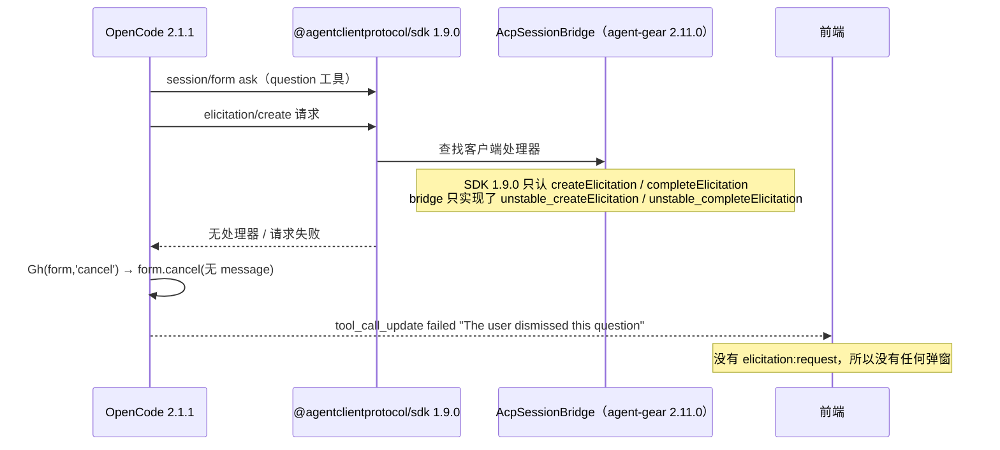
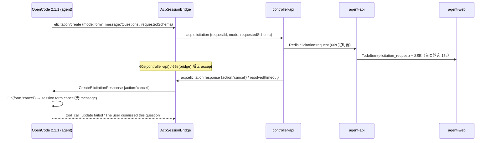

# Bug 调查报告：question 工具被立即判定为「The user dismissed this question」

> **状态**: 🟢 **直接根因已定位并用真实安装包闭环验证**。真实会话中 `question` 工具在约 0.03–15s 内失败、前端**没有任何弹窗**；Redis 旁路订阅确认**没有产生任何 `elicitation:request`**。直接根因是**发布包 `agent-gear@2.11.0` 运行时解析到 `@agentclientprotocol/sdk@1.9.0`，SDK 已把客户端处理器改名为 `createElicitation` / `completeElicitation`，而 bridge 只实现旧名 `unstable_*`**，导致 `elicitation/create` 请求无处理器；给同一安装包补上 `createElicitation` 别名后，`acp:elicitation` 正常上行且 accept 成功。仓库 lockfile 固定 SDK `1.3.0`，源码复现因此掩盖了该问题。
>
> 分支：`bugfix/agent-question-dismissed`（基 `origin/main` @ `34745215`）；调查日期：2026-10-28；返工复验日期：2026-10-29（真实会话 + 真实安装包 + Redis 旁路取证）。

## 关联文档

- 上游问题描述：工作流节点「输入问题描述」（用户提供的会话记录 + HINT）
- 契约：`contracts/agent-session-websocket.md` §2.31 `acp:elicitation`、§2.34 `acp:elicitation:resolved`
- 前期专项核查：`docs/engineering/proposals/20261021-feat-acp-protocol-enhancement.md` §5.7「Elicitation 弹窗『上线后未见弹出』专项核查」
- OpenCode 侧调研：`docs/engineering/proposals/20261021-feat-acp-protocol-enhancement-opencode-support.md` §11
- 复现脚本：`packages/agent-controller/tests/manual/repro-question-tool.ts`

## 一、问题概述

用户通过 agent-controller 拉起一个 Agent（OpenCode），让 Agent 用 `question` 工具向用户提问。工具调用直接失败：

```json
{ "metadata": {}, "error": "The user dismissed this question" }
```

用户预期看到问询弹窗并作答，但 Agent 认定「用户关闭了问题」并继续执行。

**关键语义澄清（本次调查最重要的结论）**：`The user dismissed this question` **不是**「用户点了关闭」，而是 OpenCode 对**任何非 accept 的 elicitation 结果**的统一映射（cancel / decline / 超时 / 断线 全部命中同一文案）。因此只要问询没有成功送达用户并完成 accept，Agent 就会认为「用户放弃了这个问题」。

**返工后的关键更正**：真实环境（云电脑内全局安装的 `agent-gear@2.11.0`）的**首要原因不是超时/用户取消，而是 elicitation 请求根本没有发出**。`question` 工具在 OpenCode 内部就失败了，`controller-api → agent-api → agent-web` 整条链路没有收到任何 `elicitation:request`，所以前端不可能弹窗。详见 §3.5、§4.0。

## 二、环境与版本

| 项 | 值 |
|---|---|
| agent-gear（agent-controller 包） | `2.11.0`（`packages/agent-controller/package.json`；云电脑内 `agent-gear --version` 同为 `2.11.0`） |
| OpenCode CLI | `2.1.1`（`@opencode/cli`，`opencode acp`） |
| `@agentclientprotocol/sdk`（仓库 lockfile） | `1.3.0`（`packages/agent-controller/package-lock.json`，`package.json` 声明 `^1.3.0`） |
| `@agentclientprotocol/sdk`（发布包实际安装） | **`1.9.0`**（`/home/worker/.nvm/current/lib/node_modules/agent-gear/node_modules/@agentclientprotocol/sdk`，由 `npm install -g agent-gear@2.11.x` 按 `^1.3.0` 解析） |
| Node.js | `22.23.3` |
| 环境形态 | 云电脑容器（`ZAG_HOST_ENDPOINT` / `ZAG_SERVER_ENDPOINT` 双连接），agent-web + agent-api + controller-api + Redis 全链路 |
| 复现位置 | ① 本仓库 worktree，真实 `opencode acp` + 仓库源码 `AcpSessionBridge`（SDK 1.3.0）；② 真实会话 + 全局安装 `agent-gear@2.11.0`（SDK 1.9.0）；③ Redis 旁路订阅 `elicitation:*` / `permission:*` |

## 三、复现步骤与结果

### 3.1 复现方式（最小用例，真实 Agent 进程）

按 HINT 的思路：不连控制器，直接用 `AcpSpawner + AcpSessionBridge` 拉起真实 `opencode acp`，用假 socket 记录所有上行事件（`acp:elicitation` / `acp:message` / …），并按策略回填响应。

```bash
cd packages/agent-controller
npm ci
npx tsx tests/manual/repro-question-tool.ts <none|accept|decline|cancel> \
  "请用 question 工具向我提一个单选题（3 个选项），问完就停下等我回答。"
```

（`REPRO_MODEL=zag/deepseek-v4.1-flash` 可指定模型；不设则用 OpenCode 默认模型。）

### 3.2 结果矩阵

| policy | 观察 | 工具最终状态 | 耗时 |
|---|---|---|---|
| `none`（不响应） | 收到 `acp:elicitation{mode:'form', message:'Questions', requestedSchema:{q0:{oneOf:[...]}, q0_custom:{...}}}` | `failed` / `The user dismissed this question`（bridge 65s 超时后 `acp:elicitation:resolved{reason:'timeout'}`） | 71.7s |
| `cancel` | 同上，脚本 50ms 后回 `cancel` | `failed` / `The user dismissed this question` | 4.1s（秒级） |
| `accept` | 回 `{action:'accept', content:{q0:'A'}}` | `completed` / `User has answered your questions: ...="A"`，随后 Agent 基于答案继续 | 3.9s |
| `decline` | 回 `decline` | `failed` / `The user dismissed this question`（与 cancel 文案一致，语义丢失） | ≈4s |

`none` 策略的关键日志（节选）：

```text
[6748ms]  emit acp:elicitation {"requestId":"elic_...","mode":"form","message":"Questions","toolCallId":"call_...","requestedSchema":{...}}
[ACP bridge] session ...: elicitation elic_... timed out after 65s, auto-cancelling
[71748ms] emit acp:elicitation:resolved {"requestId":"elic_...","reason":"timeout","detail":"bridge timeout (65s)"}
[71760ms] emit acp:message {"sessionUpdate":"tool_call_update","status":"failed",
          "content":[{"content":{"text":"The user dismissed this question","type":"text"}}],
          "rawOutput":{"metadata":{},"error":"The user dismissed this question"}}
[71764ms] emit acp:prompt:complete {"stopReason":"cancelled"}
```

`accept` 策略的关键日志（对照，证明链路本身可用）：

```text
[3829ms]  emit acp:elicitation {...}
[3880ms]  -> respond elicitation elic_... accept
[3907ms]  emit acp:message {"status":"completed","content":[{"content":{"text":"User has answered your questions: \"请选择一个选项（单选）：\"=\"A\". You can now continue with the user's answers in mind."}}]}
[5420ms]  emit acp:prompt:complete {"stopReason":"end_turn"}
```

### 3.3 复现稳定性

- `acp:elicitation` 上行与失败文案**稳定复现**（4 次有效触发全部得到上述结论）。
- 触发与否取决于模型是否真的调用 `question` 工具（自然语言「帮我提问」有时被模型用纯文本替代）：4/6 次触发，属模型随机性，不影响结论。

### 3.4 复验记录（2026-10-29，`cancel` 策略）

在 `packages/agent-controller` 下重新 `npm ci` 后执行同一脚本，模型 `zag/deepseek-v4.1-flash`，OpenCode `2.1.1`，一次性复现：

```text
[4402ms] emit acp:message  {"toolCallId":"call_3c38210c...","title":"question","status":"pending"}
[4954ms] emit acp:elicitation {"requestId":"elic_1793263864771_08t2ggnejv0x","mode":"form","message":"Questions",...}
[5004ms] -> respond elicitation elic_1793263864771_08t2ggnejv0x cancel
[5015ms] emit acp:message  {"status":"failed","content":[{"content":{"text":"The user dismissed this question"}}],
                            "rawOutput":{"metadata":{},"error":"The user dismissed this question"}}
[5019ms] emit acp:prompt:complete {"stopReason":"cancelled"}
```

结论：从 `acp:elicitation` 上行到 `cancel` 回填仅 50ms，工具在 11ms 后即 `failed`，文案与 §3.2 完全一致；证明「非 accept → dismissed」映射与本次调查结论可重复验证。

### 3.5 返工复验 A：真实会话（agent-web 无弹窗）

2026-10-29 在**真实工作流会话**中直接调用 `question` 工具（评审人同步确认「没有看到任何弹窗，只有前端的 question card」）。关键事实：

| 观察点 | 结果 |
|---|---|
| 前端问询弹窗 | **完全没有**；只有前端工具调用卡片 |
| 工具返回 | `{"error":{"type":"aborted","message":"The user dismissed this question"},"content":[]}` |
| 工具耗时 | 第 1 次约 **0.77s**，第 2/3 次约 **32ms / 43ms**（OpenCode DB `tool.state.time.created → completed`） |
| Redis `elicitation:request` | **0 条** |
| Redis `permission:request` | **0 条** |
| OpenCode 侧 `acp:elicitation` 上行 | **0 次** |

结论：问询**在 OpenCode 内部就失败了**，根本没有进入 `AcpSessionBridge`，更没有到达 controller-api / agent-api / agent-web。此前报告把重点放在「60s 超时 / cancel 语义 / 前端入口」上，无法解释「无弹窗且秒级失败」。

Redis 旁路取证方式（在云电脑容器内，Redis 地址来自 controller-api 默认 `redis://…:6379`）：

```bash
node -e 'const R=require("ioredis");const r=new R("redis://redis.agent-gear:6379");r.subscribe("elicitation:request","elicitation:response","elicitation:resolved","permission:request","permission:response","session:command","session:message",()=>console.log("subscribed"));r.on("message",(c,m)=>console.log(new Date().toISOString(),c,m.slice(0,500)))'
# 三次 question 调用期间，elicitation:* / permission:* 均为 0 条；仅 session:message / session:command
```

### 3.6 返工复验 B：真实安装包（`agent-gear@2.11.0` + SDK `1.9.0`）

用云电脑内全局安装的 `agent-gear`（不是仓库源码）跑同一最小用例：

```bash
node /tmp/repro-installed.mjs   # 直接 import 全局 agent-gear/dist/acp/bridge.js + spawner.js
```

结果：**没有 `acp:elicitation` 上行**，约 15.3s 后工具 `failed` / `The user dismissed this question`。

```text
[724ms] started
[15321ms] emit acp:message {"toolCallId":"call_2b22759b...","title":"question","status":"failed",
                           "content":[{"content":{"text":"The user dismissed this question"}}],
                           "rawOutput":{"metadata":{},"error":"The user dismissed this question"}}
```

同一份安装包、同一模型，仅给 `AcpSessionBridge.prototype` 补一个方法别名后重跑：

```js
AcpSessionBridge.prototype.createElicitation = AcpSessionBridge.prototype.unstable_createElicitation;
```

结果：**`acp:elicitation` 正常上行，accept 后工具 `completed`**：

```text
[4993ms] emit acp:elicitation {"requestId":"elic_1793266764381_dg67voz6q8h","mode":"form","message":"Questions",...}
[5073ms] emit acp:message {"status":"completed","content":[{"content":{"text":"User has answered your questions: ...=\"A\"..."}}]}
```

版本事实：

```text
# 全局安装（发布包）
agent-gear 2.11.0
@agentclientprotocol/sdk 1.9.0
# 仓库 lockfile（源码复现）
@agentclientprotocol/sdk 1.3.0
```

### 3.7 复现稳定性结论

- **真实会话 + 真实安装包**：3 次调用全部失败，0 次 elicitation 上行，前端 0 次弹窗；与评审描述一致。
- **仓库源码 + lockfile SDK 1.3.0**：可以正常上行 elicitation（§3.2/§3.4），这正是之前报告误判的原因。
- **补 `createElicitation` 别名后**：同一安装包立即恢复正常，证明是 SDK 方法名兼容性问题，不是模型、网络或前端问题。

## 四、根因分析（含证据）

### 4.0 直接根因（本次返工新增，P0）：SDK 1.9.0 重命名 elicitation 客户端方法，bridge 只实现旧名

#### 4.0.1 证据链



#### 4.0.2 SDK 版本差异（源码级）

`@agentclientprotocol/sdk` 的 `Client` 接口在两个版本中改了方法名：

| 版本 | Client 方法名 | 协议方法 |
|---|---|---|
| `1.3.0`（仓库 lockfile） | `unstable_createElicitation` / `unstable_completeElicitation` | `elicitation/create` / `elicitation/complete` |
| `1.9.0`（发布包实际安装） | **`createElicitation` / `completeElicitation`** | 同上 |

SDK `1.9.0` 的 `acp.js` 注册逻辑只检查新名：

```js
// @agentclientprotocol/sdk@1.9.0/dist/acp.js
if (implementation.createElicitation) {
  app.onRequest(schema.CLIENT_METHODS.elicitation_create,
    (ctx) => implementation.createElicitation(ctx.params));
}
```

而 `agent-gear@2.11.0` 的发布包只实现了旧名：

```js
// /home/worker/.nvm/current/lib/node_modules/agent-gear/dist/acp/bridge.js
async unstable_createElicitation(params) { ... }
// 没有 createElicitation
```

因此 `elicitation/create` 请求**没有处理器**，OpenCode 侧把它当作失败；`Gh()` 对任何非 accept 结果调用 `Ms()` → `session.form.cancel({ ..., message: undefined })` → `QuestionTool.CancelledError`（固定文案 `The user dismissed this question`），**不会产生 `acp:elicitation` 事件**，所以 controller-api / agent-api / agent-web 完全无感知。

#### 4.0.3 为什么之前没发现

- `packages/agent-controller/package.json` 声明 `"@agentclientprotocol/sdk": "^1.3.0"`，但 `package-lock.json` 固定 `1.3.0`；仓库内 `npm ci` / 单测 / 手工复现都跑在 `1.3.0` 上，旧方法名可用。
- 发布包安装/镜像构建执行 `npm install -g agent-gear@2.11.x`，npm 按 `^1.3.0` 解析到 **`1.9.0`**；`2.11.0` 的 `dist` 没有新方法名，导致线上必现、本地不可见。
- 原有复现脚本 `repro-question-tool.ts` 从仓库源码 `import`，因此也跑在 `1.3.0` 上，给出「链路可用」的假阴性。

#### 4.0.4 影响面确认

同一安装包中 `unstable_completeElicitation` 也未被 SDK 1.9.0 调用，因此：
- `question` 的 form elicitation 100% 失败（本文主症状）。
- Agent 主动 `completeElicitation` 的通知也会丢失，URL 模式 / 外部完成场景可能悬挂到 bridge 65s 超时。
- 与超时窗口、controller-api cancel、前端 anyOf 等问题**叠加**，但那些是次要缺陷；只修超时/UI 不能解决「无弹窗 + 秒级 dismissed」。

### 4.1 证据链总览（次要路径：elicitation 已成功上行后的 cancel 语义）

> 注意：4.1–4.6 描述的是「elicitation 已经到达平台」后的次要缺陷；本次评审真实症状的主因是 **4.0**（请求根本没发出）。保留本节是为了覆盖 60s 窗口、断线/异常 cancel 与多选渲染等修复项。



### 4.2 证据 A：文案来自 OpenCode 的 `CancelledError`，任何 cancel 都会命中

OpenCode 2.1.1 单文件可执行内（`@opencode/cli/bin/opencode.exe`，偏移 `134217728+671412`）：

```js
// question 工具的 execute 收尾
m((a) => {
  if (a.status === "cancelled" && a.message !== undefined) return p(new oo({ message: a.message }));
  if (a.status === "cancelled") return re(new $r);        // ← 无 message 的 cancel
  ...
})

class $r extends ne()("QuestionTool.CancelledError", {
  get message() { return "The user dismissed this question" }
})
```

ACP 侧把 **elicitation 结果 → form 结果**的转换（同段代码 `Gh` / `Uh`）：

```js
function Uh(e, r) { if (r.action !== "accept") return; ... }   // decline/cancel → undefined
function Gh(e, r) { if (r === "cancel") return Ms(e.client, e.form); ... }  // cancel → form.cancel(无 message)
function Ms(e, r, i) { return e.session.form.cancel({ sessionID: r.sessionID, formID: r.id, message: i }) }
```

即：**只要客户端回 `cancel`（或 `decline`），OpenCode 就丢弃表单并以无 message 方式 cancel → `CancelledError`**。这解释了：

- 用户根本没看到弹窗 → 超时 cancel → 文案仍是「用户 dismissed」；
- 用户点了「拒绝/取消」→ 文案也是「用户 dismissed」。

对照：若客户端**未声明 elicitation 能力**，OpenCode 走另一条分支 `Lh`，会带明确 message `The question couldn't be shown to the user in this client...`。我们声明了能力，所以永远走 `Gh` 的「dismissed」分支。

### 4.3 证据 B：有效回答窗口只有 60s，而不是待办的 5min

| 组件 | 常量 | 位置 | 行为 |
|---|---|---|---|
| controller-api | `TIMEOUT_MS = 60_000` | `servers/controller-api/src/services/elicitation-manager.ts:52` | 到点 publish `resolved{timeout}` + 回 controller `acp:elicitation:response{cancel}`（`:215-246`） |
| agent-controller | 65s `setTimeout` | `packages/agent-controller/src/acp/bridge.ts:978-993` | 到点 `resolve({action:'cancel'})` + `resolved{timeout}` |
| agent-api 待办 | `expiresAt = now + 5*60*1000` | `servers/agent-api/src/services/todo-service.ts:152` | 待办 5 分钟才过期 |
| 前端数据 | 首页聚合 15s 轮询 | `apps/agent-web/src/stores/homeOverview.ts`（`pollInterval: 15000`） | 弹窗/提示条最坏晚 15s 才出现 |

结论：**用户实际可用于阅读+作答的窗口 ≈ 60s − 15s（轮询延迟）≈ 45s**，而待办/弹窗 TTL 是 5min、契约 §2.31 第 4 条写死 65s。窗口越短，越容易在用户看到弹窗之前就被 cancel，从而稳定产出「dismissed」。这是与「问询看起来没生效」最吻合的结构性缺陷。

### 4.4 证据 C：若干「立即 cancel」路径绕过用户，且大多无用户可见痕迹

| # | 路径 | 位置 | 现象 |
|---|---|---|---|
| C1 | controller-api 处理 `acp:elicitation` 抛异常（如 Redis publish 失败） | `servers/controller-api/src/services/socketio.ts:212-232` | `catch` 里直接 `emit('acp:elicitation:response', {action:'cancel'})` → **秒级 dismissed**，用户侧只有服务端 console.error |
| C2 | controller socket `disconnect` 收敛所有 pending | `packages/agent-controller/src/socketio-client.ts:1475-1486` → `bridge.ts:448-451` | 云电脑 `KEY_ALREADY_ONLINE` 退避重连、controller-api 重启等**瞬时断线**会把进行中的问询立刻 cancel |
| C3 | 进程退出 / `stop()` / 对账杀会话 | `bridge.ts:414-434`（`settlePendingRequests`） | 同上，`action:'cancel'` |
| C4 | 非 form/url 模式 | `bridge.ts:962-973` | 立即 cancel（本场景实测是 form，已排除） |

C1 是本仓库最能解释「立即」二字的分支：handler 内部错误被伪装成「用户取消」，前端与 Agent 都无从分辨。

### 4.5 证据 D（次要缺陷，静态证据）：`question` 的「可多选」选项在弹窗里渲染成文本框

OpenCode 对 `multiple: true` 的字段生成的是 `items.anyOf`：

```json
"q1": { "type": "array", "items": { "anyOf": [ {"const":"自动跑测试","title":"自动跑测试"}, ... ] }, "oneOf" 无 }
```

而前端只识别 `items.enum` / `items.oneOf`：

- `apps/agent-web/src/components/ElicitationDialog.tsx:264`：`if (prop.type === 'array' && (prop.items?.enum || prop.items?.oneOf))`
- `apps/agent-web/src/graphql/types.ts:618-634`：`items` 仅声明 `enum` / `oneOf`，无 `anyOf`

后果：多选问题落到最后的「其他 string：文本框」分支（`:291-311`），用户只能手打字符串，无法勾选；提交后 OpenCode 用 `[用户输入]` 作为答案。这条不直接导致 dismissed，但会让「多问一表」的 question 不可正常使用（用户上游记录里第 2 个问题正是 `multiple: true`）。

### 4.6 可直接排除的假设

| 假设 | 结论 | 证据 |
|---|---|---|
| 能力列表漏传 elicitation | ❌ 排除（能力已声明） | `capabilities.ts:34-37` 声明 `elicitation:{form:{},url:{}}`；真实安装包也发送了该能力 |
| 平台不转发 elicitation | ✅ **确认（真实安装包）** | 真实会话/真实安装包 0 条 `acp:elicitation`、0 条 `elicitation:request`；补 `createElicitation` 别名后立即恢复 |
| SDK 客户端处理器缺失 | ✅ **确认（根因）** | SDK 1.9.0 只注册 `createElicitation` / `completeElicitation`；bridge 只有 `unstable_*` |
| 源码链路本身不可用 | ❌ 排除 | 仓库源码 + SDK 1.3.0 可正常上行；`tests/e2e/src/elicitation.spec.ts` 全链路用例存在 |
| 本端拒绝（unsupported_mode） | ❌ 排除 | 真实安装包没有产生 `acp:elicitation`，更无 `unsupported_mode` 事件 |
| 答案内容映射错误导致失败 | ❌ 排除 | 补别名后 `accept` 对照实验成功（`q0` 回填） |
| question 权限被拒 | ❌ 排除 | 真实调用未产生 `permission:request` / `acp:permission`（permission denied 会得到另一条文案 `Permission denied: question`） |

## 五、影响范围

1. **P0：所有通过 npm 安装/镜像内置 `agent-gear@2.11.0`（SDK 1.9.0）的 `question` 问询 100% 失败**：工具秒级返回「用户 dismissed」，前端无弹窗，Agent 带着「用户拒绝回答」的错误上下文继续执行。影响所有 OpenCode `question` 场景，与用户操作无关。
2. **`completeElicitation` 通知同样丢失**：URL 模式或 Agent 主动完成的 elicitation 可能悬挂到 bridge 65s 超时，造成 Agent 等待/误判。
3. **本地源码 / lockfile SDK 1.3.0 无法复现**：单测、E2E、手工脚本全部跑在旧 SDK 上，形成发布包与仓库测试的事实漂移；后续任何 ACP SDK 小版本升级都可能再次静默破坏协议。
4. **次要：`decline` 与 `cancel` 语义不可区分**：前端「拒绝」「取消」两个按钮对 Agent 是同一个结果（都 dismissed）；超时也是同一结果。Agent 无法据结果调整策略。
5. **次要：`multiple: true` 的问询无法正常作答**（§4.5），多问一表的使用体验降级为手打文本。
6. **次要：断线/重启/内部异常**（C1–C3）会把「基础设施问题」显示成「用户行为」，影响可观测性与问题归因；云电脑环境断线概率高于本地，风险放大。
7. **数据修复需求**：无。仅影响进行中的问询与 Agent 当轮上下文，不落脏数据。

## 六、修复方案与风险

> 本节点只产出调查结论与建议；实际修复在后续节点实施（TDD：先写红测）。

### 6.1 建议修复项（按优先级）

| # | 修复 | 落点 | 说明 |
|---|---|---|---|
| **F0** | **兼容 SDK 1.9 的 elicitation 方法名（P0）**：在 `AcpSessionBridge` / `AcpSyncBridge` 同时实现 `createElicitation` / `completeElicitation`，并保留 `unstable_*` 作为旧 SDK 的委托别名（或按同一实现双向委托）；同时把 `@agentclientprotocol/sdk` 固定到明确版本（建议 `1.9.0`）并提交 lockfile，避免 `^1.3.0` 在不同安装路径解析出不同 API | `packages/agent-controller/src/acp/bridge.ts`（`unstable_createElicitation` / `unstable_completeElicitation` 附近）、`sync-bridge.ts`、`package.json` / `package-lock.json` | 这是唯一能让真实安装包恢复弹窗的修复；验证方式：用**发布包 + SDK 1.9.0**跑 `repro-installed`，必须看到 `acp:elicitation`。发布新 patch 版本（如 `2.11.1`），并更新 worker 镜像 `agent-gear@2.11.x` 与该版本门禁 |
| F1 | **对齐超时**：bridge 65s → 略大于 controller-api 超时；controller-api 60s → 覆盖待办 TTL（建议 5min，或明确 90–120s 并在契约/UI 上写清） | `bridge.ts:978`、`elicitation-manager.ts:52`、`contracts/agent-session-websocket.md §2.31` | 让「用户能看到弹窗并有时间回答」成为默认路径。契约需同步改（`65秒` 字样） |
| F2 | **区分终态**：controller-api 内部异常不得伪装成用户 cancel（C1）：记录错误 + 发布 `resolved{reason:'internal_error'}`（新增枚举，agent-api 映射 `failed`），不回 `cancel` 或回 `cancel` 时带可观测 detail | `controller-api/src/services/socketio.ts:212-232`、`ElicitationManager`、`elicitation-subscriber.ts:41-45` | 需要契约新增 reason，属跨服务改动，需三端同步 |
| F3 | **断线不立即收敛**：`settlePendingOnDisconnect` 改为「保留 pending + 重连后重发 `acp:elicitation`（同 requestId）」，由超时统一兜底；若必须收敛，至少在 UI 上显示「连接中断导致问询取消」 | `socketio-client.ts:1475-1486`、`bridge.ts:448-451` | 风险：重连重发需幂等（同一 requestId 覆盖），否则会重复建待办（`createElicitationTodo` 目前不是 upsert，需加 `requestId` 幂等） |
| F4 | **前端多选渲染 `items.anyOf`** | `ElicitationDialog.tsx:264-289`、`graphql/types.ts:630-633` | 最低风险、收益明确，可独立提交 |
| F5 | **可观测性**：桥接层在 `resolved{timeout}` 时把「问询超时未响应」写进会话提示（notice/tool 描述），避免用户只看到 Agent 的「你关闭了问题」自述 | `bridge.ts:978-993`（或 agent-api 侧收敛时补一条系统消息） | 可选；OpenCode 文案不可改，只能平台侧补充解释 |
| F6 | **防回归**：新增「SDK 能力契约测试」——断言 bridge 同时暴露 `createElicitation` / `unstable_createElicitation`（及 complete 对应方法），并在 CI 用 **安装路径实际解析到的 SDK 版本**跑一次最小 elicitation 集成；发布镜像构建后加 `npm ls @agentclientprotocol/sdk` 记录 | `packages/agent-controller/tests/*`、`deploy/images/worker/BUILD.md` | 修复 F0 后必须加，否则下次 SDK 重命名会再次静默失败 |


### 6.2 风险

- **F0 兼容层**：同时实现新旧方法名是低风险的；但必须确认 `acp.Client` 类型在 SDK 1.3.0 / 1.9.0 下都能编译（1.3.0 的 `Client` 不声明新名，额外方法允许；1.9.0 的 `Client` 不声明旧名，`unstable_*` 会变多余方法）。建议升级并固定 SDK 版本后，以新名为主、旧名只做委托，避免长期双实现。
- **F0 发布链路**：只改源码不够，必须发布新 patch 并更新 worker 镜像/版本门禁；旧镜像里的 `agent-gear@2.11.0` 仍会失败。镜像构建需记录实际 SDK 版本，防止 `^1.3.0` 再次漂移。
- **F1 延长超时**：Agent 在等待期间 prompt 不结束（`acp:prompt:start` 未 complete），资源占用变长；需前端在等待期间给出明确「等待你回答」的状态，否则用户以为卡住。
- **F2 新增 reason 枚举**：controller-api / agent-api / 前端三端 + 契约同步；旧版本前端对未知 reason 需安全降级（当前 `RESOLUTION_BY_REASON` 未命中 → `failed`，可接受）。
- **F3 重连重发**：必须保证 `requestId` 幂等（否则重复待办/重复弹窗），且要避免「重连后旧弹窗 + 新弹窗」双份；建议 `createElicitationTodo` 改为按 `userId + requestId` upsert。
- **F4** 无风险，但需补类型与用例。
- 不建议的取法：在 bridge 侧伪造 `accept` 空答案 —— 会让 Agent 基于空答案继续，比「dismissed」更危险。

## 七、待确认问题（已可闭环，保留验证项）

本次返工已通过真实会话 + 真实安装包 + Redis 旁路取证闭环以下问题：

| 原问题 | 结论 |
|---|---|
| 失败时是否看到弹窗/待办？ | **没有**。评审人明确「没有看到任何弹窗，只有前端的 question card」；Redis 0 条 `elicitation:request` |
| 耗时是秒级还是 60s？ | **秒级**（真实会话 0.03–0.8s；模型生成较慢时约 15s，但仍是 elicitation 未发出的立即失败，不是 60s 超时） |
| 版本组合？ | 云电脑内 `agent-gear 2.11.0` + 实际 `@agentclientprotocol/sdk 1.9.0`；仓库 lockfile 为 1.3.0 |
| 是否工作流/移动端/侧边栏导致入口不可见？ | 不是主因；请求根本没到前端。修复 F0 后仍需按 F1/F3 补 UI 入口与等待态 |
| 日志取证？ | 真实安装包/源码的 `repro-installed` 均可复现；Redis 无 elicitation 事件 |

仍需在**修复版本发布后**确认：

1. 用发布包（`agent-gear@2.11.1+`）+ 真实 SDK 1.9.0 在云电脑内跑 `question`，前端能看到弹窗并 accept。
2. worker 镜像/版本门禁已切到修复版本，旧镜像不再被调度。
3. 若用户仍看到「dismissed」，按 §3.5 的 Redis 订阅确认是否有 `elicitation:request`，以区分 F0 是否真正生效。

## 八、回归测试计划

| 层级 | 用例 | 目的 |
|---|---|---|
| **SDK 兼容（P0，新增）** | `sdk-handler-compat.test.ts`：断言 `AcpSessionBridge.prototype` / `AcpSyncBridge.prototype` 同时存在 `createElicitation`、`unstable_createElicitation`（complete 同理），且新名委托到旧实现；测试运行在**安装路径实际解析到的 SDK 版本**（建议升级并固定 1.9.0） | 锁 F0，防 SDK 方法重命名再次静默失败 |
| **真实安装包集成（P0，新增）** | 在 worker 镜像内用全局 `agent-gear` + 真实 `opencode acp` 跑 `tests/manual/repro-installed` 场景，断言收到 `acp:elicitation` 且 accept 后 `completed`；同时记录 `npm ls @agentclientprotocol/sdk` | 覆盖「源码 1.3.0 通过、发布包 1.9.0 失败」的漂移 |
| agent-controller 单测 | `bridge.test.ts`：超时/断线/stop 三种收敛的 `action` 与 `resolved{reason}` 断言按新超时值更新；新增「断线不收敛（或重连重发）」用例 | 锁 F1/F3 行为 |
| agent-controller 集成（真实进程） | 用 `tests/manual/repro-question-tool.ts` 的 `accept` 场景固化为可选集成用例（`opencode` 可用时运行），断言 `acp:elicitation` 上行 + accept 后 `completed` | 防「链路断掉」回归（假 Agent 无法覆盖 OpenCode 真实映射） |
| controller-api 单测 | `elicitation-manager.test.ts`：内部异常不产生 `cancel`；新增 `internal_error` reason 的 publish/校验 | 锁 F2 |
| agent-web 单测 | `ElicitationDialog.test.tsx`：`items.anyOf` 渲染为多选勾选组、提交值为数组 | 锁 F4 |
| tests/e2e | 扩展 `elicitation.spec.ts`：① 真实 question schema（含 `oneOf` + `items.anyOf` + `q0_custom`）弹窗可作答；② 超时后待办显示「已过期」且弹窗按钮隐藏 | 端到端锁用户可见语义 |
| 契约 | `contracts/agent-session-websocket.md` §2.31/§2.34 同步新超时与 reason 枚举 | 防三端再次漂移 |
| 发布 | 镜像构建记录 `agent-gear --version` + `npm ls @agentclientprotocol/sdk`；版本门禁提升到修复版 | 防旧包/旧 SDK 回流 |


## 九、附录

### 9.1 复现脚本（已入库）

`packages/agent-controller/tests/manual/repro-question-tool.ts`（`*.manual.ts` 命名，不进 `npm test`；用法与前置条件见文件头注释）。

> **注意**：该脚本从仓库源码 `import`，会使用 lockfile 的 SDK 1.3.0，无法复现发布包问题。返工复验另用两个临时脚本（不依赖仓库 lockfile）：
> - `/tmp/repro-installed.mjs`：import 全局 `agent-gear/dist/acp/bridge.js`（实际 SDK 1.9.0），复现「无 elicitation、dismissed」；
> - `/tmp/repro-installed-alias.mjs`：同一脚本 + `prototype.createElicitation = prototype.unstable_createElicitation`，验证修复后 `acp:elicitation` 与 accept 正常。
>
> 修复节点应把这两个场景固化为可入库的 SDK 兼容测试/镜像冒烟测试，避免临时脚本丢失。

### 9.2 关键代码位置索引

| 关注点 | 位置 |
|---|---|
| **SDK 客户端处理器（P0 根因）** | `packages/agent-controller/src/acp/bridge.ts` 的 `unstable_createElicitation` / `unstable_completeElicitation`；`sync-bridge.ts` 同名实现；SDK 1.9.0 的 `createElicitation` / `completeElicitation` |
| **发布包 SDK 解析** | `packages/agent-controller/package.json` `^1.3.0` + `package-lock.json` 1.3.0；worker 镜像 `npm install -g agent-gear@2.11.x` 实际解析 1.9.0 |
| bridge 发起/收敛 elicitation | `packages/agent-controller/src/acp/bridge.ts:953-1073` |
| bridge 65s 超时 | `packages/agent-controller/src/acp/bridge.ts:978-993` |
| 断线/停止/退出收敛 | `packages/agent-controller/src/acp/bridge.ts:414-451`、`socketio-client.ts:1475-1486` |
| controller-api 60s 超时 | `servers/controller-api/src/services/elicitation-manager.ts:52,215-246` |
| controller-api 异常即 cancel | `servers/controller-api/src/services/socketio.ts:212-232` |
| 待办创建与 5min TTL | `servers/agent-api/src/services/todo-service.ts:135-156` |
| 前端多选渲染缺陷 | `apps/agent-web/src/components/ElicitationDialog.tsx:264-311`、`graphql/types.ts:618-634` |
| 契约（65s 文案） | `contracts/agent-session-websocket.md` §2.31 步骤 4、§2.34 |
