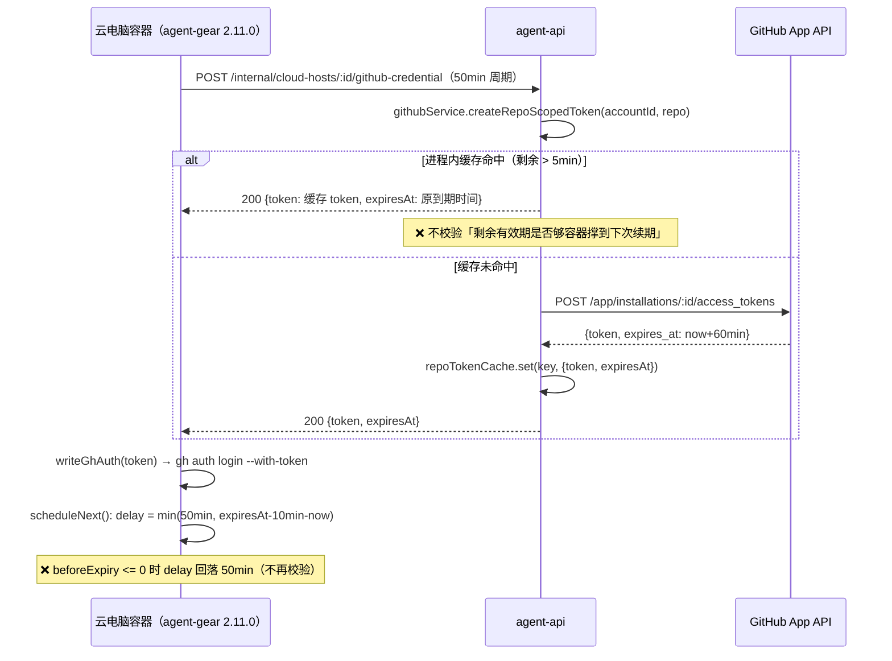

# 云电脑容器 Github 凭据不再自动续期 · 问题调查报告（2026-10-29）

> **状态**: 🔍 **已完成复现与根因定位（REPRODUCED）**——最小复现用例在当前 `origin/main`（`34745215`）上稳定失败 3 例（1 例 agent-api + 2 例 agent-gear），确定性时间线模拟显示「凭据失效窗口 = 每 100 分钟 40 分钟（40%）」。修复由下游节点实施，本文档给出修复方案、风险与回归计划。另有 1 项**无法在本环境闭环**的疑点（容器/agent-api 生产日志缺失），已登记为「待确认问题」。

## 关联文档

- PRD：`docs/product/draft/20261021-github-workload.md`（v1.1：凭据由云主机控制器申请，**每 50 分钟**续期一次，token 约 1 小时有效）
- 技术提案：`docs/engineering/proposals/20261021-feat-github-workload.md`（§AC-5 凭据申请与续期、§9 验收清单「凭据管理器每 50 分钟申请新凭据」）
- 相关提交：`00f7100e`（Git 项目设置与凭据管理器，2026-10-22）、`1fd4d866`（Check Runs 引入仓库级 token 进程内缓存，2026-10-25）
- 总分支：`bugfix/github-credential-refresh`
- 目标分支：`main`（人类问题描述未指定，按工作流默认）
- 调查报告路径：`docs/engineering/acceptance/20261029-github-credential-refresh-bug-investigation-report.md`
- 调研日期：2026-10-29

## 一、问题概述

**人类输入**（上游节点「输入问题描述」）：*「目前容器内 github 凭据似乎不会自动下发了，之前要求 50 分钟下发一次」*。

用户可见现象（推断自设计与实现契约）：

- 云电脑（harness）容器创建并设置 Git 项目后，容器内 `gh` / `git` 可正常使用；
- 一段时间后容器内 `gh auth status` 报 token 失效、`git push/clone` 401/403，且**不会自行恢复**，直到用户重启/重建云电脑；
- 与「每 50 分钟自动下发/续期一次」的既有要求不符。

需要区分两个层次：

| 层次 | 期望 | 实际（本次调查结论） |
|---|---|---|
| 凭据申请通路（agent-api 内部端点） | 每次续期都交出一枚可长期使用的 token | ❌ 50 分钟后的续期会命中缓存，交出**仅剩 10 分钟**有效期的同一枚 token |
| 容器内续期排期 | 在 token 过期前再次续期 | ❌ 收到「仅剩 10 分钟」的 token 时排期回落到 50 分钟，token 过期 40 分钟后才再次续期 |

## 二、环境与版本

| 项 | 值 |
|---|---|
| 代码基线 | `origin/main` @ `34745215`（2026-10-28） |
| 调查分支 | `bugfix/github-credential-refresh`（从 `origin/main` 切出） |
| agent-gear 版本 | `packages/agent-controller/package.json` = `2.11.0`（凭据管理器自 `2.6.0` 引入，`MIN_HARNESS_WORKER_VERSION=2.10.0`） |
| agent-api | `servers/agent-api`（Express 5 + Mongoose；token 缓存为该进程内 `Map`） |
| 运行时 | Node.js 24+ / Vitest 4.1.7 |
| 复现环境 | 本地 worktree，`npm ci` 后直接跑单测（不需要 K8s / 真实 GitHub App） |
| 未能获取 | 生产 K8s 集群（环境内无 `kubectl`）、出问题云电脑的容器日志、agent-api 访问日志 |

> **环境限制说明（不伪造结论）**：本环境无 `kubectl`、无生产 MongoDB/GitHub App 凭据，无法直接登录出问题的容器执行 `gh auth status`。因此复现采用**受控时钟的单元级复现**（可精确快进 50 分钟）+ **按仓库真实常量做的确定性时间线模拟**；这两者与生产行为同源代码路径。生产侧日志取证项见第八节「待确认问题」。

## 三、复现步骤与结果

### 3.1 最小复现用例

新增 3 个用例（均为本次调查产物，标记 `REPRO`）：

| 用例 | 文件 | 复现的行为 |
|---|---|---|
| `T-GH9 (REPRO)` | `servers/agent-api/src/services/github.test.ts` | agent-api：`createRepoScopedToken` 在 50 分钟后的第二次调用命中缓存，返回**仅剩 10 分钟**的同一枚 token |
| `T-CM9 (REPRO)` | `packages/agent-controller/src/github/credential-manager.test.ts` | agent-gear：收到仅剩 10 分钟的 token 后，下一次续期被排到 **50 分钟后**（晚于过期 40 分钟） |
| `T-CM10 (REPRO)` | 同上 | agent-gear：收到 1 分钟后过期的 token 时，仍按 50 分钟排期而不是短间隔重试 |

关键点：真实 API/E2E 用例无法快进 50 分钟，故用 `now` 注入 + `Date.now` mock 在**同一进程内**精确推进时钟，走的是与生产完全相同的代码路径（`GithubCredentialManager.scheduleNext` / `GitHubService.readCachedToken`）。

### 3.2 执行命令与实际输出

```bash
# 1) agent-api 复现
cd servers/agent-api && npx vitest run src/services/github.test.ts
```

```text
FAIL  src/services/github.test.ts > GitHubService > createRepoScopedToken
      > T-GH9 (REPRO): 容器 50 分钟后续期不得命中仅剩 10 分钟有效期的缓存 token
AssertionError: expected 600000 to be greater than or equal to 3300000
 ❯ src/services/github.test.ts:356:48
    356|  expect(second.expiresAt.getTime() - now).toBeGreaterThanOrEqual(…
       |                                                ^
 Test Files  1 failed (1)
      Tests  1 failed | 28 passed (29)
```

> 读法：第二次续期拿到的 token 剩余有效期 `600000ms = 10 分钟`，期望 ≥ `3300000ms = 55 分钟`。

```bash
# 2) agent-gear 复现
cd packages/agent-controller && npx vitest run src/github/credential-manager.test.ts
```

```text
FAIL  src/github/credential-manager.test.ts > GithubCredentialManager
      > T-CM9 (REPRO): 续期拿到仅剩 10 分钟的 token 时必须在到期前再次续期，而不是再等 50 分钟
AssertionError: expected 1792669200000 to be less than or equal to 1792666200000
 ❯ src/github/credential-manager.test.ts:208:45

FAIL  src/github/credential-manager.test.ts > GithubCredentialManager
      > T-CM10 (REPRO): 收到即将过期的 token 时短间隔重试，而不是 50 分钟后再来
AssertionError: expected 3000000 to be less than 3000000
 ❯ src/github/credential-manager.test.ts:238:39

 Tests  2 failed | 8 passed (10)
```

> 读法：`1792669200000 - 1792666200000 = 3000000ms = 50 分钟`——下一次续期被排在 token 过期之后 40 分钟；且临近过期时排期恒为 `REFRESH_INTERVAL_MS`（50 分钟）。

**复现稳定性**：3 例 100% 稳定复现（纯逻辑 + 注入时钟，无网络/无竞争）；同一文件内其余 28 / 8 例全部通过，说明复现用例本身不破坏既有断言。

### 3.3 时间线模拟（使用仓库真实常量）

模拟脚本（临时，不提交）按真实常量推演：`REFRESH_INTERVAL_MS=50min`、`EXPIRY_SKEW_MS=10min`、`TOKEN_EXPIRY_MARGIN_MS=5min`、installation token TTL=60min。

```text
t=  0min  refresh -> t1 (cacheHit=false, 剩余 60min), 下次续期 +50min
t= 50min  refresh -> t1 (cacheHit=true,  剩余 10min), 下次续期 +50min   ← 关键：同一枚 token
t=100min  refresh -> t2 (cacheHit=false, 剩余 60min), 下次续期 +50min
t=150min  refresh -> t2 (cacheHit=true,  剩余 10min), 下次续期 +50min
t=200min  refresh -> t3 (cacheHit=false, 剩余 60min), 下次续期 +50min

失效窗口（分钟）:
  [60, 100]   共 40 分钟
  [160, 200]  共 40 分钟
  [260, 300]  共 40 分钟
  [360, 400]  共 40 分钟
  [460, 500]  共 40 分钟
  [560, 600]  共 40 分钟

10 小时内：有效 360min / 失效 240min（失效占比 40%）
```

结论：**容器创建约 1 小时后开始进入「每 100 分钟有 40 分钟无凭据」的确定性循环**。若用户在失效窗口内操作（`git push`、`gh pr create`、workflow 的 PR/Check 相关操作），就会感知为「凭据不会自动下发了」。

## 四、根因分析（含证据）

### 4.1 调用链



### 4.2 缺陷一：agent-api 进程内 token 缓存对「容器续期」交出近过期凭据

`servers/agent-api/src/services/github.ts`：

```ts
// L41-47
const repoTokenCache = new Map<string, RepoTokenCacheEntry>();
const TOKEN_EXPIRY_MARGIN_MS = 5 * 60 * 1000;   // 仅 5 分钟余量

// L239-240
const cached = this.readCachedToken(String(account._id), repoFullName);
if (cached) return cached;

// L280-292
private readCachedToken(accountId, repoFullName) {
  const entry = repoTokenCache.get(key);
  if (!entry) return null;
  if (entry.expiresAt.getTime() - Date.now() <= TOKEN_EXPIRY_MARGIN_MS) { /* 作废 */ }
  return { token: entry.token, expiresAt: entry.expiresAt };
}
```

- 该缓存在 `1fd4d866`（2026-10-25，Check Runs 同步）引入，目标是让高频 Check Runs 同步复用 token；
- 但 `createRepoScopedToken` **同时是**内部端点 `POST /internal/cloud-hosts/:controllerId/github-credential` 的实现（`servers/agent-api/src/routes/internal-cloud-host.ts:130`），于是「50 分钟一次的容器续期」也共享这份 5 分钟余量的缓存；
- 容器必然在**签发后第 50 分钟**来续期（这正是设计约定的节奏），此刻缓存项剩余恰好 10 分钟（`60 - 50`）且 `10min > 5min` 余量 → **命中缓存**，交出同一枚 token。

证据（git blame 时间线）：凭据续期能力 `00f7100e`（2026-10-22）早于缓存 `1fd4d866`（2026-10-25），即「先有 50 分钟续期，后被缓存破坏」。

### 4.3 缺陷二：容器侧排期在「已进入续期余量区」时回落 50 分钟

`packages/agent-controller/src/github/credential-manager.ts`：

```ts
// L5, L8
export const REFRESH_INTERVAL_MS = 50 * 60 * 1000;
export const EXPIRY_SKEW_MS = 10 * 60 * 1000;

// L227-242
private scheduleNext(): void {
  let delay = REFRESH_INTERVAL_MS;
  if (this.expiresAt) {
    const beforeExpiry = this.expiresAt.getTime() - EXPIRY_SKEW_MS - this.now();
    if (beforeExpiry > 0 && beforeExpiry < delay) delay = beforeExpiry;  // ← <=0 时被跳过
  }
  this.timer = this.setTimeoutFn(/* refreshNow() then scheduleNext() */, delay);
}
```

- 收到「剩余 10 分钟」的 token 时 `beforeExpiry = 0`，**不满足 `> 0`** → `delay` 保持 50 分钟；
- 即使收到「剩余 1 分钟」甚至已过期的 token，也照样排 50 分钟（`T-CM10` 复现）；
- 结果是「服务端交出的近过期凭据」直接变成 40 分钟的凭据空窗，且**没有任何告警**。

### 4.4 缺陷三（可观测性）：续期失败静默

`credential-manager.ts` 仅 3 处日志：`L91`（env 缺失禁用）、`L138`（401/403 退避重试）、`L210`（成功写入）。`request()` 对 5xx/超时/非法 JSON/写 gh 失败只返回 `{ok:false, error}`，**不打印任何日志**，调用方 `scheduleNext` 也只 `.catch(() => undefined)`。

影响：若生产上真实原因是「GitHub App 配置/额度问题导致 502」「`ZAG_*` env 缺失导致 disabled」以外的任何应用层失败，容器日志里**看不到任何痕迹**，只能看到「凭据就是没更新」。这也是本报告保留「待确认问题」的原因之一：缺少可判别日志时，无法排除 502 长尾失败路径。

### 4.5 结论

| # | 根因 | 类型 | 证据 |
|---|---|---|---|
| R1 | agent-api 仓库级 token 缓存余量（5min）小于容器续期间隔（50min），续期命中近过期 token | 主因（后端） | `github.ts:47/239/287`；`T-GH9` 失败；`1fd4d866` |
| R2 | 容器排期在 `beforeExpiry <= 0` 时回落 50min，不做短间隔重试 | 主因（客户端） | `credential-manager.ts:227-242`；`T-CM9`/`T-CM10` 失败 |
| R3 | 续期失败不写日志，故障不可观测 | 次因（可观测性） | `credential-manager.ts` 仅 3 处 `this.log` |
| R4 | 容器启动首次申请若遇 `no-binding`（Git 项目尚未设置），下一轮要等 50 分钟 | 设计取舍（非本期主因，setup 批次的 `githubAuth` 会兜住） | `credential-manager.ts:169-171`、`supervisor.ts:209-216` |

## 五、影响范围

- **直接影响**：所有云电脑（harness）容器，只要绑定了 Git 项目并依赖 `gh`/`git` 长期可用。容器创建约 1 小时后进入 40% 失效窗口。
- **受影响操作**：容器内 `git clone/fetch/push`、`gh pr/issue`、workflow 的 PR 联动（Check Runs 由 agent-api 侧调用，使用同一缓存但自身仍有 5 分钟余量，**不因此失效**）、`commit-identity` 无关（独立通道）。
- **不受影响**：本地控制器（`--server` 模式）不使用该凭据管理器；`commit-identity-manager` 与凭据管理器相互独立。
- **是否影响其他入口**：`createRepoScopedToken` 还有一处内部调用（`github.ts:433 repoToken()`，Issues 同步等）。给它放宽余量属于「多签发几次 token」，无功能风险，但会增加 GitHub App 调用次数，需在修复时按需传参而非全局改默认值。
- **数据修复需求**：无。凭据不落库；已失效的容器只需在下一次续期/重启后恢复（修复上线后自动恢复，无需重建云电脑）。

## 六、修复方案与风险

> 本节为下游「修复」节点的实施建议（本次调查节点不改产品代码，只提交复现用例与报告）。

### 6.1 agent-api：按调用方要求最小剩余有效期（修 R1）

- `GitHubService.createRepoScopedToken(accountId, repoFullName, options?: { minRemainingMs?: number })`，`minRemainingMs` 缺省 `TOKEN_EXPIRY_MARGIN_MS`（保持 Check Runs 既有行为）；
- `readCachedToken(accountId, repoFullName, minRemainingMs)` 命中条件改为 `expiresAt - now > minRemainingMs`；
- 内部端点 `routes/internal-cloud-host.ts` 传 `CONTAINER_CREDENTIAL_MIN_REMAINING_MS = 55 * 60 * 1000`（`REFRESH_INTERVAL_MS 50min + EXPIRY_SKEW_MS 10min` 的安全余量，fresh token 剩余约 60min 必然满足）；
- 跨模块常量归属：55min 的语义属于「容器凭据契约」，建议放 agent-api 侧常量并加注释指向 agent-gear 的两个常量，避免两处魔法数漂移。

### 6.2 agent-gear：近过期/已过期时短间隔重试（修 R2、R3）

- `scheduleNext()`：当 `expiresAt` 存在且 `beforeExpiry <= 0` 时，改用 `NEAR_EXPIRY_RETRY_MS`（建议 60s，可注入用于测试）并 `log` 一条不含 token 的告警（如「凭据剩余有效期不足，1 分钟后重试」）；
- 建议在 `doRefresh` 返回前对 `expiresAt` 做一次「剩余 <= 0」判定：视为失败（`ok:false`，不写 gh，避免用已过期凭据覆盖），由上述短重试兜底；
- 对非 401/403/404 的失败结果补一条脱敏 `log`（修 R3），便于线上取证；
- 版本影响：属于 agent-gear patch 版本（`2.11.x`），不改变 `MIN_HARNESS_WORKER_VERSION`。

### 6.3 风险与取舍

| 风险 | 说明 | 缓解 |
|---|---|---|
| GitHub App 调用量上升 | 容器续期每次都会真正签发新 token（此前约一半命中缓存） | 每容器每小时最多 1 次，按云电脑数量线性，量级可接受；Check Runs 缓存不受影响 |
| 双端重复修复 | 只修 R1 也能消除空窗；只修 R2 会在 5 分钟内反复重试直到缓存作废后才恢复 | 建议两层都修（R1 治本、R2 兜底），回归用同一个「50 分钟快进」用例双向验证 |
| 时钟偏差 | 服务端与容器时钟偏差会让「剩余有效期」判断偏移 | 阈值已留 5 分钟余量（55 vs 60）；容器侧短重试进一步兜底 |
| 旧 worker 兼容 | 修复前启动的 2.11.0 容器不会自动获得 R2 修复 | R1（服务端）对存量容器立即生效，无需升级镜像 |

## 七、回归测试计划

| # | 层级 | 用例 | 期望 |
|---|---|---|---|
| 1 | agent-api 单测 | 新增 `T-GH9`（本次已写，当前 RED） | 50 分钟后续期必须拿到剩余 ≥ 55min 的**新** token |
| 2 | agent-api 单测 | 保留 `T-GH6`（缓存命中不重复签发）、`T-GH7`（5 分钟内作废） | Check Runs 侧缓存语义不回归 |
| 3 | agent-gear 单测 | 新增 `T-CM9`、`T-CM10`（当前 RED） | 近过期 token 触发短间隔重试，续期早于过期 |
| 4 | agent-gear 单测 | 既有 `T-CM1~T-CM8` | 首次申请/404/401 退避/并发合并/脱敏全绿 |
| 5 | agent-api 路由单测 | `internal-cloud-host.test.ts` 的 `T-ICG1~T-ICG8` | 双鉴权、404/409/502 语义不变；新增断言「传给 `createRepoScopedToken` 的 `minRemainingMs` 为 55min」 |
| 6 | api 集成（tests/api） | `agent-api/cloud-host*.test.ts` 云电脑创建 + Git 设置 + 凭据端点（mock GitHub） | 端到端仍可下发凭据，token 不回显、不落库 |
| 7 | 手工/长跑验证（下线前） | 云电脑内 `gh auth status` 连续观察 ≥ 2 小时 | 每个 50 分钟周期 token 更新且 `git ls-remote` 全绿；容器日志出现每周期成功日志 |
| 8 | 全量 | `servers/agent-api`、`packages/agent-controller` 全量单测 + `tsc` | 0 失败、0 类型错误 |

> 本次提交的 3 个 `REPRO` 用例当前为 **RED**（未修），这是红-绿循环的起点；修复节点转 GREEN 后应把它们保留为长期回归锚点（去掉 `(REPRO)` 标记或保持命名不动均可，但不得删除）。

## 八、待确认问题

1. **生产侧日志佐证（阻断级：无法在本环境闭环）**
   - 需要的材料：出问题容器内 `agent-gear` 日志中 `[GithubCredential]` 行的完整时间序列（是否每 50 分钟有「gh 凭据已更新」）、`gh auth status` 输出与时间戳、agent-api 侧 `/internal/cloud-hosts/*/github-credential` 的访问日志与状态码分布。
   - 判读方法：若日志显示「每 50 分钟都成功写入」但 `gh auth status` 在整数小时后失效 → 印证本报告 R1+R2；若日志在某个时间点后**再无** `gh 凭据已更新`，且请求侧出现 502/超时 → 指向 R3 掩盖的 GitHub App 失败路径（需另开修复）。
2. **是否存在 502 长尾**：GitHub App 私钥/加密 Key/安装授权变更会持续 502 且静默。建议修复节点同时补失败日志，上线后观察一天。
3. **多个 agent-api 实例**：若 agent-api 水平扩容，token 缓存为进程内，续期可能落在不同实例上（命中/未命中表现不同，但不影响本缺陷成立）。需确认生产副本数。
4. **产品语义确认**：是否接受「续期即签发新 token」（放弃容器侧的缓存复用）；若希望减少 GitHub 调用，也可改为服务端只缓存 ≥55 分钟余量的 token，效果等价。

## 九、经验总结

1. **跨层时间契约必须显式对齐**：客户端「每 50 分钟续期」与服务端「缓存余量 5 分钟」是两个模块各自的局部最优，组合起来破坏了不变量「交给续期方的凭据必须撑到下一次续期」。凡在服务端引入缓存，必须按**最小消费者 TTL 需求**设计失效阈值。
2. **对「交出近过期凭据」要有防御**：客户端在 `beforeExpiry <= 0` 时回落最大间隔，是把「意外输入」放大成「长时间故障」的典型写法；应改为短间隔重试并告警。
3. **静默失败等于不可运维**：本缺陷之所以只能靠「用户感觉」上报，是因为失败分支一条日志都没有；凭据类链路必须做到「成功/失败/近过期」三态可观测且不含 secret。
4. **时间维度缺陷必须可注入时钟**：E2E 无法等 50 分钟，本次以 `now` 注入 + `Date.now` mock 在同一代码路径复现，是可复用做法。
