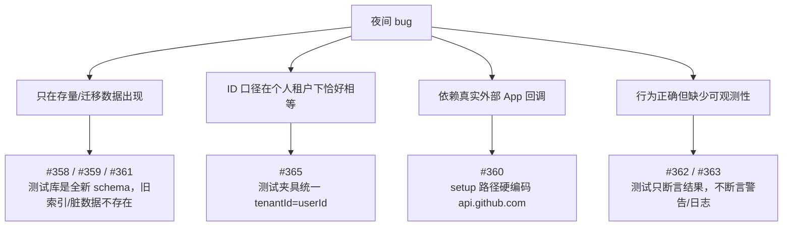

# 多租户上线夜间回归 · 验收报告（2026-10-30）

> **状态**: ✅ 生产修复均已合并（PR #356 / #358 / #359 / #360 / #361 / #362 / #363 / #365，共 8 个 PR）；本次新增 3 个 API 套件 + 1 个既有套件扩展 + 本节验收报告。API 套件需 Aspire + Docker，本机无 Docker 未执行，已在「验证」中如实标注；单测与类型检查已通过。

## 关联文档

- 多租户一期：`docs/engineering/proposals/20261027-feat-multi-tenant-phase1.md`
- 多租户二期：`docs/engineering/plan/20261028-feat-multi-tenant-phase2.md`
- 云电脑 Key 生命周期：`docs/engineering/proposals/20261026-fix-cloud-host-key-lifecycle.md`
- API 测试规范：`tests/api/AGENTS.md`
- 验收日期：2026-10-30
- 验收分支：`test/tonight-regression-api-coverage`（基于 `origin/release`）
- 测试目录：`tests/api/`

## 一、本轮 PR 清单

| PR | 标题 | 类型 | 用户可见问题 |
|---|---|---|---|
| #356 | fix(agent-api): 修复 workspace-isolation 真库用例的唯一索引冲突 | 测试基建 | release 单测门禁 E11000（`controllers.keyId` 等） |
| #358 | fix(agent-api): 迁移 011/015 兼容 Mongoose 默认名索引冲突 | 迁移 | 存量环境启动迁移失败 `IndexOptionsConflict(code 85)` |
| #359 | feat(agent-api): 迁移 017 归一化 ObjectId workspaceId 脏数据 | 数据迁移 | GitHub 账号列表为空、Commit 设置显示未设置 |
| #360 | fix(agent-api): GitHub 绑定 upsert 不再重复注入 tenantId | 逻辑 | GitHub 绑定失败 `code 40 ConflictingUpdateOperators` |
| #361 | fix(agent-api): 删除多租户改造前的无租户维度唯一索引 | 索引迁移 | 工作流管理工具集 E11000 `userId_1_name_1` |
| #362 | fix: 各服务统一用 returnDocument 替换已弃用的 new 查询选项 | 依赖升级 | Mongoose 9 弃用警告 |
| #363 | feat(agent-api): 计费调用失败记录上游状态与错误码 | 可观测性 | `billing service unavailable` 无法定位真实原因 |
| #365 | fix(admin-api): 云电脑 Key 按租户维度校验归属 | 逻辑 | 团队租户创建云电脑/调用模型失败（404/401） |

## 二、为什么之前的 API test 没测出这些 bug

### 2.1 按缺口分类

### 2.2 具体原因

| PR | 为什么 API test 覆盖不到 |
|---|---|
| #356 | 这是单元测试夹具自身的问题（原生 driver 直插缺唯一索引字段），不属于 API 行为，API 套件无法覆盖。 |
| #358 | 迁移只在「存量库已有 Mongoose 默认名索引」时失败。`tests/api` 使用全新/共享库，Mongoose `autoIndex` 直接按当前 schema 建索引，旧默认名与固定名冲突的前提不存在。 |
| #359 | `workspaceId` 为 ObjectId 的脏数据只来自早期 015 回填。API 测试的夹具全部写入 String，且迁移在服务启动时执行，测试无法在启动前注入脏数据再触发迁移。 |
| #360 | `/api/github/setup` 依赖真实 GitHub App installation；且 `getInstallationToken` / `getInstallationAccount` / `getRepositories` 硬编码 `https://api.github.com`，本地 API 套件无法把回调打到 mock。既有 GitHub API 用例只覆盖 `githubAppUrl` 与直插 DB 的账号读取，从未真正走 `handleSetup`。 |
| #361 | `mcpservers` 的旧唯一索引只在多租户改造前的存量库存在。测试库没有 `{userId,name}` 索引；且 MCP 用例只用了个人租户，没有「同一用户 + 两个租户 + 同名内置服务」场景。 |
| #362 | 弃用警告不是 API 行为；测试断言返回值，不会因为警告而失败。 |
| #363 | 失败日志属于可观测性；异常被折叠为稳定文案后，API 断言仍然是「失败」，无法区分 401/超时/500。 |
| #365 | 所有测试用户/夹具都满足 `tenantId == userId`（个人租户），`ownerId` 同时等于两者，租户与用户 ID 混用完全不可见；`T-B2` 团队计费只覆盖报价/扣费，没有覆盖云电脑 Key 铸造与模型网关。 |

### 2.3 结论

不是「API test 没跑」，而是**测试数据模型没有覆盖生产的数据形态**：

1. 只有「全新库 + 个人租户」夹具，没有「存量库 + 迁移」「团队租户」夹具；
2. 关键外部回调没有测试 seam（GitHub App base URL 硬编码）；
3. 测试只断言成功/失败，不断言迁移后的索引状态、日志与告警。

## 三、本次修改对 API test 的影响

### 3.1 PR #365（云电脑 Key 租户归属）

- **契约无变化**：GraphQL schema、内部 REST 请求/响应字段均未改。
- **个人租户行为不变**：`tenantId == userId`，既有 `admin-api/cloud-host-billing.test.ts` 全部保持通过。
- **团队租户行为变化**：`ownerType=tenant` 时归属校验从 `host.userId` 改为 `host.tenantId`；创建者 userId 不再能代替 tenantId。既有测试没有该场景，因此已补充 API 用例。
- **网关同口径**：`billing-key-auth` 同步修改，避免「Key 能铸造、模型调用 401」的半修复。

### 3.2 PR #360 的可测试性改动

为让 API 套件能真正触发 `handleSetup`，`servers/agent-api/src/services/github.ts` 的安装信息/仓库清单/卸载调用统一改用 `config.githubApiBaseUrl`（未配置时仍为 `https://api.github.com`）。这是测试 seam，不改变生产默认行为。

## 四、补充的 API test

| 用例 | 文件 | 覆盖 |
|---|---|---|
| T-GHS-API1/2 | `tests/api/src/agent-api/github-setup-upsert.test.ts` | `githubAppUrl` 取 state → `/api/github/setup` 首次 + 重复绑定均 302 `binding=success`；只落一行，回归 #360 code 40 |
| T-GHS-API3 | 同上 | installation 落库含 mock 仓库清单；token 以密文落库，不回显明文 |
| T-MCP-API1 | `tests/api/src/agent-api/mcp-tenant-upsert.test.ts` | 个人租户先 ensure `agent-workflow-admin-tools` → 加团队租户 → 团队全局再次 ensure；两条不同 tenantId 行并存，回归 #361 E11000 |
| T-IDX-API1 | `tests/api/src/agent-api/schema-index-invariants.test.ts` | `user_commit_settings` 只保留 `uniq_workspace_commit_setting`，默认名/旧固定名不残留（#358） |
| T-IDX-API2 | 同上 | `mcpservers` / `githubaccounts` 不残留无租户维度唯一索引（#361） |
| T-IDX-API3 | 同上 | `githubaccounts` / `user_commit_settings.workspaceId` 不再出现 BSON ObjectId（#359 不变量） |
| T-CHB-API-TEAM | `tests/api/src/admin-api/cloud-host-billing.test.ts`（扩展） | 团队租户 `ownerId=tenantId` 铸造云电脑 Key → RUNNING 后网关 200；创建者 userId / 其他租户 404（#365） |

> 新增 3 个测试文件，`tests/api` 常规套件由 46 个增至 49 个；目录与用例说明已同步到 `tests/api/AGENTS.md`。

## 五、验证结果

| 项 | 命令 | 结果 |
|---|---|---|
| agent-api GitHub 相关单测 | `cd servers/agent-api && npx vitest run src/services/github.test.ts src/routes/github.test.ts` | ✅ 43 passed |
| agent-api 类型检查 | `cd servers/agent-api && npx tsc --noEmit` | ✅ 0 错误 |
| API mock 自测 | `cd tests/api && npx vitest run src/mock-github-server.test.ts` | ✅ 2 passed |
| 新增 API 套件（无环境变量） | 同上 + 3 个新文件 + cloud-host-billing | ✅ 2 passed / 9 skipped（按设计 skip） |
| 新增 API 套件（完整 Aspire） | 需 `aspire start` + Docker | ⚠️ 本机 Docker 不可用，未执行；需在具备 Docker 的环境按 `tests/api/AGENTS.md` 运行 |
| agent-api 全量单测 | `cd servers/agent-api && npm test` | ✅ 113 文件 / 1467 用例通过 |

## 六、仍需补的环境型测试（后续）

| 缺口 | 建议 |
|---|---|
| 存量库迁移 | 增加「迁移前夹具库 → 启动服务 → 断言索引/数据」的 API/migration smoke 套件；需要独立 DB 与重启能力。 |
| 真实 GitHub App 回调 | 当前已用 `GITHUB_API_BASE` mock 覆盖 `handleSetup`；真实 App 安装仍由手工验收覆盖。 |
| 团队租户默认夹具 | 新增 API 用例时默认提供「team tenant + admin/developer」夹具，避免再次出现 `tenantId==userId` 的盲区。 |
| 日志可观测性 | 可在 CI 采集 agent-api stdout，断言计费失败日志包含 `status=` / `upstream=`；当前由单测 `billing-client` 行为与人工日志验收覆盖。 |

## 七、经验总结

1. **测试夹具必须覆盖生产的 ID 关系**：个人租户 `tenantId == userId` 会把「租户/用户混用」类 bug 全部隐藏；团队租户应成为多租户功能回归的默认夹具之一。
2. **迁移类修复必须在「迁移前状态」上验收**：全新库只能验证最终 schema，验证不到 `ensureIndex`、旧索引清理和脏数据归一。
3. **外部依赖要留测试 seam**：GitHub App base URL 硬编码导致最关键的绑定回调无法进入 API 套件；统一走配置后，mock 才能覆盖真实路由。
4. **索引也是契约**：唯一索引的 key pattern 应作为 API/集成断言的一部分，而不是只由迁移单测保证。
5. **失败信息要可判别**：把 401/403/404/超时/5xx 统一折叠成一句用户文案时，必须同时保留脱敏日志，否则线上只能靠猜。
