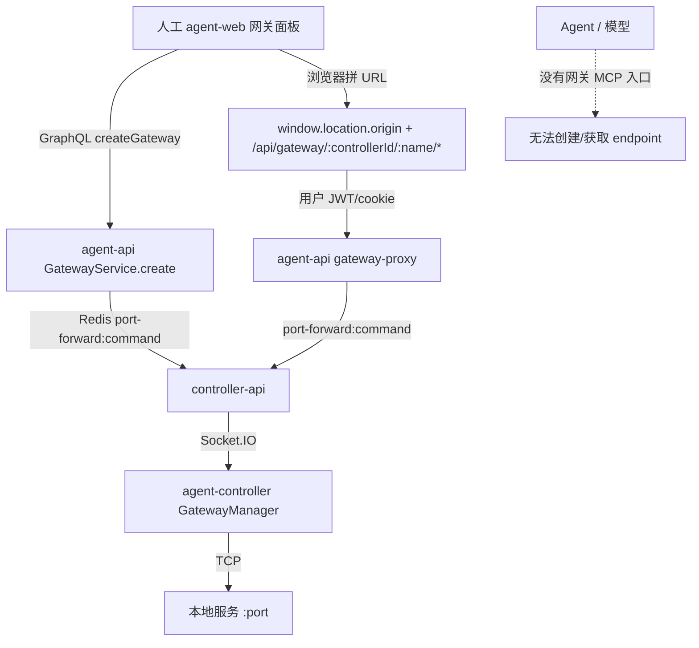
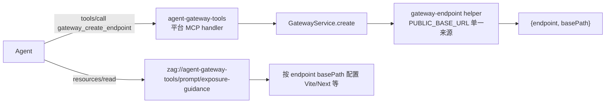

# 网关功能更新 · 问题调查报告（2026-11-26）

> **状态**: 🟡 **已复现能力缺口、已定位根因（REPRODUCED & ROOT-CAUSED）**——最小复现 **2/2 用例稳定 RED（连续两轮一致）**，既有网关单测 **11/11 GREEN**（排除回归）；结论不是某个函数写错，而是**网关能力只有「人工 UI + GraphQL」入口，没有 Agent 可用的 MCP 入口**，且**创建结果里没有 endpoint**、**没有任何暴露指引**。真实 API/E2E 未执行：本机缺少 docker compose 插件且无 mongod/redis，`aspire start` 不可用（详见 §3.4，不伪造结论）。
>
> **问题类型**: 人类输入来自 `enhancement` 标签的 Issue（不是缺陷复现），但工作流按 BUG 修复链路推进；本报告按「能力缺口」调查，不改写为既有功能故障。

## 关联文档

- 来源 Issue：[Deliay/z-agent-gear#565](https://github.com/Deliay/z-agent-gear/issues/565)（「网关功能更新」，`enhancement` + `start-BUG 修复工作流`，2026-11-18 创建）
- 统一网关 PRD / 方案：`docs/product/released/20260707-unified-gateway.md`、`docs/engineering/proposals/20260707-feat-unified-gateway.md`、`docs/engineering/plan/20260707-feat-unified-gateway.md`
- 网关契约：`contracts/gateway.graphql`、`contracts/gateway-proxy.openapi.yaml`
- 平台 MCP 路由契约：`contracts/agent-session-websocket.md` §2.12.1、`contracts/mcp-server.graphql`
- 平台片段通道裁决（必须遵守）：[#580 调查报告](./20261126-mcp-prompts-not-visible-bug-investigation-report.md)（**平台片段只用 MCP resources，移除 prompts，不做 tools 兜底**）
- 最小复现用例：`servers/agent-api/src/services/gateway-endpoint.repro.test.ts`
- 总分支：`bugfix/gateway-mcp-endpoint`（从 `origin/main` @ `f20084c3` 切出）
- 目标分支：`main`（人类问题描述未指定目标分支，按工作流默认）
- 调查报告路径：`docs/engineering/acceptance/20261126-gateway-mcp-endpoint-bug-investigation-report.md`
- 调研日期：2026-11-26

## 一、问题概述

**人类输入**（上游节点「输入问题描述」，源自 Issue #565，原文两条）：

> - 网关功能MCP在创建endpoint之后支持返回具体的endpoint
> - 增加网关功能的暴露提示词：引导agent使用返回的endpoint作为外网的basePath暴露服务，比如修改vite设置等等

**问题拆解**（本报告按此理解推进，未能确认项已列入 §八）：

1. Agent 应能通过「网关功能 MCP」创建 endpoint；
2. 创建成功后，MCP 应把**具体、可直接使用的外网 endpoint** 返回给 Agent；
3. 应提供「如何暴露服务」的指引（提示词），引导 Agent 把 endpoint 当作外网 basePath 配置（例如 Vite 的 `base`）。

**结论先行**：

| # | 结论 | 证据 |
|---|---|---|
| 1 | **当前仓库不存在任何网关平台 MCP**——没有 `agent-gateway-tools` handler、没有会话装配、没有 dispatch 路由。Agent 根本没有「创建 endpoint」这个入口。 | §3.2、§4.2 E1/E2/E3/E4 |
| 2 | 网关创建链路本身也**不返回 endpoint**：GraphQL `Gateway` 无 `endpoint` 字段，`gatewayService.mapGateway` 只返回 `id/controllerId/name/port/status/createdAt`；唯一 URL 拼装在**前端**（`window.location.origin + /api/gateway/...`）。 | §4.2 E5/E6/E8 |
| 3 | **不存在任何面向 AI 的暴露指引**（无 resources、无 prompts、工具描述也没有 basePath/Vite 内容）；且 #580 已裁决平台片段只能走 MCP resources。 | §4.2 E9/E10 |

即：Issue 的两条诉求分别落在**同一个缺口的两个面**——「Agent 侧没有网关 MCP」与「服务端没有 endpoint 单一来源与暴露指引」。这不是某个既有函数写错，不能靠修一行代码闭环。

## 二、环境与版本

| 项 | 值 |
|---|---|
| 代码基线 | `origin/main` @ `f20084c3`（Merge PR #581，`b2fee298` 平台片段改 resources 之后） |
| 调查分支 | `bugfix/gateway-mcp-endpoint`（从 `origin/main` 切出） |
| Node.js | v24.22.0 |
| pnpm | 12.16.1 |
| Vitest | 4.1.12（`servers/agent-api` 本地安装） |
| 平台服务端 | `servers/agent-api`（网关 GraphQL / 网关代理 / 平台 MCP dispatch） |
| 前端 | `apps/agent-web`（网关入口与 URL 展示） |
| 控制器 | `packages/agent-controller`（隧道数据面）；本次不涉及，问题在控制面 |
| 未执行 | `aspire start` / `tests/api` / `tests/e2e`：本机 `docker compose` 插件缺失、无 `mongod`/`redis-server`，且没有正在运行的服务（`localhost:10001`、`localhost:35273` 均无响应） |

## 三、复现步骤与结果

### 3.1 最小复现用例（当前 RED，2/2 稳定）

新增 `servers/agent-api/src/services/gateway-endpoint.repro.test.ts`，把 Issue 的两条核心期望写成可执行断言：

1. `gatewayService.create` 创建端点后，返回值应包含具体 `endpoint`；
2. 应存在平台 MCP 网关工具 handler（`gateway-tools.ts` / `agent-gateway-tools`）。

执行命令：

```bash
cd servers/agent-api
pnpm exec vitest run src/services/gateway-endpoint.repro.test.ts
```

实际输出（连续两轮一致）：

```text
 ❯ src/services/gateway-endpoint.repro.test.ts (2 tests | 2 failed) 11ms
     × T-GMCP-REPRO-1: create 返回值应包含具体 endpoint 5ms
     × T-GMCP-REPRO-2: 平台 MCP 网关工具 handler 应存在 4ms

 FAIL ... > T-GMCP-REPRO-1: create 返回值应包含具体 endpoint
 AssertionError: expected undefined to be 'http://localhost:10001/api/gateway/ctrl1/my-service/'
   + Received: undefined

 FAIL ... > T-GMCP-REPRO-2: 平台 MCP 网关工具 handler 应存在
 AssertionError: 未找到 platforms MCP 网关工具 handler（agent-gateway-tools）: expected null not to be null

 Test Files  1 failed (1)
      Tests  2 failed (2)
```

**稳定性**：重跑一轮结果完全一致（2/2 RED），不存在偶发/环境依赖。

### 3.2 既有网关行为基线（GREEN，排除「既有功能坏了」）

```bash
cd servers/agent-api
pnpm exec vitest run src/services/gateway.test.ts
```

```text
 Test Files  1 passed (1)
      Tests  11 passed (11)
```

说明：网关的创建/删除/发布 Redis 命令**本身是正常的**；缺的是 Agent 入口、endpoint 返回与暴露指引，不是既有网关功能回归。

### 3.3 一手观察：当前会话的 MCP 面没有网关服务

调查所在的真实工作流节点会话中，平台装配的平台 MCP 服务为：`agent-workflow-tools`、`agent-workflow-admin-tools`、`agent-cloud-host-tools`、`agent-session-preview-tools`、`agent-valut-tools`、`agent-knowledge-base-tools`（模型侧工具目录可见），**没有网关服务**。`list_mcp_resources()` 返回 `{ "resources": [], "templates": [] }`——不仅没有网关资源，当前平台服务还没有任何 resources（#580 的实现只覆盖了工作流管理/知识库两个服务）。

### 3.4 为什么没有跑真实 API/E2E（如实记录，不伪造）

尝试路径与阻塞原因：

| 尝试 | 结果 | 阻塞原因 |
|---|---|---|
| `aspire start` | 未启动 | `docker: unknown command: docker compose`（本机无 compose 插件） |
| 手工起 agent-api + controller-api | 未启动 | 无 `mongod` / `redis-server` 可执行文件；`mongodb-memory-server` 需下载二进制，未确认可用 |
| `curl localhost:10001/health` / `localhost:35273/health` | 无响应 | 无运行中服务 |
| `tests/api` / `tests/e2e` | 未执行 | 依赖上述运行环境 |

**下一步验证计划**（不改变本报告结论，只影响证据层级）：

1. 在有 Aspire/Docker 的环境执行 `aspire start`，用 `tests/api` 的 fake controller relay 形态补一条 **API 级复现**（参考 `tests/api/src/agent-api/mcp-server.test.ts` 的 `relayMcpRequest`）：
   - 创建 local controller + workspace + session；
   - 断言 `acp:start.mcpEndpoint.serverNames` 包含 `agent-gateway-tools`；
   - 经 relay 调 `tools/list`，断言存在网关工具；
   - 调创建工具，断言返回 `endpoint` 且与代理路由可达性一致。
2. 用 Playwright 在 agent-web 网关面板创建端点，确认前端展示 URL 与 MCP 返回 endpoint **逐字一致**（防止双源漂移）。

## 四、根因分析（含证据链）

### 4.1 调用链现状



现状只有「人」这条链路；Agent 侧没有入口，也没有服务端伪造的 endpoint。

### 4.2 证据链

| # | 证据 | 说明 |
|---|---|---|
| E1 | 全仓检索 `gateway-tools` / `gateway_create` / `create_endpoint` 等工具名**零命中**（`servers`、`packages`、`tests`、`contracts`、`docs` 均无） | 没有网关平台 MCP 实现 |
| E2 | `servers/agent-api/src/services/session.ts:407-465`：平台 MCP 只装配 `agent-cloud-host-tools`、`agent-session-preview-tools`、`agent-valut-tools`、`agent-custom-tools`、`agent-knowledge-base-tools`；`$nin` 排除清单也只有这 5 个 | 网关服务从未进入会话 |
| E3 | `servers/agent-api/src/services/mcp-dispatch.ts:189-224`：platform 分支按 serverName 三元链分发，最终 `Unsupported platform server` | 即使手工注册网关 MCP，也会 404/不支持 |
| E4 | `contracts/agent-session-websocket.md:480-490` 平台服务路由表只有 7 个 serverName，无网关 | 契约层也没有该能力 |
| E5 | `contracts/gateway.graphql:1-8` 的 `Gateway` 只有 `id/controllerId/name/port/status/createdAt`，无 `endpoint` | GraphQL 层不返回 URL |
| E6 | `servers/agent-api/src/services/gateway.ts:70-82` 的 `mapGateway` 仅映射上述 6 字段 | 服务层也没有 URL |
| E7 | `servers/agent-api/src/routes/gateway-proxy.ts:51` 路由为 `/gateway/:controllerId/:name/{*path}`，在 `index.ts:167` 挂载到 `/api`；`config/index.ts:45` 有 `publicBaseUrl`（`PUBLIC_BASE_URL`，默认 `http://localhost:10001`） | endpoint 的**可计算**形态存在，但没有被服务端使用 |
| E8 | `apps/agent-web/src/components/GatewayItem.tsx:22`：`const accessUrl = \`${window.location.origin}/api/gateway/${controllerId}/${gateway.name}/\`` | URL 拼接**只在前端**，没有服务端单一来源 |
| E9 | 全仓检索 `basePath` / `vite` / 暴露指引：平台 MCP 服务、resources、prompts、工具描述均无相关内容 | 没有面向 Agent 的暴露指引 |
| E10 | `b2fee298`（#580）：平台片段改为 MCP resources 投递，明确移除 prompts、不做 tools 兜底；`contracts/mcp-server.graphql` 同步为 resources 口径 | 新增指引**不能**再用 MCP prompts；必须用 resources（或工具描述） |
| E11 | `docs/knowledges/domain/70-模型网关/00-上下文概览.md:98-104`：Gateway 是「控制器端口映射」，代理路由 `/api/gateway/:controllerId/:name/*`，鉴权仅用户 JWT/cookie，30s 超时 | 领域模型已定义网关语义，但没有 Agent/MCP 面 |

### 4.3 根因

**根因（能力缺口）**：统一网关从设计到实现只服务「人」——入口是 agent-web 面板 + GraphQL，endpoint 由浏览器本地拼接。平台没有把网关能力注册成 **Agent 可调用的平台 MCP**，也没有在服务端提供 **endpoint 的单一事实源**，更没有把「如何把 endpoint 用作外网 basePath」的说明投递给模型。于是 Issue 的两条诉求在当前代码里都没有落点：
- 没有 MCP，「创建 endpoint 后返回 endpoint」无从谈起；
- 即便补一个 MCP 包装，现有 `Gateway` 返回值也没有 endpoint 可返回；
- 即便返回了 endpoint，模型也不知道该拿它去改 Vite/Next 等配置（#580 之后还必须用 resources 投递）。

**放大因素**：

1. **双源漂移风险**：URL 只在前端拼，服务端 `publicBaseUrl` 已存在但未被网关使用；一旦补 MCP，很容易再抄一份 URL 逻辑，形成第二事实源。
2. **网关数据面限制**：`gateway-proxy` 是 Express HTTP 请求/响应代理（30s 超时），**不支持 WebSocket upgrade**；Vite HMR 默认走 WebSocket，直接按「改 vite base」暴露会出现 HMR 连不上。
3. **鉴权语义**：代理路由要求用户 JWT 或 cookie（`gateway-proxy.ts:51-61`），「外网暴露」并不等于匿名公开；第三方 webhook 类场景仍不可用。
4. **作用域不一致**：网关的查询/创建计数按 `{userId}`，但名称唯一索引是 `{controllerId,name}`；团队工作区下其他成员创建的网关可能不可见、却会撞名（多租户二期明确把「网关」列在 `{userId}` 例外中）。

## 五、影响范围

| 维度 | 现状 | 影响 |
|---|---|---|
| Agent 暴露本地服务 | ❌ 无入口：Agent 不能创建/列出/删除网关端点 | Issue 核心诉求未达成；Agent 只能建议用户去 UI 手工操作 |
| 创建后获取 endpoint | ❌ GraphQL/MCP 均不返回 URL；仅前端展示 | Agent 即便知道端点名也无法拼出可信 URL；易产生幻觉地址 |
| 暴露指引 | ❌ 无 resources/prompts/工具说明 | Agent 不会主动配置 basePath；可能错误地让用户直接访问 localhost |
| 人工网关 UI | ✅ 正常（`gateway.test.ts` 11/11） | 零回归；人工仍可创建、复制 URL |
| 网关代理数据面 | ✅ 正常（HTTP；JWT/cookie 鉴权，30s） | WebSocket/HMR 不在现有能力内，需在指引中显式规避或另立需求 |
| 其他平台 MCP | ✅ 正常 | 新增网关服务需同步两处 `$nin`、dispatch、契约、文档，否则漏装配或不可选 |
| 数据修复需求 | **无** | 纯能力新增，不涉及存量数据迁移 |

## 六、修复方案与风险

> 本节是**建议方案**（供下游产品/技术/修复节点细化），不是本节点已实现的改动。工具名、URL 口径等未确认项见 §八。

### 6.1 方案总览



### 6.2 分阶段改动

| 阶段 | 落点 | 改动 |
|---|---|---|
| P0 契约 | `contracts/gateway.graphql`、`contracts/mcp-server.graphql`、`contracts/agent-session-websocket.md` §2.12.1 | `Gateway.endpoint` 字段；平台服务注解新增 `agent-gateway-tools`（工具清单、resources URI 约定）；路由表新增一行 |
| P1 endpoint 单一来源 | 新增 `servers/agent-api/src/services/gateway-endpoint.ts` | 纯函数 `buildGatewayEndpoint(publicBaseUrl, controllerId, name)` → `{publicBaseUrl}/api/gateway/{controllerId}/{name}/`；`buildGatewayBasePath(...)` → `/api/gateway/{controllerId}/{name}/`；`gatewayService.mapGateway`/`create` 复用它；GraphQL `Gateway.endpoint` 字段级 resolver（或映射字段） |
| P2 平台 MCP | 新增 `servers/agent-api/src/services/gateway-tools.ts` | `initialize` 声明 `{ tools: {}, resources: {} }`；`tools/list`：`gateway_list`、`gateway_create_endpoint`、`gateway_delete_endpoint`（名称待确认）；`tools/call` 用 `caller.userId + sessionId` 解析 controller 归属后调 `gatewayService`；创建结果返回 `{name, port, status, endpoint, basePath}`；错误走 `isError` + 可读文案 |
| P3 装配与路由 | `servers/agent-api/src/services/session.ts`、`controllers/controller.ts`、`mcp-dispatch.ts` | `sessionService.create` 恒装配并去重（或按控制器类型装配）；两处 `$nin` 排除清单追加新名字；dispatch platform 链增加分支 |
| P4 暴露指引 | 新增 `servers/agent-api/src/services/gateway-prompts.ts` | 单一来源 Markdown resource：`zag://agent-gateway-tools/prompt/gateway-exposure-guidance`；`resources/list` / `resources/read`；内容包含 endpoint/basePath 用法、Vite 示例、鉴权与 HMR 限制 |
| P5 领域模型 | `docs/knowledges/domain/70-模型网关/00-上下文概览.md`、`01-聚合与实体.md`、`30-控制器/01-聚合与实体.md` | Gateway 增加 endpoint（派生）、MCP 工具与指引资源、鉴权/WS 限制口径同步 |
| P6 测试 | 见 §七 | 单测 + API relay 全链路 + E2E |

### 6.3 暴露指引内容要点（建议）

1. `endpoint` 是**完整外网 URL**；`basePath` 是它的 path 部分（`new URL(endpoint).pathname`），必须以 `/` 开头和结尾。
2. Vite 示例：`base: '<basePath>'`（构建时同样生效）；`server.allowedHosts` 放行平台域名；**不要依赖默认 HMR WebSocket**（网关无 upgrade），建议 `server.hmr: false` 或轮询方案；静态资源全部用相对路径。
3. 其他框架：Next.js `basePath`/`assetPrefix`，Nuxt `app.baseURL`，Spring 等 `context-path` 同义。
4. 访问前提：网关代理要求用户 JWT 或 cookie；不是匿名公网入口；单次请求 30s 超时。
5. 端点上限 `GATEWAY_MAX_PER_CONTROLLER`（默认 5）、名称规则 `[a-zA-Z0-9_-]{1,50}`、控制器内唯一；冲突/超限要换名或先删旧端点。
6. 创建后必须用返回的 endpoint，禁止自行拼 `localhost:{port}` 对外分享。

### 6.4 风险与取舍

| # | 风险 | 说明 | 建议 |
|---|---|---|---|
| R1 | `PUBLIC_BASE_URL` 在部分部署未配置 | 默认 `http://localhost:10001`，MCP 返回的 endpoint 会指向本机，外部不可达 | 生产必须在部署文档/校验中要求配置；或新增专用 `PUBLIC_GATEWAY_BASE_URL`（§八-2） |
| R2 | 前端 origin 与 `PUBLIC_BASE_URL` 不一致 | 现有 UI 用 `window.location.origin`，服务端用 `PUBLIC_BASE_URL`；若 web 与 api 不同域会漂移 | 统一为服务端单一来源，UI 改为读 `Gateway.endpoint`；或明确同域部署假设 |
| R3 | 鉴权与「外网暴露」语义冲突 | 代理需登录，第三方回调/匿名访问不可用 | 在指引与工具描述中明确；匿名公网暴露另立需求 |
| R4 | 无 WebSocket/HMR | Vite HMR 默认 WS 会失败 | 指引显式要求关闭 HMR 或改轮询；如产品要求 HMR，需网关支持 upgrade（跨服务改造） |
| R5 | 团队工作区可见性 | 网关按 `{userId}` 计数/查询，但唯一键是 `{controllerId,name}` | 明确是否切换为工作区成员口径；至少保证创建/列表/删除同口径，避免撞名不可见 |
| R6 | 工具被滥用（模型擅自暴露端口） | MCP 工具是模型可控的副作用操作 | 工具描述明确「仅在用户要求暴露服务时使用」；必要时加二次确认/权限开关（产品决策） |
| R7 | 命名/返回结构变更成本 | 工具名与返回字段一旦发布难改 | 本报告建议名先经人类确认（§八-1），再落契约与测试 |

### 6.5 明确不做（本轮建议）

- 不恢复 MCP prompts（#580 已裁决）；
- 不新增 `initialize.instructions` 长篇正文（可作为一行发现指引另行确认）；
- 不在本期改造网关代理的 WebSocket upgrade / 匿名鉴权；
- 不引入新集合/迁移（endpoint 是派生字段，无需落库）；
- 不改变 `port-forward:command` 协议。

## 七、回归测试计划

> 口径：endpoint 单一来源（服务端）；平台 MCP 有工具 + resources；prompts 不回归；既有网关行为零变化。

| 层级 | 用例 | 断言 |
|---|---|---|
| 单测（agent-api） | `gateway-endpoint.test.ts` | `buildGatewayEndpoint` / `buildGatewayBasePath` 对 `PUBLIC_BASE_URL` 尾斜杠、controllerId/name 编码、trailing slash 正确；空 base 的边界 |
| 单测（agent-api） | `gateway.test.ts` 扩展 | `create`/`findAllByController` 返回 `endpoint`，且与 helper 一致；既有 11 用例零回归 |
| 单测（agent-api） | `gateway-tools.test.ts` | `initialize` 声明 `tools` + `resources`；`tools/list` 工具名/描述；`gateway_create_endpoint` 返回 endpoint/basePath；非本会话控制器/离线/超限/重名映射为可读 `isError`；`resources/list`/`read` 正文与注册表同源；未知 URI `INVALID_PARAMS` |
| 单测（agent-api） | `session.test.ts` 装配断言 | 新服务恒装配并去重；两处 `$nin` 排除清单包含新名字；`setControllerDefaultMcp` 选平台服务报 `MCP_SERVER_NOT_SELECTABLE` |
| 单测（agent-api） | `mcp-dispatch.test.ts` | platform 分支按 `agent-gateway-tools` 直发本地 handler；未知 serverName 仍 `SERVER_NOT_FOUND` |
| API（tests/api） | 参考 `mcp-server.test.ts` 的 fake controller relay | 创建 session 后 `mcpEndpoint.serverNames` 含新服务；`tools/list` 可见；`tools/call` 创建后返回的 endpoint 与 GraphQL/代理路由一致；resources 可读 |
| E2E（tests/e2e） | `gateway.spec.ts` 扩展 | 人工在 UI 创建的端点 URL 与 MCP/GraphQL 返回逐字一致；无权限 401、未命中 404、超时 502 文案零变化 |
| 手工验证 | 真实会话 | Agent 调用创建工具拿到 endpoint，按 resources 指引改 Vite `base`，通过返回的 endpoint 访问页面（HTTP 正常；HMR 按指引关闭） |
| 安全回归 | 鉴权 | 匿名访问 endpoint 仍 401；跨用户 endpoint 不可见/不可删；工具不泄露其他用户网关 |

## 八、待确认问题（需人类补充）

> 按工作流要求不阻塞下游：以下问题已写入本节点产物「待确认问题」，修复节点可按最合理默认推进，人类确认后调整。

1. **MCP 工具命名与范围**：建议 `gateway_list` / `gateway_create_endpoint` / `gateway_delete_endpoint`；是否也要 `gateway_update`？是否沿用 Issue 里「创建 endpoint」的措辞？
2. **endpoint 的 host 口径**：用服务端 `PUBLIC_BASE_URL`（推荐，服务端单一来源），还是前端 `window.location.origin`？路径是否固定含 `/api`（现有代理路由为 `/api/gateway/...`）？是否有单独的对外域名？
3. **装配范围**：网关 MCP 装配到「全部会话」（推荐，所有会话都有控制器），还是仅云电脑/本地控制器之一？
4. **团队工作区作用域**：保留现有 `{userId}` 口径，还是切换为工作区成员可见（与多租户二期其他资源一致）？切换会影响列表/删除/撞名行为。
5. **WebSocket/HMR**：确认「外网暴露」是否必须支持 HMR/WebSocket。若不支持，指引要求关闭 HMR 是否可接受？若要支持，需另立网关 upgrade 需求（跨 agent-api/controller/agent-controller）。
6. **指引通道**：按 #580 只用 MCP resources（推荐）；是否需要额外加 `initialize.instructions` 一行「有网关资源可读」的发现指引？
7. **匿名访问诉求**：第三方 webhook 等匿名公网入口是否在本次范围内？现有代理强制登录，若需要匿名需安全设计（另立需求）。
8. **Vite base 细节**：`base` 是否要求以 `/` 结尾、构建产物是否也走同一 base？指引中是否需要给出 `vite.config.ts` 的最小可用示例（含 `server.allowedHosts`、HMR 关闭）？
