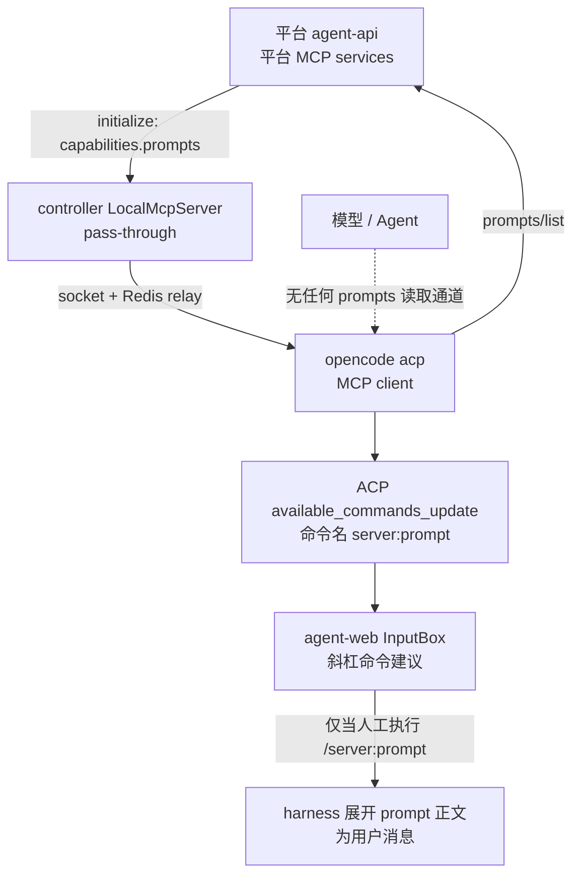

# MCP 中无法看到「提示词」· 问题调查报告（2026-11-26）

> **状态**: 🟡 **已复现机制、已定位根因（REPRODUCED & ROOT-CAUSED）**——复现对象是「MCP 提示词能否到达 Agent」这一机制本身：ACP 级最小复现 **2/2 轮稳定，5/5 断言全绿**，证明 harness（opencode 2.1.1）会把 MCP prompts 变成客户端斜杠命令 `<server>:<prompt>`，而提示词正文**从不进入 model-visible 的会话上下文**，模型侧也没有等价的读取工具。平台服务端 prompts 能力本身实现完好（有 API 测试），因此问题**不是端点漏实现，而是投递通道选错了**。修复方案与回归计划见 §六/§七；尚未确认的人类上下文见 §八。

## 关联文档

- 来源 Issue：[Deliay/z-agent-gear#580](https://github.com/Deliay/z-agent-gear/issues/580)（「MCP中无法看到「提示词」」，`bug` + `start-BUG 修复工作流`，2026-11-26 创建）
- 上游需求：Issue [#523](https://github.com/Deliay/z-agent-gear/issues/523)（工作流MCP提供提示词片段）
- 相关 PRD：`docs/product/draft/20261115-workflow-mcp-prompt-snippets.md`
- 相关技术提案：`docs/engineering/proposals/20261115-feat-workflow-mcp-prompt-snippets.md`
- 相关实现：`servers/agent-api/src/services/workflow/admin-prompts.ts`、`servers/agent-api/src/services/knowledge-base-prompts.ts`
- 最小复现用例：`tests/e2e/mcp-prompts/`（`run.mjs` / `acp-probe.mjs` / `mcp-stub-server.mjs`，含 README）
- 总分支：`bugfix/mcp-prompts-not-visible`（从 `origin/main` @ `fe609555` 切出）
- 目标分支：`main`（人类问题描述未指定目标分支，按工作流默认）
- 调查报告路径：`docs/engineering/acceptance/20261126-mcp-prompts-not-visible-bug-investigation-report.md`
- 调研日期：2026-11-26

## 一、问题概述

**人类输入**（上游节点「输入问题描述」，源自 Issue #580，原文仅一句）：

> 实际传递给Agent的MCP中，无法看到任何暴露了提示词的MCP工具的提示词

**问题拆解**（本报告按此理解推进，未能确认项已列入 §八）：

1. 平台确实存在「暴露了提示词」的 MCP 服务：`agent-workflow-admin-tools`（`workflow-schema`、`workflow-project-persistence`）与 `agent-knowledge-base-tools`（`repo-knowledge-base-authoring`），二者 `initialize` 均声明 `capabilities.prompts`。
2. 用户预期：这些提示词应当能被「实际传递给 Agent 的 MCP」这一侧看到/用到。
3. 实际：AI 会话里 AI 看不到、也无法获取任何提示词正文。

**结论先行**：MCP `prompts` 是**面向 MCP 客户端（人）的能力**，不是面向模型的能力。harness（opencode）发现提示词后只把它变成交互式斜杠命令，AI 既不会被自动注入提示词正文，也没有任何工具可以读取它——因此「把权威说明寄托在 MCP prompts 上供 AI 按需获取」在设计上不成立。

## 二、环境与版本

| 项 | 值 |
|---|---|
| 代码基线 | `origin/main` @ `fe609555`（Merge PR #576） |
| 调查分支 | `bugfix/mcp-prompts-not-visible`（从 `origin/main` 切出） |
| Harness | `opencode` **2.1.1**（`opencode --version`）；与平台锁定版本一致（`servers/admin-api/src/migrations/006-preset-harness-opencode.ts:20` `OPENCODE_CLI_VERSION = '2.1.1'`） |
| Harness ACP 能力快照 | `agentCapabilities.mcpCapabilities = { http: true, sse: false }`（探针实测输出） |
| Node.js | v24（`node --experimental-sqlite` 可用；复现脚本仅用内置模块） |
| 平台服务端 | `server/agent-api` 平台 MCP handlers（`admin-tools.ts` / `knowledge-base-tools.ts`） |
| MCP 协议形 | JSON-RPC 2.0 over Streamable HTTP，`protocolVersion: 2025-03-26` |
| 运行现场 | 本节点即为**真实工作流 AI 节点会话**（云主机），实际装配 6 个平台 MCP 服务，可作为一手观察样本 |
| 未执行 | `aspire start` 全链路（本机 `docker compose` 插件缺失）；真实部署中 agent-web 输入框是否已出现斜杠命令未截图验证（见 §3.5） |

## 三、复现步骤与结果

### 3.1 一手观察：真实会话里「实际传递给 Agent 的 MCP」有什么

在本次调查所在的真实工作流节点会话中，平台装配的平台 MCP 服务为（模型侧工具目录可见）：

| MCP 服务 | `initialize.capabilities` | 是否暴露 prompts |
|---|---|---|
| `agent-workflow-tools`（节点作用域） | `{ tools: {} }` | ❌ |
| `agent-workflow-admin-tools` | `{ tools: {}, prompts: {} }` | ✅（`workflow-schema`、`workflow-project-persistence`） |
| `agent-knowledge-base-tools` | `{ tools: {}, prompts: {} }` | ✅（`repo-knowledge-base-authoring`） |
| `agent-session-preview-tools` | `{ tools: {} }` | ❌ |
| `agent-valut-tools` | `{ tools: {} }` | ❌ |
| `agent-cloud-host-tools` | `{ tools: {} }` | ❌ |

模型侧实际可见的只有**工具**；opencode 提供给模型的 MCP 读取面只有资源类工具
（`list_mcp_resources` / `read_mcp_resource`），**没有任何 prompts 读取工具**。
实测 `list_mcp_resources()` 返回 `{ "resources": [], "templates": [] }`（平台服务未暴露 resources），
即：模型侧对 MCP prompts 的可见性为 **0**。

### 3.2 最小复现（ACP 级，稳定 2/2，5/5 断言通过）

新增复现用例 `tests/e2e/mcp-prompts/`（零依赖，Node 内置模块）：

```bash
node tests/e2e/mcp-prompts/run.mjs
```

用例做的事：起两个 MCP 服务桩（`:7811` 声明 prompts，`:7812` 只有 tools）→ 拉起 `opencode acp`
→ `session/new` 传入两个 `http` MCP（带 `Authorization`）→ 断言 harness 侧与 ACP 侧行为。

实际输出（连续两轮一致）：

```text
=== 场景 1：prompts 型 + tools 型 MCP 服务（均带 Authorization 头） ===
agent: {"type":"agent-capabilities","mcpCapabilities":{"http":true,"sse":false},"agentVersion":"2.1.1"}
PASS  harness 对 prompts 型服务调用 prompts/list  — calls=1
PASS  harness 对 tools 型服务不调用 prompts/list（按 initialize 能力门控）  — calls=0
PASS  ACP 侧出现 MCP 提示词斜杠命令 prompts-tools:demo-prompt  — commands=init,review,compact,init,review,prompts-tools:demo-prompt,compact
PASS  提示词正文从未进入 model-visible 的 session/update（模型看不到提示词）  — modelVisibleChars=0

=== 场景 2（补充观察）：ACP http MCP 条目不带 headers ===
PASS  不带 headers 的 http MCP 条目被 harness 静默忽略（无任何入站请求）  — requests=0

=== 结果：5/5 PASS （工作目录 /tmp/zag-mcp-prompts-repro） ===
```

服务桩日志（`/tmp/zag-mcp-prompts-repro/prompts-server.log`）证明 harness 的真实调用序列：

```text
prompts-tools:initialize
prompts-tools:notifications/initialized
prompts-tools:tools/list
prompts-tools:prompts/list
```

**关键结果 1**：prompts 被发现（`prompts/list` 有调用），并以上述 `available_commands_update`
的斜杠命令形式出现在 **ACP 客户端**侧。
**关键结果 2**：提示词正文（`HELLO FROM MCP PROMPT`）**一次都没有**出现在除
`available_commands_update` 之外的任何 `session/update` 中（`modelVisibleChars=0`），
即模型上下文里没有提示词正文。
**关键结果 3**：harness 按每个服务 `initialize` 的能力声明门控 prompts 发现——tools-only 服务
**从未**收到 `prompts/list`（`calls=0`），与平台侧「5 个平台服务只声明 tools」的现状一致。

### 3.3 平台服务端 prompts 是否真的可用

可用，且有既有测试证据（说明问题不在端点实现）：

| 代码/测试 | 证据 |
|---|---|
| `servers/agent-api/src/services/workflow/admin-tools.ts:487` | `initialize` → `capabilities: { tools: {}, prompts: {} }` |
| `servers/agent-api/src/services/workflow/admin-tools.ts:498-527` | `prompts/list` / `prompts/get` 分支，未知名称返回 `INVALID_PARAMS` + 可用清单 |
| `servers/agent-api/src/services/knowledge-base-tools.ts:242,251-279` | 同上形态 |
| `servers/agent-api/src/services/workflow/admin-prompts.ts:151,155` | 片段注册表：`workflow-schema`、`workflow-project-persistence` |
| `servers/agent-api/src/services/knowledge-base-prompts.ts:150` | 片段注册表：`repo-knowledge-base-authoring` |
| `tests/api/src/agent-api/mcp-server.test.ts:301-360` | T-AP-API1/2/3：经会话 MCP 端点（relay 全链路）`prompts/list` 返回 2 段片段、`prompts/get` 返回 messages、未知名称报错 |

即：**服务端 prompts 通道是通的**；断点在「prompts 通道的消费方只有人，没有模型」。

### 3.4 稳定性

- ACP 级复现：**2/2 轮稳定复现**（5/5 断言通过，命令列表、`prompts/list` 调用次数、模型侧可见文本长度均一致）。
- 一手观察：本次调查所在的真实工作流节点会话中，模型侧 MCP 面只有工具；`list_mcp_resources()` 返回空，且工具目录中没有任何 prompts 读取工具，属稳定现状。

### 3.5 未能复现/未能验证的部分（不伪造结论）

| 项 | 原因 | 下一步 |
|---|---|---|
| 真实部署中 agent-web 输入框是否出现 `/agent-workflow-admin-tools:workflow-schema` | 需要登录平台 UI 并观察目标会话的 `available_commands_update`；本轮无法执行 `aspire start`（本机 `docker compose` 插件缺失） | 由人类在目标会话输入 `/` 观察；或在 controller/agent-api 的 ACP 消息表里查 `available_commands_update` 内容 |
| kimi / dsh harness 的 prompts 消费路径 | 本机仅有 opencode 2.1.1 | 分别在 kimi/dsh 上跑 `tests/e2e/mcp-prompts/` 的探针变体 |
| 人类观察位置（斜杠命令列表 / 直接问 AI / ACP 报文 / MCP 端点直连） | 追问被人类 dismiss（见 §八） | 人类补充后按观察位置缩小结论（证明项不变，只是用户可见面不同） |

## 四、根因分析（含证据链）

### 4.1 调用链



### 4.2 证据链

| # | 证据 | 说明 |
|---|---|---|
| E1 | `tests/e2e/mcp-prompts/run.mjs` 实测：`prompts/list` 被调用 1 次；命令列表出现 `prompts-tools:demo-prompt` | harness 确实发现并**展示**了提示词，但只展示给客户端 |
| E2 | 同一用例断言：提示词正文在 `available_commands_update` 之外的 `session/update` 中出现次数为 **0**（`modelVisibleChars=0`） | 提示词正文**不进模型上下文** |
| E3 | 本节点真实会话模型侧工具目录：MCP 面只有工具；`opencode.list_mcp_resources()` → `{resources:[], templates:[]}`，且无 prompts 读取工具 | 模型侧**无** prompts 访问通道（一手证据） |
| E4 | `admin-tools.ts:487,498`、`knowledge-base-tools.ts:242,251`、`tests/api/.../mcp-server.test.ts:301` | 平台服务端 prompts 能力完好，排除「端点漏实现」 |
| E5 | `tests/e2e/mcp-prompts/run.mjs`：tools-only 服务 `prompts/list` 调用数 0 | harness 按 `initialize.capabilities` 门控，与平台 5 个仅 tools 的服务一致 |
| E6 | PRD `docs/product/draft/20261115-workflow-mcp-prompt-snippets.md` §1.2「AI 可发现并随时获取」；提案 §2.1 架构图把 `prompts/list` 画在「MCP 客户端（Kimi Code 等 Harness）」上 | 需求假设与协议能力错位：真正调用方是客户端，不是 AI |
| E7 | `servers/agent-api/src/services/workflow/orchestrator.ts:190-210` 节点会话由引擎发送首条提示词；`instance.ts:312,609` 的 `additionalPrompts` 只注入 GitHub PR 指引 | 工作流 AI 节点全程无人值守，**没有任何人工触发斜杠命令的窗口**；提示词片段也未进入节点提示词 |

### 4.3 根因

**根因（设计缺口）**：平台把「给 AI 的权威说明」投放到了 MCP `prompts` 通道，而 MCP prompts 的
规范消费方是**客户端 UI**（harness 把它实现成交互式斜杠命令 `<server>:<prompt>`，由人触发后展开为
一条用户消息）。模型无法调用 `prompts/list` / `prompts/get`（MCP 没有对应工具），harness 也不会自动
注入。于是在「工作流 AI 节点会话无人值守」的现实场景里，**提示词永远到不了 AI**——与人类观察
「MCP 中看不到提示词」完全一致。

**放大因素**：

1. 工作流 AI 节点全自动（E7）：没有人工点斜杠命令的时机；
2. PRD 明确假设「AI 按需获取」（E6），实现与需求目标不等价；
3. 平台侧只实现了 prompts 通道，没有提供模型可调用的等价工具通道（E4）。

**次要缺陷（本次调查顺带发现，非本问题根因）**：

1. **JSON-RPC 错误码类型不符合规范**：`servers/agent-api/src/services/mcp-dispatch.ts:61-62` 的
   `jsonRpcError()` 使用字符串 code（`METHOD_NOT_FOUND` / `INVALID_PARAMS` / `SERVER_NOT_FOUND` …），
   而 JSON-RPC 2.0 要求 `error.code` 为数值。严格客户端可能判为非法响应。
2. **opencode 2.1.1 静默忽略不带 `headers` 的 http MCP 条目**（复现场景 2）：平台当前恒下发
   `Authorization` 头，暂不受影响，但属于脆弱点（`packages/agent-controller/src/acp/bridge.ts:131-138`
   的 `toMcpEndpointServers` 始终带 header，是当前的隐性依赖）。

## 五、影响范围

| 维度 | 影响 |
|---|---|
| 工作流管理提示词片段（`workflow-schema` / `workflow-project-persistence`） | ❌ AI 拿不到：AI 创建/修改工作流模板仍靠试错，Issue #523 的成功标准未真正达成 |
| 知识库编写指引（`repo-knowledge-base-authoring`） | ❌ 同上（`docs-root` 后的知识库编写规范 AI 同样读不到） |
| 工作流 AI 节点会话 | ❌ 全自动、无人值守 → 斜杠命令通道形同不存在 |
| 普通手动会话（有人操作） | 🟡 理论上可人工输入 `/agent-workflow-admin-tools:workflow-schema` 使用；但产品 UI 未把 MCP 提示词显式呈现（仅混在斜杠命令列表里），可发现性差 |
| MCP 工具调用（tools） | ✅ 不受影响（`tools/list` / `tools/call` 全链路正常，本次会话即为在跑证据） |
| 工作流推进 / 黑板 / 产物 / PR 联动 | ✅ 不受影响 |
| 其他 harness（kimi / dsh） | 🟡 未实测；机制上同样只能由各自客户端消费 prompts，模型侧无通道 |
| 数据修复需求 | 无（纯行为/设计问题，无脏数据） |

## 六、修复方案与风险

### 6.1 方案 A（推荐，主修）：prompts + tools 双通道，工具成为模型可读通道

在**同一份片段注册表**上新增工具通道，prompts 保留给人工：

- `agent-workflow-admin-tools` 新增：
  - `listPromptSnippets`：返回 `[{ name, description }]`（复用 `ADMIN_PROMPT_DEFINITIONS`）
  - `getPromptSnippet({ name })`：返回片段正文（复用 `getAdminPromptText`）
- `agent-knowledge-base-tools` 同理（`REPO_KNOWLEDGE_BASE_PROMPT_DEFINITIONS` / `getKnowledgeBasePromptText`）
- `prompts/list` / `prompts/get` 保持不变（人工斜杠命令、外部 MCP 客户端仍可用）

优点：单一内容来源、零数据模型变更、任意 harness 通用、AI 真正可「按需获取」。
风险：
- 工具数量 +2，工具描述需明确「仅在需要时调用」以免模型滥用；
- `workflow-schema` 片段较长，`getPromptSnippet` 返回体进入上下文会占用 token——按 name 精确取用可控；
- 与既有防漂移测试（片段文本与校验规则同源）需保持同一断言口径。

### 6.2 方案 B（建议同步做）：节点提示词里声明「片段可用」

在 `orchestrator.assemblePrompt` 的节点系统提示中加一句固定指引（或复用 `additionalPrompts`）：
「如需工作流 Schema / 持久化 / 知识库编写规范，先调用 getPromptSnippet 获取权威说明」。
风险：每条节点提示词 +1 行，成本可忽略；需与提示词片段清单同步（防漂移）。

### 6.3 方案 C（产品体验，可选）：UI 呈现 MCP 提示词

agent-web 对 `available_commands_update` 中 `<server>:<prompt>` 形态的命令分组标注（如「MCP 提示词」
分组、展示 description、一键插入）。风险：纯前端改动，需注意命令名含 `:` 的展示与 fuzzy 匹配。

### 6.4 方案 D（次要缺陷，建议顺手修）：错误码合规

`mcp-dispatch.jsonRpcError` 改为数值 code（`-32601` METHOD_NOT_FOUND、`-32602` INVALID_PARAMS、
自定义范围如 `-32001` SERVER_NOT_FOUND/SERVER_OFFLINE），message 保留人可读语义，避免破坏既有
测试断言（需同步调整 `tests/api` 与单测中断言 code 的位置）。

### 6.5 明确不做

- 不改 harness/opencode（上游能力边界）；
- 不引入新数据模型/迁移；
- 不把片段正文硬塞进每个会话的系统提示（避免上下文膨胀，与 PRD「按需获取」冲突）。

## 七、回归测试计划

| 层级 | 用例 | 断言 |
|---|---|---|
| 单测（agent-api） | `admin-tools.test.ts` 新增 | `listPromptSnippets` 返回 2 段、`getPromptSnippet` 返回与 `prompts/get` **同一文本**（防漂移）、未知 name 返回明确错误 |
| 单测（agent-api） | `knowledge-base-tools.test.ts` 新增 | 同上（`repo-knowledge-base-authoring`） |
| API 测试 | `tests/api/src/agent-api/mcp-server.test.ts` 扩展 | 经会话 MCP 端点：`tools/list` 含新工具；`tools/call getPromptSnippet` 返回正文；既有 T-AP-API1/2/3（`prompts/list`、`prompts/get`、未知名称）不回归 |
| 复现用例升级 | `tests/e2e/mcp-prompts/run.mjs` | 新增「模型可经 tools/call 获取片段正文」断言；保留「prompts → 斜杠命令」现状断言，防 harness 行为漂移 |
| 手工 e2e | 工作流实例化一个 AI 节点会话，要求 AI 创建模板 | AI 先调用 `getPromptSnippet('workflow-schema')`，按片段生成的定义一次性通过 `validateTemplateGraph` |
| 次要缺陷 | `mcp-dispatch` 错误码 | 单测断言 `error.code` 为数值且与原语义一一对应；API 测试断言客户端可解析 |

## 八、待确认问题（需人类补充）

> 调查过程中已就以下几点向人类发起追问，但提问被 dismiss；因此按最可能解释推进并在此登记。

1. **观察位置**：是在「会话输入框斜杠命令列表」看不到？还是「直接问 AI，AI 说没有」？还是检查
   ACP 报文 / 直接 curl MCP 端点？——不同观察位置会改变「用户可见面」的修复优先级，但不影响本报告
   的机制结论。
2. **会话类型**：工作流 AI 节点会话 / 普通手动会话 / 两者都有？
3. **期望效果**：希望 **AI 自主读取**提示词（→ 必须走方案 A/B），还是希望 **人工在 UI 里看到并选用**
   （→ 方案 C 即可）？还是两者都要？
4. **是否接受主修方向**：保留 MCP `prompts`（人工/外部客户端可用）+ 新增 MCP **工具**通道
   （AI 可读），即方案 A？
5. **harness 范围**：是否要求 kimi / dsh 会话同样可用？本机仅实测 opencode 2.1.1。
6. **次要缺陷是否本期一并修**：`mcp-dispatch` 的 JSON-RPC 字符串错误码（§4.3-1）。
