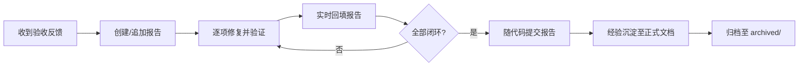

# 验收报告管理

本文档描述 `docs/engineering/acceptance/` 目录下验收报告（Acceptance Report）的管理规范。验收报告用于跟踪每一轮验收反馈的问题、根因、修复与验证结果，是验收闭环的唯一事实来源。

## 目录结构

```
acceptance/
├── AGENTS.md           # 本文件：验收报告管理规范
├── archived/           # 已闭环归档的验收报告（只读，保持原内容不变）
└── *.md                # 在途验收报告
```

## 文档命名

- 新建报告命名格式：`YYYYMMDD-<feature-slug>-acceptance-report.md`，例如 `20260726-factory-acceptance-report.md`。
- 日期为报告创建日期；`<feature-slug>` 为被验收功能的提炼。
- 归档文件保持原内容不变，仅移动位置到 `archived/`。

## 报告内容模板

每份验收报告必须包含：

1. **YAML front matter**：`description`（简述本轮验收主题）与 `type: Permanent`。
2. **状态横幅**：`> **状态**: ...`，概述本轮受理的验收反馈数量与整体进度。
3. **关联文档**：关联 PRD / 技术方案 / 实现方案的链接（`[[...]]` 或相对路径），以及关联分支、验收日期。
4. **需求概述（可选）**：本轮验收对应的需求背景。
5. **验收问题清单**：每个问题一节，包含：
   - 问题描述（含复现 URL/路径）
   - 根因分析
   - 修复方案（按步骤列出，标注涉及文件）
   - 验证结果（✅ 形式，含 E2E / 单测 / lint / build 结果）
   - 修复 commit（在总览表中回填）
6. **修复总览表格**：`| # | 问题 | 根因 | 状态 | 修复 commit |`，实时回填每个问题的 commit hash。
7. **最终验证表格**：lint / build / 单测 / E2E 的结果汇总。
8. **经验总结**：本轮沉淀的可复用经验，简短列表。

## 处理流程



1. **创建/更新报告**：收到验收问题反馈后，在 `acceptance/` 根目录按日期创建报告；同一模块同一轮验收追加到现有报告（问题按 `2.x` 序号递增）。
2. **实时更新**：修复每个问题后，同步更新文档中对应条目（commit hash、验证结果）。
3. **提交文档**：验收完成后随代码一起提交。
4. **知识沉淀**：每个问题修复后，将可复用的经验同步整理到对应的正式参考文档中。
5. **归档**：验收全部闭环、长期经验已沉淀至正式文档后，将报告移入 `archived/`（保持原内容不变），`acceptance/` 根目录只保留在途报告。
6. **引用维护**：归档后，正式文档中引用验收报告的链接需更新为 `archived/` 下的新路径。

## 相关文档

- [[../AGENTS.md|Engineering 文档管理]]
- [[../../../.agents/skills/z-document/SKILL.md|z-document 文档规范]]
