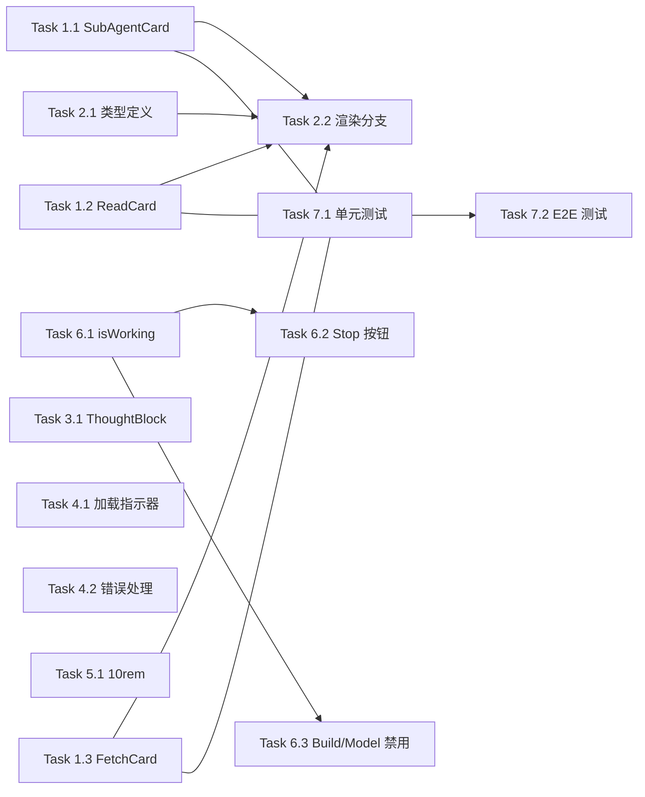

# 用户界面优化二期 - 实现计划

**关联提案**: proposals/20260526-proposal-ui-optimization-phase2.md
**计划版本**: v1.0
**创建日期**: 2026-05-26
**作者**: opencode

## 1. 任务拆解

### Phase 1: 新增消息类型卡片

#### Task 1.1 SubAgentCard 组件

- **文件**: `apps/agent-web/src/components/session/SubAgentCard.tsx`（新增）
- **改动**:
  - 复用 `AcpCard` 可折叠卡片容器
  - 从 `messages` 最后一条解析 `SessionUpdate` 的 `rawInput`
  - 三段式布局：
    - 标题区：`rawInput.description`（如"代码审查"）
    - 主体：`rawInput.prompt`（Markdown 渲染，提取 MarkdownContent 共用组件）
    - 底部：`rawOutput?.output`（与 user/agent 消息一致的外观）
  - 折叠态摘要：`kind + type` 简要信息
  - 无 `rawOutput` 时只显示标题和提示词
  - 从 `Record<string, unknown>` 安全访问 `subagent_type`
- **验证**: 接收 `kind=other` 消息，正确展示 description/prompt/output

#### Task 1.2 ReadCard 组件

- **文件**: `apps/agent-web/src/components/session/ReadCard.tsx`（新增）
- **改动**:
  - 复用 `AcpCard`
  - 上方：`locations` 数组展示为多行文件路径列表
  - 下方：`$.content` 文本内容（共用 MarkdownContent 组件）
  - `locations` 为空时只显示内容区域
- **验证**: 接收 `kind=read` 消息，展示文件路径列表 + 文件内容

#### Task 1.3 FetchCard 组件

- **文件**: `apps/agent-web/src/components/session/FetchCard.tsx`（新增）
- **改动**:
  - 复用 `AcpCard`
  - 显示 `rawInput.url`（可点击链接）
  - 显示 `rawOutput.output` 结果内容（共用 MarkdownContent）
  - 无 `rawOutput` 时只显示 URL
- **验证**: 接收 `kind=fetch` 消息，展示 URL + 结果内容

### Phase 2: MessageList 类型分发扩展

#### Task 2.1 MessageGroup 类型定义扩展

- **文件**: `apps/agent-web/src/components/session/MessageList.tsx`
- **改动**:
  - `MessageGroup['type']` 新增 `'sub_agent'`、`'read'`、`'fetch'`
  - `groupMessages()` 中根据消息的 `sessionUpdate` 类型判断：
    - `kind=other` + `rawInput.subagent_type` 存在 → `type: 'sub_agent'`
    - `kind=read` → `type: 'read'`
    - `kind=fetch` → `type: 'fetch'`
  - 对 `kind=other` 的 `rawInput` 做 safe 检查（`typeof rawInput === 'object' && rawInput !== null`）

#### Task 2.2 渲染分支扩展

- **文件**: `apps/agent-web/src/components/session/MessageList.tsx`
- **改动**:
  - 在 MessageList 渲染 switch 中新增三个分支引用 SubAgentCard / ReadCard / FetchCard
  - 各卡片使用 `expanded` / `onExpandedChange` 支持折叠控制（复用一期 AcpCard 受控展开逻辑）
  - 将卡片包装在 `<div className="...">` 消息容器中

### Phase 3: ThoughtBlock Markdown 渲染

#### Task 3.1 ThoughtBlock 改造

- **文件**: `apps/agent-web/src/components/session/ThoughtBlock.tsx`
- **改动**:
  - 引入 `react-markdown` + `remark-gfm`，保持与 MessageItem 相同的配置
  - 代码块使用 `react-syntax-highlighter` + `Prism` + `oneDark` 主题
  - 保持 AcpCard 的灰底 (`color="gray"`) 和折叠交互不变
  - 折叠态摘要：保留前 60 字符 + "..."（不变）
- **验证**: 思考内容中的代码块语法高亮，列表/标题正确渲染

### Phase 4: 消息列表加载状态

#### Task 4.1 SSE 加载指示器

- **文件**: `apps/agent-web/src/components/session/MessageList.tsx`
- **改动**:
  - 新增 `loading?: boolean` prop
  - 当 `loading=true` 且 `messages` 长度为 0 时，在消息列表中央显示加载提示
  - 使用现有加载组件（InlineSpin 或 Spin 等已有组件）
  - 当 `messages` 首次从 0 变为非 0 时，loading 状态结束
- **文件**: `apps/agent-web/src/pages/SessionPage.tsx`
- **改动**:
  - 新增 `const [loading, setLoading] = useState(false)`
  - 切换会话（`useParams().id` 变化）时 `setLoading(true)`
  - SSE `history` 事件到达时 `setLoading(false)`
  - 传递给 MessageList

#### Task 4.2 SSE 连接失败处理

- **文件**: `apps/agent-web/src/pages/SessionPage.tsx`
- **改动**:
  - EventSource `onerror` 回调中设置错误状态而非无限加载
  - 传递错误状态给 MessageList 显示错误提示

### Phase 5: 输入框 10rem

#### Task 5.1 maxHeight 调整

- **文件**: `apps/agent-web/src/components/session/InputBox.tsx`
- **改动**:
  - `style={{ maxHeight: '5rem', overflowY: 'auto' }}` → `max-h-[10rem]`（Tailwind 任意值）
  - 其他行为（auto-grow、内部滚动、发送后重置）不变

### Phase 6: Agent 运行状态指示

#### Task 6.1 isWorking 派生状态

- **文件**: `apps/agent-web/src/pages/SessionPage.tsx`
- **改动**:
  - 新增 `const isWorking = useMemo(...)` 计算：
    - `messages` 不为空时，检查最后一条消息的 `sessionUpdate` 字段
    - 如果 `sessionUpdate !== 'usage_update'` → `isWorking = true`
  - 传递给 InputBox 和 ModeSwitcher/ModelSwitcher

#### Task 6.2 InputBox Stop 按钮逻辑增强

- **文件**: `apps/agent-web/src/components/session/InputBox.tsx`
- **改动**:
  - 新增 `isWorking?: boolean` prop
  - Agent 工作时的渲染：
    - `isWorking=true` 且 `sending=false` 时：按钮显示 Stop 样式（红色），点击调用 `onStop`
    - `isWorking=true` 时：输入框可输入（不 disabled）
    - `sending=true` 时的 Stop 按钮优先级高于 `isWorking`（保持现有行为）
    - 按钮文案：`isWorking` 时始终显示"Stop"（无论 sending）
- **验证**: Agent 工作时按钮为 Stop，输入框可输入

#### Task 6.3 Build/Model 禁用

- **文件**: `apps/agent-web/src/pages/SessionPage.tsx`（传递 `isWorking`）
- **文件**: `apps/agent-web/src/components/session/ModeSwitcher.tsx`
- **文件**: `apps/agent-web/src/components/session/ModelSwitcher.tsx`
- **改动**:
  - ModeSwitcher/ModelSwitcher 新增 `disabled?: boolean` prop
  - `isWorking=true` 时传入 `disabled={true}`
  - 触发器按钮在 disabled 时置灰 + 不可点击
  - 通过 `cursor-not-allowed`、`opacity-50` 等样式视觉禁用

### Phase 7: 测试

#### Task 7.1 单元测试

- **文件**: `apps/agent-web/src/components/session/__tests__/SubAgentCard.test.tsx`（新增）
- **文件**: `apps/agent-web/src/components/session/__tests__/ReadCard.test.tsx`（新增）
- **文件**: `apps/agent-web/src/components/session/__tests__/FetchCard.test.tsx`（新增）
- **文件**: `apps/agent-web/src/components/session/__tests__/MessageList.test.tsx`（如有，补充新类型分发测试）
- **覆盖**:
  - 三类卡片渲染测试（正常数据、缺失数据）
  - 折叠/展开状态测试
  - MessageList 类型分发判断逻辑
  - ThoughtBlock Markdown 渲染验证（代码块、列表、标题）

#### Task 7.2 E2E 测试

- **文件**: `tests/e2e/src/session.spec.ts`（补充）
- **覆盖**:
  - 新增消息类型在界面中的渲染验证
  - Agent 运行时 Stop 按钮交互
  - Build/Model 禁用状态验证

## 2. 依赖关系



- Phase 1 依赖 Phase 2：新增卡片需先完成，MessageList 才能引用
- Phase 3-6 之间无跨阶段依赖，可并行
- Task 2.1 → Task 2.2 有依赖（类型定义先于渲染分支）
- Task 6.1 → Task 6.2/6.3 有依赖（isWorking 先于下游消费）
- Task 7.1 → Task 7.2（单元测试先于 E2E）

## 3. 执行顺序建议

1. **Phase 3** (Task 3.1 ThoughtBlock Markdown) — 改动最小，独立无依赖，优先完成
2. **Phase 5** (Task 5.1 输入框 10rem) — 一行改动，立即完成
3. **Phase 1** (Task 1.1~1.3 三张卡片) + **Phase 2** (Task 2.1~2.2 类型分发) — 按序完成
4. **Phase 6** (Task 6.1~6.3 Agent 状态) — 需要理解现有状态逻辑，但无代码依赖
5. **Phase 4** (Task 4.1~4.2 SSE 加载) — 独立
6. **Phase 7** (Task 7.1~7.2 测试) — 最后补充

## 4. 涉及文件清单

| 文件路径 | 改动类型 |
|---------|---------|
| `apps/agent-web/src/components/session/SubAgentCard.tsx` | 新增 |
| `apps/agent-web/src/components/session/ReadCard.tsx` | 新增 |
| `apps/agent-web/src/components/session/FetchCard.tsx` | 新增 |
| `apps/agent-web/src/components/session/ThoughtBlock.tsx` | 修改 |
| `apps/agent-web/src/components/session/MessageList.tsx` | 修改 |
| `apps/agent-web/src/components/session/InputBox.tsx` | 修改 |
| `apps/agent-web/src/components/session/ModeSwitcher.tsx` | 修改 |
| `apps/agent-web/src/components/session/ModelSwitcher.tsx` | 修改 |
| `apps/agent-web/src/pages/SessionPage.tsx` | 修改 |
| `apps/agent-web/src/components/session/__tests__/SubAgentCard.test.tsx` | 新增 |
| `apps/agent-web/src/components/session/__tests__/ReadCard.test.tsx` | 新增 |
| `apps/agent-web/src/components/session/__tests__/FetchCard.test.tsx` | 新增 |
| `tests/e2e/src/session.spec.ts` | 补充 |

## 5. 验证命令

```bash
# TypeScript 编译检查
npm run build    # 工作目录: apps/agent-web

# 单元测试
npm run test     # 工作目录: apps/agent-web

# E2E 测试
npm run test     # 工作目录: tests/e2e

# 分项目构建（如需确认所有项目编译通过）
# agent-api, controller-api, agent-controller
npm run build    # 工作目录: servers/agent-api
npm run build    # 工作目录: servers/controller-api
npm run build    # 工作目录: packages/agent-controller
```

## 6. 验收 Checklist

- [ ] SubAgentCard 正确渲染 sub-agent 消息（description/prompt/output）
- [ ] ReadCard 正确渲染 read 消息（文件路径列表 + 内容）
- [ ] FetchCard 正确渲染 fetch 消息（URL + 结果）
- [ ] ThoughtBlock 支持 Markdown 代码块语法高亮
- [ ] 切换会话时消息列表显示 loading 状态
- [ ] SSE 连接失败时显示错误提示
- [ ] 输入框最高高度为 10rem
- [ ] Agent 工作时按钮显示 Stop
- [ ] Agent 工作时 build/model 禁用
- [ ] Agent 工作时输入框可输入
- [ ] Agent 收到 usage_update 后恢复正常状态
- [ ] 121 个单元测试通过
- [ ] 77 个 e2e 测试通过
- [ ] `npm run build` 无错误（tsc + vite）
