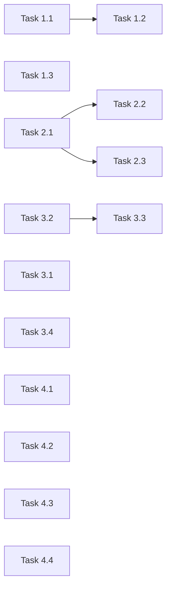

# 用户界面优化 - 实现计划

**关联提案**: proposals/20260526-proposal-ui-optimization.md
**计划版本**: v1.0
**创建日期**: 2026-05-26
**作者**: opencode

## 1. 任务拆解

### Phase 1: 加载状态反馈

#### Task 1.1 SessionHeader 新增 loading props

- **文件**: `apps/agent-web/src/components/session/SessionHeader.tsx`
- **改动**: 
  - 新增 `closing: boolean` 和 `deleting: boolean` props
  - Close 按钮在 `closing` 时 disabled + 显示旋转动画
  - Delete 按钮在 `deleting` 时 disabled + 显示旋转动画
- **验证**: 手动点击 Close/Delete 观察按钮状态

#### Task 1.2 SessionPage 新增 closing/deleting state

- **文件**: `apps/agent-web/src/pages/SessionPage.tsx`
- **改动**:
  - 新增 `const [closing, setClosing] = useState(false)` 和 `const [deleting, setDeleting] = useState(false)`
  - `handleCloseSession` 中 `setClosing(true)` → await → `setClosing(false)`（finally）
  - `handleDeleteSession` 中 `setDeleting(true)` → await → `setDeleting(false)`（finally）
  - 传入 SessionHeader
- **验证**: 操作过程按钮不可重复点击

#### Task 1.3 Sidebar session 切换骨架屏

- **文件**: `apps/agent-web/src/components/Sidebar.tsx`
- **改动**: NavLink to session 时在 SessionPage 加载完成前显示骨架屏（已有 sessionLoading 状态）
- **验证**: 切换 session 时看到加载指示

### Phase 2: 输入框优化

#### Task 2.1 InputBox 布局重构

- **文件**: `apps/agent-web/src/components/session/InputBox.tsx`
- **改动**:
  - 外层容器改为两行布局：toolbar 行 + input 行
  - toolbar 行：ModeSwitcher | ModelSwitcher（左对齐）
  - input 行：textarea（flex-1）+ Send/Stop 按钮
- **验证**: Mode/Model 在上方，输入框在下方占满

#### Task 2.2 InputBox auto-grow

- **文件**: `apps/agent-web/src/components/session/InputBox.tsx`
- **改动**:
  - textarea 添加 `onInput` 事件处理 auto-grow
  - 每次输入：`e.target.style.height = 'auto'` + `e.target.style.height = e.target.scrollHeight + 'px'`
  - CSS: `max-height: 5rem` + `overflow-y: auto` + `resize: none`
  - 发送成功后高度重置
- **验证**: 输入多行文本自动增高，超过 5rem 滚动

#### Task 2.3 InputBox 输入持久化

- **文件**: `apps/agent-web/src/components/session/InputBox.tsx`, `apps/agent-web/src/pages/SessionPage.tsx`
- **改动**:
  - InputBox 新增 `sessionId?: string` prop
  - `useEffect` 在 mount 时从 `localStorage.getItem('session_input_' + sessionId)` 恢复
  - `onChange` 时 `localStorage.setItem('session_input_' + sessionId, value)`
  - 发送成功后 `localStorage.removeItem('session_input_' + sessionId)`
  - SessionPage 传入 `sessionId={id}`
- **验证**: 刷新页面输入内容恢复，发送后清空

### Phase 3: 消息展示优化

#### Task 3.1 MessageList 分组逻辑修复（两个 BUG）

- **文件**: `apps/agent-web/src/components/session/MessageList.tsx`
- **改动**:
  - `groupMessages` 中：`user_message_chunk` → `groupType = 'user_message'`
  - `agent_message_chunk` → `groupType = 'agent_message'`
  - `user_message` 类型不走连续合并逻辑，每条单独成组
  - `agent_message` 保持连续合并
  - 同步修改 `MessageList` switch 中 'user_message' / 'agent_message' 的渲染
- **验证**: 用户消息独立展示，AI 消息不与用户消息合并

#### Task 3.2 AcpCard 受控展开

- **文件**: `apps/agent-web/src/components/session/AcpCard.tsx`
- **改动**:
  - 新增 `expanded?: boolean` 和 `onExpandedChange?: (expanded: boolean) => void` props
  - 如果传入了 `expanded`，使用外部值；否则使用内部 state
  - 点击展开/折叠时，如果 `onExpandedChange` 存在则调用
- **验证**: 传入 expanded={true} 时卡片展开，传 false 时折叠

#### Task 3.3 MessageList 自动展开逻辑

- **文件**: `apps/agent-web/src/components/session/MessageList.tsx`
- **改动**:
  - 新增 `lastAutoExpandedGroupKey` state（useRef）
  - 每个可展开 group（thought / tool_call）渲染时传入 `expanded={groupKey === lastAutoExpandedGroupKey}`
  - messages 变化时：
    - 找到最后一个可展开 group
    - 如果和 `lastAutoExpandedGroupKey` 不同，更新
  - MessageItem / ThoughtBlock / ToolCallCard 将 expanded 透传给 AcpCard
- **验证**: 最后一条可展开消息默认展开，新消息到来时折叠旧展开新

#### Task 3.4 ToolCallCard 状态时间线

- **文件**: `apps/agent-web/src/components/session/ToolCallCard.tsx`
- **改动**:
  - 遍历 messages，收集所有 status 变更记录
  - 卡片内部展开后显示每个状态阶段的时间线
  - 卡片 summary（折叠态）仍显示最终状态
  - 增加日志展示区域（如果有 log 信息）
- **验证**: 卡片内部可见 pending → in_progress → completed 各阶段

### Phase 4: 创建弹窗优化

#### Task 4.1 工作目录下拉替换

- **文件**: `apps/agent-web/src/components/session/NewSessionDialog.tsx`
- **改动**:
  - radio `<fieldset>` 替换为 `<Select>`
  - 每个 `<SelectItem>` 内自定义内容：name + path 两行
  - auto-select 逻辑保留（默认选中第一个）
- **验证**: 工作目录选项保留两行信息，下拉展示

#### Task 4.2 ACP Server 下拉替换

- **文件**: `apps/agent-web/src/components/session/NewSessionDialog.tsx`
- **改动**:
  - radio `<fieldset>` 替换为 `<Select>`
  - 每个 `<SelectItem>` 内自定义内容：type + version 两行
  - auto-select 逻辑保留
- **验证**: ACP Server 选项保留两行信息

#### Task 4.3 分支名称前缀独占一行

- **文件**: `apps/agent-web/src/components/session/NewSessionDialog.tsx`
- **改动**: 前缀从 `flex items-center gap-0` 改为上下两行
- **验证**: 前缀占一行，后缀输入框在下一行

#### Task 4.4 复选框文字颜色修复

- **文件**: `apps/agent-web/src/components/session/NewSessionDialog.tsx`
- **改动**: `` → ``
- **验证**: 文字始终可见

## 2. 依赖关系

- Phase 1-4 无跨阶段依赖，可并行
- Phase 3 内部：Task 3.2 → Task 3.3 有依赖关系
- Phase 2 内部：Task 2.1 → Task 2.2, Task 2.1 → Task 2.3 有依赖

## 3. 执行顺序建议

1. Task 1.2 → Task 1.1 → Task 1.3（加载状态，按 props 传递方向）
2. Task 2.1 → Task 2.2 + Task 2.3（输入框重构，auto-grow 和持久化并行）
3. Task 3.1 (独立，BUG 修复)
4. Task 3.2 → Task 3.3（AcpCard 受控 → 自动展开）
5. Task 3.4 (独立)
6. Task 4.1 ~ 4.4 (独立，可并行)

## 4. 涉及文件清单

| 文件路径 | 改动类型 |
|---------|---------|
| `apps/agent-web/src/pages/SessionPage.tsx` | 修改 |
| `apps/agent-web/src/components/Sidebar.tsx` | 修改 |
| `apps/agent-web/src/components/session/SessionHeader.tsx` | 修改 |
| `apps/agent-web/src/components/session/InputBox.tsx` | 重构 |
| `apps/agent-web/src/components/session/MessageList.tsx` | 修改（核心） |
| `apps/agent-web/src/components/session/AcpCard.tsx` | 修改（新增 props） |
| `apps/agent-web/src/components/session/ToolCallCard.tsx` | 修改 |
| `apps/agent-web/src/components/session/MessageItem.tsx` | 可能不改 |
| `apps/agent-web/src/components/session/ThoughtBlock.tsx` | 可能不改 |
| `apps/agent-web/src/components/session/NewSessionDialog.tsx` | 修改 |
