# Web 端移动端布局 - 实现计划

**关联提案**: `20260527-feat-mobile-layout.md`
**创建日期**: 2026-05-27
**feat-branch**: `feat/mobile-layout`

## 执行概览

所有变更集中在 `apps/agent-web`，无后端依赖。按功能层拆分为 4 个阶段：

| # | 阶段 | 涉及文件 | 预估工时 |
|---|------|---------|---------|
| P1 | 基础设施 | `useIsMobile.ts`, `MobileBackButton.tsx` | 1.5h |
| P2 | 布局壳 + Sidebar | `MainLayout.tsx`, `Sidebar.tsx` | 2h |
| P3 | 页面适配 | `SessionHeader.tsx`, `SettingsPage.tsx`, `ControllerConfigPage.tsx` | 3.5h |
| P4 | 测试 | E2E 测试文件 | 4h |

---

## P1: 基础设施

### P1.1: 新增 `useIsMobile` hook

**文件:** `apps/agent-web/src/hooks/useIsMobile.ts`

```typescript
import { useSyncExternalStore } from 'react';

const MOBILE_BREAKPOINT = 768;

function subscribe(callback: () => void): () => void {
  const mql = window.matchMedia(`(max-width: ${MOBILE_BREAKPOINT - 1}px)`);
  mql.addEventListener('change', callback);
  return () => mql.removeEventListener('change', callback);
}

function getSnapshot(): boolean {
  return window.innerWidth < MOBILE_BREAKPOINT;
}

function getServerSnapshot(): boolean {
  return false;
}

export function useIsMobile(): boolean {
  return useSyncExternalStore(subscribe, getSnapshot, getServerSnapshot);
}
```

**要点：**
- `useSyncExternalStore` 三个参数：subscribe, getSnapshot, getServerSnapshot
- SSR fallback 返回 `false`（默认桌面模式）
- `matchMedia` 的 `change` 事件驱动更新，非 resize 轮询

### P1.2: 新增 `MobileBackButton` 组件

**文件:** `apps/agent-web/src/components/MobileBackButton.tsx`

```typescript
import { useNavigate } from 'react-router-dom';

interface MobileBackButtonProps {
  to?: string;
  label?: string;
}

export default function MobileBackButton({ to, label = '返回' }: MobileBackButtonProps) {
  const navigate = useNavigate();

  return (
    <button
      type="button"
      onClick={() => (to ? navigate(to) : navigate(-1))}
      className="flex shrink-0 items-center gap-1 rounded-md px-2 py-1 text-sm text-gray-600 hover:text-gray-900 md:hidden"
    >
      ← {label}
    </button>
  );
}
```

**要点：**
- `md:hidden` 确保桌面端不显示
- `to` prop 指定目标路由，不传则 `navigate(-1)`
- `shrink-0` 防止在 flex 容器中被压缩

### P1.3: 测试

**文件:** `apps/agent-web/src/hooks/useIsMobile.test.ts`

```typescript
describe('useIsMobile', () => {
  it('should return false for desktop viewport', () => {
    // Arrange: mock window.innerWidth = 1024
    // Act: renderHook(() => useIsMobile())
    // Assert: result.current === false
  });

  it('should return true for mobile viewport', () => {
    // Arrange: mock window.innerWidth = 375
    // Act: renderHook(() => useIsMobile())
    // Assert: result.current === true
  });

  it('should update when viewport changes', () => {
    // Arrange: start at 1024px
    // Act: resize to 375px → trigger matchMedia change event
    // Assert: result.current transitions from false to true
  });
});
```

**验证命令:** `cd apps/agent-web && npx vitest run src/hooks/useIsMobile.test.ts`

---

## P2: 布局壳 + Sidebar 适配

### P2.1: 修改 `MainLayout.tsx`

**文件:** `apps/agent-web/src/pages/MainLayout.tsx`

替换整个组件为：

```typescript
import { Outlet, useLocation } from 'react-router-dom';
import { useAuth } from '../stores/auth';
import { useIsMobile } from '../hooks/useIsMobile';
import Sidebar from '../components/Sidebar';

export default function MainLayout() {
  const { user, loading } = useAuth();
  const isMobile = useIsMobile();
  const location = useLocation();

  if (loading) {
    return (
      <output className="flex h-screen items-center justify-center" aria-label="Loading…">
        <div className="motion-safe:h-8 motion-safe:w-8 motion-safe:animate-spin motion-safe:rounded-full motion-safe:border-4 motion-safe:border-gray-300 motion-safe:border-t-blue-600" />
        <span className="sr-only">Loading…</span>
      </output>
    );
  }

  // 桌面端：保持现有双栏布局（零改动）
  if (!isMobile) {
    return (
      <div className="grid h-screen grid-cols-[240px_1fr]">
        <Sidebar username={user?.username ?? ''} />
        <main className="overflow-auto">
          <Outlet />
        </main>
      </div>
    );
  }

  // 移动端：根据路由决定显示列表还是详情/设置
  const path = location.pathname;
  const isSessionDetail = /^\/sessions\/[^/]+$/.test(path);
  const isSettings = path.startsWith('/settings');

  if (isSessionDetail || isSettings) {
    // 详情/设置模式：全屏内容区
    return (
      <main className="h-screen overflow-auto">
        <Outlet />
      </main>
    );
  }

  // 列表模式：全屏 Sidebar
  return (
    <div className="h-screen">
      <Sidebar username={user?.username ?? ''} mobile />
    </div>
  );
}
```

**要点：**
- `!isMobile` 分支完全保持原有代码，桌面端零改动
- 移动端路由判断：`/sessions/:id` 和 `/settings` 显示内容，其余显示列表
- 正则 `/^\/sessions\/[^/]+$/` 匹配 session 详情页

### P2.2: 修改 `Sidebar.tsx`

**文件:** `apps/agent-web/src/components/Sidebar.tsx`

**变更 1: Props 接口（第 1-9 行附近）**

```typescript
interface SidebarProps {
  username: string;
  mobile?: boolean;
}
```

**变更 2: 根容器（第 142 行）**

```diff
- <nav className="flex h-screen flex-col bg-gray-900 text-white" aria-label="Sidebar">
+ <nav className={`flex flex-col bg-gray-900 text-white ${mobile ? 'h-full' : 'h-screen'}`} aria-label="Sidebar">
```

**变更 3: 移动端底部设置入口（第 280 行附近，在现有 footer 之前）**

在现有 footer `<div>` 之前添加：

```typescript
{mobile && (
  <NavLink
    to="/settings"
    className="flex items-center gap-2 border-t border-gray-700 px-4 py-3 text-sm text-gray-300 hover:text-white"
  >
    <span>⚙️</span>
    <span>设置</span>
  </NavLink>
)}
```

**变更 4: 移动端 Session NavLink 点击后自动隐藏列表**

无需修改 NavLink 本身。点击后 React Router 导航到 `/sessions/:id`，`MainLayout` 检测到路由变化自动切换为详情模式。

**要点：**
- `mobile` prop 默认 `undefined`，桌面端行为不变
- `h-full` vs `h-screen`：移动端 Sidebar 填满父容器而非视口
- 设置入口使用 `NavLink`，点击后 `MainLayout` 切换为详情/设置模式

**验证命令:** `cd apps/agent-web && npx vitest run`

---

## P3: 页面适配

### P3.1: 修改 `SessionHeader.tsx`

**文件:** `apps/agent-web/src/components/session/SessionHeader.tsx`

**变更 1: 新增导入（文件顶部）**

```typescript
import { useIsMobile } from '../../hooks/useIsMobile';
import MobileBackButton from '../MobileBackButton';
```

**变更 2: 组件内部（第 38 行附近）**

在组件函数开头添加：
```typescript
const isMobile = useIsMobile();
```

**变更 3: 头部布局（第 39-60 行附近）**

```diff
  <div className="flex items-center justify-between border-b border-gray-200 bg-white px-4 py-3">
    <div className="flex items-center gap-4">
+     {isMobile && <MobileBackButton to="/sessions" />}
      <h1 className="text-lg font-semibold">
        {session?.controllerName || 'Session'}
      </h1>
      <span className={`rounded-full px-2 py-1 text-xs font-medium ${getStatusBadgeClass(status)}`}>
        {STATUS_LABELS[status] ?? status}
      </span>
-     {session?.acpServerType && (
+     {session?.acpServerType && !isMobile && (
        <span className="rounded bg-gray-100 px-1.5 py-0.5 text-xs text-gray-600">
          ...
        </span>
      )}
-     {session?.cwd && (
+     {session?.cwd && !isMobile && (
        <div className="flex items-center gap-1">
          ...
        </div>
      )}
    </div>
```

**要点：**
- 移动端显示：返回按钮 + 名称 + 状态徽章
- 桌端显示：全部信息（不变）
- `!isMobile` 条件隐藏 ACP Server 类型、cwd、worktree 徽章

### P3.2: 修改 `SettingsPage.tsx`

**文件:** `apps/agent-web/src/pages/SettingsPage.tsx`

**变更 1: 新增导入**

```typescript
import { useIsMobile } from '../hooks/useIsMobile';
import MobileBackButton from '../components/MobileBackButton';
```

**变更 2: 组件内部（第 24 行附近）**

```typescript
const isMobile = useIsMobile();
```

**变更 3: 在 `controllerId` 检查之后、桌面端 return 之前插入移动端布局**

```typescript
// 在 if (controllerId) { ... } 之后，桌面端 return 之前

if (isMobile) {
  return (
    <div className="flex h-full flex-col">
      {/* 顶部栏 */}
      <div className="flex items-center gap-2 border-b px-4 py-3">
        <MobileBackButton to="/sessions" />
        <h1 className="text-lg font-semibold">设置</h1>
      </div>

      {/* 水平 Tab 栏 */}
      <div className="flex gap-1 overflow-x-auto border-b px-4 py-2">
        <button
          type="button"
          onClick={() => scrollTo('account-section')}
          className="shrink-0 rounded-md px-3 py-1.5 text-sm font-medium hover:bg-accent"
        >
          帐号
        </button>
        <button
          type="button"
          onClick={() => scrollTo('provider-section')}
          className="shrink-0 rounded-md px-3 py-1.5 text-sm font-medium hover:bg-accent"
        >
          供应商
        </button>
        <button
          type="button"
          onClick={() => scrollTo('model-section')}
          className="shrink-0 rounded-md px-3 py-1.5 text-sm font-medium hover:bg-accent"
        >
          模型
        </button>
        <button
          type="button"
          onClick={() => scrollTo('controller-section')}
          className="shrink-0 rounded-md px-3 py-1.5 text-sm font-medium hover:bg-accent"
        >
          控制器
        </button>
      </div>

      {/* 内容区（复用现有 section） */}
      <div className="flex-1 overflow-y-auto p-4">
        <section id="account-section" className="mb-8">
          <h2 className="mb-4 text-lg font-semibold">帐号</h2>
          {/* 现有帐号 Card 内容 */}
        </section>
        <section id="provider-section" className="mb-8">
          <ProviderSection />
        </section>
        <section id="model-section" className="mb-8">
          <ModelSection />
        </section>
        <section id="controller-section" className="mb-8">
          <ControllerListSection onNavigateToConfig={handleNavigateToConfig} />
        </section>
      </div>
    </div>
  );
}

// 桌面端布局（保持不变）
return (
  <div className="grid h-full grid-cols-[200px_1fr]">
    {/* 现有代码 */}
  </div>
);
```

**要点：**
- 移动端和桌面端是两个完全独立的 return 分支
- 移动端复用现有的 `ProviderSection`、`ModelSection`、`ControllerListSection` 组件
- Tab 栏使用 `overflow-x-auto` 支持横向滚动
- `scrollTo()` 保持不变，滚动到对应 section

### P3.3: 修改 `ControllerConfigPage.tsx`

**文件:** `apps/agent-web/src/pages/ControllerConfigPage.tsx`

**变更 1: 新增导入**

```typescript
import { useIsMobile } from '../hooks/useIsMobile';
import MobileBackButton from '../components/MobileBackButton';
```

**变更 2: 组件内部**

```typescript
const isMobile = useIsMobile();
```

**变更 3: 在现有 return 之前插入移动端布局**

```typescript
if (isMobile) {
  return (
    <div className="flex h-full flex-col">
      {/* 顶部栏 */}
      <div className="flex items-center gap-2 border-b px-4 py-3">
        <MobileBackButton to="/settings" />
        <span className={`h-2 w-2 rounded-full shrink-0 ${controller?.status === 'online' ? 'bg-green-500' : 'bg-gray-400'}`} />
        <span className="font-medium truncate">{controller?.name || '加载中...'}</span>
      </div>

      {/* Tab 栏 */}
      <div className="flex gap-1 border-b px-4 py-2">
        <button
          type="button"
          onClick={() => setActiveSection('workspace')}
          className={`rounded-md px-3 py-1.5 text-sm font-medium ${activeSection === 'workspace' ? 'bg-accent' : 'hover:bg-accent'}`}
        >
          工作区
        </button>
        <button
          type="button"
          onClick={() => setActiveSection('harness')}
          className={`rounded-md px-3 py-1.5 text-sm font-medium ${activeSection === 'harness' ? 'bg-accent' : 'hover:bg-accent'}`}
        >
          Harness 工具
        </button>
      </div>

      {/* 内容区 */}
      <div className="flex-1 overflow-y-auto p-4">
        {activeSection === 'workspace' && (
          <WorkspaceSection controllerId={controllerId} controllerOnline={controller?.status === 'online'} />
        )}
        {activeSection === 'harness' && (
          <HarnessToolsSection controllerId={controllerId} />
        )}
      </div>
    </div>
  );
}

// 桌面端布局（保持不变）
return (
  <div className="grid h-full grid-cols-[200px_1fr]">
    {/* 现有代码 */}
  </div>
);
```

**要点：**
- 返回按钮指向 `/settings`（而非 `onBack` 清空 searchParams）
- 复用现有的 `WorkspaceSection` 和 `HarnessToolsSection` 组件
- `activeSection` 状态管理保持不变

**验证命令:** `cd apps/agent-web && npx vitest run`

---

## P4: 测试

### P4.1: E2E 测试 — 移动端 Session 流程

**文件:** `tests/e2e/src/session-mobile.spec.ts`（新增）

```typescript
import { test, expect } from '@playwright/test';

test.use({ viewport: { width: 375, height: 812 } }); // iPhone 13 尺寸

test.describe('Session Mobile Layout', () => {
  test('should show full-screen session list on mobile', async ({ page }) => {
    // 登录后访问 /sessions
    // Assert: Sidebar 占满屏幕，无侧边栏宽度限制
    // Assert: Controller 树可见
  });

  test('should navigate to session detail on click', async ({ page }) => {
    // 点击 Session
    // Assert: 页面切换为详情页（全屏）
    // Assert: 返回按钮可见
    // Assert: SessionHeader 显示状态徽章
  });

  test('should navigate back to list from detail', async ({ page }) => {
    // 在详情页点击返回按钮
    // Assert: 回到列表页
  });

  test('should show settings via tab navigation', async ({ page }) => {
    // 点击设置入口
    // Assert: 设置页全屏显示
    // Assert: 顶部 Tab 栏可见（帐号/供应商/模型/控制器）
    // Assert: 左侧 200px 导航栏不可见
  });
});
```

### P4.2: E2E 测试 — 桌面端回归

**文件:** 现有 `tests/e2e/src/session.spec.ts` 等

确保现有桌面端 E2E 测试全部通过（使用默认 1280x720 viewport）。

### P4.3: E2E 测试 — 视口切换

**文件:** `tests/e2e/src/responsive-layout.spec.ts`（新增）

```typescript
test.describe('Responsive Layout', () => {
  test('should switch to mobile layout when viewport shrinks', async ({ page }) => {
    // 桌面端访问 /sessions
    // Assert: 侧边栏可见（240px）
    // 缩小视口到 375px
    // Assert: 侧边栏隐藏，列表全屏
  });

  test('should switch to desktop layout when viewport expands', async ({ page }) => {
    // 移动端访问 /sessions
    // Assert: 列表全屏
    // 扩大视口到 1024px
    // Assert: 侧边栏可见（240px）
  });
});
```

**验证命令:**

```bash
# 移动端测试
cd tests/e2e && BASE_URL="..." npx playwright test src/session-mobile.spec.ts

# 桌面端回归
cd tests/e2e && BASE_URL="..." npx playwright test src/session.spec.ts

# 全量
cd tests/e2e && BASE_URL="..." npx playwright test
```

---

## 执行顺序

```mermaid
gantt
    title 实现计划
    dateFormat  HH:mm
    axisFormat  %H:%m

    section P1 基础设施
    useIsMobile hook          :p1a, 00:00, 0.5h
    MobileBackButton          :p1b, 00:00, 0.5h
    hook 测试                 :p1c, after p1a, 0.5h

    section P2 布局壳
    MainLayout 响应式         :p2a, after p1c, 1h
    Sidebar mobile prop       :p2b, after p1c, 1h

    section P3 页面适配
    SessionHeader             :p3a, after p2a, 1h
    SettingsPage              :p3b, after p2a, 1.5h
    ControllerConfigPage      :p3c, after p3b, 1h

    section P4 测试
    移动端 E2E                :p4a, after p3c, 2h
    桌面端回归                :p4b, after p3c, 1h
    视口切换 E2E              :p4c, after p4a, 1h
```



P1 的两个任务可并行。P2 依赖 P1。P3 的三个任务可并行（依赖 P2）。P4 依赖 P3。

---

## 验证清单

- [ ] `cd apps/agent-web && npm run build` — 编译通过
- [ ] `cd apps/agent-web && npm test` — 单元测试全部通过
- [ ] 375px 设备：Session 列表全屏显示，树结构完整
- [ ] 375px 设备：点击 Session 后详情页全屏，返回按钮可用
- [ ] 375px 设备：设置页 Tab 导航可用
- [ ] 1024px 设备：布局与现有完全一致
- [ ] 视口缩放：375px ↔ 1024px 布局平滑切换
- [ ] E2E 测试全部通过
