# Agent 状态统一 - 实现计划

**关联提案**: `20260527-feat-unified-agent-status.md`
**创建日期**: 2026-05-27
**feat-branch**: `feat/unified-agent-status`

## 执行概览

按子项目拆分为 3 个独立任务，可并行执行：

| # | 子项目 | 涉及文件 | 预估工时 |
|---|--------|---------|---------|
| T1 | agent-controller | `bridge.ts`, `acp-bridge.test.ts` | 2h |
| T2 | controller-api | `socketio.ts`, `acp-session-manager.ts`, `disconnect-timer.ts`, `index.ts`, 测试文件 | 5h |
| T3 | agent-web | `status-colors.ts`, `SessionHeader.tsx`, `Sidebar.tsx`, `SessionPage.tsx`, 测试文件 | 4.5h |

---

## T1: agent-controller — Bridge 事件发送

### 目标

Bridge 在 prompt 生命周期的关键节点发送 Socket.IO 事件，使 controller-api 能感知 agent 的工作状态。

### T1.1: 修改 `bridge.ts`

**文件:** `packages/agent-controller/src/acp/bridge.ts`

**变更 1: 新增 `stopped` 字段（第 40 行附近）**

```typescript
// 在 private initializing = false; 之后新增
private stopped = false;
```

**变更 2: 修改 `processPrompt()` 方法（第 175-193 行）**

替换整个方法为：

```typescript
private async processPrompt(message: QueuedInput): Promise<void> {
  if (!this.connection || !this.acpSessionId || this.stopped) return;

  this.activePrompt = this.connection.prompt({
    sessionId: this.acpSessionId,
    prompt: [{ type: 'text' as const, text: message.content }],
  });

  this.socket.emit('acp:prompt:start', { sessionId: this.sessionId });

  let stopReason = 'end_turn';
  try {
    const result = await this.activePrompt;
    stopReason = result?.stopReason ?? 'end_turn';
  } catch {
    stopReason = 'error';
  } finally {
    this.activePrompt = null;
    if (!this.stopped) {
      this.socket.emit('acp:prompt:complete', {
        sessionId: this.sessionId,
        stopReason,
      });
    }
    if (this.inputQueue.length > 0) {
      this.processPrompt(this.inputQueue.shift()!);
    }
  }
}
```

**变更 3: 修改 `emitStopped()` 方法（第 308-311 行）**

```typescript
private emitStopped(reason: string, exitCode?: number): void {
  this.stopped = true;
  this.socket.emit('acp:stopped', { sessionId: this.sessionId, reason, exitCode });
  this.emit('acp:stopped', { sessionId: this.sessionId, reason, exitCode });
}
```

**变更 4: 修改 `handleError()` 方法（第 313-326 行）**

```typescript
private handleError(error: unknown): void {
  this.stopped = true;
  const msg = error instanceof Error ? error.message : String(error);
  this.socket.emit('acp:stopped', {
    sessionId: this.sessionId,
    reason: 'error',
    error: msg,
  });
  this.emit('acp:stopped', {
    sessionId: this.sessionId,
    reason: 'error',
    error: msg,
  });
  this.spawner.stop();
}
```

### T1.2: 更新 `acp-bridge.test.ts`

**文件:** `packages/agent-controller/tests/acp-bridge.test.ts`

在现有 `describe('sendInput')` 块中新增测试：

```typescript
it('should emit acp:prompt:start when prompt begins', async () => {
  // Arrange: mock prompt 返回 resolve
  // Act: bridge.sendInput({ type: 'text', content: 'hello' })
  // Assert: expect(mockSocket.emit).toHaveBeenCalledWith('acp:prompt:start', { sessionId })
});

it('should emit acp:prompt:complete when prompt ends', async () => {
  // Arrange: mock prompt 返回 { stopReason: 'end_turn' }
  // Act: bridge.sendInput → await prompt 完成
  // Assert: expect(mockSocket.emit).toHaveBeenCalledWith('acp:prompt:complete', { sessionId, stopReason: 'end_turn' })
});

it('should emit acp:prompt:complete with error stopReason on prompt failure', async () => {
  // Arrange: mock prompt 返回 reject
  // Act: bridge.sendInput → await prompt 失败
  // Assert: expect(mockSocket.emit).toHaveBeenCalledWith('acp:prompt:complete', { sessionId, stopReason: 'error' })
});

it('should not emit acp:prompt:complete after stopped', async () => {
  // Arrange: mock prompt 挂起不 resolve
  // Act: bridge.stop() → prompt 被取消 → finally 块执行
  // Assert: expect(mockSocket.emit).not.toHaveBeenCalledWith('acp:prompt:complete', ...)
  // Assert: expect(mockSocket.emit).toHaveBeenCalledWith('acp:stopped', { reason: 'user_close' })
});
```

**验证命令:** `cd packages/agent-controller && npm test`

---

## T2: controller-api — 状态处理与断连管理

### 目标

controller-api 正确处理 `running` ↔ `idling` 状态切换，以及 `disconnected` 断连管理。

### T2.1: 修改 `socketio.ts`

**文件:** `servers/controller-api/src/services/socketio.ts`

**变更:** 在 `acp:stopped` 事件监听之后（第 175 行之后），新增两个事件监听：

```typescript
socket.on('acp:prompt:start', async (payload: { sessionId: string }) => {
  if (!authenticated) return;
  try {
    await acpSessionManager.handlePromptStart(payload.sessionId);
  } catch (err) {
    console.error(`ACP prompt start error for session ${payload.sessionId}:`, err);
  }
});

socket.on('acp:prompt:complete', async (payload: {
  sessionId: string;
  stopReason: string;
}) => {
  if (!authenticated) return;
  try {
    await acpSessionManager.handlePromptComplete(payload.sessionId, payload.stopReason);
  } catch (err) {
    console.error(`ACP prompt complete error for session ${payload.sessionId}:`, err);
  }
});
```

### T2.2: 修改 `acp-session-manager.ts`

**文件:** `servers/controller-api/src/services/acp-session-manager.ts`

**变更 1: 新增 `handlePromptStart` 方法（在 `handleControllerStopped` 之前）**

```typescript
async handlePromptStart(sessionId: string): Promise<void> {
  const result = await Session.findOneAndUpdate(
    { _id: sessionId, status: 'idling' },
    { status: 'running' },
  );
  if (result) {
    await this.publishStatus(sessionId, 'running');
  }
}
```

**变更 2: 新增 `handlePromptComplete` 方法**

```typescript
async handlePromptComplete(sessionId: string, stopReason: string): Promise<void> {
  const result = await Session.findOneAndUpdate(
    { _id: sessionId, status: 'running' },
    { status: 'idling' },
  );
  if (result) {
    await this.publishStatus(sessionId, 'idling');
  }
}
```

**变更 3: 新增 `handleControllerDisconnect` 方法，替换 `handleSocketDisconnect` 中的调用**

```typescript
private async handleControllerDisconnect(sessionId: string): Promise<void> {
  const session = this.sessions.get(sessionId);
  if (session) {
    this.sessions.delete(sessionId);
    const socketSessions = this.socketToSessions.get(session.controllerSocket.id);
    if (socketSessions) {
      socketSessions.delete(sessionId);
      if (socketSessions.size === 0) {
        this.socketToSessions.delete(session.controllerSocket.id);
      }
    }
  }

  // 原子操作：活跃 Session → disconnected
  const result = await Session.findOneAndUpdate(
    { _id: sessionId, status: { $in: ['idling', 'running'] } },
    { status: 'disconnected', disconnectedAt: new Date() },
  );
  if (result) {
    await this.publishStatus(sessionId, 'disconnected');
    return;
  }

  // 非活跃 Session（creating/connecting）→ ended
  await Session.findOneAndUpdate(
    { _id: sessionId, status: { $nin: ['ended', 'disconnected'] } },
    { status: 'ended', endedAt: new Date() },
  );
  await this.publishStatus(sessionId, 'ended');
}
```

**变更 4: 修改 `handleSocketDisconnect` 方法**

```typescript
async handleSocketDisconnect(socketId: string): Promise<void> {
  const socketSessions = this.socketToSessions.get(socketId);
  if (socketSessions) {
    for (const sessionId of socketSessions) {
      await this.handleControllerDisconnect(sessionId);
    }
    this.socketToSessions.delete(socketId);
  }
}
```

### T2.3: 新增 `disconnect-timer.ts`

**文件:** `servers/controller-api/src/services/disconnect-timer.ts`

```typescript
import { Session } from '../models/session.js';
import { getRedisClient } from '../middleware/redis.js';

const SCAN_INTERVAL_MS = 60_000;
const TIMEOUT_MS = 5 * 60_000;

export class DisconnectTimer {
  private timer: ReturnType<typeof setInterval> | null = null;

  start(): void {
    this.timer = setInterval(() => { void this.scan(); }, SCAN_INTERVAL_MS);
  }

  stop(): void {
    if (this.timer) {
      clearInterval(this.timer);
      this.timer = null;
    }
  }

  private async scan(): Promise<void> {
    const threshold = new Date(Date.now() - TIMEOUT_MS);
    const expired = await Session.find(
      { status: 'disconnected', disconnectedAt: { $lt: threshold } },
      { _id: 1 },
    ).lean();

    if (expired.length === 0) return;

    const ids = expired.map((s) => s._id);
    await Session.updateMany(
      { _id: { $in: ids } },
      { status: 'ended', endedAt: new Date() },
    );

    const redis = getRedisClient();
    for (const id of ids) {
      const payload = JSON.stringify({ sessionId: String(id), status: 'ended' });
      await redis.publish('session:status', payload);
    }

    console.log(`[DisconnectTimer] ${ids.length} session(s) timed out → ended`);
  }
}
```

### T2.4: 修改 `index.ts`

**文件:** `servers/controller-api/src/index.ts`

**变更 1: 导入（文件顶部）**

```typescript
import { DisconnectTimer } from './services/disconnect-timer.js';
```

**变更 2: 在服务启动后创建并启动 timer（`startSocketIOServer` 调用之后）**

```typescript
const disconnectTimer = new DisconnectTimer();
disconnectTimer.start();
```

**变更 3: 在 shutdown 逻辑中停止 timer**

```typescript
disconnectTimer.stop();
```

### T2.5: 更新测试

**文件:** `servers/controller-api/src/services/acp-session-manager.test.ts`

新增测试用例：

```typescript
describe('handlePromptStart', () => {
  it('should update status from idling to running', async () => {
    // Arrange: Session.findOneAndUpdate mock 返回非 null
    // Act: manager.handlePromptStart(sessionId)
    // Assert: Session.findOneAndUpdate called with { status: 'idling' }
    // Assert: redis.publish called with status 'running'
  });

  it('should not update when session is not idling', async () => {
    // Arrange: Session.findOneAndUpdate mock 返回 null
    // Act: manager.handlePromptStart(sessionId)
    // Assert: redis.publish not called
  });
});

describe('handlePromptComplete', () => {
  it('should update status from running to idling', async () => {
    // Arrange: Session.findOneAndUpdate mock 返回非 null
    // Act: manager.handlePromptComplete(sessionId, 'end_turn')
    // Assert: Session.findOneAndUpdate called with { status: 'running' }
    // Assert: redis.publish called with status 'idling'
  });

  it('should not update when session is ended (crash race)', async () => {
    // Arrange: Session.findOneAndUpdate mock 返回 null（acp:stopped 先到达）
    // Act: manager.handlePromptComplete(sessionId, 'error')
    // Assert: redis.publish not called
  });
});

describe('handleSocketDisconnect (updated)', () => {
  it('should set active sessions to disconnected instead of ended', async () => {
    // Arrange: session status = 'idling'
    // Act: manager.handleSocketDisconnect(socketId)
    // Assert: Session.findOneAndUpdate called with { status: { $in: ['idling', 'running'] } }
    // Assert: publishStatus called with 'disconnected'
  });

  it('should set creating/connecting sessions to ended', async () => {
    // Arrange: session status = 'creating', findOneAndUpdate for disconnected returns null
    // Act: manager.handleSocketDisconnect(socketId)
    // Assert: second findOneAndUpdate called
    // Assert: publishStatus called with 'ended'
  });
});
```

**新增测试文件:** `servers/controller-api/src/services/disconnect-timer.test.ts`

```typescript
describe('DisconnectTimer', () => {
  it('should mark expired disconnected sessions as ended', async () => {
    // Arrange: Session.find returns expired sessions
    // Act: timer.scan() (通过反射调用 private method)
    // Assert: Session.updateMany called with status 'ended'
    // Assert: redis.publish called for each session
  });

  it('should not modify sessions within timeout', async () => {
    // Arrange: Session.find returns empty array
    // Act: timer.scan()
    // Assert: Session.updateMany not called
  });
});
```

**验证命令:** `cd servers/controller-api && npm test`

---

## T3: agent-web — 前端状态展示统一

### 目标

统一所有组件的状态颜色，`running` 状态显示脉冲动画，简化 `sending`/`isWorking` 逻辑。

### T3.1: 新增 `status-colors.ts`

**文件:** `apps/agent-web/src/components/session/status-colors.ts`

```typescript
export const STATUS_COLORS = {
  creating:     { dot: 'bg-yellow-500', badge: 'bg-yellow-100 text-yellow-800' },
  connecting:   { dot: 'bg-yellow-500', badge: 'bg-yellow-100 text-yellow-800' },
  idling:       { dot: 'bg-green-500',  badge: 'bg-green-100 text-green-800' },
  running:      { dot: 'bg-blue-500',   badge: 'bg-blue-100 text-blue-800 animate-pulse' },
  disconnected: { dot: 'bg-orange-500', badge: 'bg-orange-100 text-orange-800' },
  ended:        { dot: 'bg-gray-500',   badge: 'bg-gray-100 text-gray-800' },
} as const;

export const STATUS_LABELS: Record<string, string> = {
  creating: 'Creating',
  connecting: 'Connecting',
  idling: 'Idle',
  running: 'Working',
  disconnected: 'Disconnected',
  ended: 'Ended',
};

export function getStatusDotColor(status: string): string {
  return STATUS_COLORS[status as keyof typeof STATUS_COLORS]?.dot ?? 'bg-gray-500';
}

export function getStatusBadgeClass(status: string): string {
  return STATUS_COLORS[status as keyof typeof STATUS_COLORS]?.badge ?? 'bg-gray-100 text-gray-800';
}
```

### T3.2: 修改 `Sidebar.tsx`

**文件:** `apps/agent-web/src/components/Sidebar.tsx`

**变更 1: 导入（文件顶部）**

```typescript
import { getStatusDotColor } from './session/status-colors';
```

**变更 2: 删除 `statusColors` 常量（第 13-18 行）**

```diff
- const statusColors: Record<string, string> = {
-   running: 'bg-green-500',
-   connecting: 'bg-yellow-500',
-   creating: 'bg-yellow-500',
-   ended: 'bg-gray-500',
- };
```

**变更 3: 替换状态圆点引用（第 257 行附近）**

```diff
- className={`w-2 h-2 rounded-full ${statusColors[session.status] ?? 'bg-gray-500'}`}
+ className={`w-2 h-2 rounded-full ${getStatusDotColor(session.status)}`}
```

### T3.3: 修改 `SessionHeader.tsx`

**文件:** `apps/agent-web/src/components/session/SessionHeader.tsx`

**变更 1: 导入（文件顶部）**

```typescript
import { getStatusBadgeClass, STATUS_LABELS } from './status-colors';
```

**变更 2: 删除 `getStatusColor` 函数（第 33-50 行）**

```diff
- const getStatusColor = (status: string) => {
-   switch (status) {
-     case 'idling':
-       return 'bg-green-100 text-green-800';
-     // ... 全部删除
-   }
- };
```

**变更 3: 替换徽章引用**

```diff
- <span className={`... ${getStatusColor(status)}`}>
-   {status === 'idling' ? 'Idle' : status === 'running' ? 'Working' : ...}
+ <span className={`... ${getStatusBadgeClass(status)}`}>
+   {STATUS_LABELS[status] ?? status}
```

### T3.4: 修改 `SessionPage.tsx`

**文件:** `apps/agent-web/src/pages/SessionPage.tsx`

**变更: 简化 sending/isWorking 逻辑**

- 保留 `sending` 状态用于乐观 UI（用户点击发送后立即禁用输入），但在 SSE 收到 `status: 'running'` 后由 `isWorking` 接管
- `isWorking` 统一由 `status === 'running'` 驱动
- InputBox 的 `disabled` 条件简化为 `status !== 'idling' && status !== 'running'`

### T3.5: 更新测试

**文件:** `apps/agent-web/src/components/session/SessionHeader.test.tsx`

新增/修改测试：

```typescript
it('should display running status badge with pulse animation', () => {
  render(<SessionHeader session={baseSession} status="running" ... />);
  const badge = screen.getByText('Working');
  expect(badge.className).toContain('animate-pulse');
});

it('should display disconnected status badge', () => {
  render(<SessionHeader session={baseSession} status="disconnected" ... />);
  expect(screen.getByText('Disconnected')).toBeTruthy();
});
```

**验证命令:** `cd apps/agent-web && npm test`

---

## 执行顺序

```mermaid
gantt
    title 实现计划
    dateFormat  HH:mm
    axisFormat  %H:%m

    section T1 agent-controller
    bridge.ts 修改         :t1a, 00:00, 1h
    acp-bridge.test.ts     :t1b, after t1a, 1h

    section T2 controller-api
    socketio.ts 修改       :t2a, 00:00, 0.5h
    acp-session-manager.ts :t2b, 00:00, 1.5h
    disconnect-timer.ts    :t2c, after t2b, 1h
    index.ts 集成          :t2d, after t2c, 0.5h
    测试更新               :t2e, after t2d, 2h

    section T3 agent-web
    status-colors.ts       :t3a, 00:00, 0.5h
    Sidebar.tsx 修改       :t3b, after t3a, 0.5h
    SessionHeader.tsx 修改 :t3c, after t3a, 0.5h
    SessionPage.tsx 修改   :t3d, after t3b, 1h
    测试更新               :t3e, after t3d, 1.5h
```



T1、T2、T3 可并行启动，无前后依赖。

---

## 验证清单

- [ ] `cd packages/agent-controller && npm test` — 全部通过
- [ ] `cd servers/controller-api && npm test` — 全部通过
- [ ] `cd apps/agent-web && npm test` — 全部通过
- [ ] `npm run lint` (各子项目) — 无新增 warning
- [ ] `npm run typecheck` (各子项目) — 无新增 error
- [ ] 手动验证：发送消息 → 状态变 `running` → 回复后变 `idling`
- [ ] 手动验证：停止 controller → 状态变 `disconnected` → 5 分钟后变 `ended`
