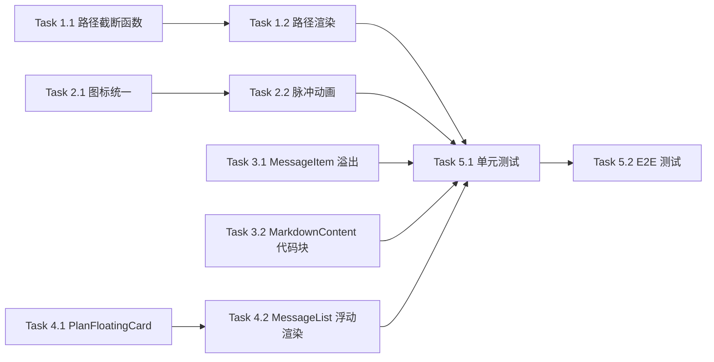

# 前端界面优化三期 - 实现计划

**关联提案**: proposals/20260528-proposal-ui-optimization-phase3.md
**计划版本**: v1.0
**创建日期**: 2026-05-28
**作者**: opencode

## 1. 任务拆解

### Phase 1: SessionHeader 路径截断

#### Task 1.1 路径截断辅助函数

- **文件**: `apps/agent-web/src/components/session/SessionHeader.tsx`
- **改动**:
  - 新增辅助函数 `truncatePathLeft(path: string, maxLen = 40): string`
  - 逻辑：当 `path.length > maxLen` 时返回 `'...' + path.slice(-(maxLen - 3))`
  - 当 `path.length <= maxLen` 时原样返回
- **验证**: 辅助函数对空路径、短路径、长路径的返回值正确

#### Task 1.2 SessionHeader 路径渲染修改

- **文件**: `apps/agent-web/src/components/session/SessionHeader.tsx`
- **改动**:
  - 在 `cwd` 渲染处（第 56-72 行），将路径文本通过 `truncatePathLeft()` 处理后再渲染
  - 在 `<span>` 上添加 `title={session.cwd}` 提供 Tooltip
  - 保留 `font-mono` 和 `text-gray-500` 样式
- **验证**: 长路径显示为 `.../project/src` 形式，Tooltip 显示完整路径

### Phase 2: Sidebar Session 状态圆点

#### Task 2.1 Sidebar Session 图标统一

- **文件**: `apps/agent-web/src/components/Sidebar.tsx`
- **改动**:
  - 修改 Session 列表项的图标渲染逻辑（第 256-267 行）
  - 统一所有 Session 先渲染状态圆点：`<span className="h-2 w-2 shrink-0 rounded-full ${getStatusDotColor(session.status)}" />`
  - worktree 类型在圆点旁追加分支图标（缩小为 12px）：
    ```tsx
    <>
      <span className={`h-2 w-2 shrink-0 rounded-full ${getStatusDotColor(session.status)}`} />
      {session.worktreePath && (
        <svg ... className="shrink-0 text-blue-400" width="12" height="12">...</svg>
      )}
    </>
    ```
  - 删除原有的条件渲染分支（worktree 显示 SVG / 非 worktree 显示圆点）
- **验证**: 所有 Session 显示状态颜色圆点，worktree 类型额外显示分支图标

#### Task 2.2 Running 状态脉冲动画

- **文件**: `apps/agent-web/src/components/session/status-colors.ts`
- **改动**:
  - 检查 `STATUS_COLORS.running.dot` 是否包含 `animate-pulse`
  - 如未包含，在 `getStatusDotColor()` 中对 running 状态追加 `animate-pulse` 类
  - 或在 Sidebar 渲染圆点时根据状态动态追加 `animate-pulse`
- **验证**: Running 状态的圆点有脉冲动画

### Phase 3: 消息内容换行

#### Task 3.1 MessageItem 溢出控制

- **文件**: `apps/agent-web/src/components/session/MessageItem.tsx`
- **改动**:
  - 在消息气泡外层 div（第 99 行 `max-w-[70%]` 所在元素）添加 `overflow-hidden`
  - 确保用户消息的 `whitespace-pre-wrap` 生效（已有）
  - 确保 AI 消息通过 MarkdownContent 渲染时自动换行
- **验证**: 长文本消息在气泡内自动换行，不撑开容器

#### Task 3.2 MarkdownContent 代码块滚动

- **文件**: `apps/agent-web/src/components/session/MarkdownContent.tsx`
- **改动**:
  - 检查 `<SyntaxHighlighter>` 组件（第 21-30 行）是否已有 `overflow-x-auto`
  - 如未添加，在 `SyntaxHighlighter` 的 `className` 中追加 `overflow-x-auto`
  - 确保 `<pre>` 标签（第 52 行）保持 `overflow-x-auto`
- **验证**: 代码块支持水平滚动，不被截断

### Phase 4: Plan 浮动卡片

#### Task 4.1 PlanFloatingCard 组件

- **文件**: `apps/agent-web/src/components/session/PlanFloatingCard.tsx`（新增）
- **改动**:
  - 新建组件，Props: `{ entries: Array<{ content: string; status: string; priority: string }>; collapsed?: boolean; onToggle?: () => void }`
  - 样式：`sticky top-0 z-10 bg-white/90 backdrop-blur-sm rounded-lg shadow-md border border-yellow-200 p-3`
  - 显示内容：
    - 顶部：进度摘要（如 `2/5 completed`）+ 展开/收起按钮
    - 展开态：显示所有 entries（复用 PlanCard 的条目渲染逻辑）
    - 收起态：只显示最后一条条目的内容摘要（截断到 80 字符）
  - 颜色主题：复用 AcpCard 的 yellow 主题
- **验证**: 组件正确渲染 Plan 摘要，展开/收起交互正常

#### Task 4.2 MessageList 提取 Plan + 浮动渲染

- **文件**: `apps/agent-web/src/components/session/MessageList.tsx`
- **改动**:
  - 在 `groups` 计算之后，扫描 groups 找到所有 `type === 'plan'` 的 group
  - 取最后一个 plan group，解析其 messages 中的 entries
  - 计算进度：`completed / total`
  - 新增 state `const [planExpanded, setPlanExpanded] = useState(false)`
  - 在消息列表顶部（`<div className="space-y-4">` 之前）渲染 `PlanFloatingCard`：
    ```tsx
    {lastPlan && (
      <PlanFloatingCard
        entries={lastPlan.entries}
        collapsed={!planExpanded}
        onToggle={() => setPlanExpanded(!planExpanded)}
      />
    )}
    ```
  - 消息列表为空时不显示
  - 提取 Plan 解析逻辑为辅助函数（复用 PlanCard 的解析）
- **验证**: 包含 Plan 的 Session 在消息列表顶部显示浮动卡片，不随滚动移动

### Phase 5: 测试

#### Task 5.1 单元测试

- **文件**: `apps/agent-web/src/components/session/__tests__/SessionHeader.test.tsx`（补充）
- **文件**: `apps/agent-web/src/components/session/__tests__/MessageList.test.tsx`（补充）
- **文件**: `apps/agent-web/src/components/session/__tests__/PlanFloatingCard.test.tsx`（新增）
- **覆盖**:
  - SessionHeader 路径截断：长路径截断、短路径完整、Tooltip 属性
  - Sidebar 状态圆点：各状态颜色正确
  - PlanFloatingCard：渲染进度、展开/收起、空 entries
  - MessageList Plan 浮动：有 Plan 时显示、无 Plan 时不显示

#### Task 5.2 E2E 测试

- **文件**: `tests/e2e/src/session.spec.ts`（补充）
- **覆盖**:
  - Session 标题栏路径截断展示
  - Session 列表状态圆点颜色
  - 消息内容换行不撑开容器
  - Plan 浮动卡片交互

## 2. 依赖关系



- Phase 1-4 之间无跨阶段依赖，可并行开发
- Phase 5 依赖 Phase 1-4 全部完成

## 3. 执行顺序建议

1. **Phase 1** (Task 1.1~1.2 SessionHeader 路径截断) — 改动最小，独立无依赖
2. **Phase 3** (Task 3.1~3.2 消息换行) — 改动最小，独立无依赖
3. **Phase 2** (Task 2.1~2.2 Sidebar 状态圆点) — 独立，需修改 status-colors.ts
4. **Phase 4** (Task 4.1~4.2 Plan 浮动卡片) — 改动最大，需新建组件
5. **Phase 5** (Task 5.1~5.2 测试) — 最后补充

## 4. 涉及文件清单

| 文件路径 | 改动类型 |
|---------|---------|
| `apps/agent-web/src/components/session/SessionHeader.tsx` | 修改 |
| `apps/agent-web/src/components/Sidebar.tsx` | 修改 |
| `apps/agent-web/src/components/session/status-colors.ts` | 可能修改 |
| `apps/agent-web/src/components/session/MessageItem.tsx` | 修改 |
| `apps/agent-web/src/components/session/MarkdownContent.tsx` | 微调 |
| `apps/agent-web/src/components/session/PlanFloatingCard.tsx` | 新增 |
| `apps/agent-web/src/components/session/MessageList.tsx` | 修改 |
| `apps/agent-web/src/components/session/__tests__/SessionHeader.test.tsx` | 补充 |
| `apps/agent-web/src/components/session/__tests__/PlanFloatingCard.test.tsx` | 新增 |
| `apps/agent-web/src/components/session/__tests__/MessageList.test.tsx` | 补充 |
| `tests/e2e/src/session.spec.ts` | 补充 |

## 5. 验证命令

```bash
# TypeScript 编译检查
npm run build    # 工作目录: apps/agent-web

# 单元测试
npm run test     # 工作目录: apps/agent-web

# E2E 测试
npm run test     # 工作目录: tests/e2e

# Lint
npm run lint     # 工作目录: apps/agent-web
```

## 6. 验收 Checklist

- [ ] `cwd` 路径过长时从左侧截断，保留右侧目录层级
- [ ] 鼠标悬停在路径上时显示完整路径 Tooltip
- [ ] Session 列表每个 Session 显示与状态对应颜色的圆点
- [ ] Running 状态圆点带脉冲动画
- [ ] worktree 类型 Session 在圆点旁保留分支图标
- [ ] 消息气泡内容过长时自动换行，不撑开容器
- [ ] 代码块支持水平滚动
- [ ] 包含 Plan 的 Session 在消息列表顶部显示浮动 Plan 卡片
- [ ] Plan 浮动卡片显示进度和最后一条条目
- [ ] Plan 浮动卡片可展开/收起
- [ ] Plan 浮动卡片不随消息列表滚动
- [ ] 现有单元测试全部通过
- [ ] 现有 E2E 测试全部通过
- [ ] 新增测试覆盖各功能点
- [ ] `npm run build` 无错误
- [ ] `npm run lint` 无错误
