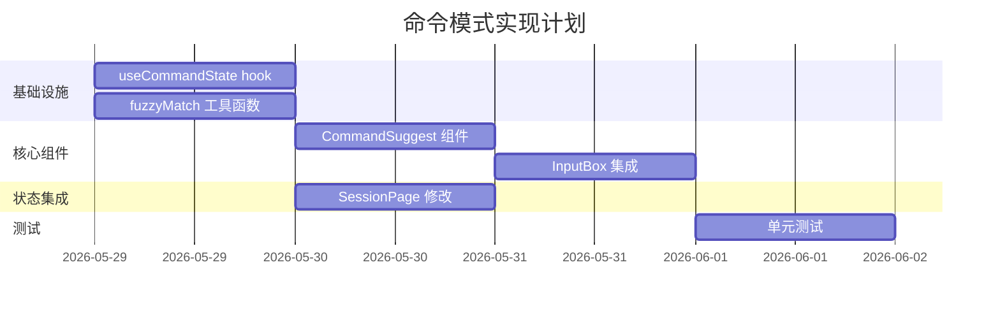

# 命令模式 - 实现计划

**关联技术提案**: 20260529-command-mode.md
**计划版本**: v1.0
**创建日期**: 2026-05-29

## 1. 任务分解

### 阶段一：基础设施

| 序号 | 任务 | 描述 | 依赖 |
|------|------|------|------|
| 1.1 | 创建 useCommandState hook | 管理可用命令状态，提供 updateCommands 方法 | 无 |
| 1.2 | 创建 fuzzyMatch 工具函数 | 实现顺序模糊匹配算法 | 无 |

### 阶段二：核心组件

| 序号 | 任务 | 描述 | 依赖 |
|------|------|------|------|
| 2.1 | 创建 CommandSuggest 组件 | 命令下拉选择 UI，包含匹配高亮、键盘导航 | 1.2 |
| 2.2 | 集成 InputBox 组件 | 添加命令触发检测、下拉框定位、补全逻辑 | 1.1, 2.1 |

### 阶段三：状态集成

| 序号 | 任务 | 描述 | 依赖 |
|------|------|------|------|
| 3.1 | 修改 SessionPage | 处理 available_commands_update 消息，传递命令状态 | 1.1 |

### 阶段四：测试

| 序号 | 任务 | 描述 | 依赖 |
|------|------|------|------|
| 4.1 | fuzzyMatch 单元测试 | 测试模糊匹配算法 | 1.2 |
| 4.2 | CommandSuggest 组件测试 | 测试下拉组件渲染和交互 | 2.1 |
| 4.3 | InputBox 集成测试 | 测试命令触发和补全 | 2.2 |

## 2. 实现顺序



## 3. 详细实现步骤

### 3.1 useCommandState hook

**文件**: `apps/agent-web/src/hooks/useCommandState.ts`

```typescript
interface Command {
  name: string;
  description?: string;
}

export function useCommandState() {
  const [commands, setCommands] = useState<Command[]>([]);
  
  const updateCommands = (newCommands: Command[]) => {
    setCommands(newCommands);
  };
  
  return { commands, updateCommands };
}
```

**验收标准**:
- [ ] hook 返回 commands 数组和 updateCommands 方法
- [ ] updateCommands 正确更新状态

### 3.2 fuzzyMatch 工具函数

**文件**: `apps/agent-web/src/lib/fuzzyMatch.ts`

```typescript
export function fuzzyMatch(query: string, target: string): boolean {
  let queryIndex = 0;
  for (let i = 0; i < target.length && queryIndex < query.length; i++) {
    if (target[i] === query[queryIndex]) {
      queryIndex++;
    }
  }
  return queryIndex === query.length;
}
```

**验收标准**:
- [ ] "cnet" 匹配 "connect"
- [ ] "con" 匹配 "connect"
- [ ] "xyz" 不匹配 "connect"
- [ ] 空查询匹配所有命令

### 3.3 CommandSuggest 组件

**文件**: `apps/agent-web/src/components/session/CommandSuggest.tsx`

**功能**:
- 显示匹配的命令列表
- 高亮匹配字符
- 支持键盘导航（上/下箭头）
- 支持鼠标点击选择
- 支持 Enter/Tab 确认选择

**验收标准**:
- [ ] 正确显示过滤后的命令列表
- [ ] 匹配字符高亮显示
- [ ] 键盘导航正常工作
- [ ] 点击选择正常工作
- [ ] 无匹配结果时隐藏

### 3.4 InputBox 集成

**文件**: `apps/agent-web/src/components/session/InputBox.tsx`

**修改点**:
- 添加 `availableCommands` prop
- 检测输入 "/" 触发命令检索
- 计算下拉框位置
- 处理命令选择和补全
- 处理键盘事件（上/下/Enter/Tab/Esc）

**验收标准**:
- [ ] 输入 "/" 显示下拉框
- [ ] 继续输入更新匹配结果
- [ ] 选择命令后补全输入框
- [ ] 按 Esc 关闭下拉框
- [ ] 失去焦点关闭下拉框

### 3.5 SessionPage 修改

**文件**: `apps/agent-web/src/pages/SessionPage.tsx`

**修改点**:
- 使用 useCommandState hook
- 处理 available_commands_update 消息
- 传递 availableCommands 给 InputBox

**验收标准**:
- [ ] 收到 available_commands_update 消息时更新命令列表
- [ ] 命令列表正确传递给 InputBox

## 4. 测试计划

### 4.1 fuzzyMatch 单元测试

**文件**: `apps/agent-web/src/lib/fuzzyMatch.test.ts`

**测试用例**:
- 精确匹配
- 模糊匹配（顺序）
- 不匹配
- 空查询
- 大小写敏感

### 4.2 CommandSuggest 组件测试

**文件**: `apps/agent-web/src/components/session/CommandSuggest.test.tsx`

**测试用例**:
- 渲染命令列表
- 键盘导航
- 点击选择
- 无匹配结果隐藏

### 4.3 InputBox 集成测试

**文件**: `apps/agent-web/src/components/session/InputBox.test.tsx`

**测试用例**:
- 命令触发检测
- 下拉框显示/隐藏
- 命令补全
- 边界条件处理

## 5. 风险与应对

| 风险 | 影响 | 应对措施 |
|------|------|---------|
| SSE 消息格式变化 | 命令列表无法解析 | 添加错误处理和默认值 |
| 下拉框定位不准 | 用户体验差 | 使用输入框底部定位方案 |
| 键盘事件冲突 | 功能异常 | 仔细处理事件优先级 |

## 6. 完成标准

- [ ] 所有代码实现完成
- [ ] 所有单元测试通过
- [ ] 代码 review 通过
- [ ] 功能验收通过
