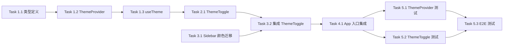

# 黑暗模式 - 实现计划

**关联提案**: proposals/20260529-feat-dark-mode.md
**计划版本**: v1.0
**创建日期**: 2026-05-29
**作者**: Agent

## 1. 任务拆解

### Phase 1: ThemeProvider 核心

#### Task 1.1 ThemeContext 类型定义

- **文件**: `apps/agent-web/src/contexts/ThemeContext.tsx`（新增）
- **改动**:
  - 定义类型 `Theme = 'light' | 'dark' | 'system'`
  - 定义类型 `ResolvedTheme = 'light' | 'dark'`
  - 定义 Context 类型：
    ```typescript
    interface ThemeContextType {
      theme: Theme
      resolvedTheme: ResolvedTheme
      setTheme: (theme: Theme) => void
    }
    ```
- **验证**: TypeScript 编译通过

#### Task 1.2 ThemeProvider 实现

- **文件**: `apps/agent-web/src/contexts/ThemeContext.tsx`
- **改动**:
  - 创建 `ThemeContext` 和 `ThemeProvider` 组件
  - 初始化逻辑：
    - 从 `localStorage.getItem('theme')` 读取
    - 无则默认 `'system'`
    - 验证值是否为合法 Theme
  - 系统主题监听：
    - 使用 `window.matchMedia('(prefers-color-scheme: dark)')`
    - 添加 `change` 事件监听
    - 组件卸载时移除监听
  - 主题应用逻辑：
    - 计算 `resolvedTheme`
    - `document.documentElement.classList.toggle('dark', resolvedTheme === 'dark')`
  - `setTheme` 实现：
    - 更新 state
    - 写入 `localStorage.setItem('theme', theme)`
    - 立即应用主题
- **验证**: Provider 渲染不报错，context 值正确传递

#### Task 1.3 useTheme Hook

- **文件**: `apps/agent-web/src/hooks/useTheme.ts`（新增）
- **改动**:
  - 封装 `useContext(ThemeContext)`
  - 添加错误检查：在 Provider 外使用时抛出错误
  - 导出 `{ theme, resolvedTheme, setTheme }`
- **验证**: Hook 在 Provider 内可正常使用，Provider 外抛出错误

### Phase 2: ThemeToggle 组件

#### Task 2.1 ThemeToggle 组件实现

- **文件**: `apps/agent-web/src/components/ThemeToggle.tsx`（新增）
- **改动**:
  - 使用 lucide-react 的 `Moon`、`Sun`、`Monitor` 图标
  - 三档循环逻辑：
    ```typescript
    const nextTheme: Record<Theme, Theme> = {
      light: 'dark',
      dark: 'system',
      system: 'light'
    }
    ```
  - 图标映射：
    - `light` → `Moon`
    - `dark` → `Sun`
    - `system` → `Monitor`
  - Title 映射：
    - `light` → '明亮模式'
    - `dark` → '黑暗模式'
    - `system` → '跟随系统'
  - 样式：复用设置按钮的 `rounded p-1.5 text-sm transition-colors text-muted-foreground hover:text-foreground`
- **验证**: 组件渲染正确，点击切换主题，图标和 title 随主题变化

### Phase 3: Sidebar 集成

#### Task 3.1 Sidebar 颜色迁移

- **文件**: `apps/agent-web/src/components/Sidebar.tsx`
- **改动**:
  - 根容器（第 152 行）：
    - `bg-gray-900` → `bg-sidebar`
    - `text-white` → `text-sidebar-foreground`
  - 顶部标题栏：
    - `hover:bg-gray-800` → `hover:bg-sidebar-accent`
  - Session 列表项：
    - `hover:bg-gray-800` → `hover:bg-sidebar-accent`
    - `text-gray-300` → `text-sidebar-foreground`
    - `text-gray-400` → `text-muted-foreground`
  - 底部栏（第 308 行）：
    - `border-gray-700` → `border-sidebar-border`
  - 用户名：
    - `text-sm font-medium` 保持，颜色跟随 `text-sidebar-foreground`
  - 设置按钮：
    - `bg-gray-700` → `bg-sidebar-accent`
    - `text-gray-400` → `text-muted-foreground`
- **验证**: 明亮模式下视觉效果与迁移前一致

#### Task 3.2 集成 ThemeToggle

- **文件**: `apps/agent-web/src/components/Sidebar.tsx`
- **改动**:
  - 导入 `ThemeToggle` 组件
  - 在底部栏设置按钮左侧添加 `<ThemeToggle />`（第 311-312 行之间）
  - 布局：`[TodoListPanel] [ThemeToggle] [Settings]`
- **验证**: ThemeToggle 显示在设置按钮左侧，点击可切换主题

### Phase 4: App 入口集成

#### Task 4.1 App.tsx 包裹 ThemeProvider

- **文件**: `apps/agent-web/src/App.tsx`
- **改动**:
  - 导入 `ThemeProvider`
  - 在 `BrowserRouter` 外层包裹 `ThemeProvider`
  - 结构：
    ```tsx
    <ThemeProvider>
      <BrowserRouter>
        <AuthProvider>
          <ApolloProvider client={apolloClient}>
            <Routes>...</Routes>
          </ApolloProvider>
        </AuthProvider>
      </BrowserRouter>
    </ThemeProvider>
    ```
- **验证**: 应用正常启动，主题切换功能可用

### Phase 5: 测试

#### Task 5.1 ThemeProvider 单元测试

- **文件**: `apps/agent-web/src/contexts/__tests__/ThemeContext.test.tsx`（新增）
- **覆盖**:
  - 默认主题为 'system'
  - localStorage 有值时正确读取
  - setTheme 更新主题并写入 localStorage
  - 系统主题变化时 resolvedTheme 更新（system 模式）
  - 非 system 模式不受系统主题变化影响
  - 无效 localStorage 值降级为 'system'
- **验证**: 所有测试通过

#### Task 5.2 ThemeToggle 单元测试

- **文件**: `apps/agent-web/src/components/__tests__/ThemeToggle.test.tsx`（新增）
- **覆盖**:
  - light 模式显示 Moon 图标
  - dark 模式显示 Sun 图标
  - system 模式显示 Monitor 图标
  - 点击循环切换：light → dark → system → light
  - title 属性正确显示
- **验证**: 所有测试通过

#### Task 5.3 E2E 测试

- **文件**: `tests/e2e/src/theme.spec.ts`（新增）
- **覆盖**:
  - 默认跟随系统主题
  - 点击切换按钮切换主题
  - 主题切换后界面立即生效
  - 刷新后主题保持
  - Sidebar 颜色正确响应主题
- **验证**: E2E 测试通过

## 2. 依赖关系



- Phase 1 是基础，Phase 2-4 依赖 Phase 1
- Phase 3 的颜色迁移可与 Phase 2 并行
- Phase 5 依赖 Phase 1-4 全部完成

## 3. 执行顺序建议

1. **Phase 1** (Task 1.1~1.3 ThemeProvider 核心) — 基础设施，必须先完成
2. **Phase 2** (Task 2.1 ThemeToggle) + **Phase 3 Task 3.1** (Sidebar 颜色迁移) — 可并行
3. **Phase 3 Task 3.2** (集成 ThemeToggle) — 依赖 Phase 2 和 Task 3.1
4. **Phase 4** (Task 4.1 App 入口集成) — 依赖 Phase 1-3
5. **Phase 5** (Task 5.1~5.3 测试) — 最后补充

## 4. 涉及文件清单

| 文件路径 | 改动类型 |
|---------|---------|
| `apps/agent-web/src/contexts/ThemeContext.tsx` | 新增 |
| `apps/agent-web/src/hooks/useTheme.ts` | 新增 |
| `apps/agent-web/src/components/ThemeToggle.tsx` | 新增 |
| `apps/agent-web/src/components/Sidebar.tsx` | 修改 |
| `apps/agent-web/src/App.tsx` | 修改 |
| `apps/agent-web/src/contexts/__tests__/ThemeContext.test.tsx` | 新增 |
| `apps/agent-web/src/components/__tests__/ThemeToggle.test.tsx` | 新增 |
| `tests/e2e/src/theme.spec.ts` | 新增 |

## 5. 验证命令

```bash
# TypeScript 编译检查
npm run build    # 工作目录: apps/agent-web

# 单元测试
npm run test     # 工作目录: apps/agent-web

# E2E 测试
npm run test     # 工作目录: tests/e2e

# Lint
npm run lint     # 工作目录: apps/agent-web
```

## 6. 验收 Checklist

### Phase 1 验收
- [ ] ThemeContext 类型定义正确
- [ ] ThemeProvider 默认主题为 system
- [ ] localStorage 读写正常
- [ ] 系统主题监听正常工作
- [ ] `.dark` class 正确切换

### Phase 2 验收
- [ ] ThemeToggle 图标随主题变化
- [ ] 三档循环切换正常
- [ ] title 属性显示正确

### Phase 3 验收
- [ ] Sidebar 使用 CSS 变量
- [ ] 明亮模式视觉效果与迁移前一致
- [ ] 黑暗模式视觉效果正确
- [ ] ThemeToggle 位于设置按钮左侧

### Phase 4 验收
- [ ] 应用正常启动
- [ ] 主题切换全局生效
- [ ] 刷新后主题保持

### Phase 5 验收
- [ ] 单元测试全部通过
- [ ] E2E 测试全部通过
- [ ] `npm run build` 无错误
- [ ] `npm run lint` 无错误
