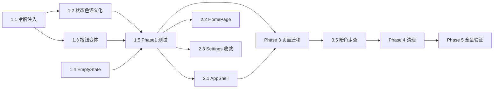

# 整体前端设计优化 - 实现计划

**关联提案**: proposals/20260721-refactor-frontend-design-overhaul.md
**关联 PRD**: docs/product/draft/20260721-frontend-design-overhaul.md
**计划版本**: v1.0
**创建日期**: 2026-07-21
**作者**: kimi-cli

## 0. 基线与总原则

- 仅涉及子项目 `apps/agent-web`（外加 `tests/e2e` 回归）；`contracts/` 零改动，后端零改动。
- **先跑基线**：开工前执行 `npm run build && npm run test && npm run lint`（工作目录 `apps/agent-web`），记录现有 23 个测试文件全部通过的状态作为安全网。
- 全程 TDD 红-绿-重构：新增组件/行为先写测试；纯样式替换类任务以"现有测试不红 + 页面走查"为验证。
- 颜色替换映射表（全计划唯一标准）：

| 现状硬编码 | 替换为 | 用途 |
|-----------|--------|------|
| `bg-blue-600 text-white`（主按钮、用户气泡） | `bg-primary text-primary-foreground` | 主操作/用户消息 |
| `bg-blue-500` / `text-blue-400` / `border-t-blue-600` | `bg-info` / `text-info` / `border-t-primary` | 运行态/链接态/spinner |
| `bg-green-500` | `bg-success` | 在线点/空闲态 |
| `bg-yellow-500`、`bg-yellow-100 text-yellow-800` | `bg-warning`、`bg-warning/15 text-warning-foreground` | 创建/连接中 |
| `bg-orange-500`、`bg-orange-100 text-orange-800` | `bg-warning-deep` 系（或并入 warning） | 断连态 |
| `bg-gray-100 text-gray-800` / `bg-gray-500` | `bg-muted text-muted-foreground` | 结束态/中性徽章 |
| `bg-red-*` / `text-red-*` | `bg-destructive` / `text-destructive` | 危险操作/错误 |
| `text-gray-500/600`、`border-gray-*` | `text-muted-foreground`、`border-border` | 辅助文字/边框 |

## 1. 任务拆解

### Phase 1: 设计令牌与基元统一

#### Task 1.1 设计令牌注入

- **文件**: `apps/agent-web/src/index.css`
- **改动**:
  - `:root` 与 `.dark` 中注入品牌主色（替换纯黑 `--primary`）：
    - light: `--primary: oklch(0.55 0.20 264)` 系（蓝紫品牌色），dark: 提亮至 `oklch(0.72 0.14 264)` 系；最终值以 §5 对比度校验微调
  - 新增语义色令牌（亮/暗双套）：`--success` / `--success-foreground`、`--warning` / `--warning-foreground`、`--info` / `--info-foreground`
  - `@theme inline` 中补充对应 `--color-success` 等映射，使其可作为 Tailwind 类使用
  - `--chart-1~5` 由灰阶改为品牌协调的有彩色阶
  - 新增排版令牌：heading 1~4 字号/字重（供各页标题统一引用）
- **验证**: `npm run build` 通过；`bg-primary` 呈现品牌色；亮/暗切换两体系均生效

#### Task 1.2 状态色语义化

- **文件**: `apps/agent-web/src/components/session/status-colors.ts`
- **改动**:
  - `STATUS_COLORS` 全部改为语义类（按 §0 映射表），如 `creating: { dot: 'bg-warning', badge: 'bg-warning/15 text-warning-foreground' }`
  - `STATUS_LABELS` 中文化：`创建中 / 连接中 / 空闲 / 工作中 / 已断连 / 已结束`
  - fallback 由 `bg-gray-500` / `bg-gray-100 text-gray-800` 改为 `bg-muted` / `bg-muted text-muted-foreground`
- **验证**: 引用方（Sidebar、SessionHeader 等）无需改动即获得暗色适配；相关测试断言同步更新

#### Task 1.3 按钮基元变体扩展

- **文件**: `apps/agent-web/src/components/ui/button.tsx`
- **改动**:
  - 补充缺失变体：`xs` 尺寸（替代 Sidebar "新建" 的 `px-2 py-1 text-xs` 手写）、`ghost-danger`（替代 Close/Delete 手写样式）
  - 变体全部基于语义 token，不引入硬编码色
- **验证**: 新增变体单测（Task 1.5）；`npm run build` 通过

#### Task 1.4 EmptyState 通用组件

- **文件**: `apps/agent-web/src/components/ui/empty-state.tsx`（新增）
- **改动**: Props `{ icon: LucideIcon; title: string; description?: string; action?: ReactNode }`；垂直居中、muted 配色、可选引导操作
- **验证**: 单测覆盖有/无 description、有/无 action 渲染

#### Task 1.5 Phase 1 测试

- **文件**: `apps/agent-web/src/components/ui/__tests__/button.test.tsx`（补充变体用例）、`empty-state.test.tsx`（新增）
- **验证**: 红-绿循环完成；基线测试无新增失败

### Phase 2: 布局壳与首页

#### Task 2.1 AppShell 导航分区

- **文件**: `apps/agent-web/src/components/AppShell.tsx`（新增）、`apps/agent-web/src/pages/MainLayout.tsx`（改造）
- **改动**:
  - 抽取统一导航壳：顶部/侧栏导航分三组——会话（现有会话树入口）、网关（GatewaySection）、设置；当前区域选中态用 `bg-accent text-accent-foreground`
  - 移动端与桌面端共用同一导航数据结构（`{ key, label, icon: LucideIcon, path }[]`），仅以 Tailwind `md:` 响应式类切换形态
  - 保持 `grid-cols-[240px_1fr]` 桌面布局与现有移动端列表/详情切换行为不变
- **验证**: AppShell 单测（分组渲染、选中态）；移动端现有测试（SessionHeader.mobile.test.tsx 等）不红

#### Task 2.2 HomePage 首页

- **文件**: `apps/agent-web/src/pages/HomePage.tsx`（新增）、`apps/agent-web/src/App.tsx`（index 路由替换）
- **改动**:
  - 替换 `App.tsx:31-35` 占位 div 为 `<HomePage />`
  - 内容：会话概况（复用 Sidebar 既有 sessions/controllers 查询，不新增 API）、最近会话快捷入口、"新建会话"主操作、空数据时用 EmptyState 引导
- **验证**: HomePage 单测（有数据/空数据两态）；手动走查首屏

#### Task 2.3 SettingsPage 响应式收敛

- **文件**: `apps/agent-web/src/pages/SettingsPage.tsx`
- **改动**: 双套 JSX（`SettingsPage.tsx:60-125` vs `127-251`）合并为单一 markup + `md:` 响应式类；锚点导航按钮迁移至 `ui/button` ghost 变体
- **验证**: 桌面/移动两态手动走查；`?controllerId=` 深链行为不变

### Phase 3: 业务页面迁移（硬编码清零 + 图标 + 文案）

> 按文件逐个迁移，每个文件迁移后跑一次 `npm run test` 确保不红。下列文件清单即 §4 全量清单（含硬编码处数）。

#### Task 3.1 会话域迁移

- **文件**（处数）: `status-colors.ts`(21，Task 1.2 已完成) → `PlanFloatingCard.tsx`(7) → `ConfigOptionCard.tsx`(4) → `CurrentModeCard.tsx`(3) → `SessionPage.tsx`(3) → `DiffView.tsx`(2) → `TerminalOutput.tsx`(2) → `MessageList.tsx`(2) → `NewSessionDialog.tsx`(2) → `MessageItem.tsx`(1) → `CommandSuggest.tsx`(1) → `PlanCard.tsx`(1)
- **改动**: 按 §0 映射表替换；`SessionHeader.tsx:91-147` 三个手写操作按钮迁移至 `ui/button`；手写内联 SVG 全部替换 lucide
- **验证**: 会话域现有测试（SessionHeader 23 例、MessageItem 8 例等）全绿

#### Task 3.2 设置域迁移

- **文件**（处数）: `GithubBindingSection.tsx`(8) → `ControllerListSection.tsx`(6) → `McpServerSection.tsx`(4) → `HarnessToolsSection.tsx`(4) → `WorkspaceSection.tsx`(2) → `HistorySessionDialog.tsx`(1)
- **改动**: 按 §0 映射表替换；表单/列表操作按钮统一 `ui/button`
- **验证**: 设置域现有测试全绿；手动走查各分节

#### Task 3.3 布局与通用组件迁移

- **文件**（处数）: `Sidebar.tsx`(5) → `ControllerConfigPage.tsx`(4) → `MainLayout.tsx`(1) → `ProtectedRoute.tsx`(1) → `TodoListPanel.tsx`(1) → `GatewayItem.tsx`(1)
- **改动**: 按 §0 映射表替换；`Sidebar.tsx:204-207/322-325` 内联 SVG、`📁/⚙️/▼/▶` 全部替换 lucide；Sidebar "新建" 按钮迁移 `ui/button` xs 变体；登录/注册页品牌呈现对齐
- **验证**: 全量单测；四象限走查（亮/暗 × 桌面/移动）

#### Task 3.4 文案统一

- **文件**: `apps/agent-web/src/lib/copy.ts`（新增术语表常量）、`SessionHeader.tsx`（Close/Continue/Delete）、`SessionPage.tsx`（"New Session" 等）、`lib/apollo.ts`（"Session expired..." toast）、其余页面零散英文
- **改动**: 操作类文案 100% 简体中文；术语表落地（Session/Workspace/Worktree/MCP 保留英文原词）
- **验证**: 全项目 grep 残留英文操作文案为零；断言英文文案的测试同步更新

#### Task 3.5 暗色模式走查

- **文件**: 视走查结果微调 `index.css` 暗色 token 值与少量 `dark:` 变体
- **验证**: 逐页暗色走查清单通过；关键文本对比度 ≥ 4.5:1（对比度工具校验）

### Phase 4: 死代码清理与数据流收敛

#### Task 4.1 SessionPage SSE 收敛（先测试后切换）

- **文件**: `apps/agent-web/src/pages/SessionPage.tsx`、`apps/agent-web/src/hooks/useSessionStream.ts`
- **改动**: **先**为 SessionPage 流处理补测试（history/message/status/mode:changed 各事件的红测试）；**再**将内联 EventSource 实现切换为复用 `useSessionStream`，事件处理逐条对齐（含 `SessionPage.tsx:366` 的 `as any` 一并消除）
- **验证**: 新增流处理测试全绿；会话页手动回归（收发消息、模式切换、断线提示）

#### Task 4.2 toast 统一与杂项清理

- **文件**: `SessionPage.tsx:351-355`（自实现 errorToast → sonner）、`components/_test_use.tsx`（删除）、`assets/react.svg|vite.svg|hero.png`（删除）、`components.json`（css 路径 `src/App.css` → `src/index.css`）、`package.json`（`@types/react-syntax-highlighter` 移至 devDependencies）
- **验证**: 错误场景 toast 表现一致；`npm run build && npm run test` 通过

### Phase 5: 全量验证

#### Task 5.1 单元测试全量 + 覆盖率

- **验证**: `npm run test` 全绿，覆盖率 ≥ 80%

#### Task 5.2 E2E 回归

- **文件**: `tests/e2e/`（仅补充受文案变更影响的断言，不新增流程）
- **验证**: E2E 零新增失败

## 2. 依赖关系



- Phase 1 是一切的前提（映射目标 token 必须先存在）
- Phase 2 三个任务相互独立，可并行；与 Phase 3 可部分并行（不同文件）
- Task 4.1 必须先补测试再切换实现（TDD）

## 3. 执行顺序建议

1. **Phase 1**（1.1 → 1.2/1.3/1.4 → 1.5）— 令牌与基元，独立 PR 可上线
2. **Phase 2**（2.1 / 2.2 / 2.3 并行）— 布局壳与首页
3. **Phase 3**（3.1 → 3.2 → 3.3 → 3.4 → 3.5）— 页面迁移，文件级小步提交
4. **Phase 4**（4.1 先行补测试 → 4.2）— 清理
5. **Phase 5** — 全量验证后合并

## 4. 涉及文件清单

| 文件路径 | 改动类型 |
|---------|---------|
| `apps/agent-web/src/index.css` | 修改（令牌注入） |
| `apps/agent-web/src/components/session/status-colors.ts` | 修改（语义化 + 中文标签） |
| `apps/agent-web/src/components/ui/button.tsx` | 修改（变体扩展） |
| `apps/agent-web/src/components/ui/empty-state.tsx` | 新增 |
| `apps/agent-web/src/components/AppShell.tsx` | 新增 |
| `apps/agent-web/src/pages/HomePage.tsx` | 新增 |
| `apps/agent-web/src/App.tsx` | 修改（index 路由） |
| `apps/agent-web/src/pages/MainLayout.tsx` | 修改（接入 AppShell） |
| `apps/agent-web/src/pages/SettingsPage.tsx` | 修改（响应式收敛） |
| `apps/agent-web/src/pages/SessionPage.tsx` | 修改（色板/文案/SSE 收敛） |
| `apps/agent-web/src/pages/LoginPage.tsx` / `RegisterPage.tsx` | 修改（品牌呈现） |
| `apps/agent-web/src/pages/ControllerConfigPage.tsx` | 修改（色板替换） |
| `apps/agent-web/src/components/Sidebar.tsx` | 修改（图标/按钮/色板） |
| `apps/agent-web/src/components/{ProtectedRoute,TodoListPanel,GatewayItem}.tsx` | 修改（色板替换） |
| `apps/agent-web/src/components/session/*.tsx`（12 个文件） | 修改（色板/图标/按钮） |
| `apps/agent-web/src/components/settings/*.tsx`（6 个文件） | 修改（色板/按钮） |
| `apps/agent-web/src/lib/copy.ts` | 新增（文案常量/术语表） |
| `apps/agent-web/src/lib/apollo.ts` | 修改（toast 文案） |
| `apps/agent-web/src/components/_test_use.tsx` | 删除 |
| `apps/agent-web/src/assets/{react.svg,vite.svg,hero.png}` | 删除 |
| `apps/agent-web/components.json` / `package.json` | 修改（杂项修正） |
| `apps/agent-web/src/components/ui/__tests__/{button,empty-state}.test.tsx` | 新增/补充 |
| `apps/agent-web/src/components/__tests__/AppShell.test.tsx`、`pages/__tests__/HomePage.test.tsx` | 新增 |
| `apps/agent-web/src/pages/__tests__/SessionPage.stream.test.tsx` | 新增（4.1 红测试） |
| 受文案变更影响的既有测试断言 | 同步更新 |
| `tests/e2e/` | 仅同步受影响断言 |

## 5. 验证命令

```bash
# 工作目录: apps/agent-web
npm run build          # TypeScript 编译检查（strict）
npm run test           # Vitest 单测
npm run lint           # ESLint

# 工作目录: tests/e2e
npm run test           # E2E 回归（需先编排服务）

# 暗色对比度校验（手动）
# 亮/暗 × 桌面/移动四象限逐页走查，对比度工具抽检关键文本 ≥ 4.5:1
```

## 6. 验收 Checklist

### Phase 1
- [ ] 品牌主色与语义色令牌（success/warning/info）亮/暗双套生效
- [ ] status-colors.ts 零硬编码色板，状态标签中文化
- [ ] ui/button 新增 xs / ghost-danger 变体并有测试
- [ ] EmptyState 组件有测试

### Phase 2
- [ ] AppShell 导航三区（会话/网关/设置）分组与选中态正确
- [ ] 首页展示会话概况与快捷入口，占位文案移除
- [ ] SettingsPage 单一 JSX，桌面/移动两态正常，`?controllerId=` 深链不变

### Phase 3
- [ ] 25 个文件 88 处硬编码色板清零（grep 校验为零）
- [ ] 内联 SVG / emoji / ▼▶ 图标清零，统一 lucide
- [ ] 操作文案 100% 简体中文，英文操作文案 grep 为零
- [ ] 暗色逐页走查通过，关键对比度 ≥ 4.5:1

### Phase 4
- [ ] SessionPage 复用 useSessionStream，流处理测试先行且全绿
- [ ] 死代码（_test_use.tsx / 模板 assets）删除，components.json 修正
- [ ] toast 统一 sonner

### Phase 5
- [ ] `npm run build` / `test` / `lint` 全绿，覆盖率 ≥ 80%
- [ ] E2E 回归零新增失败
- [ ] `contracts/` 目录零改动确认
