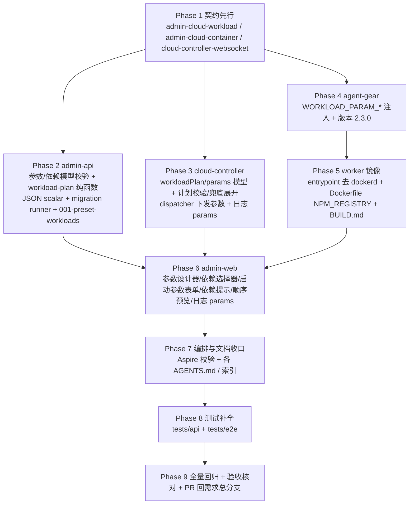

# 工作负载一期（参数、依赖与预制工作负载）- 实现计划

**关联 Proposal**: `docs/engineering/proposals/20261018-feat-workload-phase1.md`（v1.2）
**关联 PRD**: `docs/product/draft/20261018-workload-phase1.md`（v1.2）
**需求总分支（feat-branch）**: `feat/workload-phase1`（基于 `main`，需求总 PR #221）
**开发分支**: `servers/workload-phase1`、`apps/workload-phase1`、`packages/workload-phase1`、`tests/workload-phase1`（均基于 `feat/workload-phase1`，完成后各自提 PR 回需求总分支）
**创建日期**: 2026-10-18
**计划版本**: v1.0

## 实现顺序



依赖说明：

- **Phase 1 契约**是全部实现的输入，独立提交（`docs(contracts): ...`）。
- **Phase 2（admin-api）** 与 **Phase 3（cloud-controller）** 仅依赖 Phase 1，可并行；二者共用「依赖展开 + 参数归一」语义，必须以 §计划期裁决 4~6 为准实现一致。
- **Phase 4（agent-gear）** 仅依赖 Phase 1 协议即可并行开发；与 Phase 3 的联调在 Phase 8。
- **Phase 6（admin-web）** 仅依赖 Phase 1/2 契约，admin-api 未就绪时可先以 mock 开发（顺序预览为前端镜像实现，最终以服务端为准）。
- **Phase 5（worker 镜像）** 依赖 Phase 4 的 agent-gear 版本产物；**Phase 7** 依赖 Phase 2~5 的配置项定型；**Phase 8** 在各实现分支合并回需求总分支后切出；**Phase 9** 收口。

开发模式采用 TDD（红-绿-重构）：每个 Phase 先写测试（RED）再实现（GREEN）。编码前加载 `docs/engineering/common-rules.md`、`backend-rules.md`（后端 Phase）与 `frontend-rules.md`（前端 Phase），并遵循各子项目 `AGENTS.md`。

### 关键约束（提案 §5.2/§6.1，实现期不得回退）

- **契约先行**：三份契约先于实现独立提交，字段与提案 §3 逐项对齐；`scalar JSON` 只在 `contracts/admin-cloud-workload.graphql` 声明一次。
- **权限不放宽**：工作负载 CRUD/参数/依赖/日志仅管理员可见；worker 脚本环境不因参数注入获得新的执行边界、超时或权限能力。
- **参数不落 K8s env**：脚本仍只经 Socket.IO `workload:run` 下发；参数以 `items[].params` 随条目下发，worker 侧注入 `WORKLOAD_PARAM_*` 环境变量，**不改写脚本文本**（避免注入）。
- **单一事实源**：`cloudworkloads` 由 admin-api 写入、cloud-controller 只读；`cloudcontainers`/`cloudworkloadlogs` 由 cloud-controller 写入；admin-api 只读降级路径不变。
- **依赖展开在 admin-api**：cloud-controller 仅执行已下发的计划，保留「仅 `workloadIds`」的兜底展开以兼容滚动升级。
- **预制项一次性**：migration 只补缺、不覆盖；已写入的预制项归管理员所有，后续启动不恢复。
- **frontend 手写类型**：admin-web 无 codegen，`graphql/` 下类型与契约人工对齐；数据加载分支一律 `loading && !data`。
- **测试纪律**：新增代码单测覆盖率 ≥ 80%；API 与 E2E 串行执行；测试服务只用 Aspire 编排。

## 计划期裁决（提案留白/含混处的实现口径）

1. **迁移 runner 归属**：复制 `servers/agent-api/src/migrations/` 模式到 `servers/admin-api/src/migrations/`，使用**独立集合 `admin_migrations`**（与 agent-api 的 `migrations` 隔离，避免两个服务共用账本）。在 Mongo 连接成功后、`app.listen` 之前执行；单个 migration 失败只记录错误、不阻断启动，下次启动按未完成重试（沿用 agent-api 口径）。
2. **预制项写入口径**：每项先按 `presetKey` 查、再按精确 `name` 查；已存在则跳过并打 `warn`，**不覆盖**。Aspire 的 `dependsOnWorkloadIds` 分别解析为「本次插入或同名已存在的 Docker / .NET」，顺序固定 `[Docker, .NET]`；任一依赖缺失则记录告警并保留空依赖（不阻断）。
3. **预制脚本存放**：四个预制脚本作为 `001-preset-workloads.ts` 内的常量写入 `cloudworkloads.initScript`；写库后归管理员所有，后台可编辑；后续新增预制项走新的 `002-...` migration 并注册到 `runMigrations([...])` 数组。
4. **依赖展开唯一语义（admin-api 权威，cloud-controller 兜底）**：以「显式选择 + 依赖配置顺序」为输入，做**后序 DFS**（先访问 `dependsOnWorkloadIds` 全部依赖、再输出自身），天然实现「依赖先于依赖方」「同一负载只出现一次」「多条路径去重」；DFS 栈重复即视为依赖环（运行时兜底报错）。cloud-controller 仅在请求**不带 `workloadPlan`**（旧版 admin-api）时，用只读定义做同样的兜底展开。
5. **执行计划结构**：`workloadPlan = [{ workloadId, params, implicit }]`，数组顺序即执行顺序；由 admin-api 生成并随 `POST /internal/containers` 下发；cloud-controller 落库到 `cloudcontainers.workloadPlan`，并由 plan 派生写入 `workloadIds`（兼容旧版读取）。展开后条数 >10 返回错误（admin-api 侧文案 `expanded workloads exceed 10`）。
6. **参数归一与校验**：显式选择使用用户参数、缺省字段填默认值；隐式依赖使用其默认参数。`SELECT` 为 `options` 内字符串；`MULTI_SELECT` 为 `options` 子集且去重（可空数组）；`TEXT` 为 ≤1024 字符字符串；`BOOLEAN` 为布尔值；未知参数报 `unknown parameter: <key>`，类型/取值非法报 `invalid value for parameter <key>`。保存时校验规则见 Phase 2（`paramSchema` 上限 20、`key` 正则、`label` 1~64、`options` 1~50 去重、`defaultValue` 必填且合法）。
7. **参数环境变量约定**：worker 对每个 item 以 `process.env` 为基础注入 `WORKLOAD_PARAMS=<完整 JSON>` 与 `WORKLOAD_PARAM_<KEY_UPPER>`（`KEY_UPPER = key.toUpperCase()`）：字符串原样、布尔 `"true"`/`"false"`、多选为 JSON 数组字符串（`["pnpm"]`）。参数 env 仅对当前 item 生效，不污染后续脚本；`params` 缺省为 `{}` 时行为与旧版一致。
8. **worker 版本与门禁**：agent-gear minor bump 到 `2.3.0`（major 保持 2）；`cloud-controller` 的 `MIN_WORKER_VERSION` **保持 `2.2.0`**（2.2.0 worker 仍能执行不带参数的脚本，预制脚本均带默认值兜底），但 worker 镜像必须重建为 ≥2.3.0 才能获得参数注入能力；AGENTS/BUILD 文档需写明该升级要求。
9. **依赖选择器为多选**：以契约 §3.1.2/§6.1 与 PRD 功能点 4 为准，工作负载编辑支持 0~5 个依赖的多选；提案 §5.2 实现点 9 中「单选工作负载」为 v1.1 单依赖版本的遗留描述，实现按多选。
10. **顺序预览是前端镜像**：admin-web 提供与服务端同口径的纯函数用于「初始化顺序预览」与隐式依赖提示，但**仅作展示**，最终执行顺序以服务端下发的计划为准。
11. **布尔/空值判定**：动态表单以「参数键是否存在」判断是否填写，不得用 truthy 判定（避免 `false`/空字符串被误判为未填）。
12. **E2E 边界**：沿用基线口径（`K8S_ENABLED=false`、无真实工作容器回连），`INITIALIZING`/脚本执行/参数注入的真实链路由 cloud-controller + agent-gear 单测与 `tests/api`（直写 Mongo）覆盖；E2E 只覆盖 CRUD、参数表单、依赖提示、顺序预览、日志 params 展示；真实集群脚本执行列部署侧手工验收（含 `aspire --version`）。
13. **向后兼容**：`adminStartCloudContainer` 的 `workloadIds` 保留为可选，`workloadIds` 与 `workloads` 二选一（同时非空报错）；历史容器无 `workloadPlan` 时 dispatcher 回退 `workloadIds → {workloadId, params:{}, implicit:false}`；历史日志无 `params` 时展示为空/`{}`。
14. **entrypoint 去 dockerd**：`deploy/images/worker/entrypoint.sh` 删除 `start_dockerd` 函数与调用（保留镜像引用规范化 shim 与 agent-gear 更新/监督逻辑）；dockerd 由「Docker」工作负载脚本按需启动。
15. **JSON scalar 必须运行时校验**：admin-api 新增依赖 `graphql-type-json`，`defaultValue`/`params` 绕过 GraphQL 静态类型，服务层必须做运行时类型与取值校验。
16. **参数不入敏感数据**：参数会落执行记录，界面需提示「不得存放密码/Token」；参数不得改变脚本执行边界、超时与权限（PRD §4.2）。

---

## Phase 1: 契约变更（contracts/）

开发分支：`servers/workload-phase1`。本 Phase 独立提交（`docs(contracts): ...`）。

### 文件修改

| 文件 | 操作 | 说明 |
|------|------|------|
| `contracts/admin-cloud-workload.graphql` | 修改 | 新增 `scalar JSON`；`enum CloudWorkloadParamType { SELECT MULTI_SELECT TEXT BOOLEAN }`；`type CloudWorkloadParamField { key label type options defaultValue }` 与 `input CloudWorkloadParamFieldInput`；`type CloudWorkload` 增加 `paramSchema: [CloudWorkloadParamField!]!`、`dependsOnWorkloadIds: [ID!]!`、`isPreset: Boolean!`；`Create/UpdateCloudWorkloadInput` 增加 `paramSchema`、`dependsOnWorkloadIds`；`type CloudWorkloadLog` 增加 `params: JSON!`；新增 `input CloudWorkloadSelectionInput { workloadId: ID!, params: JSON }`；注释补充参数/依赖校验上限（§计划期裁决 6、9）与错误文案 |
| `contracts/admin-cloud-container.graphql` | 修改 | `adminStartCloudContainer` 增加 `workloads: [CloudWorkloadSelectionInput!]`；注释补充 `workloadIds`/`workloads` 二选一、`duplicate workload selection`、`expanded workloads exceed 10`、`dependency workload not found` 等约束 |
| `contracts/cloud-controller-websocket.md` | 修改 | §2.9 `items[]` 增加 `workloadId`、`params`（键为参数标识、值类型与注入约定）；附录 A.2.2 `POST /internal/containers` 请求体增加可选 `workloadPlan:[{workloadId,params,implicit}]` 与校验/兜底展开说明；A.3 `CloudContainer` JSON 增加 `workloadPlan`；A.6 `CloudWorkloadLog` JSON 增加 `params` |

### 验收 checklist

- [ ] 三份契约与提案 §3/§4 逐字段一致；`scalar JSON` 仅声明一次，不产生重复定义
- [ ] `workload:run` items 的 `params` 键/值类型与注入约定（§计划期裁决 7）在契约中无歧义
- [ ] `workloadIds`/`workloads` 二选一与 `workloadPlan` 兜底展开在契约中写明
- [ ] 契约变更独立提交，后续 Phase 才动实现代码

---

## Phase 2: admin-api（参数/依赖模型 + workload-plan 纯函数 + migration）

开发分支：`servers/workload-phase1`。TDD 顺序：先写 `src/services/workload-plan.test.ts`、扩展 `src/services/cloud-workload.test.ts`、`src/graphql/resolvers/cloud-workload.test.ts`、`src/graphql/resolvers/cloud-container.test.ts`、`src/migrations/*.test.ts`（RED）→ 实现（GREEN）。

### 文件修改

| 文件 | 操作 | 说明 |
|------|------|------|
| `servers/admin-api/package.json` | 修改 | 新增依赖 `graphql-type-json`（与 agent-api 用法一致） |
| `servers/admin-api/src/models/cloud-workload.ts` | 修改 | 新增 `paramSchema`（子文档数组：`key`/`label`/`type`（enum `select`/`multi_select`/`text`/`boolean`）/`options`/`defaultValue` Mixed，default `[]`）、`dependsOnWorkloadIds: [ObjectId]`（default `[]`，index）、`presetKey`（unique sparse，default null）、`isPreset`（Boolean，default false） |
| `servers/admin-api/src/models/cloud-container.ts` | 修改 | 只读模型新增 `workloadPlan` 子文档数组（`workloadId`/`params` Mixed/`implicit` Boolean），与 cloud-controller schema 对齐（仅 find） |
| `servers/admin-api/src/models/cloud-workload-log.ts` | 修改 | 只读模型新增 `params` Mixed（default `{}`），与 A.6 对齐 |
| `servers/admin-api/src/services/cloud-workload.ts` | 修改 | DTO 增加 `paramSchema`/`dependsOnWorkloadIds`/`isPreset`；新增参数与依赖校验（§计划期裁决 6）：参数 ≤20、`key` 满足 `^[a-z][a-z0-9_]{0,31}$` 且工作负载内唯一、`label` 1~64、`options` 仅下拉类型使用（1~50 项、去重、非空、单项 ≤100、其他类型归一为 `[]`）、`defaultValue` 必填且按类型校验；依赖 ≤5、存在、非自身、数组内去重、DFS 检测依赖环并返回环路径；`mapWorkloadLog` 增加 `params` 归一 |
| `servers/admin-api/src/services/workload-plan.ts` | 新增 | 纯函数 `resolveWorkloadPlan(explicitSelections, definitions, options)`：一次批量查询定义 → 建 `explicitById`（含用户参数）→ 按显式选择顺序后序 DFS（依赖按配置顺序、去重、环兜底）→ 参数归一（显式优先、缺省填默认、隐式用默认、未知/非法报错）→ 结果 ≤10 → 返回有序 `[{workloadId, params, implicit}]`；不依赖 Mongoose，输入为定义快照，便于单测全分支 |
| `servers/admin-api/src/services/cloud-controller-client.ts` | 修改 | `start(purpose, workloadPlan, workloadIds)`：`POST /internal/containers` 请求体携带 `workloadPlan` 与派生的 `workloadIds`；`CloudContainerDTO` 若需兼容旧字段保持不变（不新增读路径） |
| `servers/admin-api/src/graphql/schemas/cloud-workload.ts` | 修改 | 逐字段对齐契约：JSON scalar、`CloudWorkloadParamType`/`CloudWorkloadParamField`/`CloudWorkloadParamFieldInput`、`CloudWorkload` 新字段、Create/Update 新字段、`CloudWorkloadLog.params`、`CloudWorkloadSelectionInput` |
| `servers/admin-api/src/graphql/schemas/cloud-container.ts` | 修改 | `adminStartCloudContainer(purpose, workloadIds, workloads)` 参数扩展 |
| `servers/admin-api/src/graphql/schemas/index.ts` | 复用 | 无需新增注册（`cloudWorkloadTypeDefs`/`cloudContainerTypeDefs` 已登记）；如新增 JSON schema 文件则登记 |
| `servers/admin-api/src/graphql/resolvers/index.ts` | 修改 | 注册 `JSON: GraphQLJSON` scalar resolver |
| `servers/admin-api/src/graphql/resolvers/cloud-workload.ts` | 修改 | CRUD 透传 `paramSchema`/`dependsOnWorkloadIds`；校验错误（重复 key/默认值非法/依赖环/自依赖/依赖不存在/超 5）映射为明确 GraphQL 错误 |
| `servers/admin-api/src/graphql/resolvers/cloud-container.ts` | 修改 | `adminStartCloudContainer` 支持 `workloads`：校验二选一、调用 `resolveWorkloadPlan`，将计划与派生 `workloadIds` 经 `cloudControllerClient.start` 下发；`workloadIds` 路径等价于全默认参数 |
| `servers/admin-api/src/migrations/runner.ts` | 新增 | 复制 agent-api runner（锁 + 已执行集合 + 单项失败不阻断 + finally 释放锁），改用 `admin_migrations` |
| `servers/admin-api/src/migrations/models.ts` | 新增 | `admin_migrations` 模型（`name` unique sparse、`executedAt`、`_lock`、`acquired`、`expiresAt`） |
| `servers/admin-api/src/migrations/001-preset-workloads.ts` | 新增 | `001-preset-workloads`：Docker（无参数/无依赖/dockerd 脚本）、Node.js（`version` TEXT 默认 `22`、`package_manager` MULTI_SELECT options `npm/pnpm/bun/yarn` 默认 `["npm"]`）、.NET（无参数/无依赖，LTS 脚本）、Aspire（无参数，`dependsOnWorkloadIds=[Docker,.NET]`，CLI 安装 + `aspire --version`）；按 §计划期裁决 2/3 写入 |
| `servers/admin-api/src/index.ts` | 修改 | Mongo 连接成功后、`seedAdmin` 与 `app.listen` 前后按序执行 `runMigrations([migration001])`；失败 try/catch 记录日志不阻断启动 |
| `servers/admin-api/src/config/index.ts` | 复用 | 无需新增配置项（migration/参数无环境变量开关） |

### 测试用例（增量）

| # | 用例 | 预期 |
|---|------|------|
| T-WP1 | `resolveWorkloadPlan` 显式依赖顺序（先选依赖方） | 输出依赖在前、依赖方在后；顺序与依赖配置一致 |
| T-WP2 | 仅选 Aspire（配置 `[Docker, .NET]`） | 输出 `Docker → .NET → Aspire`，两个依赖 `implicit=true` |
| T-WP3 | 显式 + 隐式重复选中同一依赖 | 只出现一次，`implicit=false`，使用显式参数 |
| T-WP4 | 多条依赖路径指向同一节点 | 去重且位置由拓扑序决定 |
| T-WP5 | 依赖环 / 依赖不存在 / 自依赖（运行时兜底） | 抛明确错误（含环路径） |
| T-WP6 | 展开后 >10 | 抛 `expanded workloads exceed 10` |
| T-WP7 | 参数归一 | 缺省字段填默认值；未知参数报 `unknown parameter: <key>`；类型/取值非法报 `invalid value for parameter <key>`；多选去重并校验子集 |
| T-W8 | `paramSchema` CRUD（四种类型） | 正常保存与回显；空表单无配置 |
| T-W9 | 参数校验边界 | key 重复/非法、label 超长、options 空/重复/超限、默认值不在 options/类型不符 → 拒绝并给字段路径 |
| T-W10 | 依赖保存校验 | 正常、超 5、自依赖、依赖不存在、依赖环 → 拒绝并给明确错误 |
| T-W11 | `adminStartCloudContainer(workloads)` | 内部 API 请求体携带 `workloadPlan` + 派生 `workloadIds`；`workloadIds` 单独调用行为不变 |
| T-W12 | `workloads` 与 `workloadIds` 同时非空 | 返回二选一错误 |
| T-MIG1 | `001-preset-workloads` 首次执行 | 写入四项，Aspire 依赖指向 Docker/.NET；记录 `admin_migrations` |
| T-MIG2 | 二次启动（已执行） | 跳过，不重复写入 |
| T-MIG3 | 同名已存在 / presetKey 已存在 | 保留现有数据、打告警、不覆盖 |
| T-MIG4 | 单项写入失败 | 记录错误不阻断启动，其余项照常 |

### 命令参考

```bash
cd servers/admin-api && npx vitest run src/services/workload-plan.test.ts src/services/cloud-workload.test.ts src/graphql/resolvers/cloud-workload.test.ts src/graphql/resolvers/cloud-container.test.ts src/migrations
cd servers/admin-api && npm run build
```

### 验收 checklist

- [ ] T-WP*/T-W*/T-MIG* 全部通过；`npm run build` strict 通过
- [ ] `JSON` scalar 已注册；GraphQL 类型与契约逐字段一致
- [ ] 参数/依赖校验全部在服务层（resolver 保持薄），错误文案与契约一致
- [ ] migration 使用独立 `admin_migrations`；失败不阻断启动
- [ ] admin-api 对 `cloudcontainers`/`cloudworkloadlogs` 仍仅只读（无写操作）

---

## Phase 3: cloud-controller（计划落库 + 下发参数 + 日志 params + 兜底展开）

开发分支：`servers/workload-phase1`。TDD 顺序：先写 `src/services/workload-plan.test.ts`、扩展 `src/services/container-service.test.ts`、`src/services/workload-dispatcher.test.ts`、`src/routes/internal-api.test.ts`（RED）→ 实现（GREEN）。

### 文件修改

| 文件 | 操作 | 说明 |
|------|------|------|
| `servers/cloud-controller/src/models/cloud-container.ts` | 修改 | 新增 `workloadPlan` 子文档数组（`workloadId: ObjectId`、`params: Mixed` default `{}`、`implicit: Boolean` default false），default `[]` |
| `servers/cloud-controller/src/models/cloud-workload.ts` | 修改 | 只读模型新增 `paramSchema`（子文档数组）与 `dependsOnWorkloadIds: [ObjectId]`（default `[]`），供兜底展开读取 |
| `servers/cloud-controller/src/models/cloud-workload-log.ts` | 修改 | 新增 `params` Mixed（default `{}`） |
| `servers/cloud-controller/src/repositories/container-repository.ts` | 修改 | Entity/Create/Update 增加 `workloadPlan`；Mongo/InMemory 实现同步映射 |
| `servers/cloud-controller/src/repositories/workload-repository.ts` | 修改 | `CloudWorkloadEntity` 增加 `paramSchema`/`dependsOnWorkloadIds`；`toEntity` 同步 |
| `servers/cloud-controller/src/repositories/workload-log-repository.ts` | 修改 | Entity/CreateWorkloadLogInput 增加 `params`；Mongo `insertMany`/InMemory 同步 |
| `servers/cloud-controller/src/services/workload-plan.ts` | 新增 | 兜底纯函数：仅当请求无 `workloadPlan` 时，用 `workloadIds` + 只读定义做同样的后序 DFS 展开 + 参数默认值归一（不含用户参数）；输出 `[{workloadId, params, implicit}]`；上限/去重/环兜底与 admin-api 同口径 |
| `servers/cloud-controller/src/services/container-service.ts` | 修改 | `start(purpose, refId, workloadIds, workloadPlan)`：优先落库 `workloadPlan`，并由 plan 派生 `workloadIds`；无 plan 时沿用去重保序的 `workloadIds` |
| `servers/cloud-controller/src/services/workload-dispatcher.ts` | 修改 | `startInit`/`hasInitScripts`/`preparePostBatch` 改为按 `workloadPlan` 读取有序条目与参数（无 plan 时回退 `workloadIds`）；`emitRun` 的每个 item 携带 `workloadId` 与 `params`；创建 `cloudworkloadlogs` 时写入 `params` 快照（已删除占位/未连接未执行项 params 为 `{}`） |
| `servers/cloud-controller/src/routes/internal-api.ts` | 修改 | `POST /internal/containers` 接收可选 `workloadPlan`：校验（数组、≤10、`workloadId` 去重且存在、`params` 为对象、`implicit` 为布尔），非法 400 `INVALID_WORKLOAD`；无 plan 时按 `workloadIds` 兜底展开；`CloudContainerJson` 增加 `workloadPlan`；`toCloudWorkloadLogJson` 增加 `params` |
| `servers/cloud-controller/src/index.ts` | 复用 | 装配无需新增依赖；`StatusSyncService` 看门狗逻辑不变（已支持 initializing） |
| `servers/cloud-controller/src/config/index.ts` | 复用 | 不新增配置项 |

### 测试用例（增量）

| # | 用例 | 预期 |
|---|------|------|
| T-CC1 | `start` 携带 `workloadPlan` | 落库 plan；`workloadIds` 由 plan 派生且保序 |
| T-CC2 | `start` 仅携带 `workloadIds` | 行为与现状一致（去重保序） |
| T-ICC1 | `POST { workloadPlan }` 合法 | 201，JSON 携带 `workloadPlan`；日志含 params |
| T-ICC2 | `workloadPlan` 非法（非数组/超 10/含未知 id/`params` 非对象/`implicit` 非布尔） | 400 `INVALID_WORKLOAD` |
| T-ICC3 | 仅 `workloadIds`（旧客户端） | 按定义兜底展开，依赖先于依赖方、参数取默认值 |
| T-ICC4 | `workloadPlan` 与 `workloadIds` 同时下发 | 优先使用 plan（`workloadIds` 以 plan 派生值为准或不一致时以 plan 为准） |
| T-CCS1 | `CloudWorkloadLog` JSON | 携带 `params` |
| T-WD11 | dispatcher init 下发 | items 携带 `workloadId`/`params`；日志 `params` 快照正确 |
| T-WD12 | dispatcher 隐式依赖 | 按 plan 顺序下发，隐式条目参数为默认值 |
| T-WD13 | 历史容器无 plan | 回退 `workloadIds` + 空 params，行为与现状一致 |
| T-WD14 | post 批次与已删除占位 | params 快照写入；占位记录 params 为 `{}` |

### 命令参考

```bash
cd servers/cloud-controller && npx vitest run src/services/workload-plan.test.ts src/services/container-service.test.ts src/services/workload-dispatcher.test.ts src/routes/internal-api.test.ts
cd servers/cloud-controller && npm run build
```

### 验收 checklist

- [ ] T-CC*/T-ICC*/T-CCS*/T-WD* 全部通过
- [ ] 存量容器（无 plan/无 params）行为零变化；旧 worker/旧 admin-api 兼容路径有测试锚定
- [ ] 集合名与字段与提案 §4.1 一致（`cloudcontainers.workloadPlan`、`cloudworkloadlogs.params`）
- [ ] `workload:run` items 与 `contracts/cloud-controller-websocket.md` §2.9 逐字段一致

---

## Phase 4: agent-gear 参数注入 + 版本 bump

开发分支：`packages/workload-phase1`。TDD 顺序：先扩展 `src/workload-executor.test.ts`（RED）→ 实现（GREEN）。

### 文件修改

| 文件 | 操作 | 说明 |
|------|------|------|
| `packages/agent-controller/src/workload-executor.ts` | 修改 | `WorkloadItem` 增加 `workloadId?: string`、`params?: Record<string, unknown>`；`executeItem` 的 `spawn` env 由 `process.env` 扩展为 `{ ...process.env, WORKLOAD_PARAMS: JSON.stringify(params), WORKLOAD_PARAM_<KEY_UPPER>: <value> }`；值编码：字符串原样、布尔 `"true"`/`"false"`、多选 JSON 数组字符串；参数缺省 `{}`（等价旧行为）；参数 env 仅对当前 item 生效 |
| `packages/agent-controller/src/workload-executor.test.ts` | 修改 | 新增四种类型注入、多选 JSON、空 params、参数不污染后续 item 的用例 |
| `packages/agent-controller/src/socketio-client.ts` | 复用 | `workload:run` payload 透传，无需改动；如类型需引用新字段则同步 import |
| `packages/agent-controller/package.json` | 修改 | 版本 `2.3.0`（minor bump，major 保持 2） |

### 测试用例（增量）

| # | 用例 | 预期 |
|---|------|------|
| T-WE9 | TEXT/BOOLEAN 参数 | 脚本可读 `WORKLOAD_PARAM_*`；布尔为 `true`/`false`；`WORKLOAD_PARAMS` 为完整 JSON |
| T-WE10 | MULTI_SELECT 参数 | 注入为 JSON 数组字符串，脚本可解析 |
| T-WE11 | 无 params | env 与旧版一致（仅 `WORKLOAD_PARAMS={}`），行为零变化 |
| T-WE12 | 参数隔离 | 前一条参数不影响后续 item |
| T-WE13 | `workloadId` 仅用于日志 | 不影响执行顺序与结果结构 |

### 命令参考

```bash
cd packages/agent-controller && npx vitest run src/workload-executor.test.ts
cd packages/agent-controller && npm run build
cd packages/agent-controller && npm pack --dry-run
```

### 验收 checklist

- [ ] T-WE* 全部通过；`npm run build` 通过
- [ ] 对既有事件（register/heartbeat/shutdown/acp:*/fs:*/git:*）零行为变化
- [ ] 版本 `2.3.0` 已 bump，major 校验不受影响（`MIN_WORKER_VERSION` 保持 2.2.0）

---

## Phase 5: worker 镜像（entrypoint 去 dockerd + 运行时 registry + BUILD 自验）

开发分支：`servers/workload-phase1`（`deploy/` 归该分支）。

### 文件修改

| 文件 | 操作 | 说明 |
|------|------|------|
| `deploy/images/worker/entrypoint.sh` | 修改 | 删除 `start_dockerd` 函数与 `main` 中的调用（§计划期裁决 14）；保留 `install_docker_shim`、agent-gear 更新与监督逻辑；更新头部注释说明 dockerd 由「Docker」工作负载负责 |
| `deploy/images/worker/entrypoint.test.sh` | 修改 | 移除/改写 dockerd 启动相关断言；保留 shim、更新、监督、信号转发用例 |
| `deploy/images/worker/Dockerfile` | 修改 | 增加运行时 `ENV NPM_REGISTRY=${NPM_REGISTRY}`（供 Node.js 预制脚本读取；当前仅有 build ARG）；可选增加 `ENV DOTNET_INSTALL_URL`/`ENV ASPIRE_INSTALL_URL` 说明；`npm install -g agent-gear` 取到 ≥2.3.0（与 Phase 4 版本对齐，必要时固定 `agent-gear@2.3.x`） |
| `deploy/images/worker/BUILD.md` | 修改 | 自验更新：agent-gear 版本 ≥2.3.0、入口不再自动启动 dockerd、参数注入自验（`WORKLOAD_PARAMS`/`WORKLOAD_PARAM_*`）、Docker/Node.js/.NET/Aspire 脚本手工验收步骤（含 `aspire --version`）；注明镜像需重建发布 |

### 验收 checklist

- [ ] `entrypoint.sh` 不再启动 dockerd；未选择「Docker」工作负载时容器无 dockerd（手工验证）
- [ ] `entrypoint.test.sh` 全部通过（纯 Bash + stub，不启动真实 dockerd）
- [ ] 镜像构建成功且 `agent-gear --version` ≥2.3.0；`npm config get registry` 指向内网代理
- [ ] `BUILD.md` 自验步骤可执行

---

## Phase 6: admin-web（参数设计器 + 依赖选择器 + 启动参数表单 + 依赖提示 + 日志 params）

开发分支：`apps/workload-phase1`（仅依赖 Phase 1/2 契约，可并行）。TDD 顺序：先写组件/页面/纯函数测试（RED）→ 实现（GREEN）。

### 文件修改

| 文件 | 操作 | 说明 |
|------|------|------|
| `apps/admin-web/src/graphql/types.ts` | 修改 | 新增 `CloudWorkloadParamType`、`CloudWorkloadParamFieldData`、`CloudWorkloadParamFieldInputData`；`CloudWorkloadData`/`CloudWorkloadInputData` 增加 `paramSchema`/`dependsOnWorkloadIds`/`isPreset`（输入不含 `isPreset`）；新增 `CloudWorkloadSelectionData`；`CloudWorkloadLogData` 增加 `params` |
| `apps/admin-web/src/graphql/queries.ts` | 修改 | `ADMIN_CLOUD_WORKLOADS` 增加 `paramSchema { key label type options defaultValue }`、`dependsOnWorkloadIds`、`isPreset`；`ADMIN_CLOUD_WORKLOAD_LOGS` 增加 `params` |
| `apps/admin-web/src/graphql/mutations.ts` | 修改 | `CREATE/UPDATE_CLOUD_WORKLOAD` 增加 `paramSchema`/`dependsOnWorkloadIds`；`ADMIN_START_CLOUD_CONTAINER` 增加 `$workloads: [CloudWorkloadSelectionInput!]` |
| `apps/admin-web/src/components/cloud-workloads/ParamSchemaEditor.tsx` | 新增 | 参数列表编辑器：新增/删除/上下移；字段类型下拉；下拉类型的可选项编辑；随类型切换的默认值控件；与服务端同口径的前端预校验 |
| `apps/admin-web/src/components/cloud-workloads/WorkloadFormDialog.tsx` | 修改 | 集成参数编辑器；新增依赖工作负载多选（0~5，复用 `cloudworkloads` 列表、排除自身）；保存前依赖环提示；校验失败定位到具体参数 |
| `apps/admin-web/src/components/cloud-workloads/WorkloadTable.tsx` | 修改 | 展示「预制」徽章、参数数量、依赖名称（按 ID 映射列表）；无参数/依赖展示「-」 |
| `apps/admin-web/src/components/cloud-containers/WorkloadParamsForm.tsx` | 新增 | 按 `paramSchema` 渲染单个工作负载的参数表单（SELECT 下拉、MULTI_SELECT 多选、TEXT 文本、BOOLEAN 开关）；默认值预填；以「键是否存在」判定是否填写 |
| `apps/admin-web/src/components/cloud-containers/StartContainerDialog.tsx` | 修改 | 选中工作负载后展开参数表单；带依赖的工作负载展示「将自动初始化 XXX、YYY（默认参数）」提示；汇总初始化顺序预览；提交 `workloads[]`（含 params）；`onStart(purpose, workloads)` 签名扩展 |
| `apps/admin-web/src/components/cloud-containers/WorkloadLogsDialog.tsx` | 修改 | 选中记录展示 `params` 快照（与脚本/输出并列）；无参数展示「-」 |
| `apps/admin-web/src/components/cloud-containers/labels.ts` | 修改 | 增加参数类型中文标签（下拉单选/下拉多选/文本/布尔） |
| `apps/admin-web/src/lib/workload-plan.ts` | 新增 | 纯函数：由选中项 + 定义计算隐式依赖集合与初始化顺序（仅预览用，§计划期裁决 10） |
| `apps/admin-web/src/pages/CloudWorkloadsPage.tsx` | 修改 | 传入依赖候选项（当前列表）；`onSave` 透传 `paramSchema`/`dependsOnWorkloadIds` |
| `apps/admin-web/src/pages/CloudContainersPage.tsx` | 修改 | 传入带 `paramSchema`/`dependsOnWorkloadIds` 的工作负载列表；`handleStart` 改为提交 `workloads[]` |

### 测试用例（增量）

| # | 用例 | 预期 |
|---|------|------|
| T-FP1 | `lib/workload-plan.ts` | 隐式依赖集合、顺序预览（Aspire → Docker/.NET/Aspire）、去重、环检测提示 |
| T-FP2 | 参数编辑器四种类型 | 类型切换展示对应默认值控件；可选项编辑；增删排序 |
| T-FP3 | 参数表单校验 | key 重复/非法、默认值不在 options、缺默认值 → 阻止保存并提示 |
| T-FP4 | 依赖多选 | 可选 0~5；排除自身；展示已选列表；环提示 |
| T-FP5 | 启动对话框参数区 | 选中带参数负载展示表单并预填默认值；无参数显示「无参数」 |
| T-FP6 | 隐式依赖提示与顺序预览 | 未显式选择依赖时提示将自动初始化；顺序预览正确 |
| T-FP7 | 显式调整依赖参数 | 提交 `workloads[]` 中该依赖使用修改后的参数 |
| T-FP8 | 列表展示增强 | 预制徽章、参数数量、依赖名称；无值显示「-」 |
| T-FP9 | 日志参数快照 | 展示 `params`；历史无 params 显示空/「-」 |
| T-FP10 | 轮询不打断弹窗 | 10s 轮询刷新时已打开的启动/日志对话框保持 |

### 命令参考

```bash
cd apps/admin-web && npx vitest run src/lib/__tests__/workload-plan.test.ts src/components/__tests__/ParamSchemaEditor.test.tsx src/components/__tests__/StartContainerDialog.test.tsx src/pages/__tests__/CloudWorkloadsPage.test.tsx src/pages/__tests__/CloudContainersPage.test.tsx
cd apps/admin-web && npm run build && npm run lint
```

### 验收 checklist

- [ ] T-FP* 全部通过；build/lint 通过
- [ ] PRD §3.4 页面元素逐项核对（参数编辑区、依赖选择区、启动参数表单、顺序预览、日志参数）
- [ ] 仅管理员可访问（`ProtectedRoute` 回归）；`loading && !data` 规则遵守
- [ ] 禁止跨项目 import；长文本/窄容器无横向溢出

---

## Phase 7: 编排与文档收口

开发分支：`servers/workload-phase1`（`aspire/`、`docs/` 归该分支）。

### 文件修改

| 文件 | 操作 | 说明 |
|------|------|------|
| `aspire/AgentGear.AppHost/AppHost.cs` | 校验（如需修改） | 无新增必需环境变量（migration 自动执行）；确认 admin-api 的 `CLOUD_CONTROLLER_DESTROY_TIMEOUT_MS` 与 cloud-controller 的 `WORKLOAD_*` 已存在；如需本地参数调优可显式声明，不改默认行为 |
| `docs/engineering/AGENTS.md` | 修改 | 实现计划索引增加本文档 |
| `servers/admin-api/AGENTS.md` | 修改 | 架构/迁移/参数与依赖校验、GraphQL 字段补充 |
| `servers/cloud-controller/AGENTS.md` | 修改 | `workloadPlan`/`params` 下发与兜底展开说明 |
| `packages/agent-controller/AGENTS.md` | 修改 | 参数注入约定与版本要求（≥2.3.0） |
| `apps/admin-web/AGENTS.md` | 修改 | 参数设计器/依赖选择器/启动参数表单/日志 params 描述 |
| `docs/product/draft/20261018-workload-phase1.md` | 复用 | 本期不移动生命周期目录（仍为 draft，待实现验收后按流程归档） |

### 验收 checklist

- [ ] `aspire start` 可拉起（`K8S_ENABLED=false`），admin-api 启动自动执行 migration 且不阻断
- [ ] `aspire publish -o aspire/manifest` 产物正常；cloud-controller/worker 镜像可构建
- [ ] 各 `AGENTS.md` 与环境变量表/架构说明与实现一致
- [ ] `docs/engineering/AGENTS.md` 索引含本文档

---

## Phase 8: 测试补全（tests/api + tests/e2e）

开发分支：`tests/workload-phase1`（基于需求总分支，Phase 2~7 合并后切出）。

### 文件修改

| 文件 | 操作 | 说明 |
|------|------|------|
| `tests/api/src/admin-api/cloud-workload.test.ts` | 修改 | `paramSchema` CRUD（四种类型/默认值/可选项/非法值）、依赖保存（正常/自依赖/环/不存在/超 5）、预制项存在性与幂等（重复查询不重复） |
| `tests/api/src/admin-api/cloud-container.test.ts` | 修改 | `adminStartCloudContainer(workloads)` 展开/去重/排序/参数优先/超上限/非法参数；`workloadIds` 兼容路径；日志返回 `params` |
| `tests/api/src/cloud-controller/internal-api.test.ts` | 修改 | `POST` 带 `workloadPlan` 的校验分支与 201 JSON；仅 `workloadIds` 兜底展开；`GET /workload-logs` 返回 `params`；Bearer 401 回归 |
| `tests/e2e/src/admin-cloud-workload.spec.ts` | 修改 | 配置四种参数与多依赖 → 保存 → 编辑回显 → 列表展示预制/参数数量/依赖；删除/非法值提示 |
| `tests/e2e/src/admin-cloud-container.spec.ts` | 修改 | 启动对话框参数表单默认值、隐式依赖提示、初始化顺序预览、提交后容器挂载展示；日志对话框展示参数快照（直写 Mongo 构造） |
| `tests/api/AGENTS.md`、`tests/e2e/AGENTS.md` | 修改 | 补充工作负载参数/依赖/预制相关测试说明与套件归属 |

### 测试用例（E2E 增量）

| # | 用例 | 预期 |
|---|------|------|
| T-E12 | 参数表单配置全流程 | 四种类型可配置保存并回显；空表单无参数区；非法值被拦截 |
| T-E13 | 多依赖配置 | 可选多个依赖并展示；自依赖/环被拦截 |
| T-E14 | 启动参数填写与依赖提示 | 选中带参数负载展示表单；选中 Aspire 提示自动初始化 Docker/.NET 并给出顺序预览 |
| T-E15 | 日志参数快照展示 | 直写 `cloudworkloadlogs.params` 后对话框展示参数值 |
| T-E16 | 预制项展示 | 列表出现 Docker/Node.js/.NET/Aspire 与「预制」徽章（迁移已执行） |

### 命令参考

```bash
aspire start && aspire wait admin-api && aspire wait admin-web && aspire wait agent-api
cd tests/api && ADMIN_API_URL=http://localhost:10003/graphql MONGODB_URI=<aspire describe mongodb> CLOUD_CONTROLLER_URL=http://localhost:10004 CLOUD_CONTROLLER_INTERNAL_TOKEN=<...> npm test
# 与 API 套件串行
cd tests/e2e && ADMIN_WEB_URL=<aspire describe admin-web> ADMIN_API_URL=http://localhost:10003/graphql MONGODB_URI=<...> npx playwright test admin-cloud-workload.spec.ts admin-cloud-container.spec.ts
```

### 验收 checklist

- [ ] T-E12~T-E16 全部通过；API 与 E2E 串行
- [ ] 各实现分支单测覆盖率 ≥ 80%（workload-plan 纯函数、参数/依赖校验、migration、dispatcher params、executor 注入）
- [ ] E2E 不依赖真实 K8s；参数注入真实链路由单测 + tests/api 覆盖（裁决 12）

---

## Phase 9: 全量回归 + 验收核对 + PR

### 命令参考

```bash
# 后端
cd servers/admin-api && npm run build && npx vitest run
cd servers/cloud-controller && npm run build && npx vitest run --coverage
# agent-gear
cd packages/agent-controller && npm run build && npx vitest run
# 前端
cd apps/admin-web && npm run build && npm run lint && npx vitest run
# API / E2E 全量（串行）
```

### 总体验收 checklist

- [ ] 单元测试覆盖率 ≥ 80%（admin-api workload-plan/校验/migration、cloud-controller dispatcher/计划、agent-gear executor、admin-web 纯函数与组件）
- [ ] API 测试通过（参数 CRUD、依赖校验、启动传参展开、日志 params、内部 API workloadPlan、迁移幂等）
- [ ] E2E 测试通过（参数配置 → 依赖提示/顺序预览 → 启动 → 日志参数展示）
- [ ] PRD §1.3/§3.2 逐条核对（功能点 1~6）：
  - [ ] 参数表单四种类型可配置保存/回显；空表单不展示；默认值必填且合法（功能点 1）
  - [ ] 启动可填写参数，默认值预填，非法值阻止启动（功能点 2）
  - [ ] 参数在初始化/清理脚本生效并随执行记录留档，编辑/删除不影响历史（功能点 3）
  - [ ] 多依赖隐式展开、显式参数优先、依赖先于依赖方、只初始化一次、按配置顺序、环校验（功能点 4）
  - [ ] Docker/Node.js/.NET/Aspire 四个预制项一次性写入，修改/删除后不被覆盖（功能点 5）
  - [ ] 列表展示预制/参数数量/依赖；启动对话框展示顺序与隐式提示；日志展示参数快照（功能点 6）
- [ ] PRD §3.5 边界逐条核对（未填/缺默认值/默认值非法/依赖不存在/显式与隐式冲突/依赖失败继续/同名预制/删除预制/未选 Docker/安装失败）
- [ ] PRD §4 非功能与 §5 约束核对（性能、安全提示、向后兼容、一次性迁移语义）
- [ ] 提案 §10 验收标准逐条核对；提案 §5.3 预制脚本与实现一致（含 Aspire CLI 安装与 `aspire --version`）
- [ ] 开发分支 PR 合并回 `feat/workload-phase1`，需求总 PR #221 自动更新；实现计划文档保留在需求总分支

## 风险与回滚

| 风险 | 缓解 |
|------|------|
| admin-api 与 cloud-controller 的依赖展开实现口径漂移 | 以 §计划期裁决 4~6 为唯一语义；两端各有 workload-plan 纯函数单测；启动传参用例覆盖展开顺序/去重/上限 |
| JSON scalar 绕过静态类型导致非法 `defaultValue` 入库 | 服务层强制运行时校验（T-W9）；前端仅预校验、不作为事实源 |
| 迁移锁未释放或单项失败导致预制项缺失 | 沿用 agent-api 锁结构与日志；失败不阻断启动，下次启动重试；T-MIG4 |
| 旧版 worker（<2.3.0）不认识 `params` | 预制脚本均带默认值兜底（不传参也能运行）；文档要求重建镜像；`MIN_WORKER_VERSION` 保持 2.2.0 不强制升级 |
| 旧版 admin-api 只下发 `workloadIds` 时依赖未展开 | cloud-controller 兜底展开（T-ICC3） |
| 预制项与管理员已有同名工作负载冲突 | 按 presetKey/name 跳过、打告警、不覆盖（T-MIG3） |
| entrypoint 去 dockerd 后未选 Docker 的容器 Docker 不可用 | 符合 PRD 预期；Docker 工作负载幂等启动并等待就绪；失败仅记录不阻断上线 |
| 依赖展开后超过单次挂载上限 | admin-api 与 cloud-controller 双重≤10 校验，超限明确报错（T-WP6/T-ICC2） |
| 参数被误当作敏感数据存放或用于越权 | 界面提示不得存放密码/Token；参数只注入环境变量，不改变执行边界/超时/权限（PRD §4.2） |
| 真实集群脚本行为与测试环境差异（.NET/Aspire 外网/内网源） | 部署侧手工验收（Docker/Node.js/.NET/Aspire + `aspire --version`）；E2E 只覆盖确定性链路（裁决 12） |

## 相关文档

- 关联 PRD：`docs/product/draft/20261018-workload-phase1.md`
- 关联 Proposal：`docs/engineering/proposals/20261018-feat-workload-phase1.md`
- 基线提案：`docs/engineering/proposals/20261017-feat-cloud-controller-workload.md`
- 基线实现计划：`docs/engineering/plan/20261017-feat-cloud-controller-workload.md`
- 既有实现：`servers/admin-api/src/services/cloud-workload.ts`、`servers/cloud-controller/src/services/workload-dispatcher.ts`、`packages/agent-controller/src/workload-executor.ts`、`deploy/images/worker/entrypoint.sh`
- 迁移参考：`servers/agent-api/src/migrations/runner.ts`
- 契约：`contracts/admin-cloud-workload.graphql`、`contracts/admin-cloud-container.graphql`、`contracts/cloud-controller-websocket.md`
- 开发规范：`docs/engineering/common-rules.md`、`backend-rules.md`、`frontend-rules.md`
- 测试规范：`tests/api/AGENTS.md`、`tests/e2e/AGENTS.md`
- 镜像构建：`deploy/images/worker/BUILD.md`
