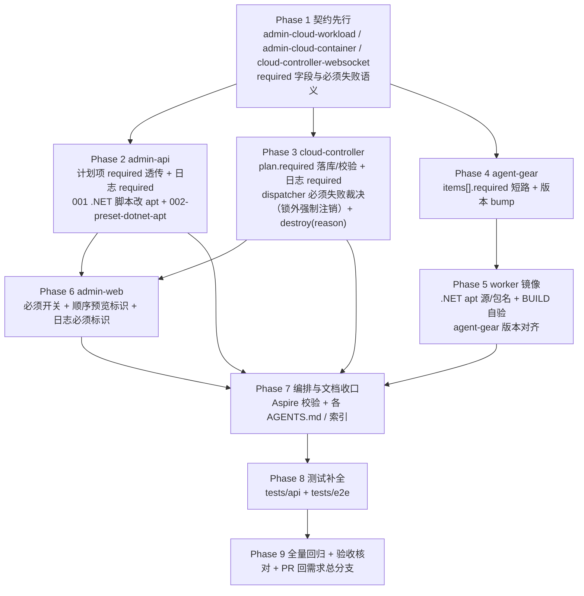

# 工作负载三期（必须工作负载硬失败与 .NET 安装优化）- 实现计划

**关联 Proposal**: `docs/engineering/proposals/20261018-feat-workload-phase3.md`（v1.0）
**关联 PRD**: `docs/product/draft/20261018-workload-phase3.md`（v1.0）
**需求总分支（feat-branch）**: `feat/workload-phase3`（基于 `origin/main cd6aa5c`，需求总 PR [#224](https://github.com/Deliay/z-agent-gear/pull/224)）
**开发分支**: `servers/workload-phase3`、`apps/workload-phase3`、`packages/workload-phase3`、`tests/workload-phase3`（均基于 `feat/workload-phase3`，完成后各自提 PR 回需求总分支）
**创建日期**: 2026-10-18
**计划版本**: v1.0

## 实现顺序



依赖说明：

- **Phase 1 契约**是全部实现的输入，独立提交（`docs(contracts): ...`）。
- **Phase 2（admin-api）** 与 **Phase 3（cloud-controller）** 仅依赖 Phase 1，可并行；二者共用「`required` 归一」语义，必须以 §计划期裁决 4~7 为准实现一致。
- **Phase 4（agent-gear）** 仅依赖 Phase 1 协议即可并行开发（worker 短路是省时优化，服务端仍为唯一裁决）；与 Phase 3 的联调在 Phase 3 单测 + Phase 8。
- **Phase 5（worker 镜像）** 依赖 Phase 4 的 agent-gear 产物；**.NET apt** 脚本与 **Phase 2** 内置脚本同源（014 版）。
- **Phase 6（admin-web）** 仅依赖 Phase 1/2/3 契约，admin-api 未就绪时可先以 mock 开发（顺序预览为前端镜像实现，最终以服务端为准）。
- **Phase 7** 依赖 Phase 2~6 的配置项与文档定型；**Phase 8** 在各实现分支合并回需求总分支后切出；**Phase 9** 收口。

开发模式采用 TDD（红-绿-重构）：每个 Phase 先写测试（RED）再实现（GREEN）。编码前加载 `docs/engineering/common-rules.md`、`backend-rules.md`（后端 Phase）与 `frontend-rules.md`（前端 Phase），并遵循各子项目 `AGENTS.md`。

### 关键约束（提案 §5.2/§6，实现期不得回退）

- **裁决权在服务端**：`required` 的失败判定与容器注销由 cloud-controller `workload-dispatcher` 独占；worker 只做省时短路，旧 worker 忽略该字段不影响正确性。
- **不 backoff、直接失败**：注销复用既有 `ContainerService.destroy`（CAS `destroying` → post 批次 + `shutdown` → `deleteJob` → `exited`），**不新增删除路径**；`destroying` 属终态集合，凭据在宽限前即失效（回连必被拒），不做重试/退避。
- **锁外强制注销**：`KeyedMutex` 非可重入；注销会触发 gateway 的 `runPostBatch`（等待结果回调，需同一把容器锁）。因此 dispatcher 的 `startInit`/`handleResult`/`onWatchdog` 必须把 must-failure 信号**在 `mutex.runExclusive` 回调之外**消费并调用 `forceDestroy`（回调返回信号对象，不得在回调内销毁）。
- **中断语义**：必须项失败后不调用 `advance`；把该容器**剩余非终态 init 记录**标 `timeout` 并追加中断说明日志；失败记录保留自身终态。`finishInit` 对 `status !== 'initializing'` 直接返回，注销后不会被重新置 `online`。
- **必须仅作用于 init**：`post` 批次日志的 `required` 固定 `false`，清理失败不触发额外行为。
- **.NET 保守迁移**：`002-preset-dotnet-apt` 仅当预制 .NET 的 `initScript` **逐字节等于旧版 `dotnet-install.sh` 脚本**（即管理员未改动）时升级为 apt 版；管理员改动过的保留并记录跳过；预制项不存在则跳过（不重建、不报错）。
- **单一事实源**：`cloudworkloads` 由 admin-api 写、cloud-controller 只读；`cloudcontainers`/`cloudworkloadlogs` 由 cloud-controller 写，admin-api 只读降级路径不变。
- **向后兼容**：`required` 缺省一律 `false`；旧记录、旧 worker、旧 admin-api（仅 `workloadIds`）行为零变化；仅 `workloadIds` 的兜底展开 `required` 一律 `false`。
- **frontend 手写类型**：admin-web 无 codegen，`graphql/` 下类型与契约人工对齐；数据加载分支一律 `loading && !data`。
- **测试纪律**：新增代码单测覆盖率 ≥ 80%；API 与 E2E 串行执行；测试服务只用 Aspire 编排。

## 计划期裁决（提案留白/含混处的实现口径）

1. **`required` 归一唯一语义（admin-api 权威，cloud-controller 兜底）**：显式选择的条目取 `selection.required === true`，隐式依赖与缺省/`undefined`/`null` 一律 `false`。`required=true` 但定义无 `initScript` 时**保留原值透传**（由 dispatcher 视为无效果），前端另做不展示。
2. **执行计划条目结构**：`workloadPlan = [{ workloadId, params, implicit, required }]`；数组顺序即执行顺序。内部 API 缺省/`null` 归一 `false`，**非布尔返回 400 `INVALID_WORKLOAD`**（与 `implicit` 同口径）；仅 `workloadIds` 的兜底展开 `required` 一律 `false`。
3. **日志 `required` 快照**：dispatcher 建 `cloudworkloadlogs` 时写入本条的 `required`（init 来自计划、已删除占位来自计划）。`post` 批次与新占位固定 `false`。DTO/映射缺省归一 `false`（历史记录按非必须展示）。
4. **必须失败信号结构**：dispatcher 内部用 `{ requiredFailure: { workloadName } } | null` 表达；`startInit`/`handleResult`/`onWatchdog` 在锁外消费。
5. **中断落地**：必须项 `failed`/`timeout` 时，把剩余非终态 init 记录标 `timeout` 并追加日志 `必须工作负载初始化失败，已中断`（本条失败记录不加该说明，保留其自身 status 与日志）。
6. **强制注销文案**：`exitReason = 必须工作负载「<workloadName>」初始化失败`（PRD 验收要求可读负载名）。执行前被删除的必须项 `workloadName` 沿用占位名 `(已删除)`；Job 删除失败时沿用既有后缀 `（Job 删除失败，需人工清理）`。
7. **`destroy` 原因参数**：`ContainerService.destroy(containerId, options?: { reason?: string })`，活跃路径 `exitReason = (options?.reason ?? '强制销毁')`（Job 删除失败再追加后缀）；`adminDestroyCloudContainer` 不传 reason，行为与现状一致。spi 端口 `WorkloadContainerStatePort` 增加 `forceDestroy(containerId, reason)`；`index.ts` 注入 `(id, reason) => containerService.destroy(id, { reason })`。
8. **看门狗必须失败**：单条 `running` 必须项超时 → 标 `timeout` 并返回信号（不 `advance`）；批次超时（`items × initTimeoutMs + 120s`）分支若剩余 activeInit 含必须项 → 标终态后返回信号（不 `finishInit`）。`pending` 停留推进分支不判失败。
9. **startInit 前置删除**：计划存在「必须且执行前被删除」的条目时，仍先创建全部占位/运行记录（留档），随后把非终态 init 记录标 `timeout`（追加中断说明）并返回信号，**不下发 `workload:run`**；不进入 `initializing`。
10. **gateway 收口**：`startInit` 返回结构由 `boolean` 扩展为携带必须失败标记的结果；`requiredFailure` 时 gateway **不得** `markOnline`（容器已被处置；即使调用也因终态 CAS 失败而无害）。
11. **迁移 002 等值比对来源**：`001-preset-workloads.ts` 导出 `DOTNET_SCRIPT`（**新 apt 版**），`002-preset-dotnet-apt.ts` 内维护 `LEGACY_DOTNET_SCRIPT`（**旧 `dotnet-install.sh` 版**，逐字节复制当前 001 内容）用于等值判断；002 升级时复用 `DOTNET_SCRIPT`。
12. **002 查找与写入口径**：按 `presetKey='dotnet'` 查、回退精确 `name='.NET'`；存在且 `initScript === LEGACY_DOTNET_SCRIPT` → 更新 `initScript` 为 apt 版（**仅改 init 脚本**，不动 `postScript`/`paramSchema`/`dependsOnWorkloadIds`/`name`）；不等则 `warn` 跳过；不存在则 `warn` 跳过。完成后由 runner 写入 `admin_migrations`；`index.ts` 注册为 `runMigrations([migration001, migration002])`。
13. **.NET apt 脚本契约**：`apt-get update` →（`DOTNET_APT_UPGRADE=1` 时）`apt-get -y upgrade` → `apt-get install -y --no-install-recommends "$DOTNET_APT_PACKAGE"`；`DOTNET_APT_PACKAGE` 默认 `dotnet10`，`DOTNET_APT_UPGRADE` 默认 `1`；幂等判据 `dotnet --list-sdks | grep -q '^10\.'`；结束时 `command -v dotnet` 自校验并 `dotnet --list-sdks`。安装源优先镜像内已配置内网 Ubuntu/apt 源；如需 Microsoft feed 代理，由镜像 build-arg 注入（见 Phase 5）。
14. **Aspire 兼容不改**：Aspire 脚本的 `.NET` 前置检查为 `command -v dotnet`，apt 安装 `/usr/bin/dotnet` 在 PATH 中；`DOTNET_ROOT=/usr/local/dotnet` 兜底指向不存在目录不影响判定。**Aspire 脚本本期不改**。
15. **worker 版本口径**：`agent-gear` minor bump 到 `2.4.0`（major 保持 `2`，标记 `items[].required` 短路能力）；cloud-controller `MIN_WORKER_VERSION` **保持 `2.2.0`**（服务端为唯一裁决，旧 worker 忽略 `required` 仍正确）。worker 镜像需重建为 ≥ `2.4.0` 才具备短路优化。
16. **E2E 边界（沿用一期裁决 12/17）**：`K8S_ENABLED=false`、无真实工作容器回连；必须失败的真实注销链路由 cloud-controller 单测（dispatcher + container-service）与 `tests/api`（直写 Mongo + 内部 API/GraphQL）覆盖；E2E 覆盖必须开关、顺序预览标识、日志必须标识（直写 Mongo 构造）。真实集群脚本执行与凭据失效列部署侧手工验收。
17. **`required` 不参与前端硬失败预判**：admin-web 仅做展示与提交，不在本地预判失败；仅对有 `initScript`（trim 后非空）的工作负载展示「必须」开关；取消勾选时清除其必须设置、重新勾选回到默认（非必须）。

---

## Phase 1: 契约变更（contracts/）

开发分支：`servers/workload-phase3`。本 Phase 独立提交（`docs(contracts): ...`）。

### 文件修改

| 文件 | 操作 | 说明 |
|------|------|------|
| `contracts/admin-cloud-workload.graphql` | 修改 | `input CloudWorkloadSelectionInput` 增加 `required: Boolean`（注释：缺省 `false`；仅对含初始化脚本的工作负载产生硬失败语义；隐式依赖永按 `false`）；`type CloudWorkloadLog` 增加 `required: Boolean!`（本次启动该项是否为「必须」；历史记录缺省 `false`） |
| `contracts/admin-cloud-container.graphql` | 修改 | 启动入参注释补充：`workloads[].required` 缺省 `false`；`required=true` 仅对含初始化脚本的工作负载产生硬失败语义；`workloadIds` 兼容调用等价于全部 `required=false`；「必须」失败即中断剩余初始化并强制注销（详见 websocket 契约 §5） |
| `contracts/cloud-controller-websocket.md` | 修改 | §2.9 `items[]` 增加 `items[].required: boolean`（可选，缺省 `false`）；新增「必须失败语义」小节（服务端裁决 + worker 短路 + 中断/注销行为、`exitReason` 文案）；附录 A.2.2 `workloadPlan[]` 条目增加 `required`（可选布尔、缺省归一 `false`、非布尔 400 `INVALID_WORKLOAD`）；A.3 `CloudContainer.workloadPlan` 条目结构更新为 `{ workloadId, params, implicit, required }`；A.6 `CloudWorkloadLog` 增加 `required`（缺省 `false`）；§3 生命周期图补注「必须项失败 → 中断 + 强制注销」 |

### 验收 checklist

- [ ] 三份契约与提案 §3/§4 逐字段一致；`required` 缺省/归一/400 口径无歧义
- [ ] `workload:run` items 的 `required` 与「服务端裁决 + worker 短路」在契约中写明
- [ ] `post` 不参与必须判定（`required` 固定 `false`）在契约中写明
- [ ] 契约变更独立提交，后续 Phase 才动实现代码

---

## Phase 2: admin-api（计划项 required 透传 + 日志 required + .NET 脚本改 apt + 002 migration）

开发分支：`servers/workload-phase3`。TDD 顺序：先扩展 `src/services/workload-plan.test.ts`、`src/graphql/resolvers/cloud-container.test.ts`、`src/services/cloud-workload.test.ts`、`src/migrations/001-preset-workloads.test.ts`，新增 `src/migrations/002-preset-dotnet-apt.test.ts`（RED）→ 实现（GREEN）。

### 文件修改

| 文件 | 操作 | 说明 |
|------|------|------|
| `servers/admin-api/src/services/workload-plan.ts` | 修改 | `WorkloadSelection` 增加 `required?: boolean`；`WorkloadPlanItem` 增加 `required: boolean`；`resolveWorkloadPlan` 显式项取 `selection.required === true`、隐式/缺省 `false`；保持既有「显式优先/去重/拓扑序/上限」逻辑不变 |
| `servers/admin-api/src/graphql/schemas/cloud-workload.ts` | 修改 | `CloudWorkloadSelectionInput` 增加 `required: Boolean`；`CloudWorkloadLog` 增加 `required: Boolean!`；注释对齐契约 |
| `servers/admin-api/src/graphql/schemas/cloud-container.ts` | 修改 | 启动 mutation 注释补充 `required` 语义（与契约一致） |
| `servers/admin-api/src/graphql/resolvers/cloud-container.ts` | 修改 | `adminStartCloudContainer` 的 `workloads` 入参类型增加 `required?: boolean`；透传给 `resolveWorkloadPlan`；`required` 非布尔按现有兜底（缺省 `false`，仅 `=== true` 生效） |
| `servers/admin-api/src/services/cloud-controller-client.ts` | 修改 | `WorkloadPlanItemDTO` 增加 `required: boolean`；`start(...)` 请求体 plan 条目携带 `required`（缺省 `false`） |
| `servers/admin-api/src/services/cloud-workload.ts` | 修改 | `CloudWorkloadLogDTO` 增加 `required: boolean`；`mapWorkloadLog` 增加 `required: raw.required === true`（历史缺省 `false`） |
| `servers/admin-api/src/models/cloud-workload-log.ts` | 修改 | 只读模型增加 `required: { type: Boolean, default: false }`（与 cloud-controller 写入结构对齐） |
| `servers/admin-api/src/models/cloud-container.ts` | 修改 | 只读 `workloadPlanItemSchema` 增加 `required: { type: Boolean, default: false }`（与 cloud-controller schema 对齐） |
| `servers/admin-api/src/migrations/001-preset-workloads.ts` | 修改 | `DOTNET_SCRIPT` 改为 **apt 版**（裁决 13）并 `export`；`PRESETS` 的 dotnet 项继续引用它；其余三个脚本不变 |
| `servers/admin-api/src/migrations/002-preset-dotnet-apt.ts` | 新增 | `002-preset-dotnet-apt`：按 §计划期裁决 12 保守升级（`LEGACY_DOTNET_SCRIPT` 等值判断 → 更新/跳过；不存在跳过）；`name='002-preset-dotnet-apt'`；`run()` 幂等 |
| `servers/admin-api/src/migrations/runner.ts` | 复用 | 无需改动（通用 runner）；002 与 001 复用同一 `admin_migrations` 账本 |
| `servers/admin-api/src/index.ts` | 修改 | `runMigrations([migration001, migration002])`（`import` 002 并注册） |

### 测试用例（增量）

| # | 用例 | 预期 |
|---|------|------|
| T-WP1 | `resolveWorkloadPlan` 显式 `required=true` 透传 | 该条 `required=true`；其余显式项缺省 `false` |
| T-WP2 | 隐式依赖 `required` | 一律 `false`（即使依赖方 `required=true`） |
| T-WP3 | `required` 缺省/`undefined`/`null`/非布尔 | 归一为 `false`（不抛错） |
| T-WP4 | `required=true` 但定义无 `initScript` | 计划项保留 `required=true`（不因无脚本改写） |
| T-CCL1 | `adminStartCloudContainer` 携带 `workloads[].required` | 下发 `/internal/containers` 的 `workloadPlan[].required` 正确；`CloudContainer.workloads` 回读不变 |
| T-CCL2 | 仅 `workloadIds` 兼容调用 | 不携带 `workloadPlan`；行为与现状一致 |
| T-MLOG1 | `mapWorkloadLog` 含 `required` | `required=true/false` 正确映射；缺省 `false` |
| T-MIG2-1 | `002` 首次执行（预制 .NET 为旧脚本） | `initScript` 更新为 apt 版；其余字段不变；写入 `admin_migrations` |
| T-MIG2-2 | 管理员已改动预制 .NET 脚本 | 保留原脚本、`warn` 跳过 |
| T-MIG2-3 | 预制 .NET 不存在 | `warn` 跳过、不重建、不报错 |
| T-MIG2-4 | 二次启动（002 已执行） | 跳过，不重复覆盖 |

### 命令参考

```bash
cd servers/admin-api && npx vitest run src/services/workload-plan.test.ts src/services/cloud-workload.test.ts src/graphql/resolvers/cloud-container.test.ts src/migrations
cd servers/admin-api && npm run build
```

### 验收 checklist

- [ ] T-WP*/T-CCL*/T-MLOG1/T-MIG2-* 全部通过；`npm run build` strict 通过
- [ ] 计划项 `required` 透传到内部 API；日志 DTO 携带 `required`
- [ ] `001` 内置 .NET 脚本为 apt 版并 `export DOTNET_SCRIPT`；002 与内置脚本同源、等值比对旧脚本
- [ ] 002 仅改 `initScript`；预制项不存在/已改动均不影响服务启动
- [ ] admin-api 对 `cloudcontainers`/`cloudworkloadlogs` 仍仅只读（无写操作）

---

## Phase 3: cloud-controller（plan.required 落库 + 日志 required + 必须失败裁决 + destroy(reason)）

开发分支：`servers/workload-phase3`。TDD 顺序：先扩展 `src/services/container-service.test.ts`、`src/services/workload-dispatcher.test.ts`、`src/routes/internal-api.test.ts`、`src/repositories/*`（如有）用例（RED）→ 实现（GREEN）。

### 文件修改

| 文件 | 操作 | 说明 |
|------|------|------|
| `servers/cloud-controller/src/models/cloud-container.ts` | 修改 | `WorkloadPlanEntry` 增加 `required: boolean`；`workloadPlanEntrySchema` 增加 `required: { type: Boolean, default: false }` |
| `servers/cloud-controller/src/models/cloud-workload-log.ts` | 修改 | schema 增加 `required: { type: Boolean, default: false }` |
| `servers/cloud-controller/src/repositories/container-repository.ts` | 修改 | `normalizePlanEntry`/`clonePlan` 归一 `required`（缺省 `false`）；Entity 类型同步 |
| `servers/cloud-controller/src/repositories/workload-log-repository.ts` | 修改 | `CloudWorkloadLogEntity`/`CreateWorkloadLogInput` 增加 `required`；`toEntity`/`createMany`（Mongo + InMemory）归一 `required`（缺省 `false`） |
| `servers/cloud-controller/src/services/container-service.ts` | 修改 | `normalizeWorkloadPlan` 归一 `required`（缺省 `false`）；`destroy(containerId, options?: { reason?: string })`：活跃路径 `exitReason = options?.reason ?? '强制销毁'`，Job 删除失败追加既有后缀；终态/`destroying` 幂等路径语义不变 |
| `servers/cloud-controller/src/services/workload-dispatcher.ts` | 修改 | ①`WorkloadContainerStatePort` 增加 `forceDestroy(containerId, reason)`；②`WorkloadDispatcherDeps` 增加 `forceDestroy`；③`resolveContainerPlan` 归一 `required`；④`startInitLocked`/`handleResultLocked`/`watchdogInitializing` 返回 must-failure 信号（裁决 4~9），`startInit`/`handleResult`/`onWatchdog` **锁外**消费信号并调用 `deps.forceDestroy`；⑤建日志/`emitRun` 的 items 携带 `required`；⑥`preparePostBatch` 的 post 记录 `required` 固定 `false` |
| `servers/cloud-controller/src/routes/internal-api.ts` | 修改 | `resolveWorkloadPlan` 校验 `required` 缺省/`null` 归一 `false`、非布尔 400 `INVALID_WORKLOAD`；`toCloudContainerJson` 的 `workloadPlan[].required` 回读；`toCloudWorkloadLogJson` 增加 `required` |
| `servers/cloud-controller/src/index.ts` | 修改 | dispatcher deps 注入 `forceDestroy: (id, reason) => containerService.destroy(id, { reason })` |
| `servers/cloud-controller/src/services/socketio-gateway.ts` | 修改 | `register` 处按 `startInit` 返回结果收口：`requiredFailure` 时不 `markOnline`（裁决 10）；其余行为不变 |
| `servers/cloud-controller/src/services/workload-plan.ts` | 修改 | 兜底展开条目 `required: false`（旧请求无 required 语义）；`WorkloadPlanEntry` 结构同步 |

### 测试用例（增量）

| # | 用例 | 预期 |
|---|------|------|
| T-ICC7 | `POST { workloadPlan[].required }` 合法/缺省/非布尔 | 合法（含 `true`/缺省/`null`→`false`）201 且回读一致；非布尔 → 400 `INVALID_WORKLOAD` |
| T-ICC8 | 仅 `workloadIds` 兜底展开 | plan 条目 `required` 一律 `false` |
| T-CCS2 | `CloudWorkloadLog` JSON | 携带 `required`；历史缺省 `false` |
| T-WD15 | `destroy(id, { reason })` | 活跃路径 `exitReason` 被 `reason` 覆盖；Job 删除失败追加后缀；不传 reason 为 `强制销毁` |
| T-WD16 | dispatcher 必须项 `failed` | 不 `advance`；剩余非终态 init 标 `timeout` + 中断日志；返回信号；**锁外** `forceDestroy(containerId, '必须工作负载「X」初始化失败')` |
| T-WD17 | dispatcher 必须项 `timeout` | 同上 |
| T-WD18 | 非必须项 `failed` | 维持现状（继续推进/收口），不触发 `forceDestroy` |
| T-WD19 | 必须项为最后一条且失败 | 仍触发注销（不因「无后续」放行上线） |
| T-WD20 | 必须项执行前被删除（占位） | `startInit` 不下发批次；占位留档；非终态 init 标 `timeout`；返回信号并锁外注销 |
| T-WD21 | 看门狗必须项单条超时 | RUNNING 超 `initTimeoutMs + 30s` → 标 `timeout` 并锁外注销 |
| T-WD22 | 看门狗批次超时含必须项 | 剩余 init 标终态后返回信号并注销（不 `finishInit`） |
| T-WD23 | **防自锁回归** | 在容器互斥锁外调用 `forceDestroy`：注入的 `forceDestroy` 内部可重入 `runPostBatch`（同 key）而不死锁 |
| T-WD24 | post 批次 `required` | post 日志 `required` 固定 `false` |
| T-WD25 | 注销后不收口 | `forceDestroy` 后 `finishInit` 不将容器置 `online` |

### 命令参考

```bash
cd servers/cloud-controller && npx vitest run src/services/container-service.test.ts src/services/workload-dispatcher.test.ts src/services/workload-plan.test.ts src/routes/internal-api.test.ts
cd servers/cloud-controller && npm run build
```

### 验收 checklist

- [ ] T-ICC7/T-ICC8/T-CCS2/T-WD15~T-WD25 全部通过；`npm run build` strict 通过
- [ ] 必须失败裁决全部在 dispatcher；`forceDestroy` 一律在容器互斥锁外调用（T-WD23 锚定）
- [ ] 非必须失败行为与现状零变化；存量容器（无 plan/无 required）行为零变化
- [ ] `required` 落库/回读与 `contracts/cloud-controller-websocket.md` A.2.2/A.3/A.6 逐字段一致
- [ ] `destroy` 不新增对外可达删除路径；`adminDestroyCloudContainer` 行为不变

---

## Phase 4: agent-gear（items[].required 短路 + 版本 bump）

开发分支：`packages/workload-phase3`。TDD 顺序：先扩展 `src/workload-executor.test.ts`（RED）→ 实现（GREEN）。

### 文件修改

| 文件 | 操作 | 说明 |
|------|------|------|
| `packages/agent-controller/src/workload-executor.ts` | 修改 | `WorkloadItem` 增加 `required?: boolean`；`executeBatch` 中 `phase === 'init'` 且 `item.required === true` 且本条结果为 `failed`/`timeout` 时，回报后**不再启动后续条目**（`return`）；无 `required`/`false` 行为不变；`post` 不短路 |
| `packages/agent-controller/src/workload-executor.test.ts` | 修改 | 新增必须项短路、最后一条必须项失败短路、非必须项失败继续、无 `required` 兼容、`post` 不短路用例 |
| `packages/agent-controller/package.json` | 修改 | 版本 `2.4.0`（minor bump，major 保持 2；裁决 15） |

### 测试用例（增量）

| # | 用例 | 预期 |
|---|------|------|
| T-WE14 | 必须项 `failed` 后短路 | 不再启动后续条目，不产生后续结果 |
| T-WE15 | 必须项为最后一条且失败 | 正常结束批次 |
| T-WE16 | 非必须项失败 | 继续执行后续条目（现状） |
| T-WE17 | 无 `required` 字段 | 行为与旧版完全一致 |
| T-WE18 | `post` 批次的 `required` | 不触发短路（`post` 不参与必须判定） |

### 命令参考

```bash
cd packages/agent-controller && npx vitest run src/workload-executor.test.ts
cd packages/agent-controller && npm run build
cd packages/agent-controller && npm pack --dry-run
```

### 验收 checklist

- [ ] T-WE14~T-WE18 全部通过；`npm run build` 通过
- [ ] 对既有事件（register/heartbeat/shutdown/acp:*/fs:*/git:*）零行为变化
- [ ] 版本 `2.4.0` 已 bump；`MIN_WORKER_VERSION` 保持 `2.2.0`（服务端唯一裁决）

---

## Phase 5: worker 镜像（.NET apt 源/包名 + BUILD 自验 + 版本对齐）

开发分支：`servers/workload-phase3`（`deploy/` 归该分支）。

### 文件修改

| 文件 | 操作 | 说明 |
|------|------|------|
| `deploy/images/worker/Dockerfile` | 修改 | 增加可选 build-arg（`DOTNET_APT_SOURCE`/`DOTNET_APT_KEY_URL`）与运行时 `ENV DOTNET_APT_PACKAGE=${DOTNET_APT_PACKAGE}`/`ENV DOTNET_APT_UPGRADE=${DOTNET_APT_UPGRADE}`（默认 `dotnet10`/`1`，供 .NET 预制脚本读取）；注释说明「.NET 经 apt 安装、不再依赖 dotnet-install.sh」；全局预装改为 `agent-gear@2.4.x` |
| `deploy/images/worker/BUILD.md` | 修改 | 更新 .NET 自验为 apt 口径（`dotnet --list-sdks` 显示 `10.x`、安装不依赖 `dotnet-install.sh`、重复执行幂等）；补充 `DOTNET_APT_PACKAGE`/`DOTNET_APT_UPGRADE`/`DOTNET_APT_SOURCE` 变量说明；`agent-gear --version` ≥ `2.4.0`；补充「必须工作负载失败强制注销」内网 K8s 手工验收步骤（必须脚本失败 → 容器非在线、退出原因含负载名、凭据失效不回连） |
| `deploy/images/worker/entrypoint.sh`、`entrypoint.test.sh` | 复用 | 无需改动（dockerd 已由工作负载负责、版本门禁自升级逻辑不变） |

### 验收 checklist

- [ ] 镜像构建成功且 `agent-gear --version` ≥ `2.4.0`
- [ ] `dotnet` 由 apt 提供（`command -v dotnet` 命中 `/usr/bin/dotnet`），`dotnet --list-sdks` 显示 `10.x`；不依赖 `dotnet-install.sh`
- [ ] 重复执行 .NET 工作负载幂等（已装 .NET 10 直接成功）
- [ ] Aspire 前置检查（`command -v dotnet`）通过
- [ ] `BUILD.md` 自验步骤可执行；真实集群必须失败注销手工验收通过（部署侧）

---

## Phase 6: admin-web（必须开关 + 顺序预览标识 + 日志必须标识）

开发分支：`apps/workload-phase3`（仅依赖 Phase 1/2/3 契约，可并行）。TDD 顺序：先写组件/页面/纯函数测试（RED）→ 实现（GREEN）。

### 文件修改

| 文件 | 操作 | 说明 |
|------|------|------|
| `apps/admin-web/src/graphql/types.ts` | 修改 | `CloudWorkloadSelectionData` 增加 `required?: boolean`；`CloudWorkloadLogData` 增加 `required: boolean` |
| `apps/admin-web/src/graphql/queries.ts` | 修改 | `ADMIN_CLOUD_WORKLOAD_LOGS` 选择集增加 `required` |
| `apps/admin-web/src/graphql/mutations.ts` | 复用 | `ADMIN_START_CLOUD_CONTAINER` 的 `$workloads: [CloudWorkloadSelectionInput!]` 自动接受新增字段，无需改动（如类型提示需要可加注释） |
| `apps/admin-web/src/components/cloud-containers/StartContainerDialog.tsx` | 修改 | 新增 `requiredByWorkload` 状态：仅「已勾选且 `initScript` trim 非空」的工作负载展示「必须」开关（默认关）；取消勾选清除其必须设置、重新勾选回默认；顺序预览对必须项加标识；提交 `workloads[]` 时携带 `required`；提供一行说明「标记为必须的工作负载初始化失败将导致容器被强制注销」 |
| `apps/admin-web/src/components/cloud-containers/WorkloadLogsDialog.tsx` | 修改 | 记录列表/详情展示每条的「必须」标识（`required=true`） |
| `apps/admin-web/src/components/cloud-containers/labels.ts` | 修改 | 增加「必须」文案/标识常量（复用） |
| `apps/admin-web/src/pages/CloudContainersPage.tsx` | 复用 | `handleStart(purpose, selections)` 已透传 `workloads[]`，`required` 随 selection 提交；如入参类型需要可同步 |

### 测试用例（增量）

| # | 用例 | 预期 |
|---|------|------|
| T-FP11 | 必须开关可见性 | 仅「已勾选且含 `initScript`」的工作负载展示开关；无脚本不展示 |
| T-FP12 | 必须设置生命周期 | 可独立设置多个；取消勾选清除；重新勾选回默认（非必须） |
| T-FP13 | 顺序预览标识 | 必须项在预览中有清晰标识；隐式依赖标识不受影响 |
| T-FP14 | 提交携带 required | `onStart` 收到的 selection 含 `required`；未设置项缺省 `false`/缺省 |
| T-FP15 | 日志必须标识 | `required=true` 记录展示标识；历史缺省 `false` 不出现错误标识 |
| T-FP16 | 轮询不打断弹窗 | 10s 轮询刷新时已打开的启动/日志对话框保持 |

### 命令参考

```bash
cd apps/admin-web && npx vitest run src/components/__tests__/StartContainerDialog.test.tsx src/components/__tests__/WorkloadLogsDialog.test.tsx src/pages/__tests__/CloudContainersPage.test.tsx
cd apps/admin-web && npm run build && npm run lint
```

### 验收 checklist

- [ ] T-FP11~T-FP16 全部通过；build/lint 通过
- [ ] PRD §3.4 页面元素逐项核对（必须开关、顺序预览必须标识、日志必须标识、退出原因）
- [ ] 无 `initScript` 的工作负载不出现开关（避免「设置了却无效」的误导）
- [ ] 仅管理员可访问（`ProtectedRoute` 回归）；`loading && !data` 规则遵守；禁止跨项目 import

---

## Phase 7: 编排与文档收口

开发分支：`servers/workload-phase3`（`aspire/`、`docs/` 归该分支）。

### 文件修改

| 文件 | 操作 | 说明 |
|------|------|------|
| `aspire/AgentGear.AppHost/AppHost.cs` | 校验（如需修改） | 无新增必需环境变量（migration 自动执行，`002` 随启动运行）；确认 cloud-controller 的 `WORKLOAD_INIT_TIMEOUT_MS`（`apt-get upgrade` 较慢时评估提高）与 admin-api 迁移注册无需额外注入；不改默认行为 |
| `docs/engineering/AGENTS.md` | 修改 | 实现计划索引增加本文档 |
| `servers/cloud-controller/AGENTS.md` | 修改 | 补充 `workloadPlan[].required` 落库/下发、必须失败裁决（中断 + 锁外强制注销）、`destroy(reason)`、日志 `required` 与 `exitReason` 文案 |
| `packages/agent-controller/AGENTS.md` | 修改 | 补充 `items[].required` 短路语义与版本要求（≥ `2.4.0` 才具备短路优化；服务端为唯一裁决） |
| `apps/admin-web/AGENTS.md` | 修改 | 补充启动对话框「必须」开关（仅含脚本项）、顺序预览必须标识、日志必须标识 |
| `docs/product/AGENTS.md` | 复用 | 本期不移动生命周期目录（PRD 仍为 `draft/`，待实现验收后按流程归档）；索引已含本文档与 PRD |
| `docs/engineering/proposals/20261018-feat-workload-phase3.md` | 复用 | 不修改（提案评审后锁定） |

### 验收 checklist

- [ ] `aspire start` 可拉起（`K8S_ENABLED=false`），admin-api 启动自动执行 migration（含 `002`）且不阻断
- [ ] `aspire publish -o aspire/manifest` 产物正常；cloud-controller/worker 镜像可构建
- [ ] 各 `AGENTS.md` 与实现一致（`required` 链路、必须失败语义、.NET apt、worker 版本要求）
- [ ] `docs/engineering/AGENTS.md` 索引含本文档

---

## Phase 8: 测试补全（tests/api + tests/e2e）

开发分支：`tests/workload-phase3`（基于需求总分支，Phase 2~7 合并后切出）。

### 文件修改

| 文件 | 操作 | 说明 |
|------|------|------|
| `tests/api/src/admin-api/cloud-workload.test.ts` | 修改 | 迁移 002 结果（预制 .NET `initScript` 为 apt 版；重复查询稳定）；`CloudWorkloadLog.required` 返回（直写 Mongo 构造） |
| `tests/api/src/admin-api/cloud-container.test.ts` | 修改 | `adminStartCloudContainer(workloads[].required)` 透传与缺省（`required` 缺省 `false`、非布尔容错为 `false`）；`workloadIds` 兼容路径不携带 `required`；启动后列表 `exitReason` 可见 |
| `tests/api/src/cloud-controller/internal-api.test.ts` | 修改 | `POST { workloadPlan[].required }` 校验分支与 201 回读；仅 `workloadIds` 兜底展开 `required=false`；`GET /workload-logs` 返回 `required`；Bearer 401 回归 |
| `tests/e2e/src/admin-cloud-container.spec.ts` | 修改 | 启动对话框「必须」开关（仅含脚本项可见/可设置/取消清除）；顺序预览必须标识；直写 `cloudworkloadlogs.required` 后日志展示必须标识；必须失败容器退出原因展示（直写 Mongo 构造 `exitReason`） |
| `tests/api/AGENTS.md`、`tests/e2e/AGENTS.md` | 修改 | 补充工作负载必须（required）与 .NET apt 迁移相关测试说明与套件归属 |

### 测试用例（E2E 增量）

| # | 用例 | 预期 |
|---|------|------|
| T-E17 | 必须开关配置 | 仅含 `initScript` 的已勾选负载出现开关（默认关）；可独立设置；取消勾选清除 |
| T-E18 | 顺序预览必须标识 | 必须项在预览有标识；隐式依赖标识不受影响 |
| T-E19 | 日志必须标识 | 直写 `cloudworkloadlogs.required` 后对话框展示必须标识；历史缺省不误标 |
| T-E20 | 退出原因展示 | 直写必须失败的容器 `exitReason` 后列表/详情可见负载名 |

### 命令参考

```bash
aspire start && aspire wait admin-api && aspire wait admin-web && aspire wait agent-api && aspire wait cloud-controller
cd tests/api && ADMIN_API_URL=http://localhost:10003/graphql MONGODB_URI=<aspire describe mongodb> CLOUD_CONTROLLER_URL=http://localhost:10004 CLOUD_CONTROLLER_INTERNAL_TOKEN=<...> npm test
# 与 API 套件串行
cd tests/e2e && ADMIN_WEB_URL=<aspire describe admin-web> ADMIN_API_URL=http://localhost:10003/graphql MONGODB_URI=<...> npx playwright test admin-cloud-container.spec.ts --workers=1
```

### 验收 checklist

- [ ] T-E17~T-E20 全部通过；API 与 E2E 串行
- [ ] 各实现分支单测覆盖率 ≥ 80%（workload-plan required、dispatcher 必须裁决/锁外注销、container-service destroy(reason)、migration 002、executor 短路、前端纯函数与组件）
- [ ] E2E 不依赖真实 K8s；必须失败真实注销链路由单测 + `tests/api` 覆盖（裁决 16）

---

## Phase 9: 全量回归 + 验收核对 + PR

### 命令参考

```bash
# 后端
cd servers/admin-api && npm run build && npx vitest run
cd servers/cloud-controller && npm run build && npx vitest run --coverage
# agent-gear
cd packages/agent-controller && npm run build && npx vitest run
# 前端
cd apps/admin-web && npm run build && npm run lint && npx vitest run
# API / E2E 全量（串行）
```

### 总体验收 checklist

- [ ] 单元测试覆盖率 ≥ 80%（admin-api workload-plan/migration 002、cloud-controller dispatcher/container-service/internal-api、agent-gear executor、admin-web 组件与纯函数）
- [ ] API 测试通过（required 透传/缺省、plan.required 校验/回读、日志 required、迁移 002 幂等）
- [ ] E2E 测试通过（必须开关 → 预览标识 → 日志必须标识 → 退出原因展示）
- [ ] PRD §1.3/§3.2 逐条核对（功能点 1~6）：
  - [ ] 启动可为含初始化脚本的工作负载设置「必须」，缺省非必须；无脚本不展示（功能点 1）
  - [ ] 必须工作负载失败/超时/执行前删除 → 中断剩余初始化 + 强制注销 + 退出原因含负载名；非必须失败行为不变；注销后不回到在线（功能点 2）
  - [ ] 不重试/不退避；凭据在宽限前失效（`destroying`）；仍先执行清理脚本并留档（功能点 3）
  - [ ] 顺序预览必须标识、执行记录必须标识、容器退出原因可见负载名；历史容器缺省非必须（功能点 4）
  - [ ] .NET 通过 apt 安装 `dotnet --list-sdks` 显示 10.x；不依赖 `dotnet-install.sh`；幂等；Aspire 前置检查通过（功能点 5）
  - [ ] 存量未改动预制 .NET 升级为 apt；管理员改动保留并跳过；预制不存在跳过；只执行一次（功能点 6）
- [ ] PRD §3.5 边界逐条核对（无脚本不触发、非必须失败继续、依赖先执行、多个必须先失败者决定原因、必须项为最后一条仍注销、断线不改变判定、无活跃连接、清理失败不阻断、脚本为空不触发、未设置必须行为一致、.NET 包缺失、版本非 10、预制被删/被改、旧 worker 忽略字段）
- [ ] PRD §4 非功能与 §5 约束核对（性能、安全/凭据失效、向后兼容、一次性保守迁移）
- [ ] 提案 §10 验收标准逐条核对；提案 §5.3 .NET 新脚本与内置一致；Aspire 脚本未改动仍兼容
- [ ] 开发分支 PR 合并回 `feat/workload-phase3`，需求总 PR #224 自动更新；实现计划文档保留在需求总分支

## 风险与回滚

| 风险 | 缓解 |
|------|------|
| 容器互斥锁内调用销毁造成自锁（`KeyedMutex` 非可重入，post 批次等待结果回调需同一把锁） | 强制注销一律在 `mutex.runExclusive` 回调之外消费信号并调用（裁决/约束）；T-WD23 以可重入 `runPostBatch` 的注入实现锚定防回归 |
| 必须项失败与看门狗/用户销毁并发导致状态错乱 | 全部走 CAS（`destroying`/终态幂等），`finishInit` 对非 `initializing` 直接返回（T-WD25） |
| worker 短路与服务端裁决并发（迟到结果） | 服务端将剩余记录标终态后，迟到 `workload:result` 按终态幂等忽略（既有口径） |
| `required` 口径在 admin-api 与 cloud-controller 漂移 | 以 §计划期裁决 1~2 为唯一语义；两端各有 `workloadPlan` 单测（T-WP*/T-ICC7/8） |
| 旧记录/旧 worker/旧 admin-api 兼容回归 | `required` 缺省一律 `false`；仅 `workloadIds` 兜底展开 `required=false`；旧 worker 忽略字段（T-WP3/T-ICC8/T-WE17/T-WD18） |
| `002` 误覆盖管理员自定义 .NET 脚本 | 逐字节等值比对旧内置脚本；不等则跳过（T-MIG2-2）；仅改 `initScript`（裁决 12） |
| `002` 已执行后无法再升级（migration 只跑一次） | 与一期同口径：预制项归管理员所有；如需再升级走新 `003`（裁决 12/约束） |
| `apt-get upgrade` 接近单条初始化超时（默认 300s） | 镜像构建期预装/预热；必要时提高 `WORKLOAD_INIT_TIMEOUT_MS` 或 `DOTNET_APT_UPGRADE=0`（裁决 13/§9.3） |
| 内网源缺 .NET 10 包导致安装失败 | 沿用既有失败策略（非必须则容器可上线；必须则强制注销），日志可读；`DOTNET_APT_SOURCE`/`DOTNET_APT_KEY_URL` build-arg 注入 Microsoft feed 代理 |
| 必须失败的真实集群注销/凭据失效无法在 E2E 验证 | 单测覆盖裁决链 + `tests/api` 直写 Mongo 覆盖；真实链路列部署侧手工验收（裁决 16 / §9.3） |
| 回滚后 worker 仍短路、服务端不再注销 | 回滚顺序：cloud-controller → admin-api → admin-web → worker；cloud-controller 回滚后回到「失败可上线」旧策略，worker 短路仅少执行后续脚本（无副作用）；迁移记录与已升级脚本保留不回滚（提案 §9.3） |

## 相关文档

- 关联 PRD：`docs/product/draft/20261018-workload-phase3.md`
- 关联 Proposal：`docs/engineering/proposals/20261018-feat-workload-phase3.md`
- 前序计划：`docs/engineering/plan/20261018-feat-workload-phase1.md`、`docs/engineering/plan/20261017-feat-cloud-controller-workload.md`
- 既有实现：`servers/cloud-controller/src/services/workload-dispatcher.ts`、`servers/cloud-controller/src/services/container-service.ts`、`servers/admin-api/src/services/workload-plan.ts`、`servers/admin-api/src/migrations/001-preset-workloads.ts`、`packages/agent-controller/src/workload-executor.ts`、`deploy/images/worker/BUILD.md`
- 契约：`contracts/admin-cloud-workload.graphql`、`contracts/admin-cloud-container.graphql`、`contracts/cloud-controller-websocket.md`
- 开发规范：`docs/engineering/common-rules.md`、`backend-rules.md`、`frontend-rules.md`
- 测试规范：`tests/api/AGENTS.md`、`tests/e2e/AGENTS.md`
- 镜像构建：`deploy/images/worker/BUILD.md`
