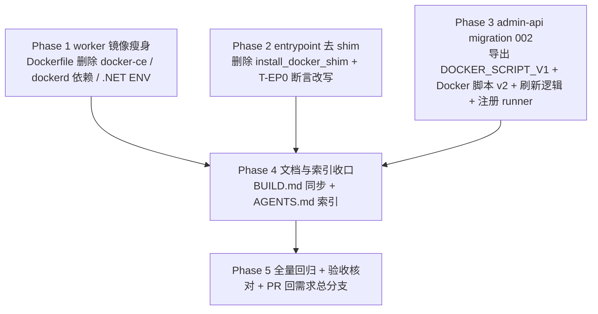

# 工作负载四期（工作容器基础环境瘦身）- 实现计划

**关联 Proposal**: `docs/engineering/proposals/20261018-feat-workload-phase4.md`（v1.2）
**关联 PRD**: `docs/product/draft/20261018-workload-phase4.md`（v1.1）
**需求总分支（feat-branch）**: `feat/workload-phase4`（基于 `main`，需求总 PR #227）
**实现分支**: `feat/workload-phase4-impl`（基于 `feat/workload-phase4`，实现 PR #228）
**创建日期**: 2026-10-18
**计划版本**: v1.2
**版本说明**:
- v1.1（2026-10-18，实现评审返工）修正 Docker 脚本 v2 的安装包列表（补充 `docker-ce` 以提供 `dockerd`）、幂等锚点改为 `docker` 与 `dockerd` 同时存在。
- v1.2（2026-10-18，实现评审返工第二轮）安装源改为**必须由环境注入**（`DOCKER_APT_URL` 无默认值；实测内网 Nexus 不存在 docker-ce apt 代理仓库），未注入时快速失败并给出指引；同步 PRD v1.1、提案 v1.2。

## 实现顺序



依赖说明：

- **Phase 1（镜像）** 与 **Phase 2（入口）** 同属 worker 镜像（`deploy/`），可并行修改、合并为一个提交；
- **Phase 3（admin-api）** 与 Phase 1/2 无代码依赖，可并行开发（脚本 v2 文本落在 migration 常量中）；
- **Phase 4** 依赖 Phase 1~3 的最终形态（BUILD.md 描述、脚本常量命名）；
- **Phase 5** 在各开发分支合并回需求总分支后收口。

开发模式采用 TDD（红-绿-重构）：每个 Phase 先写/改测试（RED）再改实现（GREEN）。编码前加载 `docs/engineering/common-rules.md`、`docs/engineering/backend-rules.md`（Phase 3）及各子项目 `AGENTS.md`。

### 关键约束（提案 §1.3/§6，实现期不得回退）

- **无契约变更**：不动 `contracts/cloud-controller-websocket.md`；`workload:run` / `workload:result` 语义、参数注入与执行边界不变。
- **Node.js 保留**：nvm / node / npm 是容器内 `agent-gear` 的运行基础，不属瘦身范围。
- **单向下沉**：Docker 的安装/配置/启动/校验全部落在「Docker」预制脚本 v2；镜像不再有任何 Docker 概念（CLI、shim、dockerd 依赖、apt 源）。
- **不覆盖定制**：002 仅在脚本等于 001 初版常量时刷新；管理员改过的脚本不覆盖并告警。
- **.NET/Aspire 不变**：脚本内容不改，仅清理镜像内 .NET/Aspire ENV 残留注释。
- **禁止 rebase/squash**：遵循 z-git 规范，仅允许 merge。

## 计划期裁决（提案留白/含混处的实现口径）

1. **常量命名与导出**：`001-preset-workloads.ts` 中原 `const DOCKER_SCRIPT` 更名为 `export const DOCKER_SCRIPT_V1`（内容逐字不变，`PRESETS[0].initScript` 继续引用它）；001 的写库行为、其余三个脚本完全不变。这是「未定制」比对的唯一事实源。
2. **v2 常量归属**：Docker 脚本 v2 文本作为 migration 002 的 `export const DOCKER_SCRIPT_V2` 常量，导出供测试复用（导出常量不改变 runner 的 `Migration` 接口）。
3. **「未定制」判定**：严格相等判定——`initScript === DOCKER_SCRIPT_V2` 直接返回（已刷新）；`initScript === DOCKER_SCRIPT_V1` 才刷新；其余视为被管理员定制，`console.warn` 且不覆盖。
4. **002 防御路径**：`findOne({ presetKey: 'docker' })` 为空时，先按精确 `name: 'Docker'` 再查一次（与 001 口径一致），两者都不存在才按 v2 创建；若同名项已存在则告警跳过，**不创建重名项**（避免 001 因同名跳过时 002 产生第二条 `Docker`）。
5. **shim 文本与一期逐字一致**：v2 脚本内嵌 shim 采用 quoted heredoc（`<<'SHIM'`）+ 内部硬编码 `HARBOR_PROXY`，与一期 `entrypoint.sh` 的 `install_docker_shim` 完全相同，避免 heredoc 展开带来的注入面；脚本顶部不再保留未被使用的 `HARBOR_PROXY` 变量（提案 §5.2 顶部变量仅作可覆盖示意，实现以「shim 内硬编码」为准）。
6. **shim 仅为便利层**：shim `exec /usr/bin/docker`，因此写入前必须已完成 CLI 安装；shim 装配放在安装之后、`dockerd` 启动之前（与提案脚本顺序一致）。
7. **entrypoint T-EP0 改写**：入口不再写 shim、不调用 docker、不启动 dockerd；断言 `ZAG_DOCKER_SHIM_PATH` 指向文件**不存在**，`docker`/`dockerd` stub 调用标记文件为 0 行。保留 stub 作为哨兵（被调用即失败）。移除 `ZAG_DOCKER_SHIM_PATH` 环境布置与相关说明。
8. **脚本 `bash -n` 校验归属**：Docker 脚本 v2 的语法校验放在 vitest（002 测试）内——将 `DOCKER_SCRIPT_V2` 写入临时文件后调用 `bash -n`；`entrypoint.test.sh` 不同步读取 TS 常量，避免跨语言耦合。
9. **镜像静态校验**：Dockerfile/entrypoint 的「无 docker 残留」除单测外，另在 BUILD.md 自验清单中以静态 `grep` 断言（`docker-ce`、`DOCKER_APT_URL`、`install_docker_shim`、`dockerd` 不出现），并在 Phase 5 手工核对。
10. **安装源注入**：`DOCKER_APT_URL` **无默认值**，必须由运行环境注入内网 docker-ce apt 代理地址；未注入且需安装时脚本快速失败（exit 2）并打印指引。当前内网 Nexus 不存在 docker-ce apt 代理仓库（实测 404），待运维提供真实可达地址后方可再设默认（提案 §9.3 发布前置）。`ZAG_DOCKER_SHIM_PATH` 语义保留在脚本内（默认 `/usr/local/bin/docker`）。
11. **幂等锚点**：安装以 `/usr/bin/docker` 与 `/usr/bin/dockerd` **是否同时存在**判定（任一缺失即重装，收敛半安装状态）；就绪以 `/usr/bin/docker info` 判定；重复执行收敛、不重复安装/不重复启动。注意 `docker-ce` 包提供 `dockerd`，`docker-ce-cli` 仅提供客户端，安装列表两者必须都在。
12. **失败不阻断上线**：脚本失败仅使该工作负载记录失败并保留日志，容器继续后续初始化并上线（沿用一期失败策略），不改动 cloud-controller 侧逻辑。
13. **无新增配置项**：admin-api / cloud-controller 不新增环境变量；迁移随启动自动执行，失败不阻断（沿用 `admin_migrations` runner 语义）。

---

## Phase 1: worker 镜像瘦身（Dockerfile）

开发分支：`deploy/workload-phase4`。

### 文件修改

| 文件 | 操作 | 说明 |
|------|------|------|
| `deploy/images/worker/Dockerfile` | 修改 | 删除 `ARG DOCKER_APT_URL`（第 27 行）与第 4 步整段 docker-ce 安装块（`/etc/apt/keyrings/docker.asc`、`/etc/apt/sources.list.d/docker.list`、`docker-ce-cli docker-buildx-plugin containerd.io`）；第 2 步 apt 列表移除 dockerd 专有依赖 `iptables iproute2 fuse-overlayfs libseccomp2 conntrack`，保留 `ca-certificates curl gnupg git gh procps sudo`；删除第 35~38 行 `.NET` / `Aspire` ENV 残留注释块；更新头部注释，移除 `DOCKER_APT_URL` 构建参数说明、改写第 3 行「docker 镜像拉取」相关表述 |
| `deploy/images/worker/BUILD.md` | 修改 | 见 Phase 4（构建参数与自验清单同步） |

### 验收 checklist

- [ ] Dockerfile 中不再出现 `docker-ce-cli` / `docker-buildx-plugin` / `containerd.io` / `DOCKER_APT_URL` / `docker.asc` / `docker.list`
- [ ] 第 2 步 apt 列表中不再出现 `iptables` / `iproute2` / `fuse-overlayfs` / `libseccomp2` / `conntrack`
- [ ] `.NET` / `Aspire` 相关 `ENV` 注释块已移除；`NPM_REGISTRY` ENV 与 nvm/Node.js/ENTRYPOINT 逻辑保持
- [ ] `docker build` 构建成功（内网环境），构建产物不含 Docker 相关软件包层
- [ ] 通用能力可用：`node` / `npm` / `git` / `gh` / `agent-gear`（镜像自验见 BUILD.md）

---

## Phase 2: entrypoint 去 shim + 入口自验

开发分支：`deploy/workload-phase4`。TDD 顺序：先改 `entrypoint.test.sh` 的 T-EP0（RED）→ 实现（GREEN）。

### 文件修改

| 文件 | 操作 | 说明 |
|------|------|------|
| `deploy/images/worker/entrypoint.sh` | 修改 | 删除 `HARBOR_PROXY` / `DOCKER_SHIM_PATH` 变量（第 24~25 行）、`install_docker_shim` 函数（第 35~78 行）与 `main()` 中的调用（第 243 行）；头部注释（第 2、8、21 行）改为「容器内 docker 能力（CLI、shim、dockerd）全部由『Docker』工作负载脚本提供」，移除 `ZAG_DOCKER_SHIM_PATH` 开关说明 |
| `deploy/images/worker/entrypoint.test.sh` | 修改 | 按裁决 7 改写 T-EP0：断言入口**不**写 shim（`ZAG_DOCKER_SHIM_PATH` 文件不存在）、不调用 `docker`、不启动 `dockerd`；移除 `setup_env` 中 `ZAG_DOCKER_SHIM_PATH` 布置与 `teardown_env` 的 unset；更新文件头注释（T-EP0 描述）；`docker`/`dockerd` stub 保留为哨兵 |

### 测试用例（按裁决 7）

| # | 用例 | 预期 |
|---|------|------|
| T-EP0 | 入口不再装配 docker shim、不调用 docker/dockerd | `ZAG_DOCKER_SHIM_PATH` 文件不存在；`docker_invocations` / `dockerd_invocations` 均 0 行；入口正常退出 0 |
| T-EP0a | 入口源码静态断言 | `entrypoint.sh` 中不含 `install_docker_shim` / `DOCKER_SHIM_PATH` / `HARBOR_PROXY` |
| T-EP1~T-EP8 | 一至八期既有用例 | 全部保持通过（回复/升级/信号/日志有界逻辑不变） |

### 命令参考

```bash
cd deploy/images/worker
bash -n entrypoint.sh
bash entrypoint.test.sh
```

### 验收 checklist

- [ ] `entrypoint.sh` 不再包含任何 shim / docker / dockerd 相关内容
- [ ] `entrypoint.test.sh` 全部用例通过（含改写后的 T-EP0），不启动真实 dockerd、不访问网络
- [ ] agent-gear 更新、版本不匹配自升级、PID 1 信号转发与日志有界行为零变化

---

## Phase 3: admin-api migration 002（Docker 脚本 v2 刷新）

开发分支：`servers/workload-phase4`。TDD 顺序：先写 `002-refresh-docker-preset-script.test.ts`（RED）→ 导出常量与实现（GREEN）。

### 文件修改

| 文件 | 操作 | 说明 |
|------|------|------|
| `servers/admin-api/src/migrations/001-preset-workloads.ts` | 修改 | 按裁决 1，将 `DOCKER_SCRIPT` 导出更名为 `DOCKER_SCRIPT_V1`（内容逐字不变），`PRESETS` 引用同步；其余脚本与写库逻辑不变 |
| `servers/admin-api/src/migrations/001-preset-workloads.test.ts` | 修改 | 断言锚点同步（若引用常量名；`expect(args[0].initScript).toContain('nohup dockerd')` 可保留或改为引用 `DOCKER_SCRIPT_V1`）；其余用例保持 |
| `servers/admin-api/src/migrations/002-refresh-docker-preset-script.ts` | 新增 | `export const name = '002-refresh-docker-preset-script'`；`export const DOCKER_SCRIPT_V2`（提案 §5.2 实现点 3：apt 安装 docker-ce/docker-ce-cli/docker-buildx-plugin/containerd.io + 运行时依赖 → 装配 shim → 启动并就绪 dockerd → 校验 `docker version` / `docker buildx version`；安装源为注入式 `DOCKER_APT_URL`、无默认值）；`run()` 按裁决 3/4 实现刷新与防御逻辑 |
| `servers/admin-api/src/migrations/002-refresh-docker-preset-script.test.ts` | 新增 | 覆盖创建/刷新/幂等/定制跳过/同名防御五条路径 + `bash -n` 语法校验（裁决 8） |
| `servers/admin-api/src/index.ts` | 修改 | `runMigrations([migration001, migration002])`，导入 `* as migration002` |

### 002 刷新逻辑（伪代码）

```ts
export const name = '002-refresh-docker-preset-script';

async function run(): Promise<void> {
  const wl = await CloudWorkload.findOne({ presetKey: 'docker' });
  if (!wl) {
    const byName = await CloudWorkload.findOne({ name: 'Docker' }); // 裁决 4
    if (byName) { console.warn('...modified/exists, skipping'); return; }
    await CloudWorkload.create({ name: 'Docker', initScript: DOCKER_SCRIPT_V2,
      postScript: null, paramSchema: [], dependsOnWorkloadIds: [], presetKey: 'docker', isPreset: true });
    return;
  }
  if (wl.initScript === DOCKER_SCRIPT_V2) return;
  if (wl.initScript === DOCKER_SCRIPT_V1) { wl.initScript = DOCKER_SCRIPT_V2; await wl.save(); return; }
  console.warn('[Migration 002] docker preset script modified by admin, skipping');
}
```

### 测试用例（增量）

| # | 用例 | 预期 |
|---|------|------|
| T-MIG5 | 全新环境（001 已写 v1，`presetKey='docker'` 命中 v1） | 刷新为 v2 并 `save()`；账本由 runner 记录 002 |
| T-MIG6 | 重复执行（已为 v2） | 直接返回，不写库 |
| T-MIG7 | 管理员定制脚本（既非 v1 也非 v2） | 不覆盖，`console.warn` |
| T-MIG8 | `presetKey='docker'` 不存在、精确 `name='Docker'` 存在 | 告警跳过，**不创建**重名项 |
| T-MIG9 | `presetKey` 与 `name` 均不存在（防御） | 按 v2 创建，字段与 001 口径一致（`postScript:null`、`isPreset:true`） |
| T-MIG10 | 脚本内容 + `bash -n` 校验 | `DOCKER_SCRIPT_V2` 写入临时文件后 `bash -n` 退出 0；安装行精确含 `docker-ce docker-ce-cli docker-buildx-plugin containerd.io`（锚定提供 dockerd 的 `docker-ce`）；幂等锚点含 `/usr/bin/dockerd`；含 `nohup dockerd`、`docker buildx version`；安装源为注入式（`DOCKER_APT_URL` 无默认、未注入时含快速失败与指引），不硬编码任何具体仓库地址、不含公网源 |

### 命令参考

```bash
cd servers/admin-api && npx vitest run src/migrations
cd servers/admin-api && npm run build
```

### 验收 checklist

- [ ] T-MIG1~T-MIG10 全部通过；001 既有测试保持通过
- [ ] `npm run build` strict 通过；runner 的 `Migration` 接口未变
- [ ] 002 仅在 `presetKey='docker'` 文档上更新 `initScript`，不产生其他集合写入
- [ ] 全新环境最终落库即为 v2（001 写 v1 → 002 刷新）

---

## Phase 4: 文档与索引收口

开发分支：`deploy/workload-phase4`（BUILD.md）、`servers/workload-phase4`（AGENTS 索引）。

### 文件修改

| 文件 | 操作 | 说明 |
|------|------|------|
| `deploy/images/worker/BUILD.md` | 修改 | 构建参数移除 `DOCKER_APT_URL`（第 21 行）；自验清单中 `docker buildx version`、镜像代理拉取等 Docker 项移入「Docker 工作负载手工验收」段并要求「未选择 Docker 时 `docker`/`dockerd` 均不存在」；「默认启动」段去掉 shim 装配步骤（第 156 行）；已知限制中 shim 说明改注「由 Docker 工作负载脚本装配」；新增裁决 9 的静态 `grep` 断言 |
| `docs/engineering/AGENTS.md` | 修改 | 「实现计划（`plan/`）」索引新增 `20261018-feat-workload-phase4.md` |
| `docs/engineering/plan/AGENTS.md` | 复用 | 无结构变更 |
| `docs/product/draft/20261018-workload-phase4.md` | 复用 | 本期不移动生命周期目录（仍为 draft，待实现验收后按流程归档） |

### 验收 checklist

- [ ] BUILD.md 构建命令与自验步骤可执行；Docker 项与「瘦身后不再预装」口径一致
- [ ] `docs/engineering/AGENTS.md` 索引含本期实现计划
- [ ] 文档口径与 PRD §1.3/§3.2 功能点 1~4、提案 §10 验收标准逐条一致

---

## Phase 5: 全量回归 + 验收核对 + PR

### 命令参考

```bash
# admin-api
cd servers/admin-api && npm run build && npx vitest run
# worker 入口自验
cd deploy/images/worker && bash -n entrypoint.sh && bash entrypoint.test.sh
# 内网镜像构建与自验（手工，见 BUILD.md）
cd deploy/images/worker && docker build -t core.harbor.internal.fffdan.com/zero-tools/worker:dev .
```

### 总体验收 checklist（对齐提案 §10 / PRD §1.3）

- [ ] 瘦身镜像构建成功，`docker` / `dockerd` / `containerd` / `dotnet` 均不存在；通用能力（`node` / `git` / `gh` / `agent-gear`）可用（功能点 1）
- [ ] migration 002 单测五条路径通过；001 既有测试通过（功能点 4）
- [ ] `entrypoint.test.sh` 全部用例通过，T-EP0 断言入口不再装配 shim（功能点 1）
- [ ] 瘦身镜像上选择「Docker」工作负载：`docker info`、`docker buildx version`、代理拉取 `docker pull ubuntu:24.04` 均成功（功能点 2）
- [ ] 重复执行 Docker 脚本幂等收敛；安装源不可达时记录失败与日志、容器仍上线（功能点 2 / PRD §3.5）
- [ ] 未选「Docker」时容器无 dockerd、无 docker CLI，其余功能正常上线（功能点 1）
- [ ] 「.NET」「Aspire」工作负载在瘦身镜像上行为与一期一致（功能点 3）
- [ ] 存量环境升级：未定制 Docker 脚本刷新为 v2；定制脚本不覆盖且有告警日志（功能点 4）
- [ ] 开发分支 PR 合并回 `feat/workload-phase4`，需求总 PR #227 自动更新；实现计划文档保留在需求总分支

## 风险与回滚

| 风险 | 缓解 |
|------|------|
| 瘦身镜像上运行期 apt 安装 Docker 依赖内网源不可达/未注入 | 安装来源由环境注入（`DOCKER_APT_URL`，无默认值），可在工作负载脚本或容器环境覆盖；未注入时快速失败并给出指引、失败仅记录日志、容器仍上线（T-MIG10 / BUILD 验收） |
| 002 误覆盖管理员定制脚本 | 严格相等比对 `DOCKER_SCRIPT_V1`；非初版一律 warn 不覆盖（T-MIG7）；比对常量单一来源（裁决 1） |
| 001 因同名跳过导致 002 建出重名 `Docker` | 002 防御路径先按 `presetKey` 再按精确 `name` 查（裁决 4，T-MIG8） |
| 旧版运行中容器仍含 Docker 组件 | 沿用既有发布口径：需重建容器才使用新镜像；发布说明提示强制销毁重建（提案 §9.3） |
| 定制过旧脚本遇新瘦身镜像而失败 | 属预期（PRD §3.5）；执行记录可见，管理员参照 v2 手动更新 |
| shim 移出入口后未选 Docker 的容器无 docker | 符合 PRD 预期；选择 Docker 时脚本先装 CLI 再装配 shim（裁决 6） |
| entrypoint 去 shim 误伤版本自升级/信号逻辑 | 只删 shim 相关代码；T-EP1~T-EP8 回归锚定 |

## 相关文档

- 关联 PRD：`docs/product/draft/20261018-workload-phase4.md`
- 关联 Proposal：`docs/engineering/proposals/20261018-feat-workload-phase4.md`
- 基线实现计划：`docs/engineering/plan/20261018-feat-workload-phase1.md`
- 基线提案：`docs/engineering/proposals/20261018-feat-workload-phase1.md`
- 既有实现：`deploy/images/worker/Dockerfile`、`deploy/images/worker/entrypoint.sh`、`deploy/images/worker/entrypoint.test.sh`、`servers/admin-api/src/migrations/001-preset-workloads.ts`、`servers/admin-api/src/migrations/runner.ts`、`servers/admin-api/src/index.ts`
- 镜像构建：`deploy/images/worker/BUILD.md`
- 开发规范：`docs/engineering/common-rules.md`、`docs/engineering/backend-rules.md`
