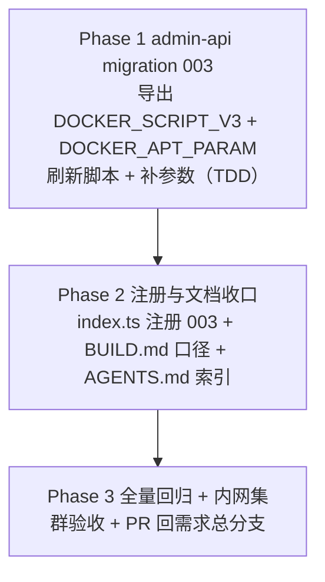

# Docker CE 软件源地址补齐（修复「Docker」工作负载初始化必然失败）- 实现计划

**关联 Proposal**: `docs/engineering/proposals/20261018-fix-docker-ce-apt-source.md`（v1.0）
**关联 PRD**: `docs/product/draft/20261018-docker-ce-apt-source.md`（v1.0）
**需求总分支（feat-branch）**: `fix/docker-ce-apt-source`（基于 `main`，需求总 PR #232）
**实现分支**: `fix/docker-ce-apt-source-impl`（基于 `fix/docker-ce-apt-source`）
**创建日期**: 2026-10-18
**计划版本**: v1.0
**版本说明**:
- v1.0（2026-10-18）首版，与 PRD v1.0 / 提案 v1.0 对齐。

## 实现顺序



依赖说明：

- 本期**只有 admin-api 一个代码仓库变更**（脚本与参数均为库内数据），无跨服务/跨仓并行；
- Phase 2 的 BUILD.md 口径依赖 Phase 1 落定的脚本 v3 文案与参数默认值形态；
- Phase 3 在实现分支合并回需求总分支后收口（`fix/docker-ce-apt-source`）。

开发模式采用 TDD（红-绿-重构）：Phase 1 先写 `003-docker-apt-source.test.ts`（RED）再实现 003 与脚本 v3（GREEN）。编码前加载 `docs/engineering/common-rules.md`、`docs/engineering/backend-rules.md`；`servers/admin-api` 无独立 `AGENTS.md`，沿用根 `AGENTS.md` 与 engineering 规范。

### 关键约束（提案 §1.3/§6，实现期不得回退）

- **无契约变更**：不动 `contracts/cloud-controller-websocket.md`；`workload:run` / `workload:result` 语义、`WORKLOAD_PARAM_<KEY_UPPER>` 注入与 `workloadPlan[].params` 透传保持不变。
- **无镜像变更**：不改 `deploy/images/worker/Dockerfile` / `entrypoint.sh`，本期**无需重建 worker 镜像**，部署 admin-api 即生效。
- **无 GraphQL schema / admin-web 变更**：`paramSchema` 既有字段类型（`key/label/type/options/defaultValue`）即可承载新参数；启动对话框「默认值预填」与工作负载管理页参数编辑均为既有能力。
- **不改 001 / 002 迁移源码**：003 是新增批次；001/002 已记账执行不再跑，改动它们会破坏「未定制」等比对的常量事实源。
- **不覆盖管理员定制**：脚本非 V1/V2/V3 一律 `console.warn` 跳过，且**不补参数**（提案 §5.2 判定矩阵、决策 6）。
- **不提高版本门禁**：`MIN_WORKER_VERSION` 保持 `2.2.0`（提案 决策 7）。
- **禁止 rebase/squash**：遵循 z-git 规范，仅允许 merge。

## 计划期裁决（提案留白/含混处的实现口径）

1. **常量命名与导出（003）**：`003-docker-apt-source.ts` 导出
   - `export const name = '003-docker-apt-source'`；
   - `export const DOCKER_SCRIPT_V3`（脚本 v3 全文常量，供单测与后续迁移比对）；
   - `export const DOCKER_APT_PARAM`（`docker_apt_url` 参数定义常量）；
   - `export const DOCKER_APT_URL_DEFAULT = 'https://nexus.internal.fffdan.com/repository/docker-ce-apt'`（**无尾斜杠**，`DOCKER_APT_PARAM.defaultValue` 引用它，测试断言也引用它，单一事实源）。
   导出常量不改变 runner 的 `Migration` 接口（`name` + `run`）。
2. **参数定义字段**（与 `CloudWorkload` 子文档 schema 严格对齐）：`{ key: 'docker_apt_url', label: 'Docker CE 软件源地址', type: 'text', options: [], defaultValue: DOCKER_APT_URL_DEFAULT }`。`key` 满足 `^[a-z][a-z0-9_]{0,31}$`，`defaultValue` < 1024 字符。
3. **脚本 v3 与 v2 的差异最小化**：仅两处变化——
   - 取值行由 `DOCKER_APT_URL="${DOCKER_APT_URL:-}"` 改为
     ``DOCKER_APT_URL="${DOCKER_APT_URL:-${WORKLOAD_PARAM_DOCKER_APT_URL:-}}"``，并紧随其后做尾斜杠归一：
     `while [ "${DOCKER_APT_URL%/}" != "$DOCKER_APT_URL" ]; do DOCKER_APT_URL="${DOCKER_APT_URL%/}"; done`；
   - 缺失快速失败的指引文案中的地址形态示例由 `.../<docker-ce-apt-proxy>/linux/ubuntu/` 修正为
     `https://<nexus-host>/repository/<docker-ce-apt>/`（实测该仓库根即 apt 源根，`/linux/ubuntu` 子路径 404）。
   安装包列表、幂等锚点（`/usr/bin/docker` 与 `/usr/bin/dockerd` 任一缺失即装）、shim 文本（quoted heredoc、`exec /usr/bin/docker`）、`nohup dockerd` 就绪等待（30s）、`docker version` / `docker buildx version` 校验**逐字不变**。
4. **脚本内不内置默认地址**：`DOCKER_SCRIPT_V3` 不得出现 `nexus.internal` / `download.docker.com` / `docker-ce-proxy` 等具体来源；默认值唯一来源是参数定义（提案 决策 2）。
5. **「未定制」判定矩阵**（严格相等，提案 §5.2 实现点 2）：
   | 条件 | 动作 |
   |---|---|
   | `initScript ∈ {V1, V2, V3}` 且 `paramSchema` 缺 `docker_apt_url` | `initScript` 非 V3 则置为 V3；追加 `DOCKER_APT_PARAM`；有变更才 `save()` |
   | `initScript ∈ {V1, V2, V3}` 且 `paramSchema` 已含 `docker_apt_url` | 仅 `initScript` 非 V3 时置为 V3；参数**完全不动**（含其默认值，管理员所有）；无变更则不再 `save()` |
   | 其他（`initScript` 非三者之一，含 `null`） | 不刷新、不补参数，`console.warn` 提示参照 v3 自行调整 |
   | `presetKey='docker'` 不存在、精确 `name='Docker'` 存在 | `console.warn` 跳过，**不创建重名项**（沿用 002 防御路径） |
   | 两者都不存在 | 以 V3 脚本 + `[DOCKER_APT_PARAM]` 防御创建（`isPreset: true`、`postScript: null`、`dependsOnWorkloadIds: []`） |
6. **「参数是否存在」判定**：`(wl.paramSchema ?? []).some((p) => p.key === 'docker_apt_url')`；只按 `key` 判、不比较默认值，避免把管理员改过的默认值判成缺失。
7. **写库方式**：与 002 一致，命中文档后原地改字段并 `doc.save()`（测试 mock `save`），非命中路径不写库；防御创建用 `CloudWorkload.create`。避免引入 `updateOne` 带来的新 mock 形态。
8. **`bash -n` 校验归属**：`DOCKER_SCRIPT_V3` 写入临时文件后调用 `bash -n`（模式同 002 `T-MIG10`），不引入跨语言脚本读取。
9. **脚本行为切片测试**：`T-MIG19` 从 `DOCKER_SCRIPT_V3` 中提取「取值 + 尾斜杠归一」两行（或其等价最小片段），在 `bash -c` 下喂入四种组合（env 有值 / 仅参数有值 / 两者都空 / 带尾斜杠），断言输出，覆盖语义而不启动 apt/dockerd。
10. **不改 001 的 `PRESETS[0].paramSchema`**：全新环境仍走 `001 建 V1（paramSchema:[]）→ 002 刷 V2 → 003 刷 V3 + 补参数` 的既有链路；在 001 直接预置参数会与 `DOCKER_SCRIPT_V1`（不消费参数）口径割裂，且破坏四期已锁定的常量事实源。
11. **参数注入的 worker 前提**：脚本消费 `WORKLOAD_PARAM_DOCKER_APT_URL` 需 worker 内 `agent-gear ≥2.3.0`（现网镜像已 ≥2.4.0）。极老 worker 上参数不注入时，v3 行为等价于 v2（快速失败 + 指引），不提高门禁（提案 决策 7）。
12. **失败不阻断上线**：脚本失败仅使该工作负载记录失败并保留日志，容器继续后续初始化并上线（沿用一期失败策略），不改 cloud-controller 侧逻辑。
13. **文档生命周期**：PRD 与提案本期保持各自目录（`draft` / `proposals`）不移动，待实现验收后按既有流程归档。

---

## Phase 1: admin-api migration 003（脚本 v3 + docker_apt_url 参数）

开发分支：`fix/docker-ce-apt-source-impl`。TDD 顺序：先写 `003-docker-apt-source.test.ts`（RED）→ 实现 `003-docker-apt-source.ts`（GREEN）。

### 文件修改

| 文件 | 操作 | 说明 |
|------|------|------|
| `servers/admin-api/src/migrations/003-docker-apt-source.ts` | 新增 | `name`；`DOCKER_SCRIPT_V3`（裁决 3/4）；`DOCKER_APT_URL_DEFAULT`、`DOCKER_APT_PARAM`（裁决 1/2）；`run()` 按裁决 5/6/7 实现刷新、补参数、定制跳过与防御创建 |
| `servers/admin-api/src/migrations/003-docker-apt-source.test.ts` | 新增 | 覆盖 `T-MIG11`~`T-MIG19`（下表）；mock 形态沿用 `002-refresh-docker-preset-script.test.ts`（`vi.mock('../models/cloud-workload.js')` + `findOne`/`create`/`save`） |
| `servers/admin-api/src/migrations/002-refresh-docker-preset-script.ts` | 不变 | 继续导出 `DOCKER_SCRIPT_V2` 供 003 比对（只读复用） |
| `servers/admin-api/src/migrations/001-preset-workloads.ts` | 不变 | 继续导出 `DOCKER_SCRIPT_V1`（只读复用） |

### 003 迁移逻辑（伪代码）

```ts
export const name = '003-docker-apt-source';

export async function run(): Promise<void> {
  const wl = await CloudWorkload.findOne({ presetKey: 'docker' });
  if (!wl) {
    const byName = await CloudWorkload.findOne({ name: 'Docker' });   // 裁决 5：防御
    if (byName) { console.warn('[Migration 003] ...exists without presetKey, skipping'); return; }
    await CloudWorkload.create({
      name: 'Docker', initScript: DOCKER_SCRIPT_V3, postScript: null,
      paramSchema: [DOCKER_APT_PARAM], dependsOnWorkloadIds: [], presetKey: 'docker', isPreset: true,
    });
    return;
  }

  const script = wl.initScript;
  const isStock = script === DOCKER_SCRIPT_V1 || script === DOCKER_SCRIPT_V2 || script === DOCKER_SCRIPT_V3;
  if (!isStock) { console.warn('[Migration 003] ...modified by admin, skipping'); return; }  // 裁决 5/6

  let changed = false;
  if (script !== DOCKER_SCRIPT_V3) { wl.initScript = DOCKER_SCRIPT_V3; changed = true; }
  const hasParam = (wl.paramSchema ?? []).some((p) => p.key === 'docker_apt_url');
  if (!hasParam) { wl.paramSchema = [...(wl.paramSchema ?? []), DOCKER_APT_PARAM]; changed = true; }
  if (changed) await wl.save();
}
```

### 脚本 v3 关键片段（裁决 3）

```bash
# 安装来源取值优先级：显式环境变量 DOCKER_APT_URL > 工作负载参数 WORKLOAD_PARAM_DOCKER_APT_URL > 空（缺失即快速失败）
DOCKER_APT_URL="${DOCKER_APT_URL:-${WORKLOAD_PARAM_DOCKER_APT_URL:-}}"
while [ "${DOCKER_APT_URL%/}" != "$DOCKER_APT_URL" ]; do DOCKER_APT_URL="${DOCKER_APT_URL%/}"; done
```

> TS 模板字符串中上述 `$` 需转义为 `\${...}`（同 002 写法）。

### 测试用例（对齐提案 §8）

| # | 用例 | 预期 |
|---|------|------|
| T-MIG11 | 迁移名暴露 | `migration.name === '003-docker-apt-source'` |
| T-MIG12 | v2 脚本（002 已刷新、`paramSchema: []`） | `initScript` 置为 V3 且追加 `docker_apt_url`（`defaultValue === DOCKER_APT_URL_DEFAULT`）；`save()` 一次 |
| T-MIG13 | v1 脚本（002 未跑的防御路径） | 同样刷新为 V3 并补参数；`save()` 一次 |
| T-MIG14 | 已 V3 且参数已存在 | 幂等：不 `save()`、不 `create()`，字段不变 |
| T-MIG15 | 已 V3 但参数缺失 | 只补参数、`initScript` 保持 V3；`save()` 一次 |
| T-MIG16 | 管理员定制脚本（非 V1/V2/V3） | 不覆盖、不补参数、`console.warn`；不 `save()` |
| T-MIG17a | `presetKey` 缺失、精确 `name='Docker'` 存在 | `console.warn` 跳过、不 `create()` |
| T-MIG17b | 两者都不存在 | `create()` 一次，字段：`initScript=V3`、`paramSchema=[DOCKER_APT_PARAM]`、`postScript:null`、`isPreset:true`、`presetKey:'docker'` |
| T-MIG18 | 脚本不变量 + `bash -n` | 含取值优先级与尾斜杠归一；指引含 `https://<nexus-host>/repository/<docker-ce-apt>/`、**不含** `/linux/ubuntu`；不含 `nexus.internal` / `download.docker.com` / `docker-ce-proxy`；安装列表逐字为 `docker-ce docker-ce-cli docker-buildx-plugin containerd.io`；含 `nohup dockerd`、`docker buildx version`；`bash -n` 退出 0 |
| T-MIG19 | 取值/归一行为切片 | env 覆盖参数、仅参数生效、尾斜杠归一为无斜杠、双空得空（四种组合，`bash -c` 断言） |
| 回归 | 001/002/runner 既有测试 | 全绿（v2 常量未改，`T-MIG10` 不受影响） |

### 命令参考

```bash
cd servers/admin-api
npx vitest run src/migrations        # 先跑 003 测试（RED→GREEN），再跑全目录
npm run build                        # strict TS 编译
npx vitest run --coverage            # 覆盖率 ≥80%
```

### 验收 checklist

- [ ] `T-MIG11`~`T-MIG19` 全部通过；001/002/runner 既有测试保持通过
- [ ] `npm run build` strict 通过；`Migration` 接口未变（`name` + `run`）
- [ ] 003 仅在 `cloudworkloads` 的 `presetKey='docker'` 文档上写 `initScript` / `paramSchema`，不产生其他集合写入
- [ ] 脚本内不含任何具体来源地址（默认值只在参数定义里）
- [ ] 定制脚本路径与 `presetKey` 缺失路径均只告警、不写库

---

## Phase 2: 注册与文档收口

开发分支：`fix/docker-ce-apt-source-impl`。

### 文件修改

| 文件 | 操作 | 说明 |
|------|------|------|
| `servers/admin-api/src/index.ts` | 修改 | 导入 `* as migration003DockerAptSource`，注册链追加为 `runMigrations([migration001, migration002DotnetApt, migration002RefreshDocker, migration003DockerAptSource])`（顺序必须在 001/002 之后） |
| `deploy/images/worker/BUILD.md` | 修改 | 见下方口径同步清单 |
| `docs/engineering/AGENTS.md` | 修改 | 「实现计划（`plan/`）」索引新增 `plan/20261018-fix-docker-ce-apt-source.md` |
| `docs/product/AGENTS.md` / `docs/engineering/AGENTS.md`（proposal 段） | 复用 | 上游已登记本期 PRD 与 proposal，无需改动 |

### BUILD.md 口径同步清单

对照当前文档（第 192~205、276 行等）：

- [ ] 「**安装来源已注入且可达**」项：由「要求容器/脚本提供 `DOCKER_APT_URL`（形如 `.../<docker-ce-apt-proxy>/linux/ubuntu/`）」改为「「Docker」工作负载参数 `docker_apt_url` 默认已填内网代理地址 `https://nexus.internal.fffdan.com/repository/docker-ce-apt`；可在启动时按次调整，`DOCKER_APT_URL` 环境变量可覆盖且优先」。
- [ ] 地址形态示例统一去掉 `/linux/ubuntu`（修正为 `https://<nexus-host>/repository/<docker-ce-apt>/`），与实测（仓库根即 apt 源根）一致。
- [ ] 「未注入 `DOCKER_APT_URL` 且组件尚未安装」项：改为「清空 `docker_apt_url` 参数且组件尚未安装时快速失败，并给出含正确地址形态的指引」。
- [ ] `> **安装来源（重要）**` 引用块：删除「内网 Nexus 不存在 docker-ce apt 代理」的旧结论，改为「默认来源由工作负载参数提供（内网代理），脚本本身不内置默认值；env 覆盖优先」。
- [ ] 「已知限制」段（第 276 行）Docker 口径同步为参数默认值已提供、env 可覆盖。
- [ ] 镜像静态 `grep` 自验项（第 103/111 行）保持不变——镜像仍不含 `docker-ce` / `DOCKER_APT_URL` 残留，本期不动镜像。

### 命令参考

```bash
cd servers/admin-api && npm run build
grep -n "DOCKER_APT_URL\|linux/ubuntu\|docker-ce-apt" deploy/images/worker/BUILD.md   # 人工核对口径
```

### 验收 checklist

- [ ] `index.ts` 注册链顺序正确（001 → 002 .NET → 002 Docker → 003），`npm run build` 通过
- [ ] BUILD.md 中不再出现「无默认值、必须注入」「内网未提供 docker-ce apt 代理」等已过期口径
- [ ] BUILD.md 中不再出现 `.../linux/ubuntu/` 形态的地址示例
- [ ] `docs/engineering/AGENTS.md` 计划索引含本期实现计划

---

## Phase 3: 全量回归 + 内网集群验收 + PR

### 命令参考

```bash
# admin-api 全量
cd servers/admin-api && npm run build && npx vitest run && npx vitest run --coverage
# worker 入口自验（本期未改镜像，回归确认无意外影响）
cd deploy/images/worker && bash -n entrypoint.sh && bash entrypoint.test.sh
```

### 内网 K8s 手工验收（对齐提案 §10 / PRD §1.3）

前置：admin-api 已部署含 migration 003 的镜像；worker 内 `agent-gear` ≥ `2.4.0`；内网 `docker-ce-apt` 代理可达。

- [ ] 全新环境首次启动：`cloudworkloads` 中「Docker」为 `DOCKER_SCRIPT_V3` 且 `paramSchema` 含 `docker_apt_url`（默认值 = 内网地址）
- [ ] 存量未定制环境升级后与上条一致；定制脚本不被覆盖且有告警日志（`[Migration 003] ... modified by admin, skipping`）
- [ ] 后台「工作负载管理」可见「Docker CE 软件源地址」参数及其默认值，可编辑
- [ ] 启动对话框勾选「Docker」后参数表单预填默认地址；直接启动：初始化成功，`docker info` / `docker buildx version` / `docker pull ubuntu:24.04`（走内部镜像代理）均成功
- [ ] 启动时把地址改为另一可达来源：按新地址安装成功
- [ ] 清空地址启动：初始化快速失败，执行记录给出含正确地址形态的指引（「必须」口径行为不变）
- [ ] 地址不可达：失败留痕并保留日志，容器行为遵循「必须」标记口径
- [ ] 重复执行初始化脚本幂等收敛；重复执行迁移不产生重复变更（账本 + 幂等分支）
- [ ] 实现分支 PR 合并回 `fix/docker-ce-apt-source`，需求总 PR #232 自动更新；实现计划文档保留在需求总分支

### 总体验收 checklist（对齐提案 §10 / PRD §1.3）

- [ ] `T-MIG11`~`T-MIG19` 全部通过，001/002/runner 既有测试全绿，覆盖率 ≥80%
- [ ] 无契约变更（`git diff --stat` 不含 `contracts/`）、无镜像变更（不含 `deploy/images/worker/Dockerfile` / `entrypoint.sh`）、无 GraphQL schema 与 admin-web 变更
- [ ] `deploy/images/worker/BUILD.md` 口径与实现一致
- [ ] 上述内网集群验收全项通过

## 风险与回滚

| 风险 | 缓解 |
|------|------|
| 003 误覆盖管理员定制脚本 | 严格相等比对 `V1/V2/V3`；非三者一律 warn 不覆盖、不补参数（裁决 5，T-MIG16） |
| 给不消费参数的定制脚本补参数 | 定制路径**不补参数**（裁决 5/6），避免产生无效配置 |
| 管理员改过参数默认值被迁移重置 | 参数存在性只按 `key` 判定，存在即完全不动（裁决 6，T-MIG14） |
| 003 与 002 比对常量漂移 | 003 只读复用 `001.DOCKER_SCRIPT_V1` / `002.DOCKER_SCRIPT_V2` / 自身 `DOCKER_SCRIPT_V3`；三处常量均不修改（裁决 10、关键约束） |
| 极老 worker（<2.3.0）不注入参数 | v3 行为等价 v2（快速失败 + 指引），不提高 `MIN_WORKER_VERSION`；发布说明提示 worker 版本（裁决 11） |
| 默认地址形态写错导致安装失败 | 默认值为实测验证的仓库根（无 `/linux/ubuntu`）；BUILD.md 与脚本指引统一形态（裁决 3，Phase 2 清单） |
| 内网代理不可达 | 该工作负载记录失败并保留日志，容器仍上线（沿用一期失败策略）；管理员可在启动时改地址或清空以走快速失败 |
| 运行中的旧容器仍用旧脚本 | 沿用既有发布口径：需重建容器才使用新配置；发布说明提示（提案 §9.3） |
| 迁移失败阻断启动 | 沿用 runner 语义：失败仅记日志、下轮启动重试，不阻断服务 |

## 相关文档

- 关联 PRD：`docs/product/draft/20261018-docker-ce-apt-source.md`
- 关联 Proposal：`docs/engineering/proposals/20261018-fix-docker-ce-apt-source.md`
- 直接前因（四期）：`docs/engineering/plan/20261018-feat-workload-phase4.md`、`docs/engineering/proposals/20261018-feat-workload-phase4.md`
- 基线（一期/三期）：`docs/engineering/plan/20261018-feat-workload-phase1.md`、`docs/engineering/plan/20261018-feat-workload-phase3.md`
- 既有实现：`servers/admin-api/src/migrations/001-preset-workloads.ts`、`002-refresh-docker-preset-script.ts`、`002-refresh-docker-preset-script.test.ts`、`runner.ts`、`servers/admin-api/src/index.ts`
- 参数链路参考：`servers/admin-api/src/services/workload-plan.ts`、`servers/cloud-controller/src/services/workload-dispatcher.ts`、`packages/agent-controller/src/workload-executor.ts`
- 镜像构建与自验：`deploy/images/worker/BUILD.md`
- 开发规范：`docs/engineering/common-rules.md`、`docs/engineering/backend-rules.md`
