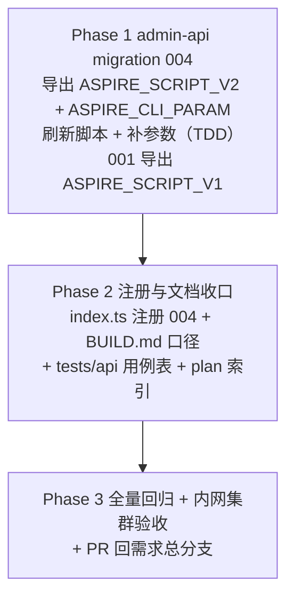

# Aspire 工作负载下载代理（Aspire CLI 内网代理下载）- 实现计划

**关联 Proposal**: `docs/engineering/proposals/20261019-feat-aspire-workload-proxy.md`（v1.0）
**关联 PRD**: `docs/product/draft/20261019-aspire-workload-proxy.md`（v1.0）
**需求总分支（feat-branch）**: `feat/aspire-workload-proxy`（基于 `main`，需求总 PR #235）
**实现分支**: `feat/aspire-workload-proxy-impl`（基于 `feat/aspire-workload-proxy`）
**创建日期**: 2026-10-19
**计划版本**: v1.0
**版本说明**:
- v1.0（2026-10-19）首版，与 PRD v1.0 / 提案 v1.0 对齐。

## 实现顺序



依赖说明：

- 本期**只有 admin-api 一个代码仓库变更**（脚本与参数均为库内数据），无跨服务/跨仓并行；
- Phase 1 内 001 的导出改造必须先于 004（004 依赖 `ASPIRE_SCRIPT_V1` 做「未定制」比对）；
- Phase 2 的 BUILD.md 口径依赖 Phase 1 落定的脚本 v2 文案与参数默认值形态；
- Phase 3 在实现分支合并回需求总分支后收口（`feat/aspire-workload-proxy`）。

开发模式采用 TDD（红-绿-重构）：Phase 1 先写 `004-aspire-cli-source.test.ts`（RED）再实现 001 导出改造与 004 脚本 v2（GREEN）。编码前加载 `docs/engineering/common-rules.md`、`docs/engineering/backend-rules.md`；`servers/admin-api` 无独立 `AGENTS.md`，沿用根 `AGENTS.md` 与 engineering 规范。

### 关键约束（提案 §1.3/§6，实现期不得回退）

- **无契约变更**：不动 `contracts/cloud-controller-websocket.md`；`workload:run` / `workload:result` 语义、`WORKLOAD_PARAM_<KEY_UPPER>` 注入与 `workloadPlan[].params` 透传保持不变。
- **无镜像变更**：不改 `deploy/images/worker/Dockerfile` / `entrypoint.sh`，本期**无需重建 worker 镜像**，部署 admin-api 即生效。
- **无 GraphQL schema / admin-web 变更**：`paramSchema` 既有字段类型（`key/label/type/options/defaultValue`）即可承载新参数；启动对话框「默认值预填」与工作负载管理页参数编辑均为既有能力。
- **不改 002 / 003 迁移源码**：004 是新增批次；001 仅做「导出改造」（更名 + 导出，内容逐字不变、写库行为不变）。
- **不覆盖管理员定制**：脚本非 V1/V2 一律 `console.warn` 跳过，且**不补参数**（提案 §5.2 判定矩阵、决策 8）。
- **脚本内不内置默认地址**：默认值唯一来源是参数定义（提案 决策 3）；「清空即快速失败」，不静默回退。
- **不改依赖与「必须」语义**：「Aspire」仍依赖 Docker → .NET，`MIN_WORKER_VERSION` 保持现状（提案 决策 9）。
- **禁止 rebase/squash**：遵循 z-git 规范，仅允许 merge。

## 计划期裁决（提案留白/含混处的实现口径）

1. **常量命名与导出（004）**：`004-aspire-cli-source.ts` 导出
   - `export const name = '004-aspire-cli-source'`；
   - `export const ASPIRE_SCRIPT_V2`（脚本 v2 全文常量，供单测与后续迁移比对）；
   - `export const ASPIRE_CLI_PARAM`（`aspire_cli_url` 参数定义常量）；
   - `export const ASPIRE_CLI_URL_DEFAULT = 'https://nexus.internal.fffdan.com/repository/misc-cache/dotnet/aspire-cli-linux-x64.tar.gz'`（**安装包直链**，`ASPIRE_CLI_PARAM.defaultValue` 引用它，测试断言也引用它，单一事实源）。
   导出常量不改变 runner 的 `Migration` 接口（`name` + `run`）。
2. **参数定义字段**（与 `CloudWorkload` 子文档 schema 严格对齐）：`{ key: 'aspire_cli_url', label: 'Aspire CLI 下载地址', type: 'text', options: [], defaultValue: ASPIRE_CLI_URL_DEFAULT }`。`key` 满足 `^[a-z][a-z0-9_]{0,31}$`，`defaultValue` < 1024 字符。
3. **001 导出改造的最小面**：`001-preset-workloads.ts` 中 `const ASPIRE_SCRIPT = ...` 改为 `export const ASPIRE_SCRIPT_V1 = ...`，并把 `PRESETS` 中 `presetKey: 'aspire'` 的 `initScript: ASPIRE_SCRIPT` 同步改为 `initScript: ASPIRE_SCRIPT_V1`。模板字符串内容**逐字节不变**（仍保留 `ASPIRE_INSTALL_URL`/`aspire.dev/install.sh`/`curl | bash` 段，作为 V1 比对事实源与「全新环境先建 V1」路径）；001 已上线环境已记账不再执行，`001-preset-workloads.test.ts`（`T-MIG1/T-MIG2`，断言 `initScript` 含 `aspire --version`）不受影响。
4. **脚本 v2 与 v1 的差异最小化**：仅置换「安装段」，其余**逐字不变**——
   - 保留：`export DOTNET_ROOT` / `DOTNET_CLI_TELEMETRY_OPTOUT`、前置检查（`.NET 未就绪…` exit 1、`Docker 未就绪…` exit 1）、「已安装」幂等分支（`command -v aspire` 或 `$HOME/.aspire/bin/aspire` → 补软链 → `aspire --version` → `exit 0`）、PATH 集成（`ln -sfn ... /usr/local/bin/aspire` + `/etc/profile.d/aspire.sh` + `export PATH`）、结尾 `aspire --version`；
   - 置换：`INSTALL_URL="${ASPIRE_INSTALL_URL:-https://aspire.dev/install.sh}"` + `curl -sSL "$INSTALL_URL" | bash` → 「取值 → 空快速失败 → `mktemp -d` + `trap` 清理 → `curl -fsSL` 下载安装包 → `tar -xzf` 解压到 `$HOME/.aspire/bin` → `chmod +x`」；
   - **保留 v1 的安装后存在性检查**：解压后 `ASPIRE_BIN="$HOME/.aspire/bin/aspire"; [ -x "$ASPIRE_BIN" ] || { echo "Aspire CLI 安装后未找到 $ASPIRE_BIN" >&2; exit 1; }`（保持「安装布局与校验口径不变」，避免 `set -e` 之外的静默失败）。
5. **缺失检查的位置**：下载地址取值与「空即 `exit 2`」必须放在「已安装」幂等分支**之后**——保证「已安装但地址为空」时直接校验通过（幂等），与 PRD「Aspire 已安装 → 跳过下载、直接校验通过」口径一致（对齐提案 §5.1 时序图的 `前置检查 → 已安装则校验后直接成功 → 取值`）。
6. **不做尾斜杠归一**：与 003（仓库根）不同，`aspire_cli_url` 是**安装包文件直链**，不做尾斜杠处理，`curl -fsSL "$ASPIRE_CLI_URL"` 原样消费。
7. **脚本内不内置默认地址**：`ASPIRE_SCRIPT_V2` 不得出现 `nexus.internal` / `aka.ms` / `aspire.dev` / `install.sh` / `ASPIRE_INSTALL_URL`；指引文案中的地址形态示例使用占位形态 `https://<nexus-host>/repository/misc-cache/dotnet/aspire-cli-linux-x64.tar.gz`（默认值唯一来源是 `ASPIRE_CLI_PARAM`，提案 决策 2/3）。
8. **「未定制」判定矩阵**（严格相等，提案 §5.2 实现点 2）：
   | 条件 | 动作 |
   |---|---|
   | `initScript ∈ {V1, V2}` 且 `paramSchema` 缺 `aspire_cli_url` | `initScript` 非 V2 则置为 V2；追加 `ASPIRE_CLI_PARAM`；有变更才 `save()` |
   | `initScript ∈ {V1, V2}` 且 `paramSchema` 已含 `aspire_cli_url` | 仅 `initScript` 非 V2 时置为 V2；参数**完全不动**（含其默认值，管理员所有）；无变更则不再 `save()` |
   | 其他（`initScript` 非 V1/V2，含 `null`） | 不刷新、不补参数，`console.warn` 提示参照 v2 自行调整 |
   | `presetKey='aspire'` 不存在、精确 `name='Aspire'` 存在 | `console.warn` 跳过，**不创建重名项**（沿用 003 防御路径） |
   | 两者都不存在 | 以 `ASPIRE_SCRIPT_V2` + `[ASPIRE_CLI_PARAM]` 防御创建（`isPreset: true`、`postScript: null`、`dependsOnWorkloadIds: []`） |
9. **「参数是否存在」判定**：`(wl.paramSchema ?? []).some((p) => p.key === 'aspire_cli_url')`；只按 `key` 判、不比较默认值，避免把管理员改过的默认值判成缺失。
10. **写库方式**：与 003 一致，命中文档后原地改字段并 `doc.save()`（测试 mock `save`），非命中路径不写库；防御创建用 `CloudWorkload.create`。避免引入 `updateOne` 带来的新 mock 形态。
11. **`bash -n` 校验归属**：`ASPIRE_SCRIPT_V2` 写入临时文件后调用 `bash -n`（模式同 003 `T-MIG18`），不引入跨语言脚本读取。
12. **脚本行为切片测试**：`T-MIG27` 从 `ASPIRE_SCRIPT_V2` 中提取「取值 + 空判断」两行（或其等价最小片段），在 `bash -c` 下喂入三种组合（env 有值 / 仅参数有值 / 两者都空），断言输出/退出码，覆盖语义而不触发真实下载安装。
13. **API 回归断言口径（澄清提案 §8 用词）**：提案 §8 表内「预制 Aspire `initScript` 含内网代理地址」与决策 3「脚本内不内置默认地址」存在用词张力，本计划以**决策 3 为准**解释——`tests/api` 断言：`paramSchema` 中 `aspire_cli_url.defaultValue === ASPIRE_CLI_URL_DEFAULT`（内网代理地址），`initScript` **不含** `install.sh`/`aspire.dev`/`aka.ms`/`ASPIRE_INSTALL_URL` 且含 `curl -fsSL`/`tar -xzf`；脚本自身含具体 `nexus.internal` 地址的事实断言**不成立、不写**。重复查询预制项 ID 集合稳定。
14. **参数注入的 worker 前提**：脚本消费 `WORKLOAD_PARAM_ASPIRE_CLI_URL` 需 worker 内 `agent-gear ≥2.3.0`（现网镜像已满足）。极老 worker 上参数不注入时，v2 行为为「取值为空 → 快速失败 + 指引」，不静默回退公网；**不提高 `MIN_WORKER_VERSION`**（提案 决策 9）。
15. **失败不阻断上线**：脚本失败仅使该工作负载记录失败并保留日志，容器继续后续初始化并上线（沿用一期失败策略），不改 cloud-controller 侧逻辑。
16. **文档生命周期**：PRD 与提案本期保持各自目录（`draft` / `proposals`）不移动，待实现验收后按既有流程归档。

---

## Phase 1: admin-api migration 004（脚本 v2 + aspire_cli_url 参数）

开发分支：`feat/aspire-workload-proxy-impl`。TDD 顺序：先写 `004-aspire-cli-source.test.ts`（RED）→ 改造 `001` 导出 → 实现 `004-aspire-cli-source.ts`（GREEN）。

### 文件修改

| 文件 | 操作 | 说明 |
|------|------|------|
| `servers/admin-api/src/migrations/001-preset-workloads.ts` | 修改 | `const ASPIRE_SCRIPT` → `export const ASPIRE_SCRIPT_V1`（内容逐字节不变）；`PRESETS` 引用同步（裁决 3） |
| `servers/admin-api/src/migrations/004-aspire-cli-source.ts` | 新增 | `name`；`ASPIRE_SCRIPT_V2`（裁决 4/5/6/7）；`ASPIRE_CLI_URL_DEFAULT`、`ASPIRE_CLI_PARAM`（裁决 1/2）；`run()` 按裁决 8/9/10 实现刷新、补参数、定制跳过与防御创建 |
| `servers/admin-api/src/migrations/004-aspire-cli-source.test.ts` | 新增 | 覆盖 `T-MIG20`~`T-MIG27`（下表）；mock 形态沿用 `003-docker-apt-source.test.ts`（`vi.mock('../models/cloud-workload.js')` + `findOne`/`create`/`save`） |
| `servers/admin-api/src/migrations/001-preset-workloads.test.ts` | 不变 | `T-MIG1/T-MIG2` 仅断言 `initScript` 含 `aspire --version`，V1 保留该行，不受导出改造影响 |
| `servers/admin-api/src/migrations/002-*.ts`、`003-docker-apt-source.ts` | 不变 | 只读复用既有导出；004 不改其写库逻辑 |

### 004 迁移逻辑（伪代码）

```ts
export const name = '004-aspire-cli-source';

export async function run(): Promise<void> {
  const wl = await CloudWorkload.findOne({ presetKey: 'aspire' });
  if (!wl) {
    const byName = await CloudWorkload.findOne({ name: 'Aspire' });   // 裁决 8：防御
    if (byName) { console.warn('[Migration 004] ...exists without presetKey, skipping'); return; }
    await CloudWorkload.create({
      name: 'Aspire', initScript: ASPIRE_SCRIPT_V2, postScript: null,
      paramSchema: [ASPIRE_CLI_PARAM], dependsOnWorkloadIds: [], presetKey: 'aspire', isPreset: true,
    });
    return;
  }

  const script = wl.initScript;
  const isStock = script === ASPIRE_SCRIPT_V1 || script === ASPIRE_SCRIPT_V2;
  if (!isStock) { console.warn('[Migration 004] aspire preset script modified by admin, skipping'); return; }  // 裁决 8/9

  let changed = false;
  if (script !== ASPIRE_SCRIPT_V2) { wl.initScript = ASPIRE_SCRIPT_V2; changed = true; }
  const hasParam = (wl.paramSchema ?? []).some((p) => p.key === 'aspire_cli_url');
  if (!hasParam) { wl.paramSchema = [...(wl.paramSchema ?? []), ASPIRE_CLI_PARAM]; changed = true; }
  if (changed) await wl.save();
}
```

### 脚本 v2 关键片段（裁决 4/5/6/7）

```bash
# 前置检查（.NET / Docker 就绪）与「已安装」幂等分支逐字保留在取值之前
# …（v1 第 114~131 行不变）…

# 下载地址取值优先级：显式环境变量 ASPIRE_CLI_URL（最高）> 工作负载参数 WORKLOAD_PARAM_ASPIRE_CLI_URL > 空（需安装时快速失败）
ASPIRE_CLI_URL="${ASPIRE_CLI_URL:-${WORKLOAD_PARAM_ASPIRE_CLI_URL:-}}"
if [ -z "$ASPIRE_CLI_URL" ]; then
  echo "Aspire CLI 下载地址未设置：请在「Aspire」工作负载参数中填写 aspire_cli_url（形如 https://<nexus-host>/repository/misc-cache/dotnet/aspire-cli-linux-x64.tar.gz）后重试" >&2
  exit 2
fi

TMP_DIR="$(mktemp -d)"
trap 'rm -rf "$TMP_DIR"' EXIT
curl -fsSL "$ASPIRE_CLI_URL" -o "$TMP_DIR/aspire-cli.tar.gz"

install -m 0755 -d "$HOME/.aspire/bin"
tar -xzf "$TMP_DIR/aspire-cli.tar.gz" -C "$HOME/.aspire/bin"
chmod +x "$HOME/.aspire/bin/aspire"

ASPIRE_BIN="$HOME/.aspire/bin/aspire"
[ -x "$ASPIRE_BIN" ] || {
  echo "Aspire CLI 安装后未找到 $ASPIRE_BIN" >&2
  exit 1
}

# PATH 集成与最终校验（v1 第 142~149 行逐字不变）
ln -sfn "$ASPIRE_BIN" /usr/local/bin/aspire
printf '%s\n' 'export PATH="$HOME/.aspire/bin:$PATH"' > /etc/profile.d/aspire.sh
chmod +x /etc/profile.d/aspire.sh
export PATH="$HOME/.aspire/bin:$PATH"

aspire --version
```

> TS 模板字符串中上述 `$` 需转义为 `\${...}`（同 001/002/003 写法）。

### 测试用例（对齐提案 §8）

| # | 用例 | 预期 |
|---|------|------|
| T-MIG20 | 迁移名暴露 | `migration.name === '004-aspire-cli-source'` |
| T-MIG21 | v1 脚本（`paramSchema: []`） | `initScript` 置为 `ASPIRE_SCRIPT_V2` 且追加 `aspire_cli_url`（`defaultValue === ASPIRE_CLI_URL_DEFAULT`）；`save()` 一次 |
| T-MIG22 | 已 V2 且参数已存在 | 幂等：不 `save()`、不 `create()`，字段不变 |
| T-MIG23 | 已 V2 但参数缺失 | 只补参数、`initScript` 保持 V2；`save()` 一次 |
| T-MIG24 | 管理员定制脚本（非 V1/V2） | 不覆盖、不补参数、`console.warn`；不 `save()` |
| T-MIG25a | `presetKey` 缺失、精确 `name='Aspire'` 存在 | `console.warn` 跳过、不 `create()` |
| T-MIG25b | 两者都不存在 | `create()` 一次，字段：`initScript=V2`、`paramSchema=[ASPIRE_CLI_PARAM]`、`postScript:null`、`isPreset:true`、`presetKey:'aspire'` |
| T-MIG26 | 脚本不变量 + `bash -n` | 含取值优先级 `ASPIRE_CLI_URL`/`WORKLOAD_PARAM_ASPIRE_CLI_URL`、`curl -fsSL`、`tar -xzf`、`install -m 0755 -d "$HOME/.aspire/bin"`、`aspire --version`；指引含 `https://<nexus-host>/repository/misc-cache/dotnet/aspire-cli-linux-x64.tar.gz`；保留 `.NET 未就绪`/`Docker 未就绪`/`$HOME/.aspire/bin/aspire` 幂等锚点；**不含** `install.sh`/`aspire.dev`/`aka.ms`/`ASPIRE_INSTALL_URL`/`nexus.internal`；`bash -n` 退出 0 |
| T-MIG27 | 取值/失败行为切片 | env 覆盖参数、仅参数生效、双空触发 `exit 2` + 指引（三种组合，`bash -c` 断言） |
| 回归 | 001/002/003/runner 既有测试 | 全绿（001 `ASPIRE_SCRIPT_V1` 内容未改，`T-MIG1/T-MIG2` 不受影响） |

### 命令参考

```bash
cd servers/admin-api
npx vitest run src/migrations        # 先跑 004 测试（RED→GREEN），再跑全目录
npm run build                        # strict TS 编译
npx vitest run --coverage            # 覆盖率 ≥80%
```

### 验收 checklist

- [ ] `T-MIG20`~`T-MIG27` 全部通过；001/002/003/runner 既有测试保持通过
- [ ] `npm run build` strict 通过；`Migration` 接口未变（`name` + `run`）
- [ ] 001 导出改造后 `ASPIRE_SCRIPT_V1` 内容逐字节等于改造前 `ASPIRE_SCRIPT`（fresh 环境仍建 V1）
- [ ] 004 仅在 `cloudworkloads` 的 `presetKey='aspire'` 文档上写 `initScript` / `paramSchema`，不产生其他集合写入
- [ ] 脚本内不含任何具体来源地址（默认值只在参数定义里）
- [ ] 定制脚本路径与 `presetKey` 缺失路径均只告警、不写库

---

## Phase 2: 注册与文档收口

开发分支：`feat/aspire-workload-proxy-impl`。

### 文件修改

| 文件 | 操作 | 说明 |
|------|------|------|
| `servers/admin-api/src/index.ts` | 修改 | 导入 `* as migration004AspireCliSource`，注册链追加为 `runMigrations([migration001, migration002DotnetApt, migration002RefreshDocker, migration003DockerAptSource, migration004AspireCliSource])`（顺序必须在 001/002/003 之后） |
| `deploy/images/worker/BUILD.md` | 修改 | 见下方口径同步清单 |
| `tests/api/AGENTS.md` | 修改 | 在「Admin Cloud Workload API」用例表新增 `T-IA 预制 Aspire 代理下载`（裁决 13 口径） |
| `tests/api/src/admin-api/cloud-workload.test.ts` | 修改 | 新增 `T-IA: preset Aspire uses the proxied-package init script (migration 004 upgrade)`：`paramSchema` 含 `aspire_cli_url` 且默认值 = 内网代理地址；`initScript` 含 `curl -fsSL`/`tar -xzf`、不含 `install.sh`/`aspire.dev`/`aka.ms`；重复查询预制项 ID 集合稳定 |
| `docs/engineering/AGENTS.md` | 修改 | 「实现计划（`plan/`）」索引新增 `plan/20261019-feat-aspire-workload-proxy.md` |
| `docs/product/AGENTS.md` / `docs/engineering/AGENTS.md`（proposal 段） | 复用 | 上游已登记本期 PRD 与 proposal，无需改动 |

### BUILD.md 口径同步清单

对照当前文档（第 182~184、198、200~205、276 行等）：

- [ ] 「Aspire（依赖 Docker + .NET，最后执行；成功判据为 CLI 可执行）」手工验收块：保留 `aspire --version`，补充「下载来源为「Aspire」工作负载参数 `aspire_cli_url`（迁移 004 默认填入内网代理地址 `https://nexus.internal.fffdan.com/repository/misc-cache/dotnet/aspire-cli-linux-x64.tar.gz`）；启动时可按次调整，运行时 `ASPIRE_CLI_URL` 环境变量可覆盖且优先；脚本本身不内置默认值」。
- [ ] 第 198 行「Aspire 脚本前置检查…安装 CLI 后 `aspire --version` 输出非空（不能仅以安装脚本返回 0 判成功）」：把「安装脚本」措辞改为「下载安装」，并补「清空 `aspire_cli_url`（且未提供 `ASPIRE_CLI_URL`）且未安装时该工作负载**快速失败**并给出含正确地址形态的指引（容器仍继续后续初始化并上线）」「下载地址不可达时记录失败与日志」两条。
- [ ] 第 200~205 行 `> **安装来源（重要）**` 引用块：Docker 段保留；可补一句 Aspire 段——「Aspire 默认来源由工作负载参数 `aspire_cli_url` 提供（内网代理安装包直链），脚本不内置默认值，`ASPIRE_CLI_URL` env 可覆盖且优先」。
- [ ] 第 276 行「已知限制」段：把「.NET / Aspire 脚本默认走各自官方地址，内网覆盖由管理员编辑对应工作负载脚本」改为「.NET 脚本经 apt 安装；Aspire 由工作负载参数 `aspire_cli_url` 提供内网代理安装包直链（迁移 004 默认填入），脚本本身不内置默认值，清空且未安装时快速失败并给出指引」。
- [ ] 第 106 行镜像静态 `grep` 自验项（`grep -nE 'DOTNET_INSTALL_URL|ASPIRE_INSTALL_URL' Dockerfile`）**保持不变**——该清单校验的是镜像 `Dockerfile`，而 `ASPIRE_INSTALL_URL` 仅存在于 admin-api 库内脚本常量中，本期不动镜像，无残留。
- [ ] `ASPIRE_INSTALL_URL` 随官方安装脚本退役（仅 v1 常量沿用旧变量名用于比对），BUILD.md 不再把它描述为「可替换为内部代理」的运行时变量。

### 命令参考

```bash
cd servers/admin-api && npm run build
grep -n "ASPIRE_INSTALL_URL\|aspire.dev\|即使用官方\|官方地址" deploy/images/worker/BUILD.md   # 人工核对口径
```

### 验收 checklist

- [ ] `index.ts` 注册链顺序正确（001 → 002 .NET → 002 Docker → 003 → 004），`npm run build` 通过
- [ ] BUILD.md 中不再出现「.NET / Aspire 脚本默认走各自官方地址」等已过期口径
- [ ] BUILD.md Aspire 段明确「参数默认值提供内网代理安装包直链、脚本不内置默认值、env 可覆盖且优先」
- [ ] `tests/api/AGENTS.md` 用例表含 `T-IA 预制 Aspire 代理下载`（按裁决 13 口径），与实现断言一致
- [ ] `docs/engineering/AGENTS.md` 计划索引含本期实现计划

---

## Phase 3: 全量回归 + 内网集群验收 + PR

### 命令参考

```bash
# admin-api 全量
cd servers/admin-api && npm run build && npx vitest run && npx vitest run --coverage
# API 回归（需 Aspire 编排 admin-api + cloud-controller 就绪）
cd tests/api && API_URL=http://localhost:10001/graphql \
  ADMIN_API_URL=http://localhost:10003/graphql \
  CONTROLLER_API_URL=http://localhost:33237 npm test
```

### 内网 K8s 手工验收（对齐提案 §10 / PRD §1.3）

前置：admin-api 已部署含 migration 004 的镜像；worker 内 `agent-gear` ≥ `2.3.0`；内网 `misc-cache` 代理可达。

- [ ] 全新环境首次启动：`cloudworkloads` 中「Aspire」为 `ASPIRE_SCRIPT_V2` 且 `paramSchema` 含 `aspire_cli_url`（默认值 = 内网代理安装包直链）
- [ ] 存量未定制环境升级后与上条一致；定制脚本不被覆盖且有告警日志（`[Migration 004] aspire preset script modified by admin, skipping`）
- [ ] 后台「工作负载管理」可见「Aspire CLI 下载地址」参数及其默认值，可编辑
- [ ] 启动对话框勾选「Aspire」后参数表单预填默认地址；直接启动：初始化成功，`aspire --version` 输出非空，全程不访问公网
- [ ] 启动时把地址改为另一可达来源：按新地址下载安装成功
- [ ] 清空地址且未安装启动：初始化快速失败，执行记录给出含正确地址形态的指引（「必须」口径行为不变）
- [ ] 地址不可达：失败留痕并保留日志，容器行为遵循「必须」标记口径
- [ ] 重复执行初始化脚本幂等收敛（已安装直接校验通过）；重复执行迁移不产生重复变更（账本 + 幂等分支）
- [ ] 实现分支 PR 合并回 `feat/aspire-workload-proxy`，需求总 PR #235 自动更新；实现计划文档保留在需求总分支

### 总体验收 checklist（对齐提案 §10 / PRD §1.3）

- [ ] `T-MIG20`~`T-MIG27` 全部通过，001/002/003/runner 既有测试全绿，覆盖率 ≥80%
- [ ] 无契约变更（`git diff --stat` 不含 `contracts/`）、无镜像变更（不含 `deploy/images/worker/Dockerfile` / `entrypoint.sh`）、无 GraphQL schema 与 admin-web 变更
- [ ] `deploy/images/worker/BUILD.md`、`tests/api/AGENTS.md` 口径与实现一致
- [ ] 上述内网集群验收全项通过

## 风险与回滚

| 风险 | 缓解 |
|------|------|
| 004 误覆盖管理员定制脚本 | 严格相等比对 `V1/V2`；非二者一律 warn 不覆盖、不补参数（裁决 8，T-MIG24） |
| 给不消费参数的定制脚本补参数 | 定制路径**不补参数**（裁决 8/9），避免产生无效配置 |
| 管理员改过参数默认值被迁移重置 | 参数存在性只按 `key` 判定，存在即完全不动（裁决 9，T-MIG22） |
| 001 导出改造改变写库内容 | 仅更名 + 导出，模板字符串逐字节不变；`ASPIRE_SCRIPT_V1` 与改造前 `ASPIRE_SCRIPT` 做等价断言（Phase 1 checklist） |
| 已安装但地址为空被误判失败 | 取值与空检查放在「已安装」幂等分支之后（裁决 5），已安装直接校验通过 |
| 默认地址形态写错导致下载失败 | 默认值为内网代理安装包直链（实测 200/gzip/156,461,359 字节，解压含 `aspire` + 原生库，`--version` 13.6.1）；BUILD.md 与脚本指引统一形态（裁决 7，Phase 2 清单） |
| 极老 worker（<2.3.0）不注入参数 | v2 行为为「取值为空 → 快速失败 + 指引」，不静默回退公网；不提高 `MIN_WORKER_VERSION`（裁决 14） |
| 内网代理不可达 | 该工作负载记录失败并保留日志，容器仍上线（沿用一期失败策略）；管理员可在启动时改地址或清空以走快速失败 |
| 运行中的旧容器仍用旧脚本 | 沿用既有发布口径：需重建容器才使用新配置；发布说明提示（提案 §9.3） |
| 迁移失败阻断启动 | 沿用 runner 语义：失败仅记日志、下轮启动重试，不阻断服务 |

## 相关文档

- 关联 PRD：`docs/product/draft/20261019-aspire-workload-proxy.md`
- 关联 Proposal：`docs/engineering/proposals/20261019-feat-aspire-workload-proxy.md`
- 直接前例：`docs/engineering/plan/20261018-fix-docker-ce-apt-source.md`、`docs/engineering/proposals/20261018-fix-docker-ce-apt-source.md`（参数化安装来源 + 迁移 003）
- 基线（一期/三期/四期）：`docs/engineering/plan/20261018-feat-workload-phase1.md`、`plan/20261018-feat-workload-phase3.md`、`plan/20261018-feat-workload-phase4.md`
- 既有实现：`servers/admin-api/src/migrations/001-preset-workloads.ts`、`003-docker-apt-source.ts`、`003-docker-apt-source.test.ts`、`runner.ts`、`servers/admin-api/src/index.ts`
- 参数链路参考：`servers/admin-api/src/services/workload-plan.ts`、`servers/cloud-controller/src/services/workload-dispatcher.ts`、`packages/agent-controller/src/workload-executor.ts`
- 镜像构建与自验：`deploy/images/worker/BUILD.md`
- 开发规范：`docs/engineering/common-rules.md`、`docs/engineering/backend-rules.md`
