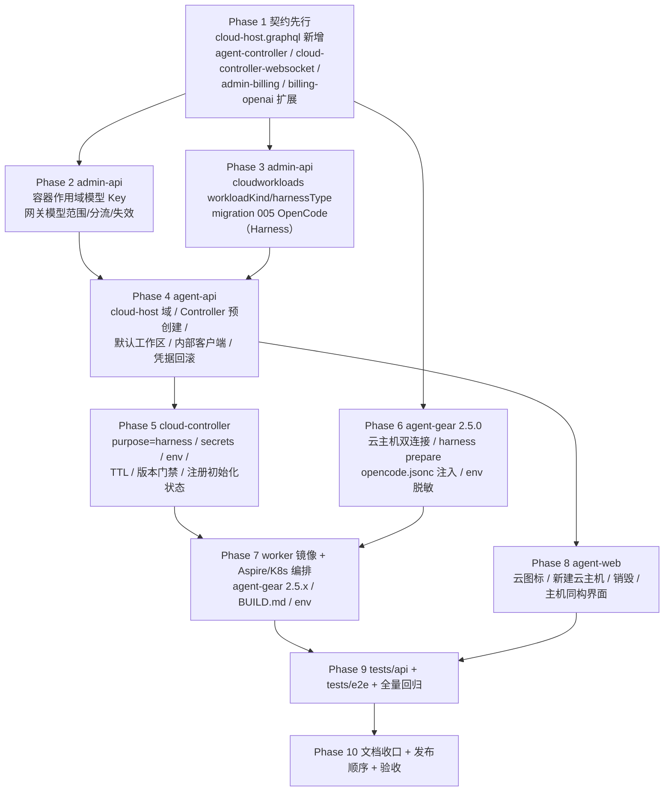
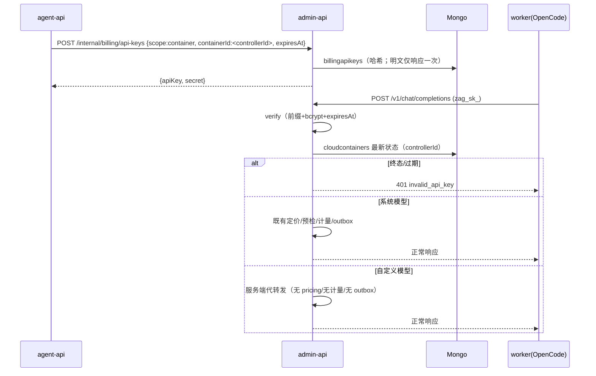
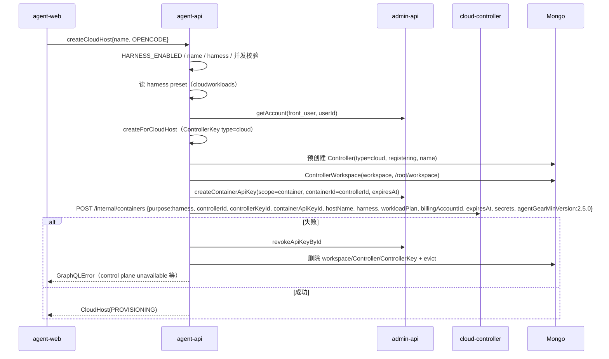
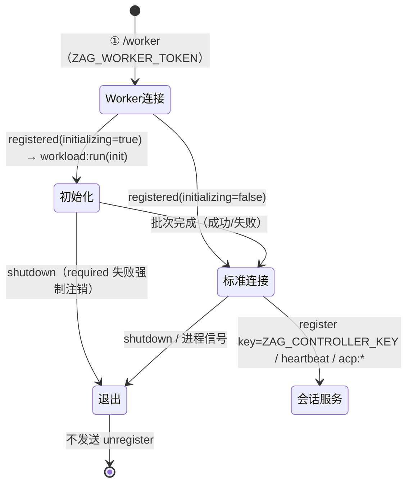
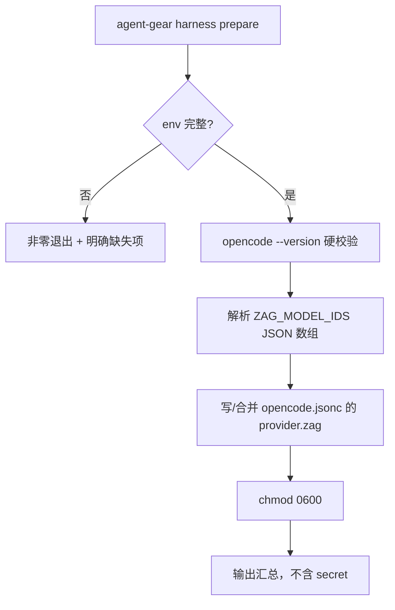

# 容器启动任务支持 harness 类型（OpenCode 云主机）- 实现计划

**关联 Proposal**: `docs/engineering/proposals/20261020-feat-container-harness-support.md`（v3.0）
**关联 PRD**: `docs/product/draft/20261020-container-harness-support.md`（v3.0）
**需求总分支（feat-branch）**: `feat/container-harness-support`（基于 `main`，需求总 PR #244）
**计划提交分支**: `feat/container-harness-support`（本文件随需求总分支提交）
**创建日期**: 2026-10-20
**计划版本**: v2.0

**版本说明**:

- v1.0（2026-10-20）首版，对应 PRD/提案 v1.0（后台启动 harness + 统一存储 + 会话导入导出）。
- v2.0（2026-10-20）按 PRD/提案 v3.0 **整体重排**：交付面前台化、云主机复用 `Controller(type=cloud)` 主机模型、统一存储与会话存取整体移出本期、后台零改动；删除 v1.0 的存储/S3/MinIO/quota/会话导入导出全部阶段，新增 agent-api 云主机域、agent-web 云主机体验、agent-gear 双连接与 OpenCode 模型配置注入。v2.0 **不是** v1.0 的局部修补。

## 0. v1.0 → v2.0 变更摘要

| 维度 | v1.0（旧） | v2.0（本计划） |
|------|-----------|---------------|
| 交付面 | 后台 admin-web 启动对话框/容器列表/存储页 | **前台 agent-web** 新建云主机/云图标/标准会话；后台零改动 |
| 产品模型 | 工作负载/容器为后台资源 | 云主机 = 既有 `Controller(type='cloud')`，左侧导航栏与普通主机同构 |
| 会话 | 自定义 OpenCode 配置 + 会话导入导出 | 容器内 `agent-gear` 标准连接 controller-api，走既有标准「会话」/`acpmessages` |
| 存储 | S3 + 元数据 + 限额 + 导入导出 | **整体二期**；本期不引入任何 S3/MinIO/存储契约/入口 |
| 参数 | `storeSessions` / `restoreSessionIds` | 本期创建表单与工作负载 `paramSchema=[]`，无会话参数 |
| 启动链路 | admin-api GraphQL → cloud-controller | **agent-api → cloud-controller 内部 HTTP**；`adminStartCloudContainer` 维持仅 `IDLE` |
| 模型 Key | 存储令牌 + 模型 Key + 对账三线 | 仅容器作用域模型 Key；**网关按容器状态/有效期校验**，销毁显式撤销 |
| 计划阶段 | 10 个 Phase（存储/后台为主） | 10 个 Phase（契约 → 计费 Key/网关 → 预置工作负载 → agent-api → cloud-controller → agent-gear → 镜像/Aspire → agent-web → tests → 文档） |

## 1. 实现顺序



依赖说明：

- **Phase 1 契约**是全部实现的输入，独立提交（`docs(contracts): ...`）；契约未合入前不写实现代码。
- **Phase 2（Key/网关）**与 **Phase 3（预置工作负载）**只依赖 Phase 1，可并行。
- **Phase 4（agent-api）**依赖 Phase 2（Key 铸造）与 Phase 3（harness preset 读取）；**Phase 5（cloud-controller）**与 **Phase 6（agent-gear）**只依赖 Phase 1，可与 Phase 4 并行开发（联调在 Phase 7/9）。
- **Phase 7** 依赖 Phase 5 的 env/门禁与 Phase 6 的 `agent-gear@2.5.0` 产物；**Phase 8** 依赖 Phase 4 的 GraphQL；**Phase 9** 在各实现分支合并回需求总分支后切出；**Phase 10** 收口。

### 开发分支与合并顺序

| 分支 | 范围 | 基于 | 合并目标 |
|------|------|------|---------|
| `feat/container-harness-support` | PRD / 提案 / 本计划 | `main` | 需求总 PR #244 |
| `contracts/harness-support` | `contracts/` 6 份 | 需求总分支 | 需求总分支 |
| `servers/harness-support` | admin-api + agent-api + cloud-controller | 需求总分支 | 需求总分支 |
| `packages/harness-support` | agent-gear + worker 镜像 + Aspire/K8s | 需求总分支 | 需求总分支 |
| `apps/harness-support` | agent-web | 需求总分支 | 需求总分支 |
| `tests/harness-support` | tests/api + tests/e2e | 需求总分支（其余已合入） | 需求总分支 |

合并顺序：契约 → servers → packages → apps → tests。**禁止 rebase/squash，只允许 merge**（z-git 规范）。

### 开发模式与规范加载

- 全部 Phase 采用 TDD（红-绿-重构）：先写测试（RED）→ 最小实现（GREEN）→ 重构。
- 编码前加载：`docs/engineering/common-rules.md`、`docs/engineering/backend-rules.md`（后端）、`docs/engineering/frontend-rules.md`（agent-web）。
- 目录级 `AGENTS.md`：`servers/agent-api/AGENTS.md`、`servers/controller-api/AGENTS.md`、`servers/cloud-controller/AGENTS.md`、`packages/agent-controller/AGENTS.md`、`apps/agent-web/AGENTS.md`、`tests/api/AGENTS.md`、`tests/e2e/AGENTS.md`、`aspire/AgentGear.AppHost/AGENTS.md`、`docs/engineering/plan/AGENTS.md`。
- `servers/admin-api` 无独立 `AGENTS.md`，沿用根 `AGENTS.md` 与 engineering 规范；**admin-web 本期零改动**。

## 2. 命令参考

```bash
# 服务编排（根目录；测试服务只用 Aspire，禁止直接 docker 命令）
aspire start
aspire wait agent-api cloud-controller controller-api agent-web
aspire describe agent-api
aspire describe controller-api
aspire stop

# 单服务单测 / 构建
cd servers/admin-api && npm ci && npm test && npm run build
cd servers/agent-api && npm ci && npm test && npm run build
cd servers/cloud-controller && npm ci && npm test && npm run build
cd servers/controller-api && npm ci && npm test && npm run build
cd packages/agent-controller && npm ci && npm test && npm run build
cd apps/agent-web && npm ci && npm test && npm run build && npm run lint

# 跨服务 API 测试（先 aspire start；地址按 aspire describe 替换）
cd tests/api
API_URL=http://localhost:10001/graphql \
ADMIN_API_URL=http://localhost:10003/graphql \
CONTROLLER_API_URL=http://localhost:<controller-api-port> \
CLOUD_CONTROLLER_URL=http://localhost:10004 \
CLOUD_CONTROLLER_INTERNAL_TOKEN=<与 internal-api-token 一致> \
MONGODB_URI=<aspire describe mongodb> \
npm test

# E2E（串行；地址按 aspire describe 替换）
cd tests/e2e
BASE_URL=http://localhost:<agent-web-port> \
API_URL=http://localhost:10001/graphql \
ADMIN_API_URL=http://localhost:10003/graphql \
CONTROLLER_API_URL=http://localhost:<controller-api-port> \
CLOUD_CONTROLLER_URL=http://localhost:10004 \
MONGODB_URI=<aspire describe mongodb> \
npx playwright test

# worker 镜像（内网构建，不属于服务编排）
cd deploy/images/worker
docker build -t core.harbor.internal.fffdan.com/zero-tools/worker:harness-local .
docker run --rm --entrypoint bash \
  core.harbor.internal.fffdan.com/zero-tools/worker:harness-local -lc \
  'agent-gear --version && agent-gear harness --help'
```

> `HARNESS_ENABLED` 在 Aspire dev 模式由 `AppHost.cs` 显式置 `true` 便于联调；publish 默认 `false`，验收/灰度时打开。API/E2E 用例在开关关闭时按 `test.skip` 跳过并在验收报告登记。

### 关键约束（提案 §1.3/§6，实现期不得回退）

- **契约先行**：6 份契约先于实现独立提交；字段、错误文案、状态码与提案 §3 对齐，偏差以 §4 计划期裁决为准。
- **单一事实源**：`cloudworkloads` 由 admin-api 写；`cloudcontainers` 由 cloud-controller 写；agent-api/admin-api 只读（只读 Mongoose 模型/内部 API）；`controllers`/`controllerkeys` 由 agent-api 预创建、controller-api 注册时 upsert。
- **secret 不落库、不进日志**：模型 Key 与控制器 Key 明文只在创建/补发响应中出现一次；cloud-controller 仅内存持有；worker 只在进程环境持有；日志统一脱敏。
- **不上调全局 worker 门禁**：`MIN_WORKER_VERSION` 保持 `2.2.0`；harness 容器使用 `MIN_HARNESS_WORKER_VERSION=2.5.0` 按 purpose 分流。
- **后台零改动**：`adminStartCloudContainer` 维持仅 `IDLE`；`contracts/admin-cloud-container.graphql`、`contracts/admin-cloud-workload.graphql`、admin-web 页面均不改。
- **本期无存储**：不引入 S3/MinIO/`unified-storage`/`storage*`/`quota-guard`/会话导入导出任何代码、契约、依赖、入口。
- **既有 idle 行为不变**：`idle` 启动、工作负载参数/依赖/必须失败、计费全链路、普通主机/标准会话保持现状；新增字段对历史记录读取必须容忍缺失。
- **测试纪律**：新增代码单测覆盖率 ≥ 80%；API 与 E2E 串行执行；测试服务只用 Aspire 编排，禁止直接 `docker` 命令。

---

## 3. 计划期裁决（提案与代码事实偏差的落地口径）

> 以下裁决以**当前代码事实**为准。提案中与代码不一致的描述在实现期按本节执行，不再回改提案；验收报告需逐条登记。

### A. 事实校正（提案描述与仓库现状不符）

| # | 提案描述 | 代码事实 | 本计划口径 |
|---|---------|---------|-----------|
| A1 | §3.2.3/§6.2：agent-gear 2.5.0；`MIN_WORKER_VERSION` 保持 2.2.0 + harness 专用门禁 | `packages/agent-controller/src/socketio-client.ts:24` 硬编码 `2.4.0`；`package.json:3` 为 `2.4.0`；`cloud-controller/src/services/worker-version.ts` 为 `2.2.0` | agent-gear 升 **`2.5.0`**；`MIN_WORKER_VERSION` **保持 `2.2.0`**；新增 **`MIN_HARNESS_WORKER_VERSION='2.5.0'`**，在 `register` 时按容器 `purpose` 分流校验。普通容器不受影响，harness 容器低版本 worker 被拒绝。 |
| A2 | §5.3/§7：worker 镜像 **未预装** `@opencode/cli`，由 init 安装；BUILD.md 校验清单 | `deploy/images/worker/Dockerfile:118-123` 只装 `agent-gear@2.4.x`、`claude-agent-acp`、`codex-acp`；`BUILD.md:89` 的「7 包」清单与 Dockerfile 不一致，`opencode --version \|\| true` 为软校验 | worker 镜像**不预装** `@opencode/cli`；init 脚本用固定版本安装并 `opencode -v`/`opencode --version` 硬校验；BUILD.md 删除「7 包」错误清单，改为「镜像 3 包 + OpenCode 由 harness 工作负载安装」并给出手工自验命令。 |
| A3 | §3.2.3：`ZAG_CONTROLLER_KEY` 承载 controller-api 的 ControllerKey | 现有 worker 的 `ZAG_CONTROLLER_KEY` 是 **cloud-controller 一次性 token**（`k8s-job-manager.ts:115-118`、`entrypoint.sh:16`）；agent-gear 也把它当作握手 token | 新增 **`ZAG_WORKER_TOKEN`** 承载 cloud-controller 一次性 token；harness 容器的 `ZAG_CONTROLLER_KEY` 专用于 controller-api 的 `zag_k_` 控制器 Key。**idle 容器保持 `ZAG_CONTROLLER_KEY=token` 不变**；agent-gear harness 模式优先读 `ZAG_WORKER_TOKEN`。 |
| A4 | §3.1.3：容器 Key `/v1/models` 返回「Key 属主个人可用模型列表」；自定义模型代转发 | `Model`/`Provider` 只有 `scope: 'user' \| 'global'`，**无 `userId`/`ownerId`**；`agent-api` 的 `models` 查询口径是「`scope=user` 全量 ∪ `scope=global` 且启用」；`billing-openai.ts` 当前只查 `scope:'global'` | 本期「用户个人可用模型列表」= **agent-web 设置页中启用的模型集合**（`scope=user,isEnabled=true` ∪ `scope=global,isEnabled=true`；禁用模型不进入容器 Key 列表与 `ZAG_MODEL_IDS` 快照）；容器 Key 的 `/v1/models` 与 `chat/completions` 使用同一口径。自定义模型（`scope=user`）走网关代转发、不记账；**按用户 ownerId 隔离模型归属不在本期**（需先给 Provider/Model 补归属字段与迁移），在验收报告登记为二期遗留。 |
| A5 | §5.1.4/§5.2-2：销毁后清理 `Controller + ControllerKey`，主机从列表移除、历史可追溯 | `homeOverview.controllers` 是 Sidebar 的来源；删除 `Controller` 会让该主机的历史会话在 Sidebar 失去归属（会话仍留在 `sessions`）；`controllerService.unbind` 会删 Controller+Key | 销毁 = ① cloud-controller 销毁容器；② 撤销模型 Key；③ **删除 `ControllerKey` 并 evict 缓存**（防重连）；④ `Controller.status='offline'` **保留 Controller 行**（历史会话/主机记录可追溯）；⑤ `cloudcontainers` 保留终态。`destroyCloudHost` 幂等。 |
| A6 | §3.2.3：默认工作区 `ZAG_DEFAULT_WORKSPACE=/home/zag/workspace` | worker 镜像 `Dockerfile` 未设置 `USER`，容器以 root 运行，`os.homedir()='/root'`；`entrypoint.sh` 以 PID 1 运行 | 默认工作区改为 **`/root/workspace`**（agent-api 配置 `CLOUD_HOST_DEFAULT_WORKSPACE`，可覆盖）；`ZAG_DEFAULT_WORKSPACE` 随 Job env 与 `workload:run env` 下发，agent-gear 启动时 `mkdir -p`，init 脚本再次幂等创建；`ControllerWorkspace.path` 与之一致。 |
| A7 | §4.1：`cloudcontainers` 扩展 `userId/controllerKeyId/harnessType/containerApiKeyId` | 现有模型**已有 `userId`**（`cloud-container.ts`），但无 `controllerId`/`controllerKeyId`/`harnessType`/`expiresAt`/`hostName`/`containerApiKeyId`；`refId` 语义为通用关联 | 新增 `controllerId`（云主机 ID，索引）、`controllerKeyId`、`containerApiKeyId`、`hostName`、`harnessType`、`expiresAt`；`refId` 继续存 `controllerKeyId`（兼容既有语义）。写入方仍只有 cloud-controller。 |
| A8 | §5.1.2：agent-api 把预制「OpenCode（Harness）」加入 `workloadPlan` | agent-api 当前**没有** `cloudworkloads`/`cloudcontainers` 模型，也没有 cloud-controller 客户端 | agent-api 新增**只读** `CloudWorkload`/`CloudContainer` Mongoose 模型（共享 Mongo，不写）与 `cloud-controller-client`；按 `presetKey='harness-opencode'` 读取 preset 并构造 `workloadPlan=[{workloadId, params:{}, implicit:false, required:true}]`。写方仍为 admin-api/cloud-controller。 |
| A9 | §5.1.1：worker 双连接、init 后才能建会话 | 现有 `registered` 事件只返回 `{controllerId}`；agent-gear 无法知道 init 批次何时结束，若立即连 controller-api 会在 OpenCode 安装完成前显示在线 | cloud-controller 的 `registered` 增加可选 **`initializing: boolean`**；agent-gear harness supervisor 在 `initializing=true` 时等待 `workload:run` 批次完成再建立 controller-api 标准连接；`false` 或无字段时立即连接（向后兼容）。 |
| A10 | §3.1.3/§4.1：`BillingApiKey.containerId` 关联容器 | Key 必须在容器创建**之前**铸造（Job env 需要模型 Key），此时 `cloudcontainers._id` 尚不存在 | `BillingApiKey.containerId` 在本期存 **云主机 Controller ID**（创建前已知）；网关按 `cloudcontainers.controllerId` 查最新容器状态并校验终态。契约字段名保持 `containerId`，注释明确「云主机 ID」。 |
| A11 | §8.1：API/E2E 覆盖云主机在线、标准会话、OpenCode ACP | Aspire dev 的 `K8S_ENABLED=false` 使用 `InMemoryK8sClient`，不会产生真实 worker；`createCloudHost` 返回的 ControllerKey 明文不通过 GraphQL 暴露 | **tests/api** 覆盖创建/能力/校验/列表/销毁/回滚；**tests/e2e** 覆盖新建对话框、云图标、启动中状态、销毁确认、主机同构页面；**在线 + OpenCode ACP + 标准会话**由 agent-gear/cloud-controller/agent-api 单测 + 真实集群手工验收覆盖（验收报告登记）。不引入测试专用后门。 |
| A12 | §9.2：`HARNESS_ENABLED` 后端开关 | agent-web 无特性开关框架；`config.js` 只注入 `apiUrl` | agent-api 增加 `HARNESS_ENABLED`（默认 `false`）与 `cloudHostCapabilities` 查询；前端据此决定是否显示「新建云主机」。开关关闭时 **create 拒绝**，但 `myCloudHosts`/`destroyCloudHost` 仍可用（便于回滚后清理存量）。 |
| A13 | §5.1.5：写 `opencode.jsonc`（custom provider） | `packages/agent-controller` 无 `jsonc-parser`；旧计划裁决 A3 已核实当前 OpenCode 配置为 `opencode.jsonc`（`.json` 亦兼容） | 新增 `jsonc-parser` 依赖；默认写 `~/.config/opencode/opencode.jsonc`，若同目录只存在 `opencode.json` 则合并该文件；保留注释与既有 provider，仅替换 `provider.zag`。 |
| A14 | §5.3：`@opencode/cli@<pin>` | 内网 npm 代理可用版本在实施时确认；旧计划使用 `2.1.1` | 固定 `OPENCODE_CLI_VERSION`（默认 `2.1.1`，实施时以 `npm view @opencode/cli versions` 实测锁定并写入 BUILD.md）；init 脚本中硬编码默认值，可用同名 env 覆盖但**验收以固定版本为准**。 |
| A15 | §3.2.1：`secrets.controllerEndpoint/modelApiKey` 由 agent-api 下发 | agent-api 无 controller-api 对外地址配置；worker 在 K8s 内需可达 controller-api 与计费网关 | agent-api 新增 `CONTROLLER_API_PUBLIC_WS_ENDPOINT`、`CLOUD_HOST_MODEL_BASE_URL`、`CLOUD_HOST_DEFAULT_WORKSPACE` 配置；创建时校验非空，随内部请求下发（非 secret 的 baseURL 也放在 `secrets` 报文内，但不落库）。 |
| A16 | §3.2.2：cloud-controller 终态撤销 + `container.destroyed` 兜底 + admin-api 对账三线 | admin-api 与 cloud-controller 共享 Mongo；admin-api 可直接读 `cloudcontainers`；cloud-controller 无 admin-api 客户端 | 本期简化为 **两条线**：① 网关鉴权时校验 Key `expiresAt` + 最新容器终态（读只读 `cloudcontainers`）；② `destroyCloudHost` 显式撤销 Key。模型 Key 不再依赖 `container.destroyed` 事件/对账任务；`container.destroyed` payload 不变。失效语义更强（容器一终态立即 401），实现更少。 |
| A17 | §8.2：tests/api 使用 `vitest + supertest` | 仓库无 `supertest`；`tests/api` 用 `fetch` 打真实 Aspire 服务 | 继续 **vitest + fetch**；不引入 supertest。 |
| A18 | §5.1.4：销毁后「主机从在线列表移除」 | 既有 `Controller.status` 只有 `online/offline/registering/unbound`；Sidebar 展示所有 Controller（离线置灰） | 云主机销毁后 `Controller.status='offline'`，Sidebar 显示「已结束」灰态；「在线列表移除」理解为不再为在线，历史记录/会话仍可追溯。普通主机的离线展示不变。 |

### B. 设计裁决（提案留白/含混处）

1. **创建编排顺序**：按 `userId` 串行锁（防双击/并发超限）→ 校验开关/名称/harness/并发 → 取（或创建）前台计费账户 → **预生成 `controllerId = new mongoose.Types.ObjectId()`** → 创建 `ControllerKey(type=cloud, boundControllerId=controllerId)` → 以该 `_id` 预创建 `Controller(type=cloud,status=registering,name,hostname=name,version='0.0.0')` → 创建默认 `ControllerWorkspace` → 铸造容器作用域模型 Key → 读取 harness preset 构造 plan → `POST /internal/containers`。任一步失败按逆序回滚（撤销 Key、删工作区/Controller/ControllerKey 并 evict）；cloud-controller **成功返回后不再回滚**（后续异常由销毁/过期兜底）；cloud-controller 失败统一抛 `control plane unavailable`（写不降级）。
2. **ControllerKey 创建**：**不得复用** `controllerKeyService.create`（它会删除用户现有的未绑定 Key）。新增 `createForCloudHost(userId, controllerId, name)`：不删除未绑定 Key、`boundControllerId` 直接写入预生成 `controllerId`，使该 Key 不出现在设置页「未绑定 Key」列表；注册时 controller-api 仍按 `keyId` upsert。
3. **Controller 预创建字段**：`Controller` schema 的 `hostname`/`version` 为必填；预创建 `hostname=name`、`version='0.0.0'`。controller-api `register` 的 `findOneAndUpdate` 使用 `$setOnInsert: { name: hostname }`，已存在文档不覆盖用户命名。
4. **状态映射**（`CloudHostStatus`）：`container.status=destroying` → `DESTROYING`；`failed` → `FAILED`；`exited` 或（`controller.status=offline` 且容器终态）→ `EXITED`；`controller.status=registering` 或容器 `creating/connecting/initializing` → `PROVISIONING`；`controller.status=online` → `ONLINE`；`controller.status=offline` 且容器非终态 → `OFFLINE`；容器缺失时按 Controller 状态降级。
5. **`cloudHostCapabilities`**：返回 `{ enabled, supportedHarnesses }`；`enabled=true` 且预设存在时返回 `[OPENCODE]`；预设缺失时返回空列表，create 报 `harness workload preset not found: opencode`。
6. **`Controller.cloudHost` 字段**：在 `cloud-host.graphql` 中 `extend type Controller { cloudHost: CloudHost }`，agent-api resolver 对 `type==='cloud'` 查只读 `cloudcontainers`（`controllerId` 倒序取最新）并映射；普通主机返回 `null`。`HOME_OVERVIEW` 与 `GET_CONTROLLERS` 均可选择该字段，Sidebar/配置页据此显示「启动中/已结束/失败」。
7. **销毁语义**：`destroyCloudHost(id)` 的 `id=controllerId`。先查 CloudHost；不存在返回 `true`（幂等）。存在则：取最新容器 → 非终态调用 cloud-controller `DELETE /internal/containers/:id` → 撤销模型 Key（幂等，404 视为成功）→ 删除 ControllerKey + evict → `Controller.status='offline'`（保留行）→ 返回 `true`。控制面不可达时抛 `control plane unavailable`，不做半程降级。
8. **模型 Key 失效**：admin-api `billingKeyAuth` 在 `apiKeyService.verify` 成功后追加：`scope=container` 时若 `expiresAt < now` 或关联云主机最新容器处于 `exited/failed/destroying` → `401 invalid_api_key`。容器尚未创建（创建窗口）时允许通过，Key 创建失败会回滚撤销。
9. **自定义模型路由**：`/v1/chat/completions` 先查 `scope='global'`（系统模型，走既有计费）；未命中且 Key 为 container scope 时查 `scope='user'`（含缺失 scope 的存量）按 `sortOrder,createdAt` 取第一条。自定义模型不要求 pricing、不写计量/outbox，`BillingApiCall` 记 `billable=false,cost=0` 作为调用审计（不计费）。同名时系统模型优先。
10. **模型列表快照**：agent-api 创建云主机时用 `modelService.findAll()` 过滤 `isEnabled` 生成 `modelIds`（去空、去重），以 JSON 数组字符串 `ZAG_MODEL_IDS` 下发；agent-gear `harness prepare` 不额外请求 `/v1/models`，避免初始化期多一次网络依赖。`/v1/models` 仍按容器 Key 口径（启用模型）返回，供 OpenCode 运行时使用。
11. **secret 恢复**：cloud-controller `SecretStore` 只存内存；缺失时调用 agent-api `POST /internal/cloud-hosts/:controllerId/model-key/reissue` 重新铸造模型 Key（同 `expiresAt`/`containerId`），旧 Key 由 admin-api 按 `containerId` 幂等撤销。**控制器 Key 不补发**（worker 进程已持有；Redis 缓存丢失时无法恢复明文，只影响新容器，不影响已运行容器）。
12. **初始化就绪门禁**：cloud-controller 在 `register` 时先判断 `hasInitScripts`；`registered` 携带 `initializing`。agent-gear 在 `initializing=true` 时等待首个 `workload:run` 批次结束（成功/失败）后再连 controller-api；等待超时（`HARNESS_INIT_WAIT_MS`，默认 10 分钟）则仍连接并由 cloud-controller 看门狗兜底。这样 Sidebar 不会在 OpenCode 装好前显示在线。
13. **容器 TTL**：agent-api `HARNESS_CONTAINER_TTL_SECONDS`（默认 `86400`）；`expiresAt=now+TTL` 同时用于模型 Key 与 Job `activeDeadlineSeconds`。cloud-controller 以 `max(60, floor((expiresAt-now)/1000))` 设置，缺省沿用 `JOB_ACTIVE_DEADLINE_SECONDS=86400`。
14. **测试边界**：Aspire dev 无真实 worker，E2E 不伪造 ControllerKey 明文；在线/ACP/会话能力以 `agent-controller` 单测（双连接/初始化等待）+ `cloud-controller` 单测（env/门禁）+ 真实集群手工验收覆盖，验收报告如实登记。
15. **OpenCode 环境**：init 脚本顺序固定为「安装固定版本 → `opencode --version` 硬校验 → `mkdir -p $ZAG_DEFAULT_WORKSPACE` → `agent-gear harness prepare`」；任一失败非零退出，依赖 `required=true` 触发容器强制注销。

---

## Phase 1: 契约先行（contracts/）

开发分支：`contracts/harness-support`。本 Phase 独立提交（`docs(contracts): ...`），不写实现代码。

### 文件修改

| 文件 | 操作 | 说明 |
|------|------|------|
| `contracts/cloud-host.graphql` | 新增 | 前台云主机契约：`CloudHostHarnessType { OPENCODE }`、`CloudHostStatus { PROVISIONING ONLINE OFFLINE DESTROYING EXITED FAILED }`、`CloudHost`（`id/name/controllerId/containerId/status/harnessType/createdAt/readyAt/exitedAt/failureReason`）、`CloudHostCapabilities`、`CreateCloudHostInput { name, harnessType }`、Query `cloudHostCapabilities/myCloudHosts`、Mutation `createCloudHost/destroyCloudHost`、`extend type Controller { cloudHost: CloudHost }` |
| `contracts/agent-controller.graphql` | 修改（注释/语义） | 明确 `ControllerType.cloud`：由 agent-api 预创建，`status=registering`，`name` 为用户命名，register upsert 不覆盖；云主机销毁后保留 Controller 行并置 `offline`；无字段新增 |
| `contracts/agent-controller-websocket.md` | 修改 | 增补「云主机注册约定」：标准连接使用 `ControllerKey(type=cloud)`；**不发送 `unregister`**（本地卸载语义）；容器销毁由 agent-api 编排；`register.version` 上报 2.5.0；Controller 状态口径 |
| `contracts/cloud-controller-websocket.md` | 修改 | 内部 API `purpose=idle\|harness`；请求增 `controllerId/controllerKeyId/containerApiKeyId/hostName/harness/expiresAt/agentGearMinVersion/secrets`；响应增 `controllerId/controllerKeyId/containerApiKeyId/hostName/harnessType/expiresAt`；`GET /internal/containers?userId=`；`registered` 增可选 `initializing`；`workload:run` 增容器级 `env`（`ZAG_*`）与脱敏；Job env 明确 `ZAG_WORKER_TOKEN`/`ZAG_CONTROLLER_ENDPOINT`/`ZAG_CONTROLLER_KEY`；版本门禁按 purpose 分流；新增 `POST /internal/cloud-hosts/:controllerId/model-key/reissue`（agent-api 内部） |
| `contracts/admin-billing.graphql` | 修改 | `BillingApiKeyScope { ACCOUNT CONTAINER }`；`BillingApiKey` 增 `scope/containerId/expiresAt`（`containerId` 注释=云主机 ID）；`BillingApiCall` 增 `containerId/billable`（如未暴露则只落内部模型，GraphQL 至少保持字段一致） |
| `contracts/billing-openai.openapi.yaml` | 修改 | 容器 Key：`expiresAt`/容器终态 → `401 invalid_api_key`；`/v1/models` 对容器 Key 返回系统启用模型 + 用户自定义模型；`/v1/chat/completions` 自定义模型代转发不记账（无计量/outbox），系统模型走既有计费 |

**不在本期改动**：`contracts/admin-cloud-container.graphql`（admin 启动维持仅 `IDLE`）、`contracts/admin-cloud-workload.graphql`、`contracts/home.graphql`（`Controller.cloudHost` 由 `cloud-host.graphql` 扩展）、`contracts/agent-session.graphql`（标准会话零改动）。
**二期新增（本期不建）**：`contracts/unified-storage.openapi.yaml`、`contracts/admin-unified-storage.graphql`。

### 云主机错误文案（服务端逐字）

| 条件 | 错误 |
|------|------|
| `HARNESS_ENABLED=false` 且调用 `createCloudHost` | `harness feature is disabled` |
| `name` trim 后为空 | `name is required` |
| `name` 超 64 字符 | `name is too long` |
| `harnessType` 不在白名单 | `unsupported harness type` |
| 并发云主机超限（`CLOUD_HOST_MAX_PER_USER`，默认 3） | `too many cloud hosts` |
| harness preset 缺失 | `harness workload preset not found: opencode` |
| 控制面不可达（创建/销毁） | `control plane unavailable` |
| 计费服务不可达（创建） | `billing service unavailable` |
| 控制器/模型网关配置缺失 | `cloud host is not configured` |
| 非属主访问/销毁 | `Cloud host not found`（不泄露存在性） |

### 验收 checklist

- [ ] 6 份契约与提案 §3/§4 逐字段一致；本计划 §3 的修正项已体现
- [ ] `CloudHost`/`CloudHostStatus`/`CloudHostCapabilities` 与 agent-api/agent-web 命名一致
- [ ] `Controller.cloudHost` 扩展与 `home.graphql` 选择集兼容
- [ ] `purpose=harness` 内部请求/响应字段、secrets 字段、`env` 清单、`initializing` 写明
- [ ] 容器 Key 的 `containerId` 语义（云主机 ID）在契约注释中明确
- [ ] 契约变更独立提交，未夹带实现代码

---

## Phase 2: admin-api 容器作用域模型 Key 与计费网关

开发分支：`servers/harness-support`。TDD 先写/扩展 `api-key-service.test.ts`、`billing-key-auth.test.ts`（新增）、`internal-billing.test.ts`（新增）、`billing-openai.test.ts`、`cloud-container-read-model.test.ts`（新增）→ RED。

### 文件修改

| 文件 | 操作 | 说明 |
|------|------|------|
| `servers/admin-api/src/models/billing-api-key.ts` | 修改 | 增 `scope: 'account'\|'container'`（默认 account）、`containerId`（index，云主机 ID）、`expiresAt`（Date/null） |
| `servers/admin-api/src/models/billing-api-call.ts` | 修改 | 增 `containerId`（index）、`billable`（默认 true） |
| `servers/admin-api/src/models/cloud-container.ts` | 新增 | **只读** `cloudcontainers` 模型：`controllerId/status/userId/exitReason`，`controllerId` 索引；只用于 Key 鉴权与审计，不写 |
| `servers/admin-api/src/services/billing/api-key-service.ts` | 修改 | `create` 接受可选 `scope/containerId/expiresAt`；新增 `createContainerScopedKey`（同 containerId 先幂等撤销旧 active Key）；`verify` 检查过期并返回 `scope/containerId/expiresAt`；新增 `revokeById(id)`（内部幂等，不要求 owner）与 `revokeByContainerId` |
| `servers/admin-api/src/middleware/billing-key-auth.ts` | 修改 | `scope=container` 时校验 `expiresAt` 与只读 `cloudcontainers` 最新状态（`exited/failed/destroying` → 401）；把 `scope/containerId` 放进 `req.billing` |
| `servers/admin-api/src/routes/internal-billing.ts` | 修改 | `POST /api-keys` body 增 `scope/containerId/expiresAt`（container scope 必填/校验日期）；新增 `POST /api-keys/:id/revoke`（内部 token，幂等，未知 404）；保留既有 owner-scoped DELETE |
| `servers/admin-api/src/routes/billing-openai.ts` | 修改 | `/models`：container scope 返回 `global enabled` ∪ `user enabled`（含无 pricing 的自定义模型），account scope 维持现状；`/chat/completions`：先查 global，container scope 未命中再查 user；自定义模型不要求 pricing、不写计量/outbox，`BillingApiCall.billable=false,cost=0`；系统模型写入 `containerId` |
| `servers/admin-api/src/graphql/schemas/billing.ts` | 修改 | `BillingApiKeyScope`、`BillingApiKey.scope/containerId/expiresAt`、`BillingApiCall.containerId/billable`（与 `contracts/admin-billing.graphql` 对齐；admin-web 不消费新字段） |
| `servers/admin-api/src/graphql/resolvers/billing.ts` | 修改 | `toApiKeyWire`/`BillingApiCall` 映射新字段；既有 create/revoke mutation 不变（容器 Key 不经 admin GraphQL 创建） |
| `servers/admin-api/src/index.ts` | 修改 | `syncIndexes` 覆盖新字段/新只读模型（只读模型不建索引也可，保留读取） |
| `servers/admin-api/src/services/billing/api-key-service.test.ts` | 修改 | 容器 Key 铸造/过期/撤销/幂等/同容器轮换 |
| `servers/admin-api/src/middleware/billing-key-auth.test.ts` | 新增 | 过期/终态/正常/账号 Key 回归 |
| `servers/admin-api/src/routes/internal-billing.test.ts` | 新增 | 内部鉴权、容器 Key 参数校验、撤销幂等/404 |
| `servers/admin-api/src/routes/billing-openai.test.ts` | 修改 | 容器模型列表、系统模型计费、自定义模型不记账、`containerId` 归因 |

### 关键语义



### 测试用例（增量）

| # | 用例 | 预期 |
|---|------|------|
| T-BK1 | 账号 Key 回归 | `scope=account`、`expiresAt=null`；既有列表/撤销测试全绿 |
| T-BK2 | `createContainerScopedKey` | `scope=container`、`containerId/expiresAt` 落库；明文仅返回一次；哈希可验证 |
| T-BK3 | 同容器重复铸造 | 旧 active Key 被撤销，只剩新 Key；旧明文 401 |
| T-BK4 | `verify` 过期 | `expiresAt < now` → 401/抛错 |
| T-BK5 | 容器终态 | 最新容器 `exited/failed/destroying` → 401；无容器（创建窗口）允许 |
| T-BK6 | `revokeById` 幂等 | 重复撤销 200；未知 id 404；不要求 owner |
| T-BK7 | 内部撤销鉴权 | 无/错误 `INTERNAL_API_TOKEN` → 401 |
| T-BK8 | 容器 `/v1/models` | 含 global enabled + user enabled（含 `isCustom=true`）；不含禁用模型 |
| T-BK9 | 账号 `/v1/models` 回归 | 仍只返回计费完整的 global 模型 |
| T-BK10 | 系统模型调用 | 产生 `BillingApiCall` + 计量/outbox，`containerId` 落库，`billable=true` |
| T-BK11 | 自定义模型调用 | 代转发成功、无计量/outbox、`BillingApiCall.billable=false,cost=0` |
| T-BK12 | 自定义模型无 pricing | 正常转发（不因缺定价报 `model_not_priced`） |
| T-BK13 | 同名系统/自定义模型 | 系统模型优先，走计费 |
| T-BK14 | 禁用/不存在模型 | `404 model_not_found` |
| T-BK15 | Key 明文不落库/不进日志 | Mongo 无明文；错误日志/响应脱敏 |
| T-BK16 | 账号 Key 行为不受影响 | 既有 billing-flow/预留/账单回归全绿 |

### 验收 checklist

- [ ] 容器 Key 有效期=容器 TTL；容器终态立即 401；销毁显式撤销双保险
- [ ] 系统模型计费、自定义模型不记账；账号 Key 行为不变
- [ ] 内部铸造/撤销幂等、鉴权正确；明文不落库/不进日志
- [ ] `/v1/models` 与 agent-web 设置页口径一致（`scope=user ∪ global enabled`）
- [ ] 新增模块单测覆盖率 ≥80%

---

## Phase 3: admin-api 预置「OpenCode（Harness）」工作负载

开发分支：`servers/harness-support`。TDD 先写 `005-preset-harness-opencode.test.ts`（新增）→ RED。

### 文件修改

| 文件 | 操作 | 说明 |
|------|------|------|
| `servers/admin-api/src/models/cloud-workload.ts` | 修改 | 增 `workloadKind: 'standard'\|'harness'`（默认 `standard`，index）、`harnessType: 'opencode'\|null`（默认 null）；不新增 `optionsSource`（会话参数二期） |
| `servers/admin-api/src/migrations/005-preset-harness-opencode.ts` | 新增 | 写入 `name='OpenCode（Harness）'`、`presetKey='harness-opencode'`、`workloadKind='harness'`、`harnessType='opencode'`、`isPreset=true`、`paramSchema=[]`、仅 `initScript`、无 `dependsOnWorkloadIds`（Node/npm 已在镜像） |
| `servers/admin-api/src/migrations/005-preset-harness-opencode.test.ts` | 新增 | 幂等、已存在不覆盖、字段完整、`bash -n`、脚本顺序 |
| `servers/admin-api/src/index.ts` | 修改 | 注册 `005` 到迁移数组 |

### init 脚本（migration 内置，示意）

```bash
#!/usr/bin/env bash
set -euo pipefail

export PATH="$HOME/.local/bin:$HOME/.npm-global/bin:$PATH"

# 1) 固定版本安装（镜像未预装；仅命令缺失时安装，保证幂等）
OPENCODE_CLI_VERSION="${OPENCODE_CLI_VERSION:-2.1.1}"
if ! command -v opencode >/dev/null 2>&1; then
  npm install -g "@opencode/cli@${OPENCODE_CLI_VERSION}"
fi
opencode --version   # 硬校验：安装返回 0 但不可用视为失败

# 2) 默认工作区 + 模型配置注入（opencode.jsonc，custom provider）
mkdir -p "${ZAG_DEFAULT_WORKSPACE:-/root/workspace}"
agent-gear harness prepare
```

> 二期追加会话导入/导出时，在 `paramSchema` 与脚本尾部扩展；本期保持 `paramSchema=[]`，不引入 `optionsSource`/存储依赖。

### 测试用例（增量）

| # | 用例 | 预期 |
|---|------|------|
| T-MIG5-1 | 005 首次执行 | 写入第 5 个预制项；`workloadKind=harness`、`harnessType=opencode`、`paramSchema=[]`、无 post |
| T-MIG5-2 | 005 二次执行 | 跳过，不覆盖管理员修改 |
| T-MIG5-3 | presetKey/name 已存在 | 保留现有并打 warning，不重复创建 |
| T-MIG5-4 | 脚本语法 | `bash -n` 通过；含固定版本安装、`opencode --version`、`agent-gear harness prepare` |
| T-MIG5-5 | 存量工作负载兼容 | 无新字段的文档读取为 `standard/null`；admin 既有 4 个预制项不变 |

### 验收 checklist

- [ ] `cloudworkloads` 新增字段对存量文档默认为 `standard/null`
- [ ] migration 005 幂等、脚本可执行、无 post/参数
- [ ] `admin-cloud-workload.graphql`/admin-web 零改动（本期不让后台展示/编辑 harness 字段）
- [ ] 既有 4 个预制工作负载与工作负载 CRUD 回归全绿

---

## Phase 4: agent-api 前台云主机域

开发分支：`servers/harness-support`。TDD 先写 `cloud-host-service.test.ts`、`cloud-controller-client.test.ts`、`cloud-host.resolver.test.ts`、`internal-cloud-host.test.ts`、扩展 `controller-key.test.ts`/`controller.test.ts`/`billing-client.test.ts` → RED。

### 文件修改

| 文件 | 操作 | 说明 |
|------|------|------|
| `servers/agent-api/src/config/index.ts` | 修改 | `harnessEnabled`（`HARNESS_ENABLED`，`toBool`）、`cloudHostMaxPerUser`（3）、`harnessContainerTtlSeconds`（86400）、`controllerApiPublicEndpoint`、`cloudHostModelBaseUrl`、`cloudHostDefaultWorkspace`（`/root/workspace`） |
| `servers/agent-api/src/models/cloud-container.ts` | 新增 | **只读** `cloudcontainers`：`controllerId/controllerKeyId/containerApiKeyId/userId/status/purpose/harnessType/expiresAt/hostName/exitReason/connectedAt/exitedAt/billingAccountId`；`controllerId` 索引 |
| `servers/agent-api/src/models/cloud-workload.ts` | 新增 | **只读** `cloudworkloads`：`name/presetKey/workloadKind/harnessType/initScript/postScript/paramSchema/dependsOnWorkloadIds` |
| `servers/agent-api/src/services/cloud-workload-reader.ts` | 新增 | `findHarnessPreset(type)`：按 `presetKey='harness-opencode'`、`workloadKind='harness'`、`harnessType` 精确匹配；缺失抛 `harness workload preset not found: opencode`；返回只读定义 |
| `servers/agent-api/src/services/cloud-controller-client.ts` | 新增 | 原生 fetch + AbortController：`startHarness(input)`（`POST /internal/containers`）、`listContainers({userId})`（`GET /internal/containers?userId=`）、`destroyContainer(id)`（`DELETE /internal/containers/:id`）；Bearer `INTERNAL_API_TOKEN`；错误映射 `control plane unavailable` |
| `servers/agent-api/src/services/cloud-host-service.ts` | 新增 | `getCapabilities`、`create`、`list`（仅 `purpose=harness`）、`destroy`、`mapCloudHost`、`assertFeature`；创建编排/回滚；状态映射（裁决 B4）；并发计数（只读 `cloudcontainers` 非终态） |
| `servers/agent-api/src/services/keyed-mutex.ts` | 新增 | 极简 `KeyedMutex`（按 userId 串行 create/destroy）；可参考 admin-api 同名实现，避免新增依赖 |
| `servers/agent-api/src/services/controller-key.ts` | 修改 | 新增 `createForCloudHost(userId, controllerId, name)`：**不删除**未绑定 Key；写入 `boundControllerId`；返回 `rawKey`；保留既有 `create/delete/regenerate` |
| `servers/agent-api/src/services/controller.ts` | 修改 | 新增 `createCloudHostController`（`type=cloud/status=registering/hostname=name/version='0.0.0'`）、`findCloudHostsByUser`、`markCloudHostOffline`；保留 `unbind` 供本地主机使用 |
| `servers/agent-api/src/services/controller-workspace.ts` | 修改 | 新增 `ensureCloudHostWorkspace(controllerId,userId,path)`：幂等 upsert（默认 `workspace`），不触发 10 个工作区上限 |
| `servers/agent-api/src/services/billing-client.ts` | 修改 | 新增 `createContainerApiKey({accountId,ownerType,ownerId,name,containerId,expiresAt})`、`revokeApiKeyById(id)`；wire DTO 增 `scope/containerId/expiresAt` |
| `servers/agent-api/src/graphql/schemas/cloud-host.ts` | 新增 | 严格对齐 `contracts/cloud-host.graphql`；注册 `cloudHostTypeDefs` |
| `servers/agent-api/src/graphql/resolvers/cloud-host.ts` | 新增 | `Query.cloudHostCapabilities/myCloudHosts`、`Mutation.createCloudHost/destroyCloudHost`、`Controller.cloudHost` 子字段 |
| `servers/agent-api/src/graphql/schemas/index.ts` / `resolvers/index.ts` | 修改 | 注册新 schema/resolver；`Controller` 合并 `cloudHost` |
| `servers/agent-api/src/routes/internal-cloud-host.ts` | 新增 | `POST /internal/cloud-hosts/:controllerId/model-key/reissue`（Bearer `INTERNAL_API_TOKEN`）：按云主机取 billingAccountId/expiresAt，重新铸造模型 Key（同 containerId），返回 `{modelApiKey, expiresAt}`；非 harness/未知 host 404 |
| `servers/agent-api/src/index.ts` | 修改 | 挂载 `/internal/cloud-hosts`（在 `express.json()` 之后即可，无二进制） |
| `servers/agent-api/src/services/cloud-host-service.test.ts` | 新增 | 见测试矩阵 |
| `servers/agent-api/src/services/cloud-controller-client.test.ts` | 新增 | 超时/非 2xx/错误映射/请求体 |
| `servers/agent-api/src/graphql/resolvers/cloud-host.test.ts` | 新增 | resolver 鉴权/开关/映射 |
| `servers/agent-api/src/routes/internal-cloud-host.test.ts` | 新增 | 鉴权/补发/撤销旧 Key/404 |
| `servers/agent-api/src/services/controller-key.test.ts` | 修改 | `createForCloudHost` 不删除未绑定 Key、`boundControllerId` 正确 |
| `servers/agent-api/src/services/billing-client.test.ts` | 修改 | 新方法 wire 字段/错误映射 |

### 创建流程



- `containerApiKeyId`：模型 Key 铸造响应中的 `apiKey.id`（非 secret，cloud-controller 落库用于补发/撤销）。
- `secrets`：`controllerEndpoint`（`CONTROLLER_API_PUBLIC_WS_ENDPOINT`）、`controllerKey`（raw `zag_k_1_...`）、`modelApiKey`（`zag_sk_...`）、`modelBaseUrl`（`CLOUD_HOST_MODEL_BASE_URL`）、`modelIds`（JSON 数组）；仅随创建请求存在。
- `workloadPlan`：`[{workloadId: preset.id, params: {}, implicit: false, required: true}]`。
- 失败回滚使用 `Promise.allSettled` 逐项 best-effort，但原始错误优先；回滚失败记日志（由过期/人工兜底）。

### 测试用例（增量）

| # | 用例 | 预期 |
|---|------|------|
| T-CH1 | `cloudHostCapabilities` 开关开+preset 存在 | `{enabled:true,supportedHarnesses:[OPENCODE]}` |
| T-CH2 | 开关关 | `{enabled:false,supportedHarnesses:[]}`；create 抛 `harness feature is disabled` |
| T-CH3 | 名称为空/空白/超长 | `name is required` / `name is too long`，不写任何记录 |
| T-CH4 | 不支持的 harness | `unsupported harness type` |
| T-CH5 | 并发超限 | 已有 3 个非终态 harness 容器 → `too many cloud hosts` |
| T-CH6 | 创建成功 | Controller `type=cloud/status=registering/name=用户命名`；ControllerKey `type=cloud/boundControllerId=controllerId`；默认工作区路径正确；cloud-controller 请求体 `purpose=harness`、plan 末位/唯一项 `required=true`、`agentGearMinVersion=2.5.0`、secrets 齐全 |
| T-CH7 | 模型 Key 铸造失败 | 不调用 cloud-controller；不留下 Controller/Key/工作区 |
| T-CH8 | cloud-controller 失败 | 撤销模型 Key；删除 Controller/Key/工作区并 evict；GraphQL 报错 |
| T-CH9 | `myCloudHosts` 映射 | PROVISIONING/ONLINE/OFFLINE/EXITED/FAILED 与裁决 B4 一致；`readyAt/exitedAt/failureReason` 正确 |
| T-CH10 | 属主隔离 | 用户 B 的 `myCloudHosts` 不含用户 A；B 销毁 A → `Cloud host not found` |
| T-CH11 | 销毁成功 | 调用 cloud-controller DELETE；撤销模型 Key；删除 ControllerKey+evict；Controller 置 offline 且保留；工作区/会话保留 |
| T-CH12 | 销毁幂等 | Controller 已 offline/container 已终态 → 再次调用返回 true；不重复报错 |
| T-CH13 | 销毁控制面不可达 | 抛 `control plane unavailable`；不提前删 Controller/Key |
| T-CH14 | 列表降级 | 控制面不可达时 `myCloudHosts` 用只读 `cloudcontainers` 落库状态返回，不整单失败 |
| T-CH15 | `Controller.cloudHost` | local 主机返回 null；cloud 主机返回最新容器映射；无容器时按 Controller 状态降级 |
| T-CH16 | 内部补发 | 鉴权正确；新建 Key 同 containerId/expiresAt；旧 active Key 被撤销；未知/非 harness 404 |
| T-CH17 | 不删除未绑定 Key | 用户已有未绑定 local Key，创建云主机后该 Key 仍存在 |
| T-CH18 | 配置缺失 | 缺 `CONTROLLER_API_PUBLIC_WS_ENDPOINT`/`CLOUD_HOST_MODEL_BASE_URL` → `cloud host is not configured`，不写记录 |
| T-CH19 | GraphQL 鉴权 | 未登录全部入口报 `Not authenticated` |

### 验收 checklist

- [ ] 前台可命名创建云主机；名称/harness/开关/并发/配置错误文案齐全
- [ ] Controller 预创建、用户命名不被 register 覆盖、Key 不出现在未绑定 Key 列表
- [ ] 默认工作区随创建预置，路径与 worker `ZAG_DEFAULT_WORKSPACE` 一致
- [ ] 创建失败全量回滚；销毁幂等且保留历史
- [ ] `Controller.cloudHost` 与 `myCloudHosts` 状态一致
- [ ] 新增模块单测覆盖率 ≥80%

---

## Phase 5: cloud-controller（purpose=harness / secrets / env / 门禁）

开发分支：`servers/harness-support`。TDD 先写/扩展 `internal-api.test.ts`、`container-service.test.ts`、`workload-dispatcher.test.ts`、`worker-version.test.ts`、`socketio-gateway.test.ts`、`k8s-job-manager.test.ts`、`secret-store.test.ts`、`agent-api-client.test.ts` → RED。

### 文件修改

| 文件 | 操作 | 说明 |
|------|------|------|
| `servers/cloud-controller/src/models/cloud-container.ts` | 修改 | `CONTAINER_PURPOSES` 增 `harness`；schema 增 `controllerId/controllerKeyId/containerApiKeyId/hostName/harnessType/expiresAt` |
| `servers/cloud-controller/src/repositories/container-repository.ts` | 修改 | `CloudContainerEntity`/`CreateContainerInput`/`UpdateContainerInput` 同步新字段；Mongo 映射 |
| `servers/cloud-controller/src/config/index.ts` | 修改 | `MIN_HARNESS_WORKER_VERSION='2.5.0'`（代码常量）、`AGENT_API_URL`（补发用，可空）、`AGENT_API_TIMEOUT_MS` |
| `servers/cloud-controller/src/routes/internal-api.ts` | 修改 | `purpose` 白名单 `idle\|harness`；harness 校验 `controllerId/controllerKeyId/containerApiKeyId/hostName/harness/expiresAt/agentGearMinVersion/secrets`；**把 `purpose` 变量传给 `containerService.start`（移除硬编码 `'idle'`）**；`GET /containers?userId=` 过滤；响应增新字段（不含 secrets） |
| `servers/cloud-controller/src/services/container-service.ts` | 修改 | `start` 接收 `StartHarnessOptions`（controllerId/controllerKeyId/containerApiKeyId/hostName/harnessType/expiresAt/secrets）；落库；`expiresAt` 传给 job manager；secretStore 写入；终态删除 secret；`purpose` 类型放开 |
| `servers/cloud-controller/src/services/secret-store.ts` | 新增 | `Map<containerId, HarnessSecrets>`：`put/get/delete`；测试可注入；不落库/不打日志 |
| `servers/cloud-controller/src/services/agent-api-client.ts` | 新增 | `POST /internal/cloud-hosts/:controllerId/model-key/reissue`（Bearer `INTERNAL_API_TOKEN`）；超时/错误映射；日志不打印返回 secret |
| `servers/cloud-controller/src/services/workload-dispatcher.ts` | 修改 | `workload:run` payload 增 `env`；`buildHarnessEnv(container)`（缺失时补发）→ 仅 harness 下发；日志不打印 env 值；idle 不携带 `env` |
| `servers/cloud-controller/src/services/socketio-gateway.ts` | 修改 | `register` 读取容器 `purpose`，按 purpose 选择版本门禁；`registered` 增 `initializing`（`hasInitScripts` 结果）；拒绝路径先于全部副作用 |
| `servers/cloud-controller/src/services/worker-version.ts` | 修改 | 保留 `MIN_WORKER_VERSION='2.2.0'`；新增 `MIN_HARNESS_WORKER_VERSION='2.5.0'`、`isSupportedHarnessWorkerVersion` |
| `servers/cloud-controller/src/services/k8s-job-manager.ts` | 修改 | `CreateJobInput` 增 `activeDeadlineSeconds?`、`env?: Record<string,string>`、`workerTokenEnvName?`；harness 用 `ZAG_WORKER_TOKEN`，idle 保持 `ZAG_CONTROLLER_KEY=token`；manifest 合并额外 env |
| `servers/cloud-controller/src/index.ts` | 修改 | 注入 `secretStore`/`agentApiClient`；dispatcher 注入 secret 读取；启动时读取 `AGENT_API_URL` |
| `servers/cloud-controller/AGENTS.md` | 修改 | 更新 purpose、env、版本门禁、secret、初始化就绪口径 |
| 对应 `*.test.ts` | 修改/新增 | 见测试矩阵 |

### `workload:run` env 清单（仅 harness）

```jsonc
{
  "phase": "init",
  "env": {
    "ZAG_HARNESS_TYPE": "opencode",
    "ZAG_CONTAINER_ID": "…",
    "ZAG_HOST_NAME": "<用户命名>",
    "ZAG_USER_ID": "<前台用户 ID>",
    "ZAG_DEFAULT_WORKSPACE": "/root/workspace",
    "ZAG_MODEL_API_KEY": "zag_sk_…",
    "ZAG_MODEL_BASE_URL": "http://admin-api:8002/v1",
    "ZAG_MODEL_IDS": "[\"model-a\",\"model-b\"]"
  },
  "items": [/* 既有结构；本期 harness preset 仅 1 条 */]
}
```

- env 仅随下发报文存在；worker 内存持有；`ZAG_MODEL_API_KEY`/`ZAG_CONTROLLER_KEY`/`ZAG_WORKER_TOKEN` 在 worker 日志与错误消息中脱敏为 `***`。
- 普通容器 `env` 字段缺省，行为不变。

### Job env（harness）

```jsonc
{
  "ZAG_SERVER_ENDPOINT": "wss://<cloud-controller>/worker",
  "ZAG_WORKER_TOKEN": "<一次性容器 token>",
  "ZAG_CONTROLLER_ENDPOINT": "wss://<controller-api>",
  "ZAG_CONTROLLER_KEY": "zag_k_1_…",
  "ZAG_HOST_NAME": "<用户命名>",
  "ZAG_HARNESS_TYPE": "opencode",
  "ZAG_DEFAULT_WORKSPACE": "/root/workspace"
}
```

> idle 保持 `{ZAG_SERVER_ENDPOINT, ZAG_CONTROLLER_KEY=<token>}` 不变。

### 测试用例（增量）

| # | 用例 | 预期 |
|---|------|------|
| T-CC1 | `purpose=idle` 回归 | 行为/响应字段兼容；Job env 仍为旧两项 |
| T-CC2 | `purpose=harness` 创建 | 落库 `controllerId/controllerKeyId/containerApiKeyId/hostName/harnessType/expiresAt`；Job `activeDeadlineSeconds` 由 `expiresAt` 计算 |
| T-CC3 | purpose 字面量修复 | `containerService.start` 收到 `harness` 而非 `idle`（spy 断言） |
| T-CC4 | 未开放 purpose | `admin-task/workflow/session` 仍 400 `UNSUPPORTED_PURPOSE` |
| T-CC5 | harness 缺字段/secrets | 400 `INVALID_HARNESS`；不创建 Job |
| T-CC6 | secrets 不落库/不返回 | Mongo 文档/响应无明文；日志无明文 |
| T-CC7 | harness Job env | 含 `ZAG_WORKER_TOKEN/ZAG_CONTROLLER_ENDPOINT/ZAG_CONTROLLER_KEY/ZAG_HOST_NAME/ZAG_HARNESS_TYPE/ZAG_DEFAULT_WORKSPACE`；不含模型 Key（模型 Key 走 workload env） |
| T-CC8 | idle Job env | 仅 `ZAG_SERVER_ENDPOINT/ZAG_CONTROLLER_KEY`；无 `env` 扩展 |
| T-CC9 | harness 版本门禁 | 2.4.0 拒绝 `VERSION_MISMATCH`；2.5.0/2.6.0 通过；idle 2.2.0 通过 |
| T-CC10 | 门禁先于副作用 | 拒绝时未写 `registered/connectedAt`、未启动 init、未 markOnline |
| T-CC11 | `registered.initializing` | 有 init → true；无 init → false/缺省 |
| T-CC12 | workload env 注入 | init 批次 `env` 含全部 `ZAG_*`；普通容器无 `env` |
| T-CC13 | secret 缺失补发 | dispatcher 调 `agentApiClient.reissueModelKey` 并更新内存；补发失败 → init 失败且不 online |
| T-CC14 | 销毁 harness | 删除 Job、终态 exited、secretStore 清理；无 post 批次 |
| T-CC15 | 列表按 userId | `GET /internal/containers?userId=` 只返回该用户；无参数保持全量（admin 兼容） |
| T-CC16 | 响应字段 | 含 `controllerId/controllerKeyId/containerApiKeyId/hostName/harnessType/expiresAt`；不含 secret |
| T-CC17 | 历史容器兼容 | 无新字段的旧记录读取/销毁正常；purpose 缺省按 idle |
| T-CC18 | 普通容器门禁回归 | `MIN_WORKER_VERSION` 仍 2.2.0；2.2.0 worker 正常 |

### 验收 checklist

- [ ] purpose=harness 全链路（创建 → 初始化 → 终态）单测覆盖
- [ ] secrets 仅内存、不落库、不进日志；缺失可补发模型 Key
- [ ] 版本门禁只影响 harness 容器；普通容器仍兼容 2.2.0+
- [ ] Job env 与 contract/agent-gear 实现一致；idle 零变化
- [ ] `registered.initializing` 使 agent-gear 可在 init 完成后再上线
- [ ] 历史容器与 idle 回归全绿

---

## Phase 6: agent-gear 2.5.0（云主机双连接 + harness prepare）

开发分支：`packages/harness-support`。TDD 先写 `cloud-host/supervisor.test.ts`、`harness/*.test.ts`、扩展 `socketio-client.test.ts`/`workload-executor.test.ts` → RED。

### 文件修改

| 文件 | 操作 | 说明 |
|------|------|------|
| `packages/agent-controller/package.json` / lock | 修改 | 版本 `2.5.0`；新增 `jsonc-parser` |
| `packages/agent-controller/src/index.ts` | 修改 | 默认 action 检测云主机模式（`ZAG_CONTROLLER_ENDPOINT` + `ZAG_WORKER_TOKEN`）→ `startCloudHostSupervisor`；否则保持单连接旧路径；注册 `harness` 命令组 |
| `packages/agent-controller/src/cloud-host/supervisor.ts` | 新增 | 双连接编排：先 `/worker`，`initializing=true` 时等待 init 批次完成再连 controller-api；`mkdir -p ZAG_DEFAULT_WORKSPACE`；任一端 `shutdown` 统一退出；**不发 `unregister`** |
| `packages/agent-controller/src/socketio-client.ts` | 修改 | `CONTROLLER_VERSION='2.5.0'`；`connectToServer` 增 `options`：`handshakeToken?: string \| false`、`onRegistered?`、`onWorkloadBatchComplete?`、`skipLocalMcpStart?`；`workload:run` 完成后回调；日志脱敏 |
| `packages/agent-controller/src/workload-executor.ts` | 修改 | `WorkloadRunPayload` 增 `env?: Record<string,string>`；`runBatch` 合并容器 env（item `WORKLOAD_PARAM_*` 优先）；`redactSecrets` 对 secret 值脱敏；批次完成回调 |
| `packages/agent-controller/src/harness/env.ts` | 新增 | `readHarnessEnv()`：校验 `ZAG_MODEL_BASE_URL/ZAG_MODEL_API_KEY/ZAG_MODEL_IDS/ZAG_DEFAULT_WORKSPACE`；解析 JSON 数组；缺失项明确报错 |
| `packages/agent-controller/src/harness/opencode-cli.ts` | 新增 | `opencode --version` 硬校验；`opencode -v` 兼容探测；错误包装 |
| `packages/agent-controller/src/harness/opencode-config.ts` | 新增 | 定位/合并 `opencode.jsonc`（存在 `.json` 时合并 `.json`）；`jsonc-parser` 保留注释；写 `provider.zag`；权限 0600 |
| `packages/agent-controller/src/harness/prepare.ts` | 新增 | 校验 env → `opencode --version` → 写配置 → 汇总；secret 不打印 |
| `packages/agent-controller/src/commands/harness.ts` | 新增 | `agent-gear harness prepare` 子命令；错误非零退出；`--help` |
| `packages/agent-controller/AGENTS.md` | 修改 | 版本 2.5.0、云主机模式、harness 命令、env 注入、脱敏、OpenCode 配置约定 |
| 对应 `*.test.ts` | 新增/修改 | 见测试矩阵 |

### 云主机模式状态机



### prepare 行为



### 测试用例（增量）

| # | 用例 | 预期 |
|---|------|------|
| T-AG1 | 版本注册 | `register.version='2.5.0'`；`package.json` 同步；既有版本断言更新 |
| T-AG2 | 模式检测 | 同时有 `ZAG_CONTROLLER_ENDPOINT/ZAG_WORKER_TOKEN` → 云主机 supervisor；否则旧单连接 |
| T-AG3 | 双连接启动顺序 | 先 worker；`initializing=false` 立即连 controller；`true` 等 init 批次 |
| T-AG4 | init 等待 | 批次完成（成功/失败）后连接；等待超时仍连接并记录 |
| T-AG5 | 不发 unregister | 进程退出/信号/`shutdown` 均不 emit `unregister` |
| T-AG6 | 默认工作区 | 启动时创建 `ZAG_DEFAULT_WORKSPACE`；已存在幂等 |
| T-AG7 | env 缺失 | 明确缺失项，非零；不泄漏其它 env |
| T-AG8 | `opencode --version` 失败 | 非零；错误含版本校验提示 |
| T-AG9 | 配置新建 | 生成 `.jsonc`，`provider.zag` 含 baseURL/apiKey/models；权限 0600 |
| T-AG10 | 配置合并 | 保留既有 provider/注释；只替换 `provider.zag` |
| T-AG11 | 模型列表 | JSON 数组去空/去重；空数组仍写 `models:{}` |
| T-AG12 | 配置候选 | 仅有 `opencode.json` 时合并该文件而非另建 `.jsonc` |
| T-AG13 | secret 脱敏 | 脚本输出/错误含 secret → 日志替换为 `***` |
| T-AG14 | workload env 合并 | 容器 `ZAG_*` 注入所有 item；`WORKLOAD_PARAM_*` 同名优先；普通容器行为不变 |
| T-AG15 | CLI 注册 | `agent-gear harness --help` 展示 prepare；未知子命令非零 |
| T-AG16 | 标准连接握手 | controller-api 连接不把 Key 放进 URL/query；worker 连接使用 `auth.token=ZAG_WORKER_TOKEN` |
| T-AG17 | 双端 shutdown | 任一 socket 收到 shutdown → 关闭两端并退出 0；post 批次等待逻辑保留 |
| T-AG18 | 本地 MCP 单例 | 双连接只启动一个 local MCP server，不端口冲突 |

### 验收 checklist

- [ ] `agent-gear@2.5.0` 构建通过；云主机模式与旧模式互不影响
- [ ] 双连接/init 等待/不发 unregister 有单测
- [ ] `harness prepare` 新建/合并不破坏用户配置，secret 不出现在日志/错误
- [ ] 普通 agent-gear（本地控制器）回归全绿

---

## Phase 7: worker 镜像与 Aspire/K8s 编排

开发分支：`packages/harness-support`。先改 `BUILD.md` 校验项，再改 Dockerfile/编排，最后跑镜像自验。

### 文件修改

| 文件 | 操作 | 说明 |
|------|------|------|
| `deploy/images/worker/Dockerfile` | 修改 | `agent-gear@2.5.x`（替代 2.4.x）；保留 ACP 两包；**不安装 `@opencode/cli`**；注释说明 OpenCode 由 harness 工作负载安装 |
| `deploy/images/worker/BUILD.md` | 修改 | 删除「7 包」错误清单；实际包清单；`agent-gear --version >=2.5.0`、`agent-gear harness --help`；`opencode --version` 改为「harness 工作负载初始化后」自验；`OPENCODE_CLI_VERSION` 锁定说明 |
| `deploy/images/worker/entrypoint.sh` | 修改（注释） | 说明 `ZAG_CONTROLLER_KEY` 在 idle 为一次性 token、在 harness 为 controller-api Key；harness 的 worker token 为 `ZAG_WORKER_TOKEN`；运行逻辑不变 |
| `aspire/AgentGear.AppHost/AppHost.cs` | 修改 | agent-api 注入 `HARNESS_ENABLED`（dev true、publish 参数默认 false）、`CONTROLLER_API_PUBLIC_WS_ENDPOINT`、`CLOUD_HOST_MODEL_BASE_URL`、`CLOUD_HOST_DEFAULT_WORKSPACE`；cloud-controller 注入 `AGENT_API_URL`、`AGENT_API_TIMEOUT_MS`；不新增容器资源 |
| `aspire/manifest/docker-compose.yaml` | 重新生成 | `aspire publish -o aspire/manifest`；追加新 env；不手工编辑 |
| `deploy/k8s/cloud-controller.yaml` | 修改 | 增 `AGENT_API_URL`（内部服务地址）、`AGENT_API_TIMEOUT_MS`；worker 镜像 tag 说明；不包含真实 secret |
| `aspire/AgentGear.AppHost/AGENTS.md` | 修改 | 更新 env 清单 |

### 测试/自验

| # | 用例 | 预期 |
|---|------|------|
| T-IMG1 | Dockerfile 静态检查 | 含 `agent-gear@2.5.x`；不含 `@opencode/cli` 预装；无硬编码公网 registry |
| T-IMG2 | 镜像内 `agent-gear --version` | ≥2.5.0 |
| T-IMG3 | 镜像内 `agent-gear harness --help` | 可见 prepare |
| T-IMG4 | 镜像自验 | `opencode --version` 在镜像内可失败（未安装）不阻断；BUILD.md 提供 harness 工作负载后的自验步骤 |
| T-IMG5 | Aspire 本地 | agent-api `/health` 正常；cloud-controller 正常；无新增资源 |
| T-IMG6 | Compose 发布 | `docker compose config` 通过；env 注入正确 |
| T-IMG7 | K8s manifest | YAML 合法；`AGENT_API_URL` 指向可达内部服务 |

### 验收 checklist

- [ ] worker 镜像可构建、agent-gear 版本满足 harness 门禁
- [ ] BUILD.md 与实际 Dockerfile 一致，软校验改硬校验（在 harness init 内）
- [ ] Aspire/Compose 本地可启动；publish 默认关闭 harness
- [ ] K8s env 示例完整，不含真实 secret

---

## Phase 8: agent-web 云主机体验

开发分支：`apps/harness-support`。TDD 先写/改 `Sidebar.test.tsx`、`ControllerConfigPage.test.tsx`、新增 `NewCloudHostDialog.test.tsx`、`DestroyCloudHostDialog.test.tsx` → RED。

### 文件修改

| 文件 | 操作 | 说明 |
|------|------|------|
| `apps/agent-web/src/graphql/types.ts` | 修改 | `CloudHostHarnessType`、`CloudHostStatus`、`CloudHostData`、`CloudHostCapabilitiesData`、`CreateCloudHostMutation`、`DestroyCloudHostMutation`；`ControllerData` 增 `cloudHost?: CloudHostData \| null` |
| `apps/agent-web/src/graphql/home.ts` | 修改 | `HOME_OVERVIEW.controllers` 增 `cloudHost { id status containerId failureReason }` |
| `apps/agent-web/src/graphql/queries.ts` | 修改 | `GET_CONTROLLERS` 增 `type` 已有 + `cloudHost { ... }`；新增 `CLOUD_HOST_CAPABILITIES`、`MY_CLOUD_HOSTS` |
| `apps/agent-web/src/graphql/mutations.ts` | 修改 | 新增 `CREATE_CLOUD_HOST`、`DESTROY_CLOUD_HOST` |
| `apps/agent-web/src/components/Sidebar.tsx` | 修改 | 主机列表顶部新增「新建云主机」入口（capabilities.enabled 时显示）；`type==='cloud'` 渲染 `Cloud` 图标；`registering/cloudHost.status` 映射「启动中/在线/已结束/失败」；普通主机展示不变；新建成功后 `refetch` + 跳转 `/settings?controllerId=` |
| `apps/agent-web/src/components/cloud-host/NewCloudHostDialog.tsx` | 新增 | 名称（必填，trim 1~64）、harness 下拉（一期仅 OpenCode）、提交/取消、错误映射；无参数区（无存储/会话） |
| `apps/agent-web/src/components/cloud-host/DestroyCloudHostDialog.tsx` | 新增 | 二次确认「将结束该云主机」；确认调用 `destroyCloudHost(controllerId)`；错误提示 |
| `apps/agent-web/src/pages/ControllerConfigPage.tsx` | 修改 | `type==='cloud'` 时展示云主机状态/失败原因/销毁按钮；工作区 + Harness 工具两栏与普通主机完全一致；普通主机不显示销毁 |
| `apps/agent-web/src/components/__tests__/Sidebar.test.tsx` | 修改 | `makeController` 增 `cloudHost` 默认 null；新增云图标/新建入口/状态用例 |
| `apps/agent-web/src/pages/__tests__/ControllerConfigPage.test.tsx` | 修改 | 云主机状态/销毁按钮；普通主机无销毁 |
| `apps/agent-web/src/components/cloud-host/__tests__/NewCloudHostDialog.test.tsx` | 新增 | 校验/提交变量/错误 |
| `apps/agent-web/src/components/cloud-host/__tests__/DestroyCloudHostDialog.test.tsx` | 新增 | 确认/取消/错误 |
| `apps/agent-web/AGENTS.md` | 修改 | 云主机入口、云图标、状态映射、测试清单 |

### 交互要点

- **入口**：Sidebar 主机列表标题行右侧 `Cloud +` 按钮，`aria-label="新建云主机"`；`cloudHostCapabilities.enabled=false` 时隐藏（回滚即关闭入口）。
- **云图标**：`type==='cloud'` 时在主机名前渲染 `Cloud` 图标（`data-testid="cloud-host-icon"`）；普通主机保持现状。
- **状态**：`controller.status==='registering'` →「启动中」；`cloudHost.status==='EXITED'` →「已结束」；`FAILED` →「失败」；`ONLINE` → 在线点；`OFFLINE` → 离线点。状态点颜色沿用 Sidebar 现有规则。
- **主机界面**：点击齿轮进入 `/settings?controllerId=`，工作区/Harness 工具两栏与普通主机一致；云主机无额外差异（PRD「界面完全一致」）。
- **销毁**：仅在云主机配置页显示；确认后调用 mutation，成功 `refetch` home + 返回设置页；失败保留对话框并显示错误。
- **表单**：名称 trim 后 1~64；harness 未选/列表为空时禁用提交并提示；不含任何「存储会话/恢复的会话」控件（二期）。
- **移动端**：新建按钮在 mobile Sidebar 同样可达；对话框不横向溢出（沿用现有 Dialog 宽度约束）。

### 测试用例（增量）

| # | 用例 | 预期 |
|---|------|------|
| T-AW1 | 云图标 | cloud 主机显示 `cloud-host-icon`；local 主机不显示 |
| T-AW2 | 新建入口 | capabilities.enabled=true 显示；false 隐藏 |
| T-AW3 | 对话框校验 | 名称为空/全空白禁用提交并提示；未选 harness 禁用 |
| T-AW4 | 提交成功 | mutation 变量 `{name,harnessType:'OPENCODE'}`；关闭对话框；refetch + 跳转 |
| T-AW5 | 提交失败 | 展示服务端文案（`name is too long`/`too many cloud hosts`/`harness feature is disabled`） |
| T-AW6 | 启动中 | `registering` 主机显示「启动中」；不显示为离线 |
| T-AW7 | 已结束/失败 | `cloudHost.status=EXITED/FAILED` 显示对应文案/失败原因 |
| T-AW8 | 普通主机回归 | local 主机图标/分组/会话/工作区无变化 |
| T-AW9 | 主机同构 | 云主机配置页显示「工作区」「可用 Harness 工具」两栏；切到 Harness 显示列表 |
| T-AW10 | 销毁确认 | 取消不调用；确认调用 `destroyCloudHost(controllerId)`；成功后 refetch |
| T-AW11 | 销毁失败 | 显示错误，主机仍在 |
| T-AW12 | 无会话参数 | 对话框不出现「存储会话」「恢复的会话」 |
| T-AW13 | 移动端 | 新建入口可见；对话框/配置页无横向溢出 |
| T-AW14 | home 字段 | HOME_OVERVIEW 请求包含 `cloudHost`，轮询不卸载 Sidebar |

### 验收 checklist

- [ ] 前台可命名新建云主机；名称/harness 必填校验、开关隐藏、错误文案齐全
- [ ] 云主机在 Sidebar 使用云图标，状态与普通主机同口径
- [ ] 云主机界面与普通主机一致（工作区 + Harness 工具列表）
- [ ] 销毁二次确认、幂等、失败提示
- [ ] 普通主机零视觉/行为变化；无存储/会话导入导出入口
- [ ] `npm run build` / `npm run lint` / `npm test` 全绿

---

## Phase 9: tests/api + tests/e2e + 全量回归

开发分支：`tests/harness-support`（基于已合入的 servers/packages/apps）。

### tests/api

| 文件 | 操作 | 覆盖 |
|------|------|------|
| `tests/api/src/agent-api/cloud-host.test.ts` | 新增 | `cloudHostCapabilities` 开关；`createCloudHost` 名称/harness/并发/配置错误矩阵；创建成功（Controller type=cloud/registering、默认工作区、ControllerKey 不出现在 `controllerKeys`）；`myCloudHosts`；非属主销毁；销毁幂等；`Controller.cloudHost` local=null |
| `tests/api/src/agent-api/billing.test.ts` | 修改 | 内部补发/撤销相关（如经 agent-api 入口） |
| `tests/api/src/admin-api/billing-gateway.test.ts` | 修改 | 容器 Key 模型范围、过期/终态 401、自定义模型不记账、系统模型计费、`billable=false,cost=0` |
| `tests/api/src/admin-api/billing.test.ts` | 修改 | 内部铸造容器 Key、撤销幂等、`expiresAt` 校验 |
| `tests/api/src/admin-api/cloud-workload.test.ts` | 修改 | 预制 4→5（数量/名称）；`workloadKind=harness/harnessType=opencode/paramSchema=[]` 由 migration 单测或 `MONGODB_URI` 直读断言（admin GraphQL 本期不暴露新字段） |
| `tests/api/src/cloud-controller/internal-api.test.ts` | 修改 | purpose=harness 创建/响应/secret 不回显/未开放 purpose 回归/`userId` 过滤 |
| `tests/api/src/cloud-controller/worker-handshake.test.ts` | 修改 | 版本门禁 purpose 分流、`registered.initializing`（可构造） |
| `tests/api/AGENTS.md` | 修改 | 新增 `HARNESS_ENABLED`/云主机套件说明 |

### tests/e2e

| 文件 | 操作 | 覆盖 |
|------|------|------|
| `tests/e2e/src/cloud-host.spec.ts` | 新增 | 新建云主机对话框（名称必填、harness 必选、无存储参数）→ 提交 → Sidebar 出现云图标 + 启动中 → 进入配置页（工作区/Harness 两栏）→ 销毁确认 → 主机已结束 |
| `tests/e2e/src/admin-cloud-workload.spec.ts` | 修改 | 预制 4→5；预制徽章/名称集合加入 `OpenCode（Harness）`（admin-web 页面逻辑不变，仅断言随 migration 更新） |
| `tests/e2e/src/settings-controller-config.spec.ts` | 修改 | 普通主机配置页不出现云主机销毁按钮；云主机配置页出现（如复用 helper） |
| `tests/e2e/src/home.spec.ts` | 修改 | Sidebar 普通主机回归；如有云主机 fixture，断言云图标不影响普通主机 |
| `tests/e2e/AGENTS.md` | 修改 | 新增云主机套件说明与「无真实 worker 时只覆盖到 PROVISIONING/销毁」边界 |

### 回归清单

- [ ] `cd servers/admin-api && npm test` 全绿（含既有 billing 542+ 用例）
- [ ] `cd servers/agent-api && npm test && npm run build` 全绿
- [ ] `cd servers/cloud-controller && npm test && npm run build` 全绿
- [ ] `cd servers/controller-api && npm test` 全绿
- [ ] `cd packages/agent-controller && npm test && npm run build` 全绿
- [ ] `cd apps/agent-web && npm test && npm run build && npm run lint` 全绿
- [ ] `cd tests/api && npm test` 全绿
- [ ] `cd tests/e2e && npx playwright test` 全绿（串行）
- [ ] `idle` 启动、工作负载参数/依赖/必须失败、计费全链路、普通主机/标准会话回归通过
- [ ] 历史容器（无 harness 字段）读取/展示/销毁不报错
- [ ] 后台 admin-web/admin GraphQL 零改动（`adminStartCloudContainer` 仍仅 IDLE）
- [ ] 新增模块覆盖率 ≥80%

---

## Phase 10: 文档收口与发布

### 文档

| 文件 | 操作 |
|------|------|
| `docs/engineering/AGENTS.md` | 实现计划索引更新为本计划 v2.0 简介 |
| `docs/engineering/proposals/20261020-feat-container-harness-support.md` | 保持 v3.0；验收报告登记本计划 §3 的修正项（不回改提案） |
| `docs/product/draft/20261020-container-harness-support.md` | 保持 draft，待验收后按 product 生命周期归档 |
| `servers/agent-api/AGENTS.md` | 新增云主机域/只读模型/内部补发/开关说明 |
| `servers/cloud-controller/AGENTS.md` | purpose/env/secret/门禁/初始化就绪说明 |
| `servers/controller-api/AGENTS.md` | 增补云主机标准注册约定（无 `unregister`、用户命名保留） |
| `packages/agent-controller/AGENTS.md` | 2.5.0 云主机模式/harness prepare/env 脱敏 |
| `apps/agent-web/AGENTS.md` | 云主机入口/云图标/状态/测试清单 |
| `tests/api/AGENTS.md` / `tests/e2e/AGENTS.md` | 新增套件/环境变量/边界 |
| `aspire/AgentGear.AppHost/AGENTS.md` | 新增 env 清单 |
| `deploy/images/worker/BUILD.md` | 版本/包清单/自验命令 |
| `deploy/k8s/cloud-controller.yaml` | `AGENT_API_URL` 等 env 示例 |

### 发布顺序

```mermaid
flowchart LR
    A[1 契约合入] --> B[2 admin-api<br/>Key scope + 网关分流 + migration 005]
    B --> C[3 cloud-controller<br/>purpose/secrets/env/门禁]
    C --> D[4 agent-gear 2.5.0 发布]
    D --> E[5 worker 镜像重建<br/>agent-gear 2.5.x]
    E --> F[6 agent-api<br/>HARNESS_ENABLED=false 可先发布]
    F --> G[7 agent-web<br/>入口由 capabilities 控制]
    G --> H[8 K8s/Aspire 配置<br/>CONTROLLER_API_PUBLIC_WS_ENDPOINT / CLOUD_HOST_MODEL_BASE_URL / AGENT_API_URL]
    H --> I[9 打开 HARNESS_ENABLED<br/>按用户灰度]
    I --> J[10 验收 + 归档]
```



- **回滚**：`HARNESS_ENABLED=false` 立即隐藏新建入口并拒绝 create；存量云主机仍可 `myCloudHosts`/`destroyCloudHost`；模型 Key 到期/容器终态自动失效；worker 镜像可回退（普通容器门禁仍 2.2.0）；migration 005 不删除（幂等、无破坏性）。
- **配置清单**：`HARNESS_ENABLED`、`HARNESS_CONTAINER_TTL_SECONDS`、`CLOUD_HOST_MAX_PER_USER`、`CONTROLLER_API_PUBLIC_WS_ENDPOINT`、`CLOUD_HOST_MODEL_BASE_URL`、`CLOUD_HOST_DEFAULT_WORKSPACE`、`AGENT_API_URL`/`AGENT_API_TIMEOUT_MS`（cloud-controller）、`MIN_HARNESS_WORKER_VERSION`（代码常量）、`OPENCODE_CLI_VERSION`（init 固定版本）。
- **监控/排障**：云主机创建失败看 agent-api `cloud-host` 日志（回滚项）；worker 回连看 cloud-controller `/worker` 握手/`registered`；OpenCode 初始化看 `cloudworkloadlogs` 的 init 记录；Key 401 看 admin-api `billing-key-auth`（过期/容器终态）。

### 最终验收 checklist（对应 PRD v3.0）

- [ ] 前台「新建云主机」可用：名称必填、harness 必选（一期 OpenCode）、无存储/会话参数
- [ ] 创建后左侧导航栏出现云主机（云图标、用户命名、启动中/在线/离线/已结束状态）
- [ ] 云主机界面与普通主机一致：工作区 + 支持的 Harness 工具（ACP）列表（含 OpenCode）
- [ ] 云主机上创建 OpenCode 会话即标准「会话」，对话/模式/模型/历史消息与普通主机一致，消息按 `acpmessages` 留档
- [ ] OpenCode 环境开箱即用：固定版本安装 + `opencode --version` 硬校验 + `opencode.jsonc` 注入成功
- [ ] 容器作用域 Key：有效期=容器 TTL、容器终态立即失效、销毁立即撤销、明文不落库/不进日志
- [ ] 计费：系统模型计费入用户计费账户；自定义模型代转发不计费；可用模型=用户可见模型列表
- [ ] 销毁：二次确认、幂等、销毁后主机不再在线、历史会话/容器记录可追溯、失败原因可见
- [ ] 非属主无法查看/销毁；`HARNESS_ENABLED=false` 时入口关闭、create 拒绝、存量可清理
- [ ] 后台零改动：admin-web 无新增入口，`adminStartCloudContainer` 仍仅 `IDLE`
- [ ] 本期无任何统一存储/会话导入导出入口与依赖（无 S3/MinIO/存储契约）
- [ ] 单元/API/E2E 全绿；既有 idle/工作负载/计费/普通主机/标准会话回归全绿
- [ ] worker 镜像自验、发布顺序、灰度开关、回滚路径文档完成
- [ ] 验收报告登记 §3 的 A4（模型归属二期）、A11（无真实 worker 的测试边界）、A16（两线失效）等裁决

## 11. 相关文档

- [[../../product/draft/20261020-container-harness-support.md]] — 本期 PRD（v3.0）
- [[../proposals/20261020-feat-container-harness-support.md]] — 本期技术提案（v3.0）
- [[20261017-feat-cloud-controller-workload.md]] — 云控制器工作负载功能
- [[20261018-feat-workload-phase1.md]] — 工作负载一期（参数、依赖与预制工作负载）
- [[20261018-feat-workload-phase3.md]] — 工作负载三期（必须工作负载硬失败）
- [[20261018-feat-credits-billing.md]] — 费用中心（Credits 计费）
- [[20261014-feat-cloud-agent-phase2.md]] — 云Agent二期（K8s 云端工作容器）
- [[20261017-feat-controller-version-requirement.md]] — 云端工作容器控制器版本兼容与自动恢复
- contracts/：`cloud-host.graphql`、`agent-controller.graphql`、`agent-controller-websocket.md`、`cloud-controller-websocket.md`、`admin-billing.graphql`、`billing-openai.openapi.yaml`
- OpenCode custom provider：https://opencode.ai/v2/docs/providers/#custom
- 开发规范：`docs/engineering/common-rules.md`、`docs/engineering/backend-rules.md`、`docs/engineering/frontend-rules.md`
