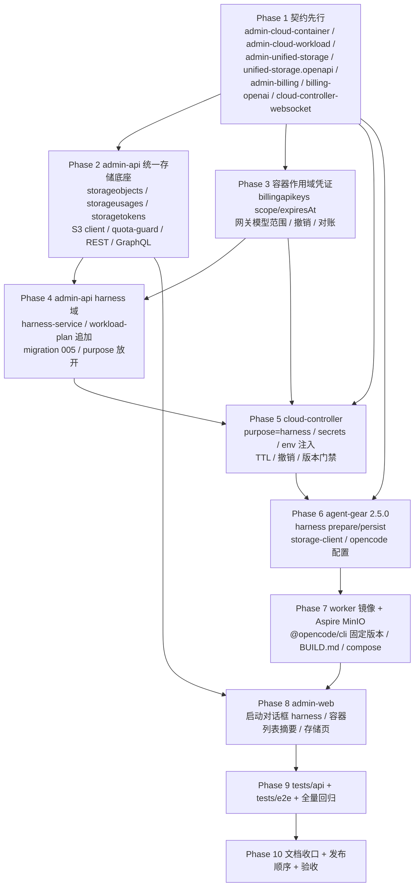
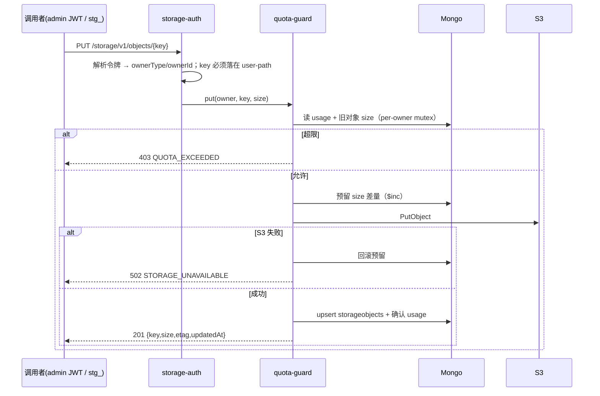
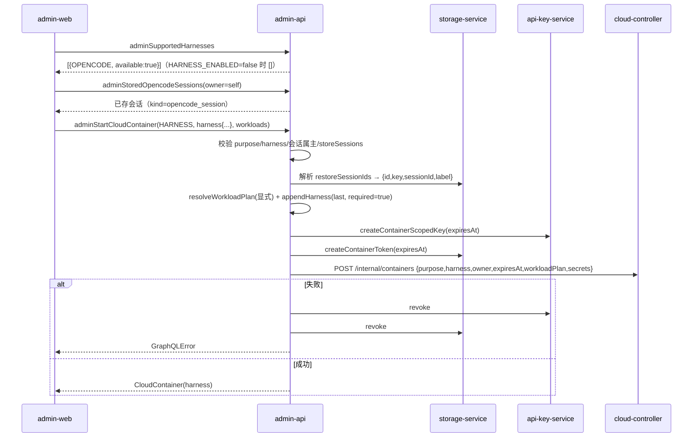
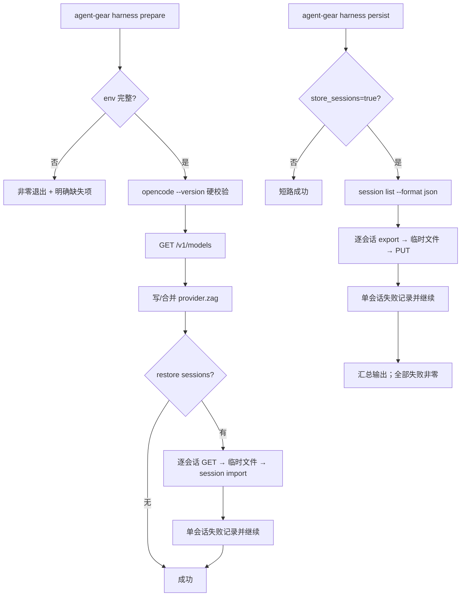
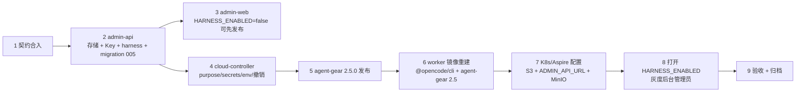

# 容器启动任务支持 harness 类型（OpenCode 工作负载与统一存储）- 实现计划

**关联 Proposal**: `docs/engineering/proposals/20261020-feat-container-harness-support.md`（v1.0）
**关联 PRD**: `docs/product/draft/20261020-container-harness-support.md`（v1.0）
**需求总分支（feat-branch）**: `feat/container-harness-support`（基于 `main`，需求总 PR #244）
**计划提交分支**: `feat/container-harness-support`（本文件随需求总分支提交）
**创建日期**: 2026-10-20
**计划版本**: v1.0
**版本说明**:
- v1.0（2026-10-20）首版，与 PRD v1.0 / 提案 v1.0 对齐；对提案中与当前代码事实不符的 6 处描述做计划期修正（见 §计划期裁决 A）。

## 实现顺序



依赖说明：

- **Phase 1 契约** 是全部实现的输入，独立提交（`docs(contracts): ...`）；契约未合入前不写实现代码。
- **Phase 2（统一存储）**、**Phase 3（容器作用域凭证）**、**Phase 5（cloud-controller 骨架）**、**Phase 6（agent-gear）** 仅依赖 Phase 1，可并行开发；Phase 5 的 env 注入联调依赖 Phase 3 的 Key/令牌契约，但可先用固定测试值。
- **Phase 4** 依赖 Phase 2（会话查询/存储对象）与 Phase 3（Key 铸造）；**Phase 5** 的撤销链路依赖 Phase 3 的内部撤销接口。
- **Phase 7** 依赖 Phase 6 的 `agent-gear@2.5.0` 产物；**Phase 8** 依赖 Phase 2/4 的 GraphQL 契约；**Phase 9** 在各实现分支合并回需求总分支后切出；**Phase 10** 收口。

### 开发分支与合并顺序

| 分支 | 范围 | 基于 | 合并目标 |
|------|------|------|---------|
| `feat/container-harness-support` | PRD / 提案 / 本计划 | `main` | 需求总 PR #244 |
| `contracts/harness-support` | `contracts/` 7 份 | 需求总分支 | 需求总分支 |
| `servers/harness-support` | admin-api + cloud-controller | 需求总分支 | 需求总分支 |
| `packages/harness-support` | agent-gear + worker 镜像 + Aspire | 需求总分支 | 需求总分支 |
| `apps/harness-support` | admin-web | 需求总分支 | 需求总分支 |
| `tests/harness-support` | tests/api + tests/e2e | 需求总分支（其余已合入） | 需求总分支 |

合并顺序：契约 → servers → packages → apps → tests。**禁止 rebase/squash，只允许 merge**（z-git 规范）。

### 开发模式与规范加载

- 全部 Phase 采用 TDD（红-绿-重构）：先写测试（RED）→ 最小实现（GREEN）→ 重构。
- 编码前加载：`docs/engineering/common-rules.md`、`docs/engineering/backend-rules.md`（后端）、`docs/engineering/frontend-rules.md`（admin-web）、`packages/agent-controller/AGENTS.md`、`servers/cloud-controller/AGENTS.md`、`apps/admin-web/AGENTS.md`、`tests/api/AGENTS.md`、`tests/e2e/AGENTS.md`、`aspire/AgentGear.AppHost/AGENTS.md`。
- `servers/admin-api` 无独立 `AGENTS.md`，沿用根 `AGENTS.md` 与 engineering 规范。

## 命令参考

```bash
# 服务编排（根目录；测试服务只用 Aspire，禁止直接 docker 命令）
aspire start
aspire wait admin-api cloud-controller admin-web
aspire describe admin-api
aspire stop

# 单服务单测 / 构建
cd servers/admin-api && npm ci && npm test && npm run build
cd servers/cloud-controller && npm ci && npm test && npm run build
cd packages/agent-controller && npm ci && npm test && npm run build
cd apps/admin-web && npm ci && npm test && npm run build && npm run lint

# 跨服务 API 测试（先 aspire start；地址按 aspire describe 替换）
cd tests/api
ADMIN_API_URL=http://localhost:10003/graphql \
ADMIN_INITIAL_PASSWORD=<与 Aspire 参数一致> \
CLOUD_CONTROLLER_URL=http://localhost:10004 \
CLOUD_CONTROLLER_INTERNAL_TOKEN=<与 internal-api-token 一致> \
npm test

# E2E（串行）
cd tests/e2e && npx playwright test

# worker 镜像（构建自验，不属于服务编排）
docker build -f deploy/images/worker/Dockerfile -t zag-worker:harness-local deploy/images/worker
docker run --rm --entrypoint bash zag-worker:harness-local -lc 'agent-gear --version && opencode --version && agent-gear harness --help'
```

> `tests/api` 的 admin 套件依赖已启动的 admin-api；`HARNESS_ENABLED=true`、`STORAGE_ENABLED=true` 需在 Aspire 参数/环境变量中打开，否则 harness/存储用例按 `test.skip` 跳过并在验收报告登记。

### 关键约束（提案 §1.3/§6，实现期不得回退）

- **契约先行**：7 份契约先于实现独立提交；字段、错误文案、状态码与提案 §3 逐项对齐，本计划的修正项以 §计划期裁决 为准。
- **单一事实源**：`cloudworkloads` 由 admin-api 写、cloud-controller 只读；`cloudcontainers`/`cloudworkloadlogs` 由 cloud-controller 写；`storageobjects`/`storageusages`/`storagetokens` 由 admin-api 写；S3 只是字节层，一切 list/usage/限额以 Mongo 元数据为准。
- **secret 不落库、不进日志**：模型 Key 与存储令牌明文只在创建/补发响应中出现一次；cloud-controller 仅内存持有；worker 只在进程环境持有；日志统一脱敏。
- **限额唯一卡点**：所有写入（含覆盖）必须经过 `quota-guard`；S3 桶策略不作为限额事实源。
- **不上调全局 worker 门禁**：`MIN_WORKER_VERSION` 保持 `2.2.0`，harness 使用独立门禁 `MIN_HARNESS_WORKER_VERSION=2.5.0`（见裁决 A1）。
- **既有 idle 行为不变**：`idle` 启动、工作负载参数/依赖/必须失败、计费全链路保持现状；新增字段对历史记录读取必须容忍缺失。
- **测试纪律**：新增代码单测覆盖率 ≥ 80%；API 与 E2E 串行执行；测试服务只用 Aspire 编排，禁止直接 `docker` 命令。

---

## 计划期裁决（提案与代码事实偏差的落地口径）

> 以下裁决以**当前代码事实**为准。提案中与代码不一致的描述在实现期按本节执行，不再回改提案；验收报告需逐条登记。

### A. 事实校正（提案描述与仓库现状不符）

| # | 提案描述 | 代码事实 | 本计划口径 |
|---|---------|---------|-----------|
| A1 | §3.2.3/§6.2：`MIN_WORKER_VERSION` 由 `2.2.0` 提升到 `2.3.0`；agent-gear 发版 2.3.0 | `cloud-controller/src/services/worker-version.ts:12` 为 `2.2.0`；`packages/agent-controller/package.json:3` 已是 `2.4.0`；`socketio-client.ts:24` 硬编码 `2.4.0` | agent-gear 升到 **`2.5.0`**；`MIN_WORKER_VERSION` **保持 `2.2.0`**；新增 **`MIN_HARNESS_WORKER_VERSION = '2.5.0'`**，在 `register` 时按**容器 purpose** 分流校验。普通容器不受影响，harness 容器低版本 worker 被拒绝。 |
| A2 | §5.3/§6.2/§7：worker 镜像已预装 `@opencode/cli`，BUILD.md 校验清单保留 | `deploy/images/worker/Dockerfile:118-123` 只装 `agent-gear@2.4.x`、`@agentclientprotocol/claude-agent-acp`、`@agentclientprotocol/codex-acp`；`BUILD.md:89` 的「7 包」清单与 Dockerfile 不一致，`opencode --version || true` 为软校验 | Dockerfile 新增 **固定版本** `@opencode/cli@2.1.1`（build arg `OPENCODE_CLI_VERSION`，默认 `2.1.1`）；BUILD.md 修正为实际包清单，`opencode --version` 改为**硬校验**；init 脚本仅在命令缺失时按其固定版本兜底安装。 |
| A3 | §5.1.4/§5.2-8：写 `~/.config/opencode/opencode.json`；`opencode session list` 用 `--json` | 本机 OpenCode v2.0.31：配置文档为 `~/.config/opencode/opencode.jsonc`；`session list` 的 JSON 开关是 `--format json`；`session import <file> --directory <dir>`；`session export <session>` 输出到 stdout，按 cwd 作用域 | 统一写/合并 **`~/.config/opencode/opencode.jsonc`**（已存在 `.json` 时优先合并该文件）；`session list --format json`；`session import <file> --directory "$HOME"`；所有 opencode 子命令 `cwd = os.homedir()`。 |
| A4 | §8.2：tests/api 使用 `vitest + supertest` | 仓库无 `supertest` 依赖；`tests/api` 用 `fetch` 打真实 Aspire 服务；admin-api 路由测试用 Express + 原生 `fetch` | 继续使用 **vitest + fetch**；不引入 supertest。 |
| A5 | §3.1.2/§4.1：`StoredOpencodeSession.size`、`StorageUsage.totalBytes/quotaBytes` 用 GraphQL `Int` | GraphQL `Int` 为 32 位有符号整数，存储字节数会溢出 | 契约改为 **`Float!` / `Float`**（JS Number 安全整数范围内足够），Mongo 存 Number。 |
| A6 | §9.3：前端特性开关 `HARNESS_ENABLED`，默认关 | admin-web 无特性开关框架；`config.js` 只注入 `apiUrl` | 改为**后端开关**：admin-api `HARNESS_ENABLED`（默认 `false`）控制 `adminSupportedHarnesses` 返回空列表与启动拒绝；admin-web 依据查询结果渲染，不新增前端开关基础设施。 |
| A7 | §5.2-4：网关按 Key 属主返回「前台用户个人模型列表 + 自定义模型」，自定义模型代转发不记账 | `Model`/`Provider` 只有 `scope: 'user'|'global'`，**无 ownerId/userId**；`/v1/models` 只查 `scope:'global'`；`/chat/completions` 已有 `pricing.isBillable=false` 不记账路径 | 一期容器 Key **只发给 `admin_user`**；网关模型列表对容器 Key 返回**全部启用的全局模型（含 `isBillable=false`/`isCustom=true`）**；自定义/不计费模型复用既有 `billable=false` 路径，不产生计量事件。**按用户归属的 `scope=user` 模型列表留二期**（需先补 owner 字段），PRD 已声明前台二期接入。 |
| A8 | §5.2-3/§3.2.1：secrets 仅一次性下发、不持久化；Key 有效期取容器 `activeDeadlineSeconds` | 提案未定义 cloud-controller 重启后 secret 丢失的恢复路径；内部创建响应也不返回 `expiresAt` | ① admin-api 在创建时计算 `expiresAt` 并随请求下发，cloud-controller 用它设置 Job `activeDeadlineSeconds` 并落库；② secrets 仍不落库，cloud-controller 内存持有；③ 新增 **`POST /internal/containers/:id/secrets/reissue`**，控制器重启/内存丢失时重新铸造并撤销旧凭证，保证 init/post 可继续。 |

### B. 设计裁决（提案留白/含混处）

1. **`optionsSource` 的校验语义**：`CloudWorkloadParamField.optionsSource` 缺省 `NONE`；仅 `MULTI_SELECT` 可设为 `OPENCODE_SESSIONS`，且必须 `options=[]`、`defaultValue=[]`。`optionsSource != NONE` 时 `workload-plan` 不再按静态 `options` 校验，改为「字符串数组、去重、≤20」；会话 ID 的属主/存在性由 `harness-service` 单独校验。静态 `multi_select` 仍要求 1~50 个 `options`（现状不变）。仅 `workloadKind='harness'` 的工作负载允许 `optionsSource != NONE`。
2. **工作负载类型字段**：`cloudworkloads` 新增 `workloadKind: 'standard' | 'harness'`（默认 `standard`）与 `harnessType: 'opencode' | null`。`CloudWorkload` DTO/GraphQL 只读暴露这两个字段；CRUD 输入不接受（由 migration 写入），避免管理员误改。admin-web 启动对话框过滤 `workloadKind === 'HARNESS'` 的项。
3. **harness 自动挂载顺序**：先按现有 `resolveWorkloadPlan` 展开用户显式选择（含 `workloadIds` 转默认参数），再把预制 harness 项**追加到末尾**，`required=true`，参数由 `harness` 输入归一。显式传入同名 harness 预设 → `duplicate workload selection`；若任一显式工作负载（直接/间接）依赖 harness 工作负载 → 返回 `harness workload cannot be a dependency of other workloads`（比提案的「warning + 仍置末位」更安全，避免依赖序被破坏）。追加后总条数 >10 → `expanded workloads exceed 10`。
4. **恢复会话的标识与传递**：GraphQL `restoreSessionIds` 是**存储对象 ID**（`storageobjects._id`），不是 OpenCode sessionId。admin-api 校验后解析为 `{id, key, sessionId, label}`，随内部请求 `harness.restoreSessions` 下发；cloud-controller 以 `ZAG_RESTORE_SESSIONS`（JSON 数组）注入 worker。worker 按 `key` GET 会话包，`opencode session import` 使用 `sessionId`。参数快照 `restore_session_ids` 仍保存存储对象 ID，用于留档。
5. **会话存储布局与元数据**：`{user-path}/opencode/{sourceContainerId}/{safeSessionId}-{hash8}.json`；`safeSessionId` 仅保留 `[A-Za-z0-9._-]`，`hash8 = sha256(sessionId)` 前 8 位，防截断/字符替换碰撞。PUT 头：`x-zag-kind: opencode_session`、`x-zag-session-id`、`x-zag-container-id`、`x-zag-session-label`（`encodeURIComponent`）。服务端仅在 key 落在 `{owner}/opencode/` 且 `kind` 合法时登记 `kind/sessionId/containerId/sessionLabel`，否则一律 `generic`。
6. **会话导出范围**：容器为新实例，`opencode session list --format json` 返回的会话即为「本容器新建 + 恢复后继续」的集合；逐会话导出，单会话 ≤32 MiB、总数 ≤50，超限跳过并记录原因。`store_sessions=false` 时 post 脚本直接短路成功。
7. **模型配置注入**：worker 用容器 Key 调 `GET {ZAG_MODEL_BASE_URL}/models` 获取可用模型快照，不依赖额外 `ZAG_MODEL_IDS`；写 `provider.zag`（`@ai-sdk/openai-compatible`，`baseURL` + `apiKey` + `models`）。合并既有配置时使用 `jsonc-parser`，保留注释与用户其它 provider；API Key 不写日志、不进错误消息。
8. **存储令牌鉴权**：`/storage/v1` 支持两类令牌：① admin JWT（`Authorization: Bearer <admin JWT>`，解析为 `admin_user/{adminId}`）；② 容器作用域令牌 `stg_<random>`（bcrypt 哈希、`expiresAt`、`status`，解析为容器属主）。前台用户 JWT 一期不接入（返回 `401 FRONT_USER_TOKEN_NOT_SUPPORTED`），与 PRD「前台二期」一致。所有 key 必须落在 `/{ownerType}/{ownerId}/` 之下，穿越/跨用户一律 `403 FORBIDDEN`。
9. **存储 REST 挂载顺序**：`/storage/v1` 必须在全局 `express.json()` **之前**挂载，PUT 使用 `express.raw({ type: () => true, limit: '256mb' })`，避免 JSON 会话包被 JSON parser 消费；GET 用 `stream/promises.pipeline` 代理 S3 流；Express 5 通配参数使用命名形式 `*key`。
10. **限额与用量事务**：`quota-guard` 以 owner 为 key 走 `KeyedMutex`；覆盖同 key 先减旧 size 再校验/加新 size；先做用量预留（`$inc`）→ PutObject → 成功提交元数据并保留预留，失败回滚预留。删除同理先 S3 删除再回退用量；S3 与元数据不一致以元数据为准并告警。`KeyedMutex` 从 `services/billing/keyed-mutex.ts` 提取到 `services/keyed-mutex.ts`，billing 侧保留 re-export。
11. **S3 配置与开关**：新增 `STORAGE_ENABLED`（默认 `false`）。为 `true` 时 `STORAGE_S3_ENDPOINT/REGION/BUCKET/ACCESS_KEY_ID/SECRET_ACCESS_KEY` 必填并 fail-fast；`STORAGE_S3_FORCE_PATH_STYLE` 默认 `true`；`STORAGE_S3_AUTO_CREATE_BUCKET` 默认 `false`（Aspire/MinIO 置 `true`）。harness 启动要求 `STORAGE_ENABLED=true`，否则返回 `storage is not enabled`。
12. **容器有效期**：admin-api `HARNESS_CONTAINER_TTL_SECONDS` 默认 `86400`；创建时 `expiresAt = now + TTL`，Key/令牌使用同一 `expiresAt`，另加 `HARNESS_KEY_EXPIRY_GRACE_SECONDS=60` 仅用于 Key 校验（避免时钟偏差导致容器存活期间 Key 先失效）；容器结束由撤销保证立即失效。cloud-controller 以 `max(60, floor((expiresAt-now)/1000))` 设 Job `activeDeadlineSeconds`。
13. **撤销链路**：cloud-controller 在 `markExited`/`markFailed`/`destroy` 终态 CAS 成功后调用 admin-api 内部撤销（Key + 存储令牌，幂等）；`container.destroyed` 事件 payload 追加 `containerApiKeyId`/`storageTokenId`，admin-api 消费者兜底撤销；admin-api 另起 `ContainerCredentialReconciler`（默认 300s）扫描「已过期仍 active」与「容器已终态仍 active」的凭证。三条线都幂等。
14. **post 预算**：新增 `HARNESS_POST_BUDGET_MS` 默认 `120000`；dispatcher 在 `purpose=harness` 时使用该值，其余仍用 `WORKLOAD_POST_BUDGET_MS`（90000）。超时按既有 post 语义记失败，不阻塞销毁。
15. **容器展示**：admin-web 无容器详情页，本期不改路由；harness 摘要放在「云端容器」列表的**用途列 + 新增 Harness 列**，日志对话框头部补充 harness 元信息。PRD 的「容器详情」以列表 + 日志对话框承载。
16. **存储后台页面**：新增 `/storage` 页面，包含「用量列表 + 指定用户对象列表 + 上传/下载/删除 + 配额编辑」。为此 GraphQL 增加 `adminStorageUsages` 与 `adminStorageObjects`（提案原契约只有单用户 `adminStorageUsage`）；对象字节上传/下载走 `/storage/v1` REST（admin JWT），不在 GraphQL 传输二进制。
17. **测试与文档冲突**：以下既有断言必须随本期更新——`tests/api/src/admin-api/cloud-workload.test.ts:660-694`（预制 4→5）、`tests/e2e/src/admin-cloud-workload.spec.ts:568-593`（4→5 与名称）、`tests/e2e/src/admin-cloud-container.spec.ts:99-113`（「仅 idle」文案）、`apps/admin-web/src/components/__tests__/StartContainerDialog.test.tsx:96-108`、`apps/admin-web/src/pages/__tests__/CloudContainersPage.test.tsx:194-198,314-326`、`packages/agent-controller/tests/socketio-client.test.ts:232,250`（版本号）。

---

## Phase 1: 契约先行（contracts/）

开发分支：`contracts/harness-support`。本 Phase 独立提交（`docs(contracts): ...`），不写实现代码。

### 文件修改

| 文件 | 操作 | 说明 |
|------|------|------|
| `contracts/admin-cloud-container.graphql` | 修改 | `CloudContainerPurpose` 增 `HARNESS`；新增 `HarnessType { OPENCODE }`、`HarnessSelectionInput`、`CloudHarnessOptions`、`HarnessOption`；`CloudContainer` 增 `harness: CloudHarnessOptions`；`adminStartCloudContainer` 增 `harness: HarnessSelectionInput`；新增 `adminSupportedHarnesses: [HarnessOption!]!`；注释写清错误文案与「HARNESS 自动挂载、不得显式传 harness 预设」 |
| `contracts/admin-cloud-workload.graphql` | 修改 | 新增 `CloudWorkloadKind { STANDARD HARNESS }`、`CloudWorkloadParamOptionsSource { NONE OPENCODE_SESSIONS }`；`CloudWorkloadParamField`/`Input` 增 `optionsSource`；`CloudWorkload` 增 `workloadKind`、`harnessType`；注释写清 `optionsSource` 仅 MULTI_SELECT、静态 options 为空、默认值空数组、≤20 |
| `contracts/admin-unified-storage.graphql` | 新增 | `StorageOwnerType { FRONT_USER ADMIN_USER }`；`StoredOpencodeSession`（`size: Float!`）；`StorageUsage`（`totalBytes: Float!`、`quotaBytes: Float`）；`StorageObject`；Query `adminStoredOpencodeSessions`、`adminStorageUsage`、`adminStorageUsages`、`adminStorageObjects`；Mutation `adminSetStorageQuota`、`adminDeleteStorageObject` |
| `contracts/unified-storage.openapi.yaml` | 新增 | Base `/storage/v1`；PUT/GET/HEAD/DELETE `/objects/{key}`、GET `/objects?prefix&limit&cursor`、GET `/usage`；Bearer 三类令牌口径（一期 admin JWT + 容器令牌）；错误 `QUOTA_EXCEEDED/FORBIDDEN/NOT_FOUND/PAYLOAD_TOO_LARGE/INVALID_PREFIX`；单对象 256 MiB；会话头 `x-zag-*` |
| `contracts/admin-billing.graphql` | 修改 | `BillingApiKeyScope { ACCOUNT CONTAINER }`；`BillingApiKey` 增 `scope/containerId/expiresAt`；补 `BillingApiCall.containerId`（如未暴露则只在内部模型） |
| `contracts/billing-openai.openapi.yaml` | 修改 | 容器 Key 的 `expiresAt`/容器终态 → `401 invalid api key`；`/v1/models` 对容器 Key 返回全部启用全局模型（含 `isBillable=false`）；`/v1/chat/completions` 的 `billable=false` 不产生计费；说明前台 `scope=user` 二期 |
| `contracts/cloud-controller-websocket.md` | 修改 | 附录 A.2.2 `POST /internal/containers` 增 `purpose=harness`、`harness`、`ownerType/ownerId`、`expiresAt`、`secrets`；A.3 响应增 `harness/expiresAt/containerApiKeyId/storageTokenId`；A.5 用途表更新；§2.9 `workload:run` 增容器级 `env`（`ZAG_*`）与脱敏约定；新增 §2.10 `POST /internal/containers/:id/secrets/reissue` 与撤销接口；版本门禁改为「purpose 分流：普通 ≥2.2.0，harness ≥2.5.0」 |

### 统一存储 GraphQL 签名（计划期新增，供 admin-web 存储页使用）

```graphql
type StorageObject {
  id: ID!
  key: String!
  size: Float!
  contentType: String!
  etag: String
  kind: String!
  sessionId: String
  containerId: ID
  sessionLabel: String
  updatedAt: String!
}

type StorageUsagePage { items: [StorageUsage!]! nextCursor: String }
type StorageObjectPage { items: [StorageObject!]! nextCursor: String }

type Query {
  adminStoredOpencodeSessions(ownerId: ID, ownerType: StorageOwnerType): [StoredOpencodeSession!]!
  adminStorageUsage(ownerType: StorageOwnerType!, ownerId: ID!): StorageUsage!
  adminStorageUsages(ownerType: StorageOwnerType, limit: Int, cursor: String): StorageUsagePage!
  adminStorageObjects(
    ownerType: StorageOwnerType!
    ownerId: ID!
    prefix: String
    limit: Int
    cursor: String
  ): StorageObjectPage!
}
```

### 契约错误文案（服务端逐字）

| 条件 | 错误 |
|------|------|
| `purpose=HARNESS` 且 `harness` 为空 | `harness selection is required for HARNESS purpose` |
| `purpose!=HARNESS` 且 `harness` 非空 | `harness selection is only allowed for HARNESS purpose` |
| `HARNESS_ENABLED=false` | `harness is not enabled` |
| `harnessType` 不在支持列表 | `unsupported harness type` |
| harness 预制工作负载缺失 | `harness workload preset not found: opencode` |
| 存储未启用 | `storage is not enabled` |
| `restoreSessionIds` 含不存在/非属主会话 | `stored session not found: <id>` |
| `restoreSessionIds` 去重后 >20 | `too many restore sessions` |
| 显式传入 harness 预制项 | `duplicate workload selection` |
| 显式工作负载依赖 harness | `harness workload cannot be a dependency of other workloads` |
| 展开后 >10 | `expanded workloads exceed 10` |

### 验收 checklist

- [ ] 7 份契约与提案 §3/§4 逐字段一致；本计划 §计划期裁决 的修正项已体现
- [ ] `HARNESS` / `optionsSource` / `workloadKind` / `expiresAt` / `scope` 在所有相关契约中命名一致
- [ ] 存储 REST 的 key 路径、令牌类型、错误码、会话头无歧义
- [ ] `workload:run` 的 `env` 与 `ZAG_*` 变量清单、脱敏要求写明
- [ ] 契约变更独立提交，未夹带实现代码

---

## Phase 2: admin-api 统一存储底座

开发分支：`servers/harness-support`。TDD 顺序：先写 `storage/*.test.ts`、`routes/unified-storage.test.ts`、`graphql/resolvers/unified-storage.test.ts`（RED）→ 实现（GREEN）。

### 文件修改

| 文件 | 操作 | 说明 |
|------|------|------|
| `servers/admin-api/package.json` | 修改 | 新增 `@aws-sdk/client-s3`（版本随 lockfile 固定） |
| `servers/admin-api/src/config/index.ts` | 修改 | `STORAGE_ENABLED`、`STORAGE_S3_ENDPOINT/REGION/BUCKET/ACCESS_KEY_ID/SECRET_ACCESS_KEY/FORCE_PATH_STYLE/AUTO_CREATE_BUCKET`、`STORAGE_DEFAULT_QUOTA_BYTES`、`STORAGE_MAX_OBJECT_BYTES`（默认 256 MiB）、`STORAGE_MAX_SESSION_BYTES`（32 MiB）；`assertRuntimeConfig` 在 `STORAGE_ENABLED=true` 时 fail-fast |
| `servers/admin-api/src/models/storage-object.ts` | 新增 | `key` 唯一、`ownerType/ownerId` 复合索引、`prefix`、`size`、`contentType`、`etag`、`kind`、`sessionId`、`containerId`、`sessionLabel`、timestamps |
| `servers/admin-api/src/models/storage-usage.ts` | 新增 | `{ownerType,ownerId}` 唯一复合索引、`totalBytes`、`objectCount`、`quotaBytes`（null=不限）、`updatedAt` |
| `servers/admin-api/src/models/storage-token.ts` | 新增 | `tokenPrefix` 索引、`tokenHash`、`ownerType/ownerId`、`containerId` 索引、`expiresAt`、`status`、timestamps |
| `servers/admin-api/src/services/keyed-mutex.ts` | 新增 | 从 `services/billing/keyed-mutex.ts` 提取 `KeyedMutex`；billing 文件保留 `export * from '../keyed-mutex.js'` 兼容 |
| `servers/admin-api/src/services/storage/key-path.ts` | 新增 | `buildUserPath(ownerType,ownerId)`、`normalizeObjectKey`、`assertWithinOwner`、`sanitizeSessionSegment` |
| `servers/admin-api/src/services/storage/s3-client.ts` | 新增 | `S3Client` 封装、`ensureBucket`、Put/Get/Head/Delete/List（仅调试用，不做业务 list） |
| `servers/admin-api/src/services/storage/quota-guard.ts` | 新增 | 唯一写入卡点：per-owner mutex、预留/回滚、覆盖同 key 的 size 差量、quota 判定 |
| `servers/admin-api/src/services/storage/object-service.ts` | 新增 | `putObject/getObject/headObject/deleteObject/listObjects`；PUT 支持 `x-zag-*` 元数据；list 走元数据游标分页 |
| `servers/admin-api/src/services/storage/usage-service.ts` | 新增 | `getUsage`、`ensureUsage`、`setQuota`、`listUsages`；`$inc` 原子更新 |
| `servers/admin-api/src/services/storage/token-service.ts` | 新增 | `createContainerToken`、`verify`、`revoke`（幂等）；`stg_` + random、bcrypt、前缀索引 |
| `servers/admin-api/src/middleware/storage-auth.ts` | 新增 | admin JWT 与容器令牌解析；`req.storage = {ownerType,ownerId,containerId?,scope}`；跨用户/未认证错误 |
| `servers/admin-api/src/routes/unified-storage.ts` | 新增 | `/storage/v1` REST；PUT raw、GET stream、HEAD、DELETE、LIST、usage；错误映射 |
| `servers/admin-api/src/graphql/schemas/unified-storage.ts` | 新增 | 契约 GraphQL 类型与 Query/Mutation |
| `servers/admin-api/src/graphql/resolvers/unified-storage.ts` | 新增 | 会话查询（`kind=opencode_session`、属主过滤、`storedAt` 倒序、上限 200）、用量、配额、对象列表/删除 |
| `servers/admin-api/src/graphql/schemas/index.ts` | 修改 | 注册 `unifiedStorageTypeDefs` |
| `servers/admin-api/src/graphql/resolvers/index.ts` | 修改 | 注册 `unifiedStorageResolvers` |
| `servers/admin-api/src/index.ts` | 修改 | **在 `express.json()` 之前**挂载 `/storage/v1`；启动时 `ensureBucket`（storage enabled）；关闭时释放 S3 client |
| `servers/admin-api/src/services/storage/*.test.ts` | 新增 | 见测试矩阵 |
| `servers/admin-api/src/routes/unified-storage.test.ts` | 新增 | Express + 内存 Mongo + 假 S3（注入 client 接口） |
| `servers/admin-api/src/graphql/resolvers/unified-storage.test.ts` | 新增 | resolver 直调 + mock service |

### 核心语义



### 测试用例（增量）

| # | 用例 | 预期 |
|---|------|------|
| T-ST1 | `buildUserPath` / `normalizeObjectKey` | `admin_user/abc` → `/admin_user/abc/`；拒绝 `..`、`\`、NUL、绝对路径、空段、>1024 |
| T-ST2 | 跨用户 key | `admin_user/a` 写 `/admin_user/b/x` → `403 FORBIDDEN` |
| T-ST3 | 首次上传 | S3 Put + `storageobjects` + `storageusages` 增量正确 |
| T-ST4 | 覆盖同 key | usage 只增加 `new-old`，不重复累计 |
| T-ST5 | 覆盖为更小对象 | usage 回退，最小为 0 |
| T-ST6 | 配额刚好等于 | 允许；超出 1 字节 → `403 QUOTA_EXCEEDED` |
| T-ST7 | 配额 null（后台） | 永不拒绝 |
| T-ST8 | S3 Put 失败 | 预留回滚、无元数据、返回 502 |
| T-ST9 | 并发 PUT 同 owner 不同 key | mutex 串行，usage 最终准确 |
| T-ST10 | 并发 PUT 同 key | 只有最后一次 size 计入，无负值 |
| T-ST11 | DELETE 存在对象 | S3 删除、元数据删除、usage 回退 |
| T-ST12 | DELETE 不存在 | 404，usage 不变 |
| T-ST13 | HEAD 存在/不存在 | 元信息/404；不触发 S3 |
| T-ST14 | GET 存在/不存在 | 流式返回/404 |
| T-ST15 | LIST 前缀 + 游标 | 只返回本 owner 且 key 以 prefix 开头；`nextCursor` 稳定；limit 1~1000 |
| T-ST16 | LIST 非法 prefix | `400 INVALID_PREFIX` |
| T-ST17 | 会话元数据登记 | key 在 `/opencode/` + `x-zag-kind=opencode_session` → `kind/sessionId/containerId/sessionLabel` 落库 |
| T-ST18 | 非 opencode 路径伪造 kind | 归一为 `generic`，不进入会话列表 |
| T-ST19 | 单对象 >256 MiB | `413 PAYLOAD_TOO_LARGE`（或 Express 层 413 映射） |
| T-ST20 | 会话包 >32 MiB | 服务端按 `kind=opencode_session` 拒绝（413） |
| T-ST21 | 容器令牌校验 | 正确令牌通过；错误/过期/revoked → 401；owner 正确 |
| T-ST22 | admin JWT 校验 | 合法 JWT 通过；过期/密码变更 → 401 |
| T-ST23 | `adminStoredOpencodeSessions` | 只返回本 owner 的 `opencode_session`；`storedAt` 倒序；size/label/containerId 正确 |
| T-ST24 | `adminStorageUsage` / `adminStorageUsages` | 单用户/列表数值与 usage 表一致；`quotaExceeded` 计算正确 |
| T-ST25 | `adminSetStorageQuota` / `adminDeleteStorageObject` | 设置 null 取消限额；删除后列表消失 |
| T-ST26 | `ensureBucket` | bucket 不存在且 `AUTO_CREATE=true` 创建；false 时 fail-fast |
| T-ST27 | 历史数据兼容 | 无 `sessionLabel` 的旧对象返回空字符串/`-`，不报错 |

### 验收 checklist

- [ ] `STORAGE_ENABLED=false` 时服务正常启动、`/storage/v1` 返回 `503 STORAGE_DISABLED`
- [ ] `STORAGE_ENABLED=true` 缺配置时启动 fail-fast，错误信息点名缺失项
- [ ] CRUD+list+usage 全部方法通过 API 测试；跨用户 403、超限 403、只读/删除不受限
- [ ] 用量在覆盖/删除/并发场景下与实际一致（含回滚）
- [ ] `/storage/v1` 挂载在 `express.json()` 之前，JSON 与二进制上传均可用
- [ ] 新增模块单测覆盖率 ≥80%

---

## Phase 3: 容器作用域模型 Key 与计费网关

开发分支：`servers/harness-support`。TDD 先写 `api-key-service.test.ts`、`billing-openai.test.ts`、`internal-billing.test.ts`、`credential-reconciler.test.ts`（RED）。

### 文件修改

| 文件 | 操作 | 说明 |
|------|------|------|
| `servers/admin-api/src/models/billing-api-key.ts` | 修改 | 增 `scope: 'account'|'container'`（默认 account）、`containerId`（index）、`expiresAt`、`allowedModelIds`（默认 null） |
| `servers/admin-api/src/models/billing-api-call.ts` | 修改 | 增 `containerId`（可选，index），用于容器调用归因 |
| `servers/admin-api/src/services/billing/api-key-service.ts` | 修改 | 增 `createContainerScopedKey({accountId,ownerType,ownerId,containerId,expiresAt,name})`；`verify` 返回 `scope/containerId/expiresAt` 并检查过期；`revokeById(id)` 幂等（不要求 owner）；现有 `create/revoke` 语义不变 |
| `servers/admin-api/src/middleware/billing-key-auth.ts` | 修改 | `scope=container` 且容器终态/过期 → 401 `invalid_api_key`；把 `scope/containerId` 放进 `req.billing` |
| `servers/admin-api/src/routes/internal-billing.ts` | 修改 | 新增 `POST /api-keys/:id/revoke`（内部 token，幂等，200/404）；保留既有 DELETE |
| `servers/admin-api/src/routes/billing-openai.ts` | 修改 | `/models`：容器 Key 返回全部启用全局模型（含 `isBillable=false`/`isCustom`），过滤 `allowedModelIds`；账号 Key 保持现状（仅计费完整模型）。`/chat/completions`：容器 Key 允许非计费模型走既有 `billable=false` 路径；`BillingApiCall` 写 `containerId` |
| `servers/admin-api/src/services/billing/credential-reconciler.ts` | 新增 | 扫描过期/容器终态仍 active 的 Key 与存储令牌，批量撤销；幂等 |
| `servers/admin-api/src/config/index.ts` | 修改 | `HARNESS_ENABLED`、`HARNESS_CONTAINER_TTL_SECONDS`、`HARNESS_KEY_EXPIRY_GRACE_SECONDS`、`CONTAINER_CREDENTIAL_RECONCILE_INTERVAL_MS` |
| `servers/admin-api/src/index.ts` | 修改 | 启动/停止 reconciler；`syncIndexes` 覆盖新模型 |
| `servers/admin-api/src/graphql/schemas/billing.ts` + `resolvers/billing.ts` | 修改 | `BillingApiKey` 暴露 `scope/containerId/expiresAt`；现有创建/撤销 mutation 不变（容器 Key 不经 GraphQL 创建） |
| `servers/admin-api/src/services/billing/api-key-service.test.ts` | 修改 | 容器 Key 铸造/过期/撤销/幂等 |
| `servers/admin-api/src/services/billing/credential-reconciler.test.ts` | 新增 | 过期/终态/批量撤销 |
| `servers/admin-api/src/routes/internal-billing.test.ts` | 新增 | 内部撤销鉴权/幂等/404 |
| `servers/admin-api/src/routes/billing-openai.test.ts` | 修改 | 容器 Key 模型列表/非计费模型/containerId 归因 |

### 测试用例（增量）

| # | 用例 | 预期 |
|---|------|------|
| T-BK1 | `createContainerScopedKey` | `scope=container`、`containerId/expiresAt` 落库；返回明文一次；哈希可验证 |
| T-BK2 | 账号 Key 兼容 | `scope=account`、`expiresAt=null`；现有列表/撤销测试全绿 |
| T-BK3 | `verify` 过期 | `expiresAt < now` → 401/抛错 |
| T-BK4 | `verify` 容器终态 | 容器 `exited/failed/destroying` → 401 |
| T-BK5 | 撤销幂等 | 重复 revoke 均 200；未知 id 404 |
| T-BK6 | 内部撤销鉴权 | 无/错误内部 token → 401 |
| T-BK7 | `/v1/models` 容器 Key | 含 `isBillable=false`/`isCustom=true` 的启用模型；不返回未启用 |
| T-BK8 | `/v1/models` 账号 Key 回归 | 仍只返回计费完整模型 |
| T-BK9 | `/v1/chat/completions` 系统模型 | 产生 `BillingApiCall` + 计量事件，`containerId` 落库 |
| T-BK10 | `/v1/chat/completions` 非计费/自定义模型 | 正常转发、不产生计量/outbox、`BillingApiCall.billable=false` |
| T-BK11 | `allowedModelIds` | 列表只含白名单；非白名单 chat → `model_not_allowed` |
| T-BK12 | 对账任务 | 过期 active Key/令牌被撤销；未过期/已撤销不动 |
| T-BK13 | 容器终态对账 | 容器已 `exited` 但 Key active → 撤销 |
| T-BK14 | 时钟偏差 grace | `expiresAt` 刚到但容器仍 online → 在 60s grace 内可用 |

### 验收 checklist

- [ ] 容器 Key 有效期 = 容器 `expiresAt`，容器结束立即失效（撤销 + 终态校验双保险）
- [ ] Key 明文不落库、不进日志；内部撤销/对账幂等
- [ ] 系统模型计费、全局非计费/自定义模型不记账；账号 Key 行为不变
- [ ] 前台 `scope=user` 按属主模型列表明确列为二期（契约注释 + 验收报告登记）

---

## Phase 4: admin-api harness 域（校验 / 计划 / migration）

开发分支：`servers/harness-support`。TDD 先写 `harness-service.test.ts`、扩展 `workload-plan.test.ts`、`cloud-workload.test.ts`、`cloud-container.test.ts`、`005-preset-harness-opencode.test.ts`（RED）。

### 文件修改

| 文件 | 操作 | 说明 |
|------|------|------|
| `servers/admin-api/src/models/cloud-workload.ts` | 修改 | 增 `workloadKind`（default `standard`，index）、`harnessType`（default null）；`paramSchema` 子文档增 `optionsSource`（default `NONE`） |
| `servers/admin-api/src/services/cloud-workload.ts` | 修改 | DTO/映射增 `workloadKind/harnessType/optionsSource`；`normalizeParamField` 接受 `optionsSource` 并执行裁决 B1；`normalizeParamValue`/`resolveWorkloadPlan` 对 `optionsSource != NONE` 走动态数组校验；`list()` 支持按 `workloadKind` 过滤（可选） |
| `servers/admin-api/src/services/workload-plan.ts` | 修改 | `WorkloadParamFieldSnapshot` 增 `optionsSource`；`normalizeParamValue` 动态分支（string[]、去重、≤20）；新增 `appendHarnessSelection(plan, harnessSelection)` 或 `resolveWorkloadPlan(..., {appendSelections})`，负责末位追加、`required=true`、重复/依赖检查、总数上限 |
| `servers/admin-api/src/models/cloud-container.ts` | 修改 | 只读模型增 `purpose='harness'`、`harnessType`、`harnessOptions`（子文档）、`ownerType`、`ownerId`、`expiresAt`、`containerApiKeyId`、`storageTokenId` |
| `servers/admin-api/src/services/harness-service.ts` | 新增 | `getSupportedHarnesses`、`resolveSelection`、`validateStoredSessions`、`buildHarnessParams`、`assertNoExplicitHarnessPreset` |
| `servers/admin-api/src/services/cloud-controller-client.ts` | 修改 | `start(purpose, workloadPlan, workloadIds, billingAccountId, harness?, owner?, secrets?, expiresAt?)`；请求体增 `harness/ownerType/ownerId/secrets/expiresAt`；`PURPOSE_TO_GQL` 增 `harness→HARNESS`；DTO 增 harness/expiresAt/key ids |
| `servers/admin-api/src/graphql/schemas/cloud-container.ts` | 修改 | 契约同步：HARNESS/HarnessType/HarnessSelectionInput/CloudHarnessOptions/HarnessOption；`adminStartCloudContainer` 增 `harness`；新增 `adminSupportedHarnesses` |
| `servers/admin-api/src/graphql/schemas/cloud-workload.ts` | 修改 | 契约同步：`optionsSource/workloadKind/harnessType` |
| `servers/admin-api/src/graphql/resolvers/cloud-container.ts` | 修改 | 放开 `IDLE|HARNESS`；HARNESS 校验 harness/存储/会话；构建计划并追加 harness；铸造 Key/令牌；失败回滚撤销；`adminSupportedHarnesses` resolver |
| `servers/admin-api/src/graphql/resolvers/cloud-workload.ts` | 修改 | 透传 `optionsSource/workloadKind/harnessType`（只读字段拒绝用户修改） |
| `servers/admin-api/src/routes/internal-container.ts` | 新增 | 内部 token 鉴权；`POST /internal/containers/:id/secrets/reissue`：按容器属主/harness 重新铸造 Key + 存储令牌，撤销旧 id（若记录），返回明文一次 |
| `servers/admin-api/src/routes/internal-container.test.ts` | 新增 | 鉴权、幂等补发、旧凭证撤销、非 harness/未知容器 404 |
| `servers/admin-api/src/migrations/005-preset-harness-opencode.ts` | 新增 | 写入 `name='OpenCode（Harness）'`、`presetKey='harness-opencode'`、`workloadKind='harness'`、`harnessType='opencode'`、`isPreset=true`、`paramSchema=[store_sessions(BOOLEAN,true), restore_session_ids(MULTI_SELECT, optionsSource=OPENCODE_SESSIONS, options=[], defaultValue=[])]`、`initScript`/`postScript`（§5.3） |
| `servers/admin-api/src/migrations/005-preset-harness-opencode.test.ts` | 新增 | 幂等、已存在不覆盖、字段完整、脚本 `bash -n` |
| `servers/admin-api/src/index.ts` | 修改 | 注册 `005` 到 migration 数组；挂载 `/internal/containers` 路由 |

### harness 启动流程



### 测试用例（增量）

| # | 用例 | 预期 |
|---|------|------|
| T-HS1 | `adminSupportedHarnesses`（开关开） | 返回 OPENCODE/available=true；预制缺失时 available=false |
| T-HS2 | `adminSupportedHarnesses`（开关关） | 返回 `[]` |
| T-HS3 | HARNESS 缺 harness | `harness selection is required for HARNESS purpose` |
| T-HS4 | IDLE 传 harness | `harness selection is only allowed for HARNESS purpose` |
| T-HS5 | 不支持的 harnessType | `unsupported harness type` |
| T-HS6 | 存储未启用 | `storage is not enabled`，且不铸造 Key/令牌 |
| T-HS7 | 会话不存在/他人会话 | `stored session not found: <id>` |
| T-HS8 | 会话去重 >20 | `too many restore sessions` |
| T-HS9 | 显式选 harness 预设 | `duplicate workload selection` |
| T-HS10 | 显式工作负载依赖 harness | `harness workload cannot be a dependency of other workloads` |
| T-HS11 | 计划追加 | harness 项在末位、`required=true`、参数 `store_sessions/restore_session_ids` 正确 |
| T-HS12 | 展开 >10 | `expanded workloads exceed 10` |
| T-HS13 | Key/令牌铸造失败 | 不调用 cloud-controller；已铸造项回滚撤销 |
| T-HS14 | cloud-controller 失败 | 撤销 Key/令牌，GraphQL 返回控制面错误 |
| T-HS15 | `workloadIds` 路径 + HARNESS | 转为默认参数后追加 harness；与 `workloads` 二选一错误不变 |
| T-HS16 | `optionsSource` 保存 | MULTI_SELECT + 空 options + 空默认值可保存；静态类型缺 options 仍拒绝 |
| T-HS17 | `optionsSource` 参数归一 | 字符串数组去重、≤20；不做静态 options 子集校验 |
| T-HS18 | 非 harness 工作负载设 optionsSource | 拒绝（`optionsSource is only allowed for harness workloads`） |
| T-HS19 | `POST /internal/containers/:id/secrets/reissue` | 内部 token 校验；返回新 Key/令牌明文一次；旧 id 撤销；非 harness/未知容器 404；重复补发幂等 |
| T-MIG5-1 | 005 首次执行 | 写入 5 个预制项之一；字段/脚本正确；`bash -n` 通过 |
| T-MIG5-2 | 005 二次执行 | 跳过，不覆盖管理员修改 |
| T-MIG5-3 | presetKey 存在但 name 不同 | 保留现有，打 warning |
| T-MIG5-4 | 005 单项失败 | 记录错误不阻断启动 |

### 验收 checklist

- [ ] `purpose=HARNESS` 全链路可用，`IDLE` 行为不变
- [ ] harness 预制项幂等、脚本可执行、参数 `optionsSource` 正确
- [ ] 恢复会话只允许属主对象，ID 解析为完整 key
- [ ] 计划末位追加、`required=true`、上限/重复/依赖错误齐全
- [ ] Key/令牌铸造失败或控制面失败时可回滚

---

## Phase 5: cloud-controller（生命周期 / secrets / env / 撤销 / 门禁）

开发分支：`servers/harness-support`。TDD 先写 `internal-api.test.ts`、`container-service.test.ts`、`workload-dispatcher.test.ts`、`worker-version.test.ts`、`socketio-gateway.test.ts`（RED）。

### 文件修改

| 文件 | 操作 | 说明 |
|------|------|------|
| `servers/cloud-controller/src/models/cloud-container.ts` | 修改 | `CONTAINER_PURPOSES` 增 `harness`；主 schema 增 `harnessType`、`harnessOptions`、`ownerType`、`ownerId`、`expiresAt`、`containerApiKeyId`、`storageTokenId` |
| `servers/cloud-controller/src/repositories/container-repository.ts` | 修改 | `CloudContainerEntity`/`CreateContainerInput`/`UpdateContainerInput`/`create()` 同步新字段 |
| `servers/cloud-controller/src/config/index.ts` | 修改 | `ADMIN_API_URL`、`MIN_HARNESS_WORKER_VERSION`（默认 `2.5.0`）、`HARNESS_POST_BUDGET_MS`（默认 120000）、`ADMIN_API_TIMEOUT_MS` |
| `servers/cloud-controller/src/routes/internal-api.ts` | 修改 | `purpose` 允许 `idle|harness`；解析/校验 `harness/ownerType/ownerId/expiresAt/secrets`；**把 `purpose` 变量传给 `containerService.start`（移除 `'idle'` 字面量）**；响应允许列表增 harness/expiresAt/key ids（补发由 `adminApiClient` 直接调用 admin-api，不在本路由暴露） |
| `servers/cloud-controller/src/services/container-service.ts` | 修改 | `start` 接收 purpose/harness/owner/secrets；落库；`expiresAt` 传给 job manager；内存 secret store；终态撤销；`purpose` 类型放开 |
| `servers/cloud-controller/src/services/secret-store.ts` | 新增 | `Map<containerId, ContainerSecrets>`；`put/get/delete`；测试可注入 |
| `servers/cloud-controller/src/services/admin-api-client.ts` | 新增 | 内部 Bearer 调用：`revokeApiKey`、`revokeStorageToken`、`reissueSecrets`；超时/幂等/日志脱敏 |
| `servers/cloud-controller/src/services/workload-dispatcher.ts` | 修改 | `workload:run` payload 增 `env`；`buildHarnessEnv(container, secrets)`；`purpose=harness` 用 `HARNESS_POST_BUDGET_MS`；secret 缺失时先 reissue；日志不打印 env 值 |
| `servers/cloud-controller/src/services/worker-version.ts` | 修改 | 保留 `MIN_WORKER_VERSION='2.2.0'`；新增 `MIN_HARNESS_WORKER_VERSION='2.5.0'`、`isSupportedHarnessWorkerVersion` |
| `servers/cloud-controller/src/services/socketio-gateway.ts` | 修改 | `register` 时读取容器 purpose，按 purpose 选择门禁；低版本 harness worker 返回 `VERSION_MISMATCH` 并断开；成功日志用 `sanitizeVersionForLog` |
| `servers/cloud-controller/src/services/k8s-job-manager.ts` | 修改 | `CreateJobInput` 增 `activeDeadlineSeconds?`；manifest 使用传入值（默认 86400） |
| `servers/cloud-controller/src/index.ts` | 修改 | 注入 `adminApiClient`、`secretStore`、`MIN_HARNESS_WORKER_VERSION`；事件 payload 增 key ids；启动时读取 `ADMIN_API_URL` |
| `servers/cloud-controller/AGENTS.md` | 修改 | 更新 purpose、env、版本门禁、secret、post 预算口径 |

### `workload:run` env 清单

```jsonc
{
  "phase": "init",
  "env": {
    "ZAG_HARNESS_TYPE": "opencode",
    "ZAG_CONTAINER_ID": "…",
    "ZAG_USER_TYPE": "admin_user",
    "ZAG_USER_ID": "…",
    "ZAG_USER_PATH": "/admin_user/66f…/",
    "ZAG_STORE_SESSIONS": "true",
    "ZAG_RESTORE_SESSIONS": "[{\"id\":\"…\",\"key\":\"/admin_user/…/opencode/…json\",\"sessionId\":\"ses_…\",\"label\":\"…\"}]",
    "ZAG_MODEL_API_KEY": "zag_sk_…",
    "ZAG_MODEL_BASE_URL": "http://admin-api:8002/v1",
    "ZAG_STORAGE_BASE_URL": "http://admin-api:8002/storage/v1",
    "ZAG_STORAGE_TOKEN": "stg_…",
    "ZAG_CONTAINER_STARTED_AT": "2026-10-20T…Z"
  },
  "items": [/* 既有结构 */]
}
```

- env 仅随下发报文存在；worker 内存持有；`ZAG_MODEL_API_KEY`/`ZAG_STORAGE_TOKEN` 在 worker 日志与错误消息中脱敏为 `***`。
- 普通容器不下发 `env`（字段缺省），行为不变。

### 测试用例（增量）

| # | 用例 | 预期 |
|---|------|------|
| T-CC1 | `purpose=idle` 回归 | 行为不变；响应字段兼容 |
| T-CC2 | `purpose=harness` 创建 | 落库 harness/owner/expiresAt；Job `activeDeadlineSeconds` 来自 `expiresAt` |
| T-CC3 | `purpose` 字面量修复 | `start` 收到 `harness` 而非 `idle`（spy 断言） |
| T-CC4 | 未开放 purpose | `workflow/session/admin-task` 仍 400 `UNSUPPORTED_PURPOSE` |
| T-CC5 | harness 缺 secrets | 400 `INVALID_HARNESS` |
| T-CC6 | secrets 不落库/不返回 | Mongo 文档无明文；响应无 secret 字段 |
| T-CC7 | env 注入 | 初始化批次 `env` 含全部 `ZAG_*`；普通容器无 `env` |
| T-CC8 | secret 缺失触发 reissue | dispatcher 调 `adminApiClient.reissueSecrets` 并更新内存 |
| T-CC9 | 版本门禁 purpose 分流 | idle + 2.2.0 通过；harness + 2.4.0 拒绝 `VERSION_MISMATCH`；harness + 2.5.0 通过 |
| T-CC10 | 门禁先于副作用 | 拒绝时未写 connectedAt/未启动 init |
| T-CC11 | `markExited` 撤销 | CAS 成功后调用 revoke（Key + 令牌）；重复调用幂等 |
| T-CC12 | `markFailed` 撤销 | 同上 |
| T-CC13 | `destroy` 撤销 | 销毁完成后调用；Job 删除失败仍尝试撤销 |
| T-CC14 | revoke 失败 | 记录日志、不改变容器终态；对账兜底 |
| T-CC15 | `container.destroyed` payload | 含 `containerApiKeyId/storageTokenId` |
| T-CC16 | post 预算 | harness 用 120s；普通用 90s |
| T-CC17 | 响应映射 | `purpose=harness` 不再回落 `IDLE` |
| T-CC18 | 历史容器兼容 | 无新字段的旧记录读取/销毁正常 |

### 验收 checklist

- [ ] purpose=harness 全链路（创建 → 初始化 → 终态）单测覆盖
- [ ] secrets 仅内存、不落库、不进日志；重启可 reissue
- [ ] 版本门禁只影响 harness 容器，普通容器仍兼容 2.2.0+
- [ ] 终态撤销 + 事件兜底 + 对账三线幂等
- [ ] `workload:run` env 契约与 worker 实现一致

---

## Phase 6: agent-gear（harness prepare/persist + storage client）

开发分支：`packages/harness-support`。TDD 先写 `tests/commands/harness.test.ts`、`src/harness/*.test.ts`、`src/storage-client.test.ts`、扩展 `workload-executor.test.ts`（RED）。

### 文件修改

| 文件 | 操作 | 说明 |
|------|------|------|
| `packages/agent-controller/package.json` | 修改 | 版本 `2.5.0`；新增 `jsonc-parser` |
| `packages/agent-controller/package-lock.json` / `pnpm-lock.yaml` | 修改 | 版本与依赖同步（以 `npm ci` 为准，修正 package-lock 根版本 2.3.0 漂移） |
| `packages/agent-controller/src/index.ts` | 修改 | 注册 `harness` 命令组（`prepare`/`persist`）；改用 `program.parseAsync()` 并统一 catch → `process.exitCode=1` |
| `packages/agent-controller/src/commands/harness.ts` | 新增 | 子命令参数解析、env 校验、错误输出（不含 secret） |
| `packages/agent-controller/src/harness/types.ts` | 新增 | `HarnessEnv`、`RestoreSession`、`PersistSummary` |
| `packages/agent-controller/src/harness/opencode-cli.ts` | 新增 | `opencode --version`、`session list --format json`、`session export <id>`、`session import <file> --directory <dir>`；cwd `homedir()`；超时/错误包装 |
| `packages/agent-controller/src/harness/opencode-config.ts` | 新增 | 定位/合并 `opencode.jsonc`/`opencode.json`；写 `provider.zag`；`jsonc-parser` 保留注释；权限 0600 |
| `packages/agent-controller/src/harness/prepare.ts` | 新增 | 取模型列表 → 写配置 → 逐会话 GET/导入 → 汇总；单会话失败跳过；配置失败非零 |
| `packages/agent-controller/src/harness/persist.ts` | 新增 | `store_sessions` 短路 → list → 逐会话 export → PUT → 汇总；单会话失败不阻断 |
| `packages/agent-controller/src/storage-client.ts` | 新增 | `getObject`、`putObject`、`listObjects`、`getUsage`；Bearer；超时；错误映射；二进制/流 |
| `packages/agent-controller/src/workload-executor.ts` | 修改 | `WorkloadRunPayload` 增 `env`；`buildWorkloadEnv` 合并容器 env；`redactSecrets` 对 secret 值脱敏；测试覆盖 |
| `packages/agent-controller/src/socketio-client.ts` | 修改 | `CONTROLLER_VERSION='2.5.0'`；`workload:run` 透传 `env`；注册版本与 package 一致 |
| `packages/agent-controller/AGENTS.md` | 修改 | 版本 2.5.0、harness 命令、env 注入、脱敏、OpenCode 约定 |

### prepare / persist 行为



### 测试用例（增量）

| # | 用例 | 预期 |
|---|------|------|
| T-AG1 | CLI 注册 | `agent-gear harness --help` 展示 prepare/persist；未知子命令非零 |
| T-AG2 | env 缺失 | 明确缺失项，非零；不泄漏其它 env |
| T-AG3 | `opencode --version` 失败 | 非零；错误含版本校验提示 |
| T-AG4 | 配置新建 | 生成 `.jsonc`，`provider.zag` 含 baseURL/apiKey/models；权限 0600 |
| T-AG5 | 配置合并 | 保留既有 provider/注释；只替换 `provider.zag` |
| T-AG6 | 模型列表 | 用容器 Key 请求 `/v1/models`；空列表仍写 provider（models={}） |
| T-AG7 | 恢复会话成功 | 逐个 GET + `session import --directory $HOME`；汇总成功数 |
| T-AG8 | 恢复会话 404 | 跳过并记录 `stored session not found`；其余继续；退出 0 |
| T-AG9 | 恢复会话导入失败 | 记录 stderr；其余继续；退出 0 |
| T-AG10 | persist 关闭 | `ZAG_STORE_SESSIONS=false` 不调用 opencode/存储 |
| T-AG11 | persist 正常 | list → export → PUT；key/headers/session 元数据正确 |
| T-AG12 | persist 单会话超 32 MiB | 跳过并记录；其余继续 |
| T-AG13 | persist 单会话 PUT 失败 | 记录；其余继续；汇总非零 |
| T-AG14 | 会话 ID 路径安全 | 特殊字符被替换 + hash；元数据保留原始 sessionId |
| T-AG15 | env 注入 | executor 合并 `ZAG_*`；参数 env 仍覆盖同名；普通容器行为不变 |
| T-AG16 | secret 脱敏 | 脚本输出含 secret → 结果日志替换为 `***` |
| T-AG17 | 版本注册 | `register.version='2.5.0'`；测试期望同步更新 |

### 验收 checklist

- [ ] `agent-gear@2.5.0` 构建通过；`harness prepare/persist` 在无 OpenCode 环境给出明确错误
- [ ] 模型配置、会话导入/导出、存储 PUT 均有单测（mock 外部命令/HTTP）
- [ ] 单会话失败不阻断其它会话；persist 失败不阻塞容器销毁
- [ ] secret 不出现在日志/错误/测试快照中

---

## Phase 7: worker 镜像与 Aspire 编排

开发分支：`packages/harness-support`。TDD/自验：先改 `deploy/images/worker/BUILD.md` 的校验项，再改 Dockerfile，最后跑镜像自验。

### 文件修改

| 文件 | 操作 | 说明 |
|------|------|------|
| `deploy/images/worker/Dockerfile` | 修改 | 新增 `ARG OPENCODE_CLI_VERSION=2.1.1`；全局安装 `agent-gear@2.5.x`、`@opencode/cli@${OPENCODE_CLI_VERSION}`；保留既有 ACP 包；注释修正「全量 7 包」 |
| `deploy/images/worker/BUILD.md` | 修改 | 实际包清单；`opencode --version` 硬校验；新增 `agent-gear harness --help`、`opencode session --help` 自验；版本 ≥2.5.0 |
| `deploy/images/worker/entrypoint.sh` | 检查/修改 | 运行时 `npm install -g agent-gear` 仍保留；启动日志打印版本；不打印 secret |
| `aspire/AgentGear.AppHost/AppHost.cs` | 修改 | 新增 MinIO 容器（镜像参数化、数据卷、bucket 初始化）；admin-api 注入 `STORAGE_*`、`HARNESS_*`；cloud-controller 注入 `ADMIN_API_URL`、`HARNESS_POST_BUDGET_MS`、`MIN_HARNESS_WORKER_VERSION` |
| `aspire/manifest/docker-compose.yaml` | 重新生成 | `aspire publish -o aspire/manifest`；追加 minio 服务与依赖；不手工编辑 |
| `deploy/k8s/*` | 修改 | admin-api/cloud-controller env 示例（S3、ADMIN_API_URL、HARNESS_ENABLED）；worker 镜像 tag 说明 |
| `aspire/AgentGear.AppHost/AGENTS.md` | 修改 | MinIO/存储 env 说明 |

### 测试/自验

| # | 用例 | 预期 |
|---|------|------|
| T-IMG1 | Dockerfile 静态检查 | 含 `@opencode/cli@2.1.1`、`agent-gear@2.5.x`；无硬编码公网 registry |
| T-IMG2 | 镜像内 `opencode --version` | 成功且版本 = `OPENCODE_CLI_VERSION` |
| T-IMG3 | 镜像内 `agent-gear --version` | ≥2.5.0 |
| T-IMG4 | 镜像内 `agent-gear harness --help` | prepare/persist 可见 |
| T-IMG5 | Aspire 本地 | MinIO healthy；admin-api `/health` 正常；bucket 存在 |
| T-IMG6 | Compose 发布 | `docker compose config` 校验通过；minio 依赖顺序正确 |

### 验收 checklist

- [ ] worker 镜像可构建、OpenCode 可执行、agent-gear 版本满足 harness 门禁
- [ ] BUILD.md 与实际 Dockerfile 一致，软校验改硬校验
- [ ] Aspire/Compose 本地可启动 MinIO + admin-api + cloud-controller
- [ ] 生产 K8s env 示例完整，不包含真实 secret

---

## Phase 8: admin-web（harness 启动交互 / 容器摘要 / 存储页）

开发分支：`apps/harness-support`。TDD 先写/改 `StartContainerDialog.test.tsx`、`CloudContainersPage.test.tsx`、`StoragePage.test.tsx`（RED）。

### 文件修改

| 文件 | 操作 | 说明 |
|------|------|------|
| `apps/admin-web/src/graphql/types.ts` | 修改 | `CloudContainerPurpose` 增 `HARNESS`；`CloudContainerData.harness`；`HarnessOptionData`、`HarnessSelectionData`；`CloudWorkloadParamFieldData.optionsSource`；`CloudWorkloadData.workloadKind/harnessType`；存储类型 |
| `apps/admin-web/src/graphql/queries.ts` | 修改 | `ADMIN_CLOUD_CONTAINERS` 增 `harness { harnessType storeSessions restoreSessionIds }`；`ADMIN_CLOUD_WORKLOADS` 增 `optionsSource/workloadKind/harnessType`；新增 `ADMIN_SUPPORTED_HARNESSES`、`ADMIN_STORED_OPENCODE_SESSIONS`、`ADMIN_STORAGE_USAGES`、`ADMIN_STORAGE_OBJECTS`、`ADMIN_STORAGE_USAGE` |
| `apps/admin-web/src/graphql/mutations.ts` | 修改 | `ADMIN_START_CLOUD_CONTAINER` 增 `$harness: HarnessSelectionInput`；新增 `ADMIN_SET_STORAGE_QUOTA`、`ADMIN_DELETE_STORAGE_OBJECT` |
| `apps/admin-web/src/components/cloud-containers/labels.ts` | 修改 | `CONTAINER_PURPOSE_LABELS.HARNESS='Harness'`；harness 类型标签；存储用量格式化辅助 |
| `apps/admin-web/src/components/cloud-containers/StartContainerDialog.tsx` | 修改 | `PURPOSE_OPTIONS` 动态：IDLE +（supported harnesses 非空时）HARNESS；harness 下拉；`storeSessions` Switch（默认 true）；`restoreSessionIds` 多选（数据源查询、空态/加载/失败/刷新、≤20）；过滤 harness 预制项；预览追加 harness 末位 + 必须标识；提交 `harness`（仅 HARNESS）；重置逻辑 |
| `apps/admin-web/src/components/cloud-containers/WorkloadParamsForm.tsx` | 修改 | `optionsSource` 驱动：空 options 时不再过滤已选值；渲染动态选项/空态；多选上限 20（仅动态源） |
| `apps/admin-web/src/lib/workload-params.ts` | 修改 | `validateParamSchema` 支持动态源（空 options 合法）；`validateParamValues` 动态源按「字符串数组、去重、≤20」，静态源仍按 options；`normalizeParamSchema` 保留 `optionsSource` |
| `apps/admin-web/src/lib/workload-plan.ts` | 修改 | `previewWorkloadPlan` 支持末位追加 synthetic harness 项；计数/顺序/必须标识与服务端一致 |
| `apps/admin-web/src/components/cloud-workloads/ParamSchemaEditor.tsx` | 修改 | 支持 `optionsSource` 选择/展示；动态源时隐藏静态 options 输入；默认值空数组 |
| `apps/admin-web/src/components/cloud-workloads/WorkloadFormDialog.tsx` | 修改 | 保存时保留 `optionsSource`；harness 预设打开不报错 |
| `apps/admin-web/src/pages/CloudContainersPage.tsx` | 修改 | 新增 Harness 摘要列（类型、存储会话、恢复数）；启动 mutation 传 harness；日志对话框传入 harness 元信息 |
| `apps/admin-web/src/components/cloud-containers/WorkloadLogsDialog.tsx` | 修改 | 头部展示 harness 类型/参数摘要（无则隐藏） |
| `apps/admin-web/src/pages/StoragePage.tsx` | 新增 | 用量列表、配额编辑、对象列表（prefix）、上传/下载/删除；REST 客户端 |
| `apps/admin-web/src/lib/storage-client.ts` | 新增 | admin JWT + `/storage/v1` fetch；上传/下载/删除/列表；错误映射 |
| `apps/admin-web/src/lib/format.ts` | 修改 | `formatBytes`（B/KiB/MiB/GiB） |
| `apps/admin-web/src/App.tsx` | 修改 | 新增 `/storage` 受保护路由 |
| `apps/admin-web/src/components/AdminLayout.tsx` | 修改 | 新增「存储」导航 |
| `apps/admin-web/AGENTS.md` | 修改 | 更新路由、harness 交互、存储页、测试清单 |

### 交互要点

- 选择 `Harness` 后必须选 harness 类型；未选时「确认启动」禁用并提示。
- `adminSupportedHarnesses` 为空时：不展示 Harness 选项（或展示但禁用 + 「联系管理员」），以 PRD 异常边界为准。
- 「存储会话」默认开启；关闭后「恢复的会话」仍可选择（恢复不受存储开关影响）。
- 「恢复的会话」选项展示 `label` + `sessionId` + `storedAt`；空态「暂无已存储会话，可正常启动」；加载失败「重试」。
- 客户端校验：最多 20 个恢复会话；与 `storeSessions` 无关。
- 预览：harness 项固定最后，带「必须」标识；用户选择的工作负载仍按依赖序；总数含 harness。
- 容器列表：用途列 `Harness`；Harness 列显示 `OpenCode` + `存储: 开/关` + `恢复: N`；旧记录显示 `-`。

### 测试用例（增量）

| # | 用例 | 预期 |
|---|------|------|
| T-AW1 | 任务类型选项 | `adminSupportedHarnesses` 非空 → 出现 Harness；为空 → 不出现 |
| T-AW2 | 未选 harness | 提交禁用 + 提示 |
| T-AW3 | 选择 OpenCode | 展示「存储会话」「恢复的会话」 |
| T-AW4 | 存储会话默认 | 默认 true；可切换 false |
| T-AW5 | 会话选项 | 调用 `adminStoredOpencodeSessions`；展示 label/sessionId；空态提示 |
| T-AW6 | 会话加载失败 | 错误 + 重试；不阻塞启动 |
| T-AW7 | 多选/清空/上限 | 最多 20；清空后提交空数组 |
| T-AW8 | 工作负载列表过滤 | harness 预制项不出现在启动选择列表 |
| T-AW9 | 预览 | harness 项末位 + 必须；总数含 harness；>10 时前端拦截 |
| T-AW10 | 提交 IDLE | mutation 变量不含 `harness`（兼容既有） |
| T-AW11 | 提交 HARNESS | 变量含 `harness { harnessType, storeSessions, restoreSessionIds }` |
| T-AW12 | 容器列表 | Harness 列/用途标签正确；旧记录 `-` |
| T-AW13 | 日志对话框 | harness 元信息展示；普通容器隐藏 |
| T-AW14 | 存储页用量 | 列表/字节格式化/配额状态正确 |
| T-AW15 | 配额编辑 | 设置/取消（null）；刷新后生效 |
| T-AW16 | 对象管理 | 列表/上传/下载/删除；错误提示 |
| T-AW17 | 权限 | 未登录访问 `/storage` → `/login` |
| T-AW18 | 动态参数编辑 | `optionsSource` 保存/回显；静态校验回归 |

### 验收 checklist

- [ ] 启动对话框 harness 全流程可用，空态/加载/失败/校验齐备
- [ ] IDLE 提交变量与既有测试兼容（不传 harness）
- [ ] 工作负载编辑器不会破坏 migration 写入的 `optionsSource`
- [ ] 容器列表/日志对话框展示 harness 摘要
- [ ] 存储页 CRUD + 用量 + 配额可用（后台 JWT）
- [ ] `npm run build` / `npm run lint` / `npm test` 全绿

---

## Phase 9: tests/api + tests/e2e + 全量回归

开发分支：`tests/harness-support`（基于已合入的 servers/packages/apps）。

### tests/api

| 文件 | 操作 | 覆盖 |
|------|------|------|
| `tests/api/src/admin-api/cloud-container.test.ts` | 修改 | HARNESS 启动矩阵、错误文案、返回 harness、IDLE 回归、`workloadIds` 路径 |
| `tests/api/src/admin-api/unified-storage.test.ts` | 新增 | admin JWT 的 PUT/GET/HEAD/DELETE/LIST/usage、跨用户 403、超限 403、会话查询 |
| `tests/api/src/admin-api/cloud-workload.test.ts` | 修改 | 预制 5 项、`optionsSource` 回显、harness 预设字段 |
| `tests/api/src/admin-api/billing-gateway.test.ts` | 修改 | 容器 Key 模型列表/过期 401/非计费模型 |
| `tests/api/src/admin-api/billing.test.ts` | 修改 | 内部撤销、配额设置、用量查询 |
| `tests/api/src/cloud-controller/internal-api.test.ts` | 修改 | purpose=harness 创建/响应/secret 不返回/未开放 purpose 回归 |
| `tests/api/src/cloud-controller/worker-handshake.test.ts` | 修改 | 版本门禁 purpose 分流（如可构造） |

### tests/e2e

| 文件 | 操作 | 覆盖 |
|------|------|------|
| `tests/e2e/src/admin-cloud-container.spec.ts` | 修改 | 移除「仅 idle」断言；新增 Harness 启动流程（supported harness、会话空态/选择、提交、列表摘要、销毁） |
| `tests/e2e/src/admin-cloud-workload.spec.ts` | 修改 | 预制 4→5、名称含 `OpenCode（Harness）`；harness 预设不出现在启动选择列表 |
| `tests/e2e/src/admin-storage.spec.ts` | 新增 | 存储页用量/配额/对象列表/上传下载删除（可用 API 造数） |
| `tests/e2e/AGENTS.md` | 修改 | 更新「仅 idle」与测试清单 |

### 回归清单

- [ ] `cd servers/admin-api && npm test` 全绿（含既有 billing 542+ 用例）
- [ ] `cd servers/cloud-controller && npm test` 全绿
- [ ] `cd packages/agent-controller && npm test && npm run build` 全绿
- [ ] `cd apps/admin-web && npm test && npm run build && npm run lint` 全绿
- [ ] `cd tests/api && npm test` 全绿
- [ ] `cd tests/e2e && npx playwright test` 全绿（串行）
- [ ] `idle` 启动、工作负载参数/依赖/必须失败、计费全链路、既有容器展示回归通过
- [ ] 历史容器（无 harness 字段）读取/展示/销毁不报错
- [ ] 新增模块覆盖率 ≥80%

---

## Phase 10: 文档收口与发布

### 文档

| 文件 | 操作 |
|------|------|
| `docs/engineering/AGENTS.md` | 实现计划索引新增本文件 |
| `docs/engineering/proposals/20261020-feat-container-harness-support.md` | 保持 v1.0；验收报告登记本计划 §计划期裁决 A 的修正项（不回改提案） |
| `docs/product/draft/20261020-container-harness-support.md` | 保持 draft，待验收后按 product 生命周期归档 |
| `servers/cloud-controller/AGENTS.md` / `packages/agent-controller/AGENTS.md` / `apps/admin-web/AGENTS.md` / `tests/e2e/AGENTS.md` / `aspire/AgentGear.AppHost/AGENTS.md` | 更新本期能力与约束 |
| `deploy/images/worker/BUILD.md` | 版本/包清单/自验命令 |
| `deploy/k8s/*` | S3/harness env 示例 |
| `CHANGELOG.md`（agent-gear） | 2.5.0 条目（harness 命令、env 注入、脱敏） |

### 发布顺序



- **回滚**：`HARNESS_ENABLED=false` 立即关闭新入口（后端拒绝 + UI 隐藏）；`STORAGE_ENABLED=false` 关闭存储（已有 harness 容器仍可走撤销/销毁，post 失败只记日志）；worker 镜像可回退到上一 tag（普通容器门禁仍 2.2.0）。
- **配置清单**：`HARNESS_ENABLED`、`HARNESS_CONTAINER_TTL_SECONDS`、`HARNESS_KEY_EXPIRY_GRACE_SECONDS`、`HARNESS_POST_BUDGET_MS`、`STORAGE_ENABLED`、`STORAGE_S3_*`、`STORAGE_DEFAULT_QUOTA_BYTES`、`ADMIN_API_URL`（cloud-controller）、`MIN_HARNESS_WORKER_VERSION`、`CONTAINER_CREDENTIAL_RECONCILE_INTERVAL_MS`。

### 最终验收 checklist

- [ ] `purpose=HARNESS` 全链路可用，未开放类型文案不变
- [ ] 受支持 harness 列表可查询；HARNESS_ENABLED=false 时入口关闭
- [ ] OpenCode（Harness）预制工作负载幂等；参数（存储会话/恢复的会话）生效并留档
- [ ] 恢复会话仅属主可见；导入成功/跳过/失败记录明确
- [ ] 存储会话落 `{user-path}/opencode/<containerId>/<sessionId>.json`，下次可恢复
- [ ] 容器作用域 Key：有效期=容器有效期、结束立即失效、明文不落库/不进日志
- [ ] 系统模型计费、非计费/自定义模型不记账；账号 Key 行为不变
- [ ] 统一存储 CRUD+list+usage 全通；跨用户 403、超限 403、覆盖/删除用量准确
- [ ] 后台不限量；前台 quota=null（机制先行）；`adminSetStorageQuota` 可设置
- [ ] admin-web harness 启动、列表摘要、存储页可用
- [ ] 单测/API/E2E/回归全绿；覆盖率 ≥80%
- [ ] 部署配置、worker 镜像自验、发布/回滚顺序文档完成
- [ ] 验收报告登记 §计划期裁决 A 的 6 项事实修正与二期遗留（前台用户模型归属、预签名直传、存储对账自愈）
