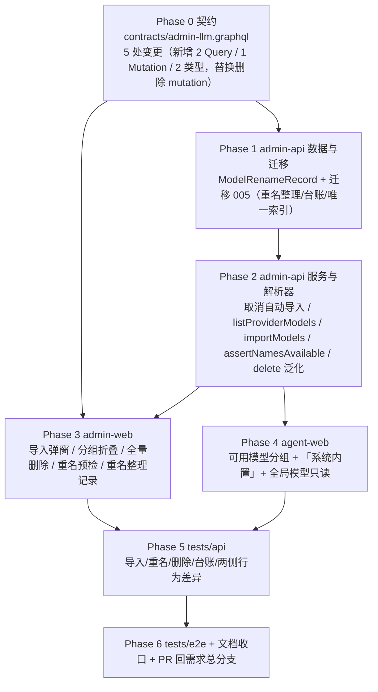

# 内建 API 渠道一期上线后问题修复（供应商与模型管理）- 实现计划

**关联 Proposal**: `docs/engineering/proposals/20261020-fix-api-channel-model-fixes.md`（v1.1）
**关联 PRD**: `docs/product/draft/20261020-api-channel-model-fixes.md`（v1.1）
**需求总分支（feat-branch）**: `fix/api-channel-model-fixes`（需求总 PR #242）
**实现分支**: `fix/api-channel-model-fixes-impl`（基于 `fix/api-channel-model-fixes`）
**创建日期**: 2026-10-20
**计划版本**: v1.0
**版本说明**:
- v1.0（2026-10-20）首版，与 PRD v1.1 / 提案 v1.1 对齐。上游打回三项的处置已固化在提案中：① agent-api 用户侧 `syncSyncedModels` 保留不动；② 会话内「切换模型」不分组、本期零改动；③ 改名对照持久化为 `model_rename_records` 并在后台可查。

## 实现顺序



依赖说明：

- Phase 0 是唯一事实源，P1/P2/P3/P4 的类型与字段均以其为准；契约未定稿前不写业务代码。
- P1 必须先于 P2：`assertNamesAvailable` 依赖唯一索引语义，迁移 005 同时提供改名台账，是 P2/P3 的联调数据源。
- P2 必须先于 P3/P4：前端 GraphQL 文档与手写类型依赖解析器字段。
- P3 与 P4 无代码依赖，可由两个 subagent 并行；但共享同一需求分支，合并顺序 P3 → P4，禁止 rebase/squash。
- P5/P6 在各子项完成后串行执行（E2E 与 API 共用同一套 Aspire 服务与 Mongo，禁止并行）。

开发模式采用 TDD（红-绿-重构）。每个 Phase 先落测试（RED）再写实现（GREEN），最后重构。编码前按目录加载：`docs/engineering/common-rules.md`、`backend-rules.md`、`frontend-rules.md`、`servers/agent-api/AGENTS.md`、`apps/admin-web/AGENTS.md`、`apps/agent-web/AGENTS.md`、`tests/api/AGENTS.md`、`tests/e2e/AGENTS.md`。`servers/admin-api` 无独立 AGENTS.md，沿用根 `AGENTS.md` 与 engineering 规范。

### 关键约束（提案 §1.3/§6，实现期不得回退）

- **agent-api 零业务改动**：`servers/agent-api/src/services/provider.ts` 的 `syncSyncedModels`（create L69、update L142）与回滚逻辑**一行不改**；`servers/agent-api/src/models/model.ts` 仅加注释，不改唯一索引。用户添加供应商仍自动同步模型，行为与现状一致。
- **会话内「切换模型」零改动**：`apps/agent-web/src/components/session/ModelSelectDialog.tsx` 不参与分组，不新增 `provider` 字段透传，不改 `packages/agent-controller` / `controller-api` / `contracts/agent-session.graphql`。
- **不改计费口径**：`servers/admin-api/src/routes/billing-openai.ts` 寻址逻辑不动；删除模型后按名调用返回 `model_not_found`（既有行为），历史账单/收据/计量不动。
- **不改 `contracts/llm.graphql`**：用户侧契约不变；agent-web 只是在既有查询中补选 `Model.scope`（后端字段已存在）。
- **不引入新依赖**：折叠组件两端各自手写（admin-web 与 agent-web 禁止跨项目 import）；不引入折叠库、虚拟滚动库。
- **不删除任何存量模型数据**：历史重名只改名；迁移失败仅记录日志、不阻断启动（沿用 runner 语义）。
- **禁止 rebase/squash**：遵循 z-git 规范，仅允许 merge。

## 计划期裁决（提案留白/含混处的实现口径）

1. **`ModelRenameRecord.renamedAt` 用 `String!`（ISO 8601），不用 `DateTime!`**：提案 §3.1 示例写 `DateTime!`，但 admin-api 现有契约（Provider/Model/BaseImage 等）全部用 `String!` 承载时间，仓库内**未定义 DateTime scalar**。本期沿用既有约定，resolver 返回 `record.renamedAt.toISOString()`。
2. **唯一索引只在迁移 005 创建，不在 Mongoose schema 声明**：提案 §7 要求 `models/model.ts` 新增 partial unique index。但 Mongoose 默认 `autoIndex: true`，schema 声明会让索引在启动连接后立即构建，与「先清理存量重名再建索引」的迁移顺序竞态，存量重复数据环境下必然报 E11000 且可能造成「迁移未跑、索引已失败」的不可预期状态。裁决：`servers/admin-api/src/models/model.ts` 与 `servers/agent-api/src/models/model.ts` 只加注释说明约束，实际索引由迁移 005 用固定名 `scope_global_name_unique` 创建；迁移是唯一创建入口，fresh 环境同样经迁移建索引。
3. **`assertNamesAvailable` 只校验 `scope='global'`**：用户侧（`scope=user`）允许跨 scope 同名（既有 T-SC7 语义），部分唯一索引的 `partialFilterExpression` 同样只覆盖 global，二者口径一致。
4. **导入幂等与重名检查的顺序**：`importModels` 先剔除「该供应商下已存在」的名字（幂等跳过，不报错），再对剩余名字做全局重名校验。否则重复导入同一批名字会被自身已有模型误判为重名。返回值为**实际新建**的模型列表；全部已存在时返回 `[]`，不调用上游。
5. **导入前的上游连通校验**：`importModels` 在写库前调用一次 `fetchModels` 作为连通性门禁（失败归一化为既有连通性文案），**不把上游返回作为白名单**——允许「列表打开后上游新增模型」的短暂竞态，避免把合法勾选误判为非法；`names` 只做 trim/去空校验。
6. **并发重名兜底的部分成功**：`importModels` 使用 `insertMany(docs, { ordered: false })`，并发下由唯一索引兜底；捕获 E11000 统一映射 `MODEL_NAME_EXISTS`。冲突前已写入的条目保留（不是脏数据，重新打开弹窗即显示「已导入」），重试幂等。计划只承诺「不产生重名」，不承诺批量原子性（standalone Mongo 无事务，沿用既有部署事实）。
7. **`deleteGlobalModel` 的错误文案**：服务层对「不存在 / 非 global / 非法 id」一律返回 null，resolver 抛 `Model not found`（去掉原「or is not a custom model」限定，避免语义误导）。
8. **重名错误文案**：服务层统一抛 `Model name already exists: <name1>, <name2>`；保留既有英文错误风格。admin-web 的**本地预检**展示中文「模型名已存在」并禁用提交，服务端错误仍原样展示（与现有 CustomModelDialog 行为一致）。
9. **分组顺序（admin-web）**：按 `adminModels` 排序结果（`sortOrder asc, createdAt asc`）中**供应商首次出现顺序**分组；组内按原顺序。`provider` 为 null（悬空 providerId）的模型归入「未知供应商」组，不丢弃。
10. **拖拽排序语义（admin-web）**：单 `DndContext` + 每组一个 `SortableContext`；跨组拖拽直接忽略（不移动、不报错）。保存时把「各组当前顺序」按组展示顺序拼接成全量 id 数组提交，`updateGlobalModelSortOrder` 契约不变。
11. **折叠状态**：默认全部折叠；折叠状态以 `Set<string>`（组 key）保存在页面内存，refetch 不重置；不持久化到 localStorage（PRD 只要求默认折叠）。
12. **agent-web 分组键**：`scope === 'global'` 统一归入固定 key `system`，组名「系统内置」且排在首位；其余按 `providerId` 分组、组名取 `provider.name`（provider 为空归入「未知供应商」）。
13. **agent-web 全局模型只读**：`scope === 'global'` 的模型不渲染拖拽手柄、开关置灰（`title="系统内置模型不可修改"`）、无删除入口。这是对现状「点了必然报 `GLOBAL_WRITE_FORBIDDEN`」的死路修正，符合 PRD「仅可查看与选用，不可删除」。
14. **agent-web 排序只提交用户模型 id**：`updateModelSortOrder` 仍全量提交「用户分组拼接后的 id」，**不含 global id**（agent-api 明确拒绝含 global id 的批量排序）。
15. **「重名整理记录」入口位置**：独立只读区块放在 `ModelConfigPage` 的 `ModelSection` 之后、`ModelPricingSection` 之前，默认折叠；`useQuery(..., { skip: !expanded })`，展开才请求，避免首屏多余流量。
16. **迁移批号与命名**：迁移文件名 `005-model-name-unique-global.ts`，`name = '005-model-name-unique-global'`；`batchId = '20261020-005'`（常量，单次整理只有一个批次，便于 API 测试断言）。
17. **导入弹窗的「取消」语义**：导入是单次 GraphQL 请求，客户端关闭弹窗不中止服务端写入；再次打开以服务端最新结果为准（已导入项禁选）。不引入请求取消/回滚，避免与「取消不影响已完成导入」的 PRD 口径冲突。
18. **文档生命周期**：PRD 与提案本期保持各自目录（`draft` / `proposals`）不移动，待实现验收后按既有流程归档。

---

## Phase 0: 契约（Contracts）

开发分支：`fix/api-channel-model-fixes-impl`。

### 文件修改

| 文件 | 操作 | 说明 |
|------|------|------|
| `contracts/admin-llm.graphql` | 修改 | 见下方「契约变更清单」；头部注释同步「后台供应商不再自动导入模型」「global 内模型名全局唯一」 |
| `contracts/llm.graphql` | 不变 | 用户侧零改动 |
| `contracts/billing-openai.openapi.yaml` | 不变 | 计费网关寻址不变 |
| `contracts/agent-session.graphql` | 不变 | 会话切换模型不参与本期 |

### 契约变更清单（`contracts/admin-llm.graphql`）

1. 新增类型：

```graphql
type ProviderModelOption {
  name: String!        # 上游模型名（已 trim/去重，保持上游顺序）
  isImported: Boolean! # 该供应商下已存在（(providerId, name) 命中）
  isDuplicate: Boolean! # 已被其他供应商的 global 模型占用（全局唯一冲突）
}

type ModelRenameRecord {
  id: ID!
  modelId: ID!          # 被改名的模型（现以 newName 存在）
  providerId: ID!
  providerName: String! # 冗余留档：供应商删除后仍可读
  oldName: String!
  newName: String!
  batchId: String!
  renamedAt: String!    # ISO 8601（裁决 1）
}
```

2. Query 新增：

```graphql
listGlobalProviderModels(providerId: ID!): [ProviderModelOption!]!
modelRenameRecords: [ModelRenameRecord!]!
```

3. Mutation 新增：

```graphql
importGlobalModels(providerId: ID!, names: [String!]!): [Model!]!
```

4. Mutation 替换：

```graphql
# 删除：deleteGlobalCustomModel
deleteGlobalModel(id: ID!): Model!
```

5. 头部注释补充：`scope=global` 内 `Model.name` 全局唯一（跨供应商）；`createGlobalCustomModel` / `importGlobalModels` 冲突时返回 `Model name already exists: <names>`；`create/updateGlobalProvider` 不再自动写入模型。

### 验收 checklist

- [ ] `contracts/admin-llm.graphql` 可被 GraphQL schema 拼接（Phase 2 后由 `npm run build` + GraphQL 查询验证）
- [ ] 契约中不再出现 `deleteGlobalCustomModel`
- [ ] 时间字段统一 `String!`，未引入新 scalar
- [ ] `contracts/llm.graphql` / `contracts/billing-openai.openapi.yaml` / `contracts/agent-session.graphql` `git diff` 为空

---

## Phase 1: admin-api 数据模型与迁移 005

开发分支：`fix/api-channel-model-fixes-impl`。TDD 顺序：先写 `005-model-name-unique-global.test.ts`（RED）→ 实现模型与迁移（GREEN）。

### 文件修改

| 文件 | 操作 | 说明 |
|------|------|------|
| `servers/admin-api/src/models/model-rename-record.ts` | 新增 | `ModelRenameRecord`（collection `model_rename_records`），字段见提案 §4.1；索引 `{ renamedAt: -1 }`、`{ batchId: 1 }` |
| `servers/admin-api/src/models/model.ts` | 修改 | **仅注释**：说明 `scope=global` 内 name 全局唯一由迁移 005 创建 `scope_global_name_unique`（裁决 2），schema 不声明该索引 |
| `servers/agent-api/src/models/model.ts` | 修改 | 同上，保持两侧注释同步（业务零改动） |
| `servers/admin-api/src/migrations/005-model-name-unique-global.ts` | 新增 | 存量重名整理 + 台账写入 + partial unique index（见下方伪代码） |
| `servers/admin-api/src/migrations/005-model-name-unique-global.test.ts` | 新增 | 覆盖 `T-MIG30`~`T-MIG37`（下表） |
| `servers/admin-api/src/index.ts` | 修改 | 导入 `* as migration005ModelNameUnique`，注册链追加在 004 之后 |

### 迁移 005 逻辑（伪代码）

```ts
export const name = '005-model-name-unique-global';
export const BATCH_ID = '20261020-005';
export const INDEX_NAME = 'scope_global_name_unique';

export async function run(): Promise<void> {
  const models = await Model.find({ scope: 'global' })
    .sort({ name: 1, createdAt: 1, _id: 1 })
    .lean();

  const groups = groupBy(models, (m) => m.name);
  const used = new Set(models.map((m) => m.name));
  const duplicateGroups = [...groups.values()].filter((g) => g.length > 1);

  const providerIds = [...new Set(duplicateGroups.flat().map((m) => String(m.providerId)))];
  const providers = await Provider.find({ _id: { $in: providerIds } }, 'name').lean();
  const providerNames = new Map(providers.map((p) => [String(p._id), p.name]));

  for (const group of duplicateGroups) {
    // 保留 createdAt 最早、_id 最小的一条原名
    const [, ...rest] = group;
    for (const model of rest) {
      let suffix = 2;
      let newName = `${model.name}-${suffix}`;
      while (used.has(newName)) { suffix += 1; newName = `${model.name}-${suffix}`; }
      used.add(newName);

      await Model.updateOne({ _id: model._id, scope: 'global' }, { $set: { name: newName } });
      await ModelRenameRecord.create({
        modelId: model._id,
        providerId: model.providerId,
        providerName: providerNames.get(String(model.providerId)) ?? '未知供应商',
        oldName: model.name,
        newName,
        batchId: BATCH_ID,
        renamedAt: new Date(),
      });
    }
  }

  // 幂等：无重名且索引已存在则跳过；createIndex 本身幂等
  // fresh 环境集合可能尚不存在，indexes() 会抛 NamespaceNotFound → 视为无索引
  const indexes = await Model.collection.indexes().catch(() => []);
  if (duplicateGroups.length === 0 && indexes.some((i) => i.name === INDEX_NAME)) {
    console.log('[Migration 005] no duplicate global model names, index present, skipping');
    return;
  }
  await Model.collection.createIndex(
    { name: 1 },
    { unique: true, partialFilterExpression: { scope: 'global' }, name: INDEX_NAME },
  );
  console.log(`[Migration 005] renamed ${...} duplicate global models (batch ${BATCH_ID})`);
}
```

实现细则：

- 分组排序保证「最早创建」：`createdAt` 缺失按 `new Date(0)` 兜底，再以 `_id` 字符串升序兜底（稳定）。
- 生成的新名必须避开**全库所有 global 名称**（`used` 初始化为全量），避免 `<name>-2` 撞上另一组真实存在的同名模型。
- 每条改名先 `updateOne` 再 `create` 台账；迁移整体成功才记账（runner 语义），失败下次启动重试。重试时已改名模型不再出现在重名组，台账不会重复写入（`batchId` 固定 + 模型已不在重复组）。
- `createIndex` 抛错（如同名索引 options 冲突）直接向上抛，runner 记录失败并在下次启动重试；**不静默降级为无唯一约束**。
- 日志只输出数量与批次，不打印模型名清单（避免刷屏）；逐条对照在 `model_rename_records` 与后台视图。
- 执行前建议备份 `models` 集合（写入部署说明/PR 描述）。

### 测试用例（`005-model-name-unique-global.test.ts`）

mock 形态沿用 `004-aspire-cli-source.test.ts`：`vi.mock('../models/model.js')` + `vi.mock('../models/provider.js')` + `vi.mock('../models/model-rename-record.js')`。

| # | 用例 | 预期 |
|---|------|------|
| T-MIG30 | 迁移名与常量 | `name === '005-model-name-unique-global'`、`BATCH_ID === '20261020-005'`、`INDEX_NAME === 'scope_global_name_unique'` |
| T-MIG31 | 无重名 + 索引已存在 | 不 `updateOne`、不写台账、不 `createIndex` |
| T-MIG32 | 无重名 + 索引不存在 | 不写台账、调用一次 `createIndex`（options：unique + partialFilterExpression + 固定名） |
| T-MIG33 | 两个供应商同名 `gpt-4o` | 保留最早（createdAt 最小，其次 `_id`）原名；另一条改为 `gpt-4o-2`；台账 1 条，字段完整（含 providerName、batchId） |
| T-MIG34 | 三条同名 + 已存在 `gpt-4o-2` | 保留最早原名；其余改为 `gpt-4o-3`、`gpt-4o-4`（跳过已占用名） |
| T-MIG35 | provider 已不存在 | `providerName` 兜底 `'未知供应商'`，改名照常 |
| T-MIG36 | 索引创建失败 | `run()` reject（不吞错、不写「已完成」假象） |
| T-MIG37 | 幂等重跑（无重名 + 索引存在） | 不产生重复台账、不重复改名 |

### 命令参考

```bash
cd servers/admin-api
npx vitest run src/migrations/005-model-name-unique-global.test.ts
npx vitest run src/migrations
npm run build
```

### 验收 checklist

- [ ] `T-MIG30`~`T-MIG37` 全绿；001~004 与 runner 既有测试保持通过
- [ ] 迁移只读写 `models` / `providers`（只读）/ `model_rename_records`，不触碰其他集合
- [ ] 索引名固定 `scope_global_name_unique`，partial 条件仅 `{ scope: 'global' }`
- [ ] `index.ts` 注册顺序 001 → 002(.NET) → 002(Docker) → 003 → 004 → 005
- [ ] 两侧 `models/model.ts` 仅注释变化（`git diff` 无索引声明）

---

## Phase 2: admin-api 服务与 GraphQL 解析器

开发分支：`fix/api-channel-model-fixes-impl`。TDD 顺序：先改/加 service 与 resolver 单测（RED）→ 实现（GREEN）。

### 文件修改

| 文件 | 操作 | 说明 |
|------|------|------|
| `servers/admin-api/src/services/provider.ts` | 修改 | `create` 移除 `Model.insertMany` 段与孤儿清理；`update` 移除重同步段，保留连通性校验；新增 `getDecryptedConnection(id)`；`dedupeModelNames` 若无引用可删 |
| `servers/admin-api/src/services/model.ts` | 修改 | 新增 `assertNamesAvailable` / `listProviderModels` / `importModels`；`createCustom` 接入重名检查；`delete` 去掉 `isCustom` 限制；`mapModel` 不变 |
| `servers/admin-api/src/services/model-rename-record.ts` | 新增 | `ModelRenameRecordService.findAll()`：按 `renamedAt desc, _id desc`，映射为 GraphQL DTO（`renamedAt` ISO 字符串） |
| `servers/admin-api/src/graphql/schemas/model.ts` | 修改 | 追加 `ProviderModelOption`、`ModelRenameRecord`、两条 Query、`importGlobalModels`、`deleteGlobalModel`；删除 `deleteGlobalCustomModel` |
| `servers/admin-api/src/graphql/resolvers/model.ts` | 修改 | 新增解析器；`deleteGlobalCustomModel` → `deleteGlobalModel`；新增 `mapModelError`（重名/连通性/未找到） |
| `servers/admin-api/src/services/provider.test.ts` | 修改 | 自动导入/重同步断言改为「不写模型」；保留连通性/事务/批量测试 |
| `servers/admin-api/src/services/model.test.ts` | 修改 | T-M2 改为可删非自定义；新增 T-M5~T-M10（见下表） |
| `servers/admin-api/src/services/model-rename-record.test.ts` | 新增 | `findAll` 排序与 DTO 映射 |
| `servers/admin-api/src/graphql/resolvers/model.test.ts` | 修改 | 删除泛化 + 新解析器 + 错误映射 |

### 服务层口径

#### `ProviderService`

```ts
async create(input) {
  // 保留连通性校验：只校验不落库
  try { await llmApiService.fetchModels(input.type, input.endpoint, input.credentialValue); }
  catch { throw new Error(PROVIDER_CONNECTIVITY_ERROR); }
  // 只写 provider 单文档（沿用 runWithOptionalTransaction 包裹，最小改动）
  return runWithOptionalTransaction(async (session) => { /* Provider.create */ });
}

async update(id, input) {
  // needsResync 更名 needsConnectivityCheck（凭据/type/endpoint 变化时才探测）
  // 探测结果丢弃；删除 customDocs / desired / bulkWrite / deleteMany 整段
}

async getDecryptedConnection(id: string) {
  const p = await Provider.findOne({ _id: id, scope: GLOBAL_SCOPE }).lean();
  if (!p) return null;
  return { type: p.type, endpoint: p.endpoint, apiKey: decrypt(p.encryptedCredential) };
}
```

- `create` 的 `fetchModels` 返回值不再赋值（避免未使用变量告警）。
- `update` 中 `needsConnectivityCheck` 仅决定是否调用 `fetchModels`；无论是否变化都**不**写模型。
- `delete/toggle/batch*` 的级联模型行为保持不变（供应商删除仍级联删除其模型，PRD 边界保持现状）。

#### `ModelService`

```ts
private async assertNamesAvailable(names: string[]): Promise<void> {
  if (names.length === 0) return;
  const conflicts = await Model.find({ scope: GLOBAL_SCOPE, name: { $in: names } }, 'name').lean();
  if (conflicts.length > 0) {
    const unique = [...new Set(conflicts.map((m) => m.name))];
    throw new Error(`Model name already exists: ${unique.join(', ')}`);
  }
}

async listProviderModels(providerId: string): Promise<ProviderModelOption[]> {
  // 1) 校验 provider 存在（global）→ 否则 'Provider not found'
  // 2) getDecryptedConnection → 解密失败视为 Provider not found
  // 3) fetchModels；任何抛错 → PROVIDER_CONNECTIVITY_ERROR
  // 4) dedupeModelNames（trim/去空/去重保序）
  // 5) 查本供应商已存在名（isImported）；查其他供应商占用名（isDuplicate）
  // 6) 按上游顺序返回 { name, isImported, isDuplicate }
}

async importModels(providerId, names): Promise<MappedModel[]> {
  // 1) provider 存在校验
  // 2) normalize：trim；出现空名 → throw 'Model name is invalid'
  // 3) 去掉该供应商已存在的名字；为空直接 return []
  // 4) fetchModels 连通门禁（结果丢弃）→ 失败 throw PROVIDER_CONNECTIVITY_ERROR
  // 5) assertNamesAvailable(toCreate)
  // 6) maxSort = 本供应商 global 模型最大 sortOrder；insertMany(ordered:false)
  // 7) E11000 → 'Model name already exists'；返回实际新建并映射的模型
}

async createCustom(input) {
  // trim/空名/provider 校验保持
  // 新增：await this.assertNamesAvailable([name])（置于 Provider 校验之后、create 之前）
  // E11000 捕获保持（并发兜底）
}

async delete(id) {
  // 保留：非法 id / 不存在 / 非 global → null
  // 删除 if (!model.isCustom) return null 及其注释
}
```

#### `ModelRenameRecordService`

```ts
async findAll() {
  const records = await ModelRenameRecord.find().sort({ renamedAt: -1, _id: -1 }).lean();
  return records.map((r) => ({
    id: String(r._id), modelId: String(r.modelId), providerId: String(r.providerId),
    providerName: r.providerName, oldName: r.oldName, newName: r.newName,
    batchId: r.batchId, renamedAt: r.renamedAt.toISOString(),
  }));
}
```

### 解析器口径

- `Query.listGlobalProviderModels` / `Query.modelRenameRecords`：`assertAdmin(context)` 后委托 service。
- `Mutation.importGlobalModels`：`assertAdmin`；`try/catch` 统一走 `mapModelError`：
  - `Model name already exists...` → `GraphQLError(原文)`
  - `PROVIDER_CONNECTIVITY_ERROR` → `GraphQLError(原文)`
  - `Provider not found` / `Model name is invalid` → 原文
  - 其他 → `GraphQLError(message)`
- `Mutation.deleteGlobalModel`：service 返回 null → `GraphQLError('Model not found')`。
- `Mutation.createGlobalCustomModel`：保留 Provider not found 分支，重名 message 由 service 决定；E11000 仍兜底映射为 `Model name already exists`。
- `resolvers/index.ts` 已合并 `modelResolvers.Query/Mutation/Model`，新增解析器无需改索引（但 Phase 2 checklist 需确认 GraphQL 能查到新字段）。

### 测试用例（增量）

**`services/provider.test.ts`**

| # | 用例 | 预期 |
|---|------|------|
| U-P1 | 创建供应商成功 | `fetchModels` 调用一次；`Model.insertMany` / `Model.create` **零调用**；返回 provider |
| U-P2 | 连通性失败 | 抛连通性文案，`Provider.create` 零调用 |
| U-P3 | 更新（凭据/endpoint/type 变化） | `fetchModels` 调用（校验），`Model.bulkWrite`/`deleteMany` 零调用 |
| U-P4 | 更新（凭据留空且参数未变） | `fetchModels` 零调用；provider 正常更新 |
| U-P5 | 供应商删除/启停/批量 | 既有级联模型行为不变（保留存量断言） |

> 原 T-P2「creates provider and syncs models」、T-P8/T-P9 重同步/清理相关用例删除或改写为上述断言；原问题 54 的孤儿清理用例随自动导入移除一并删除。

**`services/model.test.ts`**

| # | 用例 | 预期 |
|---|------|------|
| U-M1 | `createCustom` 重名 | 跨供应商同名 → `Model name already exists: <name>`，不写库 |
| U-M2 | `assertNamesAvailable` 无冲突 | 正常返回（不抛） |
| U-M3 | `listProviderModels` 标记 | 上游顺序保留；已导入/被占用分别标记；trim/去重生效 |
| U-M4 | `listProviderModels` 连通失败 | `PROVIDER_CONNECTIVITY_ERROR`，不读模型集合（除 provider） |
| U-M5 | `importModels` 增量导入 | 只插入未导入项；`sortOrder` 从现有最大值 +1 连续递增；返回新建列表 |
| U-M6 | `importModels` 全部已存在 | 返回 `[]`，不调用 `fetchModels`、不 `insertMany` |
| U-M7 | `importModels` 重名 | 抛 `Model name already exists: <name>`，不写库 |
| U-M8 | `importModels` 空名 | 抛 `Model name is invalid`，不调用上游 |
| U-M9 | `importModels` E11000（并发） | 映射为 `Model name already exists` |
| U-M10 | `delete` 非自定义 global 模型 | 删除成功并返回 DTO（原「拒绝」语义反转） |
| U-M11 | `delete` user scope / 不存在 | 仍返回 null |

**`services/model-rename-record.test.ts`**

| # | 用例 | 预期 |
|---|------|------|
| U-R1 | `findAll` | 按 `renamedAt desc`；字段映射完整；`renamedAt` 为 ISO 字符串 |

**`graphql/resolvers/model.test.ts`**

| # | 用例 | 预期 |
|---|------|------|
| R-M1 | 新 Query 未认证 | 均为 `Not authenticated` |
| R-M2 | `listGlobalProviderModels` 委托 | 返回 service 结果 |
| R-M3 | `importGlobalModels` 错误映射 | 重名/连通/未找到分别映射原文 |
| R-M4 | `deleteGlobalModel` 不存在 | 抛 `Model not found` |
| R-M5 | `deleteGlobalModel` 成功 | 返回被删模型 |
| R-M6 | `createGlobalCustomModel` 重名 | 抛 `Model name already exists...` |
| R-M7 | `modelRenameRecords` 委托 | 返回 service 结果 |

### 命令参考

```bash
cd servers/admin-api
npx vitest run src/services/provider.test.ts src/services/model.test.ts src/services/model-rename-record.test.ts
npx vitest run src/graphql/resolvers/model.test.ts src/graphql/resolvers/provider.test.ts
npx vitest run            # 全量单测
npm run build             # strict TS
```

### 验收 checklist

- [ ] `servers/admin-api/src/services/provider.ts` 中不存在 `Model.insertMany` / 重同步 `bulkWrite` / 陈旧模型 `deleteMany`
- [ ] `servers/agent-api/src/services/provider.ts` `git diff` 为空
- [ ] `createGlobalProvider` 创建后 `adminModels` 无新增（API 层验证）
- [ ] 重名检查入口唯一：`createCustom` 与 `importModels` 均调用 `assertNamesAvailable`
- [ ] `deleteGlobalModel` 对导入模型/自定义模型均可删，对 user scope 返回未找到
- [ ] `npm run build` 通过；GraphQL introspection 含 2 个新 Query、2 个新 Mutation 字段与 2 个新类型

---

## Phase 3: admin-web（导入 / 分组 / 删除 / 重名 / 台账）

开发分支：`fix/api-channel-model-fixes-impl`。TDD：先改 `ModelSection.test.tsx` / 新增 `ImportModelsDialog.test.tsx` / `ModelRenameRecordsPanel.test.tsx`（RED）→ 实现（GREEN）。

### 文件修改

| 文件 | 操作 | 说明 |
|------|------|------|
| `apps/admin-web/src/graphql/queries.ts` | 修改 | 新增 `LIST_GLOBAL_PROVIDER_MODELS`、`MODEL_RENAME_RECORDS` |
| `apps/admin-web/src/graphql/mutations.ts` | 修改 | `DELETE_GLOBAL_CUSTOM_MODEL` → `DELETE_GLOBAL_MODEL`；新增 `IMPORT_GLOBAL_MODELS` |
| `apps/admin-web/src/graphql/types.ts` | 修改 | 新增 `ProviderModelOptionData`、`ModelRenameRecordData` 及对应 Query/Mutation 类型；`AdminModelData` 不变 |
| `apps/admin-web/src/components/ui/collapsible-group.tsx` | 新增 | 轻量折叠组：`{ title, count, defaultExpanded?, actions?, children }`，`aria-expanded` + Chevron，沿用 `TreeSection` 手写模式，不引依赖 |
| `apps/admin-web/src/components/models/ModelGroup.tsx` | 新增 | 组头（供应商名 + 数量 + 箭头）+ 组内 `SortableContext` |
| `apps/admin-web/src/components/models/ModelSection.tsx` | 修改 | 分组、折叠、跨组拖拽忽略、全量删除、空态文案、台账区块入口不上移 |
| `apps/admin-web/src/components/models/ModelItem.tsx` | 修改 | 删除按钮不限 `isCustom`；去掉供应商副标题；删除 title「删除模型」 |
| `apps/admin-web/src/components/models/CustomModelDialog.tsx` | 修改 | 新增 `existingNames` 入参：trim 后精确匹配 → 内联「模型名已存在」并禁用保存 |
| `apps/admin-web/src/components/models/ImportModelsDialog.tsx` | 新增 | 拉取清单、勾选、全选、关键字过滤、已导入/已存在禁选、重试、结果反馈 |
| `apps/admin-web/src/components/models/ModelRenameRecordsPanel.tsx` | 新增 | 只读「重名整理记录」，默认折叠，展开才查询 |
| `apps/admin-web/src/components/providers/ProviderActionMenu.tsx` | 修改 | 新增「导入模型」菜单项（编辑之前） |
| `apps/admin-web/src/components/providers/ProviderItem.tsx` | 修改 | 透传 `onImport` |
| `apps/admin-web/src/components/providers/ProviderSection.tsx` | 修改 | 持有 `importTarget` 并渲染弹窗；创建成功 toast「供应商已添加，请通过「导入模型」手动导入模型」；refetch `ADMIN_PROVIDERS + ADMIN_MODELS` |
| `apps/admin-web/src/pages/ModelConfigPage.tsx` | 修改 | `ModelSection` 后插入 `<ModelRenameRecordsPanel />` |
| `apps/admin-web/src/components/__tests__/ModelSection.test.tsx` | 修改 | 分组折叠、全量删除、默认折叠、空态文案、拖拽跨组忽略 |
| `apps/admin-web/src/components/__tests__/ImportModelsDialog.test.tsx` | 新增 | 勾选/禁选/全选/过滤/失败重试/结果反馈 |
| `apps/admin-web/src/components/__tests__/ModelRenameRecordsPanel.test.tsx` | 新增 | 折叠时不查询、展开后渲染对照行与空态 |

### UI 口径

- **分组构建**（裁决 9）：

```ts
const groups = useMemo(() => {
  const order: string[] = [];
  const map = new Map<string, { key: string; title: string; models: AdminModelData[] }>();
  for (const m of models) {
    const key = m.providerId || 'unknown';
    if (!map.has(key)) {
      map.set(key, { key, title: m.provider?.name ?? '未知供应商', models: [] });
      order.push(key);
    }
    map.get(key)!.models.push(m);
  }
  return order.map((k) => map.get(k)!);
}, [models]);
const [expanded, setExpanded] = useState<Set<string>>(new Set()); // 默认全折叠
```

- **拖拽**（裁决 10）：

```ts
const handleDragEnd = async ({ active, over }) => {
  if (!over || active.id === over.id) return;
  const group = groups.find((g) => g.models.some((m) => m.id === active.id));
  const overGroup = groups.find((g) => g.models.some((m) => m.id === over.id));
  if (!group || group.key !== overGroup?.key) return; // 跨组忽略
  const ids = group.models.map((m) => m.id);
  const from = ids.indexOf(String(active.id));
  const to = ids.indexOf(String(over.id));
  const reordered = [...ids];
  reordered.splice(to, 0, ...reordered.splice(from, 1));
  const fullIds = groups.flatMap((g) => (g.key === group.key ? reordered : g.models.map((m) => m.id)));
  await updateSortOrder({ variables: { ids: fullIds }, refetchQueries: [ADMIN_MODELS] });
};
```

- **删除**：所有模型渲染删除按钮；确认弹窗标题「删除模型」，描述 `确定要删除模型「<name>」吗？删除后前台不再展示，按该模型名调用将返回「模型不存在」。`；成功后 toast「模型已删除」。
- **导入弹窗**：
  - `useQuery(LIST_GLOBAL_PROVIDER_MODELS, { variables: { providerId }, skip: !open, fetchPolicy: 'network-only' })`。
  - 可勾选条件：`!isImported && !isDuplicate`；「已导入」/「已存在」徽标；全选只作用于当前过滤结果中的可勾选项。
  - 导入成功后：`refetchQueries: [ADMIN_MODELS, ADMIN_PROVIDERS]`，弹窗内展示 `成功导入 N 个模型`；已导入项即时置为禁选（本地 `importedNames` 合并 + 重新查询）。
  - 查询失败：错误文案 + 「重试」按钮（`refetch`）；空清单：「暂无可导入的模型」。
- **重名预检**：`existingNames = models.map((m) => m.name)`；`existingNames.includes(name.trim())` → 显示「模型名已存在」并禁用保存；服务端仍为唯一事实源。
- **重名整理记录**：展开时 `useQuery(MODEL_RENAME_RECORDS, { skip: !expanded })`；表格列「原名 → 新名 / 供应商 / 整理时间（`formatDateTime`）」，按 API 顺序（`renamedAt desc`）；空态「暂无重名整理记录」；只读无操作按钮。

### 测试用例（增量）

| # | 用例 | 预期 |
|---|------|------|
| T-W6 | 分组与默认折叠 | 两个供应商 → 两个组头（名称 + 数量）；初始不渲染组内模型；点击组头展开后可见 |
| T-W7 | 悬空供应商 | `provider: null` → 归入「未知供应商」组，不丢模型 |
| T-W8 | 跨组拖拽忽略 | active/over 不同组 → 不调用 `updateGlobalModelSortOrder` |
| T-W9 | 组内拖拽 | 提交全量 id（组顺序拼接），组间顺序不变 |
| T-W10 | 全量删除入口 | 非自定义模型也渲染删除按钮；点击弹出「删除模型」确认；确认后调用 `DELETE_GLOBAL_MODEL` |
| T-W11 | 空态文案 | 「暂无可用模型，通过供应商的「导入模型」手动导入」 |
| T-W12 | 导入弹窗标记 | `isImported`/`isDuplicate` 条目 disabled 且带对应徽标 |
| T-W13 | 全选 + 过滤 | 关键字过滤后全选只选可勾选项；清空过滤保持已选 |
| T-W14 | 导入成功反馈 | 调用 `IMPORT_GLOBAL_MODELS`；展示成功数量；refetch 两个查询 |
| T-W15 | 上游失败重试 | 错误提示 + 「重试」触发 refetch；不影响列表 |
| T-W16 | 自定义模型重名预检 | 输入已存在名称 → 内联「模型名已存在」且保存禁用 |
| T-W17 | 重名整理记录 | 折叠不查询；展开后逐行展示 原名→新名/供应商/时间；空态提示 |

> 现有 `T-W2` 拖拽全量 id 断言保留（单组数据下语义不变）；`T-W3`「仅自定义模型可删」反转为「全部可删」；`T-W5` 空态文案更新。

### 命令参考

```bash
cd apps/admin-web
npm test
npm run lint
npm run build
```

### 验收 checklist

- [ ] 后台新增供应商后模型列表不新增，页面 toast 提示手动导入
- [ ] 导入弹窗全选/过滤/已导入/已存在/重试/结果反馈全链路可用
- [ ] 分组默认折叠、组头含供应商名与数量、展开后组内完整
- [ ] 任意模型可删（含导入模型），确认弹窗含影响说明
- [ ] 自定义模型重名在提交前被拦截
- [ ] 「重名整理记录」可展开查看逐条对照，折叠时不发请求
- [ ] `npm run lint` / `npm run build` 通过

---

## Phase 4: agent-web（可用模型分组 + 系统内置）

开发分支：`fix/api-channel-model-fixes-impl`。TDD：先新增 `settings/__tests__/ModelSection.test.tsx`（RED）→ 实现（GREEN）。

### 文件修改

| 文件 | 操作 | 说明 |
|------|------|------|
| `apps/agent-web/src/graphql/queries.ts` | 修改 | `GET_MODELS` 补 `scope` 字段（后端已有，零后端改动） |
| `apps/agent-web/src/graphql/types.ts` | 修改 | `ModelData` / `GetModelsQuery` 补 `scope: 'user' \| 'global'` |
| `apps/agent-web/src/components/ui/collapsible-group.tsx` | 新增 | 与 admin-web 同构的独立副本（禁止跨项目 import；不复用 `TreeSection` 的侧边栏样式） |
| `apps/agent-web/src/components/settings/ModelGroup.tsx` | 新增 | 组头（名称 + 数量 + 箭头）+ 组内容器 |
| `apps/agent-web/src/components/settings/ModelSection.tsx` | 修改 | 分组（系统内置优先）、默认折叠、仅用户组可拖拽、排序只提交用户 id |
| `apps/agent-web/src/components/settings/ModelItem.tsx` | 修改 | 新增 `sortable` / `hideProviderName` / `readOnlyToggle`；去掉供应商副标题 |
| `apps/agent-web/src/components/settings/__tests__/ModelSection.test.tsx` | 新增 | 分组、折叠、系统内置展示、只读、排序 id |
| `apps/agent-web/src/components/session/ModelSelectDialog.tsx` | **不改** | 本期不分组（提案 §5.2 实现点 3） |

### UI 口径

- 分组（裁决 12）：

```ts
// 系统内置固定 key=system，排首位；其余按 providerId 首次出现顺序
const systemModels = models.filter((m) => m.scope === 'global');
const userGroups = groupBy(models.filter((m) => m.scope !== 'global'), (m) => m.providerId);
const groups = [
  ...(systemModels.length ? [{ key: 'system', title: '系统内置', models: systemModels }] : []),
  ...userGroups,
];
```

- 折叠：`useState<Set<string>>`，默认全折叠，refetch 不重置。
- 只读（裁决 13）：系统内置组 `ModelItem` 不渲染拖拽手柄、开关 `disabled` 且 `title="系统内置模型不可修改"`、无删除按钮（`isCustom` 本为 false，另加 `scope === 'global'` 显式防护）。
- 排序（裁决 14）：仅对用户组包 `DndContext`/`SortableContext`；跨用户组拖拽忽略；提交 ids = 用户组按展示顺序拼接（不含 global）。
- 空态文案改为「暂无可用模型」并保留「自定义模型」入口（用户侧仍可自建）。避免沿用「添加供应商后自动拉取」在后台已不成立造成的误解。
- 前台任何位置不展示后台供应商名：分组后 `ModelItem` 不再渲染 `model.provider.name`；系统内置组内仅模型名与徽标。

### 测试用例

| # | 用例 | 预期 |
|---|------|------|
| T-AW1 | 系统内置分组 | `scope=global` 模型全部进入「系统内置」组且组头排首位，默认折叠 |
| T-AW2 | 用户供应商分组 | 用户模型按 `providerId` 分组，组头为供应商名，默认折叠 |
| T-AW3 | 不泄露后台供应商名 | 系统内置组内不出现 `model.provider.name` 文本 |
| T-AW4 | 全局模型只读 | 无删除按钮、开关 disabled、无拖拽手柄 |
| T-AW5 | 排序只提交用户 id | 用户组内拖拽后 `updateModelSortOrder` 的 ids 不含 global id |
| T-AW6 | 跨组拖拽忽略 | 不调用排序 mutation |
| T-AW7 | 折叠状态保持 | refetch 后展开状态不重置 |
| T-AW8 | 会话切换模型不退化 | `ModelSelectDialog` 源文件未变（E2E 另断言） |

### 命令参考

```bash
cd apps/agent-web
npm test
npm run lint
npm run build
```

### 验收 checklist

- [ ] 前台可用模型按组展示、默认折叠，组头含名称与数量
- [ ] 后台来源模型统一「系统内置」，前台不再出现后台供应商名
- [ ] 系统内置模型不可删/不可改/不可拖拽，无死路报错
- [ ] 用户自定义模型新建/删除/启停/排序不退化
- [ ] `ModelSelectDialog` 零改动；`npm run lint` / `npm run build` 通过

---

## Phase 5: tests/api（集成契约与行为差异）

开发分支：`fix/api-channel-model-fixes-impl`。需 `aspire start && aspire wait admin-api agent-api controller-api`。

### 文件修改

| 文件 | 操作 | 说明 |
|------|------|------|
| `tests/api/src/admin-api/llm.test.ts` | 修改 | 原 T-P2 改为「创建后无模型」；新增导入/重名/删除/台账用例；删除 `DeleteGlobalCustomModel` 文档 |
| `tests/api/src/agent-api/llm.test.ts` | 修改 | 保留并显式命名既有自动同步断言（`T-SYNC1`）；新增更新重同步回归；**不改业务代码** |
| `tests/api/AGENTS.md` | 修改 | 更新「Admin Global LLM API」用例表；新增「Agent API 自动同步回归」说明 |

### 用例（`admin-api/llm.test.ts`）

| # | 用例 | 预期 |
|---|------|------|
| T-P2（改） | 创建全局供应商 | 返回 `models: []`；`adminModels` 中无该 provider 的模型；连通性仍校验（无效地址报连通性错误） |
| T-P2b | 更新供应商（改 endpoint） | `adminModelsByProvider` 不增不减（不再重同步） |
| T-MI1 | 拉取上游清单 | 返回 mock 模型名；全部 `isImported=false`、`isDuplicate=false` |
| T-MI2 | 勾选导入 | 只创建所选模型（`scope=global`、`isCustom=false`）；返回新建列表 |
| T-MI3 | 重复拉取/导入 | 已导入项 `isImported=true`；再次导入返回 `[]`（幂等） |
| T-MI4 | 跨供应商重名 | 供应商 B 拉取时同名项 `isDuplicate=true`；导入报 `Model name already exists`，不新增 |
| T-MI5 | 上游不可用 | `listGlobalProviderModels` / `importGlobalModels` 均返回连通性文案，不写模型 |
| T-MI6 | 空名导入 | `names: ['  ', 'gpt-4o']` → `Model name is invalid` |
| T-MD1 | 删除导入模型 | `deleteGlobalModel` 成功；列表消失；同名可重新导入 |
| T-MD2 | 删除自定义模型 | 仍成功（能力不回归） |
| T-MU1 | 自定义模型重名 | 与已导入模型同名 → `Model name already exists` |
| T-MU2 | 并发重名兜底 | 两个供应商并发导入同名 → 恰一成功一失败；库内该名称仅 1 条 |
| T-MR1 | 改名台账 | 迁移 005 产生 N 条改名 → `modelRenameRecords` 返回 N 条；逐条 `modelId` 当前 `name === newName`；`oldName → newName` 唯一 |
| T-MR2 | 台账只读/不随删除消失 | 删除被改名模型后，记录仍可查（审计留痕） |

> T-MR1/T-MR2 需要 `MONGODB_URI`；无该变量时用 `it.skipIf` 跳过（与现有 dangling provider 用例同模式）。迁移已在服务启动时执行完毕，测试直接查询台账与模型集合比对。

### 用例（`agent-api/llm.test.ts` 回归）

| # | 用例 | 预期 |
|---|------|------|
| T-SYNC1 | 创建用户供应商 | `createProvider` 返回 `models.length > 0`（既有断言保留，显式标注 T-SYNC1） |
| T-SYNC2 | 更新用户供应商（改 endpoint） | 模型按新上游清单重同步（新增/清理），`syncSyncedModels` 行为不变 |
| T-SC7 | 跨 scope 同名 | 用户模型与全局模型可同名并存（既有断言保留，验证 partial index 不误伤 user） |

### 命令参考

```bash
cd tests/api
API_URL=http://localhost:10001/graphql \
ADMIN_API_URL=http://localhost:10003/graphql \
CONTROLLER_API_URL=http://localhost:33237 \
MONGODB_URI=<aspire describe mongodb> \
ADMIN_INITIAL_PASSWORD=<与服务一致> \
npm test
```

### 验收 checklist

- [ ] 后台创建/更新供应商均不再落模型；连通性校验仍在
- [ ] 导入链路全分支（成功/幂等/重名/失败/空名）通过
- [ ] 删除泛化后同名可重新导入；删除后计费网关按名调用返回 `model_not_found`
- [ ] 台账条数与实际改名数一致，逐条可核对
- [ ] agent-api 自动同步回归通过，`syncSyncedModels` 未被修改
- [ ] `tests/api/AGENTS.md` 用例表与实现一致

---

## Phase 6: tests/e2e + 文档收口 + PR

开发分支：`fix/api-channel-model-fixes-impl`。需 `aspire start && aspire wait admin-web admin-api agent-api`。

### 文件修改

| 文件 | 操作 | 说明 |
|------|------|------|
| `tests/e2e/src/admin-model-config.spec.ts` | 修改 | 新增导入/分组/删除/重名/台账用例；改写原「同步模型」用例 |
| `tests/e2e/src/settings-llm.spec.ts` | 修改 | 新增「系统内置」分组与前台只读断言 |
| `tests/e2e/src/session-mode-switch.spec.ts` | 不变 | 会话内「切换模型」不退化，作为回归基线执行 |
| `tests/e2e/AGENTS.md` | 修改 | 更新 Admin Model Config / Settings LLM 用例表 |
| `apps/admin-web/AGENTS.md` | 修改 | 「模型配置」页行为说明：手动导入、分组折叠、全量删除、重名整理记录 |
| `apps/agent-web/AGENTS.md` | 修改 | 设置「可用模型」行为说明：分组折叠、「系统内置」、全局模型只读 |
| `docs/engineering/AGENTS.md` | 修改 | 「实现计划（`plan/`）」索引新增本期 plan |
| `deploy/` | 不变 | 无新增配置；迁移随 admin-api 启动执行 |

### E2E 用例

| # | 用例 | 预期 |
|---|------|------|
| T-E21 | 新增供应商不自动导入 | UI 新增供应商 → 供应商卡片「0 个模型」→ toast 提示手动导入 → 可用模型区无上游模型 |
| T-E22 | 导入弹窗勾选导入 | 打开「导入模型」→ 列出 mock 上游模型 → 勾选 2 个 → 导入 → 成功提示 → 展开分组可见 2 个模型 |
| T-E23 | 已导入/已存在禁选 | 重新打开弹窗：已导入项标记「已导入」且 disabled；供应商 B 弹窗中同名项标记「已存在」且 disabled |
| T-E24 | 分组默认折叠 | 两个供应商 → 两个组头含名称与数量；组内模型初始不可见；点击组头展开后可见 |
| T-E25 | 后台删除任意模型 | 删除导入模型 → 二次确认含影响说明 → 列表/组计数即时刷新 → 同名可重新导入 |
| T-E26 | 自定义模型重名拦截 | 输入已存在模型名 → 内联「模型名已存在」→ 保存禁用 |
| T-E27 | 重名整理记录 | 直写/迁移构造改名台账（需 `MONGODB_URI`，缺省 `test.skip`）→ 展开面板 → 逐行展示 原名→新名/供应商/时间；空环境显示「暂无重名整理记录」 |
| T-E28 | 前台分组与系统内置 | 设置-可用模型显示「系统内置」组（首位、默认折叠）；展开后仅模型名，无后台供应商名；无删除/开关禁用；用户供应商组可展开且自定义模型可删 |

> E2E 数据清理：每个用例创建 `e2e-global-*` 供应商并在 `finally` 批量删除，避免全局模型名残留影响后续套件；`cleanupProviders` 已存在，复用。

### 命令参考

```bash
cd tests/e2e
BASE_URL=http://localhost:<agent-web> \
ADMIN_WEB_URL=http://localhost:<admin-web> \
ADMIN_API_URL=http://localhost:10003/graphql \
API_URL=http://localhost:10001/graphql \
CONTROLLER_API_URL=http://localhost:33237 \
MONGODB_URI=<aspire describe mongodb> \
npx playwright test admin-model-config.spec.ts settings-llm.spec.ts session-mode-switch.spec.ts --workers=1
```

### 验收 checklist

- [ ] PRD §1.3 六条成功标准逐条可验证（导入可控 / 分组折叠 / 系统内置 / 删除 / 重名 / 台账）
- [ ] 前台任何位置不出现后台供应商名称
- [ ] 会话内「切换模型」不退化（`session-mode-switch.spec.ts` 通过）
- [ ] `tests/api/AGENTS.md`、`tests/e2e/AGENTS.md`、`docs/engineering/AGENTS.md`、两端 `AGENTS.md` 与实现一致
- [ ] 全量验证（见下）
- [ ] 实现分支 PR 合并回 `fix/api-channel-model-fixes`，需求总 PR #242 自动更新；实现计划文档保留在需求总分支

---

## 全量验证命令

```bash
# 后端
cd servers/admin-api && npm run build && npx vitest run && npx vitest run --coverage
cd servers/agent-api && npm run build && npx vitest run

# 前端
cd apps/admin-web && npm test && npm run lint && npm run build
cd apps/agent-web && npm test && npm run lint && npm run build

# 集成
aspire start && aspire wait admin-api agent-api controller-api admin-web agent-web
cd tests/api && API_URL=... ADMIN_API_URL=... CONTROLLER_API_URL=... MONGODB_URI=... npm test
cd tests/e2e && BASE_URL=... ADMIN_WEB_URL=... ADMIN_API_URL=... API_URL=... npx playwright test --workers=1
```

## 总体验收 checklist（对齐提案 §10 / PRD §1.3）

- [ ] 契约评审通过，`contracts/admin-llm.graphql` 与实现一致；用户侧契约零改动
- [ ] admin-api 创建/更新供应商不再自动导入/重同步，连通性校验保留
- [ ] 手动导入链路可用：拉取、勾选、已导入/已存在禁选、幂等、失败重试
- [ ] 后台/前台可用模型分组默认折叠；前台后台来源模型统一「系统内置」
- [ ] 后台任意模型可删，删除后前台不可见、网关返回「模型不存在」、同名可重导入
- [ ] `scope=global` 模型名全局唯一：UI 预检 + 服务校验 + 唯一索引三层
- [ ] 存量重名一次性整理、无数据丢失，`model_rename_records` 逐条可查且条数一致
- [ ] agent-api 用户侧自动同步行为不变（`syncSyncedModels` 零改动 + 回归测试）
- [ ] 会话内「切换模型」列表零改动、不退化
- [ ] 单测覆盖率：新增 service 逻辑 ≥ 80%
- [ ] `npm run build` / `npm run lint` / 单测 / tests/api / tests/e2e 全绿

## 风险与回滚

| 风险 | 缓解 |
|------|------|
| 迁移 005 改名影响既有按名调用方 | 仅改存量重名（这些名字在网关下本就路由不确定）；`model_rename_records` 持久 old→new 对照供公告；迁移前备份 `models` |
| 唯一索引在存量重名前创建导致失败 | 索引只在迁移内、重名整理之后创建（裁决 2）；失败向上抛，runner 下次启动重试，不静默降级 |
| autoIndex 与迁移竞态 | schema 不声明该索引（裁决 2），迁移是唯一创建入口 |
| 导入并发下部分成功 | `insertMany(ordered:false)` + E11000 映射；重试幂等，弹窗刷新后已写入项显示「已导入」（裁决 6） |
| 后台取消自动导入导致「添加后没模型」的误判 | 供应商创建成功 toast + 模型空态文案 + 供应商卡片「N 个模型」显式提示；E2E `T-E21` 锁住 |
| 分组后拖拽语义混乱 | 跨组拖拽直接忽略；保存仍提交全量 id，契约不变（裁决 10）；单测 `T-W8/T-W9` 锁定 |
| 前台仍泄露后台供应商名 | `ModelItem` 删除供应商副标题 + 系统内置组不渲染来源；E2E `T-E28` 断言页面文本 |
| agent-web 全局模型误操作报错 | 全局模型不渲染拖拽/删除，开关置灰（裁决 13），消除 `GLOBAL_WRITE_FORBIDDEN` 死路 |
| agent-api 被误改 | Phase 2/5 checklist 显式检查 `services/provider.ts` diff 为空；`T-SYNC1/T-SYNC2` 回归 |
| E2E 全局模型名残留污染 | 每个用例 `e2e-global-*` 前缀 + `finally` 批量清理；套件串行（`workers: 1`） |
| 重名整理记录误当业务数据 | 仅迁移写入、Query 只读、服务运行期不写；不随模型删除而删除（审计留痕） |

## 相关文档

- 关联 PRD：`docs/product/draft/20261020-api-channel-model-fixes.md`（v1.1）
- 关联 Proposal：`docs/engineering/proposals/20261020-fix-api-channel-model-fixes.md`（v1.1）
- 基线：
  - `docs/engineering/proposals/20260517-feat-llm-provider-settings.md`（供应商/模型基线）
  - `docs/engineering/proposals/20261014-feat-admin-console.md`（全局 scope 机制）
  - `docs/engineering/proposals/20261018-feat-credits-billing.md`（计费网关寻址）
- 既有实现：
  - `servers/admin-api/src/services/{provider,model,llm-api}.ts`
  - `servers/admin-api/src/models/{model,provider}.ts`
  - `servers/admin-api/src/migrations/{runner,004-aspire-cli-source}.ts`
  - `apps/admin-web/src/components/{providers,models}/*`
  - `apps/agent-web/src/components/settings/Model*.tsx`
- 开发规范：`docs/engineering/common-rules.md`、`docs/engineering/backend-rules.md`、`docs/engineering/frontend-rules.md`
