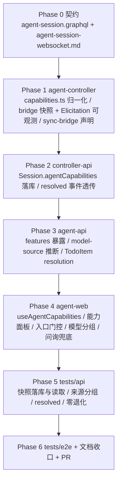

# ACP 协议增强（能力透明化与模型来源分组）- 实现计划

**关联 Proposal**: `docs/engineering/proposals/20261021-feat-acp-protocol-enhancement.md`（v1.2）
**关联 PRD**: `docs/product/draft/20261021-acp-protocol-enhancement.md`（v1.2）
**调研附录**: `docs/engineering/proposals/20261021-feat-acp-protocol-enhancement-opencode-support.md`
**需求总分支（feat-branch）**: `feat/acp-protocol-enhancement`（需求总 PR #246）
**实现分支**: `feat/acp-protocol-enhancement-impl`（基于 `feat/acp-protocol-enhancement`）
**创建日期**: 2026-10-21
**计划版本**: v1.0
**版本说明**:
- v1.0（2026-10-21）首版，与 PRD v1.2 / 提案 v1.2 对齐。本计划把提案 §9.2 的四个实现点拆成 7 个 Phase：契约 → agent-controller（能力快照 + Elicitation 可观测）→ controller-api（快照落库 + resolved 透传）→ agent-api（快照暴露 + 来源推断 + 待办状态）→ agent-web（门控/面板/分组/兜底）→ tests/api → tests/e2e + 文档收口。
- 本版新增「上游文档 × 代码现状差异」与 16 条计划期裁决（§「计划期裁决」），覆盖提案未落地的细节：FeatureId 全集、三档状态语义、门控边界、模型来源字段落点、Elicitation 超时与待办留存口径。

## 实现顺序



依赖说明：

- **Phase 0 是唯一事实源**：GraphQL 类型、事件 payload 字段名全部以其为准；契约未定稿前不写业务代码。
- **P1 → P2 必须先于 P3**：快照结构（`features[].id/status/detail`）由 P1 产出、P2 落库，P3 只做读取与暴露。
- **P3 必须先于 P4**：前端 GraphQL 文档与手写类型依赖 `features`、`source/group/basis` 字段。
- **P4 内部可并行分派**：`agent-web` 的门控/面板 与 模型分组/问询兜底 可由两个 subagent 并行，但共享同一分支，合并顺序为「能力门控/面板 → 模型分组 → 问询兜底」，禁止 rebase/squash。
- **P5/P6 串行**：API 与 E2E 共用同一套 Aspire 服务与 Mongo/Redis，禁止并行执行。

开发模式采用 TDD（红-绿-重构）。每个 Phase 先落测试（RED）再写实现（GREEN），最后重构。编码前按目录加载：`docs/engineering/common-rules.md`、`backend-rules.md`、`frontend-rules.md`、`packages/agent-controller/AGENTS.md`、`servers/controller-api/AGENTS.md`、`servers/agent-api/AGENTS.md`、`apps/agent-web/AGENTS.md`、`tests/api/AGENTS.md`、`tests/e2e/AGENTS.md`。

### 关键约束（提案 §1.3 / §10.1，实现期不得回退）

- **消息链路零改动**：`acp:message`、`AcpMessage` 落库、`group-messages.ts` 渲染一律不动；`AcpMessage.type` 枚举不扩展（提案 §5.5 观察项 3）。
- **不实施扩展通道**：不得引入 `_meta.agentgear.*`、`_agentgear/*` 方法、扩展能力广播；OpenCode `opencode/*` `_meta` 键与 `opencode/session/child_update` 仅登记进 `raw`，不消费。
- **不新建入口**：附件（图片/音频）、登录/登出、附加工作目录在当前前端**没有入口**，本期不新建（裁决 R4）；能力面板以 `partial` 如实展示。
- **不实施 `fs`/`terminal` client 能力**，不实施 `session/fork` 入口（沿用 `20260803` 决策与提案 §1.3）。
- **不新增第三方依赖**：分组/折叠/面板均手写（无折叠库、无虚拟滚动库、无表单 schema 渲染库）。
- **零退化**：旧 Agent（无能力广播）、旧会话（无 `agentCapabilities`）、旧 payload（`acp:start:result` 不带 `capabilities`）全部按今天的行为运行。
- **只登记不修改**：§5.5 观察项 1/2/3/4/5/6/7 一项都不在本次改动范围内。
- **禁止 rebase/squash**：遵循 z-git 规范，仅允许 merge。

---

## 上游文档 × 代码现状差异

实现前必须知道的三处事实偏差（均已在本计划内消化，无需打回上游，但需要在 PR 描述中声明）：

| # | 上游表述 | 代码现状（证据） | 本计划处置 |
|---|---|---|---|
| D1 | 提案 §9.2 实现点 3 要求「入口（附件、模型、模式、认证、会话恢复、历史管理）按能力显示/禁用/提示」；PRD F2 验收同款列表 | `apps/agent-web/src/components/session/InputBox.tsx` 无附件上传；全仓无 `authenticate/logout` mutation 与调用点（controller 侧 `acp:authenticate` 已实现，controller-api/agent-api/前端未接线）；无 `additionalDirectories` 入口 | 门控只覆盖**已存在且会失败**的入口（模型/模式/配置项/会话继续）；不存在的入口用能力面板 `partial` 如实表达；历史管理已有降级提示，不加门控（裁决 R4） |
| D2 | 提案 §7.2 把来源字段加在 `SessionConfigOptionValue` 上 | 会话内「切换模型」渲染的是 `Session.availableModels`（`AgentModelInfo`，`ModelSelectDialog.tsx` / `InputBox.tsx`），`configOptions.options` 不参与该弹层 | 来源字段落 `AgentModelInfo`（裁决 R12）；`SessionConfigOptionValue` 保持三字段不变 |
| D3 | 提案 §9.2 实现点 1 的 FeatureId 表只覆盖 `initialize` 能力字段 | PRD F1 要求清单覆盖「模式切换、模型切换、命令集」，这些不是 `initialize` 能力字段（分别来自 `session/new` 的 `configOptions.category` 与后续 `available_commands_update`） | FeatureId 扩容为 18 项，并把 `commands` 标为固定 `partial`（裁决 R1/R2） |
| D4 | PRD §3.4 页面表列出「Agent 选择界面：各 Agent 能力摘要」 | 能力是**会话级**协商结果（`initialize` + `session/new`），创建会话前只有 CLI 可用性探测（`detector.ts`），没有能力数据；提案未设计该页面 | 本期不做（不编造 pre-session 能力数据），能力摘要只在会话内呈现；如需「选择前预知」另立「按类型空实例能力探测缓存」需求 |

---

## 计划期裁决（提案留白 / 含混处的实现口径）

1. **FeatureId 全集（18 项）**，映射与平台侧支持矩阵集中在 `packages/agent-controller/src/acp/capabilities.ts`：

| FeatureId | 判定来源（Agent 侧） | 平台侧支持 | 备注 |
|---|---|---|---|
| `session.load` | `agentCapabilities.loadSession` | full | 带历史重放恢复 |
| `session.resume` | `sessionCapabilities.resume` | full | 无重放恢复（「继续」按钮） |
| `session.close` | `sessionCapabilities.close` | full | `closeSession` |
| `session.list` | `sessionCapabilities.list` | full | 历史会话导入/发现 |
| `session.delete` | `sessionCapabilities.delete` | full | 历史会话删除 |
| `session.fork` | `sessionCapabilities.fork` | none | 非 ACP v1（RFD），仅登记 |
| `session.additionalDirectories` | `sessionCapabilities.additionalDirectories` | none | 平台无入口 |
| `prompt.image` / `prompt.audio` / `prompt.embeddedContext` | `promptCapabilities.*` | none | 平台无附件入口 |
| `auth.login` | `authMethods.length > 0` | none | 平台无认证入口 |
| `auth.logout` | `agentCapabilities.auth.logout` | none | 同上 |
| `mcp.http` | `mcpCapabilities.http` | full | MCP 代理经 `session/new` 注入 |
| `mcp.sse` | `mcpCapabilities.sse` | none | 平台不支持 SSE 传输 |
| `config.boolean` | `clientCapabilities.session.configOptions.boolean`（平台能力，恒 true） | full | 布尔配置项面板 |
| `config.model` / `config.mode` | `configOptions` 内 `category==='model'/'mode'`（`session/new` 响应；mode 回退 `modes[]`） | full | 模型/模式切换入口 |
| `commands` | 无 initialize 字段（`available_commands_update` 动态下发） | partial | detail 固定说明「动态下发」 |
| `elicitation.form` / `elicitation.url` | 平台 `clientCapabilities.elicitation.form/url`（本端通告，恒 true） | full | detail 注明「Agent 是否发起取决于其触发条件」 |

2. **三档状态 = Agent 声明 × 平台支持 二维合并**（不用「Agent 声明了就 supported」的单一维度，否则出现「清单显示支持、界面没有入口」的第二次「名不副实」）：
   - `declared=false` → `unsupported`，detail = `未声明 <sourceField>`；
   - `declared=true` 且平台 `full` → `supported`；
   - `declared=true` 且平台 `partial`/`none` → `partial`，detail 追加「平台暂未提供入口」/「平台仅动态下发」；
   - 计算式为纯函数，穷举单测（T-C1~T-C8）。

3. **`elicitation.form/url` 的 declared 取平台自身 `clientCapabilities`**：ACP 中 elicitation 是 **Client 能力**，Agent 无法在 `initialize` 里广播「我会问询」。清单显示 `supported` 的含义是「平台已通告，链路可用（本需求修复目标）」；detail 明确写「Agent 是否发起取决于其触发条件」，避免误导。

4. **门控边界：只门控真实存在、且「点了必然失败」的入口，只对「明确 unsupported」生效**：
   - 生效点：模型切换（`config.model`）、模式切换（`config.mode`）、配置项布尔项（`config.boolean`）、会话「继续」（`session.resume` 与 `session.load` 同时 unsupported 才禁用）；
   - `features` 为空（旧会话/旧 Agent）或状态为 `partial` 时**一律放行**，保持今天的交互（零退化优先，防止误伤「不广播但能用」的 Agent）；
   - 不门控：消息发送/停止/会话关闭、命令列表（`availableCommands` 驱动）、历史会话导入/删除（现有链路已有 `syncedToAgent=false` + toast 降级，门控会破坏本地删除能力）、设置页 `HistorySessionDialog`（无会话快照）。

5. **模型来源字段落点 = `AgentModelInfo`**：新增 `source`（枚举）、`sourceProvider`、`group`、`basis` 四个可空字段，由 `Session.availableModels` 字段解析器在查询时计算返回，**不落库**；`currentModel` 不填这些字段（可空，天然兼容）。理由：渲染层只吃 `availableModels`（差异 D2），落库会与 `configOptions` 双写不一致（提案 §8.2 口径保持）。

6. **来源三档判定顺序**（纯函数，`servers/agent-api/src/services/model-source.ts`）：
   1. **平台库比对**：`id` 或 `name` 与平台库（`AVAILABLE_MODELS_FILTER` 同口径，见 `services/model.ts`）**不区分大小写精确匹配**；命中 `scope=global` → `platform`，命中 `scope=user` → `custom`。命中优先于标识解析（平台模型也可能带 `provider/model` 形式）。
   2. **标识解析**：未命中时用 `/^([A-Za-z0-9][A-Za-z0-9._-]*)\/(.+)$/` 解析 `id`，得 `sourceProvider` → `agent`（Agent 自带）。
   3. **兜底**：两档都不成立 → `unknown`（组名「来源未知」，basis「无法判定」）。
   - 分组顺序固定 `平台内置 → Agent 自带 → 自定义 → 来源未知`，组内保持 `availableModels` 原始顺序（同一模型在不同会话结果一致）。

7. **能力快照唯一持久化位置 = Mongo `sessions.agentCapabilities`**：不新增 Redis 能力键（现有 `session:{id}:promptCapabilities|agentInfo|authMethods` 写入但无人读取，本期原样保留不动）；`controller-api` 的 `cacheCapabilities` 不扩展。

8. **旧会话无快照时 `Session.features` 返回 `[]`**，前端按「未知 → 全部放行」处理，能力面板显示一行提示「该会话创建于能力快照上线前，继续会话后可获取能力清单」。**不在 agent-api 复制一份 FeatureId 映射做旧数据合成**（避免与服务端矩阵漂移）；继续（resume）会话会重新生成快照并落库。

9. **Elicitation 可观测通道（新增事件 `acp:elicitation:resolved`）**：
   - bridge → controller-api：`{requestId?, sessionId, reason, detail?}`，`reason ∈ unsupported_mode | timeout | cancelled`；
   - controller-api → Redis `elicitation:resolved`：追加 `userId`（来自 `socket.data.userId`）与 `controllerId`；
   - agent-api 订阅后写 `TodoItem.resolution`：`unsupported_mode → failed`、`timeout → expired`、`cancelled → cancelled`，并写 `resolvedAt`。
   - 用户主动响应不依赖该事件：`respondElicitation` resolver 直接按 `action` 写 `accepted | declined | cancelled`。

10. **Elicitation 超时口径统一**：controller-api `TIMEOUT_MS=60s` 为**唯一用户可见超时**（到点回 Agent `cancel` + 发布 `resolved(timeout)`）；bridge 的 65s 兜底保留并从「静默 `resolve(cancel)`」改为「`console.warn` + `acp:elicitation:resolved(timeout)`」，作为最后一道防线（正常路径不会先到）。

11. **待办留存策略不改 TTL**：`TodoItem.expiresAt` 的 TTL 索引（`expireAfterSeconds: 0`，5 分钟）保持不变，不迁移、不影响权限待办；`resolution` 在 60s 内写入，因此待办在 5 分钟窗口内可看到「已过期/已取消/已拒绝」，之后随 TTL 清理。长期审计由 controller 日志 + SSE 事件承担（PRD「可查记录」的落点）。

12. **sync-bridge 声明 elicitation，但仍自动 cancel**：`sync-bridge.ts` 的 `clientCapabilities` 补齐 `session.configOptions.boolean` 与 `elicitation.form/url`（历史同步链路的 Agent 若问询可被显式识别），`unstable_createElicitation` 保持 `{action:'cancel'}` 但补 `console.warn`（同步进程无用户通道，声明 + 立即取消是合法降级），不引入交互链路。

13. **elicitation 端到端回归不依赖 OpenCode 安装**：新增 stdio 假 Agent 进程 fixture（真实 JSON-RPC 字节流）验证「SDK 是否把 `elicitation/create` 路由到 `unstable_createElicitation`」——这是现有 `bridge.test.ts`（mock SDK）覆盖不到的层，直接对应打回疑问「上线后未见弹出」的最后一公里。真实 OpenCode 用例进 `test:real` 套件，不作为唯一验收依据。

14. **GraphQL `raw` 字段保留但不默认查询**：契约暴露 `AgentCapabilitySnapshot.raw`（审计/回归用），前端查询不选该字段（控制 payload 体积、避免把原始对象带进 UI）；`raw` 内不存放任何平台内部实现（只放 `agentCapabilities` / `authMethods` / `clientCapabilities` 三份对端声明原文）。

15. **契约修正 D3 顺带**：`contracts/agent-session.graphql` 中 `Session.availableModels: [AgentModel!]` 与服务端实现（`[AgentModelInfo!]`）不一致，本次一并修正为 `AgentModelInfo!`；WebSocket 契约的 wire 类型 `AgentModel` 不动（不改协议）。

16. **文档生命周期**：PRD 留在 `docs/product/draft/`，提案留在 `docs/engineering/proposals/`；实现完成后由验收节点移动归档，本节点只新增 plan 文档。

---

## Phase 0: 契约（Contracts）

开发分支：`feat/acp-protocol-enhancement-impl`。

### 文件修改

| 文件 | 操作 | 说明 |
|------|------|------|
| `contracts/agent-session.graphql` | 修改 | 新增 `AgentFeatureStatus`/`AgentFeatureSupport`/`AgentCapabilitySnapshot`/`AgentModelSource`；`Session` 增 `agentCapabilities`、`features`；`AgentModelInfo` 增 4 字段；修正 `availableModels` 类型 |
| `contracts/agent-session-websocket.md` | 修改 | §2.5/§2.12 的 `acp:start:result`/`acp:resume:result` 增 `capabilities`；新增 §2.34 `acp:elicitation:resolved`；§5 客户端能力声明处补 sync-bridge 说明 |
| `contracts/agent-message.openapi.yaml` 等其余契约 | 不变 | 消息链路零改动 |

### `contracts/agent-session.graphql` 增量

```graphql
enum AgentFeatureStatus {
  supported
  partial
  unsupported
}

enum AgentModelSource {
  platform
  agent
  custom
  unknown
}

type AgentFeatureSupport {
  id: String!
  status: AgentFeatureStatus!
  detail: String
}

type AgentCapabilitySnapshot {
  protocolVersion: Int
  agentInfo: AgentInfo
  features: [AgentFeatureSupport!]!
  # 对端声明原文（agentCapabilities / authMethods / clientCapabilities），前端不查询
  raw: JSON
}

type AgentModelInfo {
  id: String!
  name: String!
  provider: String
  # 来源推断（仅 Session.availableModels 解析器填充，其余位置为 null）
  source: AgentModelSource
  sourceProvider: String
  group: String
  basis: String
}

type Session {
  # ... 既有字段不变 ...
  agentCapabilities: AgentCapabilitySnapshot
  features: [AgentFeatureSupport!]!
  # availableModels 类型由 [AgentModel!] 修正为 [AgentModelInfo!]
}

enum ElicitationResolution {
  accepted
  declined
  cancelled
  expired
  failed
}

type TodoItem {
  # ... 既有字段不变 ...
  # 问询终态：null = 仍待处理；expired = 超时未响应；failed = 链路不支持
  resolution: ElicitationResolution
  resolvedAt: String
  expiresAt: String
}
```

> `expiresAt` 为 ISO 8601 字符串（既有时间字段约定，不引入 DateTime scalar）；`resolvedAt` 同。

### `contracts/agent-session-websocket.md` 增量

1. §2.5 `acp:start:result` / §2.12 `acp:resume:result` 新增可选字段：

| 字段 | 类型 | 必填 | 说明 |
|------|------|------|------|
| `capabilities` | `AgentCapabilitySnapshot` | 否 | 能力快照（缺省 = 该 controller 版本未上报，服务端按旧行为处理） |

`AgentCapabilitySnapshot` 结构：`protocolVersion: int | null`、`agentInfo: AgentInfo | null`、`features: AgentFeatureSupport[]`、`raw: object`（`agentCapabilities`/`authMethods`/`clientCapabilities` 原文）。

2. 新增 §2.34：

```
### 2.34 `acp:elicitation:resolved`（Controller → Server）

Agent 侧问询在到达用户之前已结束（模式不支持 / 超时 / 被 Agent 取消）。
仅用于可观测与待办状态收敛；用户已响应的情况走 `acp:elicitation:response`。

| 字段 | 类型 | 必填 | 说明 |
| requestId | string | 否 | 平台侧请求 ID（模式不支持时可能没有） |
| sessionId | string | 是 | 会话 ID |
| reason | `"unsupported_mode" \| "timeout" \| "cancelled"` | 是 | 结束原因 |
| detail | string | 否 | 可读原因（如未知模式名） |

服务端行为：发布 Redis `elicitation:resolved`（附 userId/controllerId），agent-api 据此把
对应待办标记为 failed / expired / cancelled，并记录 `resolvedAt`。
```

3. §5「ACP JSON-RPC 协议」客户端能力声明段落补充：`sync-bridge`（历史同步）同样声明 `session.configOptions.boolean` 与 `elicitation.form/url`，其 `elicitation/create` 一律 `cancel`（无用户通道）。

### 验收 checklist

- [ ] `contracts/agent-session.graphql` 与 `servers/agent-api/src/graphql/schemas/session.ts` 类型/字段名逐字一致（含可空性）
- [ ] `features`/`agentCapabilities` 在契约中可空性为「`features` 非空数组、`agentCapabilities` 可空」
- [ ] `acp:start:result` 既有字段零改动（仅新增 `capabilities`）
- [ ] 新增事件命名/字段与 Phase 2/3 代码一致（`acp:elicitation:resolved` + Redis `elicitation:resolved`）
- [ ] `TodoItem.resolution/resolvedAt/expiresAt` 与 `ElicitationResolution` 已写入契约，字段可空性一致
- [ ] `git diff` 不包含 `acp:message`、`acp:set-model`、`acp:set-mode` 等既有事件

---

## Phase 1: agent-controller（能力归一化 + Elicitation 可观测）

开发分支：`feat/acp-protocol-enhancement-impl`。TDD 顺序：先写 `capabilities.test.ts`（RED）→ 实现 `capabilities.ts`（GREEN）→ 再改 `bridge.ts`。

### 文件修改

| 文件 | 操作 | 说明 |
|------|------|------|
| `packages/agent-controller/src/acp/capabilities.ts` | 新增 | `AgentCapabilitySnapshot` 类型、FeatureId 目录、平台支持矩阵、`normalizeCapabilities()` 纯函数 |
| `packages/agent-controller/src/acp/capabilities.test.ts` | 新增 | 18 项映射、三档合并、`raw` 保真、缺失降级、OpenCode fixture 断言 |
| `packages/agent-controller/src/acp/__fixtures__/opencode-2.0.31-capabilities.json` | 新增 | 调研附录 §4.1 实测广播原文（回归基线） |
| `packages/agent-controller/src/acp/__fixtures__/fake-elicitation-agent.mjs` | 新增 | stdio 假 Agent：`initialize` → `session/new` → 发 `elicitation/create` → 读响应 → 记录并退出 |
| `packages/agent-controller/src/acp/elicitation.integration.test.ts` | 新增 | 真实 SDK + 假 Agent 进程：验证 `elicitation/create` 被路由到 `unstable_createElicitation` 并回传响应 |
| `packages/agent-controller/src/acp/bridge.ts` | 修改 | 保存原始 `agentCapabilities`；`AcpInitializedPayload.capabilities`；Elicitation 未知模式/超时日志 + `acp:elicitation:resolved` |
| `packages/agent-controller/src/acp/bridge.test.ts` | 修改 | 增快照字段、Elicitation 事件、65s 兜底取消日志断言 |
| `packages/agent-controller/src/socketio-client.ts` | 修改 | 抽出 `buildAcpInitResult(payload)` 纯函数（start/resume 共用），结果对象增 `capabilities`（bridge 事件 → `acp:start:result`/`acp:resume:result` 的唯一出口，漏改则前端永远拿不到快照） |
| `packages/agent-controller/src/socketio-client.test.ts` | 新增 | `buildAcpInitResult` 的字段透传与旧 payload 兼容 |
| `packages/agent-controller/src/acp/sync-bridge.ts` | 修改 | `clientCapabilities` 声明补齐 + `unstable_createElicitation` 告警（裁决 R12） |
| `packages/agent-controller/src/acp/prober.ts` | 修改 | 探测结果新增 `capabilities`（供 API 测试与后续回归复用），不改变既有返回字段 |

### `capabilities.ts` 口径

```ts
export type AgentFeatureStatus = 'supported' | 'partial' | 'unsupported';

export interface AgentFeatureSupport {
  id: string;
  status: AgentFeatureStatus;
  detail: string | null;
}

export interface AgentCapabilitySnapshot {
  protocolVersion: number | null;
  agentInfo: { name: string; version: string | null } | null;
  features: AgentFeatureSupport[];
  raw: {
    agentCapabilities: unknown;      // initialize 原文（含 _meta）
    authMethods: unknown;
    clientCapabilities: unknown;    // 本端声明原文
  };
}

/** 平台侧支持矩阵：full=有入口且可用，partial=仅动态/受限，none=无入口 */
const PLATFORM_SUPPORT: Record<string, 'full' | 'partial' | 'none'> = {
  'session.load': 'full', 'session.resume': 'full', 'session.close': 'full',
  'session.list': 'full', 'session.delete': 'full',
  'session.fork': 'none', 'session.additionalDirectories': 'none',
  'prompt.image': 'none', 'prompt.audio': 'none', 'prompt.embeddedContext': 'none',
  'auth.login': 'none', 'auth.logout': 'none',
  'mcp.http': 'full', 'mcp.sse': 'none',
  'config.boolean': 'full', 'config.model': 'full', 'config.mode': 'full',
  commands: 'partial',
  'elicitation.form': 'full', 'elicitation.url': 'full',
};

export function normalizeCapabilities(input: NormalizeCapabilitiesInput): AgentCapabilitySnapshot
```

`normalizeCapabilities` 输入：`protocolVersion`、`agentInfo`、`agentCapabilities`（原文）、`authMethods`、`clientCapabilities`（bridge 构造时使用的同一对象，抽成常量 `CLIENT_CAPABILITIES` 复用）、`configOptions`（已 `extractConfigOptions` 的结果）、`modes`。

实现细则：

- 布尔判定统一走 `isTruthyCapability(v)`：`true` 或**非 null 对象**（`{}`）均视为已声明（ACP 用 `{}` 表示「通告零模式」，对能力开关语义是「已声明」）；`null`/`undefined`/`false` 为未声明。
- `auth.login` 的 declared = `authMethods.length > 0`；`auth.logout` 的 declared = `agentCapabilities?.auth?.logout === true`。
- `config.model` / `config.mode` 的 declared = `configOptions` 中存在 `category==='model'/'mode'` 的 `select` 项；`config.mode` 额外回退 `modes.length > 0`（旧 Agent 走 `modes` 字段）。
- `config.boolean` / `elicitation.form` / `elicitation.url` 的 declared 来自 `clientCapabilities`（本端声明），不是 Agent 广播。
- `commands` 固定 `partial`，detail 固定 `命令集由 available_commands_update 动态下发，平台已支持命令列表与 / 补全`。
- 状态合并规则见裁决 R2；`detail` 由「Agent 侧说明」+「平台侧说明」拼接，空值过滤；`unsupported` 的 detail 必须以 `未声明` 开头（便于断言与 UI 一致）。
- `raw` 原样保存三份声明；**不消费**任何 `_meta` 扩展键。
- 未知 `_meta` 键不产生 feature（避免清单随 Agent 私有扩展膨胀），只在 `raw` 中可见。

### `bridge.ts` 改动点

1. 新增私有字段 `clientCapabilitiesRaw`、`agentCapabilitiesRaw`；`initConnection()` 把本次 `initialize` 的 `clientCapabilities` 常量保存下来。建议把 §5 的声明抽成模块常量：

```ts
export const CLIENT_CAPABILITIES = {
  session: { configOptions: { boolean: {} } },
  elicitation: { form: {}, url: {} },
} as const;
```

2. `buildInitializedPayload()` 返回对象新增 `capabilities: normalizeCapabilities({...})`（含 `configOptions`/`modes`，因此 `commands`/`config.*` 能正确落状态）。
3. `unstable_createElicitation()`：
   - 未知模式分支：`console.warn('[ACP bridge] session %s: unsupported elicitation mode=%j', ...)` + `this.socket.emit('acp:elicitation:resolved', { sessionId, reason: 'unsupported_mode', detail: String((params as {mode?: unknown}).mode ?? 'unknown') })`，再 `return { action: 'cancel' }`（保持不挂起 Agent）。
   - 65s 兜底分支：`console.warn` + 同事件 `reason:'timeout'` + `detail:'bridge timeout (65s)'`。
   - 已知模式路径不变（`acp:elicitation` + `elicitation:sent`）。
4. `sync-bridge.ts`：`clientCapabilities` 使用 `CLIENT_CAPABILITIES`；`unstable_createElicitation` 加 `console.warn('[ACP sync-bridge] elicitation request auto-cancelled: no user channel')`。
5. `socketio-client.ts`：把 `acp:start` / `acp:resume` 两处 `onInitialized` 里逐字段拼装的结果对象收敛为导出的纯函数：

```ts
export function buildAcpInitResult(payload: Record<string, unknown>): Record<string, unknown> {
  // 既有字段原样拷贝（modes/currentModeId/currentModel/availableModels/
  // currentModelId/configOptions/promptCapabilities/agentInfo/authMethods/
  // supportsAdditionalDirectories）
  if (payload.capabilities) result.capabilities = payload.capabilities; // 新增
  return result;
}
```

   start 分支额外带 `externalSessionId`（在调用处补），resume 分支不带；两处行为与今天一致，仅新增 `capabilities`。

### 测试用例

**`capabilities.test.ts`**

| # | 用例 | 预期 |
|---|------|------|
| T-C1 | OpenCode 2.0.31 fixture 全量归一化 | 18 项 feature id 全集；`session.load/resume/close/list/delete` = supported；`prompt.image/embeddedContext` = partial；`prompt.audio` = unsupported；`session.fork` = partial；`session.additionalDirectories` = partial；`config.model` = supported（fixture 需带 model 配置项，见下） |
| T-C2 | `agentCapabilities` 为 `null`（旧 Agent） | 全 18 项仍返回；声明类全部 `unsupported`（detail 以「未声明」开头）；`elicitation.*`/`config.boolean` 仍 supported（本端声明） |
| T-C3 | `{}` 与 `false` 区分 | `sessionCapabilities.resume: {}` → 视为已声明；`resume: false` → 未声明 |
| T-C4 | `authMethods` 非空 | `auth.login` = partial（平台无入口），`auth.logout` = unsupported |
| T-C5 | `modes[]` 回退 | 无 `category==='mode'` 配置项但 `modes` 非空 → `config.mode` = supported |
| T-C6 | `_meta` 扩展键 | `agentCapabilities._meta` 原样进 `raw`；不产生任何 feature，`features` 长度仍为 18 |
| T-C7 | `raw` 保真 | `raw.agentCapabilities/authMethods/clientCapabilities` 与入参深相等 |
| T-C8 | detail 文案 | `unsupported` 的 detail 以「未声明 <字段>」开头；`partial` 的 detail 含「平台」字样 |

> fixture 说明：调研附录的实测广播里 `configOptions` 未记录，T-C1 的 `config.model` 断言使用「fixture 广播 + 手工追加 model/mode 配置项」的组合入参，避免虚构原始广播内容。

**`bridge.test.ts`（增量）**

| # | 用例 | 预期 |
|---|------|------|
| T-B1 | `start()` 后 `acp:initialized` 含 `capabilities` | `features` 为 18 项数组；`raw.clientCapabilities.elicitation.form` 存在 |
| T-B2 | `resume()` 后同样携带 `capabilities` | 同 T-B1（走 resume 分支） |
| T-B3 | 未知 elicitation 模式 | 返回 `{action:'cancel'}`；`socket.emit('acp:elicitation:resolved', {reason:'unsupported_mode'})`；`console.warn` 调用一次 |
| T-B4 | 65s 超时 | 前进假时钟 → 返回 `{action:'cancel'}`；发出 `reason:'timeout'`；不残留 pending |
| T-B5 | 正常 form 模式 | 仍只发 `acp:elicitation`，**不**发 resolved 事件 |

**`elicitation.integration.test.ts`（真实 SDK + 假 Agent 进程）**

| # | 用例 | 预期 |
|---|------|------|
| T-BI1 | 假 Agent 在 `session/new` 后发 `elicitation/create`（form） | bridge 在 socket 上收到 `acp:elicitation`；`handleElicitationResponse('accept', {answer:'x'})` 后假 Agent 收到含 `action:'accept'` 的 JSON-RPC 响应并正常退出 |
| T-BI2 | 平台未声明该模式（假 Agent 发 `mode:'custom'`） | 假 Agent 收到 `action:'cancel'`；socket 收到 `acp:elicitation:resolved(unsupported_mode)` |

**`socketio-client.test.ts`（新增）**

| # | 用例 | 预期 |
|---|------|------|
| T-SC1 | payload 带 `capabilities` | 结果对象 `capabilities` 与入参深相等；既有字段一个不少 |
| T-SC2 | 旧 payload 不带 `capabilities` | 结果对象不含该键（零退化，控制器版本混跑安全） |

验收说明：T-BI1 若失败（SDK 未路由 `elicitation/create`），说明「上线后未见弹出」的真因在 SDK 层，需要在 `bridge.ts` 侧补显式路由/升级 SDK —— 此时在 PR 描述中登记结论，不得修改测试绕过。

### 命令参考

```bash
cd packages/agent-controller
npx vitest run src/acp/capabilities.test.ts src/acp/bridge.test.ts \
  src/acp/elicitation.integration.test.ts src/socketio-client.test.ts
npx vitest run
npm run build
```

### 验收 checklist

- [ ] `AcpInitializedPayload` 的既有字段零语义变化（仅新增 `capabilities`）
- [ ] `socketio-client.ts` 的 start/resume 两条路径都经 `buildAcpInitResult` 输出，`grep 'acp:start:result'` 外无第二处拼装
- [ ] `CLIENT_CAPABILITIES` 常量在 bridge/sync-bridge 共用，无重复字面量
- [ ] `capabilities.ts` 无任何 `socket`/`fs` 依赖（纯函数，可单测）
- [ ] 18 项 FeatureId 与裁决 R1 表格逐项一致
- [ ] 未引入新依赖；`npm run build` 通过

---

## Phase 2: controller-api（快照落库 + resolved 透传）

开发分支：`feat/acp-protocol-enhancement-impl`。TDD：先补 `acp-session-manager.test.ts` / `elicitation-manager.test.ts` / `socketio.test.ts`（RED）→ 实现（GREEN）。

### 文件修改

| 文件 | 操作 | 说明 |
|------|------|------|
| `servers/controller-api/src/models/session.ts` | 修改 | 新增 `agentCapabilities: { type: mongoose.Schema.Types.Mixed }`（与 agent-api 同步副本字段） |
| `servers/controller-api/src/services/acp-session-manager.ts` | 修改 | `PendingRequest.resolve` 类型增 `capabilities`；`startSession`/`resumeSession` 落库；`cacheCapabilities` 不变 |
| `servers/controller-api/src/services/elicitation-manager.ts` | 新增/修改 | `handleElicitationResolved(socket, data)` 转发 Redis；`handleTimeout` 发布 `elicitation:resolved(reason:'timeout')` |
| `servers/controller-api/src/services/socketio.ts` | 修改 | 注册 `socket.on('acp:elicitation:resolved')` → `elicitationManager.handleElicitationResolved` |
| `servers/controller-api/src/services/acp-session-manager.test.ts` | 修改 | start/resume 落库断言 |
| `servers/controller-api/src/services/elicitation-manager.test.ts` | 修改 | 超时发布 resolved；resolved 透传 |
| `servers/controller-api/src/services/socketio.test.ts` | 修改 | 新事件接线 + 未认证直接忽略 |

### 服务层口径

```ts
// acp-session-manager.ts（start 与 resume 两处同样处理）
if (payload.capabilities) {
  updateData.agentCapabilities = payload.capabilities;
}
```

- **只在 payload 携带时写**：旧 controller 不上报 → 不覆盖已有快照（避免 `undefined` 把历史快照抹掉）。
- **不写 Redis 能力键**（裁决 R7）；`statusExtra` 不追加 `capabilities`（SSE 状态事件载荷保持精简）。
- 失败路径（`success:false`）不写快照。

```ts
// elicitation-manager.ts
const ELICITATION_RESOLVED_CHANNEL = 'elicitation:resolved';

async handleElicitationResolved(socket: Socket, data: {
  requestId?: string; sessionId: string;
  reason: 'unsupported_mode' | 'timeout' | 'cancelled'; detail?: string;
}): Promise<void> {
  await getRedisClient().publish(ELICITATION_RESOLVED_CHANNEL, JSON.stringify({
    ...data,
    controllerId: socket.data.controllerId,
    userId: socket.data.userId,
  }));
}

private handleTimeout(requestId: string): void {
  const pending = this.pendingRequests.get(requestId);
  if (!pending) return;
  this.pendingRequests.delete(requestId);
  // 1) 回 Agent cancel（既有行为）
  // 2) 发布 resolved(timeout)（新增）
  // 3) 仍回发 acp:elicitation:response{cancel} 给 controller（既有行为）
}
```

注意：`handleTimeout` 内需要 `userId`，`PendingRequest` 已保存 `userId`，直接用于 publish，不依赖 `socket`。

### 测试用例

| # | 用例 | 预期 |
|---|------|------|
| T-S1 | `acp:start:result` 带 `capabilities` | `Session.findByIdAndUpdate` 的 `updateData.agentCapabilities` 深相等；其余既有字段断言不变 |
| T-S2 | `acp:start:result` 不带 `capabilities` | `updateData` 不含 `agentCapabilities`（零退化） |
| T-S3 | `acp:resume:result` 带 `capabilities` | 同上（resume 分支） |
| T-S4 | `success:false` | 不写 `agentCapabilities` |
| T-S5 | ElicitationManager 60s 超时 | Redis `elicitation:resolved` 发布含 `{requestId, sessionId, userId, reason:'timeout'}`；仍有 `acp:elicitation:response{cancel}` |
| T-S6 | 收到 `acp:elicitation:resolved` | 发布同名 channel，附 `userId`/`controllerId`/`detail` |
| T-S7 | 未认证 socket 发 `acp:elicitation:resolved` | 零 publish |

### 命令参考

```bash
cd servers/controller-api
npx vitest run src/services/acp-session-manager.test.ts src/services/elicitation-manager.test.ts src/services/socketio.test.ts
npx vitest run
npm run build
```

### 验收 checklist

- [ ] `acp:message` 落库相关代码 `git diff` 为空（提案 §5「只登记不修改」）
- [ ] 旧 payload（无 `capabilities`）不产生任何字段写入
- [ ] Redis channel 命名 `elicitation:resolved` 与 agent-api 订阅一致
- [ ] 超时路径同时完成「回 Agent cancel + 落 resolved + 回前端 cancel」，三件事都在同一分支里断言

---

## Phase 3: agent-api（能力暴露 + 模型来源推断 + 待办状态）

开发分支：`feat/acp-protocol-enhancement-impl`。TDD：先写 `model-source.test.ts` / `session.test.ts` 增量 / `todo-service.test.ts` 增量（RED）→ 实现（GREEN）。

### 文件修改

| 文件 | 操作 | 说明 |
|------|------|------|
| `servers/agent-api/src/models/session.ts` | 修改 | 新增 `agentCapabilities: { type: mongoose.Schema.Types.Mixed }` |
| `servers/agent-api/src/models/todo-item.ts` | 修改 | 新增 `resolution`（enum）+ `resolvedAt`（Date）；TTL 索引不变 |
| `servers/agent-api/src/services/session.ts` | 修改 | `mapSession` 增 `agentCapabilities`（空则 null） |
| `servers/agent-api/src/services/agent-capabilities.ts` | 新增 | `featuresFromSnapshot(snapshot): AgentFeatureSupport[]`（空快照返回 `[]`，裁决 R8） |
| `servers/agent-api/src/services/model-source.ts` | 新增 | 三档推断纯函数 + 分组常量 |
| `servers/agent-api/src/services/model.ts` | 修改 | 新增 `listSourceLibrary(): Promise<Array<{ name: string; scope: 'user' \| 'global' }>>`（复用 `AVAILABLE_MODELS_FILTER`，只 select `name scope`） |
| `servers/agent-api/src/services/todo-service.ts` | 修改 | 新增 `markElicitationResolved(requestId, resolution)` |
| `servers/agent-api/src/services/elicitation-subscriber.ts` | 修改 | 订阅 `elicitation:resolved` |
| `servers/agent-api/src/graphql/schemas/session.ts` | 修改 | 新增 4 个类型/枚举 + `Session.agentCapabilities/features` + `AgentModelInfo` 4 字段 |
| `servers/agent-api/src/graphql/schemas/todo.ts` | 修改 | `TodoItem.resolution/resolvedAt/expiresAt` |
| `servers/agent-api/src/graphql/resolvers/session.ts` | 修改 | 新增 `Session` 类型级 resolver（`features`/`agentCapabilities`/`availableModels`） |
| `servers/agent-api/src/graphql/resolvers/todo.ts` | 修改 | `TodoItem.resolution/resolvedAt/expiresAt` 归一化；`respondElicitation` 写 resolution |
| `servers/agent-api/src/graphql/resolvers/auth.ts` | 修改 | `AuthContext` 新增可选的 `modelLibraryPromise` 请求级缓存字段 |
| `servers/agent-api/src/graphql/resolvers/index.ts` | 修改 | **登记 `Session` 类型级 resolver**（`backend-rules` 明确陷阱） |

### `model-source.ts` 口径

```ts
export type AgentModelSource = 'platform' | 'agent' | 'custom' | 'unknown';

export const SOURCE_GROUP: Record<AgentModelSource, string> = {
  platform: '平台内置',
  agent: 'Agent 自带',
  custom: '自定义',
  unknown: '来源未知',
};

export interface SourceLibraryEntry { name: string; scope: 'user' | 'global' }

export interface ModelSourceResult {
  source: AgentModelSource;
  sourceProvider: string | null;
  group: string;
  basis: string;
}

/** 纯函数：三档推断（裁决 R6） */
export function inferModelSource(
  model: { id: string; name: string },
  library: SourceLibraryEntry[],
): ModelSourceResult {
  const key = (s: string) => s.trim().toLowerCase();
  const hit = library.find((m) => key(m.name) === key(model.name))
    ?? library.find((m) => key(m.name) === key(model.id));
  if (hit) {
    const source = hit.scope === 'global' ? 'platform' : 'custom';
    return { source, sourceProvider: null, group: SOURCE_GROUP[source],
      basis: hit.scope === 'global' ? '按平台模型库比对（平台内置）' : '按平台模型库比对（自定义）' };
  }
  const parsed = key(model.id).match(/^([a-z0-9][a-z0-9._-]*)\/(.+)$/);
  if (parsed) {
    return { source: 'agent', sourceProvider: parsed[1], group: SOURCE_GROUP.agent,
      basis: `按标识前缀判定（${parsed[1]}）` };
  }
  return { source: 'unknown', sourceProvider: null, group: SOURCE_GROUP.unknown, basis: '无法判定' };
}
```

- 匹配对「库内 `name` ↔ 会话 `name`」与「库内 `name` ↔ 会话 `id`」都尝试（不同 Agent 的 `configOptions` 可能把模型名放在任一侧）。
- 空输入：`library` 为空时仍可跑完前缀/兜底分支（不抛错）。
- 重复 id 的模型各自独立计算，不做跨模型去重（同一模型在不同会话结果一致，由纯函数与同一库保证）。

### `Session` 类型级 resolver

```ts
export const sessionResolvers = {
  // ... Query/Mutation 不变 ...
  Session: {
    agentCapabilities: (session: Doc) => (session as any).agentCapabilities ?? null,
    features: (session: Doc) =>
      featuresFromSnapshot((session as any).agentCapabilities),
    availableModels: async (session: Doc, _args: unknown, context: AuthContext) => {
      const models = ((session as any).availableModels ?? []) as Array<{ id: string; name: string; provider?: string | null }>;
      if (models.length === 0) return [];
      context.modelLibraryPromise ??= modelService.listSourceLibrary();
      const library = await context.modelLibraryPromise;
      return models.map((m) => {
        const inferred = inferModelSource(m, library);
        return { ...m, provider: m.provider ?? null, ...inferred };
      });
    },
  },
};
```

- `auth.ts` 的 `AuthContext` 增加 `modelLibraryPromise?: Promise<SourceLibraryEntry[]>`；每个 GraphQL 请求只查一次平台库（`sessions` 列表也只有一个查询）。
- `featuresFromSnapshot` 返回深拷贝的 `features` 数组（避免 Apollo/GraphQL 层意外修改数据库读取对象）；快照缺失/格式异常（非数组）一律 `[]`。

### `todo-service.ts` / `elicitation-subscriber.ts`

```ts
async markElicitationResolved(
  requestId: string,
  resolution: 'accepted' | 'declined' | 'cancelled' | 'expired' | 'failed',
): Promise<void> {
  await TodoItem.updateOne(
    { 'elicitationData.requestId': requestId },
    { $set: { resolution, resolvedAt: new Date(), isRead: true } },
  );
}
```

- `respondElicitation` resolver：`accept→accepted`、`decline→declined`、`cancel→cancelled`，在 publish 之后调用 `markTodoAsResponded` + `markElicitationResolved`（保留 `markTodoAsResponded` 的既有语义，避免影响权限待办）。
- `elicitation-subscriber`：`subscribe('elicitation:request', 'elicitation:complete', 'elicitation:resolved')`；`resolved` 分支映射 `unsupported_mode→failed`、`timeout→expired`、`cancelled→cancelled`，并保留一条 `console.log('[Elicitation] resolved reason=%s requestId=%s')`。
- 找不到待办（如已过期被 TTL 清理）时 `updateOne` 无匹配即静默返回（幂等，不抛错）。

### 测试用例

**`services/model-source.test.ts`**

| # | 用例 | 预期 |
|---|------|------|
| T-MS1 | 命中平台内置 | `scope:global` 同名 → `source='platform'`，group「平台内置」，basis 含「平台内置」 |
| T-MS2 | 命中自定义 | `scope:user` 同名 → `custom`，group「自定义」 |
| T-MS3 | 前缀未命中库 | `opencode-go/kimi-k3` 且库无匹配 → `agent`，`sourceProvider='opencode-go'`，basis 含前缀 |
| T-MS4 | 无前缀未命中库 | `gpt-4o` 且库为空 → `unknown`，group「来源未知」，basis「无法判定」 |
| T-MS5 | 库命中优先于前缀 | 库中存在 `opencode-go/kimi-k3`（global）→ `platform`（不判 agent） |
| T-MS6 | 大小写不敏感 | `GPT-4O` 命中库内 `gpt-4o` |
| T-MS7 | 库为空/名称为空 | 不抛错；空 id 归一为 `unknown` |

**`services/session.test.ts`（增量）**

| # | 用例 | 预期 |
|---|------|------|
| T-SS1 | `mapSession` 含快照 | 返回 `agentCapabilities` 原样；无快照返回 `null` |
| T-SS2 | `listSourceLibrary` | 只 select `name/scope`；`scope=global` 仅含 `isEnabled:true`（与 `AVAILABLE_MODELS_FILTER` 一致） |

**`services/todo-service.test.ts`（增量）**

| # | 用例 | 预期 |
|---|------|------|
| T-TD1 | `markElicitationResolved('expired')` | `updateOne` 条件 `{'elicitationData.requestId': id}`，`$set` 含 `resolution/resolvedAt/isRead:true` |
| T-TD2 | 不存在的 requestId | 不抛错（`modifiedCount=0` 通过） |

**`services/elicitation-subscriber.test.ts`（增量）**

| # | 用例 | 预期 |
|---|------|------|
| T-ES1 | 订阅 3 个 channel | `subscribe` 参数包含 `elicitation:resolved` |
| T-ES2 | `resolved(timeout)` | 调用 `markElicitationResolved(requestId,'expired')` |
| T-ES3 | `resolved(unsupported_mode)` | 调用 `markElicitationResolved(requestId,'failed')` |
| T-ES4 | `resolved(cancelled)` | 调用 `markElicitationResolved(requestId,'cancelled')` |

**`graphql/resolvers/todo.test.ts`（增量）**

| # | 用例 | 预期 |
|---|------|------|
| T-TR1 | `respondElicitation(accept)` | publish 内容不变；`markElicitationResolved` 收到 `accepted` |
| T-TR2 | `decline/cancel` | 分别 `declined`/`cancelled` |
| T-TR3 | `TodoItem.expiresAt/resolvedAt` | Date → ISO 字符串；缺失返回 null（`backend-rules` 嵌套物化陷阱） |

**新增 `graphql/resolvers/session.test.ts`**

| # | 用例 | 预期 |
|---|------|------|
| T-SR1 | `Session.features` 有快照 | 返回快照内 features（深拷贝，改返回值不影响入参） |
| T-SR2 | `Session.features` 无快照/脏数据 | 返回 `[]` |
| T-SR3 | `Session.availableModels` 分组 | 平台库命中/前缀/兜底分别得到 `platform/agent/unknown` 与对应 group/basis |
| T-SR4 | 请求级缓存 | 同一 context 两次解析只调用一次 `listSourceLibrary` |
| T-SR5 | 空 availableModels | 不查库（`listSourceLibrary` 零调用），返回 `[]` |

### 命令参考

```bash
cd servers/agent-api
npx vitest run src/services/model-source.test.ts src/services/session.test.ts src/services/todo-service.test.ts \
  src/services/elicitation-subscriber.test.ts src/graphql/resolvers/todo.test.ts src/graphql/resolvers/session.test.ts
npx vitest run
npm run build
```

### 验收 checklist

- [ ] `resolvers/index.ts` 已合并 `Session` 类型级 resolver（漏登记会导致线上字段不生效）
- [ ] `sessions` 列表查询 N 条会话只查一次平台模型库
- [ ] `Session.features` 对旧会话返回 `[]`，不抛错、不写库
- [ ] `TodoItem` 的 TTL 索引 `git diff` 为空（裁决 R11）
- [ ] GraphQL 契约（P0）与 schema 字段/可空性逐字一致

---

## Phase 4: agent-web（能力门控 / 能力面板 / 模型分组 / 问询兜底）

开发分支：`feat/acp-protocol-enhancement-impl`。TDD：先写 `useAgentCapabilities.test.ts`、`AgentCapabilityPanel.test.tsx`、`ModelSelectDialog.test.tsx` 增量、`PendingElicitationBanner.test.tsx`、`ElicitationDialog.test.tsx` 增量（RED）→ 实现（GREEN）。

### 文件修改

| 文件 | 操作 | 说明 |
|------|------|------|
| `apps/agent-web/src/graphql/types.ts` | 修改 | `AgentFeatureSupportData`/`AgentCapabilitySnapshotData`/`AgentFeatureStatus`；`AgentModelInfoData` 增 4 字段；`SessionData` 增 `agentCapabilities/features`；`TodoItemData` 增 `resolution/resolvedAt/expiresAt` |
| `apps/agent-web/src/graphql/queries.ts` | 修改 | `GET_SESSION`（及 `GET_SESSIONS` 如需卡片摘要）增 `features { id status detail }`、`agentCapabilities { protocolVersion agentInfo { name version } features { id status detail } }`（不选 `raw`）、`availableModels { id name provider source sourceProvider group basis }` |
| `apps/agent-web/src/hooks/useAgentCapabilities.ts` | 新增 | 门控 hook（裁决 R4 语义） |
| `apps/agent-web/src/hooks/useAgentCapabilities.test.ts` | 新增 | 空清单/unsupported/partial 三态 |
| `apps/agent-web/src/components/session/AgentCapabilityPanel.tsx` | 新增 | 能力清单弹层：Agent 名称版本 + 18 项逐项状态/detail + 旧会话提示 |
| `apps/agent-web/src/components/session/__tests__/AgentCapabilityPanel.test.tsx` | 新增 | 渲染/状态徽标/空快照提示 |
| `apps/agent-web/src/components/session/SessionHeader.tsx` | 修改 | 新增「能力」入口按钮；「继续」按 `session.resume`/`session.load` 门控 |
| `apps/agent-web/src/components/session/SessionHeader.test.tsx` | 修改 | 新按钮 + 门控断言 |
| `apps/agent-web/src/components/session/SessionView.tsx` | 修改 | 计算/透传 `capabilities`；挂载能力面板、待处理问询提示条 |
| `apps/agent-web/src/components/session/ModelSwitcher.tsx` | 修改 | `config.model` 明确 unsupported → 禁用 + tooltip |
| `apps/agent-web/src/components/session/ModeSwitcher.tsx` | 修改 | `config.mode` 同上 |
| `apps/agent-web/src/components/session/ConfigOptionsPanel.tsx` | 修改 | boolean 项按 `config.boolean` 门控（unsupported 时禁用并提示） |
| `apps/agent-web/src/components/session/ModelSelectDialog.tsx` | 修改 | 按 `group` 分组、固定组序、组内保留原序、组头展示判定依据 |
| `apps/agent-web/src/components/session/__tests__/ModelSelectDialog.test.tsx` | 修改 | 分组/兜底组/组序/判定依据 |
| `apps/agent-web/src/components/session/PendingElicitationBanner.tsx` | 新增 | 会话内「待处理问询」提示条（兜底入口，移动端可用） |
| `apps/agent-web/src/components/session/__tests__/PendingElicitationBanner.test.tsx` | 新增 | 显示条件/跳转/无数据不渲染 |
| `apps/agent-web/src/components/ElicitationDialog.tsx` | 修改 | `resolution`/`expiresAt` 状态展示与禁用提交 |
| `apps/agent-web/src/components/ElicitationDialog.test.tsx` | 修改 | 已过期/已取消/已拒绝三态 + 提交禁用 |
| `apps/agent-web/src/components/TodoListPanel.tsx` | 修改 | 已 resolved 的待办不再自动弹窗；关闭弹窗后不重复自动弹（沿用 `processedImmediateRef`） |

### `useAgentCapabilities` 口径

```ts
export type FeatureStatus = 'supported' | 'partial' | 'unsupported';

export function useAgentCapabilities(session: SessionData | null | undefined) {
  const features = session?.features ?? [];
  const map = useMemo(() => new Map(features.map((f) => [f.id, f])), [features]);
  return {
    features,
    hasSnapshot: features.length > 0,
    status: (id: string): FeatureStatus => map.get(id)?.status ?? 'partial',
    detail: (id: string): string | null => map.get(id)?.detail ?? null,
    // 只在「有快照 + 明确 unsupported」时拦截；旧会话/partial 一律放行（裁决 R4）
    isBlocked: (id: string): boolean => features.length > 0 && map.get(id)?.status === 'unsupported',
  };
}
```

### UI 口径

- **能力面板**：`SessionHeader` 右侧新增 icon 按钮（`aria-label="能力清单"`），点开 `AgentCapabilityPanel`（`Dialog`）。面板头部显示 `agentInfo.name + version`；列表按固定顺序（裁决 R1 表格顺序）渲染 18 项，状态徽标：支持（绿）/部分支持（黄）/不支持（灰）；每行右侧显示 `detail`；`hasSnapshot=false` 时列表区替换为提示文案「该会话创建于能力快照上线前，继续会话后可获取能力清单」。移动端同样可打开（`SessionHeader` 已有移动分支）。
- **门控**：
  - `ModelSwitcher`：`isBlocked('config.model')` → `disabled=true`，`title` 用 `detail`（缺省「当前 Agent 不支持模型切换」）。`availableModels.length === 0` 仍沿用现有「No models available」。
  - `ModeSwitcher`：`isBlocked('config.mode')` → 同上。
  - `ConfigOptionsPanel`：`isBlocked('config.boolean')` 时布尔项禁用，`title="当前 Agent 不支持布尔配置项"`（非布尔项不受影响）。
  - `SessionHeader` 「继续」：`isBlocked('session.resume') && isBlocked('session.load')` 才置灰，`title="当前 Agent 不支持会话恢复"`；其余情况保持现状。
  - 历史会话导入/删除（`settings/HistorySessionDialog.tsx`、`SessionHeader` 的删除历史入口）没有会话级快照，本期**不加门控**，保持现状（裁决 R4，在 PR 描述中声明）。
- **模型分组**：
  ```ts
  const GROUP_ORDER = ['平台内置', 'Agent 自带', '自定义', '来源未知'] as const;
  // group 缺失 → 来源未知；组序固定；组内保持 models 原顺序
  ```
  组头：组名 + 数量 + 判定依据（组内 `basis` 去重后以「；」连接，`text-xs text-muted-foreground`）；组默认展开（弹层空间有限，不做折叠，避免多一层交互状态）。
- **待处理问询兜底**：`PendingElicitationBanner` 消费 `useHomeOverview()` 的 `todos`，筛选 `type==='elicitation_request' && elicitationData.sessionId===id && !resolution`；渲染为会话内提示条（`sticky top-0 z-10`），文案「Agent 正在等待你的输入（N）」+「查看」按钮，点击打开 `ElicitationDialog`（本地 state）。移动端同样渲染（修复「移动端会话详情下 `Sidebar` 未挂载 → `TodoListPanel` 不存在」的洞）。
- **ElicitationDialog 状态**：
  - `resolution === 'expired'` → 头部 warning 文案「该问询已过期」，隐藏提交/拒绝/取消按钮；
  - `resolution === 'cancelled' | 'failed'` → 文案「该问询已取消/已失效」，同样禁用操作；
  - `resolution === 'accepted' | 'declined'` → 简单展示结果后允许关闭；
  - `expiresAt` 已过但 `resolution` 为空（TTL 未清理的窄窗口）→ 同样按「已过期」处理；
  - 表单 `defaults`/校验逻辑不变。

### 测试用例

| # | 用例 | 预期 |
|---|------|------|
| T-W1 | `useAgentCapabilities` 空清单 | `hasSnapshot=false`；`isBlocked('prompt.image')=false`（旧会话放行） |
| T-W2 | unsupported 拦截 | `features` 含 `prompt.image:unsupported` → `isBlocked=true` |
| T-W3 | partial 放行 | `session.fork:partial` → `isBlocked=false` |
| T-W4 | 能力面板渲染 | 18 行、状态徽标文案、detail 可见、Agent 版本可见 |
| T-W5 | 面板旧会话提示 | 无快照 → 提示文案出现，不渲染状态列表 |
| T-W6 | 模型弹层分组 | 四个来源各一条 → 4 个组头、固定顺序、组内顺序 = 输入顺序 |
| T-W7 | 来源未知兜底 | `group=null` → 归入「来源未知」，不丢模型 |
| T-W8 | 判定依据展示 | 组内两类 basis → 组头文本含两段（去重） |
| T-W9 | 模型切换门控 | `config.model:unsupported` → `ModelSwitcher` button disabled + title 含 detail |
| T-W10 | 模式切换门控 | `config.mode:unsupported` → 同上 |
| T-W11 | 继续按钮门控 | `resume`+`load` 均 unsupported → disabled；仅 `load` supported → 可用 |
| T-W12 | 布尔配置项门控 | `config.boolean:unsupported` → boolean 项 disabled；select 项不受影响 |
| T-W13 | 问询提示条 | 有未解决 elicitation todo → 显示 N 与按钮；无 → 不渲染 |
| T-W14 | 提示条打开弹窗 | 点击 → `ElicitationDialog` 可见且承载该 todo |
| T-W15 | 已过期弹窗 | `resolution='expired'` → 文案「已过期」、提交按钮 disabled |
| T-W16 | 已取消/已失效弹窗 | 对应文案 + 禁用 |
| T-W17 | 自动弹窗不重复 | 已 resolved todo 不触发自动弹窗（`TodoListPanel`） |

### 命令参考

```bash
cd apps/agent-web
npm test
npm run lint
npm run build
```

### 验收 checklist

- [ ] 会话内可打开能力清单，18 项状态与 Agent 广播一致（OpenCode 实测对照）
- [ ] 明确 unsupported 的入口被禁用并给出原因；partial/旧会话不误伤
- [ ] 模型弹层按来源分组、兜底「来源未知」非空、判定依据可见
- [ ] 会话内与移动端都能通过提示条打开问询弹窗
- [ ] `GET_SESSION` 未查询 `raw` 字段
- [ ] `npm run lint` / `npm run build` 通过

---

## Phase 5: tests/api（集成契约与零退化）

开发分支：`feat/acp-protocol-enhancement-impl`。前置：`aspire start && aspire wait agent-api controller-api`。

### 文件修改

| 文件 | 操作 | 说明 |
|------|------|------|
| `tests/api/src/agent-api/session-capabilities.test.ts` | 新增 | 快照落库/读取/features/来源分组/旧 payload 零退化/resolved |
| `tests/api/src/controller-api/acp-websocket.test.ts` | 修改 | `acp:start:result` 带 `capabilities` 的透传断言 |
| `tests/api/src/controller-api/acp-real-capabilities.test.ts` | 新增 | `test:real` 套件：真实 OpenCode 会话 → `agentCapabilities` 落库且 `features` 非空 |
| `tests/api/AGENTS.md` | 修改 | 用例表新增本节条目 + `acp-real-capabilities` 说明 |

### 用例（`agent-api/session-capabilities.test.ts`）

| # | 用例 | 预期 |
|---|------|------|
| T-AC1 | fake controller 启动返回 `capabilities` | `session(id)` 返回 `agentCapabilities.protocolVersion/agentInfo`；`features.length === 18` |
| T-AC2 | 同一会话 resume 上报新快照 | `agentInfo.version` 与 `features` 状态按新快照更新（不残留旧值） |
| T-AC3 | 旧 controller（不带 `capabilities`） | `agentCapabilities=null`、`features=[]`，其余会话字段与既有断言一致 |
| T-AC4 | features 内容抽样 | `session.load=supported`、`prompt.audio=unsupported`、`elicitation.form=supported` |
| T-AC5 | 来源分组（需 `MONGODB_URI`，缺省 skip） | 直写平台库（global `gpt-4o` / user `my-model`）+ fake controller 上报 `availableModels: [gpt-4o, my-model, opencode-go/kimi-k3, local-llm]` → 查询返回四组（平台内置/自定义/Agent 自带/来源未知），`basis` 分别为库比对/库比对/前缀/无法判定 |
| T-AC6 | 询问 resolved（timeout） | fake controller 发 `acp:elicitation` → `getTodoList` 有 elicitation todo；fake controller 发 `acp:elicitation:resolved{reason:'timeout'}` → 该 todo `resolution='expired'`、`resolvedAt` 非空 |
| T-AC7 | 询问响应 | `respondElicitation(action:'decline')` → todo `resolution='declined'`；fake controller 收到 `acp:elicitation:response{action:'decline'}` |
| T-AC8 | 消息链路零退化 | 既有 `session.test.ts` 全量通过作为回归基线（本文件不重写） |

### 用例（`controller-api/acp-real-capabilities.test.ts`，`test:real`）

| # | 用例 | 预期 |
|---|------|------|
| T-ARC1 | 真实 OpenCode 建会话 | `agentCapabilities.raw.agentCapabilities` 含 `sessionCapabilities`；`features` 含 `session.load=supported`、`prompt.audio=unsupported` |
| T-ARC2 | 真实 OpenCode 能力聚合 | `features` 中 `partial` 的项（`prompt.image`/`session.fork` 等）与调研附录 §4 判断一致 |

### 命令参考

```bash
cd tests/api
API_URL=http://localhost:10001/graphql \
CONTROLLER_API_URL=http://localhost:33237 \
MONGODB_URI=<aspire describe mongodb> \
npx vitest run src/agent-api/session-capabilities.test.ts src/controller-api/acp-websocket.test.ts

# 真实 OpenCode 套件（需本机 install opencode）
npx vitest run src/controller-api/acp-real-capabilities.test.ts
```

### 验收 checklist

- [ ] 快照「落库 → GraphQL → 前端字段」全链路字段名一致（无 camelCase 漂移）
- [ ] 旧 payload / 旧会话用例显式断言 `[]`/`null`（零退化可回归）
- [ ] T-AC5 在无 `MONGODB_URI` 时跳过而非失败（沿用既有 dangling provider 用例模式）
- [ ] `tests/api/AGENTS.md` 用例表与实现一致

---

## Phase 6: tests/e2e + 文档收口 + PR

开发分支：`feat/acp-protocol-enhancement-impl`。前置：`aspire start && aspire wait agent-web agent-api controller-api`。

### 文件修改

| 文件 | 操作 | 说明 |
|------|------|------|
| `tests/e2e/src/session-capabilities.spec.ts` | 新增 | 能力面板 / 门控 / 模型分组（fake controller 上报 `capabilities`） |
| `tests/e2e/src/elicitation.spec.ts` | 修改 | 兜底提示条 / 已过期态 / 移动端会话详情弹窗 |
| `tests/e2e/AGENTS.md` | 修改 | 新增用例表条目 |
| `apps/agent-web/AGENTS.md` | 修改 | 更新「能力门控与能力面板」「会话内模型分组」「问询兜底」说明，删除「会话内切换模型本期不分组」旧表述 |
| `packages/agent-controller/AGENTS.md` | 修改 | 新增能力快照归一化与 Elicitation 可观测说明（capabilities.ts / 事件） |
| `servers/controller-api/AGENTS.md` / `servers/agent-api/AGENTS.md` | 修改 | 各补一段：快照落库与 `Session.features`、`elicitation:resolved` 链路 |
| `docs/engineering/AGENTS.md` | 修改 | 「实现计划（`plan/`）」索引新增本期 plan |
| `docs/engineering/proposals/20261021-feat-acp-protocol-enhancement.md` | 不变 | 提案保持 v1.2（计划期裁决不回流提案） |

### E2E 用例

fake controller 的 `acp:start:result` 统一改为「带 `capabilities`」的变体（另保留一个「不带」的变体用例覆盖零退化）：

```ts
socket.once('acp:start', (data) => {
  socket.emit('acp:start:result', {
    requestId: data.requestId, sessionId, success: true,
    capabilities: {
      protocolVersion: 1,
      agentInfo: { name: 'OpenCode', version: '2.0.31' },
      features: [/* 18 项，见 fixture */],
      raw: { agentCapabilities: {}, authMethods: [], clientCapabilities: {} },
    },
  });
});
```

| # | 用例 | 预期 |
|---|------|------|
| T-E31 | 能力面板 | 打开会话 → 「能力清单」→ 18 项、状态徽标与 detail 可见、Agent 版本可见 |
| T-E32 | 旧会话面板提示 | fake controller 不带 `capabilities` → 面板显示「创建于能力快照上线前」提示 |
| T-E33 | 模型切换门控 | `config.model:unsupported` → 模型按钮 disabled，tooltip 含原因 |
| T-E34 | 模式切换门控 | `config.mode:unsupported` → 模式按钮 disabled |
| T-E35 | 继续按钮门控 | `resume`+`load` 均 unsupported → 「继续」disabled；`load=supported` → 可用 |
| T-E36 | 模型来源分组 | fake 上报 4 个模型（platform/agent/custom/unknown）→ 4 组、固定顺序、组头含判定依据 |
| T-E37 | 问询兜底提示条 | fake controller 发 `acp:elicitation` → 会话内提示条可见（关闭全局面板后仍可打开弹窗） |
| T-E38 | 问询已过期 | fake controller 发 `acp:elicitation` 后发 `acp:elicitation:resolved{timeout}` → 弹窗显示「已过期」且提交禁用 |
| T-E39 | 移动端会话详情 | 移动视口进入会话详情 → 提示条可见、可打开弹窗（`Sidebar` 未挂载场景） |
| T-E40 | 既有回归 | `session-mode-switch.spec.ts`、`session-chat.spec.ts`、`session-message.spec.ts` 全绿（消息与切换链路零退化） |

> T-E38 依赖 controller-api 60s 超时或显式 resolved 事件：测试中直接由 fake controller 发 `acp:elicitation:resolved`（不等待 60s），并把「60s 超时 → expired」放在 controller-api 单测 T-S5 覆盖，避免 E2E 被 60s 拖慢。

### 命令参考

```bash
cd tests/e2e
BASE_URL=http://localhost:<agent-web> \
API_URL=http://localhost:10001/graphql \
CONTROLLER_API_URL=http://localhost:33237 \
npx playwright test session-capabilities.spec.ts elicitation.spec.ts session-mode-switch.spec.ts --workers=1
```

### 验收 checklist

- [ ] PRD §1.3 成功标准逐条可验证：能力清单一致 / Elicitation 端到端 / 模型分组与兜底 / 零退化 / 测试覆盖
- [ ] §5 对照矩阵随提案交付（本期不改矩阵内容，仅在 PR 描述引用）
- [ ] 文档索引与 AGENTS.md 已更新，无「会话内切换模型不分组」等过期描述
- [ ] 实现分支 PR 合并回 `feat/acp-protocol-enhancement`，需求总 PR #246 自动更新；实现计划文档保留在需求总分支

---

## 全量验证命令

```bash
# 包 / 服务
cd packages/agent-controller && npx vitest run && npm run build
cd servers/controller-api && npx vitest run && npm run build
cd servers/agent-api && npx vitest run && npm run build

# 前端
cd apps/agent-web && npm test && npm run lint && npm run build

# 集成（串行，禁止并行）
aspire start && aspire wait agent-api controller-api agent-web
cd tests/api && API_URL=... CONTROLLER_API_URL=... MONGODB_URI=... npm test
cd tests/e2e && BASE_URL=... API_URL=... CONTROLLER_API_URL=... npx playwright test --workers=1
```

## 总体验收 checklist（对齐提案 §14 / PRD §1.3）

- [ ] 契约评审通过：`agent-session.graphql` / `agent-session-websocket.md` 增量与实现一致，消息事件零改动
- [ ] 能力快照全链路：`initialize` → bridge 归一化 → `acp:start:result/resume:result.capabilities` → `sessions.agentCapabilities` → GraphQL `agentCapabilities`/`features` → 能力面板
- [ ] 能力清单覆盖 18 项（含 Elicitation form/url），状态为「Agent 声明 × 平台支持」合并结果，detail 可解释
- [ ] 门控生效且不误伤：明确 unsupported 的模型/模式/布尔配置项/继续入口被禁用并给出原因；partial 与旧会话保持现状
- [ ] 模型来源三档推断：平台库命中 → 平台内置/自定义；前缀 → Agent 自带；兜底 → 来源未知；判定依据可查、组序稳定
- [ ] **Elicitation 端到端可用**：Agent 发起 → 弹窗可见 → 响应回传 → Agent 收到；静默取消全部有日志 + `acp:elicitation:resolved`；超时/取消/失效在待办与弹窗可见
- [ ] 旧 Agent / 旧 payload / 旧会话零退化（单测 + API + E2E 三层回归）
- [ ] 单元测试覆盖：`capabilities.ts` ≥ 90%；`model-source.ts` 全分支；新增组件/ hook 均有用例
- [ ] 全量命令（包/服务/前端/API/E2E）全绿

## 风险与回滚

| 风险 | 缓解 |
|------|------|
| SDK 未把 `elicitation/create` 路由到 `unstable_createElicitation`（「未见弹出」真因） | Phase 1 T-BI1 用真实 SDK + 假 Agent 进程直接验证；失败则补显式处理/升级 SDK，并在 PR 描述登记证据链（不改测试绕过） |
| 能力门控误伤「不广播但可用」的 Agent | 只在「有快照且明确 unsupported」时拦截；partial/空快照放行；E2E T-E40 锁既有会话回归 |
| `features` 清单与实际入口不一致 | 平台支持矩阵集中一处（`capabilities.ts`）+ 三档合并单测 T-C1~T-C8 + 面板 detail 明示平台侧限制 |
| 模型来源判定误判（平台库与 Agent 命名不一致） | 库比对只做精确匹配（不模糊），未命中一律兜底「来源未知」；basis 展示判定依据；API T-AC5 锁三类 + 兜底 |
| `Session.availableModels` 字段解析器引入 N+1 | 平台库按 GraphQL 请求级 Promise 缓存（T-SR4 断言）；`availableModels` 为空时不查库 |
| 新增 `acp:elicitation:resolved` 与既有 complete 语义混淆 | resolved 只表达「未到达用户即结束」；用户响应走 response；url 完成走 complete；三者在契约表与单测中分别锁定 |
| 待办 5 分钟 TTL 导致「记录消失」 | 裁决 R11：resolved 在 60s 内写入，5 分钟窗口内可见；长期审计依赖日志与 SSE；如需延长留存另立需求（观察项） |
| 旧会话无快照导致面板空白 | 面板显式提示「继续会话后可获取能力清单」；继续后快照重算落库（T-AC2） |
| 跨服务字段漂移（controller-api 写入 / agent-api 读取） | 两侧 `models/session.ts` 同批修改 + API T-AC1/T-AC2 全链路断言 |
