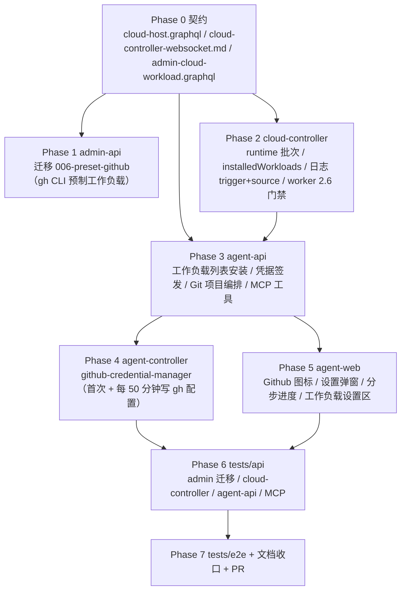

# Github 工作负载与云主机 Git 项目设置 - 实现计划

**关联 Proposal**: `docs/engineering/proposals/20261021-feat-github-workload.md`（v1.1）
**关联 PRD**: `docs/product/draft/20261021-github-workload.md`（v1.1）
**需求总分支（feat-branch）**: `feat/github-workload`（需求总 PR #253，基于 `origin/main` 提交 `2b279e4`）
**实现分支**: `feat/github-workload-impl`（基于 `feat/github-workload`）
**创建日期**: 2026-10-22
**计划版本**: v1.0
**版本说明**:
- v1.0（2026-10-22）首版，与 PRD v1.1 / 提案 v1.1 对齐。把提案 §5.2 的六个实现点拆成 8 个 Phase：契约 → admin-api 预制迁移 → cloud-controller runtime 批次 → agent-api 编排/凭据/MCP → agent-controller 凭据管理器 → agent-web → tests/api → tests/e2e + 文档收口。
- 本版新增「上游文档 × 代码现状差异」与 16 条计划期裁决，收敛提案中与现有代码不一致或未落到接口层的细节（迁移编号、凭据申请通路、git setup 批次载体、执行记录关联 ID、worker 版本门禁等）。
- 本计划**不改变 PRD 的产品口径**；对提案的 3 处实现口径做收敛（见 D1/D2/D3），需在实现 PR 描述中声明。

## 实现顺序



依赖说明：

- **P0 是唯一事实源**：GraphQL 字段、内部 REST body/响应、`workload:run` 新增字段全部以 P0 为准；契约未定稿前不写业务代码。
- **P1 与 P2/P3 可并行**：迁移只写 `cloudworkloads`，与 runtime 链路无代码依赖；但 P3 的 `cloudHostWorkloads` 查询依赖 P1 写入的 Github 预制项，联调前需先跑迁移。
- **P2 必须先于 P3**：agent-api 的安装/编排依赖 cloud-controller 的 runtime 端点与日志查询语义。
- **P3 必须先于 P4/P5**：凭据申请接口与 GraphQL 契约是容器侧与前端的前置。
- **P4 与 P5 可并行**：分属容器侧与前端；共享 P0 契约。
- **P6/P7 串行**：API 与 E2E 共用同一套 Aspire 服务与 Mongo/Redis，禁止并行执行。

开发模式采用 TDD（红-绿-重构）。每个 Phase 先落测试（RED）再写实现（GREEN），最后重构。编码前按目录加载：`docs/engineering/common-rules.md`、`backend-rules.md`、`frontend-rules.md`、`servers/admin-api/AGENTS.md`、`servers/cloud-controller/AGENTS.md`、`servers/agent-api/AGENTS.md`、`packages/agent-controller/AGENTS.md`、`apps/agent-web/AGENTS.md`、`tests/api/AGENTS.md`、`tests/e2e/AGENTS.md`。

### 关键约束（实现期不得回退）

- **不做卸载**：`installedWorkloads` 只增不删；前端不提供卸载入口。
- **仅云主机**：拉起后安装、Github 项目设置、MCP 工具只对 `Controller.type === 'cloud'` 生效；本地/自定义主机不出现入口。
- **仅 github.com**：不支持 Github Enterprise、不支持一次设置多个仓库。
- **凭据最小化与唯一写入口**：凭据只能由云主机内的 `github-credential-manager` 向 agent-api 申请并写入 gh 配置；**禁止** agent-api 经 secret env / 批次 env 向容器推送 Github token；token 不落库、不落日志、不出现在界面与执行记录。
- **runtime 安装不阻断容器**：runtime 批次的 `required` 固定 `false`；安装失败只让操作失败，不注销云主机。
- **零退化**：未使用本期能力的云主机、本地控制器、旧会话、旧 worker（低于 2.6.0 的 harness worker 会被版本门禁拒绝）行为与现状一致。
- **不新增第三方依赖**：GitHub API 沿用裸 `fetch` + `jsonwebtoken`；前端不引入表单/轮询库。
- **禁止 rebase/squash**：遵循 z-git 规范，仅允许 merge。

---

## 上游文档 × 代码现状差异

实现前必须知道的事实偏差（均在本计划内消化，无需打回上游，但需在 PR 描述中声明）：

| # | 上游表述 | 代码现状（证据） | 本计划处置 |
|---|---|---|---|
| D1 | 提案 §4.1 使用 `007-preset-github.ts`，并称「当前编号到 006」 | `servers/admin-api/src/migrations/` 实际只有 `001`~`005`（含两个 005），`index.ts` 的 `runMigrations([...])` 也只注册到 005 | 迁移文件改为 **`006-preset-github.ts`**，并在 `servers/admin-api/src/index.ts` 注册；不修改既有迁移编号 |
| D2 | 提案 §3.2 称容器以「容器接入凭据（经 cloud-controller 校验/转发）」调用 agent-api 的凭据接口 | 容器只有 `ZAG_HOST_KEY`（controller key）与 `ZAG_SERVER_ENDPOINT`/`ZAG_HOST_ENDPOINT`；没有 agent-api 地址；agent-api `/internal/cloud-hosts` 现有路由只接受 `INTERNAL_API_TOKEN` | **直接申请**：cloud-controller 向 harness Job 注入 `ZAG_AGENT_API_ENDPOINT`（来自已有 `AGENT_API_URL`）与 `ZAG_CONTROLLER_ID`；agent-controller 以 `ZAG_HOST_KEY` Bearer 调用 agent-api 新接口；agent-api 用 key-cache + bcrypt 校验 controller key 并核对 `controllerId`。不新增 controller-api 转发层 |
| D3 | 提案 §3.2/§5.2 称 Git 设置脚本由 agent-api 作为「第二个 runtime 批次」下发，但未定义接口 | cloud-controller 现有 `POST /internal/containers` 只接受 `workloadPlan`（来自 `cloudworkloads` 定义），没有「在线容器下发内联脚本」的入口；`cloudworkloadlogs.workloadId` 为必填 ObjectId | 新增内部端点 `POST /internal/containers/:id/runtime-scripts`（内联单脚本，非用户可见工作负载）；日志复用 **Github 工作负载 ID** 作为关联 ID，`workloadName='Git 项目设置'`，并用新增 `trigger/source` 区分来源 |
| D4 | 提案 §4.1 只给 `cloud_containers` 加 `installedWorkloads`，未说明启动批次如何回填 | 当前 dispatcher 的结果处理只更新日志与容器状态，没有「已安装集合」 | 在启动 init 与 runtime 批次的每条成功结果上回填 `installedWorkloads`（按 `workloadId` 去重，保留首次安装时间与来源） |
| D5 | 提案未提 worker 版本 | `packages/agent-controller` 当前 `2.5.0`，cloud-controller `MIN_HARNESS_WORKER_VERSION='2.5.0'`；新协议字段 `githubAuth` 与凭据管理器旧 worker 不认识 | 包版本升到 **`2.6.0`**；cloud-controller `MIN_HARNESS_WORKER_VERSION='2.6.0'`；worker 镜像安装 `agent-gear@2.6.x`；普通容器 `MIN_WORKER_VERSION` 保持 `2.2.0` |
| D6 | 提案 §3.2 的凭据申请接口路径为 `/internal/cloud-hosts/:controllerId/github-credential` | agent-api 现有 `internalCloudHostRouter` 以 `INTERNAL_API_TOKEN` 统一守门；容器没有该 token | 同一路径保留，但增加**双鉴权分支**：`Bearer INTERNAL_API_TOKEN`（服务间）或 `Bearer <controller key>`（容器）；controller key 分支必须校验 key 归属与 `controllerId` 一致，且只能取回本机绑定仓库 |
| D7 | PRD 功能点 4 的 clone 默认路径是 `/root/workspace`；PRD 功能点 3 的 Github 工作负载参数默认是 `/root/workspaces/{repo}` | 云电脑当前只暴露 `workspaceId`，GraphQL 没有默认工作区路径字段；`ensureCloudHostWorkspace` 只供创建时使用 | GraphQL `CloudHost` 新增 `defaultWorkspace`（字段解析 `workspaceId → ControllerWorkspace.path`）；设置弹窗默认填该值；Github 工作负载脚本负责把 `{repo}` 占位符解析为仓库名（独立安装时的默认值） |

---

## 计划期裁决（提案留白 / 含混处的实现口径）

1. **迁移编号与幂等**：新增 `006-preset-github`，`presetKey='github'`、`name='Github'`、`workloadKind='standard'`、`isPreset=true`。先按 `presetKey` 查、再按精确 `name` 查；命中即跳过且打 `warn`，**不覆盖管理员修改**。`initScript` 首行 `command -v gh >/dev/null 2>&1 && gh --version && exit 0`；`paramSchema` 为 `repoFullName`（TEXT，默认 `""`）与 `targetPath`（TEXT，默认 `/root/workspaces/{repo}`）；`postScript=null`、`dependsOnWorkloadIds=[]`。

2. **凭据申请通路（D2/D6）**：
   - cloud-controller 在 harness Job env 中注入 `ZAG_AGENT_API_ENDPOINT`（值取 `config.agentApiUrl`，去掉末尾 `/`）与 `ZAG_CONTROLLER_ID`（agent-api 创建云主机时预生成的 controllerId）。
   - agent-controller 的 `github-credential-manager` 调 `POST {ZAG_AGENT_API_ENDPOINT}/internal/cloud-hosts/{ZAG_CONTROLLER_ID}/github-credential`，Header `Authorization: Bearer ${ZAG_HOST_KEY}`，无 body。
   - agent-api 鉴权顺序：先比较 `INTERNAL_API_TOKEN`（常量时间）；不匹配时用 `lookupKey(hostKey)` 取缓存 → `bcrypt.compare` → 要求 `cached.type==='cloud'` → `Controller.findOne({ keyId: cached.keyId })` → `controller._id.toString() === params.controllerId` → `CloudHost.findOne({ controllerId, userId: cached.userId, deletedAt: null })` 且状态为 `STARTING|RUNNING`。
   - 响应 `200 { token, expiresAt }`；`401` 凭据非法；`403` controllerId 不匹配/非 cloud；`404` 无绑定或云主机不存在；`409` 云主机非 STARTING/RUNNING。**任何分支都不得打印 token**。

3. **Git 项目设置批次（D3）**：新增 cloud-controller `POST /internal/containers/:containerId/runtime-scripts`，body：
   ```json
   {
     "workloadId": "<github workload id>",
     "workloadName": "Git 项目设置",
     "script": "set -euo pipefail\n...",
     "params": { "repoFullName": "owner/repo", "targetPath": "/root/workspace" },
     "source": "system",
     "githubAuth": true
   }
   ```
   校验：容器存在且 `status==='online'`；`workloadId` 为合法 ObjectId；`script` 非空且 ≤16 KiB；`source ∈ user|mcp|system`；`githubAuth` 仅允许布尔。响应 `200 { batchId, logId }`；`409 CONTAINER_BUSY`（已有 runtime 批次）/`CONTAINER_NOT_ONLINE`；`404 NOT_FOUND`。日志 `workloadId` 复用 Github 工作负载 ID，`workloadName='Git 项目设置'`，`trigger='runtime'`、`source='system'`。

4. **runtime 安装端点**：`POST /internal/containers/:containerId/workloads`，body `{ workloadId, params, source }`。cloud-controller 用只读定义做**后序 DFS 展开**（依赖先行、去重、≤10），显式工作负载合并用户参数并按 `paramSchema` 校验（类型/取值/未知参数），隐式依赖取默认参数；输出 `batchId` 与 `items[]`（每条含 `logId/workloadId/workloadName`）。`required` 固定 `false`。若已安装仍允许执行（脚本幂等），执行成功后 `installedWorkloads` 去重保留首次记录，不重复插入。

5. **runtime 批次状态机**：
   - 入口要求 `status==='online'`；CAS 到 `initializing`（写 `currentWorkloadName`）并写入 `initTrigger='runtime'`。
   - 完成后：`initTrigger==='runtime'` 一律 `markOnline`（不进入 `connecting`）；清空 `initTrigger`/`currentWorkloadName`。
   - 若执行过程中断线，看门狗按既有规则推进；重连时 `startInit` 看到 `initTrigger==='runtime'` 不再重放启动计划，仅收口（避免把创建时的 harness 初始化再跑一遍）。
   - `startInit` 设置 `initTrigger='start'`；完成后同样清空。
   - 两类批次共用 `KeyedMutex`；同一容器同时只允许一个 runtime 批次。

6. **已安装集合（D4）**：`cloudcontainers.installedWorkloads: [{ workloadId, name, installedAt, source }]`，`source ∈ start|user|mcp`。写入时机：init 起始批次或 runtime 批次的每条 `workload:result` 为 `success` 时；`timeout/failed` 不写。按 `workloadId` 去重（Mongo `$addToSet` 语义由仓储层实现，保留首次时间）。`GET /internal/containers` 的 JSON 增加该字段。

7. **执行记录 trigger/source**：`cloudworkloadlogs` 增加 `trigger: 'start'|'runtime'`（默认 `start`）与 `source: 'admin'|'user'|'mcp'|'system'`（默认 `admin`）。起始 init 写 `start/admin`；runtime 安装写 `runtime/user|mcp`；Git 设置写 `runtime/system`。admin-api 只读模型与 GraphQL 增加可空字段（历史记录缺省 `start/admin`），前端后台日志对话框可展示来源。

8. **operation 状态机**：新增 `cloud_host_setup_operations`。`kind ∈ installWorkload|githubSetup`；`status ∈ RUNNING|SUCCEEDED|FAILED`；`steps: [{ key: workload|gitSetup|session, status: PENDING|RUNNING|SUCCEEDED|FAILED|SKIPPED, detail }]`。`installWorkload` 只有 `workload` 一步；`githubSetup` 固定三步。操作创建后立即返回（GraphQL），后台 runner 异步推进；`cloudHostSetupOperation(id)` 供前端 1.5s 轮询。`retryCloudHostSetupOperation(id)` 仅允许 `FAILED`，把失败步骤及其后续步骤重置为 `PENDING`、保留 `SUCCEEDED|SKIPPED`，重新入队。同一 controllerId 同时只允许一个 RUNNING 的 `githubSetup`（`KeyedMutex` + DB 查询双保险）。

9. **runner 的完成判定**：agent-api 调用 cloud-controller runtime 接口拿到 `logId(s)` 后，每 1s 调 `GET /internal/containers/:id/workload-logs`，按 `logId` 过滤；全部进入 `success|failed|timeout` 即结束。任一条 `failed|timeout` → 步骤 FAILED；`success` → SUCCEEDED。单步超时默认 `CLOUD_HOST_SETUP_STEP_TIMEOUT_MS=600000`（10 分钟），超时步骤 FAILED、错误文案「等待工作负载执行超时」。轮询期间把当前 `running` 记录的 `workloadName` 写入 `step.detail`，支撑进度展示。

10. **Git setup 脚本幂等**：
    ```bash
    set -euo pipefail
    TARGET="${WORKLOAD_PARAM_TARGETPATH:?missing targetPath}"
    REPO="${WORKLOAD_PARAM_REPOFULLNAME:?missing repoFullName}"
    command -v gh >/dev/null || { echo "gh 不可用，请先安装 Github 工作负载"; exit 1; }
    if [ -d "$TARGET/.git" ]; then
      ORIGIN="$(git -C "$TARGET" remote get-url origin 2>/dev/null || true)"
      case "$ORIGIN" in
        *"github.com/$REPO"|*"github.com:$REPO") git -C "$TARGET" pull --ff-only ;;
        *) echo "目标目录已存在其他 Git 仓库，请修改 clone 路径"; exit 2 ;;
      esac
    else
      if [ -d "$TARGET" ] && [ -n "$(ls -A "$TARGET" 2>/dev/null)" ]; then
        echo "目标目录非空且不是 Git 仓库，请修改 clone 路径"; exit 3
      fi
      gh repo clone "$REPO" "$TARGET"
    fi
    ```
    `TARGET` 默认 `/root/workspace`；`gh` 认证由 credential manager 在脚本执行前完成。脚本与批次均不含 token。

11. **凭据续期**：`github-credential-manager` 在云主机启动时创建（随 supervisor 生命周期），首次 `refresh()` 在 Git setup 批次前由 `beforeWorkloadBatch` 触发；此后 `setInterval` 每 **50 分钟** 调一次申请接口并覆盖 gh 配置。写入方式固定：
    ```bash
    printf '%s' "$TOKEN" | gh auth login --with-token
    gh auth setup-git
    ```
    token 只经 stdin 传递，不进入 argv/env/日志。管理器内部用互斥锁串行化「申请 → 写入」，失败按 1/2/4 分钟退避，超过 token 有效期（`expiresAt`）仍失败则记录告警并停止本轮续期；下一次定时继续尝试。`404`（未设置过 Git 项目）视为正常跳过，不打 error。

12. **token scope**：`GitHubService.createRepoScopedToken(accountId, repoFullName)` 先从 `githubinstallations` 中按 `accountId` 找到包含该 `fullName` 的安装，取 `installationId`；调用 `POST https://api.github.com/app/installations/{installationId}/access_tokens`，body `{ repositories: [repoName], permissions: { contents: "write" } }`。返回 `{ token, expiresAt }`。找不到安装/仓库 → 抛 `repository is not authorized`；GitHub 非 2xx → 抛 `failed to issue github token`，**不把响应体写入错误信息**。

13. **会话创建（D7）**：`controllerWorkspaceService` 新增 `ensureWorkspace(controllerId,userId,path)`（幂等 upsert，不触发 10 个工作区上限；名称取路径末段）；`ensureCloudHostWorkspace` 复用该实现。gitSetup 成功后：查/建 targetPath 工作区 → `sessionService.create(userId,{controllerId,workspaceId,acpServerType:'opencode',mcpServerIds:[cloudHostToolsServerId]})`。会话创建失败：`session` 步骤 FAILED，但 operation 置 `SUCCEEDED`，`error` 记录可读原因；前端展示「仓库已就绪，请手动创建会话」。

14. **MCP 工具**：新增平台内置服务 `agent-cloud-host-tools`（`transport='platform'`、`source='platform'`），工具：
    - `workload_list`：列出当前云主机可安装的 `standard` 工作负载（已安装标记、参数 schema、依赖）。
    - `workload_install`：参数 `{ workloadId, params? }`，从会话所属 controller 解析云主机；仅云主机会话可用；与前台安装共用 `cloud-host-workload-service`，执行记录 `source='mcp'`；MCP 调用会等待 operation 完成（上限 10 分钟）并返回成功/失败摘要。
    `sessionService.create` 对 `Controller.type==='cloud'` 自动确保该平台服务并合并进 `mcpServerIds`（去重），保证默认会话与手动会话都能用；非云会话不装配。

15. **前端入口与门控**：Github 图标放在 Sidebar「工作区」`TreeSection` 的 `actions`（仅 `type==='cloud'` 且 `cloudHost.status==='RUNNING'` 时显示）；同时 ControllerConfigPage 的云电脑工作区区域提供同一入口。弹窗默认选中当前云主机（固定），未绑定 Github 账号时展示绑定引导并禁用确认；仓库列表来自所选账号的 `installations[].repos` 去重；工作负载勾选默认选中 `Github` 且不可取消；clone 路径默认 `CloudHost.defaultWorkspace`，可编辑。确认后打开进度对话框，轮询 operation，成功后 `navigate('/sessions/{sessionId}')` 并 refetch `HOME_OVERVIEW`。

16. **文档生命周期**：PRD 留在 `docs/product/draft/`，提案留在 `docs/engineering/proposals/`；实现完成后由验收节点移动归档。本节点只新增 `docs/engineering/plan/20261021-feat-github-workload.md` 并更新 `docs/engineering/AGENTS.md` 的计划索引。

---

## Phase 0: 契约（Contracts）

开发分支：`feat/github-workload-impl`。契约提交与实现分开 commit，便于评审。

### 文件修改

| 文件 | 操作 | 说明 |
|------|------|------|
| `contracts/cloud-host.graphql` | 修改 | 新增工作负载列表/安装、Git 项目设置、operation 进度、`CloudHost.defaultWorkspace/workloadInstalling` |
| `contracts/cloud-controller-websocket.md` | 修改 | §2.9 `workload:run` 增 `githubAuth`；A.2 增 runtime 端点；A.3/A.6 增 `installedWorkloads`/`trigger`/`source`；harness env 增 `ZAG_AGENT_API_ENDPOINT`/`ZAG_CONTROLLER_ID`；worker 版本门禁说明 |
| `contracts/admin-cloud-workload.graphql` | 修改 | `CloudWorkloadLog` 增 `trigger`/`source`（可空，历史记录缺省） |
| `contracts/admin-cloud-container.graphql` | 修改 | `CloudContainer` 增 `installedWorkloads`（可空数组） |

### `contracts/cloud-host.graphql` 增量

```graphql
enum CloudHostSetupKind {
  INSTALL_WORKLOAD
  GITHUB_SETUP
}

enum CloudHostSetupStatus {
  RUNNING
  SUCCEEDED
  FAILED
}

enum CloudHostSetupStepStatus {
  PENDING
  RUNNING
  SUCCEEDED
  FAILED
  SKIPPED
}

type CloudHostWorkloadItem {
  workloadId: ID!
  name: String!
  paramSchema: JSON!
  dependsOnWorkloadIds: [ID!]!
  isPreset: Boolean!
  installed: Boolean!
  installedAt: String
  source: String
}

type CloudHostSetupStep {
  key: String!
  status: CloudHostSetupStepStatus!
  detail: String
}

type CloudHostSetupOperation {
  id: ID!
  kind: CloudHostSetupKind!
  status: CloudHostSetupStatus!
  steps: [CloudHostSetupStep!]!
  sessionId: ID
  error: String
  createdAt: String!
  updatedAt: String!
}

type CloudHost {
  # ... 既有字段不变 ...
  defaultWorkspace: String!
  # 当前正在 runtime 安装的工作负载名；null 表示空闲
  workloadInstalling: String
}

input InstallCloudHostWorkloadInput {
  controllerId: ID!
  workloadId: ID!
  params: JSON
}

input SetupCloudHostGithubProjectInput {
  controllerId: ID!
  accountId: ID!
  repoFullName: String!
  targetPath: String!
}

extend type Query {
  cloudHostWorkloads(controllerId: ID!): [CloudHostWorkloadItem!]!
  cloudHostSetupOperation(id: ID!): CloudHostSetupOperation
}

extend type Mutation {
  installCloudHostWorkload(input: InstallCloudHostWorkloadInput!): CloudHostSetupOperation!
  setupCloudHostGithubProject(input: SetupCloudHostGithubProjectInput!): CloudHostSetupOperation!
  retryCloudHostSetupOperation(id: ID!): CloudHostSetupOperation!
}
```

> `JSON` scalar 已在 `graphql/schemas/session.ts` 声明一次，agent-api 全 schema 复用；不得重复声明。

### `contracts/cloud-controller-websocket.md` 增量

1. §2.9 `workload:run` payload 新增可选字段：

| 字段 | 类型 | 必填 | 说明 |
|------|------|------|------|
| `githubAuth` | `boolean` | 否 | `true` 时客户端必须在执行本批第一条脚本前完成 gh 凭据申请与写入；缺省/false 行为不变 |

2. A.2 新增内部端点：

```
POST /internal/containers/:containerId/workloads
Body: { workloadId, params?: object, source?: 'user'|'mcp' }
200: { batchId, items: [{ logId, workloadId, workloadName }] }
409: CONTAINER_NOT_ONLINE | CONTAINER_BUSY
404: NOT_FOUND
400: INVALID_WORKLOAD

POST /internal/containers/:containerId/runtime-scripts
Body: {
  workloadId, workloadName, script, params?: object,
  source?: 'user'|'mcp'|'system', githubAuth?: boolean
}
200: { batchId, logId }
409: CONTAINER_NOT_ONLINE | CONTAINER_BUSY
404: NOT_FOUND
400: INVALID_SCRIPT
```

3. A.2.2 harness 请求新增可选 `controllerId`；Job env 新增 `ZAG_AGENT_API_ENDPOINT` 与 `ZAG_CONTROLLER_ID`（仅 harness）。

4. A.3 `CloudContainer` JSON 新增 `installedWorkloads`；A.6 `CloudWorkloadLog` JSON 新增 `trigger`/`source`。

5. worker 版本门禁：`purpose=harness` 的 `MIN_HARNESS_WORKER_VERSION` 提升为 `2.6.0`（`SUPPORTED_MAJOR=2` 不变）；普通容器仍 `2.2.0`。

### 验收 checklist

- [ ] `cloud-host.graphql` 与 `servers/agent-api/src/graphql/schemas/cloud-host.ts` 类型/字段名/可空性逐字一致
- [ ] `CloudHostSetupOperation.steps` 非空数组、`sessionId/error` 可空
- [ ] runtime 端点 body/响应/错误码与 Phase 2 实现一致
- [ ] `workload:run.githubAuth` 缺省行为与今天完全一致
- [ ] admin 两个契约只新增可空字段，不改变既有字段类型
- [ ] 契约中不出现 Github token 字段/示例

---

## Phase 1: admin-api（Github 预制工作负载迁移）

开发分支：`feat/github-workload-impl`。TDD：先写 `006-preset-github.test.ts`（RED）→ 实现迁移（GREEN）。

### 文件修改

| 文件 | 操作 | 说明 |
|------|------|------|
| `servers/admin-api/src/migrations/006-preset-github.ts` | 新增 | 写入「Github」预制工作负载 |
| `servers/admin-api/src/migrations/006-preset-github.test.ts` | 新增 | 幂等、`presetKey`/name 冲突跳过、脚本/参数断言 |
| `servers/admin-api/src/index.ts` | 修改 | `runMigrations([...])` 注册 `migration006PresetGithub` |
| `tests/api/src/admin-api/cloud-workload.test.ts` | 修改 | 预制项存在性/幂等/参数 schema |
| `servers/admin-api/AGENTS.md` | 修改 | 迁移清单与预制项说明 |

### 迁移脚本口径

```ts
export const name = '006-preset-github';
export const GITHUB_PRESET_KEY = 'github';
export const GITHUB_PRESET_NAME = 'Github';

export const GITHUB_INIT_SCRIPT = `#!/usr/bin/env bash
set -euo pipefail

# 幂等：镜像已预装 gh 时直接成功（旧镜像走内网 apt 代理安装）
if command -v gh >/dev/null 2>&1; then
  gh --version
  exit 0
fi

install -m 0755 -d /etc/apt/keyrings
curl -fsSL https://nexus.internal.fffdan.com/repository/github-cli-apt-proxy/githubcli-archive-keyring.gpg \
  -o /etc/apt/keyrings/githubcli-archive-keyring.gpg
chmod a+r /etc/apt/keyrings/githubcli-archive-keyring.gpg
printf '%s\\n' \
  'deb [signed-by=/etc/apt/keyrings/githubcli-archive-keyring.gpg] https://nexus.internal.fffdan.com/repository/github-cli-apt-proxy/ stable main' \
  > /etc/apt/sources.list.d/github-cli.list
apt-get update
apt-get install -y gh
gh --version
`;

// paramSchema：
// - repoFullName: TEXT, defaultValue: ''
// - targetPath:   TEXT, defaultValue: '/root/workspaces/{repo}'
```

`run()`：先 `findOne({ presetKey })`，再 `findOne({ name })`；命中则 `console.warn` 并返回；否则 `CloudWorkload.create({ ... })`。不修改既有 `cloudworkloads`。

### 测试用例

| # | 用例 | 预期 |
|---|------|------|
| T-MIG1 | 空库执行迁移 | 新增 1 条 `presetKey='github'`、`isPreset=true`、`workloadKind='standard'` |
| T-MIG2 | 重复执行 | 不新增第二条，`presetKey` 唯一 |
| T-MIG3 | 同名非预制项已存在 | 跳过并 warn，不覆盖 |
| T-MIG4 | 同 presetKey 已被管理员改名 | 跳过，不覆盖 |
| T-MIG5 | 脚本断言 | 含内部 apt 源、key-ring、`apt-get install -y gh`、首行幂等短路；不含公网 `cli.github.com` |
| T-MIG6 | 参数断言 | `repoFullName`/`targetPath` 类型与默认值正确，`postScript=null`、依赖为空 |

### 命令参考

```bash
cd servers/admin-api
npx vitest run src/migrations/006-preset-github.test.ts
npx vitest run
npm run build
```

### 验收 checklist

- [ ] 迁移文件编号为 006，未改动 001~005
- [ ] `runMigrations` 已注册且按 name 幂等
- [ ] 迁移不覆盖管理员对同名/同 presetKey 工作负载的修改
- [ ] 脚本不访问不可信外部源

---

## Phase 2: cloud-controller（runtime 批次 / 已安装集合 / 日志来源）

开发分支：`feat/github-workload-impl`。TDD：先补 `internal-api.test.ts`、`workload-dispatcher.test.ts`、`container-service.test.ts`、`worker-version.test.ts`（RED）→ 实现（GREEN）。

### 文件修改

| 文件 | 操作 | 说明 |
|------|------|------|
| `servers/cloud-controller/src/models/cloud-container.ts` | 修改 | 新增 `installedWorkloads`、`initTrigger` |
| `servers/cloud-controller/src/models/cloud-workload-log.ts` | 修改 | 新增 `trigger`/`source` |
| `servers/cloud-controller/src/repositories/container-repository.ts` | 修改 | 实体/raw/toEntity/create/update/InMemory 补字段 |
| `servers/cloud-controller/src/repositories/workload-log-repository.ts` | 修改 | `CreateWorkloadLogInput` 增 `trigger/source`；entity/raw/toEntity 补字段 |
| `servers/cloud-controller/src/services/workload-plan.ts` | 修改 | 新增 `resolveRuntimeWorkloadPlan()`（显式参数校验 + 依赖展开）与 `normalizeProvidedParams()` |
| `servers/cloud-controller/src/services/workload-dispatcher.ts` | 修改 | `startRuntimeBatch` / `startRuntimeScriptBatch` / 结果回填 `installedWorkloads` / `githubAuth` 透传 / `initTrigger` 收口 |
| `servers/cloud-controller/src/services/container-service.ts` | 修改 | harness Job env 注入 `ZAG_AGENT_API_ENDPOINT`/`ZAG_CONTROLLER_ID`；`ContainerServiceConfig` 增 `agentApiUrl` |
| `servers/cloud-controller/src/services/worker-version.ts` | 修改 | `MIN_HARNESS_WORKER_VERSION='2.6.0'` |
| `servers/cloud-controller/src/routes/internal-api.ts` | 修改 | 新增 `/workloads`、`/runtime-scripts`；`CloudContainerJson` 增 `installedWorkloads`；日志 JSON 增 `trigger/source` |
| `servers/cloud-controller/src/index.ts` | 修改 | 向 `ContainerServiceConfig` 传 `config.agentApiUrl` |
| `servers/admin-api/src/models/cloud-workload-log.ts` | 修改 | 只读模型补 `trigger`/`source`（历史缺省 `start`/`admin`） |
| `servers/admin-api/src/models/cloud-container.ts` | 修改 | 只读模型补 `installedWorkloads` |
| `servers/admin-api/src/graphql/schemas/cloud-workload.ts` | 修改 | `CloudWorkloadLog` 增 `trigger`/`source` 与枚举 |
| `servers/admin-api/src/graphql/schemas/cloud-container.ts` | 修改 | `CloudContainer` 增 `installedWorkloads` |
| `servers/admin-api/src/graphql/resolvers/cloud-workload.ts` | 修改 | 日志/容器映射补新字段 |
| `servers/cloud-controller/AGENTS.md` | 修改 | runtime 批次、installedWorkloads、版本门禁 |
| `deploy/images/worker/Dockerfile` | 修改 | `agent-gear@2.6.x` |
| `packages/agent-controller/package.json` | 修改 | `version: 2.6.0` |

### 数据模型增量

```ts
// cloud-container.ts
installedWorkloads: [{
  workloadId: ObjectId,
  name: String,
  installedAt: Date,
  source: 'start' | 'user' | 'mcp',
}]

// runtime 批次收口依据
initTrigger: 'start' | 'runtime' | null
```

```ts
// cloud-workload-log.ts
trigger: 'start' | 'runtime'   // default 'start'
source: 'admin' | 'user' | 'mcp' | 'system'  // default 'admin'
```

### `resolveRuntimeWorkloadPlan()` 口径

```ts
export function resolveRuntimeWorkloadPlan(input: {
  workloadId: string;
  params: Record<string, unknown>;
  definitions: WorkloadPlanDefinition[];
}): WorkloadPlanEntry[]
```

- 后序 DFS 展开依赖（与 `resolveFallbackWorkloadPlan` 同口径），去重、≤10、环检测。
- 显式工作负载：以 `normalizeDefaultParams` 为底，逐项覆盖用户参数；未知 key、类型不符、select 不在 options、text >1024 → 抛 `WorkloadPlanError`。
- 隐式依赖：默认参数、`implicit=true`、`required=false`。
- 显式项 `implicit=false`、`required=false`。
- 返回顺序即执行顺序（依赖先于依赖方）。

### dispatcher 增量

```ts
async startRuntimeBatch(containerId: string, input: {
  entries: RuntimeEntry[];   // { workloadId, name, script, params }
  source: 'user' | 'mcp' | 'system';
  githubAuth?: boolean;
}): Promise<{ batchId: string; items: RuntimeItem[] }>
```

1. 在容器互斥锁内：`findById` → 必须 `status==='online'`（否则 `ContainerNotOnlineError`）。
2. 创建日志：首条 `running`、其余 `pending`，写 `trigger='runtime'`、`source`、脚本/参数快照。
3. `containerService.markInitializing(containerId, entries[0].name)`，`containerRepository.update(id,{ initTrigger:'runtime' })`。
4. `emitRun(containerId,'init',logs,undefined,{ githubAuth })`。
5. 结果处理沿用 `handleResult` → `advance` → `finishInit`；`finishInit` 读取 `initTrigger`：`runtime` 直接 `markOnline`，`start` 走现有 `isConnected ? online : connecting`；成功后清空 `initTrigger`。
6. 每条 `success` 结果调用 `appendInstalledWorkload(containerId, log.workloadId, log.workloadName, batchSource)`；`failed/timeout` 不写。用 `containerRepository.update` 归一去重（已存在同 workloadId 则跳过）。
7. `startInit` 写入 `initTrigger='start'`；`startInitLocked` 若发现 `status==='connecting' && initTrigger==='runtime'`，清空 trigger 并返回 `noInit`（不重放创建计划）。

### 内部端点

`POST /internal/containers/:containerId/workloads`
- 校验 `workloadId` 存在且 `workloadKind !== 'harness'`；`params` 为对象；`source` 白名单。
- `collectWorkloadDefinitions([workloadId], ...)` → `resolveRuntimeWorkloadPlan`。
- `entries` 过滤掉 `initScript` 为空的工作负载（保留 deleted 占位？本期 runtime 不做删除占位：不存在返回 404）。
- 调 `startRuntimeBatch`；响应 `{ batchId, items }`。

`POST /internal/containers/:containerId/runtime-scripts`
- 校验 body；`script.trim().length>0` 且 ≤16 KiB；`workloadId` 为合法 ObjectId；`source` 白名单；`githubAuth` 布尔。
- 单条 entry；调 `startRuntimeBatch`；响应 `{ batchId, logId }`。
- 不写 `installedWorkloads`（Git 设置不是工作负载安装）。

错误映射：`ContainerNotOnlineError` → 409 `CONTAINER_NOT_ONLINE`；`ContainerBusyError` → 409 `CONTAINER_BUSY`；`WorkloadPlanError` → 400 `INVALID_WORKLOAD`；未知容器 → 404 `NOT_FOUND`。

### harness Job env

`buildHarnessJobEnv` 追加：
```ts
if (this.cfg.agentApiUrl) env.ZAG_AGENT_API_ENDPOINT = this.cfg.agentApiUrl.replace(/\/+$/, '');
if (options.controllerId) env.ZAG_CONTROLLER_ID = options.controllerId;
```
`StartHarnessOptions` / `parseHarnessRequest` 新增可选 `controllerId`（null 时不注入；agent-api 必传）。`AGENT_API_URL` 缺失时仅告警，不阻断容器创建（Github 设置会因凭据申请不可用而失败，错误可读）。

### `workload:run` 透传

`emitRun` 的 payload 增加 `githubAuth: githubAuth === true`（仅 runtime 脚本批次携带；普通批次不出现该键，保持报文形状零变化）。worker 侧只在 `githubAuth===true` 时触发凭据预取。

### 测试用例

**`routes/internal-api.test.ts`**

| # | 用例 | 预期 |
|---|------|------|
| T-RI1 | runtime workloads 鉴权 | 缺 Bearer → 401 |
| T-RI2 | 容器不在线 | 409 `CONTAINER_NOT_ONLINE` |
| T-RI3 | 未知容器/工作负载 | 404 / 400 |
| T-RI4 | 依赖展开 | 返回 items 依赖在前、去重、显式参数覆盖默认值 |
| T-RI5 | 显式参数非法 | 400 `INVALID_WORKLOAD`（未知 key/类型错） |
| T-RI6 | runtime scripts 正常 | 201/200，返回 `logId`，日志 `trigger='runtime'`、`source='system'` |
| T-RI7 | script 空/超长 | 400 `INVALID_SCRIPT` |
| T-RI8 | 已有 runtime 批次 | 409 `CONTAINER_BUSY` |
| T-RI9 | `installedWorkloads` 回读 | JSON 含安装项；重复安装不重复插入 |

**`services/workload-dispatcher.test.ts`（增量）**

| # | 用例 | 预期 |
|---|------|------|
| T-WD-R1 | startRuntimeBatch 在线容器 | 建日志、置 initializing、emit `workload:run`（`trigger` 由日志体现）、`githubAuth` 透传 |
| T-WD-R2 | 结果 success | 写 `installedWorkloads`（source 正确），推进下一条 |
| T-WD-R3 | 结果 failed/timeout | 不写 installedWorkloads，不注销容器（required=false） |
| T-WD-R4 | runtime 收口 | `markOnline`（不是 connecting），清空 `initTrigger/currentWorkloadName` |
| T-WD-R5 | runtime 中断连 | 看门狗推进；重连 `startInit` 不重放创建计划 |
| T-WD-R6 | 起始 init success | 同样回填 installedWorkloads（source=`start`） |

**`services/container-service.test.ts` / `k8s-job-manager.test.ts`**

| # | 用例 | 预期 |
|---|------|------|
| T-CS-R1 | harness Job env | 含 `ZAG_AGENT_API_ENDPOINT`/`ZAG_CONTROLLER_ID`；非 harness 不含 |
| T-CS-R2 | `AGENT_API_URL` 缺失 | 不注入、不抛错 |

**`services/worker-version.test.ts`**

| # | 用例 | 预期 |
|---|------|------|
| T-WV1 | harness 2.5.0 | 拒绝（低于 2.6.0） |
| T-WV2 | harness 2.6.0 | 通过 |
| T-WV3 | idle 2.2.0 | 通过（普通容器门禁不变） |

### 命令参考

```bash
cd servers/cloud-controller
npx vitest run src/routes/internal-api.test.ts src/services/workload-dispatcher.test.ts \
  src/services/workload-plan.test.ts src/services/container-service.test.ts \
  src/services/worker-version.test.ts
npx vitest run
npm run build
```

### 验收 checklist

- [ ] 起始 init 行为零变化（未携带 `githubAuth` 的批次报文形状不变）
- [ ] runtime 批次失败不触发 `forceDestroy`
- [ ] `installedWorkloads` 只在 success 时写入、按 workloadId 去重
- [ ] 日志 `trigger/source` 默认值兼容历史记录
- [ ] harness worker 门禁 2.6.0，普通容器 2.2.0
- [ ] `POST /internal/containers` 既有校验/错误码无回归

---

## Phase 3: agent-api（工作负载 / 凭据 / Git 项目编排 / MCP）

开发分支：`feat/github-workload-impl`。TDD：先写 service/resolver/route 单测（RED）→ 实现（GREEN）。

### 文件修改

| 文件 | 操作 | 说明 |
|------|------|------|
| `servers/agent-api/src/models/cloud-host-setup-operation.ts` | 新增 | 操作状态机 |
| `servers/agent-api/src/models/cloud-host-github-binding.ts` | 新增 | controllerId 唯一绑定 |
| `servers/agent-api/src/models/cloud-container.ts` | 修改 | 只读模型补 `installedWorkloads` / `currentWorkloadName`（`workloadInstalling` 数据源） |
| `servers/agent-api/src/services/cloud-workload-catalog.ts` | 新增 | 只读 `cloudworkloads`：standard 列表、按 ID/预设查 |
| `servers/agent-api/src/services/github.ts` | 修改 | 新增 `createRepoScopedToken` |
| `servers/agent-api/src/services/github.test.ts` | 修改 | token scope/授权/错误脱敏 |
| `servers/agent-api/src/services/cloud-controller-client.ts` | 修改 | 新增 `startRuntimeWorkload` / `startRuntimeScript` / `getWorkloadLogs`；`StartHarnessInput` 增 `controllerId`；新增带 `status/code` 的 `CloudControllerRequestError`（409/404/400 可读映射） |
| `servers/agent-api/src/services/cloud-host-workload-service.ts` | 新增 | 列表/安装/operation runner |
| `servers/agent-api/src/services/cloud-host-github-service.ts` | 新增 | Git 项目编排（三步） |
| `servers/agent-api/src/services/cloud-host-service.ts` | 修改 | `mapCloudHost` 增 `defaultWorkspace`（或字段 resolver）；创建时传 controllerId；新增 `findRawHostByController` |
| `servers/agent-api/src/services/controller-workspace.ts` | 修改 | 新增 `ensureWorkspace`，`ensureCloudHostWorkspace` 复用 |
| `servers/agent-api/src/services/session.ts` | 修改 | 云会话自动装配 `agent-cloud-host-tools` 平台服务 |
| `servers/agent-api/src/services/cloud-host-tools.ts` | 新增 | 平台 MCP 工具定义与 handler（`workload_list`/`workload_install`） |
| `servers/agent-api/src/services/mcp-dispatch.ts` | 修改 | 分发 `agent-cloud-host-tools` |
| `servers/agent-api/src/graphql/schemas/cloud-host.ts` | 修改 | 契约实现 |
| `servers/agent-api/src/graphql/resolvers/cloud-host.ts` | 修改 | Query/Mutation/CloudHost 字段解析 |
| `servers/agent-api/src/graphql/resolvers/index.ts` | 修改 | 登记 `CloudHost` 类型级 resolver |
| `servers/agent-api/src/routes/internal-cloud-host.ts` | 修改 | 新增 credential 路由与双鉴权 |
| `servers/agent-api/src/config/index.ts` | 修改 | `cloudHostSetupStepTimeoutMs` 等 |
| `servers/agent-api/AGENTS.md` | 修改 | 新服务/接口/工具说明 |
| `aspire/AgentGear.AppHost/AppHost.cs` | 修改 | 无需新增变量（cloud-controller 已有 AGENT_API_URL）；确认 harness 开关 |
| `aspire/AgentGear.AppHost/AGENTS.md` | 修改 | 如 env 说明有变化 |

### 数据模型

```ts
// cloud-host-setup-operation.ts
{
  userId: ObjectId,
  controllerId: ObjectId,
  hostId: ObjectId,
  kind: 'installWorkload' | 'githubSetup',
  status: 'RUNNING' | 'SUCCEEDED' | 'FAILED',
  steps: [{
    key: 'workload' | 'gitSetup' | 'session',
    status: 'PENDING' | 'RUNNING' | 'SUCCEEDED' | 'FAILED' | 'SKIPPED',
    detail: String | null,
  }],
  batchId: String | null,
  containerId: String | null,
  sessionId: ObjectId | null,
  error: String | null,
  createdAt / updatedAt: Date,
}
// 索引：{ userId:1, createdAt:-1 }、{ controllerId:1, status:1 }
```

```ts
// cloud-host-github-binding.ts
{
  userId: ObjectId,
  controllerId: ObjectId, // unique
  accountId: ObjectId,
  repoFullName: String,
  targetPath: String,
  createdAt / updatedAt: Date,
}
```

### `createRepoScopedToken`

```ts
async createRepoScopedToken(
  accountId: string,
  repoFullName: string,
): Promise<{ token: string; expiresAt: Date }> {
  const account = await GitHubAccount.findOne({ _id: accountId });
  if (!account) throw new Error('account not found');
  const installations = await GitHubInstallation.find({ accountId: account._id }).lean();
  const match = installations.find((i) =>
    (i.repos ?? []).some((r) => r.fullName.toLowerCase() === repoFullName.toLowerCase()),
  );
  if (!match) throw new Error('repository is not authorized');
  const repoName = repoFullName.split('/').pop()!;
  const appJwt = this.createAppJwt();
  const response = await fetch(
    `https://api.github.com/app/installations/${match.installationId}/access_tokens`,
    {
      method: 'POST',
      headers: {
        Authorization: `Bearer ${appJwt}`,
        Accept: 'application/vnd.github+json',
        'Content-Type': 'application/json',
      },
      body: JSON.stringify({
        repositories: [repoName],
        permissions: { contents: 'write' },
      }),
    },
  );
  if (!response.ok) throw new Error('failed to issue github token');
  const data = (await response.json()) as { token: string; expires_at: string };
  return { token: data.token, expiresAt: new Date(data.expires_at) };
}
```

> 现有 `fetch` 调用在测试里用 `vi.stubGlobal('fetch', ...)`；新增方法沿用同一 mock 方式。错误信息不含 response body。

### GraphQL 字段解析

- `CloudHost.defaultWorkspace`：`ControllerWorkspace.findOne({_id: workspaceId, userId})` → `path`；缺失返回 `'/root/workspace'`。
- `CloudHost.workloadInstalling`：读 `CloudContainer` 只读模型 `{ hostId, status:'initializing' }` → `currentWorkloadName`；否则 null。
- `CloudHostWorkloadItem.installed/installedAt/source`：读该 hostId **最新**（`createdAt` 降序）的 `CloudContainer` 的 `installedWorkloads`；无容器时全部未安装。
- `cloudHostWorkloads(controllerId)`：校验 `Controller` 归属且 `type==='cloud'`；`cloudWorkloadCatalog.listStandard()`；附安装标记。
- `installCloudHostWorkload`：校验归属/主机 RUNNING/工作负载存在且非 harness；创建 operation（`kind='installWorkload'`）→ `cloudHostWorkloadService.enqueue(operation)` → 返回 mapped。
- `setupCloudHostGithubProject`：校验 account 属于当前用户、repo 在该账号的 installations 中、targetPath 非空且绝对路径、主机 RUNNING；创建 operation（`kind='githubSetup'`，三步）→ enqueue。
- `retryCloudHostSetupOperation`：校验归属、`status==='FAILED'`；重置失败及之后步骤；enqueue。
- `cloudHostSetupOperation(id)`：校验归属；若 RUNNING 且 `updatedAt` 超过 30 分钟，标记 FAILED（「操作已中断，请重试」）后返回。

### operation runner 口径

`cloud-host-workload-service.ts` 维护 `KeyedMutex`（按 operationId）与等待者 Map：

```ts
async enqueue(opId: string): Promise<void> {
  void this.run(opId).catch((err) => this.fail(opId, err));
}

async waitForCompletion(opId: string, timeoutMs: number): Promise<OperationDoc> {
  // 轮询 DB（1s）直到终态；超时返回当前状态
}
```

`run(opId)`：

1. 加载 operation；若 `RUNNING` 且非重试入口，返回。
2. `installWorkload`：
   - step `workload` RUNNING。
   - 若容器已安装该 workload（`CloudContainer.installedWorkloads`）且非重试：step SKIPPED，SUCCEEDED。
   - 调 `cloudControllerClient.startRuntimeWorkload({ containerId, workloadId, params, source })`。
   - `pollBatch(containerId, logIds, step)`。
3. `githubSetup`：
   - step `workload` RUNNING：
     - 查找 Github 预制项；已安装 → SKIPPED；否则 `startRuntimeWorkload` + poll，params `{ repoFullName, targetPath }`。
   - step `gitSetup` RUNNING：
     - upsert binding（`controllerId` 唯一）。
     - 取 Github workloadId。
     - 生成脚本（裁决 10），调 `startRuntimeScript({ containerId, workloadId, workloadName:'Git 项目设置', script, params:{repoFullName,targetPath}, source:'system', githubAuth:true })`。
     - `pollBatch`。
   - step `session` RUNNING：
     - `controllerWorkspaceService.ensureWorkspace(controllerId, userId, targetPath)`。
     - `sessionService.create(userId,{controllerId,workspaceId,acpServerType:'opencode'})`（云会话自动装配 MCP 工具）。
     - 成功写 `sessionId`；失败 step FAILED、operation 仍 SUCCEEDED，`error` 为可读原因。
4. 全部步骤成功 → `status='SUCCEEDED'`；任一步骤 FAILED → `status='FAILED'`。
5. 任何错误写入 `error` 前先 `sanitizeError`（截断 512，过滤 `token=`/`Authorization`/`ghp_`/`github_pat_`）。

`pollBatch`：1s 间隔查 `getWorkloadLogs(containerId)`，过滤 `logIds`；更新 step.detail 为当前 running 记录名；全部终态/超时返回。

### 内部凭据接口

```ts
// routes/internal-cloud-host.ts
internalCloudHostRouter.post('/:controllerId/github-credential', async (req, res) => {
  const auth = await authenticateCredentialRequest(req); // 先 internal token，再 controller key
  if (!auth.ok) return res.status(auth.status).json({ error: auth.error });
  const host = await cloudHostService.findRawHostByController(auth.controllerId);
  if (!host || host.userId.toString() !== auth.userId) return res.status(404).json({ error: 'NOT_FOUND' });
  if (host.status !== 'RUNNING' && host.status !== 'STARTING') return res.status(409).json({ error: 'HOST_NOT_RUNNING' });
  const binding = await CloudHostGithubBinding.findOne({ controllerId: auth.controllerId, userId: auth.userId }).lean();
  if (!binding) return res.status(404).json({ error: 'NO_BINDING' });
  try {
    const { token, expiresAt } = await githubService.createRepoScopedToken(
      binding.accountId.toString(),
      binding.repoFullName,
    );
    return res.json({ token, expiresAt: expiresAt.toISOString() });
  } catch (err) {
    return res.status(502).json({ error: 'GITHUB_UNAVAILABLE' });
  }
});
```

鉴权实现注意：

- `authenticateCredentialRequest` 的 internal token 分支先从路径 `controllerId` 查 `CloudHost`，再用 `host.userId` 作为 `auth.userId`（服务间调用没有容器 key 可推导用户）；controller key 分支从 `Controller.keyId → Controller._id` 与 `cached.userId` 推导，并要求与路径 `controllerId` 一致。
- `authorizedInternal` 与 controller key 分支必须用 `crypto.timingSafeEqual` 比较 internal token。
- controller key 分支：`lookupKey(rawKey)` → `bcrypt.compare` → `type==='cloud'` → `Controller.findOne({keyId})` → `controller._id.toString()===controllerId`。
- 不得把 raw key/token 写入日志；错误只返回枚举码。

### MCP 工具

`cloud-host-tools.ts`：

```ts
export const CLOUD_HOST_TOOLS_SERVER_NAME = 'agent-cloud-host-tools';

export const TOOL_DEFINITIONS = [
  {
    name: 'workload_list',
    description: '列出当前云主机可安装的工作负载（含已安装标记与参数定义）',
    inputSchema: { type: 'object', properties: {} },
  },
  {
    name: 'workload_install',
    description: '在当前云主机安装工作负载，等待完成并返回结果',
    inputSchema: {
      type: 'object',
      properties: {
        workloadId: { type: 'string' },
        params: { type: 'object' },
      },
      required: ['workloadId'],
    },
  },
];
```

- `ensureCloudHostToolsServer(userId)`：幂等 upsert `McpServer`（`transport:'platform'`, `source:'platform'`, `enabled:true`）。
- `handleCloudHostToolRequest({userId,sessionId}, request)`：`sessionId → Session.controllerId → Controller(type=cloud) → CloudHost`；非云会话返回 `UNAVAILABLE: 当前会话不在云主机上`。
- `workload_list` 复用 `cloudHostWorkloadService.list`；`workload_install` 创建 operation 后 `waitForCompletion`，返回 `{ status, steps, error }`。
- `mcp-dispatch.ts` 增加 `CLOUD_HOST_TOOLS_SERVER_NAME` 分支（与 workflow 平台服务并列），通知（无 id）返回 202。

### 测试用例

**`services/github.test.ts`（增量）**

| # | 用例 | 预期 |
|---|------|------|
| T-GH1 | 命中安装与仓库 | 请求 URL 含 installationId；body `repositories=[repo]`、`contents:write`；返回 token/expiresAt |
| T-GH2 | 仓库不在授权列表 | 抛 `repository is not authorized`，不发起 fetch |
| T-GH3 | GitHub 非 2xx | 抛 `failed to issue github token`，错误不含响应体 |
| T-GH4 | 大小写仓库名 | 能匹配 `Owner/Repo` |
| T-GH5 | account 不存在 | `account not found` |

**`services/cloud-host-workload-service.test.ts`**

| # | 用例 | 预期 |
|---|------|------|
| T-CHW1 | list | 只返回 standard；installed 标记来自容器；非云主机报错 |
| T-CHW2 | install 创建 operation | `kind=installWorkload`、step PENDING→RUNNING |
| T-CHW3 | 安装成功 | 调 startRuntimeWorkload，轮询到 success → SUCCEEDED |
| T-CHW4 | 安装失败/超时 | operation FAILED，error 可读，不含 token |
| T-CHW5 | 重复安装已安装项 | 不重复调用（或调用后 SKIPPED），幂等 |
| T-CHW6 | 非本人主机 | 报「Cloud host not found」 |

**`services/cloud-host-github-service.test.ts`**

| # | 用例 | 预期 |
|---|------|------|
| T-CHG1 | 正常三步 | workload → binding upsert → gitSetup → session；sessionId 回填 |
| T-CHG2 | workload 已安装 | workload 步骤 SKIPPED，仍执行 gitSetup |
| T-CHG3 | gitSetup 失败 | operation FAILED，session 保持 PENDING |
| T-CHG4 | session 失败 | operation SUCCEEDED，session step FAILED + error 提示手动建会话 |
| T-CHG5 | 重试 | 已成功步骤不重复调用，从失败步骤继续 |
| T-CHG6 | 并发设置同主机 | 第二个请求被拒绝（RUNNING operation） |
| T-CHG7 | 错误脱敏 | error 不含 token/Authorization |

**`routes/internal-cloud-host.test.ts`（增量）**

| # | 用例 | 预期 |
|---|------|------|
| T-ICG1 | 无凭据 | 401 |
| T-ICG2 | INTERNAL_API_TOKEN | 200（服务间） |
| T-ICG3 | 合法 controller key + controllerId | 200，返回 token/expiresAt |
| T-ICG4 | controller key 与 controllerId 不匹配 | 403 |
| T-ICG5 | 非 cloud key | 403 |
| T-ICG6 | 无绑定 | 404 `NO_BINDING` |
| T-ICG7 | 主机 STOPPED | 409 |
| T-ICG8 | GitHub 失败 | 502，响应不含 token/上游 body |

**`graphql/resolvers/cloud-host.test.ts`（增量）**

| # | 用例 | 预期 |
|---|------|------|
| T-GCH1 | cloudHostWorkloads 鉴权/归属 | 未登录/他人主机报错 |
| T-GCH2 | CloudHost.defaultWorkspace | 返回 workspace.path |
| T-GCH3 | CloudHost.workloadInstalling | 容器 initializing 时返回当前负载名 |
| T-GCH4 | setup 输入校验 | 空 targetPath/相对路径/仓库未授权/账号不属于用户 → 可读错误 |
| T-GCH5 | retry 非 FAILED | 拒绝 |
| T-GCH6 | operation 查询归属 | 他人 operation 返回 null |
| T-GCH7 | CloudHost 类型级 resolver 已登记 | `resolvers/index.ts` 存在 `CloudHost` 键 |

**`services/cloud-host-tools.test.ts`**

| # | 用例 | 预期 |
|---|------|------|
| T-CHM1 | tools/list | 返回 2 个工具定义 |
| T-CHM2 | 非云会话 | `UNAVAILABLE` |
| T-CHM3 | workload_list | 与 GraphQL 同源 |
| T-CHM4 | workload_install 成功/失败 | 等待到终态，返回摘要；source=mcp 落执行记录 |
| T-CHM5 | 通知无 id | 202 且不等待 |

### 命令参考

```bash
cd servers/agent-api
npx vitest run src/services/github.test.ts src/services/cloud-host-workload-service.test.ts \
  src/services/cloud-host-github-service.test.ts src/services/cloud-host-tools.test.ts \
  src/routes/internal-cloud-host.test.ts src/graphql/resolvers/cloud-host.test.ts
npx vitest run
npm run build
```

### 验收 checklist

- [ ] GraphQL 契约（P0）与 `schemas/cloud-host.ts` 逐字一致
- [ ] `CloudHost` 类型级 resolver 已在 `resolvers/index.ts` 登记
- [ ] 凭据接口双鉴权；controller key 分支只能取本机绑定
- [ ] 任何 operation error/step detail 不含 token
- [ ] 云会话自动装配 `agent-cloud-host-tools`，非云会话不装配
- [ ] 重试不重复已成功步骤
- [ ] session 失败不使 operation FAILED
- [ ] 未新增第三方依赖

---

## Phase 4: agent-controller（凭据管理器 + githubAuth 预取）

开发分支：`feat/github-workload-impl`。TDD：先写 `credential-manager.test.ts`、`workload-executor.test.ts` 增量、`supervisor.test.ts` 增量（RED）→ 实现（GREEN）。

### 文件修改

| 文件 | 操作 | 说明 |
|------|------|------|
| `packages/agent-controller/src/github/credential-manager.ts` | 新增 | 申请 token、写 gh 配置、50 分钟续期、退避 |
| `packages/agent-controller/src/github/credential-manager.test.ts` | 新增 | 首次/续期/失败/无绑定/脱敏 |
| `packages/agent-controller/src/github/gh-config.ts` | 新增 | `gh auth login --with-token` + `gh auth setup-git` 封装（可注入 spawn） |
| `packages/agent-controller/src/github/gh-config.test.ts` | 新增 | stdin 传 token、失败错误不含 token |
| `packages/agent-controller/src/cloud-host/supervisor.ts` | 修改 | 创建/启动/停止 credential manager；透传 env |
| `packages/agent-controller/src/cloud-host/supervisor.test.ts` | 修改 | manager 生命周期、env 缺失时禁用 |
| `packages/agent-controller/src/workload-executor.ts` | 修改 | `WorkloadRunPayload.githubAuth`；批次开始前调用 `beforeGithubAuth`；失败时逐条 failed |
| `packages/agent-controller/src/workload-executor.test.ts` | 修改 | githubAuth 成功/失败/缺省零变化 |
| `packages/agent-controller/src/socketio-client.ts` | 修改 | `ConnectToServerOptions.onBeforeWorkloadBatch`；`workload:run` 调用 |
| `packages/agent-controller/src/socketio-client.test.ts` | 修改 | hook 调用时序、失败上报 |
| `packages/agent-controller/package.json` | 修改 | `version: 2.6.0` |
| `packages/agent-controller/AGENTS.md` | 修改 | 云电脑凭据管理器、版本、环境变量 |

### 环境变量

| 变量 | 来源 | 说明 |
|------|------|------|
| `ZAG_AGENT_API_ENDPOINT` | cloud-controller Job env（`AGENT_API_URL`） | agent-api 内部地址；缺失时 credential manager 禁用并 warn |
| `ZAG_CONTROLLER_ID` | cloud-controller Job env（agent-api 传入） | 云主机 controllerId |
| `ZAG_HOST_KEY` | 既有 | 申请凭据的 Bearer |

### `GithubCredentialManager` 口径

```ts
export interface GithubCredentialManagerDeps {
  env?: NodeJS.ProcessEnv;
  fetch?: typeof fetch;
  writeGhAuth?: (token: string) => Promise<void>;
  now?: () => number;
  log?: (message: string) => void;
}

export class GithubCredentialManager {
  start(): void;             // 启动 50 分钟定时器（unref），并立即 refresh（无绑定 404 跳过）
  stop(): void;
  async refreshNow(): Promise<{ ok: boolean; expiresAt?: Date; error?: string }>;
}
```

- `refreshNow` 用互斥锁串行；POST `{endpoint}/internal/cloud-hosts/{controllerId}/github-credential`，Header Bearer hostKey，AbortController 10s。
- `404`：`{ok:false,error:'no-binding'}`，不告警；调用方（githubAuth 批次）在 `no-binding` 时应失败并提示「未设置 Github 项目」。
- `401/403`：错误「凭据无效」，退避 1/2/4 分钟（最多 3 次）。
- 成功：`writeGhAuth(token)` → 记录 `expiresAt`，下一轮定时在 `expiresAt - 10min` 或 50 分钟后（取较早）触发；**不记录 token**。
- `writeGhAuth`：`spawn('gh',['auth','login','--with-token'],{stdio:['pipe','pipe','pipe']})`，stdin 写 token；成功后 `spawn('gh',['auth','setup-git'])`。stdout/stderr 仅在错误时汇总并 `redactSecrets([token])` 后输出。
- 管理器随 supervisor `shutdown` 停止；进程退出即失效。

### `workload:run` 预取

`WorkloadRunPayload` 增 `githubAuth?: boolean`。`WorkloadExecutor.runBatch` 增加可选第三参数（不改成全局构造依赖，避免打断「重连重放」的单例语义）：

```ts
export interface WorkloadRunOptions {
  beforeGithubAuth?: (payload: WorkloadRunPayload) => Promise<void>;
}

runBatch(
  payload: WorkloadRunPayload,
  onResult: WorkloadResultSink,
  options: WorkloadRunOptions = {},
): Promise<WorkloadBatchOutcome>
```

`socketio-client.ts` 在 `workload:run` 处理里把 `options?.onBeforeWorkloadBatch` 作为第三参数传入（仅 worker 连接有该回调；controller-api 标准连接 `handleWorkload=false`，不会触发）。

执行流程：

1. `payload.githubAuth === true` → `await options.beforeGithubAuth?.(payload)`。
2. 成功 → 正常逐条执行。
3. 失败 → 为每个 item 生成 `status:'failed'`、`log:'Github 凭据申请失败：<可读原因>'`，逐条 `onResult`，返回 outcome（failedCount=items.length）；不再启动脚本。
4. 缺省/false → 行为与今天完全一致。

`ConnectToServerOptions.onBeforeWorkloadBatch` 透传到 executor；supervisor 的 worker 连接传入 `credentialManager.refreshNow`（仅 `githubAuth` 批次）。

### 测试用例

**`github/credential-manager.test.ts`**

| # | 用例 | 预期 |
|---|------|------|
| T-CM1 | 首次 refresh 成功 | 请求 URL/Header 正确；调用 writeGhAuth；返回 expiresAt |
| T-CM2 | 404 无绑定 | 不写 gh、不 error 日志、返回 no-binding |
| T-CM3 | 401 | 退避 1/2/4 分钟；最终返回错误；不打印 token |
| T-CM4 | 续期节奏 | 假时钟前进 50 分钟触发一次；expiresAt 前 10 分钟优先 |
| T-CM5 | 并发 refresh | 串行，只发一次请求 |
| T-CM6 | env 缺失 | start 禁用并 warn（只打印变量名） |
| T-CM7 | 响应含非法 JSON | 可读错误，不崩溃 |
| T-CM8 | 日志脱敏 | 任何日志不含 token |

**`github/gh-config.test.ts`**

| # | 用例 | 预期 |
|---|------|------|
| T-GC1 | 成功 | token 经 stdin 传入；随后调用 `gh auth setup-git` |
| T-GC2 | login 失败 | 错误含退出码，不含 token |
| T-GC3 | setup-git 失败 | 返回失败，不重试无限循环 |

**`workload-executor.test.ts`（增量）**

| # | 用例 | 预期 |
|---|------|------|
| T-WE-G1 | githubAuth=true 成功 | hook 在首条脚本前调用一次 |
| T-WE-G2 | hook 失败 | 每个 item 收到 failed，脚本未 spawn |
| T-WE-G3 | githubAuth 缺省 | hook 不调用，行为与旧版一致 |
| T-WE-G4 | 批次报文无 githubAuth | 类型/运行均兼容 |

**`cloud-host/supervisor.test.ts`（增量）**

| # | 用例 | 预期 |
|---|------|------|
| T-SUP-G1 | 云电脑模式启动 | 创建 credential manager，start 被调用 |
| T-SUP-G2 | shutdown | stop 被调用 |
| T-SUP-G3 | env 缺失 | 不阻塞 supervisor，仅 warn |

### 命令参考

```bash
cd packages/agent-controller
npx vitest run src/github/credential-manager.test.ts src/github/gh-config.test.ts \
  src/workload-executor.test.ts src/cloud-host/supervisor.test.ts src/socketio-client.test.ts
npx vitest run
npm run build
```

### 验收 checklist

- [ ] token 只经 stdin 写入 gh，不出现在 argv/env/日志
- [ ] 首次凭据在 clone 前完成（githubAuth 预取）
- [ ] 50 分钟续期覆盖 token 约 1 小时有效期
- [ ] 无绑定 404 不报错、不重试风暴
- [ ] 旧版 `workload:run`（无 githubAuth）行为零变化
- [ ] 包版本 2.6.0；worker 镜像安装 2.6.x

---

## Phase 5: agent-web（入口 / 设置弹窗 / 分步进度 / 工作负载设置区）

开发分支：`feat/github-workload-impl`。TDD：先写组件测试（RED）→ 实现（GREEN）。

### 文件修改

| 文件 | 操作 | 说明 |
|------|------|------|
| `apps/agent-web/src/graphql/types.ts` | 修改 | `CloudHost.defaultWorkspace/workloadInstalling`；工作负载/operation 类型 |
| `apps/agent-web/src/graphql/queries.ts` | 修改 | `CLOUD_HOST_FIELDS` 增字段；新增 `CLOUD_HOST_WORKLOADS`、`CLOUD_HOST_SETUP_OPERATION` |
| `apps/agent-web/src/graphql/mutations.ts` | 修改 | `INSTALL_CLOUD_HOST_WORKLOAD`、`SETUP_CLOUD_HOST_GITHUB_PROJECT`、`RETRY_CLOUD_HOST_SETUP_OPERATION` |
| `apps/agent-web/src/components/cloud-host/GithubProjectSetupDialog.tsx` | 新增 | 账号/仓库/工作负载/路径/确认 |
| `apps/agent-web/src/components/cloud-host/GithubSetupProgressDialog.tsx` | 新增 | 三步进度、失败原因、重试/关闭、成功跳转 |
| `apps/agent-web/src/components/cloud-host/CloudHostWorkloadsSection.tsx` | 新增 | 可安装工作负载列表 + 安装 + 状态 |
| `apps/agent-web/src/components/cloud-host/__tests__/GithubProjectSetupDialog.test.tsx` | 新增 | 表单/校验/未绑定引导 |
| `apps/agent-web/src/components/cloud-host/__tests__/GithubSetupProgressDialog.test.tsx` | 新增 | 轮询/三态/重试/跳转 |
| `apps/agent-web/src/components/cloud-host/__tests__/CloudHostWorkloadsSection.test.tsx` | 新增 | 列表/已安装/安装中/失败 |
| `apps/agent-web/src/components/Sidebar.tsx` | 修改 | 工作区 TreeSection actions 增加 Github 图标（仅 cloud+RUNNING） |
| `apps/agent-web/src/components/__tests__/Sidebar.test.tsx` | 修改 | 图标显隐/点击打开弹窗 |
| `apps/agent-web/src/pages/ControllerConfigPage.tsx` | 修改 | 云电脑新增「工作负载」区域与 Github 入口 |
| `apps/agent-web/src/pages/__tests__/ControllerConfigPage.test.tsx` | 修改 | 云主机专属入口；普通主机不出现 |
| `apps/agent-web/AGENTS.md` | 修改 | 新组件/数据流约定 |

### 设置弹窗行为

- 数据：`githubAccounts`（复用）、`cloudHostWorkloads(controllerId)`、`CloudHost.defaultWorkspace`。
- 账号下拉：仅当前用户账号；选择后合并所有 installations 的 repos 并按 `fullName` 去重。
- 未绑定账号：显示「前往设置页绑定 Github 帐号」按钮（`navigate('/settings#github-section')`），确认禁用。
- 仓库下拉：仅所选账号已授权仓库；空列表提示「该账号暂无授权仓库，请前往设置页授权」。
- 工作负载：复选框列表，`Github` 默认选中且 `disabled`；其他 standard 负载可选（默认不选）。
- 目标路径：默认 `cloudHost.defaultWorkspace`，必填、绝对路径（`/` 开头），可编辑。
- 目标主机：只显示当前云电脑名称，不可切换。
- 确认按钮：未选账号/仓库、路径非法、主机非 RUNNING 时禁用。
- 提交：`setupCloudHostGithubProject` → 拿到 operation → 打开 `GithubSetupProgressDialog`。

### 进度对话框行为

- 每 1.5s 轮询 `cloudHostSetupOperation(id)`；`loading && !data` 才显示 loading，轮询不卸载内容。
- 步骤固定顺序：工作负载设置（安装/已安装）→ Git 项目设置（凭据申请与仓库拉取）→ 会话创建。
- 步骤状态徽标：等待/进行中/成功/失败/跳过；失败时展示 `error` 与步骤 detail。
- 失败：展示「重试」「关闭」；重试调 `retryCloudHostSetupOperation`，成功后继续轮询。
- 成功且 `sessionId`：refetch `HOME_OVERVIEW` 后 `navigate('/sessions/{sessionId}')`；session step FAILED 时展示「仓库已就绪，请手动创建会话」，不跳转。
- 不展示任何 token/命令细节。

### 工作负载设置区

- 位置：ControllerConfigPage 云电脑的「工作区」页签内，或独立「工作负载」页签（推荐独立页签，避免与工作区管理混杂）。
- 列表：名称、预制标识、参数说明、已安装徽标；已安装项禁用安装按钮、无卸载入口。
- 参数：安装前弹出参数表单（TEXT/SELECT/MULTI_SELECT/BOOLEAN），默认值已填。
- 安装：`installCloudHostWorkload` → 打开同一进度对话框（单步）；完成后刷新列表与 `cloudHost.workloadInstalling`。
- 非 RUNNING 主机：列表只读，安装按钮禁用并提示「等待云电脑运行中」。

### 测试用例

| # | 用例 | 预期 |
|---|------|------|
| T-AW-G1 | Sidebar 云主机工作区图标 | cloud+RUNNING 可见；local/STOPPED 不可见 |
| T-AW-G2 | 点击图标 | 打开设置弹窗，目标主机为当前云电脑 |
| T-AW-G3 | 未绑定账号 | 展示引导，确认禁用 |
| T-AW-G4 | 仓库按账号过滤 | 切换账号后仓库列表变化；空列表提示 |
| T-AW-G5 | Github 工作负载 | 默认选中且不可取消 |
| T-AW-G6 | 默认路径 | 等于 `cloudHost.defaultWorkspace`；可编辑 |
| T-AW-G7 | 校验 | 空/相对路径确认禁用 |
| T-AW-G8 | 进度轮询 | 三步状态渲染；轮询期间不卸载 |
| T-AW-G9 | 失败重试 | 展示 error；点击重试调用 mutation |
| T-AW-G10 | 成功跳转 | `sessionId` 存在时导航到会话 |
| T-AW-G11 | session 失败 | 展示手动建会话提示，不跳转 |
| T-AW-G12 | 工作负载列表 | 已安装标记、无卸载、参数表单默认值 |
| T-AW-G13 | 非 RUNNING | 安装禁用 |
| T-AW-G14 | 移动端 | 弹窗不横向溢出（`scrollWidth - clientWidth ≤ 1`） |

### 命令参考

```bash
cd apps/agent-web
npx vitest run src/components/cloud-host/__tests__ src/components/__tests__/Sidebar.test.tsx \
  src/pages/__tests__/ControllerConfigPage.test.tsx
npx vitest run
npm run build
npm run lint
```

### 验收 checklist

- [ ] 入口仅云主机、仅 RUNNING
- [ ] 未绑定账号无法确认
- [ ] Github 工作负载固定勾选
- [ ] 进度对话框分步、失败可重试、成功跳会话
- [ ] 轮询不打断输入/不卸载页面（Apollo v4 陷阱）
- [ ] 无横向溢出
- [ ] 不展示 token/命令

---

## Phase 6: tests/api

开发分支：`feat/github-workload-impl`。需 Aspire 全量服务与 `MONGODB_URI`；串行执行。

### 文件与用例

| 文件 | 用例 |
|------|------|
| `tests/api/src/admin-api/cloud-workload.test.ts` | Github 预制项存在且唯一；paramSchema；重复查询 ID 稳定；脚本含内网源 |
| `tests/api/src/cloud-controller/internal-api.test.ts` | runtime `/workloads` 鉴权/在线校验/依赖展开/参数校验/`installedWorkloads`；`/runtime-scripts` 成功/参数错误/`trigger/source`；409 busy/offline |
| `tests/api/src/agent-api/cloud-host-workload.test.ts` | `cloudHostWorkloads` 未认证/他人主机/已安装标记；`installCloudHostWorkload` 校验与 operation；非云主机拒绝 |
| `tests/api/src/agent-api/cloud-host-github.test.ts` | credential 接口 401/403/404/409；合法 controller key 成功路径用 mock 不现实 → 覆盖鉴权与 DB 分支；setup 输入校验/重试状态机；operation 归属 |
| `tests/api/src/agent-api/cloud-host-mcp.test.ts` | 云会话自动装配 `agent-cloud-host-tools`；`tools/list`；`workload_list`；非云会话 `UNAVAILABLE` |
| `tests/api/src/agent-api/cloud-host-callback.test.ts` | 回归：ready/terminal 不受影响 |

> 成功签发真实 GitHub token 需要外部 GitHub App 凭据与网络，不在 API 套件中断言；由 `services/github.test.ts` 单测（mock fetch）+ 部署侧手工验收覆盖。API 套件对 `/github-credential` 只覆盖鉴权、归属、无绑定、主机状态与错误映射，避免引入测试后门。

### 命令参考

```bash
aspire start && aspire wait agent-api admin-api controller-api cloud-controller
aspire describe mongodb   # 取 MONGODB_URI
API_URL=http://localhost:<agent-api>/graphql \
ADMIN_API_URL=http://localhost:<admin-api>/graphql \
CONTROLLER_API_URL=http://localhost:<controller-api> \
CLOUD_CONTROLLER_URL=http://localhost:<cloud-controller> \
CLOUD_CONTROLLER_INTERNAL_TOKEN=<internal-token> \
MONGODB_URI=<mongo-uri> \
ADMIN_INITIAL_PASSWORD=<password> \
npm test
```

### 验收 checklist

- [ ] 新增用例全部通过，既有 cloud-host / session / workflow 套件无回归
- [ ] 需要 `MONGODB_URI` 的用例在缺失时 skip 而非假失败
- [ ] 测试不依赖真实 GitHub 网络
- [ ] 测试日志中不出现 token

---

## Phase 7: tests/e2e + 文档收口

开发分支：`feat/github-workload-impl`。E2E 串行（`workers:1`）。

### E2E 文件

`tests/e2e/src/github-workload.spec.ts`（或现有目录结构对应位置）：

| # | 用例 | 预期 |
|---|------|------|
| T-EG1 | 云主机工作区 Github 图标 | 仅 RUNNING 云主机显示；点击打开弹窗 |
| T-EG2 | 未绑定引导 | 无账号时展示绑定入口，确认禁用 |
| T-EG3 | 表单校验 | 未选账号/仓库、相对路径禁用确认 |
| T-EG4 | 默认值 | 路径 = `defaultWorkspace`；Github 工作负载选中且不可取消 |
| T-EG5 | 进度与成功跳转 | 通过 GraphQL route stub 返回 RUNNING→SUCCEEDED+sessionId；断言三步与跳转 |
| T-EG6 | 失败与重试 | stub 返回 FAILED；展示原因；点击重试触发 mutation |
| T-EG7 | 会话创建失败提示 | SUCCEEDED + session step FAILED；展示手动建会话提示 |
| T-EG8 | 工作负载设置区 | 列表/已安装/参数表单/无卸载 |
| T-EG9 | 移动端 | 弹窗可打开、无横向溢出 |

> E2E 不调用真实 GitHub API：`setupCloudHostGithubProject`/`cloudHostSetupOperation` 用 Playwright `page.route` 拦截 GraphQL 返回确定性 operation；真实后端全链路（安装→凭据→clone→建会话）由单元测试 + 部署侧手工验收覆盖。若团队要求真实后端 E2E，需先在 Aspire 中注入可切换的 GitHub API stub（另立需求）。

### 文档收口

| 文件 | 操作 |
|------|------|
| `docs/engineering/AGENTS.md` | 计划索引新增本文件 |
| `docs/engineering/plan/AGENTS.md` | 无需修改规范；可在示例列表追加 |
| `servers/agent-api/AGENTS.md` | 工作负载/凭据/编排/MCP |
| `servers/cloud-controller/AGENTS.md` | runtime 批次/installedWorkloads/2.6 门禁 |
| `packages/agent-controller/AGENTS.md` | 凭据管理器/版本/env |
| `apps/agent-web/AGENTS.md` | Github 设置入口/弹窗/进度 |
| `tests/api/AGENTS.md` | 新增套件与覆盖说明 |
| `tests/e2e/AGENTS.md` | 新增 E2E 与裁剪说明 |

### PR

- 基于 `feat/github-workload` 创建 `feat/github-workload-impl`，完成后向需求总分支提 PR（不直接合 main）。
- PR 描述必须声明 D1/D2/D3/D5 口径调整。
- 禁止 rebase/squash；仅 merge。

### 命令参考

```bash
aspire start && aspire wait agent-web agent-api
BASE_URL=http://localhost:<agent-web> \
API_URL=http://localhost:<agent-api>/graphql \
CONTROLLER_API_URL=http://localhost:<controller-api> \
npx playwright test github-workload.spec.ts --workers=1
```

---

## 风险与回滚

| 风险 | 影响 | 缓解 |
|------|------|------|
| 容器到 github.com 网络不通（提案 §6.2 已标注） | clone/gh 必然失败 | 实施前验证内网代理（`HTTPS_PROXY`/nexus git proxy）；失败时 operation 给出可读原因；不阻断云主机 |
| `ZAG_AGENT_API_ENDPOINT` 不可达 | 凭据申请失败，Git 设置不可用 | 部署检查 agent-api 内部 DNS/网络策略；缺失时启动告警；operation 错误可读 |
| GitHub App 未授权目标仓库 | 签发 404/502 | 前端在设置前校验仓库列表；错误提示重新授权；绑定 upsert 不删除便于重试 |
| worker 版本未升级 | runtime 批次无响应/旧 worker 无凭据管理器 | harness 门禁 2.6.0 拒绝旧 worker；镜像固定 `agent-gear@2.6.x`；滚动升级 |
| operation 进程重启后卡 RUNNING | 前端一直转圈 | 查询时 30 分钟超时标记 FAILED；retry 可恢复 |
| 续期失败超过有效期 | 容器内 gh/git 失效 | 50 分钟续期 + 退避；operation/前台提示重新设置；监控告警 |
| 日志泄露 token | 安全事件 | token 只经 stdin；错误统一 sanitize；测试断言无 token |

**回滚**：本期不改变既有启动/会话/工作负载链路；若上线异常，可关闭 `HARNESS_ENABLED` 或回滚 agent-api/cloud-controller 部署。新增集合/字段向后兼容，旧数据缺省按默认值读取；worker 门禁提升需要与镜像同步回滚。

---

## 最终验收 checklist

- [ ] 迁移 006 写入「Github」预制工作负载，升级后只出现一次，管理员修改/删除不被覆盖
- [ ] 云主机设置中可浏览并安装工作负载；已安装标记正确；无卸载入口；带参数/依赖正确展开
- [ ] 在线云主机 runtime 安装有进度；失败可重试；失败不注销云主机
- [ ] Agent 通过 MCP `workload_list`/`workload_install` 可列出/安装，执行记录 source=mcp
- [ ] 云主机工作区 Github 图标 → 弹窗 → 选账号/仓库/路径 → 确认
- [ ] 弹窗默认 Github 工作负载且不可取消；未绑定账号有引导；仅云主机
- [ ] 进度对话框三步可见；失败定位到步骤；重试跳过已成功步骤
- [ ] 凭据仅由云主机 credential manager 申请并写入 gh 配置；agent-api 不推送 secret env
- [ ] 凭据仅对目标仓库有效（contents:write），不落库/日志/界面
- [ ] 首次 clone 前完成认证；50 分钟续期后 gh/git 仍可用
- [ ] clone 成功；目标路径幂等；路径冲突给出可读提示
- [ ] 自动在 targetPath 建会话并切换；session 失败提示手动创建
- [ ] GraphQL/WS/Admin 契约与实现逐字一致
- [ ] 单元测试、API 测试、E2E 通过；旧 controller/旧会话/旧 worker 零退化
- [ ] AGENTS.md 与文档索引更新；PR 描述声明口径调整

---

## 相关文档

- 关联 PRD：`docs/product/draft/20261021-github-workload.md`
- 关联 Proposal：`docs/engineering/proposals/20261021-feat-github-workload.md`
- 工作负载一期提案：`docs/engineering/proposals/20261018-feat-workload-phase1.md`
- 云控制器工作负载提案：`docs/engineering/proposals/20261017-feat-cloud-controller-workload.md`
- GitHub 账号绑定提案：`docs/engineering/proposals/20260709-feat-github-account-binding.md`
- 云电脑实现计划：`docs/engineering/plan/20261020-feat-container-harness-support.md`
- 契约：`contracts/cloud-host.graphql`、`contracts/cloud-controller-websocket.md`、`contracts/admin-cloud-workload.graphql`
