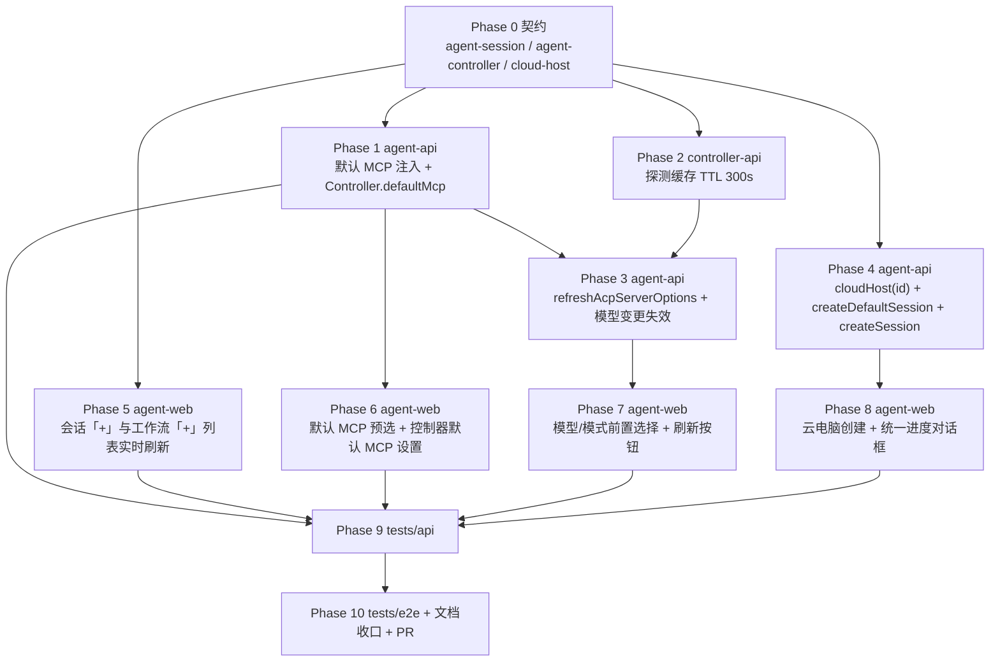

# 云容器优化一期 - 实现计划

**关联 Proposal**: `docs/engineering/proposals/20261022-feat-cloud-container-optimization-phase1.md`（v1.1）
**关联 PRD**: `docs/product/draft/20261022-cloud-container-optimization-phase1.md`（v1.1）
**需求总分支（feat-branch）**: `feat/cloud-container-optimization-phase1`（需求总 PR #264）
**实现分支**: `feat/cloud-container-optimization-phase1-impl`（基于需求总分支）
**创建日期**: 2026-10-22
**计划版本**: v1.0

**版本说明**：

- v1.0 首版，与 PRD v1.1 / 提案 v1.1 对齐。把提案 §5.2 的五个实现点拆成 11 个 Phase：契约 → agent-api（默认 MCP / 探测刷新 / 云电脑编排）→ controller-api（缓存 TTL）→ agent-web（列表刷新 / MCP 与模型模式 / 云电脑创建）→ API 测试 → E2E 与收口。
- 本版给出「上游文档 × 代码现状差异」8 条与「计划期裁决」10 条，收敛提案中与现有代码不一致、或提案留白但会阻塞实现的细节（`createDefaultSession` 必须落库、`session` 步骤 SKIPPED 的落法、admin-api 无 Redis 导致系统内置模型无法跨服务失效等）。
- 本计划不改变 PRD 产品口径；对提案的 3 处数据模型/实现口径做收敛（D1 / D5 / D6），需在实现 PR 描述中声明。

## 实现顺序



依赖说明：

- **P0 是唯一事实源**：字段名、可空性、默认值、错误文案全部以 P0 为准；契约未定稿前不写业务代码。
- **P1 / P2 / P4 / P5 可并行**：P1（MCP 解析）、P2（TTL 常量）、P4（云电脑编排）、P5（纯前端列表刷新，只依赖 P0 的 codegen）互不阻塞。
- **P3 依赖 P1 + P2**：刷新 mutation 复用 `getAcpServerOptions`，失效范围需要 `Controller.userId` 解析（与 P1 同批改动 controller model / resolver）。
- **P7 依赖 P3**：「刷新」按钮直连 `refreshAcpServerOptions`；模型/模式下拉复用既有 `GET_ACP_SERVER_OPTIONS`。
- **P8 依赖 P4**：前端编排必须先用上 `cloudHost(id)`、`createDefaultSession`、`createSession` 三个后端能力。
- **P9 / P10 串行**：API 与 E2E 共用同一套 Aspire 服务与 Mongo/Redis，禁止并行执行；E2E 依赖所有前端 Phase 完成。

开发模式采用 TDD（红-绿-重构）：每个 Phase 先落失败测试（RED）再写实现（GREEN），最后重构。编码前按目录加载 `docs/engineering/common-rules.md`、`backend-rules.md`、`frontend-rules.md`、`servers/agent-api/AGENTS.md`、`servers/controller-api/AGENTS.md`、`apps/agent-web/AGENTS.md`、`tests/api/AGENTS.md`、`tests/e2e/AGENTS.md`。

### 关键约束（实现期不得回退）

- **零回归**：未选择 Github 项目时的云电脑创建、既有「工作负载安装 / 手动 Git 项目设置」两个进度框入口、本地控制器、不带 MCP 的旧调用方行为全部与现状一致。
- **契约先行**：先改 `contracts/*.graphql`，再改 schema/resolver，最后跑 codegen 生成 `apps/agent-web/src/graphql/types.ts`；禁止手写生成类型。
- **首页数据流**：列表刷新只作用于对话框自有查询，不得让子组件各自发起信息流查询；`HOME_OVERVIEW` 仍是首页/Sidebar 唯一聚合。
- **云电脑生命周期**：每用户 1 实例、停止即销毁、会话只读，本期不改。
- **凭据零泄露**：项目准备链路继续走仓库级最小化凭据；进度对话框与日志不得出现 token / clone 命令。
- **探测口径**：配置阶段无会话可查，只走空实例探测，不编造 pre-session 能力数据。
- **默认 MCP 动态语义**：`useAllEnabled=true` 时必须动态跟随新增 MCP，不得在保存时物化 id 列表。
- **禁用即剔除**：解析默认 MCP 时必须过滤 `enabled=false` / 已删除的服务，避免 `MCP_SERVER_NOT_FOUND` 导致建会话失败。
- **禁止 rebase/squash**：遵循 z-git 规范，仅允许 merge。

## 上游文档 × 代码现状差异

实现前必须知道的事实偏差（在本计划内消化，无需打回上游；需在实现 PR 描述中声明）：

| # | 上游表述 | 代码现状（证据） | 本计划处置 |
|---|---|---|---|
| D1 | 提案 §4.1 称 `CreateCloudHostInput.createDefaultSession`「只影响 ready 行为、不落库」 | ready 回调 `handleReadyLocked` 在容器启动后独立触发，此时前端尚未调用 setup，无法把「是否要默认会话」传进来；多副本/重启下内存标记不可靠 | `cloudhosts` 新增 `createDefaultSession: Boolean`（默认 `true`），创建时落库、ready 读取；历史行缺省视为 `true`（零迁移） |
| D2 | 提案称项目会话成功后「由服务端回填 `defaultSessionId`」 | `cloud-host-github-service.runSessionStep` 只写 operation 的 `sessionId`，未回填 `CloudHost.defaultSessionId` | `runSessionStep` 成功分支补 CAS 回填（仅 `defaultSessionId: null` 时写），补单测 |
| D3 | 提案称 `createSession=false` 时 `session` 步骤记 `SKIPPED`，且「不改结构」 | `CloudHostSetupOperation` 无 `createSession` 字段；步骤在 `createOperation` 初始化时生成 | `createOperation` 收到 `false` 时把 `session` 步骤初始化为 `SKIPPED`（detail=多 Harness 不自动创建会话）；`retry` 已保留 SKIPPED，无需改模型 |
| D4 | 提案要求 `setupCloudHostGithubProject` 支持 `createSession`，未说明由谁传 | 该 mutation 由前端在云电脑 `RUNNING` 后调用，多 Harness 时前端可判定 | resolver → service 透传；缺省 `true`；仅「云电脑创建」入口在多 Harness 时传 `false` |
| D5 | 提案 §4.2 称「系统内置模型变更删全部用户的 key」 | `admin-api` 未接入 Redis（`AppHost.cs` 中 adminApi 只 `WithReference(mongodb)`），无法跨服务清 `acp:options:*` | 本期失效钩子只落在 agent-api 的用户级模型 mutation（新增/删除/启用停用）；系统内置模型变更由 5 分钟 TTL + 手动「刷新」兜底。作为提案口径收敛在 PR 声明 |
| D6 | 提案 §4.2 称失效范围「用户级删该用户全部控制器的 key」 | `acp:options` key 由 controller-api 写入，agent-api 只能按 key 模式删；控制器列表含 local/cloud/github | 以 `Controller.find({userId})` 枚举 controllerId，对每个 id 用 `SCAN MATCH acp:options:<id>:*` 删除；不用 `KEYS` |
| D7 | 提案 §3.1 称 `CreateSessionInput.mcpServerIds` 缺省 = 按控制器默认解析，显式空数组 = 不注入 | 现有 resolver 直接把 `args.input.mcpServerIds` 透传，空数组与缺省都会走「无 MCP」分支；云会话在 `session.ts:145` 自动并入 `agent-cloud-host-tools` | 在 resolver 层用 `Object.prototype.hasOwnProperty` 区分「未传 / 显式空数组」，service 内做默认解析；云会话并入逻辑保持不变 |
| D8 | 提案 §7 项目结构把 codegen 输出列为「契约字段同步」 | `apps/agent-web/src/graphql/types.ts` 是生成物，手工改会被下次 codegen 覆盖 | 契约改完统一跑 codegen；Plan 只要求「提交生成结果」，不把 types.ts 当手写文件 |

## 计划期裁决（提案留白 / 含混处的实现口径）

1. **默认 MCP 解析（D7）**：`SessionService.create` 新增纯函数 `resolveInitialMcpServerIds(userId, controller, explicitIds)`：
   - `explicitIds !== undefined` → 原样返回（含 `[]`），走既有归属校验；
   - 未传且 `controller.defaultMcp?.useAllEnabled !== false` → `McpServer.find({ userId, enabled: true })` 的 id 列表；
   - 未传且 `useAllEnabled === false` → `serverIds` 中仍存在且 `enabled=true` 的子集；
   - 最后并入云会话的 `ensureCloudHostToolsServer` 并去重。
   空集合时不创建 mcpEndpoint（沿用现行为）。不引入缓存，直接读库。

2. **`Controller.defaultMcp` 字段归一**：Mongoose 子文档历史行缺失会物化为 `{}`，字段级 resolver 统一返回 `{ useAllEnabled: true, serverIds: [] }`；在 `resolvers/index.ts` 的 `Controller` 合并块登记（`controllerResolvers.Controller`）。`serverIds` 输出为字符串数组，过滤已删除项（展示口径），保存时校验严格。

3. **`setControllerDefaultMcp` 校验**：`controllerId` 必须属于当前用户；`useAllEnabled=true` 时忽略并归一 `serverIds=[]`；`false` 时 `serverIds` 去重、逐个校验 `userId + enabled=true`，否则 `MCP_SERVER_NOT_FOUND`。空数组合法（= 不注入）。

4. **`refreshAcpServerOptions`**：resolver 校验 controller 归属后 `redis.del(acp:options:<controllerId>:<type>)`，复用 `getAcpServerOptions`（内部 `acp:probe-options` + 35s 轮询）；失败/超时返回空选项（不抛错），与既有探测口径一致。禁用「探测中」连点由前端负责。

5. **失效范围（D6）**：新增 `servers/agent-api/src/services/acp-options-cache.ts`：
   ```ts
   export async function invalidateAcpOptionsForUser(userId: string): Promise<void>
   export async function invalidateAcpOptionsForController(controllerId: string): Promise<void>
   ```
   `SCAN` 游标循环 + `MATCH`，每批 `DEL`；解析失败只 `console.warn`，不影响模型 mutation 主流程。挂在 `createCustomModel` / `deleteCustomModel` / `toggleModel` 成功之后；`updateModelSortOrder` 不失效（只影响排序）。

6. **云电脑创建抑制默认会话（D1）**：`create` 读取 `createDefaultSession ?? true` 落库；`handleReadyLocked` 两处建会话分支均要求 `host.createDefaultSession !== false`；`false` 时不写 `defaultSessionId`。`CloudHost` GraphQL 不新增该字段（前端不需要）。
7. **`cloudHost(id)` 查询**：按 `_id + userId` 查询，返回 `mapCloudHost` 结果；软删除仍返回（与 `Session.cloudHost` 留档口径一致），不存在/非本人返回 `null`。前端进度框只在自己拥有的 host 上轮询。
8. **项目准备的 `session` 步骤（D3 / D4）**：`createOperation` 入参加 `createSession?: boolean`；`false` 时初始化 `session: { status: 'SKIPPED', detail: '多 Harness 不自动创建会话' }`；`run()` 看到 SKIPPED 直接置 operation `SUCCEEDED`（既有逻辑已覆盖）。回填 `defaultSessionId` 只在 `session` 成功后执行（D2）。
9. **进度对话框泛化**：`GithubSetupProgressDialog` 新增可选 props `hostId?: string | null`、`onStartupFailed?: () => void`：
   - `hostId` 存在时在最前插入阶段「启动云电脑」，状态由 `cloudHost(id)`（`pollInterval: 1500`, `fetchPolicy: 'cache-and-network'`）驱动：`STARTING` → 进行中、`RUNNING` → 成功、`FAILED` → 失败并展示 `failureReason`；
   - `operationId` 仍为 `null` 时不渲染后三阶段（创建请求尚未返回）；
   - 旧入口（工作负载安装 / 手动 Git 项目设置）不传 `hostId`，阶段列表与行为完全不变（组件测试覆盖零回归）；
   - 成功跳转仍以 `operation.sessionId` 为准；只成功启动主机但项目准备失败时不跳转。
10. **前端编排落点**：新建云电脑提交收敛到 `NewCloudHostDialog` 内的 `useCloudHostProvisioning`（`apps/agent-web/src/hooks/useCloudHostProvisioning.ts`）：`createCloudHost` → 打开统一进度对话框 → 轮询 `cloudHost(id)` → `RUNNING` 后调 `setupCloudHostGithubProject` → 把 operationId 交给进度框。不使用后端 ready 回调编排，不新增 GraphQL 编排 mutation。
11. **列表刷新统一写法**：对话框 `useQuery` 统一 `fetchPolicy: 'cache-and-network'` + `useEffect([open])` 内 `refetch()`；加载分支只认 `loading && !data`，刷新不改受控 state。`GithubSetupProgressDialog` 成功后 `refetchQueries` 补 `GetControllerWorkspacesEnabled`（操作方负责失效）。

---

## Phase 0: 契约（Contracts）

开发分支：`feat/cloud-container-optimization-phase1-impl`。契约提交与实现分开 commit。

### 文件修改

| 文件 | 操作 | 说明 |
|------|------|------|
| `contracts/agent-session.graphql` | 修改 | `CreateSessionInput` 增 `modeId/modelId` + `mcpServerIds` 语义注释；`refreshAcpServerOptions` mutation；`acpServerOptions` 注释由 1h 改为 5 分钟 |
| `contracts/agent-controller.graphql` | 修改 | `ControllerDefaultMcp` 类型、`Controller.defaultMcp`、`Mutation.setControllerDefaultMcp` |
| `contracts/cloud-host.graphql` | 修改 | `Query.cloudHost(id)`、`CreateCloudHostInput.createDefaultSession`、`SetupCloudHostGithubProjectInput.createSession` |
| `apps/agent-web/src/graphql/types.ts` | 生成 | 契约改完跑 codegen，提交生成结果 |

### 契约增量

```graphql
# contracts/agent-session.graphql
input CreateSessionInput {
  controllerId: ID!
  acpServerType: AcpServerType! = opencode
  workspaceId: ID!
  enableWorktree: Boolean = false
  worktreeBranchSuffix: String
  existingWorktreePath: String
  # 语义：缺省 = 按控制器 defaultMcp 解析；显式传数组（含 []）= 以调用方为准。
  # 云会话仍自动并入 agent-cloud-host-tools。
  mcpServerIds: [ID!]
  additionalDirectories: [String!]
  # 新增：拉起前选择的模式/模型；缺省使用工具默认值
  modeId: ID
  modelId: ID
}

extend type Mutation {
  # 删除该 controllerId+acpServerType 的探测缓存并立即重新探测（失败返回空选项）
  refreshAcpServerOptions(controllerId: ID!, acpServerType: AcpServerType!): AcpServerOptions!
}
```

```graphql
# contracts/agent-controller.graphql
type ControllerDefaultMcp {
  # true = 动态注入全部已启用 MCP；false = 仅注入 serverIds（允许空数组）
  useAllEnabled: Boolean!
  serverIds: [ID!]!
}

extend type Controller {
  # 未配置过的存量控制器归一为 { useAllEnabled: true, serverIds: [] }
  defaultMcp: ControllerDefaultMcp!
}

extend type Mutation {
  setControllerDefaultMcp(controllerId: ID!, useAllEnabled: Boolean!, serverIds: [ID!] = []): Controller!
}
```

```graphql
# contracts/cloud-host.graphql
extend type Query {
  # 进度对话框轮询云电脑启动状态（1.5s 级）；仅返回当前用户的云电脑
  cloudHost(id: ID!): CloudHost
}

input CreateCloudHostInput {
  name: String!
  harnessTypes: [HarnessType!]!
  workloadIds: [ID!]
  # 新增：false 时 ready 不自动建默认会话（由 setup 的 session 步骤建项目会话）
  createDefaultSession: Boolean = true
}

input SetupCloudHostGithubProjectInput {
  controllerId: ID!
  accountId: ID!
  repoFullName: String!
  targetPath: String!
  workloadIds: [ID!]
  # 新增：false 时 session 步骤记 SKIPPED（多 Harness）；缺省 true
  createSession: Boolean = true
}
```

### 验收 checklist

- [ ] 三个契约的字段名 / 可空性 / 默认值与实现逐字一致
- [ ] `refreshAcpServerOptions` 返回类型与 `acpServerOptions` 同形
- [ ] codegen 通过，`types.ts` 出现 `CreateSessionInput.modeId/modelId`、`Controller.defaultMcp`、`CloudHostQuery` 等类型
- [ ] 契约 commit 独立于实现 commit

---

## Phase 1: agent-api — 默认 MCP 注入与控制器默认 MCP

### 文件修改

| 文件 | 操作 | 说明 |
|------|------|------|
| `servers/agent-api/src/models/controller.ts` | 修改 | `defaultMcp: { useAllEnabled: Boolean default true, serverIds: [ObjectId] default [] }` |
| `servers/agent-api/src/graphql/schemas/controller.ts` | 修改 | `ControllerDefaultMcp` 类型、`Controller.defaultMcp`、`setControllerDefaultMcp` |
| `servers/agent-api/src/graphql/schemas/session.ts` | 修改 | `CreateSessionInput` 增 `modeId/modelId`（与契约同步） |
| `servers/agent-api/src/graphql/resolvers/controller.ts` | 修改 | `Controller.defaultMcp` 字段 resolver 归一；`setControllerDefaultMcp` mutation（校验归属 + 服务集合法性） |
| `servers/agent-api/src/graphql/resolvers/index.ts` | 修改 | `Controller` 合并块登记 `controllerResolvers.Controller` |
| `servers/agent-api/src/services/controller.ts` | 修改 | `setDefaultMcp(userId, controllerId, input)`；错误文案 `Controller not found` / `MCP_SERVER_NOT_FOUND` |
| `servers/agent-api/src/services/session.ts` | 修改 | `create` 内默认 MCP 解析（裁决 1）；`modeId/modelId` 已存在，仅补 resolver 透传 |
| `servers/agent-api/src/graphql/resolvers/session.ts` | 修改 | `createSession` 用 `hasOwnProperty` 区分缺省与空数组（D7）；透传 `modeId/modelId` |

### 测试（RED 先行）

- `servers/agent-api/src/services/session.test.ts`：默认 MCP 解析矩阵 —— 显式数组 / 显式空数组 / 未传 + `useAllEnabled=true` / 未传 + 子集 / 子集含停用或删除项 / 云会话并入 `agent-cloud-host-tools` / 解析结果为空不建 endpoint。
- `servers/agent-api/src/graphql/resolvers/controller.test.ts`：`defaultMcp` 历史行归一为 `{true, []}`；`setControllerDefaultMcp` 的四种错误（非本人控制器、`useAllEnabled=true` 归一、非法 serverIds、空数组合法）。
- `servers/agent-api/src/services/controller.test.ts`：`setDefaultMcp` 去重与停用校验。

### 实现要点

- `resolveInitialMcpServerIds` 写成纯函数（接收 controller 快照与已启用集合），便于单测；IO 留在 `create` 外层。
- `useAllEnabled=true` 时**不写** `serverIds`，保持动态语义。
- 控制器默认 MCP 只影响**新建会话**，不改存量会话的 endpoint。
- 自动建会话入口（`handleReadyLocked` / `runSessionStep`）不传 `mcpServerIds`，自然继承默认解析。

### 验收 checklist

- [ ] 未传 `mcpServerIds` 时新会话带上全部已启用 MCP；显式空数组时不注入
- [ ] 控制器默认 MCP 保存后，下一个新会话按新配置注入
- [ ] 「Git 项目设置」自动创建的会话带默认 MCP
- [ ] 单元测试全绿，无回归

---

## Phase 2: controller-api — 探测缓存 TTL 300s

### 文件修改

| 文件 | 操作 | 说明 |
|------|------|------|
| `servers/controller-api/src/services/acp-options-prober.ts` | 修改 | `SUCCESS_CACHE_TTL = 300`（原 3600），`FAILURE_CACHE_TTL` 保持 60 |
| `servers/controller-api/src/services/acp-options-prober.test.ts` | 修改 | 断言成功写入 `EX 300`、失败写入 `EX 60` |
| `servers/agent-api/src/services/session.ts` | 修改 | `getAcpServerOptions` 注释由「1h」改为「5 分钟」；轮询上限不变（70×500ms） |
| `contracts/agent-session.graphql` | 修改 | `acpServerOptions` 注释同步为 5 分钟 |

### 实现要点

- Redis key 不变：`acp:options:<controllerId>:<serverType>`，避免与 agent-api 侧读写口径漂移。
- 失败缓存仍 60s：防止探测失败时每次打开对话框都拉起空实例。
- 仅常量与注释改动，不动探测流程与 `invalidateCache`。

### 验收 checklist

- [ ] 单测断言 TTL=300 / 60
- [ ] 5 分钟内重复查询 `acpServerOptions` 不再触发探测（日志次数可验证）

---

## Phase 3: agent-api — 刷新选项与模型变更失效

### 文件修改

| 文件 | 操作 | 说明 |
|------|------|------|
| `servers/agent-api/src/services/acp-options-cache.ts` | 新增 | `invalidateAcpOptionsForUser` / `invalidateAcpOptionsForController`（SCAN + DEL） |
| `servers/agent-api/src/services/acp-options-cache.test.ts` | 新增 | 覆盖 SCAN 游标循环、匹配前缀、Redis 异常只告警 |
| `servers/agent-api/src/services/session.ts` | 修改 | 新增 `refreshAcpServerOptions(controllerId, type, userId)`：`del` 后复用 `getAcpServerOptions` |
| `servers/agent-api/src/graphql/schemas/session.ts` | 修改 | `refreshAcpServerOptions` mutation |
| `servers/agent-api/src/graphql/resolvers/session.ts` | 修改 | 归属校验 + 调用 service；`Controller not found` |
| `servers/agent-api/src/graphql/resolvers/model.ts` | 修改 | `createCustomModel` / `deleteCustomModel` / `toggleModel` 成功后调用失效（`userId` 取自 context） |

### 实现要点

- SCAN 写法：`let cursor = '0'; do { const [next, keys] = await redis.scan(cursor, 'MATCH', pattern, 'COUNT', 100); ... } while (cursor !== '0')`；禁止 `KEYS`。
- 失效是「尽力而为」：`try/catch` 包住，失败不阻断模型 mutation 返回。
- `toggleModel` 需要区分用户模型与系统内置；本期统一按「当前用户全部控制器」失效（范围略大但安全），系统内置走 TTL。
- 排序变更（`updateModelSortOrder`）不触发失效。
- 刷新 mutation 与查询共用同一探测链路，不做第二套实现。

### 验收 checklist

- [ ] 新增 / 删除 / 启用停用模型后，下一次打开选择器能取到最新结果（API 测试断言缓存 key 被清）
- [ ] 点「刷新」立即返回最新选项，失败返回空选项且不抛错
- [ ] SCAN 单测覆盖多批游标

---

## Phase 4: agent-api — 云电脑创建与项目准备开关

### 文件修改

| 文件 | 操作 | 说明 |
|------|------|------|
| `servers/agent-api/src/models/cloud-host.ts` | 修改 | 新增 `createDefaultSession: Boolean default true`（D1） |
| `servers/agent-api/src/services/cloud-host-service.ts` | 修改 | `validateInput` 接收 `createDefaultSession`；`create` 落库；`handleReadyLocked` 两处建会话分支判断该字段 |
| `servers/agent-api/src/graphql/schemas/cloud-host.ts` | 修改 | `cloudHost(id)` Query、`CreateCloudHostInput.createDefaultSession`、`SetupCloudHostGithubProjectInput.createSession` |
| `servers/agent-api/src/graphql/resolvers/cloud-host.ts` | 修改 | `cloudHost` 查询（`_id + userId`，软删除也返回）；两处 input 透传 |
| `servers/agent-api/src/services/cloud-host-github-service.ts` | 修改 | `createOperation` 支持 `createSession`（false 时 session 步骤 SKIPPED）；`runSessionStep` 成功后回填 `defaultSessionId`（D2） |

### 测试（RED 先行）

- `cloud-host-service.test.ts`：`createDefaultSession=false` 时 ready 不建会话、不写 `defaultSessionId`；缺省/`true` 时行为与现状一致；历史行（字段缺失）视为 `true`。
- `cloud-host-github-service.test.ts`：`createSession=false` → operation 的 `session` 步骤 `SKIPPED` 且 operation `SUCCEEDED`；`retry` 保留 SKIPPED；成功回填 `defaultSessionId`（仅空时）；已有 `defaultSessionId` 不被覆盖。
- `graphql/resolvers/cloud-host.test.ts`：`cloudHost(id)` 归属校验与软删除返回。

### 实现要点

- `cloudHost(id)` 复用 `mapCloudHost`，不新增聚合字段。
- 回填用 CAS：`CloudHost.updateOne({ _id: hostId, defaultSessionId: null }, { $set: { defaultSessionId } })`。
- `createOperation` 的 `createSession` 缺省按 `input.createSession !== false` 处理。
- `run()` 的 `session` 分支已能识别 SKIPPED，无需改步骤机。

### 验收 checklist

- [ ] 选择项目创建（`createDefaultSession=false`）不出现多余空会话
- [ ] 项目会话创建成功后 `defaultSessionId` 已回填，Sidebar 不误报失败
- [ ] 多 Harness + 项目 → `session` 步骤 SKIPPED，云电脑可用
- [ ] 不选项目 → 与现状完全一致

---

## Phase 5: agent-web — 「+」对话框列表实时刷新（功能点 1 / 5）

### 文件修改

| 文件 | 操作 | 说明 |
|------|------|------|
| `apps/agent-web/src/components/session/NewSessionDialog.tsx` | 修改 | `GET_CONTROLLER_WORKSPACES_ENABLED` 改 `cache-and-network` + `useEffect([open/controllerId])` 内 `refetch`；刷新不重置已填表单 |
| `apps/agent-web/src/components/workflow/InstantiateWorkflowDialog.tsx` | 修改 | `GET_CONFIGURED_WORKFLOWS` / `GET_WORKFLOW_TEMPLATES` / `GET_WORKSPACES` 打开即 refetch |
| `apps/agent-web/src/components/settings/WorkflowSection.tsx` | 修改 | 进入设置页/切到工作流页签时刷新一次来源列表 |
| `apps/agent-web/src/components/cloud-host/GithubSetupProgressDialog.tsx` | 修改 | 成功后 `refetchQueries` 补 `GetControllerWorkspacesEnabled` |
| 组件测试 | 修改/新增 | `NewSessionDialog.test.tsx`、`InstantiateWorkflowDialog` 测试（若缺则新增）、`GithubSetupProgressDialog.test.tsx` |

### 实现要点

- 统一写法：`useQuery(..., { fetchPolicy: 'cache-and-network' })` + `useEffect` 内 `refetch()`；避免两份策略并存。
- 加载分支只认 `loading && !data`；轮询/刷新期间不得卸载表单、不得清空输入。
- 不在 Sidebar / 首页新增查询；`HOME_OVERVIEW` 约束不变。
- `refetch` 失败展示「刷新失败，可重试」，保留上一次列表，不阻断提交。
- 已删除条目以服务端返回为准整表替换。

### 验收 checklist

- [ ] Git 项目设置成功后直接开会话「+」能看到新工作区，且能建会话
- [ ] MCP 创建的已配置工作流/模板直接开工作流「+」可见
- [ ] 刷新过程中对话框已填内容不丢
- [ ] 组件测试覆盖「刷新不丢输入」与「打开即 refetch」

---

## Phase 6: agent-web — 默认 MCP 预选与控制器默认 MCP 设置（功能点 3）

### 文件修改

| 文件 | 操作 | 说明 |
|------|------|------|
| `apps/agent-web/src/components/session/NewSessionDialog.tsx` | 修改 | 打开时按控制器 `defaultMcp` 预选（`useAllEnabled` → 全部已启用；否则 `serverIds` 交集）；提交显式传 `mcpServerIds` |
| `apps/agent-web/src/components/settings/McpDefaultSection.tsx` | 新增 | 「默认注入全部 MCP」开关 + 多选列表 + 保存；开关开启时多选禁用并提示 |
| `apps/agent-web/src/pages/ControllerConfigPage.tsx` | 修改 | 新增页签/区块挂载 `McpDefaultSection`（移动端 tab 常驻滚动容器外） |
| `apps/agent-web/src/graphql/queries.ts` | 修改 | `GET_CONTROLLERS` / `HOME_OVERVIEW` 的 controller 字段加 `defaultMcp` |
| `apps/agent-web/src/graphql/mutations.ts` | 修改 | `SET_CONTROLLER_DEFAULT_MCP` |
| `apps/agent-web/src/components/Sidebar.tsx`、`pages/SessionPage.tsx` | 修改 | `onCreate` 签名扩展 `modeId/modelId`，`CREATE_SESSION` 变量透传 |

### 实现要点

- 预选只在「对话框打开 / 切换控制器」时计算一次；用户手动调整后不被后台 refetch 覆盖。
- `useAllEnabled=true` 时多选展示全部已启用服务且全部勾选（只读态），文案说明「新 MCP 上线后自动注入」。
- 保存成功后本地缓存更新（Apollo 返回值即权威），并提示「对后续新建会话生效」。
- 错误码映射：`MCP_SERVER_NOT_FOUND` → 「所选 MCP 已停用或不存在，请重新选择」。
- 云会话仍会自动并入 `agent-cloud-host-tools`，前端不展示该项为可选项。

### 验收 checklist

- [ ] 新建会话默认全选（或按控制器默认预选），可调整
- [ ] 控制器设置保存后对新会话生效；清空选择后不注入
- [ ] 「Git 项目设置」自动创建的会话带默认 MCP
- [ ] 移动端无横向溢出

---

## Phase 7: agent-web — 模型/模式前置选择与刷新按钮（功能点 4）

### 文件修改

| 文件 | 操作 | 说明 |
|------|------|------|
| `apps/agent-web/src/components/session/NewSessionDialog.tsx` | 修改 | 选定工具后 `GET_ACP_SERVER_OPTIONS`；模式/模型下拉（首项「默认」= 不传）；探测中提示；「刷新」按钮 |
| `apps/agent-web/src/components/workflow/WorkflowGraphEditor.tsx` | 修改 | `AgentNodeOptionFields` 增加「刷新」按钮（调 `refreshAcpServerOptions`，结果就地替换） |
| `apps/agent-web/src/graphql/queries.ts` | 修改 | `GET_ACP_SERVER_OPTIONS` 保持；必要时补 `fetchPolicy` |
| `apps/agent-web/src/graphql/mutations.ts` | 修改 | `REFRESH_ACP_SERVER_OPTIONS` |
| `apps/agent-web/src/components/session/NewSessionDialog.test.tsx` | 修改 | 选项渲染 / 默认项 / 探测中不阻断 / 刷新按钮 |
| `apps/agent-web/src/components/workflow/__tests__/*` | 修改 | 节点配置刷新按钮 |

### 实现要点

- 选项来源与工作流节点同源（`acpServerOptions`），保证「两处看到一致」。
- 留空 = 不传 `modeId/modelId`；`CreateSessionInput.modeId/modelId` 为 `ID`，不要传空字符串。
- 刷新按钮：点击期间 disabled + loading；失败保留旧选项并 toast；成功后替换 `modes/models`。
- 探测超时（空列表）只展示「默认」，不阻断提交。
- `modeId/modelId` 透传链路：表单 → `onCreate` → `CREATE_SESSION`；`SessionPage` 与 `Sidebar` 两个调用点都要改。

### 验收 checklist

- [ ] 选定工具后能看到模式/模型，可选「默认」
- [ ] 与工作流节点配置选项一致
- [ ] 探测中 / 无选项可直接建会话
- [ ] 两处「刷新」点击后取到最新选项
- [ ] 模型列表增删改后重新打开选择器即为最新

---

## Phase 8: agent-web — 云电脑创建 + 统一进度对话框（功能点 2）

### 文件修改

| 文件 | 操作 | 说明 |
|------|------|------|
| `apps/agent-web/src/components/cloud-host/NewCloudHostDialog.tsx` | 修改 | 新增「Github 项目（可选）」区块；提交走 `useCloudHostProvisioning` |
| `apps/agent-web/src/components/cloud-host/GithubProjectSetupDialog.tsx` | 重构 | 抽出 `useGithubProjectForm`（账号/仓库/前缀/最终地址预览）供两处复用 |
| `apps/agent-web/src/hooks/useGithubProjectForm.ts` | 新增 | 表单与校验逻辑（账号归属、`owner/repo`、绝对路径、无 `..`/反斜杠） |
| `apps/agent-web/src/hooks/useCloudHostProvisioning.ts` | 新增 | `createCloudHost` → `cloudHost(id)` 轮询 → `setupCloudHostGithubProject` 编排 |
| `apps/agent-web/src/components/cloud-host/GithubSetupProgressDialog.tsx` | 修改 | 泛化：可选前置「启动云电脑」阶段（`hostId` prop），四阶段展示 |
| `apps/agent-web/src/graphql/queries.ts` | 修改 | `CLOUD_HOST(id)`；`CREATE_CLOUD_HOST` 变量加 `createDefaultSession` |
| `apps/agent-web/src/graphql/mutations.ts` | 修改 | `SETUP_CLOUD_HOST_GITHUB_PROJECT` 变量加 `createSession` |
| `apps/agent-web/src/components/cloud-host/__tests__/*` | 修改/新增 | 项目区块校验、编排顺序、进度框四阶段与旧入口零回归 |

### 实现要点

- 编排严格顺序：`createCloudHost(..., createDefaultSession=false)` → 轮询 `cloudHost(id)` 至 `RUNNING` → `setupCloudHostGithubProject(..., createSession = harnessTypes.length === 1)`；成功且 `sessionId` 非空才跳转。
- 轮询间隔 1.5s，组件卸载/对话框关闭即停止；`FAILED` 停在「启动云电脑」并展示 `failureReason` + 重建入口（删除后重开新建）。
- 项目准备失败：停留在对应阶段，可 `retryCloudHostSetupOperation`；云电脑保持可用。
- `GithubSetupProgressDialog` 旧调用点不传 `hostId`，三阶段与成功跳转逻辑不变。
- 前端预览只做展示，`targetPath` 仍传归一后的前缀，服务端权威拼接。
- 未选项目时请求体不带 `createDefaultSession`（或传 `true`），保持旧报文形状。

### 验收 checklist

- [ ] 不选项目 → 与现状一致（单机自动建会话）
- [ ] 选项目 → 四阶段同一对话框推进，成功后进入项目会话
- [ ] 启动失败提示原因 + 重建入口；项目准备失败可重试/手动设置
- [ ] 多 Harness + 项目 → 项目准备执行但跳过会话创建
- [ ] 旧入口（工作负载安装 / 手动 Git 设置）零回归

---

## Phase 9: tests/api（GraphQL 契约与服务行为）

### 文件修改

| 文件 | 操作 | 覆盖点 |
|------|------|--------|
| `tests/api/src/agent-api/session.test.ts` | 修改 | 默认 MCP（缺省/显式/空数组/停用剔除）、`modeId/modelId` 透传、云会话并入 cloud-tools |
| `tests/api/src/agent-api/controller.test.ts` | 修改 | `Controller.defaultMcp` 缺省归一、`setControllerDefaultMcp` 成功/失败/空数组 |
| `tests/api/src/agent-api/cloud-host.test.ts` | 修改 | `createCloudHost(createDefaultSession)`、`cloudHost(id)` 归属、`setupCloudHostGithubProject(createSession)`、`session` 步骤 SKIPPED、`defaultSessionId` 回填 |
| `tests/api/src/agent-api/session-capabilities.test.ts` | 修改 | `refreshAcpServerOptions` 清缓存 + 重探测 + 失败返回空 |
| `tests/api/src/controller-api/acp-options-prober.test.ts` | 修改/新增 | TTL 300 / 60、缓存命中不重复探测 |

### 实现要点

- 缓存断言直接读 Redis（测试 fixture 已提供 ioredis）或通过「第二次查询不触发 acp:probe-options」间接断言。
- 模型 mutation 后失效：写入一个 `acp:options:<controllerId>:opencode` key → 调 `toggleModel` → 断言 key 不存在。
- 失败路径用 mock controller socket 不回包，断言 35s 超时返回空（测试里缩短轮询参数或以 fake timers 覆盖）。
- 测试串行执行：`npm test -- --runInBand`（vitest 默认单进程亦可）。

### 验收 checklist

- [ ] 新增/修改的 API 测试全绿
- [ ] 错误文案与契约一致（`MCP_SERVER_NOT_FOUND` / `Controller not found`）
- [ ] 无 Redis/Mongo 残留脏数据影响后续用例

---

## Phase 10: tests/e2e 与收口

### 文件修改

| 文件 | 操作 | 覆盖点 |
|------|------|--------|
| `tests/e2e/src/cloud-host.spec.ts` | 修改 | 新建云电脑（含/不含项目）、四阶段进度、失败重试、旧入口零回归 |
| `tests/e2e/src/session.spec.ts` | 修改 | 会话「+」工作区实时可见、默认 MCP 勾选、模型/模式前置选择与刷新 |
| `tests/e2e/src/github-workload.spec.ts` | 修改 | Git 设置成功后工作区列表即时可见；自动会话带默认 MCP |
| `tests/e2e/src/workflow*.spec.ts` | 修改 | 工作流「+」来源列表实时刷新 |
| `docs/engineering/AGENTS.md` | 修改 | 计划索引新增本文件 |
| `docs/product/draft/20261022-cloud-container-optimization-phase1.md` | 视情况 | 实现完成后由验收节点移入 `shipping/`，本节点不动 |

### E2E 场景（按顺序）

1. 新建云电脑不选项目 → 自动建默认会话（回归）。
2. 新建云电脑选项目 → 四阶段逐步出现 → 进入项目会话，无多余空会话。
3. 项目准备失败（mock 仓库无权限）→ 停留在对应阶段、云电脑可用、重试入口可用。
4. Git 设置成功后直接开会话「+」→ 新工作区在列表中。
5. 新建会话默认 MCP 全选；取消全部后创建 → 会话无 MCP。
6. 控制器设置改默认 MCP → 新会话按新配置。
7. 新建会话选模型/模式 → 会话详情显示对应值；点「刷新」取到新选项。
8. 工作流「+」→ MCP 新建的工作流立即可见。

### 收口动作

- 全量测试：单测 + `tests/api` + `tests/e2e` 串行跑一遍。
- `git diff` 自查：无 debug 日志、无 token、无硬编码本地路径。
- PR：`feat/cloud-container-optimization-phase1-impl` → 需求总分支，描述中声明 D1/D5/D6/D7 口径收敛。
- 不 squash/rebase，只 merge。

### 验收 checklist

- [ ] 8 条 E2E 场景通过
- [ ] 回归：工作负载安装进度框、手动 Git 项目设置、本地控制器建会话
- [ ] 文档索引更新

---

## 命令参考

```bash
# 服务编排（默认方式）
aspire start
aspire describe                     # 查看 agent-api / agent-web / controller-api endpoint

# 前端
cd apps/agent-web
npm run codegen                     # 契约 → types.ts
npm test -- --run                   # 组件单测
npm run build                       # 类型检查 + 构建

# 后端单测
cd servers/agent-api && npm test
cd servers/controller-api && npm test

# API 测试（需 Aspire 服务与 Mongo/Redis 就绪）
cd tests/api && npm test
cd tests/api && npm run test:real   # 真实外部依赖用例

# E2E
cd tests/e2e && npm test
cd tests/e2e && npm test -- --headed

# 分支
git checkout feat/cloud-container-optimization-phase1
git checkout -b feat/cloud-container-optimization-phase1-impl
```

---

## 总体验收 checklist

- [ ] Phase 0 契约逐字落地，codegen 通过
- [ ] 新建会话 MCP 默认注入；控制器默认 MCP 可配置；自动建会话继承
- [ ] 前置 `modeId/modelId` 生效；探测缓存 5 分钟、模型变更失效、两处刷新可用
- [ ] 云电脑创建可选 Github 项目，四阶段同一对话框，不产生多余会话
- [ ] 会话「+」/ 工作流「+」列表打开即最新且不丢输入
- [ ] 单元测试 / API 测试 / E2E 全绿
- [ ] 旧入口（工作负载安装、手动 Git 设置、本地控制器）零回归
- [ ] PR 描述声明 D1/D5/D6/D7 口径收敛

## 相关文档

- 产品需求：`docs/product/draft/20261022-cloud-container-optimization-phase1.md`
- 技术提案：`docs/engineering/proposals/20261022-feat-cloud-container-optimization-phase1.md`
- 契约：`contracts/agent-session.graphql`、`contracts/agent-controller.graphql`、`contracts/cloud-host.graphql`
- 规范：`docs/engineering/common-rules.md`、`docs/engineering/backend-rules.md`、`docs/engineering/frontend-rules.md`
- 既有计划：`docs/engineering/plan/20261022-feat-workload-optimization.md`、`docs/engineering/plan/20261021-feat-github-workload.md`
