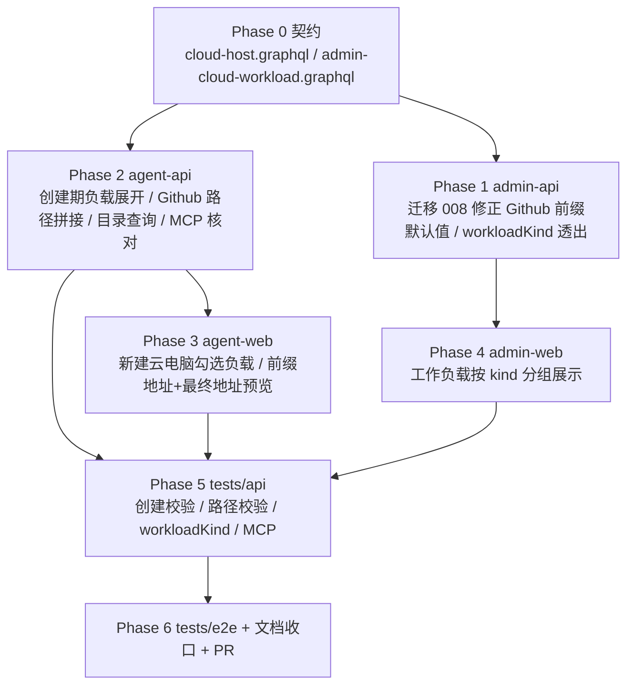

# 工作负载优化 - 实现计划

**关联 Proposal**: `docs/engineering/proposals/20261022-feat-workload-optimization.md`（v1.0）
**关联 PRD**: `docs/product/draft/20261022-workload-optimization.md`（v1.0）
**需求总分支（feat-branch）**: `feat/workload-optimization`（需求总 PR #259，基于 `main`）
**实现分支**: `feat/workload-optimization-impl`（基于 `feat/workload-optimization`）
**创建日期**: 2026-10-22
**计划版本**: v1.0
**版本说明**:
- v1.0（2026-10-22）首版，与 PRD v1.0 / 提案 v1.0 对齐。把提案 §5.2 的五个实现点拆成 7 个 Phase：契约 → admin-api → agent-api → agent-web → admin-web → API 测试 → E2E/文档收口。
- 本版新增「上游文档 × 代码现状差异」与 12 条计划期裁决，收敛提案中与现有代码不一致或未落到接口层的细节（创建弹窗的负载目录查询、harness 必须显式下发 plan、迁移 007 已执行需 008 补偿、工作负载无 description 字段等）。
- 本计划不改变 PRD 产品口径；对提案的 4 处实现口径做收敛（见 D1/D2/D3/D4），需在实现 PR 描述中声明。

## 实现顺序



依赖说明：

- **P0 是唯一事实源**：GraphQL 字段、可空性、错误文案全部以 P0 为准；契约未定稿前不写业务代码。
- **P1 与 P2 可并行**：P1 只影响 admin-api 的只读模型与预制迁移；P2 的创建链路只依赖 agent-api 自己的只读模型。但 P2 的联调需先跑 P1 的迁移 008，保证 Github 预制项默认前缀正确。
- **P2 必须先于 P3**：`cloudHostWorkloadCatalog` 查询与 `CreateCloudHostInput.workloadIds` 是前端前置。
- **P4 只依赖 P0/P1**：admin-web 消费 `CloudWorkload.workloadKind`。
- **P5/P6 串行**：API 与 E2E 共用同一套 Aspire 服务与 Mongo/Redis，禁止并行执行。

开发模式采用 TDD（红-绿-重构）。每个 Phase 先落测试（RED）再写实现（GREEN），最后重构。编码前按目录加载：`docs/engineering/common-rules.md`、`backend-rules.md`、`frontend-rules.md`、`servers/agent-api/AGENTS.md`、`servers/admin-api/AGENTS.md`、`servers/cloud-controller/AGENTS.md`、`apps/agent-web/AGENTS.md`、`apps/admin-web/AGENTS.md`、`tests/api/AGENTS.md`、`tests/e2e/AGENTS.md`。

### 关键约束（实现期不得回退）

- **零回归**：未传 `workloadIds` 的创建请求、旧 Github 绑定（存的本来就是最终目录）、本地控制器、普通容器启动行为与现状一致。
- **仅透出与挂载，不新增工作负载类型**：Aspire / Docker / .NET / Github 已由迁移 001/007 写为 `workloadKind='standard'`；本期不新增负载、不改 worker 镜像。
- **路径权威在服务端**：前端预览只是体验，最终目录一律由 agent-api 用 `path.posix.join` 计算；前端不得把拼好的最终目录当作 `targetPath` 回传。
- **凭据零变化**：Github 路径改造不得改变凭据申请、token 传递、日志脱敏链路；`targetPath` 不得写入任何 token。
- **不做卸载**：已安装负载只增不减；前端不提供卸载入口。
- **不新增第三方依赖**：路径拼接使用 Node 内置 `path`；前端预览复用同规则的小工具，不引入库。
- **禁止 rebase/squash**：遵循 z-git 规范，仅允许 merge。

---

## 上游文档 × 代码现状差异

实现前必须知道的事实偏差（均在本计划内消化，无需打回上游，但需在 PR 描述中声明）：

| # | 上游表述 | 代码现状（证据） | 本计划处置 |
|---|---|---|---|
| D1 | 提案 §5.2 实现点 5 称 `GithubProjectSetupDialog` 为「单输入框改为前缀输入 + 项目选择」 | 仓库选择已存在（`GithubProjectSetupDialog.tsx:259-282`），只有目标路径是单输入框 | 只把「目标路径」改为「前缀地址」并新增最终地址预览；不改账号/仓库/工作负载选择结构 |
| D2 | 提案要求创建云电脑时勾选 standard 负载，但未定义创建弹窗的数据来源 | `cloudHostWorkloads(controllerId: ID!)` 必须传已存在的云电脑 controllerId；新建弹窗没有该 ID | 新增无主机上下文的 `cloudHostWorkloadCatalog: [CloudHostWorkloadItem!]!`，返回全部 standard 负载且 `installed=false` |
| D3 | 提案称复用 `resolveRuntimeWorkloadPlan` 同款依赖展开 | 该函数位于 `servers/cloud-controller/src/services/workload-plan.ts`，且 `POST /internal/containers` 对 harness **要求显式非空 workloadPlan**（`internal-api.ts` 的 `hadExplicitPlan` 校验） | agent-api 新增纯函数 `resolveCreateWorkloadPlan` 做同样的后序 DFS；harness presets 在前、选中 standard 在后，依赖先行并去重；不跨服务 import |
| D4 | 提案 §5.2 实现点 3 称「把预制参数默认值改为 `/root/workspace`」 | 迁移 `007-preset-github.ts` 已在所有环境执行过，直接改 007 不会更新存量库 | 新增迁移 `008-fix-github-workload-prefix`，仅当 `targetPath.defaultValue` 仍为旧值 `/root/workspaces/{repo}` 时更新为 `/root/workspace` 并改 label；不覆盖管理员自定义 |
| D5 | PRD 要求「分类/用途展示清晰」，提案只透出 `workloadKind` | `cloudworkloads` 没有 `description` 字段，admin 契约也没有 | 本期用「工作负载类型（standard/harness）+ 预制标记 + 依赖链 + 参数标签」表达用途；不新增 description 字段（超出提案范围） |
| D6 | 提案 §3.1 契约 2 列出 `SetupCloudHostGithubProjectInput.workloadIds` 作为新增 | 该字段已存在（`contracts/cloud-host.graphql:121-128`，用于 Github 设置弹窗额外安装负载） | 保持不变；本期只改 `targetPath` 语义，不重复新增 |
| D7 | 提案 §3.1 希望 `CloudHostWorkloadItem` 透出 `workloadKind`，但该查询只返回 standard | `cloudHostWorkloadService.list` 基于 `catalog.listStandard()`，天然只有 standard | 仍加 `workloadKind`（固定 `STANDARD`）以统一前端展示与未来扩展；新增 catalog 查询复用同一类型 |

---

## 计划期裁决（提案留白 / 含混处的实现口径）

1. **创建弹窗数据源（D2）**：新增 `cloudHostWorkloadCatalog` Query。服务层 `cloudHostWorkloadService.listCatalog()` 直接返回 `catalog.listStandard()` 的映射，`installed=false`、`installedAt=null`、`source=null`。创建弹窗打开时查询；查询失败不阻断创建（展示「负载列表加载失败，可仅创建基础云电脑」）。不把 `cloudHostWorkloads` 的 `controllerId` 改成可选，避免「有无主机」语义混淆。

2. **创建时 `workloadIds` 校验**：
   - 必须是数组；去重后 ≤ 5 个（与 `dependsOnWorkloadIds` 上限一致）；
   - 每个 ID 必须是合法 ObjectId 且能在 standard 目录中找到；harness 负载 ID 一律拒绝；
   - 错误文案：`too many workloads (max 5)`、`invalid workload: <id>`、`workload is not installable: <name>`；前端映射为中文。
   - 未传 / 空数组 = 与今天完全一致（仅 harness 负载）。

3. **创建期计划展开（D3）**：新增 `servers/agent-api/src/services/cloud-host-workload-plan.ts`：
   ```ts
   export interface CreateWorkloadPlanInput {
     harnessPresets: Array<{ id: string; name: string }>;
     selectedIds: string[];
     standardCatalog: CloudWorkloadCatalogItem[];
   }
   export function resolveCreateWorkloadPlan(input: CreateWorkloadPlanInput): Array<{
     workloadId: string;
     params: Record<string, unknown>;
     implicit: boolean;
     required: boolean;
   }>;
   ```
   - 先用 `selectedIds` 在 `standardCatalog` 中建显式集合；缺失即抛 `invalid workload`。
   - 后序 DFS：依赖先行、去重、环检测；显式项 `implicit=false`、隐式依赖 `implicit=true`；全部 `required=false`（standard 安装失败不阻断容器）。
   - harness presets 放最前，`implicit=false`、`required=true`、`params={}`（保持现有硬失败语义）。
   - 总条目 > 10 抛 `workloads exceed 10`（cloud-controller 的 `MAX_WORKLOAD_PLAN_ENTRIES` 同口径）。
   - 参数取 `paramSchema[].defaultValue` 并按类型归一；非法默认值抛 `invalid workload parameter: <key>`。
   - 纯函数、无 IO，便于单测。

4. **`workloadKind` 契约与映射**：两个契约各自声明 `enum CloudWorkloadKind { STANDARD HARNESS }`（agent-api 与 admin-api 是两个独立 GraphQL 服务，不能共享类型）。DB 存小写，DTO/Resolver 映射为大写；历史缺省 `STANDARD`。`harnessType` 仅 admin 契约透出，可空。

5. **Github 前缀归一与拼接**：新增 `servers/agent-api/src/services/workspace-path.ts`：
   ```ts
   export function normalizeWorkspacePrefix(raw: string): string;
   export function resolveClonePath(prefix: string, repoFullName: string): string;
   ```
   - `normalizeWorkspacePrefix`：`trim()` → 空则 `前缀地址不能为空`；必须 `startsWith('/')` 否则 `前缀地址必须是绝对路径`；含 `\0` 或 `\\` 拒绝 `前缀地址包含非法字符`；按 `/` 分段，任一段为 `..` 拒绝 `前缀地址不能包含 ..`；用 `path.posix.normalize` 合并重复斜杠与 `.`，保留根 `/`；去掉末尾斜杠（根除外）。
   - `resolveClonePath`：要求 `repoFullName` 匹配 `^[\w.-]+/[\w.-]+$` 且两段都不为 `.`/`..`（防 `owner/..` 穿越）；`path.posix.join(prefix, repoFullName)`。
   - 权威计算发生在 `CloudHostGithubService.createOperation`：`const finalPath = resolveClonePath(normalizeWorkspacePrefix(input.targetPath), repoFullName)`，operation 的 `targetPath` 字段存 **finalPath**，后续 binding、脚本参数、`ensureWorkspace` 全部复用 finalPath。这样 `runGitSetupStep` / `runSessionStep` 无需再改语义。
   - 存量绑定不改写：旧记录存的本来就是最终目录，读取路径不变。

6. **Github 设置脚本**：`GITHUB_SETUP_SCRIPT` 文本保持不变（仍读 `WORKLOAD_PARAM_TARGETPATH`，现在该值是 finalPath）。幂等分支（已是同仓库 → `git pull --ff-only`；目录非空非仓库 → 失败提示）沿用。错误提示中的「修改 clone 路径」在 UI 文案改为「修改前缀地址」，脚本原文可保持不变，避免无意义 churn。

7. **迁移 008**：`servers/admin-api/src/migrations/008-fix-github-workload-prefix.ts`：
   - 按 `presetKey='github'` 查找；
   - `paramSchema` 中 `key='targetPath'` 且 `defaultValue === '/root/workspaces/{repo}'` 时改为 `/root/workspace`，`label` 改为 `Clone 前缀地址`；
   - 其他情况（无该字段、管理员已改）跳过并 `console.log` 说明，不覆盖；
   - `name='008-fix-github-workload-prefix'`，在 `servers/admin-api/src/index.ts` 的 `runMigrations([...])` 注册。
   - 若希望新库一步到位，可同步把 `007` 的默认值改为新值；但迁移 008 必须存在以覆盖存量库，且 007 的测试需同步（二选一：本计划选择**只改 008、保留 007 历史**，避免历史迁移漂移）。

8. **MCP 核对（提案实现点 4）**：`workload_list` / `workload_install` 已由 `cloud-host-tools.ts` + `cloud-host-workload-service.ts` 实现，且 `list()` 只用 standard 目录。本期不新增工具、不改协议；只做三件事：
   - `CloudHostWorkloadItem` 增加 `workloadKind` 后，MCP 的 JSON 输出自然包含该字段；
   - `workload_list` 的描述补一句「含 Aspire / Docker / .NET 等运行环境负载」；
   - 补测试证明列表含三者、安装失败时返回可读错误且不含 token。
   若实现时发现 `list()` 缺少 `installed` 标记，按现状已有，不再改。

9. **前端创建负载选择**：`NewCloudHostDialog` 增加「预装工作负载（可选）」多选区，数据来自 `cloudHostWorkloadCatalog`。展示名称、`预制` 徽标、依赖名称；选中任意 standard 时提示「勾选运行环境负载会延长首次就绪时间」。不选则请求体不带 `workloadIds`（或传空数组，二选一；计划选择**不传**，保持旧报文形状）。提交失败原样展示服务端文案并映射上述英文错误。

10. **前端前缀预览**：新增 `apps/agent-web/src/lib/workspace-path.ts`，实现与后端同规则的 `normalizeWorkspacePrefixForPreview` / `previewClonePath`（纯展示，容错返回 `null` 而非抛错）。`GithubProjectSetupDialog`：
    - label 改为「前缀地址（工作根目录）」，默认 `cloudHost.defaultWorkspace`；
    - 展示只读预览「最终 clone 地址：`/root/workspace/User/Repo`」；
    - 空值/相对路径/含 `..` 时禁用提交并给出对应提示；
    - 提交仍传 `targetPath: normalizedPrefix`（服务端拼接）。
    由于仓库选择已存在，不新增仓库下拉。

11. **工作负载展示分组**：
    - agent-web `CloudHostWorkloadsSection`：按 `workloadKind` 分组（standard 显示「运行环境 / 工具」，harness 不在该列表）；每项补充依赖名称（`dependsOnWorkloadIds` 映射到同列表名称），保留「安装中：<name>」与「已安装」徽标。
    - admin-web `StartContainerDialog`：按 `workloadKind` 分组渲染，组标题「运行环境（standard）」「云电脑（harness）」，不改变已选/必选/参数表单逻辑。
    - admin-web `CloudWorkloadsPage`：列表补 `workloadKind` 徽标，便于管理员识别。

12. **文档生命周期**：PRD 留在 `docs/product/draft/`，提案留在 `docs/engineering/proposals/`；本节点只新增 `docs/engineering/plan/20261022-feat-workload-optimization.md` 并更新 `docs/engineering/AGENTS.md` 的计划索引。实现完成后由验收节点移动归档。

---

## Phase 0: 契约（Contracts）

开发分支：`feat/workload-optimization-impl`。契约提交与实现分开 commit，便于评审。

### 文件修改

| 文件 | 操作 | 说明 |
|------|------|------|
| `contracts/cloud-host.graphql` | 修改 | `CloudWorkloadKind` 枚举；`CloudHostWorkloadItem.workloadKind`；`CreateCloudHostInput.workloadIds`；`cloudHostWorkloadCatalog` Query；`targetPath` 语义注释 |
| `contracts/admin-cloud-workload.graphql` | 修改 | `CloudWorkloadKind` 枚举；`CloudWorkload.workloadKind/harnessType` |

### `contracts/cloud-host.graphql` 增量

```graphql
enum CloudWorkloadKind {
  STANDARD
  HARNESS
}

type CloudHostWorkloadItem {
  # ...既有字段不变...
  workloadKind: CloudWorkloadKind!
}

input CreateCloudHostInput {
  name: String!
  harnessTypes: [HarnessType!]!
  # 新增：创建时附加预装的 standard 负载（可选，去重后 ≤5；依赖由服务端展开）
  workloadIds: [ID!]
}

extend type Query {
  # 新增：无主机上下文的 standard 负载目录（创建云电脑时勾选）
  cloudHostWorkloadCatalog: [CloudHostWorkloadItem!]!
}

# SetupCloudHostGithubProjectInput.targetPath 语义变更：
# 由「最终 clone 目录」改为「clone 前缀地址（工作根目录）」
# 最终目录 = <targetPath>/<repoFullName>；服务端用 path.posix.join 权威拼接
input SetupCloudHostGithubProjectInput {
  # ...既有字段不变...
  targetPath: String!   # 语义：前缀地址
}
```

### `contracts/admin-cloud-workload.graphql` 增量

```graphql
enum CloudWorkloadKind {
  STANDARD
  HARNESS
}

type CloudWorkload {
  # ...既有字段不变...
  workloadKind: CloudWorkloadKind!   # 历史数据缺省 STANDARD
  harnessType: String                # harness 负载类型（如 opencode）；standard 为 null
}
```

> `workloadKind` 为新增非空字段，必须在 resolver/DTO 中对历史记录归一为 `STANDARD`，否则老数据查询会崩。

### 验收 checklist

- [ ] 两个契约的枚举名/字段名/可空性与实现逐字一致
- [ ] `cloudHostWorkloadCatalog` 与 `cloudHostWorkloads` 返回同一 `CloudHostWorkloadItem` 类型
- [ ] `CreateCloudHostInput.workloadIds` 为可选，旧请求（不带该字段）合法
- [ ] `targetPath` 注释明确「前缀地址」，且未改字段名/类型
- [ ] admin 契约只新增字段，不改变既有字段类型

---

## Phase 1: admin-api（迁移 008 + 分类透出）

开发分支：`feat/workload-optimization-impl`。TDD：先写 `008-fix-github-workload-prefix.test.ts` 与 `cloud-workload.test.ts` 断言（RED）→ 实现（GREEN）。

### 文件修改

| 文件 | 操作 | 说明 |
|------|------|------|
| `servers/admin-api/src/migrations/008-fix-github-workload-prefix.ts` | 新增 | 修正 Github 预制项 `targetPath` 默认值与 label |
| `servers/admin-api/src/migrations/008-fix-github-workload-prefix.test.ts` | 新增 | 幂等、旧值更新、自定义值不覆盖、缺失字段跳过 |
| `servers/admin-api/src/index.ts` | 修改 | `runMigrations([...])` 注册 008 |
| `servers/admin-api/src/graphql/schemas/cloud-workload.ts` | 修改 | `CloudWorkloadKind` 枚举 + `workloadKind`/`harnessType` 字段 |
| `servers/admin-api/src/services/cloud-workload.ts` | 修改 | `CloudWorkloadDTO` 与 `mapWorkload` 补字段（缺省 `STANDARD`/`null`） |
| `servers/admin-api/AGENTS.md` | 修改 | 迁移清单与分类字段说明 |
| `servers/cloud-controller/src/models/cloud-workload.ts` | 修改 | 只读模型补 `workloadKind`/`harnessType`（无迁移，仅防未来读取缺字段） |

### 迁移 008 口径

```ts
export const name = '008-fix-github-workload-prefix';
export const LEGACY_GITHUB_TARGET_PATH = '/root/workspaces/{repo}';
export const GITHUB_PREFIX_DEFAULT = '/root/workspace';

export async function run(): Promise<void> {
  const doc = await CloudWorkload.findOne({ presetKey: 'github' });
  if (!doc) return;
  const schema = Array.isArray(doc.paramSchema) ? doc.paramSchema : [];
  const field = schema.find((item) => item.key === 'targetPath');
  if (!field) return;
  if (field.defaultValue !== LEGACY_GITHUB_TARGET_PATH) return; // 管理员已自定义，跳过
  field.defaultValue = GITHUB_PREFIX_DEFAULT;
  field.label = 'Clone 前缀地址';
  doc.markModified('paramSchema');
  await doc.save();
}
```

### 测试用例

| # | 用例 | 预期 |
|---|------|------|
| T-MIG8-1 | 旧默认值 + 旧 label | 更新为 `/root/workspace` / `Clone 前缀地址` |
| T-MIG8-2 | 重复执行 | 第二次无变化、不报错 |
| T-MIG8-3 | 管理员已改默认值 | 不覆盖 |
| T-MIG8-4 | 无 github 预制项 / 无 targetPath | 静默跳过 |
| T-ADM-WL1 | `adminCloudWorkloads` | standard 项 `workloadKind=STANDARD`、`harnessType=null` |
| T-ADM-WL2 | harness 项 | `workloadKind=HARNESS`、`harnessType='opencode'` |
| T-ADM-WL3 | 历史文档无 `workloadKind` | 归一为 `STANDARD`，查询不崩 |

### 命令参考

```bash
cd servers/admin-api
npx vitest run src/migrations/008-fix-github-workload-prefix.test.ts
npx vitest run
npm run build
```

### 验收 checklist

- [ ] 008 已注册且只执行一次
- [ ] 不覆盖管理员对 Github 预制项的修改
- [ ] 历史数据 `workloadKind` 缺省不导致 GraphQL 非空字段报错
- [ ] 001~007 未被改写（迁移历史不漂移）

---

## Phase 2: agent-api（创建期负载展开 / 路径拼接 / 目录查询 / MCP）

开发分支：`feat/workload-optimization-impl`。TDD：先写纯函数与 service/resolver 单测（RED）→ 实现（GREEN）。

### 文件修改

| 文件 | 操作 | 说明 |
|------|------|------|
| `servers/agent-api/src/services/cloud-host-workload-plan.ts` | 新增 | `resolveCreateWorkloadPlan` 纯函数（裁决 3） |
| `servers/agent-api/src/services/cloud-host-workload-plan.test.ts` | 新增 | 展开/去重/上限/依赖/参数单测 |
| `servers/agent-api/src/services/workspace-path.ts` | 新增 | `normalizeWorkspacePrefix` / `resolveClonePath`（裁决 5） |
| `servers/agent-api/src/services/workspace-path.test.ts` | 新增 | 绝对路径/末尾斜杠/`..`/反斜杠/两级 repo |
| `servers/agent-api/src/services/cloud-workload-catalog.ts` | 修改 | 新增 `listStandard` 已有；补 `findManyByIds` 或复用 list（供展开） |
| `servers/agent-api/src/services/cloud-host-service.ts` | 修改 | `CreateCloudHostInput.workloadIds`；校验 + 组装 workloadPlan |
| `servers/agent-api/src/services/cloud-host-service.test.ts` | 修改 | 新增创建期负载用例 |
| `servers/agent-api/src/services/cloud-host-workload-service.ts` | 修改 | 新增 `listCatalog()`；`CloudHostWorkloadItem` 补 `workloadKind` |
| `servers/agent-api/src/services/cloud-host-workload-service.test.ts` | 修改 | catalog/list 断言 |
| `servers/agent-api/src/services/cloud-host-github-service.ts` | 修改 | `createOperation` 归一前缀并计算 finalPath |
| `servers/agent-api/src/services/cloud-host-github-service.test.ts` | 修改 | finalPath 落入 operation/binding/脚本/会话 |
| `servers/agent-api/src/services/cloud-host-tools.ts` | 修改 | `workload_list` 描述补充运行环境负载（无协议变化） |
| `servers/agent-api/src/services/cloud-host-tools.test.ts` | 修改 | 列表含 Aspire/Docker/.NET、安装失败可读 |
| `servers/agent-api/src/graphql/schemas/cloud-host.ts` | 修改 | 契约实现（枚举/字段/输入/Query） |
| `servers/agent-api/src/graphql/resolvers/cloud-host.ts` | 修改 | create 入参透传；catalog query；字段映射 |
| `servers/agent-api/src/graphql/resolvers/index.ts` | 修改 | 如新增类型级 resolver 需登记（本计划预计无需新增类型级） |
| `servers/agent-api/AGENTS.md` | 修改 | 创建期负载、catalog 查询、路径拼接说明 |

### `resolveCreateWorkloadPlan` 口径

```ts
export interface CreateWorkloadPlanEntry {
  workloadId: string;
  params: Record<string, unknown>;
  implicit: boolean;
  required: boolean;
}

export function resolveCreateWorkloadPlan(input: {
  harnessPresets: Array<{ id: string }>;
  selectedIds: string[];
  standardCatalog: CloudWorkloadCatalogItem[];
}): CreateWorkloadPlanEntry[];
```

- `selectedIds` 先去重保序；`>5` 抛 `too many workloads (max 5)`。
- 显式 ID 不在 standard 目录 → `invalid workload: <id>`。
- 后序 DFS 展开 `dependsOnWorkloadIds`；依赖缺失 → `dependency workload not found: <id>`；环 → `dependency cycle detected`。
- harness presets 先入结果，`required=true`；若与 standard 显式 ID 重复（不应发生）按已出现去重。
- 结果总长 >10 抛 `workloads exceed 10`。
- 参数：`paramSchema` 每项取 `defaultValue`；`type` 大小写不敏感；TEXT 必须 string、SELECT 必须属于 options、MULTI_SELECT 为 options 子集、BOOLEAN 为 boolean，否则抛 `invalid workload parameter: <key>`。

### 创建流程增量

`CloudHostService.create`：

1. `validateInput` 返回值增加 `workloadIds`（字符串数组，去重后 ≤5；空/缺省 = `[]`）。
2. 读取 harness presets（现有逻辑）。
3. 若 `workloadIds.length > 0`，读取 `catalog.listStandard()`；调用 `resolveCreateWorkloadPlan`；否则 plan 仅 harness（与今天一致）。
4. `workloadPlan` 使用展开结果；harness 项 `required=true`、standard 项 `required=false`。
5. 任何展开/校验错误在落库前抛出，避免留下半成品（与现有「先读 preset 再落库」一致）。

> 注意：`startHarness` 请求必须携带**非空显式 plan**（cloud-controller 的 `hadExplicitPlan` 校验）；不要只传 `workloadIds`。`workloadIds` 仍由 cloud-controller 从 plan 派生。

### Github 路径增量

`CloudHostGithubService.createOperation`：

```ts
const prefix = normalizeWorkspacePrefix(input.targetPath);
const finalPath = resolveClonePath(prefix, repoFullName);
// operation.targetPath = finalPath
```

- `runGitSetupStep` / `runSessionStep` 继续读 `op.targetPath`，自动使用 finalPath。
- binding upsert 的 `targetPath` 为 finalPath；旧绑定记录保持原值。
- 重复设置同一项目：finalPath 相同 → binding upsert 幂等；脚本走 `git pull --ff-only`。

### 测试用例

**`cloud-host-workload-plan.test.ts`**

| # | 用例 | 预期 |
|---|------|------|
| T-WP1 | 仅 harness | 返回 harness 项，`required=true`、`implicit=false` |
| T-WP2 | 选中 Aspire | 返回 Docker → .NET → Aspire（依赖先行），standard 项 `required=false` |
| T-WP3 | 同时选中 Docker + Aspire | Docker 不重复；顺序稳定 |
| T-WP4 | 选中 6 个 | 抛 `too many workloads (max 5)` |
| T-WP5 | 不存在的 ID | 抛 `invalid workload` |
| T-WP6 | 依赖缺失/环 | 抛对应错误 |
| T-WP7 | 默认参数 | 按 paramSchema 类型归一 |

**`workspace-path.test.ts`**

| # | 用例 | 预期 |
|---|------|------|
| T-PATH1 | `/root/workspace` + `User/Repo` | `/root/workspace/User/Repo` |
| T-PATH2 | 末尾斜杠/重复斜杠 | 规整为单斜杠，无尾斜杠 |
| T-PATH3 | 相对路径/空串 | 抛「必须/不能为空」 |
| T-PATH4 | 含 `..` 段 | 拒绝 |
| T-PATH5 | 含反斜杠/NUL | 拒绝 |
| T-PATH6 | `owner/..` | 拒绝（repo 两段不得为 `.`/`..`） |
| T-PATH7 | 前缀 `/` | `/User/Repo` |

**`cloud-host-service.test.ts`（增量）**

| # | 用例 | 预期 |
|---|------|------|
| T-CH-C1 | 不带 workloadIds | `startHarness` 的 plan 与今天一致 |
| T-CH-C2 | 带 Docker | plan 含 harness + Docker |
| T-CH-C3 | 带 Aspire | plan 含 Docker/.NET/Aspire，依赖在前 |
| T-CH-C4 | 非法/超量/harness ID | 落库前报错，不调用 `startHarness` |
| T-CH-C5 | 重复 ID | 去重后只出现一次 |

**`cloud-host-github-service.test.ts`（增量）**

| # | 用例 | 预期 |
|---|------|------|
| T-CHG-P1 | 前缀 `/root/workspace/` + `User/Repo` | operation.targetPath=`/root/workspace/User/Repo` |
| T-CHG-P2 | binding upsert | `targetPath=finalPath` |
| T-CHG-P3 | 脚本参数 | `WORKLOAD_PARAM_TARGETPATH=finalPath` |
| T-CHG-P4 | 会话工作区 | `ensureWorkspace(..., finalPath)` |
| T-CHG-P5 | 旧绑定 | 读取原值，不被改写 |
| T-CHG-P6 | 非法前缀 | 创建前报错，不产生 operation |

**`cloud-host-tools.test.ts`（增量）**

| # | 用例 | 预期 |
|---|------|------|
| T-CHM-L1 | workload_list | 含 Aspire/Docker/.NET（按 seed 数据），带 installed/workloadKind |
| T-CHM-L2 | workload_install 失败 | 返回 `isError` 与可读信息，不含 token |
| T-CHM-L3 | 非云会话 | `UNAVAILABLE` 不变 |

### 命令参考

```bash
cd servers/agent-api
npx vitest run src/services/cloud-host-workload-plan.test.ts src/services/workspace-path.test.ts \
  src/services/cloud-host-service.test.ts src/services/cloud-host-github-service.test.ts \
  src/services/cloud-host-workload-service.test.ts src/services/cloud-host-tools.test.ts
npx vitest run
npm run build
```

### 验收 checklist

- [ ] 不带 `workloadIds` 的创建请求报文与行为零变化
- [ ] harness 计划仍为 `required=true`，standard 依赖为 `required=false`
- [ ] 展开后的 plan 条数 ≤10，显式选择 ≤5
- [ ] finalPath 是唯一落库/脚本/会话路径；旧 binding 不受影响
- [ ] 路径校验拒绝 `..`、反斜杠、相对路径
- [ ] MCP 工具协议与 token 脱敏零变化

---

## Phase 3: agent-web（新建勾选 + 前缀预览 + 工作负载展示）

开发分支：`feat/workload-optimization-impl`。TDD：先补组件测试（RED）→ 实现（GREEN）。

### 文件修改

| 文件 | 操作 | 说明 |
|------|------|------|
| `apps/agent-web/src/graphql/queries.ts` | 修改 | 新增 `CLOUD_HOST_WORKLOAD_CATALOG`；`CLOUD_HOST_WORKLOADS` 增 `workloadKind` |
| `apps/agent-web/src/graphql/types.ts` | 修改 | `CloudHostWorkloadItemData.workloadKind`；catalog query 类型 |
| `apps/agent-web/src/lib/workspace-path.ts` | 新增 | 前端预览用归一/拼接（与后端同规则、容错） |
| `apps/agent-web/src/lib/workspace-path.test.ts` | 新增 | 与后端用例对齐的关键分支 |
| `apps/agent-web/src/components/cloud-host/NewCloudHostDialog.tsx` | 修改 | 预装负载多选 + `workloadIds` 提交 + 耗时提示 |
| `apps/agent-web/src/components/cloud-host/__tests__/NewCloudHostDialog.test.tsx` | 修改 | catalog 加载/选择/提交/错误 |
| `apps/agent-web/src/components/cloud-host/GithubProjectSetupDialog.tsx` | 修改 | 前缀 label、最终地址预览、校验 |
| `apps/agent-web/src/components/cloud-host/__tests__/GithubProjectSetupDialog.test.tsx` | 修改 | 预览/禁用/提交语义 |
| `apps/agent-web/src/components/cloud-host/CloudHostWorkloadsSection.tsx` | 修改 | 依赖名称、分组/类型徽标 |
| `apps/agent-web/src/components/cloud-host/__tests__/CloudHostWorkloadsSection.test.tsx` | 修改 | 依赖/徽标展示 |
| `apps/agent-web/AGENTS.md` | 修改 | 新建弹窗负载选择、前缀预览约定 |

### 新建云电脑弹窗

- `useQuery(CLOUD_HOST_WORKLOAD_CATALOG, { skip: !open, fetchPolicy: 'cache-and-network' })`。
- state `selectedWorkloadIds: string[]`，打开时重置。
- 列表项：复选框（`aria-label={workload.name}`）、名称、`预制` 徽标、依赖文本「依赖：Docker、.NET」。
- 未选择任何负载时不传 `workloadIds`；选择后传数组。
- 提交错误映射：
  - `too many workloads (max 5)` → 「创建时最多选择 5 个工作负载」
  - `invalid workload: ...` → 「所选工作负载不存在或不可用」
  - `workload is not installable: ...` → 「该工作负载不支持创建时预装」
- catalog 查询失败：显示「负载列表加载失败，可仅创建基础云电脑」，不阻断提交。

### Github 项目设置弹窗

- 文案：`目标路径` → `前缀地址（工作根目录）`；说明「项目将 clone 到 <前缀>/<User/Repo>」。
- 默认值 `cloudHost.defaultWorkspace ?? '/root/workspace'`。
- 预览：`最终 clone 地址：{previewClonePath(prefix, repoFullName) ?? '—'}`。
- 校验：
  - 空 → 「请输入前缀地址」
  - 非 `/` 开头 → 「前缀地址必须以 / 开头」
  - 含 `..` 段 → 「前缀地址不能包含 ..」
  - 未选仓库 → 保持原禁用逻辑
- 提交 `targetPath: normalizedPrefix`，不传拼接结果。
- 预览只是展示；服务端错误原样展示。

### 工作负载展示区

- 按 `workloadKind` 分组（standard 组标题「运行环境」；若未来出现 harness 则「云电脑」）。
- 每项显示依赖名称（用同列表 `workloadId → name` 映射；缺失显示 ID）。
- 保留「安装中：<name>」「已安装」「预制」徽标与无卸载策略。
- 仅 RUNNING 可安装的判断不变。

### 测试用例

| # | 用例 | 预期 |
|---|------|------|
| T-WEB-N1 | 打开新建弹窗 | 调 catalog 查询，展示 Aspire/Docker/.NET |
| T-WEB-N2 | 勾选 Docker | 提交 input 含 `workloadIds: [dockerId]` |
| T-WEB-N3 | 不勾选 | 提交 input 不含 `workloadIds` |
| T-WEB-N4 | catalog 失败 | 显示提示，仍可提交基础创建 |
| T-WEB-G1 | 前缀 + 仓库 | 展示最终地址 `/root/workspace/User/Repo` |
| T-WEB-G2 | 相对路径/`..` | 提示且确认禁用 |
| T-WEB-G3 | 提交 | `targetPath` 为归一后的前缀（非最终目录） |
| T-WEB-W1 | 依赖展示 | Aspire 项显示「依赖：Docker、.NET」 |
| T-WEB-W2 | workloadKind 分组 | standard 组标题可见 |

### 命令参考

```bash
cd apps/agent-web
npx vitest run src/lib/workspace-path.test.ts \
  src/components/cloud-host/__tests__/NewCloudHostDialog.test.tsx \
  src/components/cloud-host/__tests__/GithubProjectSetupDialog.test.tsx \
  src/components/cloud-host/__tests__/CloudHostWorkloadsSection.test.tsx
npm run lint
npm run build
```

### 验收 checklist

- [ ] 新建弹窗能看到并可勾选 Aspire/Docker/.NET
- [ ] 选择环境类负载有耗时提示
- [ ] 前缀输入实时预览最终地址，非法输入禁止提交
- [ ] 提交的是前缀而非最终目录
- [ ] 已安装/安装中状态展示正确，无卸载入口

---

## Phase 4: admin-web（分类展示）

开发分支：`feat/workload-optimization-impl`。

### 文件修改

| 文件 | 操作 | 说明 |
|------|------|------|
| `apps/admin-web/src/graphql/queries.ts` | 修改 | `ADMIN_CLOUD_WORKLOADS` 增 `workloadKind`/`harnessType` |
| `apps/admin-web/src/graphql/types.ts` | 修改 | `CloudWorkloadData` 补字段 |
| `apps/admin-web/src/components/cloud-containers/StartContainerDialog.tsx` | 修改 | 按 kind 分组渲染（不改选择/参数逻辑） |
| `apps/admin-web/src/pages/CloudWorkloadsPage.tsx` | 修改 | 列表补类型徽标 |
| `apps/admin-web/src/pages/__tests__/CloudWorkloadsPage.test.tsx` | 修改 | 徽标断言 |
| `apps/admin-web/src/pages/__tests__/CloudContainersPage.test.tsx` | 修改 | 分组渲染断言（如涉及） |
| `apps/admin-web/AGENTS.md` | 修改 | 分组展示约定 |

### 展示口径

- standard 组：「运行环境（standard）」；harness 组：「云电脑（harness）」。
- 组内保持原顺序；`selectedIds`、`required`、参数表单、计划预览逻辑完全复用。
- 空组不渲染标题。
- `workloadKind` 缺失按 `STANDARD` 处理（前端兜底，防旧缓存）。

### 测试用例

| # | 用例 | 预期 |
|---|------|------|
| T-ADM-WEB1 | 混合 kind | 两个分组标题、项归属正确 |
| T-ADM-WEB2 | 仅 standard | 不渲染 harness 标题 |
| T-ADM-WEB3 | 选择/取消/必选 | 与改造前行为一致 |
| T-ADM-WEB4 | 管理列表 | 显示 STANDARD/HARNESS 徽标 |

### 命令参考

```bash
cd apps/admin-web
npx vitest run src/pages/__tests__/CloudWorkloadsPage.test.tsx \
  src/pages/__tests__/CloudContainersPage.test.tsx
npm run lint
npm run build
```

---

## Phase 5: tests/api（集成测试）

开发分支：`feat/workload-optimization-impl`。与单测串行，共用 Aspire 环境。

### 文件修改

| 文件 | 操作 | 说明 |
|------|------|------|
| `tests/api/src/agent-api/cloud-host.test.ts` | 修改 | create 携带 workloadIds；非法/超量/harness ID |
| `tests/api/src/agent-api/cloud-host-workload.test.ts` | 修改 | catalog 查询；前缀非法（相对/`..`）；保留旧用例 |
| `tests/api/src/admin-api/cloud-workload.test.ts` | 修改 | workloadKind/harnessType 透出；008 结果 |
| `tests/api/AGENTS.md` | 修改 | 新增用例说明 |

### 用例

| # | 用例 | 预期 |
|---|------|------|
| T-CH-API-W1 | 不带 workloadIds | 创建成功（K8S 关闭时 STARTING），行为同今天 |
| T-CH-API-W2 | workloadIds 含 Docker | 创建成功；cloud-controller 收到 plan 含 Docker（可通过容器记录/日志断言） |
| T-CH-API-W3 | 6 个 ID | `too many workloads (max 5)` |
| T-CH-API-W4 | 不存在/harness ID | `invalid workload` / `workload is not installable` |
| T-CAT-API1 | cloudHostWorkloadCatalog 未登录 | `Not authenticated` |
| T-CAT-API2 | 已登录 | 返回 standard 列表，`installed=false`、`workloadKind=STANDARD` |
| T-GH-API-P1 | 相对前缀 | `前缀地址必须是绝对路径` |
| T-GH-API-P2 | 含 `..` 前缀 | `前缀地址不能包含 ..` |
| T-GH-API-P3 | 合法前缀 + 未授权仓库 | 在授权校验处返回原错误（证明前缀校验已通过） |
| T-ADM-WL-API1 | adminCloudWorkloads | 每项有 workloadKind；harness 项有 harnessType |

### 命令参考

```bash
# 前置：aspire start，确认 agent-api/admin-api/Mongo 就绪
cd tests/api
API_URL=http://localhost:10001/graphql MONGODB_URI=<mongo-uri> HARNESS_ENABLED=true npm run test:real
```

### 验收 checklist

- [ ] 不带 workloadIds 的旧请求全绿
- [ ] 新查询鉴权/返回结构正确
- [ ] 路径错误文案与前端提示一致
- [ ] admin 分类字段无空值崩溃

---

## Phase 6: tests/e2e + 文档收口 + PR

开发分支：`feat/workload-optimization-impl`。

### 文件修改

| 文件 | 操作 | 说明 |
|------|------|------|
| `tests/e2e/src/github-workload.spec.ts` | 修改 | `目标路径` → `前缀地址`；断言最终地址预览 |
| `tests/e2e/src/cloud-host.spec.ts` | 修改 | 新建弹窗可见 Aspire/Docker/.NET 并可勾选（无 K8S 时不强制创建成功） |
| `tests/e2e/AGENTS.md` | 修改 | 用例说明 |
| `docs/engineering/AGENTS.md` | 修改 | 计划索引新增本文件 |
| `docs/engineering/plan/20261022-feat-workload-optimization.md` | 本次新增 | 本计划 |

### E2E 口径

- 新建云电脑弹窗：`cloudHostWorkloadCatalog` 来自真实 admin 迁移数据；断言 `Aspire`、`Docker`、`.NET` 文本可见，勾选后提交按钮可用（K8S 关闭时创建会停在 STARTING，不做就绪断言）。
- Github 设置弹窗：默认前缀 `/root/workspace`；选择仓库后展示 `/root/workspace/<owner>/<repo>`；未绑定账号仍禁用确认。
- 不调用真实 GitHub API；成功 clone 链路由单测 + 部署侧手工验收覆盖。
- 与 API 套件串行执行，避免共用服务导致假失败。

### 命令参考

```bash
# 前置：aspire start + 已跑迁移 001~008
cd tests/e2e
API_URL=http://localhost:10001/graphql HARNESS_ENABLED=true npx playwright test src/github-workload.spec.ts src/cloud-host.spec.ts
```

### 交付

1. 实现分支 `feat/workload-optimization-impl` 完成后，向 `feat/workload-optimization` 提 PR（不直接进 `main`）。
2. PR 描述声明 D1~D4 的实现口径收敛与迁移 008。
3. 合并方式仅 merge，禁止 rebase/squash。

---

## 总体验收 checklist

- [ ] 契约：`CloudWorkloadKind`、`workloadKind`、`CreateCloudHostInput.workloadIds`、`cloudHostWorkloadCatalog`、`targetPath` 语义注释全部落地
- [ ] admin-api：迁移 008 幂等且不覆盖自定义；`adminCloudWorkloads` 透出分类
- [ ] agent-api：创建期负载选择与依赖展开正确，旧请求零变化
- [ ] agent-api：前缀 `/root/workspace` + `User/Repo` → `/root/workspace/User/Repo`，binding/脚本/会话一致
- [ ] agent-api：路径穿越（`..`、反斜杠、相对路径）全部拒绝
- [ ] agent-api：MCP `workload_list` 含 Aspire/Docker/.NET，`workload_install` 成功/失败可读
- [ ] agent-web：新建弹窗可勾选负载；Github 弹窗前缀 + 最终地址预览；非法输入禁用
- [ ] admin-web：工作负载按 standard/harness 分组展示
- [ ] 单元测试、API 测试、E2E（可用环境）全绿；`npm run build` / `npm run lint` 通过
- [ ] 无 token 泄漏、无新增第三方依赖、无卸载入口
- [ ] PR 目标为 `feat/workload-optimization`，合并方式为 merge

## 风险与回滚

| 风险 | 影响 | 缓解 |
|------|------|------|
| 创建时勾选 Aspire 导致首次就绪变慢 | 用户等待时间长 | 前端提示「会延长首次就绪时间」；依赖展开去重；standard 失败不阻断容器 |
| `targetPath` 语义变更前后端不同版本 | 旧前端把完整目录当前缀，得到双层路径 | 契约注释 + 预览醒目 + 同版本发布；旧绑定不受影响 |
| 管理员已自定义 Github 预制参数 | 008 不应覆盖 | 仅当默认值等于旧值才更新；测试覆盖 |
| 依赖展开与服务端不一致 | plan 条数/参数错误 | 纯函数单测 + 与 cloud-controller 同口径上限 10；创建前校验 |
| 历史数据缺 `workloadKind` | GraphQL 非空字段崩溃 | DTO 归一 `STANDARD`；API 测试覆盖 |
| 旧 E2E 断言「目标路径」 | CI 失败 | 同步修改 label/断言（Phase 6） |

回滚策略：本期无数据迁移破坏性变更；008 只改预制默认值，可人工改回。关闭入口可通过前端回退与不传 `workloadIds` 降级，服务端保持向后兼容。

## 相关文档

- [[../../product/draft/20261022-workload-optimization.md|关联 PRD：工作负载优化]]
- [[../proposals/20261022-feat-workload-optimization.md|技术提案：工作负载优化]]
- [[20261021-feat-github-workload.md|Github 工作负载实现计划]]
- [[20261018-feat-workload-phase1.md|工作负载一期实现计划]]
- [[20261020-feat-container-harness-support.md|容器启动任务支持 harness 类型实现计划]]
