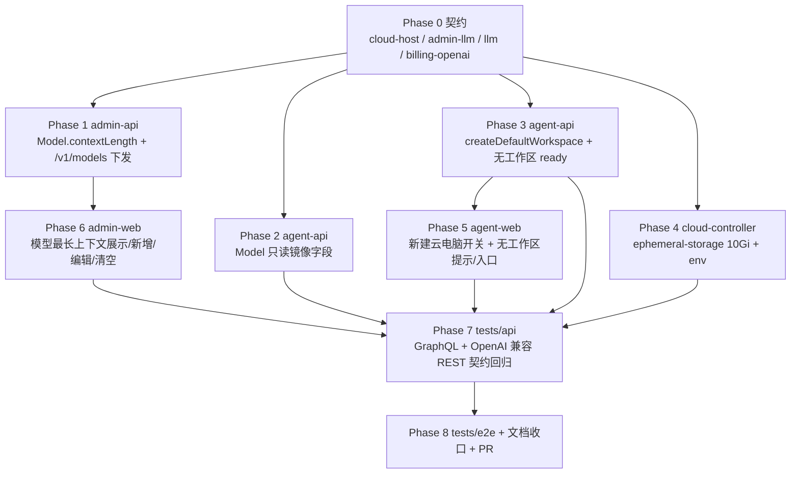

# 云容器优化二期 - 实现计划

**关联 Proposal**: `docs/engineering/proposals/20261023-feat-cloud-container-optimization-phase2.md`（v1.1）
**关联 PRD**: `docs/product/draft/20261023-cloud-container-optimization-phase2.md`（v1.1）
**需求总分支（feat-branch）**: `feat/cloud-container-optimization-phase2`（需求总 PR #267）
**实现分支**: `feat/cloud-container-optimization-phase2-impl`（基于需求总分支）
**创建日期**: 2026-10-23
**计划版本**: v1.0

**版本说明**：

- v1.0 首版，与 PRD v1.1 / 提案 v1.1 对齐，把提案 §5.2 的 4 个实现点拆成 9 个 Phase。
- 本版给出「上游文档 × 代码现状差异」6 条与「计划期裁决」8 条，收敛提案留白但会阻塞实现的细节（前端如何判定「未创建默认工作区」、`createDefaultSession` 的一期依赖、编辑入口形态等）。
- 不改变 PRD 产品口径；对提案新增 1 个展示字段 `CloudHost.hasDefaultWorkspace`（见裁决 1），需在实现 PR 描述中声明。

## 实现顺序



依赖说明：

- **P0 是唯一事实源**：字段名、可空性、默认值、错误文案以 P0 为准；契约未定稿前不写业务代码。
- **P1 / P2 / P3 / P4 可并行**：分属 admin-api、agent-api、cloud-controller，互不阻塞；P1 与 P2 必须同口径（同一 `models` 集合）。
- **P5 依赖 P3**：前端无工作区提示需要 `hasDefaultWorkspace`，默认会话判定依赖新的 ready 分支。
- **P6 依赖 P1**：后台模型设置直接消费 `Model.contextLength` 与 `updateModelContextLength`。
- **P7 依赖 P1~P6**：API 测试覆盖全部契约点；**P8 依赖 P7 与全部前端 Phase**，E2E 必须串行执行。

开发模式采用 TDD（红-绿-重构）：每个 Phase 先落失败测试（RED）再写实现（GREEN），最后重构。编码前按目录加载 `docs/engineering/common-rules.md`、`backend-rules.md`、`frontend-rules.md`、`servers/agent-api/AGENTS.md`、`servers/cloud-controller/AGENTS.md`、`apps/agent-web/AGENTS.md`、`apps/admin-web/AGENTS.md`、`tests/api/AGENTS.md`、`tests/e2e/AGENTS.md`。

### 关键约束（实现期不得回退）

- **零回归**：勾选「创建默认工作区」时与现状完全一致；存量云电脑、存量模型、存量工作区行为不变。
- **契约先行**：先改 `contracts/*`，再改 schema/resolver/service，最后改前端手写类型（本项目无 codegen，`apps/*/src/graphql/types.ts` 为人工对齐文件）。
- **下发渠道唯一**：模型最长上下文只经 OpenAI 兼容 `GET /v1/models` 的 `context_length` 下发；禁止向 `StartHarnessInput.secrets`、`ZAG_*` env、`opencode.jsonc` 注入，`packages/agent-controller` 零改动。
- **未设置即省略**：`contextLength = null` 时 `/v1/models` 不返回 `context_length`，不得返回 `null`。
- **默认工作区判定**：仅 `createDefaultWorkspace === true` 才 `ensureCloudHostWorkspace`；缺省/false 一律不创建工作区。
- **凭据零泄露**：模型上下文配置不得进入日志/错误文案；云电脑创建链路不改既有最小化凭据口径。
- **禁止 rebase/squash**：遵循 z-git 规范，仅允许 merge。

### 代码探查关键事实（实现时以现状为准）

- `CloudHostService.create` 当前无条件 `controllerWorkspaceService.ensureCloudHostWorkspace(controllerId, userId, config.cloudHostDefaultWorkspace)`，并 `CloudHost.create({ workspaceId })`；`workspaceId` schema 为 `required: true`（`servers/agent-api/src/models/cloud-host.ts`）。
- `handleReadyLocked` 两处建默认会话分支均以 `harnessTypes.length === 1` 为唯一条件，并 `workspaceId: String(host.workspaceId)`；无工作区时必须跳过，否则 `String(null) = 'null'` 会触发会话创建失败日志。
- `rollback()` 已兼容 `workspaceId` 为空（`if (input.workspaceId) ...`），无需改动。
- `CloudHost.defaultWorkspace` 为类型级 resolver（`defaultWorkspace(host)`），`workspaceId` 缺失时回退 `config.cloudHostDefaultWorkspace`（`/root/workspace`）；前端 `GithubProjectSetupDialog` 用其作为 clone 前缀默认值。
- 需求总分支当前**尚无**一期实现的 `CreateCloudHostInput.createDefaultSession` / `CloudHost.defaultSessionId` 语义字段（一期在独立实现分支）。本计划以「一期实现合入需求总分支后」为推荐基线；未合入时按现状单 Harness 自动建会话，不吞并一期范围。
- `apps/agent-web` / `apps/admin-web` 的 `src/graphql/types.ts` 均为**手写类型**（文件头注明人工对齐），无 codegen 脚本；契约变更后必须手工同步接口字段。
- admin-api `ModelService.mapModel` 显式挑选字段输出，新增 `contextLength` 必须同时补 model schema、mapModel、GraphQL typeDefs、resolver、查询语句与手写类型，缺一处即前端读不到。
- `/v1/models` 的 `toModelEntry(model)` 当前只接收 `name/createdAt` 并输出 `{id, object, owned_by, created}`；`account` 与 `cloud_host` 两种口径共用该函数，需一次性覆盖两条列表路径。
- cloud-controller `K8sJobManager.buildManifest` 从模块常量 `JOB_RESOURCES` 拷贝 requests/limits；`JobManagerConfig` 只有 `namespace/image/runtimeClassName/publicWsEndpoint`，`config/index.ts` 无 `ephemeralStorage` 配置项。
- `deploy/k8s/cloud-controller.yaml` 无 `JOB_EPHEMERAL_STORAGE`；`aspire/AgentGear.AppHost/AppHost.cs` 的 cloudController 未注入 RUNTIME_CLASS_NAME（dev 走 InMemory），但需补新 env；`aspire/manifest/docker-compose.yaml` 的 cloud-controller 段落需补同名 env。
- 前端云电脑状态来自唯一 `HOME_OVERVIEW.controllers[].cloudHost`；Sidebar 现有提示以 `RUNNING && harnessTypes.length === 1 && !defaultSessionId` 判定「默认会话创建失败」——该判定在新语义下必须改为「无默认工作区」优先，否则未勾选创建会误报失败。
- `NewCloudHostDialog` 提交时按需拼 `workloadIds`；`onCreated` 后统一跳转控制器设置页，不做会话跳转；新增开关需保持既有报文形状（未勾选不传新字段，保持兼容）。
- `GithubProjectSetupDialog` 的目标前缀默认 `cloudHost.defaultWorkspace ?? '/root/workspace'`，服务端按前缀拼接最终 clone 目录；该字符串是表单前缀，不是已创建工作区（见裁决 2）。

## 上游文档 × 代码现状差异

| # | 上游表述 | 代码现状（证据） | 本计划处置 |
|---|----------|------------------|------------|
| D1 | 提案 §3.1 契约示例含 `createDefaultSession: Boolean = true`，并作为既有字段 | 需求总分支 `contracts/cloud-host.graphql` 无该字段；一期实现分支才有 | 以「一期合入后」为基线；若实现分支拉起时一期未合入，ready 判空逻辑不依赖该字段（单 Harness 自动会话照旧），不在此重复实现一期能力 |
| D2 | 提案 §5.2 称无工作区时 `defaultSessionId` 保持 `null`，前端提示未创建工作区 | 前端无法区分「未创建默认工作区」与「默认会话创建失败」：`defaultWorkspace` 缺失回退 `/root/workspace`，现有提示只看 `defaultSessionId` | 新增只读展示字段 `CloudHost.hasDefaultWorkspace: Boolean!`（`workspaceId != null`），前端据此分流提示（裁决 1） |
| D3 | 提案 §5.2 实现点 1 称「复用一期提示组件语义」 | 当前无该组件；Sidebar 仅有 `cloud-host-default-session-hint` 失败提示 | 不改组件体系：Sidebar 增加无工作区提示与「Git 项目设置 / 新建工作区」入口，复用既有 `showGithubSetup` 与设置页跳转（裁决 3） |
| D4 | 提案 §6 决策 4 称 `CloudHost.defaultWorkspace` 保持 `String!`，回退 `/root/workspace` | 该回退值会出现在 Github 设置表单默认前缀，PRD 要求「任何入口都不出现 `/root/workspace`」 | 契约不变；表单在该主机 `hasDefaultWorkspace=false` 时不预填 `/root/workspace`，改为空值 + placeholder（裁决 2） |
| D5 | 提案 §3.1 契约 2 的 `updateModelContextLength` 返回 `Model!` | admin-api 现有 model mutation 为 granular 风格（`toggleGlobalModel`/`updateGlobalModelSortOrder`），统一经 `mapModelError` | 沿用 granular 风格；service 增加 `updateContextLength`，错误经 `mapModelError` 透传 |
| D6 | 提案 §8 未指明导入模型是否可设置上下文 | 导入链路只写 `name/isCustom/isEnabled/sortOrder/scope`，上游清单无上下文信息 | 导入模型一律「未设置」；管理员后续通过编辑入口补齐，不在导入弹窗增加字段（裁决 5） |

## 计划期裁决（提案留白 / 含混处的实现口径）

1. **`hasDefaultWorkspace` 展示字段（新增，最小扩展）**：`CloudHost` 增加 `hasDefaultWorkspace: Boolean!`，由 `mapCloudHost` 输出 `Boolean(host.workspaceId)`。仅用于前端提示与 Git 前缀默认值，不暴露 `workspaceId`，不改变既有字段语义。同步 agent-web 手写类型与 `HOME_OVERVIEW`/`GET_CONTROLLERS` 查询选择集。
2. **Github 前缀默认值**：`GithubProjectSetupDialog` 当 `hasDefaultWorkspace === false` 时 `targetPath` 初始为空，placeholder 为「例如：/workspace」，提交前仍走既有绝对路径校验；为 true 时保持 `defaultWorkspace` 预填。`CloudHost.defaultWorkspace` 契约与 resolver 不改。
3. **Sidebar 提示分流**：`RUNNING && hasDefaultWorkspace === false && controllerWorkspaces.length === 0` → 展示「未创建默认工作区，请先创建或绑定工作区」并在展开的「工作区」分组 actions 中提供既有「Github 项目设置」入口 + 「新建工作区」跳转（`/settings?controllerId=...`）；用户添加/绑定工作区后提示消失（避免「已创建仍提示创建」）。`RUNNING && hasDefaultWorkspace && single harness && !defaultSessionId` → 保留原「默认会话创建失败，可手动创建会话」；多 Harness 不提示。无工作区优先于默认会话失败。
4. **默认会话判定**：`handleReadyLocked` 两处分支增加 `host.workspaceId` 非空条件；无工作区时只 `console.info` 一次，不写 `defaultSessionId`，不新建会话。若一期 `createDefaultSession` 已合入，再叠加 `host.createDefaultSession !== false`。
5. **导入模型**：`importGlobalModels` 不接收上下文；导入后的模型 `contextLength = null`（未设置），后台编辑入口可补齐。
6. **后台编辑入口**：`CustomModelDialog` 增加 `model?: AdminModelData` 编辑模式：标题改「编辑模型」，供应商与名称只读，仅可编辑/清空「最长上下文大小」；`ModelItem` 增加铅笔按钮打开该模式。新增模式复用同一表单组件，避免再引入一个弹窗。
7. **校验唯一出口**：GraphQL `Int` 类型无法拦截 0/负数，服务端 `assertContextLength` 统一裁定：`null/undefined` → `null`；否则必须 `Number.isInteger && >= 1`，错误文案 `contextLength must be a positive integer`（create/update 共用，resolver 透传）。前端只做输入提示，不替代服务端。
8. **`/v1/models` 字段拼装**：`toModelEntry` 改为接收 `{name, createdAt, contextLength}`，用条件展开 `...(contextLength != null ? { context_length: contextLength } : {})`，保证 `account` 与 `cloud_host` 两口径行为一致；不引入缓存、不改筛选规则。

---

## Phase 0: 契约（唯一事实源）

| 文件 | 操作 | 说明 |
|------|------|------|
| `contracts/cloud-host.graphql` | 修改 | `CreateCloudHostInput` 增加 `createDefaultWorkspace: Boolean = false`；`CloudHost` 增加 `hasDefaultWorkspace: Boolean!`；注释写明「不勾选不创建 `/root/workspace`，就绪后不自动建会话」 |
| `contracts/admin-llm.graphql` | 修改 | `Model.contextLength: Int`（null=未设置）；`CustomModelInput.contextLength: Int`；`Mutation.updateModelContextLength(modelId: ID!, contextLength: Int): Model!` |
| `contracts/llm.graphql` | 修改 | `Model.contextLength: Int`（只读镜像，注释与 admin 侧逐字一致） |
| `contracts/billing-openai.openapi.yaml` | 修改 | `components.schemas.Model.properties.context_length`（integer, minimum 1，可选）；`/v1/models` 描述注明「未设置不返回该字段」 |

验收：四个契约自洽；`createDefaultWorkspace` 默认 `false`；`hasDefaultWorkspace` 与 `defaultWorkspace` 语义不冲突。

## Phase 1: admin-api（`Model.contextLength` + OpenAI 兼容下发）

开发分支：`feat/cloud-container-optimization-phase2-impl`（基于需求总分支）。

### Step 1.1 模型持久化与 GraphQL

| 文件 | 操作 | 说明 |
|------|------|------|
| `servers/admin-api/src/models/model.ts` | 修改 | 新增 `contextLength: { type: Number, default: null }`；注释「与 agent-api 同步演进；null=未设置」 |
| `servers/admin-api/src/graphql/schemas/model.ts` | 修改 | `Model.contextLength`、`CustomModelInput.contextLength`、`updateModelContextLength` |
| `servers/admin-api/src/services/model.ts` | 修改 | `MappedModel` 增加 `contextLength: number \| null`；`mapModel` 输出 `?? null`；`createCustom(input)` 接受并校验 `contextLength`；新增 `updateContextLength(id, value)`（含 `Model not found`）；抽出 `assertContextLength` |
| `servers/admin-api/src/graphql/resolvers/model.ts` | 修改 | `createGlobalCustomModel` 入参透传；新增 `updateModelContextLength`（`assertAdmin` + `mapModelError`） |

测试（先写后实现）：

- `servers/admin-api/src/services/model.test.ts`：create 带/不带 `contextLength`；`null` 清空；0/负数/小数/字符串拒绝；`updateContextLength` 不存在模型。
- `servers/admin-api/src/graphql/resolvers/model.test.ts`：`updateModelContextLength` 成功/非法值/未认证；`createGlobalCustomModel` 可选字段。
- MongoDB 断言：`models` 集合写入 `contextLength` 数值；既有行读出 `null`。

### Step 1.2 `/v1/models` 下发

| 文件 | 操作 | 说明 |
|------|------|------|
| `servers/admin-api/src/routes/billing-openai.ts` | 修改 | `toModelEntry` 增加 `contextLength` 参数与可选 `context_length`；`cloud_host` 列表 push 与 `account` 列表 map 均传 `model.contextLength`；`lean()` 无需改筛选 |
| `servers/admin-api/src/routes/billing-openai.test.ts` | 修改 | 新增用例：已设置 → `data[].context_length` 数值；未设置 → 字段不存在（`'context_length' in item === false`）；`account` 与 `cloud_host` 两口径各一条；既有 T-BK9/T-BK10/B-7/R2-9 不回归 |

### 命令参考

```bash
cd servers/admin-api && npm run build && npm test
```

---

## Phase 2: agent-api（Model 只读镜像）

| 文件 | 操作 | 说明 |
|------|------|------|
| `servers/agent-api/src/models/model.ts` | 修改 | 同步 `contextLength: { type: Number, default: null }`；注释与 admin 侧一致 |
| `servers/agent-api/src/graphql/schemas/model.ts` | 修改 | `Model.contextLength: Int`（只读） |
| `servers/agent-api/src/services/model.ts` | 修改 | `mapModel`/返回结构补 `contextLength ?? null`；不改用户侧 mutation 语义 |
| `apps/agent-web/src/graphql/types.ts` | 修改 | 手写 `ModelData`/可用模型类型补 `contextLength?: number \| null`（若前台查询选择） |

测试：`servers/agent-api/src/services/model.test.ts` 断言字段透出与 `null` 兜底；`servers/agent-api/src/graphql/resolvers/model.test.ts` 断言 `models` 可读。

## Phase 3: agent-api（`createDefaultWorkspace` + 无工作区 ready）

### Step 3.1 模型与创建编排

| 文件 | 操作 | 说明 |
|------|------|------|
| `servers/agent-api/src/models/cloud-host.ts` | 修改 | `workspaceId` 改 `required: false, default: null`；零迁移（存量行非空） |
| `servers/agent-api/src/services/cloud-host-service.ts` | 修改 | `CreateCloudHostInput` 增加 `createDefaultWorkspace?: boolean`；`validateInput` 归一 `=== true`；`create()` 仅 true 时 `ensureCloudHostWorkspace`，否则 `workspaceId=null`；`CloudHost.create` 传 `workspaceId: workspaceId ?? undefined`；`mapCloudHost` 增加 `hasDefaultWorkspace: Boolean(host.workspaceId)` |
| `servers/agent-api/src/graphql/schemas/cloud-host.ts` | 修改 | 输入与类型同步契约 |
| `servers/agent-api/src/graphql/resolvers/cloud-host.ts` | 修改 | 透传 `createDefaultWorkspace`；`hasDefaultWorkspace` 由 `mapCloudHost` 输出（若走类型级 resolver 则登记 `resolvers/index.ts`） |

### Step 3.2 ready 分支

| 文件 | 操作 | 说明 |
|------|------|------|
| `servers/agent-api/src/services/cloud-host-service.ts` | 修改 | `handleReadyLocked` 的 STARTING 分支与重复 ready 补建分支均增加 `host.workspaceId` 判空；无工作区时不建会话、不写 `defaultSessionId`，只 `console.info` |
| `servers/agent-api/src/services/cloud-host-service.test.ts` | 修改/新增 | T 用例：`createDefaultWorkspace=true` 创建工作区并落库；false/缺省不调用 `ensureCloudHostWorkspace` 且 `workspaceId=null`；rollback 在 null 工作区下不删工作区；ready 无工作区跳过会话；ready 有工作区仍建会话；重复 ready 无工作区不补建 |

测试重点：mock `controllerWorkspaceService.ensureCloudHostWorkspace` 断言调用次数；断言 `sessionService.create` 未被调用；断言 `hasDefaultWorkspace` 映射。

---

## Phase 4: cloud-controller（ephemeral-storage 10Gi）

| 文件 | 操作 | 说明 |
|------|------|------|
| `servers/cloud-controller/src/config/index.ts` | 修改 | `AppConfig` 增加 `jobEphemeralStorage: string`；`loadConfig` 读取 `env.JOB_EPHEMERAL_STORAGE || '10Gi'`；`index.test.ts` 补默认值与显式值 |
| `servers/cloud-controller/src/services/k8s-job-manager.ts` | 修改 | `JobManagerConfig` 增加 `ephemeralStorage?: string`；`JOB_RESOURCES` 保持基准 CPU/内存，`buildManifest` 拼 `'ephemeral-storage': this.cfg.ephemeralStorage ?? '10Gi'`（requests/limits 同值），避免模块常量在测试间被篡改 |
| `servers/cloud-controller/src/services/k8s-client.ts` | 修改 | `K8sResourceList` 增加 `'ephemeral-storage'?: string` |
| `servers/cloud-controller/src/index.ts` | 修改 | 构造 `K8sJobManager` 时传 `ephemeralStorage: config.jobEphemeralStorage` |
| `servers/cloud-controller/src/services/k8s-job-manager.test.ts` | 修改 | T-K5 断言 requests/limits 含 `ephemeral-storage: '10Gi'`；新增 env 覆盖用例（如 `5Gi`）与缺省默认用例 |
| `deploy/k8s/cloud-controller.yaml` | 修改 | Deployment env 增加 `JOB_EPHEMERAL_STORAGE: '10Gi'` 及注释 |
| `aspire/AgentGear.AppHost/AppHost.cs` | 修改 | cloudController 增加 `.WithEnvironment("JOB_EPHEMERAL_STORAGE", "10Gi")` |
| `aspire/manifest/docker-compose.yaml` | 修改 | cloud-controller `environment` 增加 `JOB_EPHEMERAL_STORAGE: "10Gi"` |

测试：`cd servers/cloud-controller && npm run build && npm test`；manifest 资源断言必须精确等于 `{ cpu, memory, 'ephemeral-storage' }`。

---

## Phase 5: agent-web（新建开关 + 无工作区提示/入口）

### Step 5.1 新建云电脑

| 文件 | 操作 | 说明 |
|------|------|------|
| `apps/agent-web/src/components/cloud-host/NewCloudHostDialog.tsx` | 修改 | 新增「创建默认工作区」复选，默认不勾选；与 Harness/工作负载区块并列；提交 `createDefaultWorkspace`（未勾选也显式传 `false`，语义清晰）；提示文案：勾选且单 Harness「将创建默认工作区并自动创建会话」，未勾选「不会创建工作区，就绪后需先创建或绑定工作区」 |
| `apps/agent-web/src/components/cloud-host/__tests__/NewCloudHostDialog.test.tsx` | 修改 | 默认不勾选；勾选后提交 `true`；未勾选提交 `false`；既有名称/Harness/负载用例不回归；组合 Github 负载与开关互不影响 |
| `apps/agent-web/src/graphql/mutations.ts` | 修改 | `CREATE_CLOUD_HOST` 返回选择集补 `hasDefaultWorkspace`；变量输入字段由手写类型约束 |
| `apps/agent-web/src/graphql/types.ts` | 修改 | `CloudHostData` 增加 `hasDefaultWorkspace?: boolean`；`CreateCloudHostInput` 手写类型增加 `createDefaultWorkspace?: boolean`（若有） |

### Step 5.2 就绪提示与入口

| 文件 | 操作 | 说明 |
|------|------|------|
| `apps/agent-web/src/components/Sidebar.tsx` | 修改 | 云电脑行提示分流（裁决 3）：`hasDefaultWorkspace === false && controllerWorkspaces.length === 0` 时展示 `data-testid="cloud-host-no-workspace-hint"`「未创建默认工作区，请先创建或绑定工作区」，添加/绑定工作区后消失；「工作区」TreeSection actions 在无工作区时同时展示既有 Github 入口与「新建工作区」按钮（navigate `/settings?controllerId=...`）；保留原默认会话失败提示（有工作区且单 Harness 无会话） |
| `apps/agent-web/src/components/cloud-host/GithubProjectSetupDialog.tsx` | 修改 | `hasDefaultWorkspace === false` 时 `targetPath` 初始 `''`，placeholder「例如：/workspace」；为 true 时保持 `defaultWorkspace` 预填；提交前必填校验沿用现有绝对路径校验（裁决 2） |
| `apps/agent-web/src/components/cloud-host/__tests__/GithubProjectSetupDialog.test.tsx` | 修改 | 无工作区不预填 `/root/workspace`、空值不可提交；有工作区仍预填 |
| `apps/agent-web/src/components/__tests__/Sidebar.test.tsx` | 修改/新增 | 无工作区 RUNNING 展示新提示且不展示「默认会话创建失败」；有工作区单 Harness 无会话仍展示旧提示；多 Harness 不提示；入口点击打开 Github 弹窗/跳转设置页 |

### 命令参考

```bash
cd apps/agent-web && npm run build && npm run lint && npm test
```

---

## Phase 6: admin-web（模型最长上下文展示/新增/编辑/清空）

| 文件 | 操作 | 说明 |
|------|------|------|
| `apps/admin-web/src/components/models/CustomModelDialog.tsx` | 修改 | 新增可选 `model?: AdminModelData`；编辑模式标题「编辑模型」、供应商/名称为只读文本；新增「最长上下文大小（token）」数字输入（创建/编辑共用），空字符串提交 `null`；本地校验正整数（0/负数/小数提示「请输入正整数」），服务端仍为唯一事实源 |
| `apps/admin-web/src/components/models/ModelItem.tsx` | 修改 | 名称下展示上下文摘要（如 `200,000 tokens`；未设置显示「未设置」）；新增铅笔按钮（`aria-label="编辑模型"`）触发 `onEdit(model)` |
| `apps/admin-web/src/components/models/ModelSection.tsx` | 修改 | 引入 `UPDATE_MODEL_CONTEXT_LENGTH`；`createCustom` 传 `contextLength`；编辑保存调用新 mutation 并 `refetchQueries: [ADMIN_MODELS]`；toast 成功/失败 |
| `apps/admin-web/src/graphql/mutations.ts` | 修改 | `CREATE_GLOBAL_CUSTOM_MODEL` 选择集补 `contextLength` 并接收 `$input` 新字段；新增 `UPDATE_MODEL_CONTEXT_LENGTH` |
| `apps/admin-web/src/graphql/queries.ts` | 修改 | `ADMIN_MODELS` 选择集补 `contextLength` |
| `apps/admin-web/src/graphql/types.ts` | 修改 | `AdminModelData.contextLength?: number \| null` |
| `apps/admin-web/src/components/__tests__/ModelSection.test.tsx` | 修改/新增 | 新增带上下文；编辑修改/清空；非法值前端拦截；列表展示「未设置」；既有增删改排序不回归 |

### 命令参考

```bash
cd apps/admin-web && npm run build && npm run lint && npm test
```

---

## Phase 7: API 测试（tests/api）

> 先 `aspire start && aspire wait agent-api admin-api cloud-controller`，再按 `tests/api/AGENTS.md` 注入环境变量；API 与 E2E 不得并行。

| 文件 | 操作 | 覆盖 |
|------|------|------|
| `tests/api/src/agent-api/cloud-host.test.ts` | 修改 | `createCloudHost(createDefaultWorkspace=true/false/缺省)` 三种组合；false 后 `myCloudHosts` 的 `hasDefaultWorkspace=false`；工作区列表为空；true 时 `hasDefaultWorkspace=true` 且默认工作区路径正确；`harnessTypes` 多选不再误建会话 |
| `tests/api/src/admin-api/llm.test.ts` | 修改 | `createGlobalCustomModel(contextLength)` 正/负/0/小数；`updateModelContextLength` 修改与 `null` 清空；`adminModels` 回读一致 |
| `tests/api/src/admin-api/billing-gateway.test.ts` | 修改 | `GET /v1/models`：已设置返回 `context_length`；未设置字段缺失；`account` 与 `cloud_host` 两种 Key 各一条；清空后重新请求字段消失 |
| `tests/api/src/cloud-controller/internal-api.test.ts` | 修改 | 通过真实 manifest 构造断言 `ephemeral-storage: 10Gi`（或复用单测，API 套件至少断言 Job 模板资源） |

验收：新增用例全绿；既有 `cloud-host`/`llm`/`billing-gateway` 用例零失败；测试结束后无残留活跃云电脑。

## Phase 8: E2E + 文档收口 + PR

| # | 场景 | 验证点 | 落点 |
|---|------|--------|------|
| E2E-1 | 默认不创建工作区主链路 | 新建对话框默认不勾选 → 创建 → RUNNING 后工作区列表为空、不自动进入会话、展示「未创建默认工作区」提示 → 打开 Github 项目设置 → 绑定后建会话 | `tests/e2e/src/cloud-host.spec.ts` |
| E2E-2 | 勾选创建工作区回归 | 勾选后与现状一致：有默认工作区、就绪后自动进入默认会话 | `tests/e2e/src/cloud-host.spec.ts` |
| E2E-3 | 后台最长上下文 | 新增/编辑/清空模型上下文；列表展示与回读；非法值提示 | `tests/e2e/src/admin-model-config.spec.ts` |
| E2E-4 | 存储上限 | 新建云电脑的 Job 资源约束含 ephemeral-storage 10Gi（管理后台云端容器/云端控制器可观测处断言） | `tests/e2e/src/admin-cloud-container.spec.ts` |

### 文档收口

| 文件 | 操作 | 说明 |
|------|------|------|
| `apps/agent-web/AGENTS.md` | 修改 | 新建表单增加「创建默认工作区」；默认会话判定改为「有默认工作区才自动会话」；无工作区提示与入口 |
| `apps/admin-web/AGENTS.md` | 修改 | 模型配置页增加最长上下文新增/编辑/清空与展示口径 |
| `servers/agent-api/AGENTS.md` | 修改 | 创建编排不再无条件建工作区；ready 判空；`hasDefaultWorkspace` |
| `servers/cloud-controller/AGENTS.md` | 修改 | 环境变量表增加 `JOB_EPHEMERAL_STORAGE`；Job 资源含 ephemeral-storage |
| `docs/engineering/AGENTS.md` | 修改 | 实现计划索引登记本文件 |

### 命令参考

```bash
cd servers/agent-api && npm run build && npm test
cd servers/admin-api && npm run build && npm test
cd servers/cloud-controller && npm run build && npm test
cd apps/agent-web && npm run build && npm run lint && npm test
cd apps/admin-web && npm run build && npm run lint && npm test
# 集成（串行）
cd tests/api && npm test
cd tests/e2e && npx playwright test
```

---

## 总体验收

- [ ] 契约评审通过（`cloud-host.graphql` / `admin-llm.graphql` / `llm.graphql` / `billing-openai.openapi.yaml`）
- [ ] 新建云电脑默认不创建工作区；勾选后与现状完全一致（PRD 功能点 1）
- [ ] 无工作区就绪后不自动进入会话，提示与「Git 项目设置 / 新建工作区」入口可用（PRD 功能点 1 验收 4/5）
- [ ] 后台可新增/修改/清空 `Model.contextLength`；非法值被拒；回读一致（PRD 功能点 2）
- [ ] `GET /v1/models` 对 `account` / `cloud_host` 两口径下发 `context_length`；未设置省略；清空后立即消失；全程无 secrets/env/`opencode.jsonc` 注入（PRD 功能点 2 验收 5）
- [ ] 新建云电脑 Job 资源 requests/limits 均含 `ephemeral-storage: 10Gi`；存量不受影响（PRD 功能点 3）
- [ ] 单测/API 测试/E2E 全绿且既有用例零回归
- [ ] 文档已同步（4 个 AGENTS.md + 本计划索引）
- [ ] 实现 PR 描述声明：新增 `hasDefaultWorkspace`、Github 前缀空值行为、一期 `createDefaultSession` 合并依赖

## 风险与回滚

| 风险 | 影响 | 缓解 |
|------|------|------|
| 一期实现先/后合入导致 `CreateCloudHostInput` 冲突 | 契约合并冲突、默认会话判定差异 | P0 合并前先与一期分支对齐；冲突以本计划 P0 为准，`createDefaultSession` 保留一期语义 |
| 存量调用方依赖「必有默认工作区」 | 行为变更 | PRD 已声明为有意变更；显式勾选即完全等价；发版说明中标注 |
| 节点 `allocatable.ephemeral-storage` 不足 | Pod Pending | 部署前核对节点容量；`JOB_EPHEMERAL_STORAGE` 可下调；不影响存量 |
| `hasDefaultWorkspace` 为新增字段 | 老前端忽略即可 | 可选向后兼容；仅新前端消费 |
| `contextLength` 为 `Int`（上限 2^31-1） | 超大上下文无法录入 | 实际模型上下文远小于该值；如未来需要改 `Float` |
