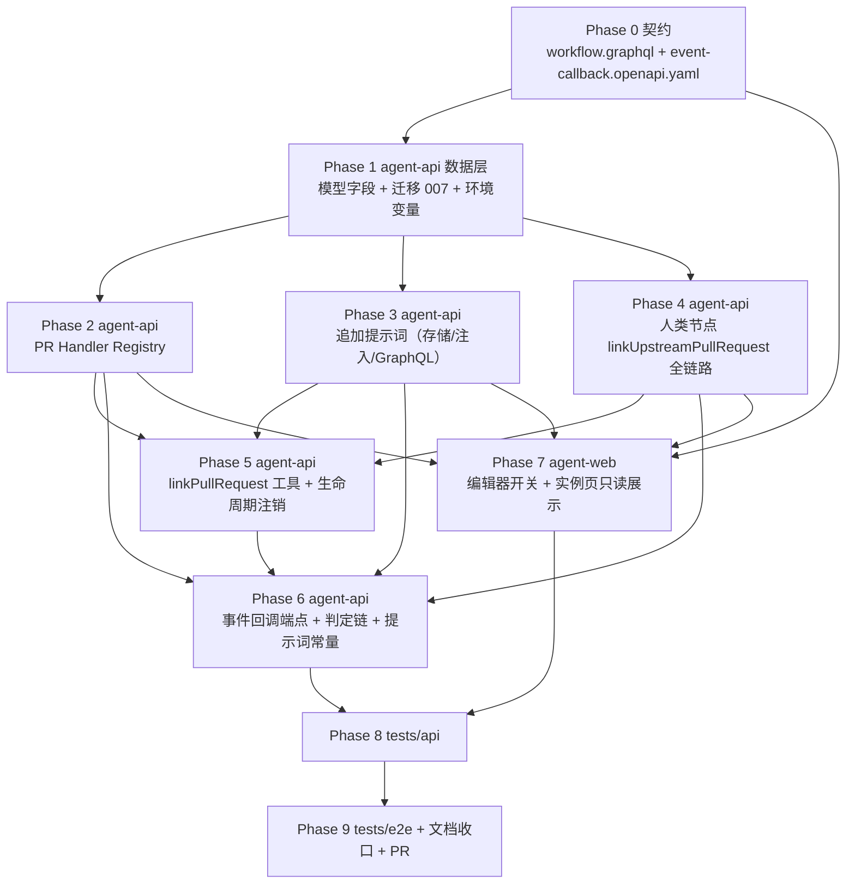
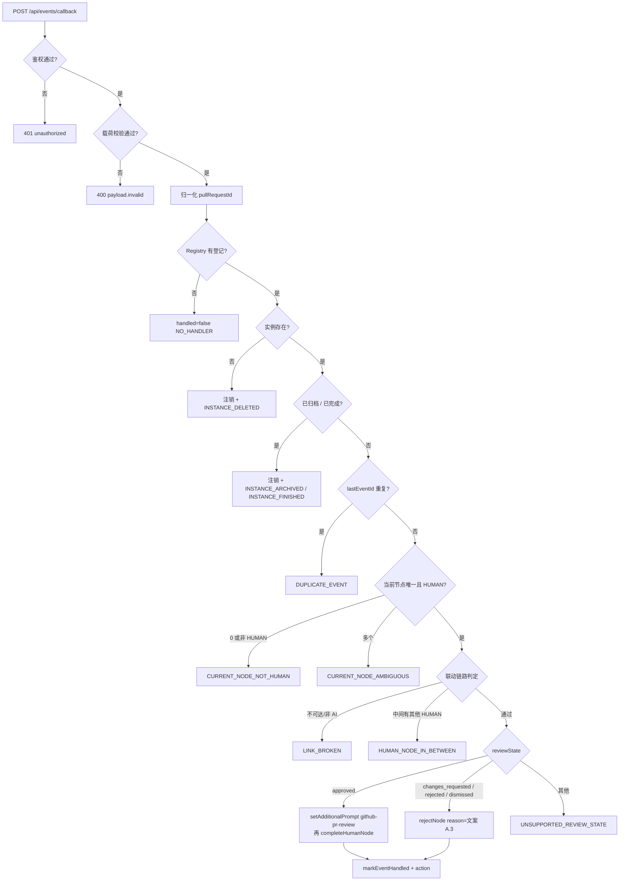

# 工作流 GitHub Pull Request 联动 - 实现计划

**关联 Proposal**: `docs/engineering/proposals/20261023-feat-workflow-github-pr-callback.md`（v1.0）
**关联 PRD**: `docs/product/draft/20261023-workflow-github-pr-callback.md`（v1.0）
**需求总分支（feat-branch）**: `feat/workflow-github-pr-callback`（需求总 PR #266）
**实现分支**: `feat/workflow-github-pr-callback-impl`（基于需求总分支）
**创建日期**: 2026-10-23
**计划版本**: v1.0

**版本说明**：

- v1.0 首版，与 PRD v1.0 / 提案 v1.0 对齐。把提案 §5.2 的六个实现点拆成 10 个 Phase：契约 → 数据模型/迁移/配置 → PR Handler Registry → 追加提示词 → 人类节点联动字段 → MCP 工具与注销 → 事件回调 → agent-web → API 测试 → E2E 与收口。
- 本版给出「上游文档 × 代码现状差异」13 条与「计划期裁决」16 条，收敛提案中与现有代码不一致、或提案留白但会阻塞实现的细节（实例无「完成」事件、`rejectNode` 不接受 READY、`copyFromTemplate` 丢弃编辑值、AI 无法获知 workflowId、回调无原始报文可验签等）。
- 本计划不改变 PRD 产品口径；对提案的 1 处契约结构（回调响应聚合为 `results[]`）、1 处工具入参（`workflowId`/`nodeId` 可缺省）与 1 处数据模型（实例新增 `finishedAt`）做收敛，需在实现 PR 描述中声明。

## 实现顺序



依赖说明：

- **P0 是唯一事实源**：字段名、可空性、枚举与错误文案全部以 P0 为准；契约未定稿前不写业务代码。
- **P1 是数据层前置**：模型字段、迁移与配置先落地，P2 / P3 / P4 才能并行开工。
- **P2 / P3 / P4 可并行**：Registry、追加提示词、节点联动字段三者互不依赖（都只依赖 P1）。
- **P5 依赖 P2 + P3 + P4**：`linkPullRequest` 写入 Registry；勾选变化重算 `github-pr` 需要 P3 的写入通道；注销钩子需要 P2 的 `unregisterByInstance`。
- **P6 依赖 P2 + P3 + P4 + P5**：事件判定链要读 Registry、写追加提示词、走 `completeHumanNode`/`rejectNode`。
- **P7 依赖 P0 + P2 + P3 + P4**：前端只需要契约与只读数据源，不等事件回调。
- **P8 / P9 串行**：API 与 E2E 共用同一套 Aspire 服务与 Mongo/Redis，禁止并行执行。

开发模式采用 TDD（红-绿-重构）：每个 Phase 先落失败测试（RED）再写实现（GREEN），最后重构。编码前按目录加载 `docs/engineering/common-rules.md`、`backend-rules.md`、`frontend-rules.md`、`servers/agent-api/AGENTS.md`、`apps/agent-web/AGENTS.md`、`tests/api/AGENTS.md`、`tests/e2e/AGENTS.md`。

### 关键约束（实现期不得回退）

- **零回归**：未开启「联动上游 Pull Request」的工作流行为与现状完全一致（无 `github-pr` 注入、无事件驱动、无新增查询字段影响既有查询）。
- **单一状态机入口**：事件驱动与人工操作共用 `workflowEngine.transition`，禁止绕过引擎直接改 `nodes[].status`。
- **契约先行**：先改 `contracts/workflow.graphql`、新增 `contracts/event-callback.openapi.yaml`，再改 schema/resolver；前端 GraphQL 类型为**手写**（本仓库无 codegen），禁止臆造生成物。
- **系统键只由系统写**：`github-pr` / `github-pr-review` 为系统管理键，GraphQL mutation 拒绝写入/删除（避免人工覆盖导致联动失效）。
- **幂等与串行**：事件回调按 `workflowInstanceId` 串行化（`KeyedMutex`，进程内、**非可重入**）；重复事件只处理一次。
- **凭据零泄露**：`EVENT_CALLBACK_TOKEN` / `GITHUB_WEBHOOK_SECRET` 不入代码库、不写日志、不进错误响应。
- **提示词纯文本**：审核意见按纯文本注入，不解析其中指令标记；超长评论截断（见裁决 12）。
- **禁止 rebase/squash**：遵循 z-git 规范，仅允许 merge。

## 上游文档 × 代码现状差异

实现前必须知道的事实偏差（在本计划内消化，无需打回上游；需在实现 PR 描述中声明）：

| # | 上游表述 | 代码现状（证据） | 本计划处置 |
|---|---|---|---|
| D1 | 提案 §3.2 引用 `createInstance` / `getInstance` | 实际为 `workflowInstanceService.instantiate`（`services/workflow/instance.ts:100`）与 `findById`（:74）；`normalizeNodes` 为私有（:79） | 计划统一使用实际函数名；新增能力以现有服务为落点 |
| D2 | 提案把「工作流完成」当作可判定状态 | `WorkflowInstance` **没有** `status` / `finishedAt` 字段；`engine.transition` 也无「全部 DONE」事件；`archivedAt` / `deletedAt` 才是显式生命周期标记 | 实例新增 `finishedAt`（见裁决 1），由引擎在每次转移后一次性 CAS 落库 |
| D3 | 提案称 rejected 直接复用 `rejectNode` | `rejectNode`（`instance.ts:406`）不做 READY 补 `start`，而 `READY` 人类节点（首节点、或上游刚全部 DONE 的下游审批）打回会抛「当前状态为 READY，不允许执行打回」；UI 已对 READY 展示打回入口（`WorkflowNodeTree.tsx:305`） | `rejectNode` 扩展为 READY→`start`→`reject`，与 `completeHumanNode` 的组合语义对称（裁决 2） |
| D4 | 提案称 `copyFromTemplate` 会把节点设置逐层传递 | `configured.ts:62-82` 的 `copyFromTemplate` 只按 nodeKey 合入 `agentConfig`，**丢弃** `input.nodes` 的其他字段（含新增联动开关） | 按 nodeKey 合入 `linkUpstreamPullRequest`（裁决 8）；同步 `normalizeConfiguredNodes`、`instance.normalizeNodes`、`instantiate` 快照、`updateNode` |
| D5 | 提案的工具入参要求 AI 传 `workflowId` + `nodeId` | 节点会话的 AI 只能通过 `getCurrentNodeId` 拿到 nodeId；`getNodeInfo`（`tool-handlers.ts:56`）**不返回 workflowInstanceId**，AI 无法自行获知实例 ID | `linkPullRequest` 的 `workflowId`/`nodeId` 改为可缺省（缺省取作用域），提供即强校验；`getNodeInfo` 补 `workflowInstanceId`（裁决 3） |
| D6 | 提案错误码含 `INVALID_ARGUMENT` | `WorkflowToolError` 现有码为 `UNAUTHORIZED` / `NOT_FOUND` / `NODE_NOT_FOUND` / `INVALID_PARAMS` / `KEY_NOT_FOUND` / `INVALID_STATE` / `UNKNOWN_TOOL`（`tool-handlers.ts`） | 不新增错误码，复用 `INVALID_PARAMS`（参数/PR 标识非法）与 `INVALID_STATE`（实例归档/删除/完成、节点不符） |
| D7 | 提案 GraphQL 片段使用 `DateTime!` | 契约与运行时 schema **没有** `DateTime` scalar，全部日期为 ISO `String`（如 `createdAt: String!`） | `WorkflowPullRequestLink.registeredAt: String!` |
| D8 | 提案称前端 `graphql/types.ts` 由 codegen 生成，并提到 `WORKFLOW_NODE_FIELDS` | 仓库**无 codegen**（无配置/脚本/依赖），`apps/agent-web/src/graphql/types.ts` 首行注明手写；工作流类型集中在 `graphql/workflow.ts`，实例节点字段内联在 `GET_WORKFLOW_INSTANCE`，不存在 `WORKFLOW_NODE_FIELDS` | 全部手写类型与文档；新增实例节点内联选择或抽公共 fragment（裁决 13） |
| D9 | 提案假设契约 `WorkflowNode` 已含 `dependsOn` | 运行时 schema 有 `dependsOn`（`graphql/schemas/workflow.ts:121`），前端也在查询（`graphql/workflow.ts:342`），但 `contracts/workflow.graphql` 的 `WorkflowNode` **缺失** | 本计划顺手补齐契约（Phase 0），避免契约与实现继续漂移 |
| D10 | 提案 `routes/event-callback.ts` 使用 `X-Event-Token` 与 raw body 验签 | 现有内部端点为 `Authorization: Bearer` + `crypto.timingSafeEqual`（`routes/internal-cloud-host.ts:13-19`）；`index.ts:37` 全局 `express.json()` **不保留原始报文**；无 `zod` 依赖 | 回调路由以 `express.raw` **前置挂载**在全局 JSON 解析器之前并手写校验（裁决 4、5） |
| D11 | 提案未提迁移 | 现有迁移至 `006`；`workflowprhandlers` 的唯一索引在 `autoIndex` 关闭的部署下会静默缺失（backend-rules 陷阱） | 新增迁移 `007-workflow-pr-handler-index` + 单测，并在 `index.ts` 注册 |
| D12 | 提案未提 Aspire 环境变量注入 | `config/index.ts` 无 `EVENT_CALLBACK_TOKEN` / `GITHUB_WEBHOOK_SECRET`；`aspire/AgentGear.AppHost/AppHost.cs:117-126` 逐项 `WithEnvironment` | Phase 1 补配置与 AppHost 参数（`secret: true`, `SecretOrDefault`），发布产物由 `aspire publish` 重新生成，不手改 manifest |
| D13 | 提案测试策略只列单元 / API / E2E | 本仓库有成熟的前端组件测试惯例（`components/__tests__/WorkflowNodeTree.test.tsx` 等）；API 已有 `A1-A50`、E2E 已有 `E2E-1..26` 编号，`tests/api/AGENTS.md` 与 `tests/e2e/AGENTS.md` 的用例表是文档事实源 | 补前端组件测试；新 API 用例用 `T-PR*` 独立文件，E2E 用 `E2E-27+` 追加到 `workflow.spec.ts`，并更新两份 AGENTS 表 |

## 计划期裁决（提案留白 / 含混处的实现口径）

1. **工作流完成判定（D2）**：`workflow-instance` 新增 `finishedAt: Date | null`。`engine.transition()` 在 `apply()` + `refreshCurrentNodeNames()` 之后判定 `nodes.every(n => n.status === 'DONE')`，为真且 `finishedAt == null` 时就地赋值（`instance.finishedAt = new Date()`）并随同一份 `instance.save()` 落库，保存成功后调用新增 hook `onWorkflowFinished(instance)` 一次。判定放在**外层 transition**（`apply` 的递归级联不触发），保证一次完成只触发一次；迁移前已完成的历史实例 `finishedAt` 为空，由事件处理器的「全节点 DONE」兜底识别并顺带补写。
   - `finishedAt` 本期**不**透出 GraphQL；对外的可观测结果是 `pullRequestLinks` 已清空（注销生效）与 `handled=false`。

2. **`rejectNode` 支持 READY（D3）**：`workflowInstanceService.rejectNode` 在节点 `status === 'READY'` 时先 `transition(start)` 再 `transition(reject)`；`RUNNING`/`REWORK` 行为不变。同时补 `node.type !== 'HUMAN'` 拒绝（与 `completeHumanNode` 对称），避免事件驱动误打回 AI 节点。此为对现有 UI 打回入口的顺带修复，需在 API 测试补齐两条断言（READY 打回成功、AI 节点拒绝）。

3. **MCP 工具入参与信息可见性（D5）**：
   - `linkPullRequest` 入参：`pullRequestId` **必填**；`workflowId`、`nodeId` 可选。缺省时取会话作用域（`scope.instanceId` / `scope.nodeId`）；显式提供时必须与作用域一致，否则 `INVALID_PARAMS`。
   - `getNodeInfo` 返回值增加 `workflowInstanceId`（不改变既有字段），使 AI 在需要显式传参时可自查。
   - `github-pr` 指引文案统一写成「调用 `agent-workflow-tools.linkPullRequest`，只需传 `pullRequestId`（形如 `owner/repo#123` 或 PR 链接）」，与 PRD 附录 A.1 语义一致（PRD 明确允许实现层补充工具名等细节）。

4. **回调鉴权（D10）**：`routes/event-callback.ts` 使用 `express.Router()` + `express.raw({ type: 'application/json', limit: '1mb' })`，在 `index.ts` 中**先于** `express.json()` 挂载到 `/api`（`app.use('/api', eventCallbackRouter)`）。通过条件（任一）：
   - `X-Event-Token: <token>` 或 `Authorization: Bearer <token>` 与 `config.eventCallbackToken` 做等长 `timingSafeEqual`；
   - `X-Hub-Signature-256: sha256=<hex>` 对**原始字节**做 HMAC-SHA256（密钥 `config.githubWebhookSecret`）并 `timingSafeEqual`。
   两者都未配置时一律 401（默认拒绝，不提供「无鉴权放行」）。鉴权失败不记录凭据，只记 `[event-callback] unauthorized`。

5. **载荷校验（D10）**：不引入 `zod`，新增纯函数 `parseEventCallbackPayload(raw: Buffer)`（`services/workflow/pr-event-payload.ts`），手写类型守卫：`eventType` 必须为 `pull_request`（否则 400 `unsupported eventType`）；`eventId` 非空字符串；`payload.pullRequestId` 非空字符串；`payload.reviewState` 为字符串；`occurredAt`/`submittedAt` 若存在必须可被 `Date.parse`。JSON 解析失败或字段缺失 → 400 `{ error: 'payload.invalid', detail: '<字段路径>' }`。

6. **回调响应聚合（契约收敛）**：同一 PR 可能登记在多个实例（PRD 3.5），响应改为 `results[]` 逐实例给出结论；`handled` 为 `results.some(r => r.action)`：
   ```json
   { "handled": true, "results": [{ "workflowInstanceId": "...", "nodeId": "...", "nodeName": "评审", "action": "COMPLETE_HUMAN_NODE", "promptKey": "github-pr-review" }] }
   { "handled": false, "reason": "HUMAN_NODE_IN_BETWEEN", "results": [{ "workflowInstanceId": "...", "nodeId": "...", "reason": "HUMAN_NODE_IN_BETWEEN" }] }
   ```
   `reason` 枚举（最终）：`NO_HANDLER` / `INSTANCE_NOT_FOUND` / `INSTANCE_DELETED` / `INSTANCE_ARCHIVED` / `INSTANCE_FINISHED` / `NODE_NOT_FOUND` / `CURRENT_NODE_NOT_HUMAN` / `CURRENT_NODE_AMBIGUOUS` / `LINK_BROKEN` / `HUMAN_NODE_IN_BETWEEN` / `DUPLICATE_EVENT` / `UNSUPPORTED_REVIEW_STATE` / `HANDLER_FAILED`。新增 `CURRENT_NODE_AMBIGUOUS`（多个 READY/RUNNING 并发节点）、`LINK_BROKEN`（登记节点已不在实例内 / 不是当前人类节点的上游 / 不是 AI 节点）、`HANDLER_FAILED`（流转异常被捕获），其余沿用提案。

7. **「当前节点」判定**：候选 = `status ∈ {READY, RUNNING}` 的节点。候选数为 1 且 `type === 'HUMAN'` 才继续；0 个或唯一但非 HUMAN → `CURRENT_NODE_NOT_HUMAN`；多于 1 个 → `CURRENT_NODE_AMBIGUOUS`（并行分支下不猜测）。`archivedAt` / `deletedAt` / `finishedAt` 优先于本判定。

8. **联动链路判定（DAG）**：以实例节点 `dependsOn`（nodeId 引用）建邻接。设当前人类节点 `H`、登记节点 `R`：
   - `R` 不存在于实例 → `NODE_NOT_FOUND`；
   - `R.type !== 'AI'` 或 `R` 不是 `H` 的上游祖先 → `LINK_BROKEN`；
   - 计算 `between = ancestors(H) ∩ descendants(R)`（两端开区间）；若 `between` 中存在 `type === 'HUMAN'` → `HUMAN_NODE_IN_BETWEEN`。菱形依赖下该集合口径无歧义，比「找一条路径」更稳。

9. **注册覆盖语义**：`register()` 在同一 `(workflowInstanceId, nodeId)` 上换 PR 时，先删除该节点其他 `pullRequestId` 的登记（`REPLACED`），再 upsert 当前 PR；不同节点/不同实例的关联互不影响（对齐 PRD「同一节点以最后一次为准」「一个工作流可关联多个 PR」）。`lastEventId` 在同一条登记上做幂等位，成功后写入 `lastEventId/lastEventAt`。

10. **事件判定顺序与幂等**：`NO_HANDLER`（空）→ 逐登记：实例存在性（删除/归档/完成 → 注销 + 忽略）→ `lastEventId === eventId` → `DUPLICATE_EVENT` → 当前节点判定 → 链路判定 → `reviewState` 映射 → 驱动。`DUPLICATE_EVENT` 判定放在节点判定**之前**，保证重复投递即使状态已变化也返回同一原因。
    - `reviewState` 归一：`approved` → 通过；`changes_requested` / `rejected` / `dismissed` → 拒绝；其余（含 `commented`、缺省）→ `UNSUPPORTED_REVIEW_STATE`。

11. **并发控制**：新增模块级 `const instanceMutex = new KeyedMutex()`（`pr-event-handler.ts`），key 为 `workflowInstanceId`。**注意非可重入**：持锁函数内不得再调用自身/同 key 的 `runExclusive`；`workflowInstanceService.setAdditionalPrompt` / `completeHumanNode` 不取锁，仅事件入口取锁。`agent-api` 单实例部署假设与云电脑一致（`docs/engineering/backend-rules.md` 已记录）。

12. **提示词文案与长度**：`services/workflow/pr-prompts.ts` 提供 `GITHUB_PR_PROMPT`、`buildReviewPassedPrompt(input)`、`buildReviewRejectedPrompt(input)` 三个常量/工厂，文案逐字对齐 PRD 附录 A。`comment` 先 `trim()` 再截断至 8000 字符（尾部追加 `……（已截断）`）；`reviewer` 缺省 `未知`；`submittedAt` 缺省 `payload.occurredAt ?? 当前时间`。写作顺序：`review passed` 先 `setAdditionalPrompt('github-pr-review', ...)` **再** `completeHumanNode`（`completeHumanNode` 会重新从 DB 载入实例，`assemblePrompt` 才能读到新值；顺序反过来下游提示词将缺失）。

13. **前端展示落点（D8）**：新增 `apps/agent-web/src/components/workflow/WorkflowContextPanel.tsx`，在实例页右栏 `BlackboardPanel` 下方渲染两个 `CollapsibleSection`：
    - 「关联 Pull Request」：`pullRequestLinks` 列表（`pullRequestId` / 所属节点名 / 链接 / `registeredAt`），空态「暂无关联」；
    - 「追加提示词」：`additionalPrompts` 列表（key + `MarkdownContent` 只读），空态「暂无」。
    节点卡片按 `linksByNodeId` 展示一个 `PR` 徽标（hover/title 显示 `pullRequestId`）。`WorkflowInstanceData` 增加两个字段，`GET_WORKFLOW_INSTANCE` 增加选择集；不改 `HOME_OVERVIEW`（列表页不需要）。

14. **系统键保护**：`workflowInstanceService.setAdditionalPrompt/removeAdditionalPrompt` 对 `SYSTEM_PROMPT_KEYS = ['github-pr', 'github-pr-review']` 抛 `系统保留的追加提示词 key，不允许人工修改`；GraphQL 层原样透出该错误。`github-pr` 的重算只发生在实例化、`updateNode` 两个入口（内部直接走仓储写入，不经 GraphQL 校验）；`github-pr-review` 只由事件处理器写入。

15. **代码归属与生命周期注销**：`prHandlerRegistry.unregisterByInstance(instanceId, reason)` 在 `setArchived(true)`、`deleteInstance()`、引擎 `onWorkflowFinished` 三处调用；`setArchived(false)`（取消归档）**不**恢复关联（PRD 明确归档即解除）。注册表启动时 `rebuild()` 全量装载并构建内存索引；运行期不依赖索引的强一致（每次查询以 Mongo 为准，索引仅作加速）；查询到实例已归档/删除/完成时顺手注销（惰性清理）。

16. **`pullRequestId` 归一化**：接受 `https://github.com/<owner>/<repo>/pull/<n>`、`<owner>/<repo>#<n>`、`<owner>/<repo>/pull/<n>`（大小写不敏感，去除首尾空白与末尾 `/`）；归一为 `<owner>/<repo>#<n>`（owner/repo 保留原始大小写、比较时小写归一），`prUrl` 统一重建为 `https://github.com/<owner>/<repo>/pull/<n>`；无法归一 → `INVALID_PARAMS`。

---

## Phase 0: 契约（Contracts）

开发分支：`feat/workflow-github-pr-callback-impl`。契约提交与实现分开 commit。

### 文件修改

| 文件 | 操作 | 说明 |
|------|------|------|
| `contracts/workflow.graphql` | 修改 | 三层节点新增 `linkUpstreamPullRequest`；`WorkflowNode` 补 `dependsOn`；`WorkflowAdditionalPrompt` / `WorkflowPullRequestLink` 类型；`WorkflowInstance.additionalPrompts` / `pullRequestLinks`；两个追加提示词 mutation |
| `contracts/event-callback.openapi.yaml` | 新增 | `POST /api/events/callback`：双鉴权头、请求体、200/400/401 响应、`results[]` 与 reason 枚举 |

### 契约增量

```graphql
# contracts/workflow.graphql —— 三层节点同步（模板 / 已配置 / 实例）
# type WorkflowTemplateNode / type ConfiguredWorkflowNode / type WorkflowNode
  # 人类节点：是否联动上游 Pull Request（默认 false；仅 HUMAN 可为 true）
  linkUpstreamPullRequest: Boolean!

# input WorkflowTemplateNodeInput / ConfiguredWorkflowNodeInput / WorkflowNodeUpdateInput
  linkUpstreamPullRequest: Boolean

type WorkflowNode {
  # ...现有字段
  # 上游节点 nodeId 列表（DAG 判定与展示用；运行时 schema 早已存在，本次补契约）
  dependsOn: [String!]!
}

type WorkflowAdditionalPrompt {
  key: String!
  value: String!
}

type WorkflowPullRequestLink {
  pullRequestId: String!
  prUrl: String
  nodeId: String!
  nodeName: String
  # ISO 字符串（本仓库无 DateTime scalar）
  registeredAt: String!
}

type WorkflowInstance {
  # ...现有字段
  # 工作流级追加提示词（key 去重，只读展示；系统键 github-pr / github-pr-review）
  additionalPrompts: [WorkflowAdditionalPrompt!]!
  # 当前实例关联的 Pull Request（工作流完成/归档后为空）
  pullRequestLinks: [WorkflowPullRequestLink!]!
}

extend type Mutation {
  # 写入/覆盖用户追加提示词（同 key 覆盖）；系统键拒绝
  setWorkflowAdditionalPrompt(instanceId: ID!, key: String!, value: String!): WorkflowInstance!
  removeWorkflowAdditionalPrompt(instanceId: ID!, key: String!): WorkflowInstance!
}
```

```yaml
# contracts/event-callback.openapi.yaml（要点）
paths:
  /api/events/callback:
    post:
      summary: 接收 pull request 审核事件并驱动工作流
      parameters:
        - in: header
          name: X-Event-Token          # 或 Authorization: Bearer <token>
          schema: { type: string }
        - in: header
          name: X-Hub-Signature-256    # sha256=<hex>，对原始 body 计算
          schema: { type: string }
      requestBody:
        required: true
        content:
          application/json:
            schema:
              type: object
              required: [eventType, eventId, payload]
              properties:
                eventType: { type: string, enum: [pull_request] }
                eventId: { type: string }
                occurredAt: { type: string, format: date-time }
                payload:
                  type: object
                  required: [pullRequestId, reviewState]
                  properties:
                    pullRequestId: { type: string, example: 'Deliay/z-agent-gear#264' }
                    prUrl: { type: string }
                    action: { type: string, example: reviewed }
                    reviewState: { type: string, enum: [approved, changes_requested, rejected, dismissed, commented] }
                    comment: { type: string }
                    reviewer: { type: string }
                    submittedAt: { type: string, format: date-time }
      responses:
        '200':
          description: 已处理或安全忽略
          content:
            application/json:
              schema:
                type: object
                required: [handled]
                properties:
                  handled: { type: boolean }
                  reason: { type: string }
                  results:
                    type: array
                    items:
                      type: object
                      properties:
                        workflowInstanceId: { type: string }
                        nodeId: { type: string }
                        nodeName: { type: string }
                        action: { type: string, enum: [COMPLETE_HUMAN_NODE, REJECT_HUMAN_NODE] }
                        promptKey: { type: string }
                        reason: { type: string }
        '400': { description: payload.invalid }
        '401': { description: unauthorized }
```

### 验收 checklist

- [ ] 三层节点、两个 input、`WorkflowNodeUpdateInput` 的字段名/可空性与实现逐字一致
- [ ] `WorkflowInstance.additionalPrompts` / `pullRequestLinks` 均为非空列表（空态返回 `[]` 而非 `null`）
- [ ] 日期字段统一 `String`，无 `DateTime` 残留
- [ ] `event-callback.openapi.yaml` 的 reason/action 枚举与裁决 6 一致
- [ ] 契约 commit 独立于实现 commit

---

## Phase 1: agent-api — 数据模型 / 迁移 / 配置

### 文件修改

| 文件 | 操作 | 说明 |
|------|------|------|
| `servers/agent-api/src/models/workflow-pr-handler.ts` | 新增 | PR 联动登记模型（唯一索引 + 幂等位） |
| `servers/agent-api/src/models/workflow-instance.ts` | 修改 | `instanceNodeSchema.linkUpstreamPullRequest`、`additionalPrompts: Map<String,String>`、`finishedAt` |
| `servers/agent-api/src/models/workflow-template.ts` | 修改 | `templateNodeSchema.linkUpstreamPullRequest` |
| `servers/agent-api/src/models/configured-workflow.ts` | 修改 | `configuredNodeSchema.linkUpstreamPullRequest` |
| `servers/agent-api/src/migrations/007-workflow-pr-handler-index.ts` + `.test.ts` | 新增 | 显式创建唯一索引与其他查询索引（幂等） |
| `servers/agent-api/src/index.ts` | 修改 | 注册 migration 007（import 与 `runMigrations([...])`） |
| `servers/agent-api/src/config/index.ts` | 修改 | `eventCallbackToken` / `githubWebhookSecret`（缺省空串） |
| `aspire/AgentGear.AppHost/AppHost.cs` | 修改 | 两个新参数（`secret: true`）+ `agentApi.WithEnvironment(...)` |

### 模型定义（落地口径）

```ts
// models/workflow-pr-handler.ts
export const PR_HANDLER_UNREGISTER_REASONS = ['WORKFLOW_FINISHED', 'ARCHIVED', 'DELETED', 'REPLACED', 'STALE'] as const

export interface WorkflowPrHandlerDoc {
  userId: Types.ObjectId
  workflowInstanceId: Types.ObjectId
  nodeId: string
  nodeKey?: string | null
  pullRequestId: string        // 归一化 owner/repo#number
  prUrl?: string | null
  registeredBySessionId?: Types.ObjectId | null
  lastEventId?: string | null
  lastEventAt?: Date | null
  createdAt: Date
  updatedAt: Date
}
```

索引（schema 声明 + 迁移 007 显式创建，双重保障）：

| 索引 | 用途 |
|------|------|
| `{ pullRequestId: 1 }` | 事件入口按 PR 查登记 |
| `{ workflowInstanceId: 1 }` | 实例联动列表 / 注销 |
| `{ workflowInstanceId: 1, nodeId: 1, pullRequestId: 1 }` unique | 并发注册兜底（重复键 11000 视为成功） |

`workflow-instance.ts` 增量：

```ts
// instanceNodeSchema
linkUpstreamPullRequest: { type: Boolean, default: false },

// workflowInstanceSchema
additionalPrompts: { type: Map, of: String, default: {} },
finishedAt: { type: Date, default: null },
```

### 测试（RED 先行）

- `migrations/007-workflow-pr-handler-index.test.ts`：断言 `createIndex` 以 `unique: true` 与指定 `name` 调用；重复执行幂等（沿用 005 的 mock 风格）。
- `models/workflow-instance.test.ts`（若无则新增）：新实例 `linkUpstreamPullRequest === false`、`additionalPrompts` 为空 Map、`finishedAt === null`；旧文档反序列化时字段缺失按默认值读出（不抛错）。

### 实现要点

- `additionalPrompts` 用 Mongoose `Map`（与 `blackboard` 同型），避免嵌套子文档空对象物化陷阱；`default: {}` 保证读出来永远是 Map 而不是 `undefined`。
- 迁移 007 命名与 005 一致；仅在 `createIndex` 上加 `name: 'uniq_workflow_pr_handler'`，失败不落迁移记录（runner 已有该语义）。
- AppHost 参数：`event-callback-token`（`SecretOrDefault`）、`github-webhook-secret`（`SecretOrDefault`）；两者只在 `agentApi` 注入，admin-api / controller-api 不需要。

### 验收 checklist

- [ ] `npm run build`（agent-api）通过
- [ ] 迁移在空库与已有库上均幂等
- [ ] 未配置新环境变量时服务正常启动（回调端点默认拒绝，不崩）

---

## Phase 2: agent-api — PR Handler Registry

### 文件修改

| 文件 | 操作 | 说明 |
|------|------|------|
| `servers/agent-api/src/services/workflow/pr-handler-registry.ts` | 新增 | 归一化、注册（同节点换 PR 覆盖）、查询、注销、启动重建、生命周期 hook 注册 |
| `servers/agent-api/src/services/workflow/pr-handler-registry.test.ts` | 新增 | 覆盖全部方法分支 |

### 内部接口（签名）

| 接口 | 签名 | 说明 |
|------|------|------|
| 归一化 | `normalizePullRequestId(input: string): { pullRequestId: string; prUrl: string }` | 纯函数，失败抛 `INVALID_PULL_REQUEST_ID`（服务内 Error，路由层映射） |
| 注册 | `register({ userId, workflowInstanceId, nodeId, nodeKey?, pullRequestId, prUrl?, sessionId? }): Promise<WorkflowPrHandlerDoc>` | upsert + 删除同节点其他 PR（`REPLACED`） |
| 按 PR 查 | `findByPullRequestId(pullRequestId: string): Promise<WorkflowPrHandlerDoc[]>` | 小写归一比较；内存索引未命中回查 DB |
| 按实例查 | `listByInstance(instanceId: string): Promise<WorkflowPrHandlerDoc[]>` | 按 `nodeId, createdAt` 排序，供 GraphQL |
| 按实例注销 | `unregisterByInstance(instanceId: string, reason: UnregisterReason): Promise<number>` | 删除并清理索引，返回条数 |
| 标记事件 | `markEventHandled(id, eventId, at): Promise<void>` | 写 `lastEventId/lastEventAt` |
| 启动重建 | `rebuild(): Promise<number>` | 全量装载 + 建索引；失败只告警 |
| 生命周期 | `registerPrHandlerLifecycleHooks(): void` | 向 `workflowEngine` 注册 `onWorkflowFinished` |

### 测试（RED 先行）

- 归一化矩阵：完整 URL / `owner/repo#1` / `owner/repo/pull/1` / 大小写 / 前后空白 / 尾斜杠 / 非法（空、`foo`、`foo/bar`、非 GitHub 域名、`#0`）。
- `register`：首次创建；同节点同 PR 更新（不新增行）；同节点换 PR → 旧行删除（`REPLACED`）+ 新行写入；不同节点互不影响；唯一键 11000 并发重试视为成功。
- `findByPullRequestId`：大小写不敏感；无登记返回 `[]`。
- `unregisterByInstance`：返回条数；索引同步清理。
- `rebuild`：装载全部 rows；Mongo 异常不抛出（只 `console.warn`）。
- `registerPrHandlerLifecycleHooks`：`workflowEngine.registerHooks` 被调用且 `onWorkflowFinished` 触发 `unregisterByInstance(id, 'WORKFLOW_FINISHED')`。

### 实现要点

- 进程内索引 `Map<normalizedPullRequestId, Map<handlerId, handler>>`；写操作先落库、后更新索引；查询以 DB 结果为准合并索引（不依赖缓存正确性）。
- `register` 的覆盖顺序：`deleteMany({ workflowInstanceId, nodeId, pullRequestId: { $ne } })` → `findOneAndUpdate({ workflowInstanceId, nodeId, pullRequestId }, { $set: {...} }, { upsert: true, new: true })`。
- `unregisterByInstance` 返回条数用于响应与日志；调用方不因失败而回滚主流程（归档/删除仍成功，记 `console.warn`）。
- 不在 Registry 内做节点类型/实例状态校验（由 `tool-handlers` 与事件处理器各自校验），保持模块单一职责。

### 验收 checklist

- [ ] 单测全绿；无真实 Mongo 依赖（mock 模型）
- [ ] 同节点换 PR 后旧 PR 的 `findByPullRequestId` 返回空
- [ ] 注销后 `listByInstance` 返回 `[]`

---

## Phase 3: agent-api — 工作流追加提示词

### 文件修改

| 文件 | 操作 | 说明 |
|------|------|------|
| `servers/agent-api/src/services/workflow/instance.ts` | 修改 | `setAdditionalPrompt` / `removeAdditionalPrompt` / `syncGithubPrPrompt`；实例化写入 `github-pr`；`updateNode` 后重算 |
| `servers/agent-api/src/services/workflow/orchestrator.ts` | 修改 | `assemblePrompt` 末尾追加「追加提示词」段（key 排序、每 key 一段） |
| `servers/agent-api/src/services/workflow/pr-prompts.ts` | 新增 | `GITHUB_PR_PROMPT` 常量 + `buildReviewPassedPrompt` / `buildReviewRejectedPrompt` |
| `servers/agent-api/src/graphql/schemas/workflow.ts` | 修改 | `WorkflowAdditionalPrompt` 类型、实例字段、两个 mutation（与 P0 同步） |
| `servers/agent-api/src/graphql/resolvers/workflow.ts` | 修改 | `mapInstance` 输出 `additionalPrompts`；`pullRequestLinks` 类型级 resolver；两个 mutation |
| `servers/agent-api/src/graphql/resolvers/index.ts` | 修改 | `WorkflowInstance` 合并块登记 `pullRequestLinks` |

### 测试（RED 先行）

- `orchestrator.test.ts`：
  - 无追加提示词时提示词与现状逐字一致（零回归基线）；
  - 注入 2 个 key → 末尾出现 `## 追加提示词` + 按 key 升序的 `### key` 段；
  - 同 key 重复写 → 只出现一次且为最新值；
  - 追加段位于「上游产物」之后。
- `instance.test.ts`：`setAdditionalPrompt` 同 key 覆盖；系统键（`github-pr`/`github-pr-review`）拒绝；`removeAdditionalPrompt` 不存在时幂等返回 true；`syncGithubPrPrompt` 有勾选节点 → 写入；全部取消 → 删除；`updateNode` 改开关后同步。
- `pr-prompts.test.ts`：三段文案与 PRD 附录 A 逐字对照（含占位符替换）；comment 截断与缺省值。
- `graphql/resolvers/workflow.test.ts`：`mapInstance.additionalPrompts` Map→数组；空 Map → `[]`；`pullRequestLinks` 走 Registry（mock）并按实例过滤。

### 实现要点

- 拼接模板（`assemblePrompt`，在现有 `## 上游产物` 之后）：
  ```text
  ## 追加提示词
  ### <key>
  <value>

  ### <key2>
  <value2>
  ```
  key 用 `[...map.keys()].sort()` 保证稳定；value 原样文本（不 trim 内部、不做 markdown 转义）。
- `setAdditionalPrompt` 用 `$set: { ['additionalPrompts.' + key]: value }`（key 需满足 `/^[a-z0-9][a-z0-9-]*$/i`，否则报 `key 非法`；避免 `$` / `.` 注入坑）。写入后 `redis.del('workflow:instance:<id>')`，与 `updateNode` 保持一致（即便当前无缓存消费者）。
- `syncGithubPrPrompt(instanceId)`：读实例 → `nodes.some(n => n.type === 'HUMAN' && n.linkUpstreamPullRequest)` → 有则写 `github-pr = GITHUB_PR_PROMPT`，无则删键。**不经**系统键校验（内部入口）。
- `mapInstance` 直接输出 `additionalPrompts`（同步），不新增字段 resolver；`pullRequestLinks` 因需要异步查询，做成类型级 resolver 并在 `resolvers/index.ts` 的 `WorkflowInstance` 键登记（父对象含 `id`）。
- mutation 返回 `mapInstance(updatedDoc)`；`removeWorkflowAdditionalPrompt` 同样返回实例。

### 验收 checklist

- [ ] 未写入任何追加提示词时 AI 提示词与改造前一致（用基线快照断言）
- [ ] 同 key 只出现一次；key 顺序稳定
- [ ] 实例查询可看到 `additionalPrompts`，空态为 `[]`
- [ ] 系统键通过 GraphQL 写入被拒

---

## Phase 4: agent-api — 人类节点「联动上游 Pull Request」全链路

### 文件修改

| 文件 | 操作 | 说明 |
|------|------|------|
| `servers/agent-api/src/services/workflow/template.ts` | 修改 | `WorkflowTemplateNodeInput.linkUpstreamPullRequest`；`validateTemplateGraph` 仅允许 HUMAN 为 true |
| `servers/agent-api/src/services/workflow/configured.ts` | 修改 | `copyFromTemplate` 按 nodeKey 合入联动开关；`normalizeConfiguredNodes` 归一 |
| `servers/agent-api/src/services/workflow/instance.ts` | 修改 | `normalizeNodes`、`instantiate` 快照、`updateNode`（patch + HUMAN 校验） |
| `servers/agent-api/src/graphql/schemas/workflow.ts` | 修改 | 三层类型/输入字段 |
| `servers/agent-api/src/graphql/resolvers/workflow.ts` | 修改 | `mapTemplateNode` / `mapConfigured` / `mapInstanceNode` 透出；`createWorkflowTemplate` / `configureWorkflow` / `updateConfiguredWorkflow` / `instantiateWorkflow` / `updateWorkflowNode` 透传 |
| `servers/agent-api/src/services/workflow/admin-tools.ts` | 修改 | 4 处节点 schema（`createWorkflowTemplate` / `createConfiguredWorkflow` / `instantiateWorkflowFromContent`，以及 `instantiateWorkflow*` 透传即可）补字段 |

### 测试（RED 先行）

- `template.test.ts`：HUMAN 为 true 通过；AI/FLAG 为 true 报 `仅人类节点可开启「联动上游 Pull Request」`。
- `configured.test.ts`：`copyFromTemplate` 保留模板值；`input.nodes` 同 nodeKey 覆盖模板值；缺省回落模板值；`normalizeConfiguredNodes` 对非 HUMAN 归一为 false。
- `instance.test.ts`：`instantiate` 快照写入；`updateNode` 修改尚未开始的人类节点成功；已开始/已完成节点拒绝（沿用既有错误文案）；AI 节点传 true 拒绝。
- `admin-tools.test.ts`：节点 items schema 含 `linkUpstreamPullRequest`（`getWorkflowToolInputSchema` 可见）。
- `graphql/resolvers/workflow.test.ts`：三层 mapper 透出 `false` 默认值。

### 实现要点

- 归一规则统一为 `linkUpstreamPullRequest: n.type === 'HUMAN' ? (n.linkUpstreamPullRequest ?? false) : false`，避免前端切换节点类型后残留 `true`（前端同样归一，双保险）。
- `validateTemplateGraph` 在 `AI/FLAG + true` 时抛错；`instantiate` 复用同一校验（已对 `normalizeNodes` 结果调用），无需重复实现。
- `updateNode`：`input.linkUpstreamPullRequest !== undefined` 时写入 patch；若值为 `true` 且 `node.type !== 'HUMAN'` → 抛 `仅人类节点支持「联动上游 Pull Request」`；更新成功后调用 `syncGithubPrPrompt(instanceId)`（Phase 3）。
- `instantiate` 在 `WorkflowInstance.create` 时带上 `additionalPrompts: anyLink ? { 'github-pr': GITHUB_PR_PROMPT } : {}`，避免「实例化后首个 AI 节点」漏注入。
- `admin-tools` 中 `instantiateWorkflowFromTemplate` / `...FromConfigured` 的 `nodes` 是 opaque `array<object>`，无需改；仅显式声明 properties 的三处需要补。

### 验收 checklist

- [ ] 模板 → 已配置 → 实例三层值一致（含配置界面覆盖）
- [ ] 仅 HUMAN 节点可见/可写；AI/FLAG 恒为 false
- [ ] `github-pr` 随勾选出现/消失，多个 HUMAN 勾选仍只有一段
- [ ] 已开始节点修改被拒

---

## Phase 5: agent-api — `linkPullRequest` 工具与生命周期注销

### 文件修改

| 文件 | 操作 | 说明 |
|------|------|------|
| `servers/agent-api/src/services/workflow/tool-handlers.ts` | 修改 | `TOOL_DEFINITIONS` 增 `linkPullRequest`；`callWorkflowTool` 增 case；`getNodeInfo` 补 `workflowInstanceId`；实例状态校验 |
| `servers/agent-api/src/services/workflow/engine.ts` | 修改 | 完成判定 + `finishedAt` + `onWorkflowFinished` hook |
| `servers/agent-api/src/services/workflow/instance.ts` | 修改 | `setArchived(true)` / `deleteInstance` 调用 `unregisterByInstance` |
| `servers/agent-api/src/index.ts` | 修改 | `registerPrHandlerLifecycleHooks()`；Mongo 连接后 `prHandlerRegistry.rebuild()` |

### 工具定义（落地口径）

```json
{
  "name": "linkPullRequest",
  "description": "将 GitHub Pull Request 关联到当前工作流实例与当前节点（注册 PR 联动处理器）。工作流完成/归档后自动解除。同一节点重复关联以最后一次为准。",
  "inputSchema": {
    "type": "object",
    "properties": {
      "pullRequestId": { "type": "string", "description": "Pull Request 标识：owner/repo#编号 或完整 PR 链接（必填）" },
      "workflowId": { "type": "string", "description": "可选；缺省为当前会话的工作流实例 ID，提供时必须一致" },
      "nodeId": { "type": "string", "description": "可选；缺省为当前节点 ID，提供时必须一致" }
    },
    "required": ["pullRequestId"]
  }
}
```

返回：`{ "registered": true, "pullRequestId": "owner/repo#264", "prUrl": "https://github.com/owner/repo/pull/264", "workflowInstanceId": "...", "nodeId": "..." }`。

### 测试（RED 先行）

- `tool-handlers.test.ts`：缺 `pullRequestId` → `INVALID_PARAMS`；非法标识 → `INVALID_PARAMS`；`workflowId`/`nodeId` 与作用域不符 → `INVALID_PARAMS`；实例已归档/已删除/已完成 → `INVALID_STATE`；成功 → Registry `register` 被调用且参数正确；同节点换 PR 覆盖；`getNodeInfo` 含 `workflowInstanceId`；非工作流会话 token → `UNAUTHORIZED`。
- `engine.test.ts`：全部节点 DONE 时 `finishedAt` 置位且 `onWorkflowFinished` 只调用一次；未全部 DONE 不调用；重复 transition 不重复触发；级联完成（complete 内递归 apply）也只触发一次。
- `instance.test.ts`：`setArchived(true)` / `deleteInstance` 调用 `unregisterByInstance`（`ARCHIVED` / `DELETED`），取消归档不调用。

### 实现要点

- `linkPullRequest` case：
  1. `loadScopeContext(scope)`（既有）；
  2. 实例 `deletedAt` / `archivedAt` / `finishedAt` 任一存在 → `INVALID_STATE`（分别给出可读文案）；
  3. `nodeId` 缺省 `scope.nodeId`，提供则必须等于 `scope.nodeId`；`workflowId` 同理；
  4. `normalizePullRequestId` → Registry `register`，`nodeKey` 取当前节点 `nodeKey`，`sessionId` 取 `scope` 关联会话（可用 `node.sessionId`）。
- 工具定义文案里写明「只需传 pullRequestId」，与 `GITHUB_PR_PROMPT` 保持一致。
- 引擎完成判定：`transition()` 里 `await instance.save()` 之后调用 hook；hook 内部 `try/catch` + `console.warn`，避免注销失败影响状态转移。
- `finishedAt` 与 `deletedAt` 互斥语义不做额外处理：删除实例的 `transition` 在入口已被拒绝。
- `rebuild()` 放在 Mongo 连接成功之后、`listen` 之前；失败不阻断启动。

### 验收 checklist

- [ ] AI 会话可调用 `linkPullRequest` 并成功登记
- [ ] 工作流完成/归档/删除后 `findByPullRequestId` 为空
- [ ] `getNodeInfo` 返回 `workflowInstanceId`
- [ ] 作用域不符与非法标识的错误文案可读

---

## Phase 6: agent-api — 事件回调端点与驱动逻辑

### 文件修改

| 文件 | 操作 | 说明 |
|------|------|------|
| `servers/agent-api/src/routes/event-callback.ts` | 新增 | 原始报文鉴权 + 载荷校验 + 委派 |
| `servers/agent-api/src/services/workflow/pr-event-payload.ts` | 新增 | 类型与手写校验（纯函数） |
| `servers/agent-api/src/services/workflow/pr-event-handler.ts` | 新增 | 判定链 + 串行化 + 驱动流转 |
| `servers/agent-api/src/index.ts` | 修改 | 在 `express.json()` **之前**挂载 `/api` 回调路由 |

### 判定链（最终顺序）



### 测试（RED 先行）

- `pr-event-payload.test.ts`：合法载荷全字段 / 可选字段缺省 / `eventType` 非 pull_request / 空 `eventId` / 缺 `pullRequestId` / 缺 `reviewState` / 非法 JSON / 非法时间。
- `routes/event-callback.test.ts`（mock handler）：无凭据 401；错误 token 401；`Authorization: Bearer` 通过；HMAC 正确 200；HMAC 错误 401；两个密钥都未配置 → 401；400 分支带 `detail`；200 透传 `results`。
- `pr-event-handler.test.ts`：`NO_HANDLER` / `INSTANCE_NOT_FOUND` / `INSTANCE_DELETED` / `INSTANCE_ARCHIVED` / `INSTANCE_FINISHED`（旧实例全 DONE 且无 `finishedAt` 也算完成并注销）/ `NODE_NOT_FOUND` / `CURRENT_NODE_NOT_HUMAN` / `CURRENT_NODE_AMBIGUOUS` / `LINK_BROKEN` / `HUMAN_NODE_IN_BETWEEN` / `DUPLICATE_EVENT` / `UNSUPPORTED_REVIEW_STATE`。
- 驱动分支：approved → 先写 `github-pr-review` 再 `completeHumanNode`（用调用顺序断言）；rejected → `rejectNode` 且 reason 含 PRD A.3 全量文案；`HANDLER_FAILED`（service 抛错被捕获、其它 handler 继续）；同一 PR 多实例各自处理；同实例串行化（并发两次只有一个执行，第二次 DUPLICATE 或被锁串行）。

### 实现要点

- 路由：`router.post('/events/callback', express.raw({ type: 'application/json', limit: '1mb' }), handler)`；`req.body` 为 `Buffer`，先鉴权再 `JSON.parse`（避免对非法报文做无谓解析前先验签）。**注意** `express.raw` 只对匹配 `Content-Type` 生效；缺失/错误 Content-Type 时 `req.body` 为 `{}` → 400 `payload.invalid`（`detail: 'content-type'`）。
- 鉴权实现放 `routes/event-callback.ts` 内部（`timingSafeEquals(actual, expected)` 自实现，长度不同直接 false），不跨文件复用私有函数。
- 事件处理器按登记逐条处理，每条 `try/catch` → `HANDLER_FAILED`，汇总 `results`；任何分支都不抛 500（驱动失败已落日志与 reason）。
- 每次成功驱动后 `markEventHandled(handler._id, eventId, now)`；注销动作在判定分支内完成，不重复。
- `reviewState` 白名单（`approved` / `changes_requested` / `rejected` / `dismissed` / `commented`）之外的字符串不视为 400（GitHub 可能新增状态），一律 `UNSUPPORTED_REVIEW_STATE`；仅类型错误才是 400。
- 驱动顺序与裁决 12 一致：`setAdditionalPrompt` → `completeHumanNode`；`completeHumanNode` 不传 input（审核意见只走提示词，不写「输入」产物）。

### 验收 checklist

- [ ] 未配置密钥时端点恒 401，且不影响其他路由
- [ ] 400 / 401 / 200 三种响应结构与 OpenAPI 一致
- [ ] approved 的下游 AI 会话提示词含审核通过文案（含 comment / PR 地址 / 审核人）
- [ ] rejected 的返工会话消息含审核被拒文案与 inline comment 提示
- [ ] 全程只经 `workflowEngine.transition`

---

## Phase 7: agent-web — 编辑器开关与实例页只读展示

### 文件修改

| 文件 | 操作 | 说明 |
|------|------|------|
| `apps/agent-web/src/graphql/workflow.ts` | 修改 | 三层节点数据/入参类型补字段；实例数据补 `additionalPrompts` / `pullRequestLinks`；`GET_WORKFLOW_INSTANCE` 选择集；两个 mutation |
| `apps/agent-web/src/components/workflow/template-validation.ts` | 修改 | `EditableNode.linkUpstreamPullRequest`、`createEmptyNode`、两个 `*ToEditable`、两个 `to*NodeInput`、`validateTemplateNodes`（仅 HUMAN 可为 true） |
| `apps/agent-web/src/components/workflow/WorkflowGraphEditor.tsx` | 修改 | HUMAN 分支新增 `Switch`（`aria-label="节点 N 联动上游 Pull Request"`），位置在 AI 专属块之后、依赖矩阵之前 |
| `apps/agent-web/src/components/workflow/EditInstanceNodeDialog.tsx` | 修改 | HUMAN 节点展示开关；提交时 `linkUpstreamPullRequest: node.type === 'HUMAN' ? flag : null` |
| `apps/agent-web/src/components/workflow/WorkflowNodeTree.tsx` | 修改 | 节点卡片展示 PR 徽标（props 增加 `pullRequestLinks`） |
| `apps/agent-web/src/components/workflow/WorkflowContextPanel.tsx` | 新增 | 「关联 Pull Request」+「追加提示词」两个只读折叠区 |
| `apps/agent-web/src/pages/WorkflowInstancePage.tsx` | 修改 | 右栏 `BlackboardPanel` 下挂载 `WorkflowContextPanel`；向 `WorkflowNodeTree` 传 links |

### 测试（RED 先行，组件测试）

- `components/__tests__/TemplateEditorDialog.test.tsx`：HUMAN 节点展开后有「联动上游 Pull Request」开关；AI/FLAG 节点无；保存请求体含 `linkUpstreamPullRequest: true`。
- `components/__tests__/ConfigureWorkflowDialog.test.tsx`：配置界面同样可切换并保存。
- `components/workflow/__tests__/InstantiateWorkflowDialog.test.tsx`：提交的 `nodes` 含该字段（该测试 mock 了编辑器，只断言入参）。
- `components/__tests__/WorkflowNodeTree.test.tsx`：节点存在关联 PR 时显示徽标；无关联不显示。
- `pages/__tests__/WorkflowInstancePage.test.tsx`：渲染「关联 Pull Request」「追加提示词」两个区块；空态文案；`additionalPrompts` 内容可见。
- `graphql/__tests__/workflow.test.ts`（新增，沿用 `home.test.ts` 的 `print(document)` 风格）：`GET_WORKFLOW_INSTANCE` 含 `additionalPrompts { key value }` 与 `pullRequestLinks { pullRequestId prUrl nodeId nodeName registeredAt }`。

### 实现要点

- 类型全部手写（D8）：`WorkflowTemplateNodeData` / `ConfiguredWorkflowNodeData` / `WorkflowNodeData` 增加 `linkUpstreamPullRequest: boolean`；三个 input 类型可选；新增 `WorkflowAdditionalPromptData`、`WorkflowPullRequestLinkData`。
- `WorkflowGraphEditor` 保持受控：只 `onUpdate(index, { linkUpstreamPullRequest: checked === true })`，不做本地状态。
- `EditInstanceNodeDialog` 的 effect 需把 `node.linkUpstreamPullRequest` 载入本地 state；AI 分支的 `null` 处理与现有 `prompts`/`requiresWorktree` 同型。
- `WorkflowNodeTree` 新增可选 prop `pullRequestLinks?: WorkflowPullRequestLinkData[]`，默认 `[]`，避免破坏既有测试调用点；徽标用 `title={pullRequestId}` + 外链 `prUrl`。
- `WorkflowContextPanel` 复用 `CollapsibleSection`（与 `BlackboardPanel` 同视觉），默认折叠；长文本用 `whitespace-pre-wrap break-all`（frontend-rules：窄容器溢出）。
- 右栏宽 320px，内容必须 `min-w-0`，禁止新增横向滚动。

### 验收 checklist

- [ ] 模板 / 已配置 / 实例化 / 实例节点编辑四处均可切换，且仅 HUMAN 可见
- [ ] 实例页可见关联 PR 与追加提示词，空态友好
- [ ] 轮询刷新不卸载（沿用 `notifyOnNetworkStatusChange: false`）
- [ ] 移动端（单列）无横向溢出

---

## Phase 8: tests/api（黑盒 GraphQL + 回调端点）

### 文件修改

| 文件 | 操作 | 覆盖点 |
|------|------|--------|
| `tests/api/src/agent-api/workflow-pr-callback.test.ts` | 新增 | 工具注册、GraphQL 透出、回调全分支、驱动效果 |
| `tests/api/AGENTS.md` | 修改 | 新增用例表与 `EVENT_CALLBACK_TOKEN` / `GITHUB_WEBHOOK_SECRET` 环境变量说明 |

### 用例清单（`T-PR*`，文件内唯一）

| 编号 | 场景 |
|------|------|
| T-PR1 | 回调鉴权：无凭据 / 错误 token / `Authorization: Bearer` / 正确 HMAC / 错误 HMAC |
| T-PR2 | 载荷非法：缺 `pullRequestId`、缺 `reviewState`、`eventType` 非 pull_request、非法 JSON → 400 |
| T-PR3 | 未登记 PR → `NO_HANDLER` |
| T-PR4 | fake controller 调 `linkPullRequest`（只传 `pullRequestId`）→ `GraphQL pullRequestLinks` 可见（含 nodeId/nodeName/prUrl） |
| T-PR5 | `workflowId`/`nodeId` 与作用域不符、非法 PR 标识、实例已归档 → 工具错误 |
| T-PR6 | 同节点更换 PR → 旧关联消失、新关联出现 |
| T-PR7 | approved → 人类节点 DONE、下游 AI 会话首条提示词含 `github-pr-review` 文案（comment / PR 地址 / 审核人 / 时间） |
| T-PR8 | rejected → 人类节点 REJECT + 上游 AI REWORK，返工会话消息含 A.3 全量文案（含 `注意检查pr的inline comment`） |
| T-PR9 | 重复投递同一 `eventId` → `DUPLICATE_EVENT`，节点状态不变 |
| T-PR10 | 当前节点为 AI → `CURRENT_NODE_NOT_HUMAN`，状态不变 |
| T-PR11 | 当前人类节点与登记节点之间隔一个 HUMAN → `HUMAN_NODE_IN_BETWEEN` |
| T-PR12 | 当前节点多个（并行分支）→ `CURRENT_NODE_AMBIGUOUS` |
| T-PR13 | 归档后事件 → `INSTANCE_ARCHIVED` 且 `pullRequestLinks` 为空；完成工作流后事件 → `INSTANCE_FINISHED` 且关联注销 |
| T-PR14 | 未勾选联动：无 `github-pr`，AI 提示词无该段；勾选后出现且只出现一次；全部取消后移除 |
| T-PR15 | 三层联动字段透传（模板 → 配置 → 实例 → `updateWorkflowNode`），AI 节点传 true 被拒 |
| T-PR16 | READY 人类节点直接被 rejected 事件打回成功（回归 D3） |
| T-PR17 | 同一 PR 关联两个实例 → 各自处理，`results` 含两条 |
| T-PR18 | PR 标识三种写法归一一致（URL / `owner/repo#n` / `owner/repo/pull/n`） |

### 实现要点

- 复用 `tests/api/src/agent-api/workflow.test.ts` 的 `gqlRequest` / `signup` / `registerFakeController` / `callWorkflowTool` 模式；新文件自带这些辅助（当前无共享 helper，复制并收敛为文件内函数）。
- 回调请求：`fetch(`${API_BASE}/api/events/callback`, { method: 'POST', headers: { 'Content-Type': 'application/json', 'X-Event-Token': token }, body })`；HMAC 用例用 `crypto.createHmac('sha256', secret).update(rawBody)` 生成签名并对**原始字符串**发送。
- 令牌来源：`process.env.EVENT_CALLBACK_TOKEN`；缺失时 `describe.skipIf` 跳过（与 `cloud-host-callback.test.ts` 同风格），并在 AGENTS 表中注明。
- 断言提示词：复用 fake controller 捕获的 `acp:start` 首条消息文本；断言 `github-pr` 段出现次数用正则计数（`text.match(/## GitHub Pull Request 联动/g).length === 1`）。

### 验收 checklist

- [ ] 新增用例全绿，`npm test`（tests/api）串行通过
- [ ] 未配置回调密钥的环境自动跳过而非失败
- [ ] 无脏数据影响后续用例（每个 describe 独立注册用户/控制器/工作区）
- [ ] AGENTS 用例表与环境变量表已更新

---

## Phase 9: tests/e2e 与收口

### 文件修改

| 文件 | 操作 | 覆盖点 |
|------|------|--------|
| `tests/e2e/src/workflow.spec.ts` | 修改 | 追加 `E2E-27..E2E-32`（复用既有 `registerWorkflowController` / `setupWorkflowEnv` / `relayMcpCall` 等文件内 helper） |
| `tests/e2e/AGENTS.md` | 修改 | 用例表追加 6 行 |
| `docs/engineering/AGENTS.md` | 修改 | 「实现计划」索引追加本文件 |
| `docs/product/draft/20261023-workflow-github-pr-callback.md` | 不动 | 完成后由验收节点移入 `shipping/` |

### E2E 场景（按顺序）

1. **E2E-27** 模板勾选联动 → 配置 → 实例化 → AI 节点 `acp:start` 提示词含 `## GitHub Pull Request 联动` → fake controller 经 MCP relay 调 `linkPullRequest` → 实例页「关联 Pull Request」出现该 PR。
2. **E2E-28** 注入 approved 回调 → 人类节点自动「已完成」→ 下游 AI 节点会话首条提示词含「Pull Request审核通过」与 comment/PR 地址。
3. **E2E-29** 注入 rejected 回调 → 人类节点「已打回」+ 上游「返工中」→ `acp:resume` 消息含「Pull Request审核被拒绝」与 inline comment 提示。
4. **E2E-30** 归档实例 → 「关联 Pull Request」清空；再注入同一 PR 的 approved 事件 → 返回 `INSTANCE_ARCHIVED`，节点状态不变。
5. **E2E-31** 未勾选联动的工作流：AI 提示词不含 PR 段；注入事件返回 `NO_HANDLER`（零回归）。
6. **E2E-32** 实例页编辑未开始 HUMAN 节点：联动开关可改并生效；节点开始后编辑入口消失。

### 实现要点

- 回调注入 helper 写在 `workflow.spec.ts` 内（文件内私有的 `postEventCallback(page, body, token?)`），不抽公共文件，避免改动既有 spec 结构。
- 事件 `eventId` 每次唯一（`gh:test:${Date.now()}`），重复投递用例显式复用同一 `eventId`。
- 页面断言优先用文本/`aria-label`，**不要**新增 `div.rounded-lg.border.p-3` 同构卡片（会破坏既有 `nodeCard()` 定位器）。
- E2E 依赖真实 `agent-web` + `agent-api`（`aspire start`），回调 token 从 `process.env.EVENT_CALLBACK_TOKEN` 读取，缺失时该 describe 跳过并输出原因。

### 收口动作

- 全量测试：agent-api 单测 + agent-web 组件测试 + `tests/api` + `tests/e2e` 串行跑一遍。
- `git diff` 自查：无 debug 日志、无 token/secret、无硬编码本地路径、无 `console.log` 调试残留。
- PR：`feat/workflow-github-pr-callback-impl` → 需求总分支，描述中声明契约收敛（`results[]`）、工具入参收敛（可缺省 workflowId/nodeId + `getNodeInfo` 增字段）、数据模型收敛（`finishedAt`）、`rejectNode` READY 修复。
- 不 squash/rebase，只 merge。

### 验收 checklist

- [ ] 6 条 E2E 场景通过（或在缺少 GitHub/回调环境时明确跳过并记录原因）
- [ ] 回归：未开启联动的工作流（E2E-31）、人工完成/打回（既有 E2E-1..3）全绿
- [ ] 文档索引与两份 AGENTS 用例表更新
- [ ] PR 描述声明 4 项口径收敛

---

## 命令参考

```bash
# 服务编排（默认方式）
aspire start
aspire describe                     # 查看 agent-api / agent-web / controller-api endpoint

# 后端单测（co-located *.test.ts）
cd servers/agent-api && npm test
cd servers/agent-api && npx vitest run src/services/workflow

# 前端组件测试
cd apps/agent-web && npm test -- --run
cd apps/agent-web && npm run build   # 类型检查 + 构建

# API 测试（需 Aspire 服务与 Mongo/Redis 就绪）
cd tests/api && npm test
cd tests/api && npm run test:real

# E2E（workers=1，禁止并行）
cd tests/e2e && npm test -- --grep "E2E-2[7-9]|E2E-3[0-2]"

# 分支
git checkout feat/workflow-github-pr-callback
git checkout -b feat/workflow-github-pr-callback-impl
```

---

## 总体验收 checklist

- [ ] Phase 0 契约逐字落地；`contracts/event-callback.openapi.yaml` 与实现一致
- [ ] `linkPullRequest` 随会话注入可用，作用域/实例状态校验完整
- [ ] 关联在工作流完成 / 归档 / 删除后自动注销（`pullRequestLinks` 为空）
- [ ] 三层（模板 / 已配置 / 实例 / 实例编辑）均可配置联动，仅 HUMAN 可开
- [ ] `github-pr` 与 `github-pr-review` 均只出现一次，AI 提示词可见，实例页可查看
- [ ] approved / rejected 分别驱动完成 / 打回，文案与 PRD 附录 A 逐字一致
- [ ] 全部忽略分支返回可解释 `reason`，重复投递幂等
- [ ] 未开启联动的工作流零回归（提示词与状态机行为不变）
- [ ] 单元测试覆盖率 ≥ 80%；API / E2E 全绿
- [ ] 文档索引与测试 AGENTS 表更新

## 相关文档

- 产品需求：`docs/product/draft/20261023-workflow-github-pr-callback.md`
- 技术提案：`docs/engineering/proposals/20261023-feat-workflow-github-pr-callback.md`
- 契约：`contracts/workflow.graphql`、`contracts/event-callback.openapi.yaml`
- 规范：`docs/engineering/common-rules.md`、`docs/engineering/backend-rules.md`、`docs/engineering/frontend-rules.md`
- 既有计划：`docs/engineering/plan/20260821-feat-workflow-optimization.md`、`docs/engineering/plan/20260811-feat-agent-workflow-phase2.md`
