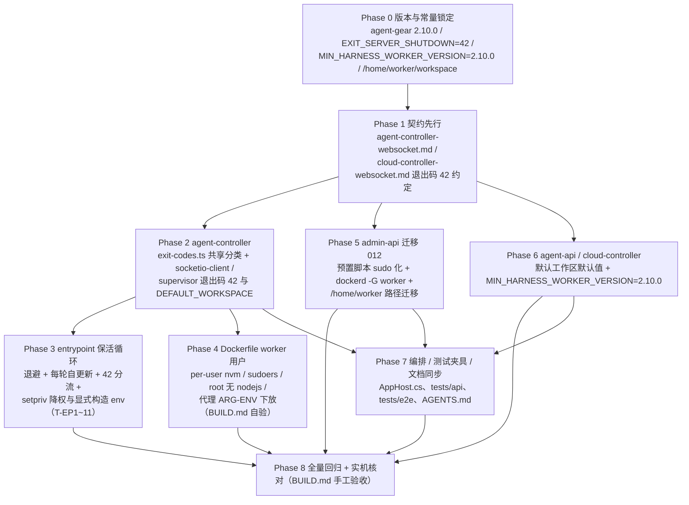

# 云电脑保活与 worker 用户：保活循环、worker 降权与预置脚本适配 - 实现计划

**关联 Proposal**: `docs/engineering/proposals/20261025-feat-cloud-host-keepalive.md`（v1.2）
**关联 PRD**: `docs/product/draft/20261025-cloud-host-keepalive.md`（v1.0）
**需求总分支（feat-branch）**: `feat/cloud-host-keepalive`（基于 `origin/main` 2ca20b82，需求总 PR #291）
**计划提交分支**: `feat/cloud-host-keepalive`（本文件随需求总分支提交）
**创建日期**: 2026-10-26
**计划版本**: v1.0

**版本说明**：

- v1.0（2026-10-26）首版。对齐提案 **v1.2**（PR #291 两轮评审结论已吸收：nvm/Node/agent-gear 下放 worker 的 per-user nvm、root 环境无 nodejs、每次 backoff 后重启前自更新、内网代理环境变量下放、setpriv 降权）。§3 计划期裁决对提案含混处定口径：退出码分类细化为 **42/1/0 三分**（信号退出必须 0，否则「误杀恢复」失效）、共享分类模块抽离（避免 socketio-client ↔ supervisor 循环依赖）、迁移 012 编号与刷新口径、`MIN_HARNESS_VERSION_BY_TYPE` 与全局门禁的关系等。

## 1. 实现顺序



依赖说明：

- **Phase 1 契约**是全部实现的输入，独立提交（`docs(contracts): ...`）；契约未合入前不写实现代码（z-coding「契约式开发」）。
- **Phase 2（agent-controller）**只依赖 Phase 1；**Phase 3（entrypoint）**依赖 Phase 2 的退出码语义（测试用 stub，可与 Phase 2 并行开发、以契约 §退出码为口径）；**Phase 4（Dockerfile）**依赖 Phase 2 的 `agent-gear@2.10.0` 发布产物（开发期可用本地打包验证，见 §8 风险）。
- **Phase 5 / Phase 6** 只依赖 Phase 1 的路径与退出码口径，可与 Phase 2~4 并行；**Phase 7** 依赖 Phase 5/6 的最终默认值；**Phase 8** 在全部实现合回需求总分支后收口。
- 本期**无 GraphQL/REST 契约变更、无前端改动**（`apps/*` 零改动）；改动集中在容器镜像入口、Node 包、三个 server 的常量/脚本与文档。

### 1.1 开发分支与合并顺序

| 分支 | 范围 | 基于 | 合并目标 |
|------|------|------|---------|
| `feat/cloud-host-keepalive` | PRD / 提案 / 本计划 | `origin/main` | 需求总 PR #291 |
| `feat/cloud-host-keepalive-impl` | 契约 + 全部实现 + 测试（主实现分支） | 需求总分支 | 需求总分支（评审通过后随需求总 PR 入 main） |
| `impl/keepalive-<子项目>`（可选） | 单子项目并行开发分支 | `feat/cloud-host-keepalive-impl` | `feat/cloud-host-keepalive-impl` |

- 主实现分支内按 Phase 顺序分提交：`docs(contracts)` → `feat(agent-gear)` → `feat(worker-image)`（entrypoint + Dockerfile + BUILD.md）→ `feat(admin-api)` → `feat(agent-api/cloud-controller)` → `chore(aspire/docs)` → `test:`。
- 并行子项目分支（z-coding「编写实现并行 subagent」）：`packages/agent-controller`、`deploy/images/worker`、`servers/admin-api`、`servers/agent-api + servers/cloud-controller`、`tests/*` 可各自从主实现分支切出，完成后 merge 回主实现分支。
- **禁止 rebase/squash，只允许 merge**（z-git 规范）。合并顺序：**contracts → packages/agent-controller → deploy/images/worker → servers（admin-api → cloud-controller → agent-api）→ aspire/docs → tests**。
- 产品文档生命周期：进入实现阶段时把 PRD 从 `docs/product/draft/` 移入 `docs/product/shipping/`（z-product 规范），上线验收后移 `released/`；本计划阶段不动。

### 1.2 开发模式与规范加载

- 全部 Phase 采用 TDD（红-绿-重构）：先写测试（RED）→ 最小实现（GREEN）→ 重构；entrypoint 为纯 Bash + PATH stub 测试，同样先补用例再改脚本。
- 编码前加载：`docs/engineering/common-rules.md`、`docs/engineering/backend-rules.md`（Node 侧）；镜像/脚本改动参照 `deploy/images/worker/BUILD.md` 既有形态。
- 目录级 `AGENTS.md`：`packages/agent-controller/AGENTS.md`、`servers/agent-api/AGENTS.md`、`servers/cloud-controller/AGENTS.md`、`servers/controller-api/AGENTS.md`、`tests/api/AGENTS.md`、`tests/e2e/AGENTS.md`、`docs/engineering/plan/AGENTS.md`。`servers/admin-api` 与 `deploy/images/worker` 无独立 `AGENTS.md`，沿用根 `AGENTS.md` 与 engineering 规范。
- 每个子项目完成后按 z-coding「编写实现」更新对应 `AGENTS.md`（行为/锚点变化处）。

## 2. 命令参考

```bash
# 服务编排（根目录；测试服务只用 Aspire，禁止直接 docker 命令）
aspire start
aspire wait agent-api cloud-controller controller-api agent-web
aspire describe agent-api
aspire stop

# 单服务单测 / 构建
cd packages/agent-controller && npm ci && npm test && npm run build
cd servers/admin-api && npm ci && npm test && npm run build
cd servers/agent-api && npm ci && npm test && npm run build
cd servers/cloud-controller && npm ci && npm test && npm run build

# entrypoint Bash 测试（纯 stub，无网络、无真实 docker/agent-gear）
bash deploy/images/worker/entrypoint.test.sh

# 跨服务 API 测试（先 aspire start；地址按 aspire describe 替换）
cd tests/api
API_URL=http://localhost:10001/graphql \
ADMIN_API_URL=http://localhost:10003/graphql \
CONTROLLER_API_URL=http://localhost:<controller-api-port> \
CLOUD_CONTROLLER_URL=http://localhost:10004 \
CLOUD_CONTROLLER_INTERNAL_TOKEN=<与 internal-api-token 一致> \
INTERNAL_API_TOKEN=<同上> \
MONGODB_URI=<aspire describe mongodb> \
npm test

# E2E（串行；地址按 aspire describe 替换）
cd tests/e2e
BASE_URL=http://localhost:<agent-web-port> \
API_URL=http://localhost:10001/graphql \
ADMIN_API_URL=http://localhost:10003/graphql \
CONTROLLER_API_URL=http://localhost:<controller-api-port> \
CLOUD_CONTROLLER_URL=http://localhost:10004 \
MONGODB_URI=<aspire describe mongodb> \
npx playwright test

# worker 镜像（内网构建，不属于服务编排；自验步骤见 BUILD.md）
cd deploy/images/worker
docker build -t core.harbor.internal.fffdan.com/zero-tools/worker:keepalive-local .
docker run --rm --entrypoint bash \
  core.harbor.internal.fffdan.com/zero-tools/worker:keepalive-local -lc \
  'id worker; command -v node || echo "root has no node (expected)"'

# worker 侧 / root 侧身份与工具链自验（容器内）
runuser -l worker -c 'node -v && npm config get registry && agent-gear --version'
runuser -l worker -c 'sudo -n true && echo sudo-ok'
```

> `K8S_ENABLED=false` 下无真实工作容器回连：保活、worker 身份、sudo 能力由 entrypoint 单测 + BUILD.md 镜像自验 + 部署侧手工验收（§6.4）覆盖。
> `HARNESS_ENABLED` 在 Aspire dev 模式由 `AppHost.cs` 显式置 `true` 便于联调；publish 默认 `false`。

## 3. 计划期裁决（提案与代码/实机事实偏差的落地口径）

> 以下裁决以**当前代码事实**为准。提案中与之不一致或含混的描述在实现期按本节执行，**不回改提案**；验收报告逐条登记。

### 3.1 事实校正（提案描述与代码事实的偏差）

| # | 提案描述 | 代码事实 | 本计划口径 |
|---|---------|----------|-----------|
| B1 | §3.1/§5.2 实现点 2：「`resolveShutdownExitCode` 语义调整为 42/1 二分」 | `cloud-host/supervisor.ts` 的信号路径 `shutdown('SIGINT'/'SIGTERM')` 也走 `resolveShutdownExitCode`（现返回 0）；若简单二分，**worker 误杀 agent-gear（SIGTERM）会退出 42 → entrypoint 不重启**，违背 PRD 功能点 1/5「误杀后保活拉起」；提案 §3.1 表自身也写明「0（含被 SIGTERM 命中后的正常收尾）→ 重启」 | 退出码**三分**：`SIGINT`/`SIGTERM` → **0**（保活重启）；服务端终止（非失败类 `shutdown`、`unregistered`、`error: INVALID_TOKEN`）→ **42**；失败类（`version_mismatch:*` / `error:*`（非 INVALID_TOKEN）/ 初始化失败）→ **1**。`isFailureShutdownReason` 逐字不变 |
| B2 | §7 项目结构：`cloud-host/supervisor.ts` 同文件改 `EXIT_SERVER_SHUTDOWN` 与 `DEFAULT_WORKSPACE` | `socketio-client.ts` 与 `cloud-host/supervisor.ts` 都需要退出码分类；`supervisor.ts` 已 `import { connectToServer } from '../socketio-client'`，反向 import 会**循环依赖** | 新增共享模块 `packages/agent-controller/src/exit-codes.ts`（`EXIT_SERVER_SHUTDOWN` + `isFailureShutdownReason` + `isServerTerminationReason` + `resolveShutdownExitCode`），`socketio-client.ts` / `cloud-host/supervisor.ts` 共用，`index.ts` 再导出 `EXIT_SERVER_SHUTDOWN` |
| B3 | §5.2 实现点 5：仅提 `MIN_HARNESS_WORKER_VERSION` 提升 | `worker-version.ts` 另有 `MIN_HARNESS_VERSION_BY_TYPE={kimi_code:'2.8.0', deepseek_harness:'2.9.0'}` + `harnessMinVersion()` 取 max；`internal-api.ts:311` 落库 `max(请求值, harnessMinVersion(types), MIN_HARNESS_WORKER_VERSION)`；`socketio-gateway.ts:281` 读 `record?.agentGearMinVersion ?? MIN_HARNESS_WORKER_VERSION` | **只上调 `MIN_HARNESS_WORKER_VERSION='2.10.0'`**；`MIN_HARNESS_VERSION_BY_TYPE` 与其常量不动（max 语义自动收编，逐类型门禁不再单独体现）；`worker-version.test.ts` 的 T-V0b/T-V6 等锚点同步（`harnessMinVersion(['opencode'])` → `2.10.0`） |
| B4 | §5.2 实现点 3b：构建期代理 ARG `NVM_INSTALL_URL` / `NVM_NODEJS_ORG_MIRROR` / `NPM_REGISTRY` | Dockerfile 已有 ARG `NVM_INSTALL_URL` / `NPM_REGISTRY` / `NODEJS_DIST_MIRROR`（经 ENV 映射为 nvm v0.40.8 实际读取的 `NVM_NODEJS_ORG_MIRROR`）；`ENV NPM_REGISTRY`、`ENV NVM_NODEJS_ORG_MIRROR` 已固化到运行期 | **沿用现有 ARG 名**（`NODEJS_DIST_MIRROR` 不改名），`USER worker` 安装层显式传入 `NVM_INSTALL_URL` / `NVM_NODEJS_ORG_MIRROR=$NODEJS_DIST_MIRROR` / `NPM_REGISTRY`（及可选 `http_proxy`/`https_proxy`）；运行期 ENV 三件套 + `DOTNET_APT_*` 保持镜像级注入（PID 1 持有，经 setpriv 原样透传） |
| B5 | §5.2 实现点 4：`007-preset-github` 的 `/root/workspaces/{repo}` → `/home/worker/workspaces/{repo}` | 迁移 008 已把 `targetPath` 语义改为「clone 前缀地址」，现存默认值是 `GITHUB_PREFIX_DEFAULT='/root/workspace`（legacy `/root/workspaces/{repo}` 仅存量残留） | 迁移 012 刷新口径：`targetPath.defaultValue` 为 `/root/workspace` → `/home/worker/workspace`；残留 legacy `/root/workspaces/{repo}` → `/home/worker/workspaces/{repo}`；其余值视为管理员定制、告警跳过 |
| B6 | §7：`0XX-worker-user-scripts.ts` | admin-api 迁移已用至 `010`；既有刷新型迁移（002/003）采用「与已知旧版**严格相等**才刷新、定制 `console.warn` 跳过、缺失则按新版创建」口径 | 新增 **`012-worker-user-scripts(.test).ts`** 并在 `index.ts` 迁移数组登记；001/002/003/006/007/009/010 源文件**不改**（历史快照），其单测锚点不改；012 携带刷新后的完整脚本文本 |
| B7 | §3.1/§5.2 实现点 1：保活循环、每轮自更新、退避 | 现 `supervise_agent_gear()` 是「一次升级收敛」模型（`upgrade_attempted` 计次、无重启循环、无退避）；`update_agent_gear` / `maybe_upgrade_agent_gear` / `agent-gear --version` 均以 **root + 全局 nvm PATH** 执行 | 全量重写监督循环（见 Phase 3）；删除 `maybe_upgrade_agent_gear` 与 `upgrade_attempted`；所有 npm/node 操作统一经 `run_as_worker()`（setpriv + 显式 env）；mismatch 标记保留**仅作日志观测** |
| B8 | §5.2 实现点 5：门禁提升到「如 2.10.0」；§7 镜像预装 `agent-gear@2.9.x` | `packages/agent-controller/package.json` = `2.9.0`；Dockerfile pin `agent-gear@2.9.x`；`MIN_HARNESS_WORKER_VERSION='2.6.0'` | 版本链统一为 **agent-gear `2.10.0`**（package.json）→ Dockerfile `agent-gear@2.10.x` → `MIN_HARNESS_WORKER_VERSION='2.10.0'`；`MIN_WORKER_VERSION='2.2.0'`（普通 idle 容器）不动 |
| B9 | §5.2 实现点 3b/3c：`$NVM_DIR/current` 软链 + `WORKER_PATH` | Dockerfile 已设 `ENV NVM_SYMLINK_CURRENT=true` 并建 `$NVM_DIR/current` 软链；`/etc/profile.d/nvm.sh` 写死 `/usr/local/nvm` | 软链机制沿用（改指 `/home/worker/.nvm/current`）；`/etc/profile.d/nvm.sh` 改为 `export NVM_DIR="$HOME/.nvm"`（worker 登录 shell 获得 node/nvm）；`WORKER_PATH` 以 `/home/worker/.nvm/current/bin` 打头 |
| B10 | §5.2 实现点 1：自更新日志含 `npm config get registry` / `agent-gear --version` | root 环境**无 nodejs**（B4/3b 口径）后，这些命令 root 侧不可执行 | entrypoint 抽 `run_as_worker()` 单一入口，启动自更新、每轮自更新、agent-gear 拉起、版本日志全部经其派生；`CHILD_PID` 即 setpriv exec 后的进程本体 |
| B11 | §5.2 实现点 4：`/root/workspace` 全库检索逐一核对 | 现存硬编码散布：`agent-api config/index.ts:44`、`controller-workspace.ts:80`、`cloud-host/supervisor.ts:19`、`AppHost.cs:204`、`aspire/manifest/docker-compose.yaml:112`、admin-api 006/007/008/009/010 脚本、`tests/api`（internal-api/cloud-host/cloud-host-workload/cloud-host-callback/session-readonly）、`tests/e2e`（cloud-host/github-workload/readonly）、`tests/e2e/AGENTS.md`、`aspire/AgentGear.AppHost/AGENTS.md`、`contracts/*` 示例 | **功能性默认值必改**（默认工作区、github 前缀默认、契约示例）；**纯夹具值统一替换**为 `/home/worker/workspace`（保持一致、便于检索）；存量 proposals / 已发布 PRD / BUILD.md 历史段落**不改** |
| B12 | §5.2 实现点 2：socketio-client（idle/单连接）`shutdown` 收尾「现 `process.exit(0)`」→ 42 | idle 模式 `shutdown` 载荷的 `reason` 也可能是失败类（如服务端强制注销的 `exitReason`）；无条件 42 会把失败伪装成正常终止 | idle 路径复用统一分类函数：`shutdown` → `resolveShutdownExitCode(reason)`（失败类 1、服务端终止 42）；`unregistered` → 42；`error` 新增 `INVALID_TOKEN` 分支 → 42（现落入通用 error → 1）；`VERSION_MISMATCH` / 其它 error → 1 不变 |
| B13 | §5.2 实现点 3c：`sudo -n nohup dockerd -G worker ...`，日志经 sudo 写入 | 脚本以 worker 运行，`>/var/log/dockerd.log` 重定向发生在 **worker shell**（sudo 之前），会因 `/var/log` 不可写失败 | dockerd 启动改为 `${SUDO} sh -c 'nohup dockerd -G worker >/var/log/dockerd.log 2>&1 &'`（重定向移入 sudo shell）；就绪探测 `docker info` 以 worker 直连 socket（`-G worker` 后 socket 组即 worker） |
| B14 | §8.1：entrypoint 测试 T-EP0~T-EP11 | 现 `entrypoint.test.sh` 仅 T-EP0~T-EP8，且 T-EP1~6 断言「升级计次/不重启」旧语义 | T-EP1~T-EP4 断言改为「`npm_installs` = 启动 1 + 每次重启各 1」；T-EP5/T-EP6 **语义反转**（自更新并重启，配「第二次退出 42」收敛）；新增 T-EP9（42 不重启不自更新）/ T-EP10（退避递增 + 每轮自更新）/ T-EP11（setpriv 参数与 env 构造断言）；T-EP7 扩展 setpriv 链信号直达 |

### 3.2 设计裁决（提案留白/含混处）

1. **退出码分类模块**：`packages/agent-controller/src/exit-codes.ts` 导出 `EXIT_SERVER_SHUTDOWN = 42`、`isFailureShutdownReason`（自 `supervisor.ts` 逐字迁移）、`isServerTerminationReason`（`unregistered`、`error: INVALID_TOKEN`，含 `worker shutdown:` / `controller-api shutdown:` 包装）、`resolveShutdownExitCode(reason)`（**信号 → 0；失败类且非终止 → 1；其余 → 42**）。判定顺序：信号前置 → 终止覆盖失败（`INVALID_TOKEN` 虽匹配 `error:` 前缀仍归 42）→ 失败 1 → 42。单测独立文件 `exit-codes.test.ts` 锚定全表。
2. **信号退出恒为 0**：`supervisor` 的 `SIGINT`/`SIGTERM` handler 调 `shutdown('SIGINT')` 语义不变，经分类得 0 → entrypoint 保活重启（误杀恢复，PRD 功能点 1）；K8s 删 Pod 时 PID 1 的 `shutting_down` 置位后入口直接 0 退出，不看子进程退出码。
3. **退避序列**：1s → 2s → 5s → 10s → 30s 封顶；本轮运行时长 ≥ 60s 视为稳定运行、重置序列。测试可用 `ZAG_KEEPALIVE_BACKOFF_MS`（毫秒整体缩放）覆盖，**仅测试用、不入契约与用户文档**。
4. **每轮自更新**：`sleep(退避)` 之后、拉起之前执行 `run_as_worker npm install -g agent-gear --no-fund --no-audit`；失败仅 `WARN` 不阻断重启；`ZAG_SKIP_AGENT_GEAR_UPDATE=1` 跳过**全部**自更新（含启动更新），但仍保活重启。mismatch 标记仅用于日志（`agent-gear reported VERSION_MISMATCH`）。
5. **setpriv env 构造**：`run_as_worker()` 固定注入 `HOME=/home/worker USER=worker LOGNAME=worker NVM_DIR=/home/worker/.nvm PATH="$WORKER_PATH"`；`ZAG_*`（K8s 注入）与镜像 ENV（`NPM_REGISTRY` / `NVM_NODEJS_ORG_MIRROR` / `DOTNET_APT_*`）经 setpriv 原样透传，不枚举。`RUN_DIR`/FIFO/mismatch 标记维持 root 拥有，fd 继承给子进程。
6. **Dockerfile 层序**：基础工具链（含 `sudo`，已装）→（可选 .NET feed）→ `userdel -r ubuntu`（容错）→ `useradd -m -s /bin/bash -u 1000 worker` → `/etc/sudoers.d/90-worker`（`worker ALL=(ALL:ALL) NOPASSWD: ALL`，0440）→ `USER worker` 安装层（per-user nvm + Node + `npm config set registry` + 全局包）→ `USER root` → `COPY entrypoint.sh`。**镜像不再把 worker 的 nvm bin 放入全局 `ENV PATH`**（root 无 nodejs，且避免 root 执行 worker 可写目录中的二进制）。
7. **迁移 012 刷新口径**（沿用 002/003 模式）：对每个目标预置项，`initScript` 与已知旧版**严格相等**才覆盖为新版；已是新版则跳过；其余值视为管理员定制 `console.warn` 不覆盖；记录缺失时按新版创建（按 `presetKey` → 精确 `name` 双查）。涉及：`docker`（v3 → v4：`SUDO` 兜底 + `dockerd -G worker`）、dotnet apt 脚本（001，`apt-get` → `${SUDO} apt-get`）、`github`（007，apt sudo 化 + `targetPath` 默认值迁移）、`harness-opencode` / `harness-kimi-code` / `harness-deepseek-harness`（006/009/010，`mkdir -p "${ZAG_DEFAULT_WORKSPACE:-/home/worker/workspace}"`）。Node.js 工作负载脚本（001）`npm install -g` 以 worker 身份运行即写 worker 的 nvm 前缀，**不需要 sudo，不改**。
8. **脚本 sudo 兜底统一写法**：脚本头 `SUDO=sudo; command -v sudo >/dev/null || SUDO=`，随后 `${SUDO} apt-get ...`——兼容旧镜像无 sudo 的执行环境（与提案一致）。
9. **github `targetPath` 参数迁移**：`defaultValue` `/root/workspace` → `/home/worker/workspace`（legacy `/root/workspaces/{repo}` → `/home/worker/workspaces/{repo}`），`label`/语义文案不变；`agent-api` 的 clone 前缀拼接逻辑零改动。
10. **门禁与发布顺序**：`MIN_HARNESS_WORKER_VERSION='2.10.0'`（仅 `purpose=harness`）；`agentGearMinVersion` 落库与注册门禁逻辑零改动。发布顺序硬约束：**agent-gear 2.10.0 → worker 镜像（预装 2.10.x）→ cloud-controller（门禁）→ admin-api（迁移 012）**。存量运行中容器不处理（一次性 Job，重建即生效）。
11. **兼容窗口**（照提案 §5.2 实现点 2）：旧镜像 + 新 agent-gear = 42 退出后容器照常结束，与现状等价；新镜像 + 旧 agent-gear = shutdown 后多重启一轮、`INVALID_TOKEN` 收敛，Job 删除兜底。仅存在于镜像滚动窗口，可接受。
12. **契约锚点**：`packages/agent-controller` 新增「契约对齐锚点」单测（`EXIT_SERVER_SHUTDOWN === 42` 与 `contracts/*-websocket.md` 文本锚点互检，沿用 `deepseek_harness` 枚举锚点的既有做法）；`cloud-controller` 门禁常量同口径。

### 3.3 评审结论落实映射（PR #291）

| 评审意见（Deliay） | 提案落点 | 本计划落点 |
|---|---|---|
| npm 是用 nvm 安装的，需保持 nvm 且安装下放 worker 用户，否则 worker 没有 nodejs 命令（附 sudo 环境调研） | v1.1：§5.2 实现点 3a/3b（per-user nvm + setpriv） | Phase 4（Dockerfile `USER worker` 安装层）+ Phase 3（`run_as_worker`）+ 附录 B 调研结论沿用 |
| 每次 backoff 都需要执行一次自更新 | v1.2：§3.1、§5.2 实现点 1/6 | Phase 3（退避 → 自更新 → 重启）+ T-EP1~4/10 |
| 记得下放相关内部代理的环境变量 | v1.2：§5.2 实现点 3b | Phase 4（ARG 显式传入 + 运行期 ENV 固化）+ Phase 3（setpriv 透传）+ 6.4 实机核对 |
| 不重置环境，但 nvm 在 worker 安装了，root 的环境是没有 nodejs 的 | v1.2：§5.2 实现点 3a 结论 4 / 3b / 3c | Phase 2/3/4 + BUILD.md 自验（root 侧 `command -v node` 为空） |

## 4. 关键约束（提案 §1.3/§6，实现期不得回退）

- **契约先行**：2 份契约先于实现独立提交；退出码、`ZAG_DEFAULT_WORKSPACE`、门禁版本与提案 §3 / §5.2 对齐，偏差以 §3 裁决为准。
- **保活终止出口只有两类**：服务端终止（退出码 42：`shutdown` 非失败类 / `unregistered` / `INVALID_TOKEN`）与 K8s 删 Pod 的 SIGTERM/SIGINT；其余退出（含 0、被误杀、VERSION_MISMATCH）一律「退避 → 自更新 → 重启」。
- **root 环境无 nodejs**：入口与任何 root 侧脚本不得调用 node/npm；凡 node 相关操作一律 worker 身份 + 显式构造环境。
- **PID 1 保持 root**：监督循环 root 运行，worker 默认无法 kill；worker 免密 sudo（`NOPASSWD: ALL`）供 apt/系统操作，蓄意 `sudo kill` 视为用户处置权。
- **不改销毁链路与 K8s 层**：destroy → post 批次 → shutdown → 删除 Job → exited 状态机不变；`restartPolicy: Never` / `backoffLimit: 0` 不变。
- **日志有界**：重启/自更新日志仅 stdout 逐行，不落盘；mismatch 标记 0 字节。
- **失败类退出码维持 1**：`version_mismatch:*` / `error:*`（非 INVALID_TOKEN）/ 初始化失败 → 1，让 Job 终态映射与语义可观测性不变。
- **预置脚本幂等且不覆盖管理员定制**：迁移 012 严格相等刷新 + 告警跳过。
- **旧版本兼容**：见 §3.2 裁决 11；`agentGearMinVersion` 校验口径不变。
- **测试纪律**：新增代码单测覆盖率 ≥ 80%；entrypoint 全部 Bash 用例通过；API 与 E2E 串行；测试服务只用 Aspire 编排。

## 5. Phase 计划

### Phase 0：版本与常量锁定（0.5d）

**目标**：固定全部版本/常量口径，避免实现期漂移。

| 项 | 取值 |
|----|------|
| agent-gear | `2.10.0`（`packages/agent-controller/package.json`） |
| 退出码 | `EXIT_SERVER_SHUTDOWN = 42` |
| 默认工作区 | `/home/worker/workspace`（`ZAG_DEFAULT_WORKSPACE` 缺省值） |
| worker 用户 | uid/gid 1000，主组 worker，home `/home/worker` |
| 版本门禁 | `MIN_HARNESS_WORKER_VERSION='2.10.0'`；`MIN_WORKER_VERSION='2.2.0'` 不动 |
| 退避 | 1/2/5/10/30s 封顶；稳定阈值 60s；`ZAG_KEEPALIVE_BACKOFF_MS` 测试覆盖 |

**完成判据**：§3 裁决定稿（本文件 v1.0）；Phase 1~8 文件清单（附录 A）不再变化。

### Phase 1：契约先行（0.5d）

| 文件 | 变更 |
|------|------|
| `contracts/agent-controller-websocket.md` | §2.7 `unregistered` / §2.8 `shutdown` 客户端行为补「以退出码 42 退出」；`connect_error(INVALID_TOKEN)`（§鉴权段）补「以 42 退出（token 已失效 = 已被服务端注销）」；新增「进程退出码约定」小节：42 = 服务端终止（不重启）、0 = 自发/信号退出（保活重启）、1 = 失败类（保活重启）；注明「被 SIGTERM 命中收尾退出 0，容器内保活将其重新拉起（被 K8s 删 Pod 时入口自身同时收到 SIGTERM 不重启）」 |
| `contracts/cloud-controller-websocket.md` | §2.8 补退出码 42 约定段落（同上表）；§3.4 版本兼容：`MIN_HARNESS_WORKER_VERSION` 示例值 `2.6.0` → `2.10.0`（含「仅 opencode 的运行仍为 2.6.0」句改为 2.10.0 口径）；`agentGearMinVersion` 落库说明同步；示例 `ZAG_DEFAULT_WORKSPACE` / `secrets.defaultWorkspace` / `targetPath` 中 `/root/workspace` → `/home/worker/workspace` |

**完成判据**：`contracts/` 单次提交（`docs(contracts): 云电脑保活退出码 42 与 worker 路径约定…`）；与 §3 裁决逐条一致。

### Phase 2：agent-controller 退出码与路径（1.5d，TDD）

| 文件 | 变更 |
|------|------|
| `packages/agent-controller/src/exit-codes.ts` | **新增**：`EXIT_SERVER_SHUTDOWN=42`、`isFailureShutdownReason`（迁移）、`isServerTerminationReason`、`resolveShutdownExitCode`（三分，见 §3.2 裁决 1） |
| `packages/agent-controller/src/exit-codes.test.ts` | **新增**：全表锚定（信号 0 / `unregistered`、`error: INVALID_TOKEN`、`worker shutdown: server requested` → 42 / `version_mismatch:*`、`error: REGISTER_FAILED`、`必须工作负载…初始化失败`、`init failed` → 1；包装前缀 `worker shutdown:` / `controller-api shutdown:` 全覆盖） |
| `packages/agent-controller/src/socketio-client.ts` | idle/单连接路径：`unregistered` → `process.exit(EXIT_SERVER_SHUTDOWN)`；`shutdown` 收尾 → `process.exit(resolveShutdownExitCode(data.reason))`；`error` 事件**新增** `INVALID_TOKEN` 分支 → 42；`VERSION_MISMATCH` → 1 与其它 error → 1 不变；云电脑模式 `onShutdown` 转发路径不变 |
| `packages/agent-controller/src/cloud-host/supervisor.ts` | `DEFAULT_WORKSPACE` `/root/workspace` → `/home/worker/workspace`（含 JSDoc）；`resolveShutdownExitCode`/`isFailureShutdownReason` 改为从 `exit-codes.ts` 导入并 re-export（保持既有测试导入路径可用）；注释「正常 0」→「服务端终止 42 / 信号 0 / 失败 1」 |
| `packages/agent-controller/src/index.ts` | 导出 `EXIT_SERVER_SHUTDOWN`（及分类函数） |
| `packages/agent-controller/package.json` | `version` → `2.10.0` |
| `packages/agent-controller/src/cloud-host/supervisor.test.ts` | T-AG17「exits 0」→ 服务端 shutdown 断言 **42**；信号路径断言 **0**；C-2 用例改写为三分断言（含 `error: INVALID_TOKEN` → 42）；T-AG6/T-AG7 默认工作区断言 `/home/worker/workspace` |
| `packages/agent-controller/src/socketio-client.test.ts` 等 | idle 路径退出码断言（42/1/0）；`INVALID_TOKEN` 分支新增用例 |
| 契约对齐锚点（既有锚点文件内追加） | `EXIT_SERVER_SHUTDOWN === 42` 与契约文本「42」互检 |

**完成判据**：`npm test` 全绿；`resolveShutdownExitCode('SIGTERM')===0`（误杀恢复前提）与 `resolveShutdownExitCode('worker shutdown: server requested')===42` 有独立用例。

### Phase 3：entrypoint 保活循环（2d，TDD）

| 文件 | 变更 |
|------|------|
| `deploy/images/worker/entrypoint.sh` | 重写监督层（见下）；删除 `maybe_upgrade_agent_gear` 与 `upgrade_attempted`；`update_agent_gear` 改 worker 化并支持每轮调用；新增 `run_as_worker()`；日志文案按提案 §5.2 实现点 1 |
| `deploy/images/worker/entrypoint.test.sh` | T-EP1~T-EP4 语义调整（`npm_installs` = 启动 1 + 每次重启各 1）；T-EP5/T-EP6 语义反转（自更新并重启，stub「第二次退出 42」收敛）；新增 T-EP9/10/11；T-EP7 扩展 setpriv 链信号直达；stub 新增 `setpriv`（记录参数与透传 env）与 `agent-gear` 退出码序列模式 |

**监督层最终形态（口径，非逐字）**：

```bash
WORKER_PATH="/home/worker/.nvm/current/bin:/usr/local/sbin:/usr/local/bin:/usr/sbin:/usr/bin:/sbin:/bin"
run_as_worker() {
  setpriv --reuid=1000 --regid=1000 --init-groups \
    env HOME=/home/worker USER=worker LOGNAME=worker \
        NVM_DIR=/home/worker/.nvm PATH="$WORKER_PATH" "$@"
}

supervise_agent_gear() {
  local attempt=0
  while true; do
    [ "$shutting_down" -eq 1 ] && return 0
    rm -f "$MISMATCH_MARKER"
    local rc=0 start_ts=$SECONDS
    run_agent_gear || rc=$?                      # run_as_worker agent-gear 2> "$fifo" &
    [ "$shutting_down" -eq 1 ] && return 0
    if [ "$rc" -eq 42 ]; then
      log "agent-gear exited (code=42): server shutdown; stopping keepalive"
      return 0
    fi
    [ $((SECONDS - start_ts)) -ge 60 ] && attempt=0   # 稳定运行后重置退避
    local delay; delay=$(backoff_delay "$attempt")    # 1/2/5/10/30s，ZAG_KEEPALIVE_BACKOFF_MS 缩放
    log "agent-gear exited (code=$rc); self-update then restarting in ${delay}s (attempt #$((attempt+1)))"
    sleep "$delay"
    update_agent_gear                            # 每轮自更新，失败容忍
    attempt=$((attempt+1))
  done
}
```

- 退出码 42 分流、`shutting_down` 优先级、FIFO/stderr 扫描、信号转发语义保持；`update_agent_gear` 内 `npm config get registry` / `agent-gear --version` 日志同样经 `run_as_worker`。
- **完成判据**：`entrypoint.test.sh` T-EP0~T-EP11 全绿；T-EP9 明确断言「42 → 不自更新、不重启、入口 0」；T-EP10 断言退避递增（stub 时间戳）且每轮 `npm_installs` +1。

### Phase 4：Dockerfile worker 用户与 per-user nvm（1.5d）

| 文件 | 变更 |
|------|------|
| `deploy/images/worker/Dockerfile` | ① `userdel -r ubuntu \|\| true` + `useradd -m -s /bin/bash -u 1000 worker` + `/etc/sudoers.d/90-worker`（`NOPASSWD: ALL`，0440）；② `USER worker` 层：`NVM_DIR=/home/worker/.nvm`，nvm 安装（`NVM_INSTALL_URL` / `NVM_SOURCE` 内网代理显式传入）、`nvm install --default`、`current` 软链、`npm config set registry "$NPM_REGISTRY"`、`npm install -g agent-gear@2.10.x @agentclientprotocol/claude-agent-acp @agentclientprotocol/codex-acp`；③ 移除全局 `ENV PATH=$NVM_DIR/current/bin:$PATH`（root 无 nodejs），保留 `NVM_NODEJS_ORG_MIRROR` / `NPM_REGISTRY` / `DOTNET_APT_*` / `NVM_SYMLINK_CURRENT` 镜像 ENV（供 setpriv 透传）；④ `/etc/profile.d/nvm.sh` → `export NVM_DIR="$HOME/.nvm"` + source nvm.sh/bash_completion；⑤ `USER root` + `COPY entrypoint.sh`（不变） |
| `deploy/images/worker/BUILD.md` | 自验新增：root 侧 `command -v node` 为空；`runuser -l worker -c 'node -v'` / `'agent-gear --version'` / `'npm config get registry'`（内网代理）；`runuser -l worker -c 'sudo -n true'`；`id worker`（uid 1000）；保活手工验证（`kill` agent-gear 观察自更新 + 重启、`kill -9` 同）；worker `kill` PID 1 被拒验证 |

**完成判据**：内网构建成功 + BUILD.md 自验逐条通过；`docker run --entrypoint bash … 'command -v node'` 为空、`runuser -l worker -c 'node -v'` 有输出。

### Phase 5：admin-api 预置脚本 sudo 化与路径迁移（1d，TDD）

| 文件 | 变更 |
|------|------|
| `servers/admin-api/src/migrations/012-worker-user-scripts.ts` | **新增**：按 §3.2 裁决 7/8/9 刷新 6 个预置项脚本与 github `targetPath` 默认值；严格相等刷新、定制告警跳过、缺失按新版创建；导出各新版脚本常量（如 `DOCKER_SCRIPT_V4`、`GITHUB_SCRIPT_V2`、`HARNESS_*_SCRIPT_V2`）供测试锚定 |
| `servers/admin-api/src/migrations/012-worker-user-scripts.test.ts` | **新增**：断言新脚本含 `SUDO=sudo; command -v sudo` 兜底、`${SUDO} apt-get`、`dockerd -G worker`（含 `sh -c` 内重定向）、`/home/worker/workspace`（`mkdir -p "${ZAG_DEFAULT_WORKSPACE:-/home/worker/workspace}"`）、github `targetPath` 默认值 `/home/worker/workspace` 与 legacy 迁移；幂等（二次 run 不新增/不覆盖）；定制内容不覆盖（warn）；名称/presetKey 冲突跳过 |
| `servers/admin-api/src/index.ts` | 迁移数组追加 `migration012WorkerUserScripts` |

**脚本刷新明细**：

| 预置项 | 变更 |
|--------|------|
| `docker`（v3 → v4） | `apt-get update/install` → `${SUDO} apt-get …`；`nohup dockerd >/var/log/dockerd.log 2>&1 &` → `${SUDO} sh -c 'nohup dockerd -G worker >/var/log/dockerd.log 2>&1 &'`；`docker info` 就绪探测保持 worker 直连 |
| dotnet apt（001 内容） | `apt-get` → `${SUDO} apt-get`（含 `apt-get -y upgrade`） |
| `github`（007 内容） | `apt-get update && apt-get install -y gh` → `${SUDO} apt-get …`；`targetPath` 默认值迁移（裁决 9） |
| `harness-opencode` / `harness-kimi-code` / `harness-deepseek-harness` | `mkdir -p "${ZAG_DEFAULT_WORKSPACE:-/root/workspace}"` → `:-/home/worker/workspace` |
| Node.js 工作负载 | 不改（worker 身份即写 worker 前缀） |

**完成判据**：`npm test` 全绿；`tests/api/src/admin-api/cloud-workload.test.ts` 既有断言（如 `script contains 'apt-get install'`）仍通过或同步（`sudo -n apt-get install` 含该子串，预期零改动）。

### Phase 6：agent-api / cloud-controller 路径与门禁（0.5d，TDD）

| 文件 | 变更 |
|------|------|
| `servers/agent-api/src/config/index.ts` | `cloudHostDefaultWorkspace` 默认 `/root/workspace` → `/home/worker/workspace` |
| `servers/agent-api/src/services/controller-workspace.ts` | 空路径 fallback `'/root/workspace'` → `'/home/worker/workspace'` |
| `servers/agent-api/src/services/cloud-host-service.test.ts` 等 | 夹具/断言同步（`defaultWorkspace: '/home/worker/workspace'`） |
| `servers/cloud-controller/src/services/worker-version.ts` | `MIN_HARNESS_WORKER_VERSION` `2.6.0` → `2.10.0`（注释同步：worker 用户 + 保活退出码自 2.10.0 起）；`MIN_HARNESS_VERSION_BY_TYPE` 不动 |
| `servers/cloud-controller/src/services/worker-version.test.ts` | T-V0b/T-V6 等锚点同步（`MIN_HARNESS_WORKER_VERSION='2.10.0'`、`harnessMinVersion(['opencode'])='2.10.0'`、含 kimi/deepseek 取 `2.10.0`） |

**完成判据**：两服务 `npm test` 全绿；`MIN_WORKER_VERSION` 仍为 `2.2.0`（有锚点）。

### Phase 7：编排、测试夹具与文档同步（0.5d）

| 文件 | 变更 |
|------|------|
| `aspire/AgentGear.AppHost/AppHost.cs` | `CLOUD_HOST_DEFAULT_WORKSPACE` → `/home/worker/workspace` |
| `aspire/AgentGear.AppHost/AGENTS.md` | env 描述行同步 |
| `aspire/manifest/docker-compose.yaml` | `CLOUD_HOST_DEFAULT_WORKSPACE` 同步（重新 `aspire publish -o aspire/manifest` 或手工同步该行） |
| `tests/api/src/cloud-controller/internal-api.test.ts` | `defaultWorkspace: '/root/workspace'` 夹具 → `/home/worker/workspace` |
| `tests/api/src/agent-api/cloud-host*.test.ts`、`session-readonly.test.ts` | 路径夹具统一替换 |
| `tests/e2e/src/cloud-host*.spec.ts`、`github-workload.spec.ts` | 路径夹具统一替换；**github 前缀默认值断言** `toHaveValue('/root/workspace')` → `/home/worker/workspace` |
| `tests/e2e/AGENTS.md` | 弹窗默认前缀描述同步 |
| `docs/engineering/AGENTS.md` | 「实现计划（plan/）」索引追加本计划条目 |

**完成判据**：全库 `/root/workspace` 检索仅余「存量文档」（proposals、released PRD、BUILD.md 历史段落、本计划/提案的对照说明）。

### Phase 8：全量回归与实机核对（2d）

1. `packages/agent-controller` / `servers/{admin-api,agent-api,cloud-controller}` 单测 + 构建全绿；`entrypoint.test.sh` 全绿。
2. `tests/api` 全量（串行）；`tests/e2e` 全量（串行，`HARNESS_ENABLED=true` 用例不 skip）。
3. 内网构建 worker 镜像，按 BUILD.md 完成自验（含 root 无 nodejs / worker 侧 nodejs / `sudo -n` / 保活手工验证）。
4. 真实集群实机核对（§6.4），结论登记验收报告。
5. 产物收口：验收报告（`docs/engineering/acceptance/`）由下游验收环节产出；本阶段只留核对记录。

## 6. 测试矩阵

### 6.1 entrypoint Bash 测试（`entrypoint.test.sh`，纯 stub）

| 用例 | 断言 |
|------|------|
| T-EP0/T-EP0a | 不装配 docker shim、不调用 docker/dockerd（保持） |
| T-EP1~T-EP4 | 语义调整：`npm_installs` = 启动 1 + 每次重启各 1；skip 开关跳过全部自更新但仍重启 |
| T-EP5/T-EP6 | **反转**：普通非零 / 正常退出（非 42）→ 自更新并重启（stub 第二次退出 42 收敛） |
| T-EP7 | SIGTERM/SIGINT → 转发、入口 0、不重启；setpriv 链下信号直达子进程 |
| T-EP8 | 日志有界 / 透传（保持） |
| T-EP9 | 退出码 42 → 不自更新、不重启、入口 0 |
| T-EP10 | 连续崩溃 → 重启递增 + 退避生效（时间戳）+ 每轮自更新 |
| T-EP11 | setpriv 参数断言：`--reuid=1000 --regid=1000 --init-groups`；env 含 `HOME=/home/worker`、`NVM_DIR=/home/worker/.nvm`、`PATH` 含 `/home/worker/.nvm/current/bin` |

### 6.2 单元测试（Vitest）

| 模块 | 覆盖 |
|------|------|
| `agent-controller/exit-codes.test.ts` | 退出码三分全表（§3.2 裁决 1）+ 包装前缀 |
| `agent-controller/socketio-client*.test.ts` | idle 路径 42/1/0、`INVALID_TOKEN` 新分支、`onShutdown` 转发不变 |
| `agent-controller/cloud-host/supervisor.test.ts` | 服务端 shutdown → 42、信号 → 0、失败类 → 1、默认工作区 `/home/worker/workspace`、T-AG3~T-AG17 不回归 |
| `admin-api/012-*.test.ts` | 脚本内容锚点（`SUDO` 兜底、`${SUDO} apt-get`、`dockerd -G worker`、路径）、幂等、定制跳过、legacy 迁移 |
| `cloud-controller/worker-version.test.ts` | 门禁常量锚点（2.10.0）与 max 语义 |
| `agent-api` | `cloudHostDefaultWorkspace` 默认值、workspace fallback |

### 6.3 API 测试（tests/api）

- `cloud-controller/internal-api.test.ts`：`defaultWorkspace` 夹具/断言同步后全绿；`agentGearMinVersion` 落库 max 语义不回归。
- `admin-api/cloud-workload.test.ts`：预置项 CRUD 与脚本锚点不回归（`apt-get install` 子串兼容 `sudo -n apt-get install`）。
- `agent-api/cloud-host*.test.ts`：创建/工作负载/回调/只读链路不回归。

### 6.4 E2E 与实机核对

- `tests/e2e`：云电脑创建/初始化/停止链路不回归；github 弹窗前缀默认值为 `/home/worker/workspace`。
- 部署侧手工验收（登记验收报告）：
  1. kill 云电脑内 `agent-gear`：容器不销毁，自更新后拉起，init 不重放（`hasSettledInit`）；
  2. 「停止云电脑」/ 管理员强制销毁 / 必须工作负载失败注销：容器正常退出（42 路径或 SIGTERM 路径），不被重启；
  3. `whoami` = worker；工作区文件归属 worker；`sudo -n apt-get install <pkg>` 成功；
  4. worker `kill` PID 1 / 监督进程被拒；`kill` agent-gear 后被拉起；
  5. root 侧 `command -v node` 为空；`runuser -l worker -c 'node -v'` 可用；`npm config get registry` 指向内网代理；
  6. Docker 工作负载：`docker info` 在 worker 下可用（socket 归属 worker 组）；
  7. 旧镜像 + 新 agent-gear、新镜像 + 旧 agent-gear 两个兼容窗口行为符合 §3.2 裁决 11。

## 7. 验收 checklist（分阶段）

- [ ] Phase 1：退出码 42 约定入档（两份契约），与 §3 裁决一致
- [ ] Phase 2：`exit-codes` 三分单测全绿；SIGTERM → 0、服务端终止 → 42 有独立锚点
- [ ] Phase 3：T-EP0~T-EP11 全绿；每轮自更新与退避可观测（日志文案）
- [ ] Phase 4：镜像构建 + BUILD.md 自验通过（root 无 nodejs / worker 侧 nodejs / sudo -n / 保活手工验证）
- [ ] Phase 5：迁移 012 幂等、不覆盖定制；脚本锚点全绿
- [ ] Phase 6：默认工作区 `/home/worker/workspace`、门禁 `2.10.0` 锚点全绿
- [ ] Phase 7：全库路径检索收口（仅存量文档残留）
- [ ] Phase 8：单测 / API / E2E 全绿；实机核对 7 项通过并登记验收报告
- [ ] 发布顺序执行：agent-gear 2.10.0 → worker 镜像 → cloud-controller → admin-api 迁移

## 8. 风险与回滚

| 风险 | 影响 | 缓解 / 回滚 |
|------|------|------------|
| 信号路径误用 42（B1） | worker 误杀后不重启，PRD 功能点 1 失效 | 三分分类 + `resolveShutdownExitCode('SIGTERM')===0` 独立锚点；review 重点核查 |
| 新镜像 + 旧 agent-gear 兼容窗口 | shutdown 后多重启一轮（30s 退避上限） | Job 删除兜底；发布顺序收窄窗口（裁决 10/11） |
| agent-gear 2.10.0 未先发布 | 镜像 `agent-gear@2.10.x` 构建失败 | 开发期本地 `npm pack` + `--build-arg`/临时 tag 验证；发布顺序硬约束 |
| per-user nvm 层序错误（先 USER 后 useradd） | 构建失败或工具链归属错误 | BUILD.md 自验断言 `ls -ld /home/worker/.nvm` 属 worker；`--init-groups` 依赖 `/etc/group`（构建期自验） |
| dockerd 重定向权限（B13） | Docker 工作负载初始化失败 | `sh -c` 内重定向口径 + 012 单测锚点 + 实机核对 6 |
| 无限崩溃循环（配置损坏） | 日志噪声、CPU 空转 | 退避封顶 30s + 每轮自更新（旧版本崩溃可收敛）+ 云电脑销毁链路/人工兜底；日志有界 |
| 迁移 012 覆盖管理员定制 | 运维脚本丢失 | 严格相等刷新 + 定制告警跳过（沿用 002/003 既有口径） |
| `sudo sh -c` 与 `nohup` 交互差异 | dockerd 随脚本退出被回收 | 实机核对 6 验证 30s 就绪与进程存活；必要时 `setsid` 兜底（记录验收报告） |

回滚：各 Phase 独立提交、merge-only，可按提交粒度 revert；镜像与门禁回滚须**反向**执行发布顺序（先回 cloud-controller 门禁、再回镜像）。

## 9. 相关文档

- 关联 PRD：[[../../product/draft/20261025-cloud-host-keepalive.md]]
- 关联 Proposal：[[../proposals/20261025-feat-cloud-host-keepalive.md]]（v1.2）
- [[20261017-feat-controller-version-requirement.md]] — 版本门禁与自升级（VERSION_MISMATCH 语义来源）
- [[20261020-feat-container-harness-support.md]] — 容器启动任务 harness 类型（停止即销毁现状）
- [[20261025-fix-cloud-container-active-deadline.md]] — 云电脑取消 Job 最长运行时间限制
- [[20261018-feat-workload-phase4.md]] — worker 基础镜像瘦身（预置脚本下沉口径）
- 契约：`contracts/agent-controller-websocket.md`、`contracts/cloud-controller-websocket.md`

## 附录 A：文件变更总览

| Phase | 文件 | 动作 |
|-------|------|------|
| 1 | `contracts/agent-controller-websocket.md` | 改（退出码 42 约定） |
| 1 | `contracts/cloud-controller-websocket.md` | 改（退出码、路径示例、门禁 2.10.0） |
| 2 | `packages/agent-controller/src/exit-codes.ts` / `exit-codes.test.ts` | 新增 |
| 2 | `packages/agent-controller/src/socketio-client.ts` | 改（42/1/0 分流、INVALID_TOKEN 分支） |
| 2 | `packages/agent-controller/src/cloud-host/supervisor.ts` | 改（分类迁移、DEFAULT_WORKSPACE） |
| 2 | `packages/agent-controller/src/index.ts` / `package.json` | 改（导出、version 2.10.0） |
| 2 | `packages/agent-controller/src/socketio-client.test.ts`、`cloud-host/supervisor.test.ts` 等 | 改（退出码断言） |
| 3 | `deploy/images/worker/entrypoint.sh` | 改（保活循环 + 每轮自更新 + run_as_worker） |
| 3 | `deploy/images/worker/entrypoint.test.sh` | 改（T-EP1~8 语义 + T-EP9~11 新增） |
| 4 | `deploy/images/worker/Dockerfile` | 改（worker 用户、per-user nvm、sudoers、root 无 nodejs） |
| 4 | `deploy/images/worker/BUILD.md` | 改（自验步骤） |
| 5 | `servers/admin-api/src/migrations/012-worker-user-scripts.ts` / `.test.ts` | 新增 |
| 5 | `servers/admin-api/src/index.ts` | 改（迁移登记） |
| 6 | `servers/agent-api/src/config/index.ts`、`services/controller-workspace.ts` | 改（默认工作区） |
| 6 | `servers/agent-api/src/services/cloud-host-service.test.ts` 等 | 改（夹具） |
| 6 | `servers/cloud-controller/src/services/worker-version.ts` / `.test.ts` | 改（门禁 2.10.0） |
| 7 | `aspire/AgentGear.AppHost/AppHost.cs`、`AGENTS.md`、`aspire/manifest/docker-compose.yaml` | 改（env 默认值） |
| 7 | `tests/api/src/**`、`tests/e2e/src/**`、`tests/e2e/AGENTS.md` | 改（路径夹具与默认值断言） |
| 7 | `docs/engineering/AGENTS.md` | 改（计划索引） |
| 8 | `docs/engineering/acceptance/`（下游产出） | 验收报告 |

## 附录 B：计划期核对记录

### B.1 代码事实核对（2026-10-26，需求总分支 f6bb0234）

| 核对项 | 结论 |
|--------|------|
| `supervisor.ts` 信号路径退出码 | `shutdown('SIGINT'/'SIGTERM')` 经 `resolveShutdownExitCode` → 0；**B1 裁决据此修正 42/1 二分为三分** |
| `socketio-client.ts` idle 退出路径 | `unregistered`/`shutdown` 均 `process.exit(0)`，`error` 无 `INVALID_TOKEN` 分支（落入通用 → 1）→ B12 |
| 循环依赖面 | `supervisor.ts` 已 import `socketio-client.ts` → 退出码分类须独立模块（B2） |
| 版本门禁结构 | `MIN_HARNESS_VERSION_BY_TYPE` + `harnessMinVersion` max 语义 + `internal-api` 落库三重 max → 只上调基线（B3） |
| Dockerfile 代理 ARG | `NVM_INSTALL_URL`/`NODEJS_DIST_MIRROR`/`NPM_REGISTRY` 已存在并有运行期 ENV（B4） |
| admin-api 迁移号 | 已用至 `010` → 本期 `012`（B6） |
| github `targetPath` 现状 | 008 后默认值为 `/root/workspace`（前缀语义）→ 迁移口径修正（B5） |
| `/root/workspace` 硬编码 | 代码/测试/编排/契约共 20+ 处，清单见 B11 与附录 A（B11） |
| entrypoint 测试基线 | T-EP0~T-EP8 存在，T-EP9~11 缺失（B14） |
| agent-gear 版本 | `package.json=2.9.0`、Dockerfile `agent-gear@2.9.x`（B8） |

### B.2 实现期核对项（Phase 4/8 收口，登记验收报告）

1. `setpriv` 在 ubuntu:24.04 基础镜像可用（util-linux 自带；提案 §5.2 实现点 3a 已实证，构建期再断言一次）。
2. `USER worker` 层 nvm 安装脚本对 `~/.bashrc` 的写入行为（预期行为，不影响 `/etc/profile.d/nvm.sh`）。
3. `runuser -l worker -c 'node -v'` 经 `/etc/profile.d/nvm.sh` 获得 PATH 的实机表现。
4. `sudo -n sh -c 'nohup dockerd -G worker …'` 的进程存活与 socket 归属（B13）。
5. `nvm alias default` + `current` 软链在 per-user 目录下的稳定性（`WORKER_PATH` 依赖）。
6. 旧镜像 + 新 agent-gear / 新镜像 + 旧 agent-gear 兼容窗口实机表现（裁决 11）。
