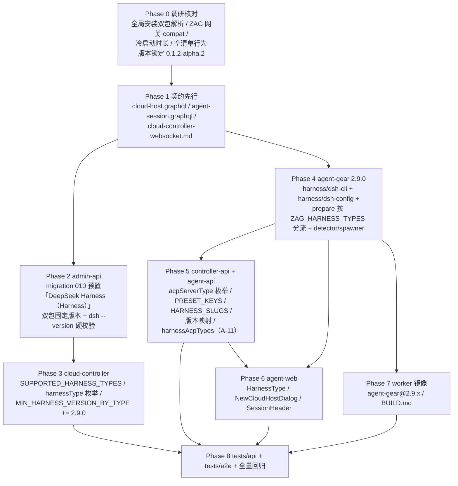

# 增加工作负载「DeepSeek Harness」（Harness）：DeepSeek Harness 接入与平台渠道模型注入 - 实现计划

**关联 Proposal**: `docs/engineering/proposals/20261025-feat-deepseek-harness.md`（v1.1）
**关联 PRD**: `docs/product/draft/20261025-deepseek-harness.md`（v1.1）
**需求总分支（feat-branch）**: `feat/deepseek-harness`（基于 `origin/main` c2ec5c8，需求总 PR #284）
**计划提交分支**: `feat/deepseek-harness`（本文件随需求总分支提交）
**创建日期**: 2026-10-25
**计划版本**: v1.0

**版本说明**：

- v1.0（2026-10-25）首版。对应 PRD/提案 **v1.1**（默认会话口径已按 PR #284 评审修订：就绪后不自动创建会话，与 harness 数量无关）。
- 提案附录 A 的 dsh 调研**已实机验证**（2026-10-25，真实安装 + 真实 ACP 会话）：注入后 `session/new.configOptions` 通告 ZAG 组模型、`currentValue` 为 ZAG 默认、禁用内建 `llm-deepseek` 后选择器仅余 ZAG 组；bridge 兼容结论（分组拍平 / `set_config_option` 原文透传）已确认。计划期遗留的 5 项核对（附录 A.9）在 Phase 0 收口，见 §3 与附录 B。

## 1. 实现顺序



依赖说明：

- **Phase 1 契约**是全部实现的输入，独立提交（`docs(contracts): ...`）；契约未合入前不写实现代码。
- **Phase 2（预置工作负载）**与 **Phase 4（agent-gear）**只依赖 Phase 1，可并行。
- **Phase 3（cloud-controller）**依赖 Phase 2 的 preset 存在性口径（展开由 agent-api 读取 preset 完成）；**Phase 5** 依赖 Phase 1 契约与 Phase 2 的 presetKey 常量口径；**Phase 6** 依赖 Phase 5 的 GraphQL 枚举；**Phase 7** 依赖 Phase 4 的 `agent-gear@2.9.0` 产物；**Phase 8** 在各实现合并回需求总分支后收口。
- 与 Kimi Code（登录闸门）不同，本期**无跨服务事件链**（无 `harness:login` 事件族改动），controller-api/agent-api 侧为纯枚举/映射扩展，工作量前倾到 Phase 4。

### 1.1 开发分支与合并顺序

| 分支 | 范围 | 基于 | 合并目标 |
|------|------|------|---------|
| `feat/deepseek-harness` | PRD / 提案 / 本计划 | `origin/main` | 需求总 PR #284 |
| `feat/deepseek-harness-impl` | 契约 + 全部实现 + 测试（主实现分支） | 需求总分支 | 需求总分支（评审通过后随需求总 PR 入 main） |
| `impl/deepseek-<子项目>`（可选） | 单子项目并行开发分支 | `feat/deepseek-harness-impl` | `feat/deepseek-harness-impl` |

- 主实现分支内按 Phase 顺序分提交：`docs(contracts)` → `feat(admin-api)` → `feat(cloud-controller)` → `feat(agent-gear)` → `feat(controller-api/agent-api)` → `feat(agent-web)` → `chore(worker)` → `test:`。
- 并行子项目分支（z-coding「编写实现并行 subagent」）：`packages/agent-controller`、`servers/*`、`apps/agent-web`、`tests/*` 可各自从主实现分支切出，完成后 merge 回主实现分支。
- **禁止 rebase/squash，只允许 merge**（z-git 规范）。合并顺序：**契约 → packages（agent-gear）→ servers → apps → tests**；`servers` 内落地顺序 admin-api → cloud-controller → controller-api → agent-api（同分支内可分提交）。

### 1.2 开发模式与规范加载

- 全部 Phase 采用 TDD（红-绿-重构）：先写测试（RED）→ 最小实现（GREEN）→ 重构。
- 编码前加载：`docs/engineering/common-rules.md`、`docs/engineering/backend-rules.md`（后端）、`docs/engineering/frontend-rules.md`（agent-web）。
- 目录级 `AGENTS.md`：`servers/agent-api/AGENTS.md`、`servers/controller-api/AGENTS.md`、`servers/cloud-controller/AGENTS.md`、`packages/agent-controller/AGENTS.md`、`apps/agent-web/AGENTS.md`、`tests/api/AGENTS.md`、`tests/e2e/AGENTS.md`、`docs/engineering/plan/AGENTS.md`。
- `servers/admin-api` 无独立 `AGENTS.md`，沿用根 `AGENTS.md` 与 engineering 规范；`apps/admin-web` **本期零改动**（仅既有预置项计数断言如受影响则同步）。
- YAML 写入（`cordis.patch.yml` / `.credentials.yaml`）是本期唯一新增依赖面（`yaml` 包）：合并语义、权限（0600/0700）与原子写必须有单测锚定（与 `opencode-config.ts` 的 jsonc 合并同口径）。

## 2. 命令参考

```bash
# 服务编排（根目录；测试服务只用 Aspire，禁止直接 docker 命令）
aspire start
aspire wait agent-api cloud-controller controller-api agent-web
aspire describe agent-api
aspire describe controller-api
aspire stop

# 单服务单测 / 构建
cd servers/admin-api && npm ci && npm test && npm run build
cd servers/agent-api && npm ci && npm test && npm run build
cd servers/cloud-controller && npm ci && npm test && npm run build
cd servers/controller-api && npm ci && npm test && npm run build
cd packages/agent-controller && npm ci && npm test && npm run build
cd apps/agent-web && npm ci && npm test && npm run build && npm run lint

# 跨服务 API 测试（先 aspire start；地址按 aspire describe 替换）
cd tests/api
API_URL=http://localhost:10001/graphql \
ADMIN_API_URL=http://localhost:10003/graphql \
CONTROLLER_API_URL=http://localhost:<controller-api-port> \
CLOUD_CONTROLLER_URL=http://localhost:10004 \
CLOUD_CONTROLLER_INTERNAL_TOKEN=<与 internal-api-token 一致> \
INTERNAL_API_TOKEN=<同上> \
MONGODB_URI=<aspire describe mongodb> \
npm test

# E2E（串行；地址按 aspire describe 替换）
cd tests/e2e
BASE_URL=http://localhost:<agent-web-port> \
API_URL=http://localhost:10001/graphql \
ADMIN_API_URL=http://localhost:10003/graphql \
CONTROLLER_API_URL=http://localhost:<controller-api-port> \
CLOUD_CONTROLLER_URL=http://localhost:10004 \
MONGODB_URI=<aspire describe mongodb> \
npx playwright test

# worker 镜像（内网构建，不属于服务编排）
cd deploy/images/worker
docker build -t core.harbor.internal.fffdan.com/zero-tools/worker:deepseek-local .
docker run --rm --entrypoint bash \
  core.harbor.internal.fffdan.com/zero-tools/worker:deepseek-local -lc \
  'agent-gear --version && command -v dsh || echo "dsh not preinstalled (expected)"'

# DeepSeek Harness（dsh）核对（开发机临时目录 / worker 内均可）
npm view @deepseek-ai/dsh@0.1.2-alpha.2 bin engines
npm view @deepseek-ai/dsh-acp-app@0.1.2-alpha.2 bin
npm install -g @deepseek-ai/dsh@0.1.2-alpha.2 @deepseek-ai/dsh-acp-app@0.1.2-alpha.2
dsh --version                       # 期望：0.1.2-alpha.2（纯版本号，单行）
dsh --profile acp --help            # 期望：帮助即退出，不占 stdio
dsh --dump-config                   # 期望：可见 profiles/acp 组合树与 patch 归属
```

> `HARNESS_ENABLED` 在 Aspire dev 模式由 `AppHost.cs` 显式置 `true` 便于联调；publish 默认 `false`。API/E2E 用例在开关关闭时按 `test.skip` 跳过并在验收报告登记。
> `K8S_ENABLED=false` 下无真实工作容器回连：云电脑在线、真实 `dsh --profile acp` 会话由单测 + 部署侧手工验收覆盖（§6.4）。

## 3. 计划期裁决（提案与代码/实机事实偏差的落地口径）

> 以下裁决以**当前代码事实**与提案附录 A 的实测结论为准。提案中与之不一致或含混的描述在实现期按本节执行，**不回改提案**；验收报告逐条登记。

### 3.1 事实校正（提案描述与代码事实的偏差）

| # | 提案描述 | 代码事实 | 本计划口径 |
|---|---------|----------|-----------|
| B1 | §2.2：agent-gear 新增依赖 `yaml` | `packages/agent-controller/package.json` = `2.8.0`，`dependencies` 仅 `@agentclientprotocol/sdk / commander / jsonc-parser / smol-toml / socket.io-client`，**无 `yaml`** | `yaml` 作为新增依赖显式引入（锁定主版本）；`version` → `2.9.0`。新增依赖须在实现提交中说明用途（D11 AST 合并） |
| B2 | §3.2.2：`verifyDshCli` 版本一致性校验 | `harness/opencode-cli.ts` 的 `extractVersion()` 取首个非空行 + `split(/\s+/).pop()` 去 `v` 前缀，`verifyOpencodeCli` 做**字符串精确比较**（非 semver） | `verifyDshCli` **复用同一归一化与精确比较**（`0.1.2-alpha.2` 预发布段天然保留，不引入 semver）；与 init 脚本 `awk '{print $NF}'` 口径一致。`extractVersion` 提升为共享工具或由 `dsh-cli.ts` 复用导出 |
| B3 | §3.2.2：prepare 分流后「摘要逐类型一行」 | `harness/prepare.ts` 的 `HarnessPrepareResult` 是 OpenCode 专有形状（`opencodeVersion`/`config`），`formatPrepareSummary` 单段输出；`commands/harness.ts` 直接消费 | 结果形状改为**逐类型数组**（`items: Array<{ type, ok, summary… }>`）+ 汇总行；`formatPrepareSummary` 逐类型一行。CLI 无外部调用方，无契约影响；单测同步改写 |
| B4 | §3.2.2：`opencode` 分支「现有流程逐字不变」 | 现 `prepareHarness` **无条件** `verifyOpencodeCli`；worker 镜像只预装 agent-gear + ACP 适配器（`opencode`/`dsh` 均由工作负载安装） | 分流后**只对所选类型**做 CLI 硬校验与写入：`deepseek_harness` 单选时不得触碰 `opencode`（否则缺二进制即假失败）。`readHarnessEnv` 校验与 `mkdir` 工作区保持**一次**（两类型共用） |
| B5 | §3.2.2：`resolvePrepareTypes` 过滤后为空的回退 | `ZAG_HARNESS_TYPES` 按 harness slug 逗号拼接，多选时可能为 `kimi_code,deepseek_harness` 等 | 白名单过滤 `{opencode, deepseek_harness}`（`kimi_code` 出现即忽略，其 init 不调 prepare）；**env 未设置/空串/过滤后为空 → `['opencode']`**（与提案一致：旧 worker 手工执行零退化）。该回退在纯 kimi 主机手工执行时才可达，单测锁定即可 |
| B6 | §5.2 实现点 6：`MIN_HARNESS_VERSION_BY_TYPE += { deepseek_harness: '2.9.0' }` | `worker-version.ts` 已有 `MIN_KIMI_HARNESS_WORKER_VERSION='2.8.0'` + `MIN_HARNESS_VERSION_BY_TYPE={kimi_code:'2.8.0'}`，`internal-api.ts` 落库已 `max(请求值, harnessMinVersion(types), 2.6.0)` | 只增 `MIN_DEEPSEEK_HARNESS_WORKER_VERSION='2.9.0'` 与 map 条目；`harnessMinVersion()`/`internal-api` 落库逻辑/socketio-gateway 注册门禁**零改动**（自动生效）。基线 `MIN_WORKER_VERSION=2.2.0`、`MIN_HARNESS_WORKER_VERSION=2.6.0` 不动 |
| B7 | §3.2.3：各映射「纯扩展」 | `PRESET_KEYS`/`HARNESS_SLUGS`/`HARNESS_ACP_TYPES`/`HARNESS_MIN_AGENT_GEAR_VERSION` 均为 `Record<HarnessType, …>`（**编译期强制补齐**）；`services/session.ts:170` 的 `harnessAcpTypes` 是函数内字面量 `Record<string,string>`（**无编译期约束**） | 枚举扩展后编译器自动暴露缺口；`session.ts` 的 A-11 映射必须**单测锚定**（缺 `DEEPSEEK_HARNESS → deepseek_harness` 时创建会话被 `unsupported harness type` 拒绝，提案 §3.2.3 已明确） |
| B8 | §7：`010-preset-harness-deepseek` | admin-api 迁移已用至 `009`（`006/007/008/009`）；agent-api 迁移账本独立 | admin-api 用 **`010`**（`010-preset-harness-deepseek(.test).ts`）并在 `index.ts` 迁移数组登记；agent-api **无新迁移** |
| B9 | §7：`commands/harness.ts` 描述更新 | `registerHarnessCommands` 的描述/注释均写死「OpenCode」（`Prepare harness runtime (OpenCode)` 等） | 文案更新为「OpenCode / DeepSeek Harness」，并同步 `harness prepare` 子命令描述（注入目标二选一） |
| B10 | §7：agent-web `graphql/types.ts` 等扩展 | `HarnessType = 'OPENCODE' \| 'KIMI_CODE'`（字符串字面量联合，手工维护）；`NewCloudHostDialog.tsx:38` 与 `SessionHeader.tsx:61` 为标签字面量 map | 三处手工扩展（无编译期联动）；`tests/e2e/src/cloud-host.spec.ts` 与前端单测同步断言第三选项与标签 |
| B11 | §8.2：tests/api 预置项断言 | `tests/api/src/admin-api/cloud-workload.test.ts` 现断言 7 个预置名（含 `OpenCode（Harness）`/`Kimi Code（Harness）`/`Github`） | 同步为 8 个（追加 `DeepSeek Harness（Harness）`），并按 kimi 同口径断言 `workloadKind=HARNESS`、`harnessType=deepseek_harness` |
| B12 | §5.2 实现点 4：detector/spawner 扩展 | `acp/detector.ts` **无独立测试文件**（仅 prober/bridge/capabilities/auth-gate 有测试） | 新增 `acp/detector.test.ts`：锁定 `detectDeepseekHarness()`（`dsh --version`、预发布段保留、缺命令归不可用）与 `getSpawnerConfig('deepseek_harness') → { command: 'dsh', args: ['--profile', 'acp'] }` |

### 3.2 设计裁决（提案留白/含混处）

1. **`writeDshConfig` 合并算法**：patch 顶层是**条目数组**（`- id: …`）。用 `yaml` Document API 解析既有文件 → 按 `id` 定位我方 4 个条目（`llm-deepseek` / `llm-pi-ai` / `agent-default-model` / `acp`）**整体替换其 config**（官方「override 替换完整 entry config」），其余条目与注释逐字保留；文件不存在/为空 → 新建 Document；**解析失败抛错不写**（不静默丢数据，与 opencode-config 同口径）。
2. **`models` 目录整体替换**（官方语义）：条目形状 `{ id, name: id, contextWindow? }`；`contextWindow` 仅在 `ZAG_MODEL_CONTEXT_LENGTHS` 含该模型**正整数**时写入；缺省**不写** `compat` / `reasoningEfforts` / `input`（D12，Phase 0 对 ZAG 网关实测后按需补默认值）。
3. **空 `ZAG_MODEL_IDS`**：不写 `agent-default-model` / `acp` 的 `model` 字段（仅 `provider: zag`），与 opencode 空清单同口径「不引入新失败形态」；摘要 `modelCount=0`。
4. **凭据文件合并**：已存在 → 解析并仅替换 `refs.ZAG_MODEL_API_KEY`（保留其他 `refs`/`records` 与注释）；不存在 → 新建 `{version: 1, refs: {…}}`；非法 YAML 抛错不覆盖。**永远写 `version: 1`**（旧扁平格式会被 dsh 迁移，我方不写）。
5. **dshHome 解析**：`$DSH_HOME` 缺省 `~/.dsh`；`profiles/acp/` 目录 0700、两个文件 0600（dsh 拒绝非属主独占可读的凭据文件）；同目录临时文件 + `rename` 原子替换（沿用 opencode-config 模式，含 atomic-failure 单测口径）。
6. **secret 纪律**：`ZAG_MODEL_API_KEY` 只落文件，不进入日志/错误/返回值（复用 `redactSecrets` / `collectSecretValues`）；`WriteDshConfigResult` 只含路径/条目数/是否新建。
7. **prepare 执行序**：`readHarnessEnv`（一次）→ `mkdir` 工作区（一次）→ 逐类型「CLI 硬校验 → 写入」；任一类型失败**整体非零退出**（`required=true` 工作负载触发容器强制注销的既有语义）；摘要逐类型一行。
8. **detector 版本解析**：`dsh --version` 输出匹配 `\d+\.\d+\.\d+(-[\w.]+)?`（**预发布段保留**）；无输出/命令缺失 → 该 serverType 不出现在探测结果（既有降级口径），不抛错。
9. **spawner**：`{ command: 'dsh', args: ['--profile', 'acp'] }`，工作目录沿用会话 cwd；`initialize` 后无需 `authenticate`（`authMethods=[]`，既有桥接对空 authMethods 直通）；**bridge / prober / spawner 通用逻辑零改动**（附录 A.5/A.7 结论）。
10. **多 harness 同选的幂等**：opencode 与 deepseek 的 init 脚本各自调用一次 `agent-gear harness prepare`（`ZAG_HARNESS_TYPES` 相同）→ 两类写入均幂等（版本一致跳过安装、配置按条目替换），重复执行无副作用（单测 T-PREP* 锚定）。
11. **默认模型**：`modelIds[0]` 同时写入 `agent-default-model` 与 `acp` 条目（D5，实测 `currentValue=["zag","<id>"]`）。
12. **不做登录闸门**：`harness:login` 事件族、auth-gate、用户级 SSE、todo 链路**零改动**（D8）；E2E 断言创建 DeepSeek 会话**不出现**任何登录引导（PRD 功能点 3）。

## 4. 关键约束（提案 §1.3/§6，实现期不得回退）

- **契约先行**：3 份契约（`cloud-host.graphql` / `agent-session.graphql` / `cloud-controller-websocket.md`）先于实现独立提交；字段、枚举值、错误文案与提案 §3 对齐，偏差以 §3 裁决为准。
- **注入只在 init、不在使用前**：init 脚本完成安装 + 硬校验 + `mkdir` + `agent-gear harness prepare`；无任何用户交互前置、无登录。
- **凭证零外泄**：`ZAG_MODEL_API_KEY` 仅写容器内 `~/.dsh/.credentials.yaml`（0600），不进日志/错误/界面；随容器销毁失效；撤销沿用 `revoke-by-host`（billing 链路零改动）。
- **幂等 + 硬校验**：安装/写入可重复执行；`dsh --version` 不一致、命令缺失、注入文件写失败均视为云电脑启动失败（`required=true`）。
- **OpenCode 零改动**：prepare 的 `opencode` 分支、`opencode.jsonc` 注入、`ZAG_MODEL_*` 语义、计费分流逐字不变；Kimi Code 登录闸门与 `kimi_code` 门禁逐字不变。
- **不上调全局门禁**：`MIN_WORKER_VERSION=2.2.0`、`MIN_HARNESS_WORKER_VERSION=2.6.0` 不动；含 `deepseek_harness` 的运行按逐容器 `agentGearMinVersion=2.9.0`（含 kimi 2.8.0、仅 opencode 2.6.0 口径不变）。
- **后台零改动**：`contracts/admin-cloud-container.graphql` / `admin-cloud-workload.graphql` / `billing-openai.openapi.yaml`、admin-web 页面不改（仅预置项计数断言同步）。
- **旧版本兼容**：旧 agent-gear（<2.9.0）注册 `deepseek_harness` 云电脑被 `VERSION_MISMATCH` 拒绝（可读 `version_mismatch`）；本地旧 agent-gear 无 detector 该类型即不可选，零退化。
- **测试纪律**：新增代码单测覆盖率 ≥ 80%；API 与 E2E **串行**执行；测试服务只用 Aspire 编排。

## 5. Phase 计划

### Phase 0：调研核对与版本锁定（0.5d）

**目标**：把提案附录 A.9 的 5 项遗留核对收口，固定版本常量，避免解析器与 CLI 一起漂移。

| 项 | 内容 |
|----|------|
| 产出 | 本计划 §3、附录 B（核对记录）；`DSH_CLI_VERSION` / `DSH_ACP_APP_VERSION` 取值 `0.1.2-alpha.2` |
| 核对项（计划期已完成） | ①`@deepseek-ai/dsh-acp-app` 无 `dsh` bin、`dsh` bin 由 `@deepseek-ai/dsh` 提供；②`dsh --version` 纯版本号 `0.1.2-alpha.2`；③patch 写入 `profiles/acp/cordis.patch.yml` 被组合采纳（`--dump-config`）；④注入后 `session/new` 通告 ZAG 组、`currentValue` 为 ZAG 默认、禁用 `llm-deepseek` 后仅 ZAG 组 |
| 核对项（实现期） | ⑤**全局安装**（`npm -g` 双包同装）后 `dsh --profile acp` 的 bundle/host discovery 解析；⑥ZAG 网关（billing-openai）对 pi-ai 请求形态的兼容（是否需 `compat.supportsDeveloperRole:false` / `maxTokensField:max_tokens`）；⑦ZAG 推理模型是否需 `compat.thinkingFormat:deepseek` 与 `reasoningEfforts`；⑧`dsh --profile acp` 冷启动时长（对照探测超时）；⑨空 `ZAG_MODEL_IDS` 的 `session/new` 行为 |
| 完成判据 | 附录 B 表格填满；如 ⑥⑦ 结论要求写 `compat`，先更新本计划 §3.2.2 再进 Phase 4；⑧ 若冷启动超探测超时，评估预热/超时口径后再定 |

### Phase 1：契约先行（0.5d）

**目标**：3 份契约落地，后续 Phase 只依赖契约不依赖提案文字。

| 文件 | 变更 |
|------|------|
| `contracts/cloud-host.graphql` | `enum HarnessType += DEEPSEEK_HARNESS`；映射注释同步：`DEEPSEEK_HARNESS → acpServerType deepseek_harness`、预置展开 `DEEPSEEK_HARNESS → harness-deepseek-harness`；`cloudHostCapabilities.supportedHarnesses` 仅在预置存在时列出（既有口径）；错误文案 `unsupported harness type: <type>` 不变；补一句「就绪后不自动创建会话（创建期不预置工作区），A-11 会话工具 ∈ 创建时所选 harnessTypes」 |
| `contracts/agent-session.graphql` | `enum AcpServerType += deepseek_harness`；无新增 mutation/subscription（模型通告/切换走既有 `availableModels` / configOptions 通道） |
| `contracts/cloud-controller-websocket.md` | 展开映射 `{ opencode: 'harness-opencode', kimi_code: 'harness-kimi-code', deepseek_harness: 'harness-deepseek-harness' }`；`agentGearMinVersion` 口径增补「含 `deepseek_harness` → 2.9.0」（§3.4 与 §internal 示例同步）；`ZAG_HARNESS_TYPES` 值域示例增 `deepseek_harness`（如 `opencode,deepseek_harness`） |

**完成判据**：契约与提案 §3.1 一致；`contracts/` 单次提交（`docs(contracts): DeepSeek Harness（Harness）契约…`）；agent-api schema / agent-web 类型后续逐字对齐同一枚举值。

### Phase 2：admin-api 预置工作负载（1d）

| 文件 | 变更 |
|------|------|
| `servers/admin-api/src/migrations/010-preset-harness-deepseek.ts` | **新增**：`presetKey='harness-deepseek-harness'`、`name='DeepSeek Harness（Harness）'`、`workloadKind='harness'`、`harnessType='deepseek_harness'`、`isPreset=true`、`paramSchema=[]`、`dependsOnWorkloadIds=[]`、`postScript=null`、`DSH_CLI_VERSION=DSH_ACP_APP_VERSION='0.1.2-alpha.2'`；幂等（presetKey 或精确 name 命中即跳过，不覆盖管理员修改），与 006/009 同构 |
| `servers/admin-api/src/migrations/010-preset-harness-deepseek.test.ts` | **新增**：脚本内容断言（含 `npm install -g "@deepseek-ai/dsh@${DSH_CLI_VERSION}" "@deepseek-ai/dsh-acp-app@${DSH_ACP_APP_VERSION}"` 双包、`dsh --version` 硬校验、`mkdir -p "${ZAG_DEFAULT_WORKSPACE:-/root/workspace}"`、**含** `agent-gear harness prepare`）；幂等（二次 run 不新增）；名称/presetKey 冲突跳过 |
| `servers/admin-api/src/index.ts` | 迁移数组追加 `migration010PresetHarnessDeepseek`，注释补一行 |

**init 脚本（最终形态，提案 §5.3 逐字）**

```bash
#!/usr/bin/env bash
set -euo pipefail

export PATH="$HOME/.local/bin:$HOME/.npm-global/bin:$PATH"

# 1) 固定版本安装 / 版本收敛（缺失或版本不一致时重装，幂等）
#    实测：@deepseek-ai/dsh-acp-app 是 profile 组合包（无 bin），dsh bin 由 @deepseek-ai/dsh 提供
export DSH_CLI_VERSION="${DSH_CLI_VERSION:-0.1.2-alpha.2}"
export DSH_ACP_APP_VERSION="${DSH_ACP_APP_VERSION:-0.1.2-alpha.2}"
installed_version=""
if command -v dsh >/dev/null 2>&1; then
  installed_version="$(dsh --version 2>/dev/null | head -n 1 | awk '{print $NF}')" || installed_version=""
  installed_version="${installed_version#v}"
fi
if [ "${installed_version}" != "${DSH_CLI_VERSION}" ]; then
  echo "Installing DeepSeek Harness ${DSH_CLI_VERSION} + acp-app ${DSH_ACP_APP_VERSION} (installed: ${installed_version:-none})"
  npm install -g "@deepseek-ai/dsh@${DSH_CLI_VERSION}" "@deepseek-ai/dsh-acp-app@${DSH_ACP_APP_VERSION}"
fi

# 2) 硬校验：命令不可用或版本不一致均视为失败（安装成功但不可用 = 启动失败）
actual_version="$(dsh --version | head -n 1 | awk '{print $NF}')"
actual_version="${actual_version#v}"
if [ "${actual_version}" != "${DSH_CLI_VERSION}" ]; then
  echo "DeepSeek Harness version mismatch: expected ${DSH_CLI_VERSION}, got ${actual_version:-unknown}" >&2
  exit 1
fi

# 3) 默认工作区 + 平台渠道模型注入（cordis.patch.yml + .credentials.yaml）
mkdir -p "${ZAG_DEFAULT_WORKSPACE:-/root/workspace}"
agent-gear harness prepare
```

**完成判据**：单测全绿；`admin-api` 启动日志出现 `[Migration 010] preset workload "harness-deepseek-harness" created`；`cloudworkloads` 中 `workloadKind=harness, harnessType=deepseek_harness` 可查。

### Phase 3：cloud-controller 白名单与版本门禁（0.5d）

| 文件 | 变更 |
|------|------|
| `servers/cloud-controller/src/models/cloud-container.ts` | `SUPPORTED_HARNESS_TYPES = ['opencode', 'kimi_code', 'deepseek_harness'] as const`；注释更新 |
| `servers/cloud-controller/src/models/cloud-workload.ts` | `harnessType` 枚举 `['opencode', 'kimi_code', 'deepseek_harness', null]` |
| `servers/cloud-controller/src/services/worker-version.ts` | 新增 `MIN_DEEPSEEK_HARNESS_WORKER_VERSION='2.9.0'`；`MIN_HARNESS_VERSION_BY_TYPE += { deepseek_harness: MIN_DEEPSEEK_HARNESS_WORKER_VERSION }` |
| `servers/cloud-controller/src/services/worker-version.test.ts` | 既有断言保留；新增 `harnessMinVersion(['deepseek_harness'])==='2.9.0'`、`(['opencode','deepseek_harness'])==='2.9.0'`、`(['kimi_code','deepseek_harness'])==='2.9.0'`、`(['opencode'])` 仍 `2.6.0` |
| `servers/cloud-controller/src/routes/internal-api.test.ts` | 新增：`harnessTypes:['deepseek_harness']` → 201 且落库 `agentGearMinVersion='2.9.0'`；混合 `['opencode','kimi_code','deepseek_harness']` → 2.9.0；`['deepseek_harness','bogus']` → 400 `INVALID_HARNESS` |

**不改**：`internal-api.ts` 落库计算（`harnessMinVersion` 自动生效）、`socketio-gateway.ts`、`workload-dispatcher.ts`、`container-service.ts`（`ZAG_HARNESS_TYPES` 已按 join 输出）。

**完成判据**：单测全绿；白名单外类型仍 400；`VERSION_MISMATCH` 报错含 `minimumVersion=2.9.0`（真实 2.8.x worker 连入含 deepseek 的云电脑时）。

### Phase 4：agent-gear 2.9.0 注入与分流（3d，核心）

| 文件 | 变更 |
|------|------|
| `packages/agent-controller/package.json` | `version` → `2.9.0`；`dependencies += yaml`（锁定主版本） |
| `packages/agent-controller/src/harness/dsh-cli.ts` | **新增**：`verifyDshCli(runner?, expectedVersion?)`（`dsh --version` 硬校验，字符串精确比较、预发布段保留）；复用/导出 `extractVersion` 口径 |
| `packages/agent-controller/src/harness/dsh-cli.test.ts` | **新增**：版本一致/不一致/无输出/命令缺失/预发布段比较 |
| `packages/agent-controller/src/harness/dsh-config.ts` | **新增**：`writeDshConfig({ env, dshHome? })`（§3.2.1 签名）——patch 4 条目合并、`models` 整体替换、`contextWindow` 条件写入、credentials `refs.ZAG_MODEL_API_KEY` 合并、0600/0700、临时文件 + rename 原子写、非法 YAML 抛错 |
| `packages/agent-controller/src/harness/dsh-config.test.ts` | **新增**：见 §6.1 T-DSH*（合并全分支/权限/幂等/原子失败/空清单/上下文长度） |
| `packages/agent-controller/src/harness/prepare.ts` | 分流：`resolvePrepareTypes` 取类型 → 逐类型「硬校验 + 写入」；结果改逐类型数组；`formatPrepareSummary` 逐类型一行；opencode 分支逻辑保留（只对所选类型执行，B4） |
| `packages/agent-controller/src/harness/env.ts` | 新增 `resolvePrepareTypes(env)`（逗号分隔、trim、去重、白名单过滤、回退 `['opencode']`，B5） |
| `packages/agent-controller/src/harness/env.test.ts` / `prepare.test.ts` | 新增分流/回退/多类型/幂等/失败整体退出用例 |
| `packages/agent-controller/src/acp/detector.ts` | `detectDeepseekHarness()`（`dsh --version`，`\d+\.\d+\.\d+(-[\w.]+)?`）；`getSpawnerConfig('deepseek_harness') → { command: 'dsh', args: ['--profile', 'acp'] }`；`detect()` 数组追加 |
| `packages/agent-controller/src/acp/detector.test.ts` | **新增**（B12）：探测成功/缺命令/版本解析/预发布段/spawner 形状 |
| `packages/agent-controller/src/commands/harness.ts` | 描述与子命令文案更新（B9）；`formatPrepareSummary` 消费新结果形状 |

**`writeDshConfig` 注入文件最终形态**（提案 §5.3 逐字；合并语义见 §3.2.1/3.2.2）：

```yaml
# ~/.dsh/profiles/acp/cordis.patch.yml（我方 4 条目整体替换，保留其他条目与注释）
- id: llm-deepseek
  disabled: true                      # 禁用内建官方渠道（选择器仅 ZAG 组；附录 A.6）
- id: llm-pi-ai
  config:
    providers:
      zag:
        displayName: ZAG
        apiKeyEnv: ZAG_MODEL_API_KEY  # 凭据引用（值在 .credentials.yaml refs）
        api: openai-completions
        baseURL: <ZAG_MODEL_BASE_URL>
        models:                       # 整体替换；contextWindow 来自 ZAG_MODEL_CONTEXT_LENGTHS
          - id: <model-id>
            name: <model-id>
            contextWindow: <n>        # 可选
- id: agent-default-model
  config: { provider: zag, model: <modelIds[0]> }
- id: acp
  name: '@deepseek-ai/dsh-acp'
  config: { provider: zag, model: <modelIds[0]> }
```

```yaml
# ~/.dsh/.credentials.yaml（仅替换 refs.ZAG_MODEL_API_KEY，保留其他 refs/records 与注释，0600）
version: 1
refs:
  ZAG_MODEL_API_KEY: <ZAG_MODEL_API_KEY>
```

**完成判据**：单测覆盖率 ≥80%；`agent-gear --version` = `2.9.0`；本地手工：临时 `DSH_HOME` 执行 `agent-gear harness prepare`（`ZAG_HARNESS_TYPES=deepseek_harness`）→ 两文件生成、0600/0700、`dsh --dump-config` 显示 patch 归属、二次执行幂等、摘要无 secret。

### Phase 5：controller-api / agent-api 枚举与映射（1d）

| 文件 | 变更 |
|------|------|
| `servers/controller-api/src/models/session.ts` | `acpServerType` 枚举 += `deepseek_harness` |
| `servers/agent-api/src/models/cloud-host.ts` | `HARNESS_TYPES = ['OPENCODE', 'KIMI_CODE', 'DEEPSEEK_HARNESS'] as const` |
| `servers/agent-api/src/graphql/schemas/cloud-host.ts` | `enum HarnessType += DEEPSEEK_HARNESS`（严格对齐契约） |
| `servers/agent-api/src/services/cloud-workload-reader.ts` | `PRESET_KEYS.DEEPSEEK_HARNESS='harness-deepseek-harness'`、`HARNESS_SLUGS.DEEPSEEK_HARNESS='deepseek_harness'` |
| `servers/agent-api/src/services/cloud-host-service.ts` | `HARNESS_ACP_TYPES += DEEPSEEK_HARNESS:'deepseek_harness'`；`HARNESS_MIN_AGENT_GEAR_VERSION += DEEPSEEK_HARNESS:'2.9.0'`（`resolveAgentGearMinVersion` 自动生效） |
| `servers/agent-api/src/services/session.ts` | `harnessAcpTypes += DEEPSEEK_HARNESS:'deepseek_harness'`（A-11 会话工具白名单校验，B7 单测锚定） |
| 测试 | `cloud-host-service.test.ts`（capabilities 含 DEEPSEEK_HARNESS / 仅 deepseek 时 minVersion=2.9.0 / 混合取最大 / 白名单报错文案）、`session.test.ts`（A-11：`deepseek_harness` 会话可创建、未选该工具拒绝 `unsupported harness type: deepseek_harness`）、controller-api 枚举落库用例 |

**完成判据**：单测全绿；`cloudHostCapabilities.supportedHarnesses` 含 `DEEPSEEK_HARNESS`（preset 存在时）；缺失时返回空列表且 create 报 `harness workload preset not found: deepseek_harness`（既有口径）。

### Phase 6：agent-web 选项与标签（0.5d）

| 文件 | 变更 |
|------|------|
| `apps/agent-web/src/graphql/types.ts` | `HarnessType += 'DEEPSEEK_HARNESS'` |
| `apps/agent-web/src/components/cloud-host/NewCloudHostDialog.tsx` | `HARNESS_LABELS += DEEPSEEK_HARNESS: 'DeepSeek Harness'`（多选第三项，既有校验/实例上限不动） |
| `apps/agent-web/src/components/session/SessionHeader.tsx` | 工具标签 `deepseek_harness: 'DeepSeek Harness'` |
| 测试 | `NewCloudHostDialog.test.tsx` 断言三选项可见可多选、移动端不溢出；`SessionHeader` 标签断言 |

**完成判据**：前端单测全绿；`npm run build` + `npm run lint` 通过；模型选择 UI 复用既有「按来源分组」（dsh 的 ZAG 组经 bridge 拍平为 `ZAG/<model>`，来源推断同口径）。

### Phase 7：worker 镜像与文档（0.5d）

| 文件 | 变更 |
|------|------|
| `deploy/images/worker/Dockerfile` | `agent-gear@2.8.x` → `agent-gear@2.9.x`；注释补「2.9.0 起 `deepseek_harness` 注入与 prepare 分流」；**不预装** `dsh` |
| `deploy/images/worker/BUILD.md` | 版本门禁说明（harness 基线 2.6.0 / 含 kimi 2.8.0 / 含 deepseek 2.9.0）；校验清单补 `command -v dsh` 应为空 |

**完成判据**：镜像内 `agent-gear --version` 为 2.9.x；`dsh` 不存在（由工作负载安装）；BUILD.md 校验命令可直接复制执行。

### Phase 8：集成测试与回归（2d）

| 文件 | 变更 |
|------|------|
| `tests/api/src/admin-api/cloud-workload.test.ts` | 预置项 7 → 8（B11）；断言 `DeepSeek Harness（Harness）` 的 `workloadKind=HARNESS` / `harnessType=deepseek_harness` / init 脚本含双包与 `harness prepare` |
| `tests/api/src/agent-api/cloud-host.test.ts` | `supportedHarnesses` 含 `DEEPSEEK_HARNESS`；`createCloudHost(harnessTypes:['DEEPSEEK_HARNESS'])` 通过；`['OPENCODE','DEEPSEEK_HARNESS']` 多选通过；`unsupported harness type: FOO` 文案不变；就绪后不自动建会话（沿用现状断言） |
| `tests/api/src/agent-api/session.test.ts` | A-11：仅选 deepseek 的云电脑可建 `deepseek_harness` 会话、建 `kimi_code` 会话被拒 |
| `tests/api/src/cloud-controller/internal-api.test.ts` | `harnessTypes:['deepseek_harness']` → 201 且落库 `agentGearMinVersion='2.9.0'`（需 `MONGODB_URI`）；混合取最大 |
| `tests/e2e/src/cloud-host.spec.ts` | 新建对话框断言三选项、多选、仅选 DeepSeek 就绪后不自动建会话提示沿用 |
| `tests/e2e/src/session-acp-server.spec.ts` / `session.spec.ts` | 会话工具标签 `DeepSeek Harness`、模型选择仅 ZAG 组且默认选中（fake ACP 夹具）；**不出现**登录引导 |
| `tests/e2e/src/harness-login.spec.ts` | 零回归：DeepSeek/OpenCode 路径不出现登录弹窗 |

**完成判据**：`tests/api` 全绿（含既有 OpenCode / Kimi Code 用例零回归）；`tests/e2e` 串行全绿；`cloud-host.spec.ts` 不因新增选项遮挡/断言失败。

## 6. 测试矩阵

### 6.1 单元测试（Vitest）

| 用例 | 文件 | 断言要点 |
|------|------|---------|
| T-DSH1 新建 patch | `dsh-config.test.ts` | 无文件 → 写 4 条目（`llm-deepseek.disabled`、`providers.zag`、默认路由）；`models` 形状正确 |
| T-DSH2 合并保留 | 同上 | 既有文件含他条目/注释 → 只替换我方 4 条目，其他逐字保留 |
| T-DSH3 models 整体替换 | 同上 | 既有 `llm-pi-ai.providers.zag.models` 被整体替换（不逐项合并） |
| T-DSH4 contextWindow | 同上 | `ZAG_MODEL_CONTEXT_LENGTHS` 正整数才写；缺省/非法不写 |
| T-DSH5 credentials 新建/合并 | 同上 | 新建 `{version:1, refs}`；已有文件仅替换 `refs.ZAG_MODEL_API_KEY`，`records` 与注释保留 |
| T-DSH6 权限 | 同上 | 目录 0700、两文件 0600 |
| T-DSH7 原子写 | `dsh-config.atomic-failure.test.ts` | 写失败不破坏既有文件（临时文件 + rename） |
| T-DSH8 非法 YAML | `dsh-config.test.ts` | 解析失败抛错、不覆盖既有配置 |
| T-DSH9 空清单 | 同上 | `modelIds=[]` → 不写 `model` 字段、`modelCount=0`、不抛错 |
| T-DSH10 幂等 | 同上 | 二次执行结果等价（条目不重复、权限不漂移） |
| T-DSH11 脱敏 | 同上 | 返回值/摘要/错误无 `ZAG_MODEL_API_KEY` |
| T-CLI1 `verifyDshCli` | `dsh-cli.test.ts` | 版本一致通过（含 `0.1.2-alpha.2` 预发布段）；不一致/无输出/命令缺失报错；`v` 前缀归一 |
| T-PREP1 分流 | `prepare.test.ts` | `ZAG_HARNESS_TYPES=deepseek_harness` → 只跑 dsh 校验与写入（**不**触碰 opencode） |
| T-PREP2 缺省回退 | 同上 / `env.test.ts` | 未设置/空串/全部非法 → `['opencode']`；`kimi_code` 被过滤 |
| T-PREP3 多类型 | 同上 | `opencode,deepseek_harness` → 两类各执行一次；顺序稳定、摘要两行 |
| T-PREP4 幂等 | 同上 | 重复执行无副作用（重复 prepare 双包场景） |
| T-PREP5 整体失败 | 同上 | 任一类型失败 → 非零退出语义、已成功部分不回滚（幂等重跑） |
| T-DET1 探测 | `detector.test.ts` | `dsh --version` 成功 → `deepseek_harness` 出现；缺命令 → 不出现 |
| T-DET2 版本解析 | 同上 | `0.1.2-alpha.2` 预发布段保留 |
| T-DET3 spawner | 同上 | `getSpawnerConfig('deepseek_harness')` = `{ command: 'dsh', args: ['--profile', 'acp'] }` |
| T-MIG10a 迁移幂等 | `010-preset-harness-deepseek.test.ts` | 二次 run 不新增；脚本含双包安装 + 硬校验 + `harness prepare` |
| T-MIG10b 不覆盖 | 同上 | presetKey/精确 name 命中跳过（管理员修改不被覆盖） |
| T-MAP1 版本映射 | `worker-version.test.ts` / `cloud-host-service.test.ts` | 含 deepseek → 2.9.0；混合取最大；仅 opencode 2.6.0 / 仅 kimi 2.8.0 不变 |
| T-MAP2 A-11 映射 | `session.test.ts` | `harnessAcpTypes` 含 `DEEPSEEK_HARNESS`；未选类型会话被拒（B7） |
| T-MAP3 映射常量 | `cloud-workload-reader` / `cloud-host-service` 测试 | `PRESET_KEYS`/`HARNESS_SLUGS`/`HARNESS_ACP_TYPES` 三处一致（`deepseek_harness`/`harness-deepseek-harness`） |

### 6.2 API 测试（tests/api，fetch 风格 + fake controller）

| 用例 | 断言要点 |
|------|---------|
| T-DS-API1 能力列表 | `cloudHostCapabilities.supportedHarnesses` 含 `DEEPSEEK_HARNESS`（preset 存在） |
| T-DS-API2 创建校验 | 卆/多选 `DEEPSEEK_HARNESS` 通过；`FOO` → `unsupported harness type: FOO`；就绪后不自动建会话 |
| T-DS-API3 展开与门禁 | workloadPlan 含 `harness-deepseek-harness`（required）；落库 `agentGearMinVersion='2.9.0'`（`MONGODB_URI` 直读） |
| T-DS-API4 A-11 会话工具 | 仅选 deepseek → `deepseek_harness` 会话可创建；`kimi_code` 会话被拒 |
| T-DS-API5 模型探测 | fake dsh configOptions 夹具 → `availableModels` 为 `ZAG/<model>` 组且默认选中（复用既有 probe 链路） |
| T-DS-API6 preset 缺失 | 删除预置 → capabilities 空列表、create 报 `harness workload preset not found: deepseek_harness` |
| T-DS-API7 零回归 | OpenCode / Kimi Code 既有用例逐字通过（含登录引导用例不弹 DeepSeek 相关内容） |

### 6.3 E2E 测试（tests/e2e，Playwright，串行）

| 用例 | 断言要点 |
|------|---------|
| T-E-DS1 三选项 | 新建云电脑对话框出现 `DeepSeek Harness`/`OpenCode`/`Kimi Code`，可多选 |
| T-E-DS2 仅选 DeepSeek | 提示「就绪后不会自动创建会话」沿用；创建/绑定工作区入口可见 |
| T-E-DS3 会话标签 | 会话头工具标签 `DeepSeek Harness` |
| T-E-DS4 模型选择 | 仅 ZAG 组（平台渠道清单）且默认选中；无内建官方渠道分组 |
| T-E-DS5 无登录引导 | 全流程不出现登录弹窗/授权提示（与 T-E-HL* 对照） |
| T-E-DS6 零回归 | OpenCode / Kimi Code 路径与既有断言（含登录弹窗用例）逐字通过 |

### 6.4 实机核对（部署侧手工验收，登记到验收报告）

- 真实云电脑（`harnessTypes=['deepseek_harness']`）：工作负载安装 + 注入成功，`dsh --profile acp` 会话可对话、模型切换正常、历史会话可继续。
- 全局安装双包后 `dsh --profile acp` 的 profile 解析（Phase 0 核对项⑤）与冷启动时长（核对项⑧）。
- ZAG 网关计费记录产生；云电脑销毁后 `revoke-by-host` 撤销、`~/.dsh` 凭据随容器消失。
- 脱敏核查：日志/事件/界面无 `ZAG_MODEL_API_KEY`；两文件 0600。
- 注入失败演练（错误 `ZAG_MODEL_BASE_URL` / 损坏 patch）→ 云电脑启动失败并展示原因，删除后重建恢复。
- OpenCode / Kimi Code 云电脑与普通主机回归（Kimi 登录引导行为不变）。

## 7. 验收 checklist（分阶段）

**Phase 1**

- [ ] 3 份契约合入，枚举/映射/错误文案与 §5 Phase 1 完全一致
- [ ] `cloud-host.graphql` 与 agent-api schema、agent-web 类型逐字对齐（`DEEPSEEK_HARNESS`）

**Phase 2/3**

- [ ] migration 010 幂等；`cloudworkloads` 出现 `harness-deepseek-harness`（`harnessType='deepseek_harness'`）
- [ ] 云电脑创建可选 `DEEPSEEK_HARNESS`；`agentGearMinVersion`：仅 opencode 2.6.0 / 含 kimi 2.8.0 / 含 deepseek 2.9.0
- [ ] 白名单外类型 400 `INVALID_HARNESS`；错误文案 `unsupported harness type: <type>` 不变

**Phase 4/5**

- [ ] `dsh --version` 硬校验失败 → 云电脑启动失败并展示原因（必须失败语义）
- [ ] `ZAG_HARNESS_TYPES=deepseek_harness` 时 opencode 分支不执行（无 opencode 二进制不假失败）
- [ ] patch 4 条目合并正确、他条目/注释保留；`.credentials.yaml` 0600、目录 0700、原子写
- [ ] 空模型清单不引入新失败形态；`contextWindow` 与后台模型设置一致
- [ ] A-11：会话工具 ∈ 创建时所选 harnessTypes（`deepseek_harness` 映射生效）

**Phase 6/7**

- [ ] 三选项多选、标签正确；移动端布局不溢出
- [ ] 模型选择仅 ZAG 组且默认选中；无内建官方渠道；无登录引导
- [ ] 镜像内 agent-gear 2.9.x、无 `dsh` 预装

**Phase 8**

- [ ] 单测覆盖率 ≥80%；tests/api、tests/e2e 串行全绿
- [ ] OpenCode / Kimi Code 全链路、普通主机、登录引导零回归
- [ ] 日志/事件/前端无凭据；平台计费记录与 `revoke-by-host` 正常

## 8. 风险与回滚

| 风险 | 影响 | 缓解 |
|------|------|------|
| dsh developer preview 破坏性变更 | 注入/解析失效、安装失败 | 固定 `0.1.2-alpha.2` 双包同装 + `dsh --version` 硬校验 + 行为夹具锁定；升级走独立迁移与核对 |
| 全局安装（`npm -g`）后 acp profile 解析不到 | `dsh --profile acp` 会话拉起失败 | Phase 0 核对项⑤先行；若不成立则评估 `npm -g` 布局适配或改全局安装路径显式注入，先改本计划再实现 |
| ZAG 网关 compat/推理方言不匹配 | 模型调用 4xx/思考链异常 | D12 缺省不写 + 实测（核对项⑥⑦）后按需补 `compat` 默认值；实测结论登记验收报告 |
| `dsh --profile acp` 冷启动超探测超时 | 模型选择为空/建会话慢 | 核对项⑧实测；必要时预热或调整超时口径（不默认放宽） |
| patch 条目合并破坏用户既有配置 | dsh 启动失败 | 按 `id` 仅替换我方 4 条目 + 非法 YAML 抛错不覆盖 + 原子写；单测 T-DSH2/7/8 锚定 |
| 凭据文件权限漂移 | dsh 拒载凭据 → MISSING_CREDENTIAL | 0600/0700 写入断言（T-DSH6）+ 启动失败可见；不静默降级 |
| 旧 agent-gear（<2.9.0）连 deepseek 云电脑 | 注册被 `VERSION_MISMATCH` 拒绝 | 报错含 `minimumVersion=2.9.0`；前端原样展示；镜像随发布升级 |
| 预置项计数断言漂移 | tests/api 失败 | B11 同步 8 项断言；admin-web 零改动 |

**回滚策略**：

1. **白名单层**：`SUPPORTED_HARNESS_TYPES` 移除 `deepseek_harness` → 新建不再可选（capabilities 由 preset 探测决定，可同步返回空）。
2. **预置项层**：`harness-deepseek-harness` 保留不删（不覆盖管理员修改；删除会导致存量云电脑展开失败）。
3. **注入层**：patch 内 `llm-deepseek` 禁用可回退为保留（D6 注明无功能阻塞）；`providers.zag` 与默认路由保留。
4. **agent-gear**：回退到 2.8.x 镜像即无 dsh 注入；云电脑侧因逐容器 2.9.0 门禁会被拒绝，需同时回退新建入口（步骤 1）。

## 9. 相关文档

- [[../proposals/20261025-feat-deepseek-harness.md]] — 本期技术提案（含附录 A dsh 调研实测）
- [[../../product/draft/20261025-deepseek-harness.md]] — 本期 PRD
- [[20261020-feat-container-harness-support.md]] — 容器启动任务支持 harness 类型（云电脑基线、预置 harness 展开）
- [[20261025-feat-kimi-code-harness.md]] — 增加工作负载「Kimi Code」（Harness）（第二个 harness 与登录闸门；本期零改动参照）
- [[20261023-feat-cloud-container-optimization-phase2.md]] — 云容器优化二期（创建期不预置默认工作区：就绪后不自动创建会话）
- [[20261025-fix-opencode-model-context-length.md]] — 云电脑 OpenCode 模型上下文长度下发（`harness prepare` 参照）
- [[20261021-feat-acp-protocol-enhancement.md]] — ACP 协议增强（configOptions 能力透明化与模型来源分组）
- 开发规范：[[../common-rules.md]]、[[../backend-rules.md]]、[[../frontend-rules.md]]

---

## 附录 A：文件变更总览

```text
contracts/
├── cloud-host.graphql                     # HarnessType += DEEPSEEK_HARNESS（映射注释同步）
├── agent-session.graphql                  # AcpServerType += deepseek_harness
└── cloud-controller-websocket.md          # harness-deepseek-harness 映射 / 2.9.0 门禁 / ZAG_HARNESS_TYPES 值域

servers/admin-api/src/
├── migrations/010-preset-harness-deepseek.ts        # 新增（init-only，双包 0.1.2-alpha.2 + 硬校验 + prepare）
├── migrations/010-preset-harness-deepseek.test.ts   # 新增
└── index.ts                                          # 迁移登记

servers/cloud-controller/src/
├── models/cloud-container.ts              # SUPPORTED_HARNESS_TYPES += 'deepseek_harness'
├── models/cloud-workload.ts               # harnessType enum += 'deepseek_harness'
└── services/worker-version.ts             # MIN_DEEPSEEK_HARNESS_WORKER_VERSION / MIN_HARNESS_VERSION_BY_TYPE += deepseek_harness

servers/controller-api/src/
└── models/session.ts                      # acpServerType 枚举 += deepseek_harness

servers/agent-api/src/
├── models/cloud-host.ts                   # HARNESS_TYPES += DEEPSEEK_HARNESS
├── graphql/schemas/cloud-host.ts          # enum HarnessType += DEEPSEEK_HARNESS
├── services/cloud-workload-reader.ts      # PRESET_KEYS / HARNESS_SLUGS += DEEPSEEK_HARNESS
├── services/cloud-host-service.ts         # HARNESS_ACP_TYPES / HARNESS_MIN_AGENT_GEAR_VERSION += DEEPSEEK_HARNESS → 2.9.0
└── services/session.ts                    # harnessAcpTypes += DEEPSEEK_HARNESS → deepseek_harness（A-11）

packages/agent-controller/                 # agent-gear 2.9.0（package.json version + 依赖 yaml）
├── src/harness/dsh-cli.ts                 # 新增：verifyDshCli（dsh --version 硬校验，预发布段保留）
├── src/harness/dsh-cli.test.ts            # 新增
├── src/harness/dsh-config.ts              # 新增：cordis.patch.yml / .credentials.yaml 合并写入（0600/0700，原子写）
├── src/harness/dsh-config.test.ts         # 新增
├── src/harness/dsh-config.atomic-failure.test.ts   # 新增（原子写失败不破坏既有文件）
├── src/harness/prepare.ts                 # 扩展：ZAG_HARNESS_TYPES 分流（缺省回退 ['opencode']）
├── src/harness/env.ts                     # 扩展：resolvePrepareTypes
├── src/acp/detector.ts                    # 扩展：detectDeepseekHarness + getSpawnerConfig('deepseek_harness')
├── src/acp/detector.test.ts               # 新增
└── src/commands/harness.ts                # 描述与摘要输出（OpenCode → OpenCode / DeepSeek Harness）

apps/agent-web/src/
├── graphql/types.ts                                   # HarnessType += 'DEEPSEEK_HARNESS'
├── components/cloud-host/NewCloudHostDialog.tsx       # 选项/标签 += DeepSeek Harness
└── components/session/SessionHeader.tsx               # 工具标签 += deepseek_harness

deploy/images/worker/
├── Dockerfile                             # agent-gear@2.9.x（不预装 dsh）
└── BUILD.md                               # 版本门禁与校验清单

tests/
├── api/src/admin-api/cloud-workload.test.ts           # 预置项 7 → 8 + 字段断言
├── api/src/agent-api/cloud-host.test.ts               # 能力/创建校验
├── api/src/agent-api/session.test.ts                  # A-11 会话工具白名单
├── api/src/cloud-controller/internal-api.test.ts      # deepseek 门禁用例
├── e2e/src/cloud-host.spec.ts                         # 三选项多选
└── e2e/src/session-acp-server.spec.ts                 # 标签 / 模型选择 / 无登录引导
```

## 附录 B：计划期核对记录

### B.1 代码事实核对（2026-10-25，需求总分支 1a34795）

| # | 核对点 | 观测 | 结论 |
|---|--------|------|------|
| B-1 | `packages/agent-controller/package.json` | `version=2.8.0`；`dependencies` 无 `yaml` | 版本升 2.9.0；新增 `yaml`（§3 B1） |
| B-2 | `harness/opencode-cli.ts` | `extractVersion` 首行取值 + `split(/\s+/).pop()` + 精确比较 | `verifyDshCli` 同口径（§3 B2） |
| B-3 | `harness/prepare.ts` | `HarnessPrepareResult` 为 OpenCode 专有；无条件 `verifyOpencodeCli` | 结果形状改逐类型；只校验所选类型（§3 B3/B4） |
| B-4 | `cloud-controller/services/worker-version.ts` | `MIN_HARNESS_VERSION_BY_TYPE={kimi_code:'2.8.0'}`；`internal-api` 落库已取最大 | 仅增常量与 map 条目（§3 B6） |
| B-5 | `agent-api` 映射常量 | `PRESET_KEYS`/`HARNESS_SLUGS`/`HARNESS_ACP_TYPES`/`HARNESS_MIN_AGENT_GEAR_VERSION` 均 `Record<HarnessType,…>`；`session.ts:170` 为内联字面量 | 编译期 + 单测双保险（§3 B7） |
| B-6 | admin-api 迁移账本 | 已用至 `009` | 采用 `010`（§3 B8） |
| B-7 | `tests/api/src/admin-api/cloud-workload.test.ts` | 断言 7 个预置名 | 同步 8 项（§3 B11） |
| B-8 | `acp/detector.ts` | 无独立测试文件；`getSpawnerConfig` 为 switch | 新增 `detector.test.ts`（§3 B12） |

### B.2 提案附录 A.9 实机核对清单（实现期填满）

| # | 核对项 | 状态 | 结论 |
|---|--------|------|------|
| 1 | 全局安装（`npm -g`）双包同装后 `dsh --profile acp` 的 bundle/host discovery 解析 | 待实现期 | |
| 2 | ZAG 网关（billing-openai）对 pi-ai 请求形态的兼容（`compat.supportsDeveloperRole` / `maxTokensField`） | 待实现期 | |
| 3 | ZAG 推理模型的 `compat.thinkingFormat: deepseek` 与 `reasoningEfforts` 需求 | 待实现期 | |
| 4 | `dsh --profile acp` 冷启动时长（对照探测超时口径） | 待实现期 | |
| 5 | 空 `ZAG_MODEL_IDS` 时 `session/new` 行为（与 opencode 空清单口径对齐） | 待实现期 | |

> 若 1/2/3 结论与 §3.2 裁决冲突：先修订本计划（升版本号 + 记录变更原因），再进入实现。
