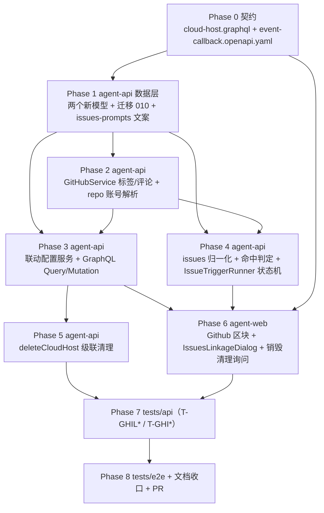

# 云电脑 GitHub Issues 联动工作流 - 实现计划

**关联 Proposal**: `docs/engineering/proposals/20261025-feat-github-issues-workflow.md`（v1.1）
**关联 PRD**: `docs/product/draft/20261025-github-issues-workflow.md`（v1.1）
**需求总分支（feat-branch）**: `feat/github-issues-workflow`（需求总 PR #286，已评审通过）
**实现分支**: `feat/github-issues-workflow-impl`（基于需求总分支）
**创建日期**: 2026-10-25
**计划版本**: v1.0

**版本说明**：

- v1.0 首版，与 PRD v1.1 / 提案 v1.1 对齐（「启用Issues联动」为**联动配置列表**形态：工作流 + 默认标签 `start-{工作流名字}` 可改 + 多选仓库并显式同步标签；销毁云电脑经确认清理标签）。PR #286 评审意见（联动配置列表、默认标签名、显式同步提示、销毁清理）已全部并入上游 v1.1 文档，本计划无新增产品口径变更。
- 把提案 §5.2 的 5 个实现点拆成 9 个 Phase：契约 → 数据模型/迁移 → GitHub 标签与评论 API → 联动配置服务与 GraphQL → issues 事件与触发状态机 → 删除级联 → agent-web → API 测试 → E2E 与收口。
- 本版给出「上游文档 × 代码现状差异」13 条与「计划期裁决」15 条，收敛提案与现有代码不一致、或提案留白但会阻塞实现的细节（`instantiate` 节点图必填、`createSession:false` 不落工作区记录、`createRepoScopedToken` 需 accountId、webhook `X-GitHub-Event` 非枚举、迁移编号至 010、前端 tab 落点等）。
- 本计划不改变 PRD 产品口径；对提案的 1 处契约组织（扩展现有 `cloud-host.graphql` 而非新增文件）、1 处内部接口（`resolveRepoAccount`）、1 处状态机补充（setup 互斥串行 + 回评一次补偿）做收敛，需在实现 PR 描述中声明。

## 实现顺序



依赖说明：

- **P0 是唯一事实源**：类型名、字段可空性、错误文案、reason 枚举全部以 P0 为准；契约未定稿前不写业务代码。
- **P1 是数据层前置**：两个模型与迁移先落地，P2 / P3 / P4 才能开工（P4 的幂等闸依赖 `issue_workflow_triggers` 唯一索引）。
- **P2 → P3 / P4**：标签同步（P3）与触发链路（P4）都依赖 `ensureIssueLabel` / `deleteIssueLabel` / `createIssueComment` 与 `resolveRepoAccount`。
- **P3 / P4 互不依赖**，可并行；P5 只依赖 P3 的模型与清理函数。
- **P6 依赖 P0 + P3**（配置 CRUD）与 P4（触发链路的可观察结果），前端不依赖 P4 完成即可开发配置列表。
- **P7 → P8 串行**：API 与 E2E 共用同一套 Aspire 服务与 Mongo/Redis，禁止并行执行。

开发模式采用 TDD（红-绿-重构）：每个 Phase 先落失败测试（RED）再写实现（GREEN），最后重构。编码前按目录加载 `docs/engineering/common-rules.md`、`backend-rules.md`、`frontend-rules.md`、`servers/agent-api/AGENTS.md`、`apps/agent-web/AGENTS.md`、`tests/api/AGENTS.md`、`tests/e2e/AGENTS.md`。

### 关键约束（实现期不得回退）

- **零回归**：`pull_request_review` 既有分支行为一字不动；未配置联动的云电脑、手工实例化的工作流行为与现状完全一致。
- **幂等闸唯一**：「这个 Issue 对这条配置未曾创建过工作流」以 `issue_workflow_triggers` 唯一索引 `(controllerId, repoFullName, labelName, issueId)` 为权威判定，插入冲突即 `ALREADY_TRIGGERED`；禁止用内存判断替代。
- **契约先行**：先改 `contracts/cloud-host.graphql`、`contracts/event-callback.openapi.yaml`，再改 schema/resolver；前端 GraphQL 类型为**手写**（本仓库无 codegen），禁止臆造生成物。
- **状态机只经服务入口**：触发推进只写 `issue_workflow_triggers.status` 与 `workflowInstanceService.completeHumanNode`，禁止绕过工作流引擎直接改 `nodes[].status`。
- **幂等与串行**：`KeyedMutex` 按 `issues-trigger:{triggerId}` / `issues-setup:{controllerId}` 串行（进程内、**非可重入**）；重复事件、重复推进安全消化。
- **凭据零泄露**：`GITHUB_WEBHOOK_SECRET` / installation token 仅在使用时铸造（`createRepoScopedToken`），不落库、不写日志、不进错误响应（沿用 `sanitizeOperationError`）。
- **提示词纯文本**：Issue 标题/正文/标签名按纯文本注入与展示，不解析指令标记；超长按裁决 12 截断。
- **清理边界**：只删除「配置记录过的（标签 × 仓库）」组合；用户自建同名标签、改名/删除配置遗留的旧标签不主动清理。
- **禁止 rebase/squash**：遵循 z-git 规范，仅允许 merge。

## 上游文档 × 代码现状差异

实现前必须知道的事实偏差（在本计划内消化，无需打回上游；需在实现 PR 描述中声明）：

| # | 上游表述 | 代码现状（证据） | 本计划处置 |
|---|---|---|---|
| D1 | 提案 §1.3 契约「扩展 `contracts/cloud-host.graphql`（或新增 `cloud-host-issues-linkage.graphql`，以既有契约拆分口径为准）」留白 | `contracts/` 现有 31 个契约文件，云电脑域全部收在 `cloud-host.graphql`（HarnessType / CloudHost / deleteCloudHost 等），无按特性拆子文件先例 | 扩展现有 `contracts/cloud-host.graphql`（裁决 1） |
| D2 | 提案 §5.2 实现点 2「按前端同口径映射 nodes → `InstantiateWorkflowInput{ source, configuredWorkflowId, controllerId, workspaceId, name }`」 | `workflowInstanceService.instantiate(userId, input)`（`services/workflow/instance.ts`）的 `nodes: InstantiateNodeInput[]` **必填**，不会自 ConfiguredWorkflow 复制节点图；`dependsOn` 传 nodeKey、实例化时重写为 nodeId | runner 读取 `ConfiguredWorkflow.nodes` 显式映射 `InstantiateNodeInput`（裁决 2） |
| D3 | 提案「确定节点图中执行序上第一个 `type=HUMAN` 的节点（按 dependsOn 拓扑序取首个 HUMAN）」未给实现口径 | 实例节点快照 `dependsOn` 已是 nodeId 引用，另有 `sortOrder`；入度 0 的首节点 `READY`，其余 `INITIALIZING`（`WORKFLOW_NODE_STATUSES`） | Kahn 拓扑序 + sortOrder 稳定排序取首个 HUMAN（裁决 3） |
| D4 | 提案「路径 = `resolveClonePath(prefix, repoFullName)`，prefix 取云电脑默认工作区路径或 `/root/workspace`」 | `resolveClonePath` / `normalizeWorkspacePrefix` 在 `services/workspace-path.ts`（非 controller-workspace）；默认工作区权威口径是 `cloudHostService.defaultWorkspace(host)`（`workspaceId→ControllerWorkspace.path`，回退 `config.cloudHostDefaultWorkspace`，env `CLOUD_HOST_DEFAULT_WORKSPACE`，默认 `/root/workspace`） | 直接复用 `cloudHostService.defaultWorkspace(host)` 取 prefix（裁决 5） |
| D5 | 提案「轮询 operation 终态后从 `ensureWorkspace` 结果取 `workspaceId`」 | `cloudHostGithubService.createOperation` 在 `createSession:false` 时把 session 步骤标记 `SKIPPED`，**不会**调用 `controllerWorkspaceService.ensureWorkspace`（该调用在 `runSessionStep` 内） | runner 在 setup 终态 `SUCCEEDED` 后自行调用 `controllerWorkspaceService.ensureWorkspace(controllerId, userId, clonePath)` 取 `workspaceId`（裁决 5） |
| D6 | 提案「`ensureIssueLabel(userId, repoFullName, name)`」内部隐含可用凭据 | `GitHubService.createRepoScopedToken(accountId, repoFullName)` 需要 `accountId`；触发链路只有 `repoFullName`；`GitHubService` 现无任何 label/comment REST 方法（全仓库 grep 无 `/labels`、`/comments`） | 新增 `resolveRepoAccount(userId, repoFullName)`（`GitHubInstallation.repos[].fullName` 反查），`ensureIssueLabel` 等内部解析（裁决 4） |
| D7 | 提案 §3.1「`event-callback.openapi.yaml`：`X-GitHub-Event` 枚举补充 `issues`」 | 该 header 在契约中是 `type: string`（`example: pull_request_review` + 描述），**非枚举**；忽略语义靠描述表达；`GithubWebhookResponse.reason` 在 `EventCallbackResult.reason` 枚举 + `UNSUPPORTED_EVENT` | 改为补充 header 描述与请求体 schema，并扩充 reason 枚举（裁决 6） |
| D8 | 提案「`createOperation` 初始化工作区」隐含可直接调用 | `createOperation` 前置：cloud host 须 `RUNNING` 且有 `containerId`；`mutex('github-setup:'+controllerId)` 下同控制器已有 `RUNNING` 的 githubSetup 操作会**直接拒绝** | 触发链路对 setup 步骤按 `issues-setup:{controllerId}` 串行；被外部手工 setup 占用时按轮询等待（裁决 7） |
| D9 | 提案「复用 `cloud-host-workload-service` 的轮询范式」「stale 复用 `CLOUD_HOST_SETUP_STALE_MS` 口径」 | 轮询在 `CloudHostWorkloadService.pollBatch`（`pollIntervalMs` 默认 1s）；stale 判定不在 runner，而在 `graphql/resolvers/cloud-host.ts:99`（`config.cloudHostSetupStaleMs`，默认 1 800 000ms） | `IssuesTriggerRunner` 自带「启动扫描 + 1s 定时」轮询；stale 阈值直接读 `config.cloudHostSetupStaleMs`（裁决 8） |
| D10 | 提案 §4.1 新集合索引「唯一索引」，未提迁移 | 迁移现状至 `009-todo-harness-login`；`autoIndex` 关闭的部署索引会静默缺失（backend-rules 陷阱），`workflow-pr-handler` 有「迁移 007/008 建唯一索引」先例 | 新增迁移 `010-issues-linkage-indexes`（两个集合全部索引）+ 单测 + `index.ts` 注册（裁决 10） |
| D11 | 提案「`deleteCloudHost` 级联删除联动配置行」 | `cloudHostService.delete(id, userId)` 是**软删除**（`$set deletedAt`），限 `STOPPED/FAILED`，全程 `hostMutex.runExclusive('host:'+id)`；`DeleteCloudHostDialog` 仅 `open/cloudHost/onClose/onDeleted` 四个 props，无询问步骤骨架 | 级联 `CloudHostIssuesLinkage.deleteMany({ controllerId })` 挂在 delete 流程软删除之后；销毁询问在 Dialog 内新增（裁决 11、13） |
| D12 | 提案「前端云电脑配置页新增『Github』区块」 | 落点是 `apps/agent-web/src/pages/ControllerConfigPage.tsx`：tab 联合类型 `'workspace'\|'harness'\|'mcp'\|'workloads'`、`data-testid="config-tab-*"`，desktop 与 mobile **两条渲染路径**都要加；「配置工作流」既有入口在 `components/settings/WorkflowSection.tsx`（`ConfigureWorkflowDialog`） | 新增 `github` tab（仅 `controller.type==='cloud'`/有 cloudHost 时展示），双路径同步；「配置工作流」按钮跳设置页工作流区块（裁决 13） |
| D13 | 提案 §8 测试只列「`tests/api/src/agent-api/github-issues-webhook.test.ts`（T-GHI\*）」 | `tests/api` 已有 `github-webhook.test.ts`（T-GHWH\*，`describe.skipIf(!GITHUB_WEBHOOK_SECRET)`）；API 用例表/ E2E 用例表在 `tests/api/AGENTS.md`、`tests/e2e/AGENTS.md`（文档事实源）；E2E 现状编号最高 `E2E-32` | 新增 `cloud-host-issues-linkage.test.ts`（T-GHIL\*）与 `github-issues-webhook.test.ts`（T-GHI\*）两个文件；E2E 新增 `E2E-33+`；同步两份 AGENTS 用例表（裁决 14） |

补充事实（非偏差，实现期直接依赖）：`cloud_host_github_bindings` 的 `controllerId` **唯一**（每控制器一条绑定记录），工作区判定不能以绑定表为权威，须以 `ControllerWorkspace.path` 为准；GraphQL 无 `DateTime` scalar，全部日期为 ISO `String!`（提案已按 String，一致）。

## 计划期裁决（提案留白 / 含混处的实现口径）

1. **契约落点（D1）**：全部增量写入 `contracts/cloud-host.graphql`，不新增契约文件。新增 `type CloudHostIssuesLinkage`、`input CloudHostIssuesLinkageInput`、`type CloudHostIssuesLabelCleanupResult`、`extend type Query { cloudHostIssuesLinkages(controllerId: ID!) }`、`extend type Mutation { createCloudHostIssuesLinkage / updateCloudHostIssuesLinkage / deleteCloudHostIssuesLinkage / cleanupCloudHostIssuesLabels }`（字段与提案 §3.1 接口 1/2 逐字一致）。`event-callback.openapi.yaml` 补 `X-GitHub-Event: issues` 的 header 描述、`GithubIssuesEvent` 请求体 schema（`action` 枚举 `opened/labeled/edited/reopened`，`issue{id,number,title,body,html_url,user.login,labels[].name}`、`repository.full_name`）与 `GithubIssuesEventResult`（`{ controllerId, linkageId, labelName, action: 'CREATE_TRIGGER' | null, reason }`）。reason 枚举在现有 `UNSUPPORTED_EVENT` 基础上新增 `NO_MATCHING_LINKAGE` / `REPO_NOT_ENABLED` / `ALREADY_TRIGGERED` / `CLOUD_HOST_NOT_RUNNING`。

2. **实例化节点映射（D2）**：runner 读 `ConfiguredWorkflow.nodes`，逐节点映射 `InstantiateNodeInput{ nodeKey, type, name, description, stage, prompts, artifactTitles, dependsOn, requiresWorktree, linkUpstreamPullRequest, agentConfig, sortOrder }`；`dependsOn` 原样传 nodeKey（`instantiate` 重写为 nodeId）。`linkUpstreamPullRequest` **原样快照**（保留用户配置语义，不额外注入/剥离 `github-pr` 系统提示词）。`createWorkflowWorktree` 缺省（不强制建工作流 worktree）。实例名 `` `${repoFullName}#${issueNumber} ${issueTitle}` `` 截断 64 字。配置行已删除也按触发记录快照实例化（PRD：删除配置不影响已触发）。

3. **首个 HUMAN 节点判定（D3）**：实例化后在实例节点快照上做 Kahn 拓扑排序（同层按 `sortOrder` 升序、再按快照顺序稳定排序），取**执行序第一个 `type === 'HUMAN'`** 的节点为 `humanNodeId`。工作流无 HUMAN（防御，配置校验已拦截）→ 触发记录直接 `COMPLETED`（记 `failureReason: 'workflow has no human node'` 仅作留痕，不报错）。后续 HUMAN 节点不受影响（只自动完成 `humanNodeId` 这一个）。

4. **repo → GitHub 账号解析（D6）**：`GitHubService.resolveRepoAccount(userId, repoFullName)` 遍历用户 `GitHubInstallation`（`repos[].fullName` 大小写不敏感匹配），返回 `accountId`；多个匹配取第一个；无匹配 → `repo not authorized: <fullName>`。`ensureIssueLabel` / `deleteIssueLabel` / `createIssueComment` / `ensureIssueLabel` 均按 `userId + repoFullName` 内部解析，对外不暴露 accountId。

5. **工作区判定与初始化（D4/D5/D8）**：
   - prefix = `await cloudHostService.defaultWorkspace(host)`；`clonePath = resolveClonePath(normalizeWorkspacePrefix(prefix), repoFullName)`；
   - 已有 `ControllerWorkspace.findOne({ userId, controllerId, path: clonePath })` → 直接用其 `_id` 作为 `workspaceId`（**不**查 `cloud_host_github_bindings`，见补充事实）；
   - 缺失 → `KeyedMutex('issues-setup:'+controllerId)` 内执行：`cloudHostGithubService.createOperation({ userId, controllerId, accountId: resolveRepoAccount(...), repoFullName, targetPath: prefix, createSession: false })` → 轮询 `CloudHostSetupOperation` 至 `SUCCEEDED/FAILED`（stale 阈值 `config.cloudHostSetupStaleMs`）→ `SUCCEEDED` 后 `controllerWorkspaceService.ensureWorkspace(controllerId, userId, clonePath)` 取 `workspaceId`；
   - setup `FAILED` / 超时 / 云电脑非 `RUNNING` → 触发记录 `FAILED`，`failureReason` 记 `sanitizeOperationError` 结果，**不实例化工作流**（PRD 功能点 3）。

6. **webhook 响应聚合**：`issues` 事件对每条命中配置产出一个 `results` 项 `{ controllerId, linkageId, labelName, action: 'CREATE_TRIGGER' | null, reason }`；顶层 `handled = results.some(r => r.action === 'CREATE_TRIGGER')`。无任何候选配置 → `REPO_NOT_ENABLED`；有候选但标签不中 → `NO_MATCHING_LINKAGE`；唯一索引冲突 → 该项 `ALREADY_TRIGGERED`；`action` 不在受理集合 / 非 `issues` 事件 → 200 `UNSUPPORTED_EVENT`；处理异常 → 200 `HANDLER_FAILED`（防 GitHub 重投风暴，与现状一致）。

7. **并发与互斥（D8）**：单触发记录推进用 `KeyedMutex('issues-trigger:'+triggerId)`；工作区初始化用 `KeyedMutex('issues-setup:'+controllerId)` 串行，避免撞上 `createOperation` 的 `github-setup:` 互斥拒绝。`KeyedMutex` 非可重入：持锁函数内不得再取同 key 锁。每步推进前在锁内**重读**触发记录与实例状态（防重复实例化/重复 `completeHumanNode`）；`completeHumanNode` 抛非法状态转移时捕获并重读节点状态确认幂等。

8. **超时口径**：工作区准备/实例化阶段超时 = `config.cloudHostSetupStaleMs`（1 800 000ms 默认，`updatedAt` 未推进即 `FAILED: 操作已中断，请重试`）；`PENDING_HUMAN_NODE` 上限 24h，新增常量 `ISSUES_TRIGGER_HUMAN_NODE_TIMEOUT_MS`（env 同名，默认 `86400000`，写入 `config/index.ts`），超时 `FAILED: human node timeout`。

9. **回评失败补偿**：回评失败**不**回滚、不阻断（PRD 功能点 4）：`commentError` 落库、状态继续推进；在 `PENDING_HUMAN_NODE` 轮询期内做**一次**补偿重试（`commentId` 为空且未补偿过），仍失败仅留痕。回评文案见裁决 12。

10. **labelName 归一与唯一（提案实现点 3 口径细化）**：落库前 `trim`，冗余字段 `labelNameLower = labelName.toLowerCase()` 参与唯一索引 `{ controllerId: 1, labelNameLower: 1 }`（与 `workflow-pr-handler.pullRequestIdLower` 先例一致）；校验：非空、≤50、不含逗号；冲突文案 `label name already exists: <labelName>`（唯一索引 11000 映射同文案，走 `toCloudHostGraphQLError` 白名单）。

11. **配置修改/删除/清理边界**：`update` 改 `labelName` 时**不同步删除旧标签**（旧标签保留但不再触发），仅同步新标签；`deleteCloudHostIssuesLinkage` 只删配置行（触发记录、实例、仓库标签全保留）；`cleanupCloudHostIssuesLabels` 逐（配置标签 × 配置仓库）`deleteIssueLabel`（404 视为成功），收集 `deleted/failed` 清单，全部完成后删除该控制器全部配置行；`deleteCloudHost` 软删除后级联 `CloudHostIssuesLinkage.deleteMany({ controllerId })`（用户跳过清理时配置同样失效）。

12. **文案与截断（`services/workflow/issues-prompts.ts`）**：
    - 回评：`` `工作流已经触发创建，Issue 的后续修改将不会影响工作流的执行。\n工作流地址：${config.frontendUrl}/workflows/${workflowInstanceId} ，点击查看。` ``；
    - 首人类节点输入（作为 `completeHumanNode` 的 `input`，落「输入」产物）：

      ```text
      来源：GitHub Issue {repoFullName}#{issueNumber}
      标题：{issueTitle}
      链接：{issueUrl}
      提交人：{issueAuthor}

      {issueBody}
      ```

    - `issueAuthor` 缺省 `未知`；`issueBody` 缺省空；`issueBody` 在归一化层已限 ≤64000，输入文本不再二次截断；`issueTitle` ≤256（归一化层）。

13. **前端落点（D12）**：
    - `ControllerConfigPage.tsx` tab 联合类型加 `'github'`，按钮「Github」`data-testid="config-tab-github"`，desktop/mobile 双路径同步；面板 `CloudHostIssuesLinkageSection`（仅 cloudHost 存在时渲染）。
    - `CloudHostIssuesLinkageSection.tsx`：列表（工作流名称 / 标签名 / 仓库 chips / 编辑 / 删除）+「加Issue联动配置」按钮；删除二次确认；懒查询（进入区块才拉 `cloudHostIssuesLinkages`），不进 `HOME_OVERVIEW` 聚合。
    - `IssuesLinkageDialog.tsx`：分步「选工作流（`configuredWorkflows(controllerId)` 过滤 `nodes.some(n => n.type === 'HUMAN')`）→ 标签名（预填 `start-{工作流名字}` 截断 50，dirty 标记防覆盖用户编辑）→ 仓库多选（`GET_GITHUB_ACCOUNTS` → `installations[].repos` 按 `fullName` 去重合并）」；确认按钮上方固定提示「确认后将把标签 `{labelName}` 同步到所选仓库」；无可用工作流展示「配置工作流」按钮（跳 `SettingsPage` 工作流区块）并禁用确认；服务端 `label sync failed: ...` 时展示失败仓库、保留弹窗数据可重试；编辑态提示「旧标签将保留在仓库中但不再触发」。
    - `DeleteCloudHostDialog.tsx`：打开时查 `cloudHostIssuesLinkages(controllerId)`，非空展示勾选项「同时删除已同步到仓库的标签（N 条配置）」；勾选 → 先 `cleanupCloudHostIssuesLabels`，`failed` 非空展示失败项且**不阻断**删除；未勾选直接删除；查询失败降级为不展示勾选项（不阻断删除）。移动端沿用既有对话框宽度约束，禁止横向溢出。
    - GraphQL 类型手写进 `apps/agent-web/src/graphql/`（查询/变更按现状归类到 `queries.ts` / `mutations.ts`）。

14. **测试编号与文档事实源（D13）**：API 新增 `T-GHIL*`（配置 CRUD / 标签同步 / 清理）与 `T-GHI*`（webhook 事件链路）两个文件；E2E 新增 `E2E-33..E2E-38`（新 spec `cloud-host-issues-linkage.spec.ts`）；同步更新 `tests/api/AGENTS.md`、`tests/e2e/AGENTS.md` 用例表；前端组件测试进 `apps/agent-web/src/components/cloud-host/__tests__/`。

15. **部署与运维**：`FRONTEND_URL` 须为外部可达地址（回评工作流地址来源）；GitHub App webhook 订阅需勾选 `issues` 事件（一次性运维操作，未订阅时功能静默不触发，写入部署文档/提案 §9.2 备注）；`GITHUB_WEBHOOK_SECRET` 复用现状（未配置 → webhook 401，T-GHWH/T-GHI 套件 skip）。

---

## Phase 0: 契约（Contracts）

开发分支：`feat/github-issues-workflow-impl`。契约提交与实现分开 commit。

### 文件修改

- `contracts/cloud-host.graphql` — [改] 新增 `CloudHostIssuesLinkage` / `CloudHostIssuesLinkageInput` / `CloudHostIssuesLabelCleanupResult`、`Query.cloudHostIssuesLinkages`、四个 Mutation（字段逐字对齐提案 §3.1）。
- `contracts/event-callback.openapi.yaml` — [改] `/api/events/github/webhook`：`X-GitHub-Event` 描述补 `issues`；新增 `GithubIssuesEvent` 请求体 schema；`GithubWebhookResponse.reason` 补 `NO_MATCHING_LINKAGE` / `REPO_NOT_ENABLED` / `ALREADY_TRIGGERED` / `CLOUD_HOST_NOT_RUNNING`；`results` 项补 `GithubIssuesEventResult`。

### 契约增量（要点）

```graphql
# contracts/cloud-host.graphql
type CloudHostIssuesLinkage {
  id: ID!
  controllerId: ID!
  configuredWorkflowId: ID!
  configuredWorkflowName: String!   # 展示用冗余（配置删除后仍可读）
  labelName: String!
  repoFullNames: [String!]!
  createdAt: String!
  updatedAt: String!
}

input CloudHostIssuesLinkageInput {
  controllerId: ID!                 # update 时忽略（以 id 定位）
  configuredWorkflowId: ID!
  labelName: String!
  repoFullNames: [String!]!         # 至少 1 个；去重后 ≤50
}

type CloudHostIssuesLabelCleanupResult {
  deleted: [String!]!               # 已删除的 "repo#label"
  failed: [String!]!                # 失败的 "repo#label"
}

extend type Query {
  cloudHostIssuesLinkages(controllerId: ID!): [CloudHostIssuesLinkage!]!
}

extend type Mutation {
  createCloudHostIssuesLinkage(input: CloudHostIssuesLinkageInput!): CloudHostIssuesLinkage!
  updateCloudHostIssuesLinkage(id: ID!, input: CloudHostIssuesLinkageInput!): CloudHostIssuesLinkage!
  deleteCloudHostIssuesLinkage(id: ID!): Boolean!
  cleanupCloudHostIssuesLabels(controllerId: ID!): CloudHostIssuesLabelCleanupResult!
}
```

错误文案（进 `toCloudHostGraphQLError` 白名单原样透传）：`cloud host not found` / `workflow must contain a human node` / `invalid label name` / `label name already exists: <labelName>` / `repo not authorized: <fullName>` / `at least one repo is required` / `label sync failed: <repo1,repo2>`。

### 测试（RED 先行）

- 契约无运行时测试；以「schema/resolver 编译 + `tests/api` 用例」为对齐手段。契约 commit 后跑 `npm run typecheck`（各服务）确认无漂移。

### 验收 checklist

- [ ] 两份契约改动合并进需求总分支；`cloud-host.graphql` 与运行时 schema 字段一一对应。
- [ ] reason 枚举与 §3.1 响应口径一致（`handled` 语义、`results` 逐配置）。

---

## Phase 1: agent-api — 数据模型 / 迁移 / 文案常量

### 文件修改

- `servers/agent-api/src/models/cloud-host-issues-linkage.ts` — [新] `CloudHostIssuesLinkage`（集合 `cloud_host_issues_linkages`）：`userId`（索引）、`controllerId`（索引）、`configuredWorkflowId`、`labelName`、`labelNameLower`、`repoFullNames: string[]`（保存前 trim/去重/格式校验）、timestamps；索引 `{ controllerId: 1, labelNameLower: 1 }` unique（`uniq_cloud_host_issues_linkage_label`）、`{ userId: 1 }`。
- `servers/agent-api/src/models/issue-workflow-trigger.ts` — [新] `IssueWorkflowTrigger`（集合 `issue_workflow_triggers`）：提案 §4.1 字段全量（快照字段 `configuredWorkflowId/labelName/repoFullName/issueId/issueNumber/issueTitle/issueUrl/issueAuthor`、`status`、`workspaceId/setupOperationId/workflowInstanceId/humanNodeId/completedNodeId/commentId/commentError/failureReason`、timestamps）；`ISSUE_TRIGGER_STATUSES = ['PENDING_WORKSPACE','PENDING_INSTANTIATE','PENDING_HUMAN_NODE','COMPLETED','FAILED']`；索引 `{ controllerId: 1, repoFullName: 1, labelName: 1, issueId: 1 }` unique（`uniq_issue_workflow_trigger`，幂等闸）、`{ controllerId: 1, status: 1 }`。
- `servers/agent-api/src/migrations/010-issues-linkage-indexes.ts`（+ `010-issues-linkage-indexes.test.ts`）— [新] 两个集合索引兜底（`autoIndex` 关闭部署）。
- `servers/agent-api/src/index.ts` — [改] 注册迁移 010。
- `servers/agent-api/src/services/workflow/issues-prompts.ts` — [新] 回评文案与首人类节点输入拼装（裁决 12）。
- `servers/agent-api/src/config/index.ts` — [改] `issuesTriggerHumanNodeTimeoutMs`（env `ISSUES_TRIGGER_HUMAN_NODE_TIMEOUT_MS`，默认 86 400 000）。

### 测试（RED 先行）

- `models/*.test.ts`：`labelNameLower` 归一；`repoFullNames` 去重 trim；唯一索引冲突（同 controllerId 同标签、同 trigger 四元组）抛 11000。
- `migrations/010-*.test.ts`：重复执行幂等、索引存在性断言（对齐 007/008 测试风格）。
- `issues-prompts.test.ts`：文案占位符替换、缺省 `未知`/空 body。

### 实现要点

- 模型风格对齐 `models/workflow-pr-handler.ts`（冗余小写列 + 具名唯一索引 + 导出类型）。
- `labelNameLower` 由 schema `pre('save')` 或写入服务统一生成，模型层兜底。

### 验收 checklist

- [ ] 两个集合建索引成功（迁移可重复执行）。
- [ ] 单测覆盖归一化与唯一约束。

---

## Phase 2: agent-api — GitHub 标签 / 评论 API

### 文件修改

- `servers/agent-api/src/services/github.ts` — [改] 新增：
  - `resolveRepoAccount(userId, repoFullName): Promise<string>`（`GitHubInstallation.repos[].fullName` 大小写不敏感反查，多匹配取首个，无匹配抛 `repo not authorized: <fullName>`）；
  - `ensureIssueLabel(userId, repoFullName, name): Promise<void>`（GET `/repos/{owner}/{repo}/labels/{name}` 存在即返回；否则 POST 创建，颜色/描述常量 `ISSUES_LINKAGE_LABEL_COLOR` / `ISSUES_LINKAGE_LABEL_DESCRIPTION = '由 z-agent-gear 云电脑 Issues 联动同步'`；422 already_exists 视为成功）；
  - `deleteIssueLabel(userId, repoFullName, name): Promise<void>`（DELETE，404 视为成功）；
  - `createIssueComment(userId, repoFullName, issueNumber, body): Promise<number>`（POST `/repos/{owner}/{repo}/issues/{n}/comments`，返回 comment id）。
- `servers/agent-api/src/services/github.test.ts` — [改] fetch stub 断言 URL/方法/权限（`issues: write`）与 422/404 语义。

### 测试（RED 先行）

- `ensureIssueLabel`：存在跳过 / 不存在创建 / 422 幂等；`deleteIssueLabel`：404 幂等；`createIssueComment` 返回 id；`resolveRepoAccount` 命中/多账号/未授权。

### 实现要点

- 复用 `createRepoScopedToken(accountId, repoFullName)`（installation token 已含 `issues: write`），token 用时铸造、不落日志。
- 错误经 `sanitizeOperationError` 归一，不透出 GitHub 响应体细节。

### 验收 checklist

- [ ] 四个方法单测全绿；无任何凭据进日志。

---

## Phase 3: agent-api — 联动配置服务与 GraphQL

### 文件修改

- `servers/agent-api/src/services/cloud-host-issues-linkage.ts` — [新] `cloudHostIssuesLinkageService`：`list(userId, controllerId)`、`create(userId, input)`、`update(userId, id, input)`、`remove(userId, id)`、`cleanup(userId, controllerId)`；公共校验（裁决 10/11）；`create/update` 落库后逐仓库 `ensureIssueLabel`（单仓库失败不中断，汇总 `label sync failed: <repo1,repo2>`——配置已保存，前端重试即重发同一变更，幂等）。
- `servers/agent-api/src/graphql/schemas/cloud-host.ts` — [改] 按契约补类型与 Query/Mutation。
- `servers/agent-api/src/graphql/resolvers/cloud-host.ts` — [改] 四个 resolver，错误经 `toCloudHostGraphQLError`（新增文案进 `CLOUD_HOST_PUBLIC_ERRORS` 白名单）。
- `servers/agent-api/src/graphql/resolvers/index.ts` — [改] 如有新增 type resolver 须登记（本 Phase 预期仅 Query/Mutation 展开）。
- `servers/agent-api/src/services/cloud-host-service.ts` — [改] `CLOUD_HOST_PUBLIC_ERRORS` 追加上述错误文案。

### 测试（RED 先行）

- 校验矩阵：非 cloud 控制器 / 工作流无 HUMAN / 标签名空·超长·含逗号·同云电脑重复（大小写不敏感）/ repo 未授权 / `repoFullNames` 为空。
- `label sync` 部分失败汇总报错且配置已落库；重试幂等（已存在标签不重复创建）。
- `update` 改名不同步删旧标签（只同步新标签）；`delete` 不动标签与触发记录；`cleanup` 逐项收集 `deleted/failed` 并删除配置行（404 计入 `deleted`）。
- 权限：跨用户 id 不可见/不可改（`userId` 过滤）。

### 实现要点

- 服务层持有全部业务规则，resolver 只做参数透传与错误映射（与 `cloud-host-service` 既有分层一致）。
- `configuredWorkflowName` 落库时快照（列表展示无需 join）。

### 验收 checklist

- [ ] GraphQL 五操作黑盒可用；错误文案与契约一致。
- [ ] 标签同步/清理编排单测覆盖失败汇总与幂等。

---

## Phase 4: agent-api — issues 事件与触发状态机（核心）

### 文件修改

- `servers/agent-api/src/services/workflow/github-issues-webhook-payload.ts` — [新] `parseGithubIssuesEvent(raw: Buffer | string): IssuesEventPayload | null`（与 `github-webhook-payload.ts` 同风格手写校验，复用 `GithubWebhookPayloadError`）；`IssuesEventPayload { action, issueId, issueNumber, title, body?, issueUrl, author?, labels: string[], repoFullName }`。
- `servers/agent-api/src/services/workflow/issues-event-handler.ts` — [新] `handleIssuesEvent(event): Promise<EventHandleResponse>`（候选查询 → 标签命中 → 逐配置插触发记录 → `advance`）+ `IssuesTriggerRunner`（`advance(triggerId)` 状态机 + 启动扫描 + 1s 定时轮询 + stale/超时判定）。
- `servers/agent-api/src/routes/github-webhook.ts` — [改] `x-github-event` 分支：`pull_request_review` 原路径不动，新增 `issues` 分支（解析 → `handleIssuesEvent` → 同构响应）；其余事件维持 `UNSUPPORTED_EVENT`。
- `servers/agent-api/src/index.ts` — [改] 启动 `IssuesTriggerRunner`（进程启动扫描 + 定时器；`unref()` 防挂住退出）。

### 判定链（最终顺序）

1. `action ∈ {opened, labeled, edited, reopened}`，否则 `UNSUPPORTED_EVENT`；
2. `parseGithubIssuesEvent` 抛 `GithubWebhookPayloadError` → 400 `payload.invalid`（与现状一致）；返回 `null` → `UNSUPPORTED_EVENT`；
3. `CloudHostIssuesLinkage.find({ repoFullNames: event.repoFullName, ...userId? })`——注意：事件侧无 userId，按 `repoFullName` 命中**所有**用户的配置，逐配置用其 `userId` 走后续链路（多实例场景各自独立，PRD 3.5）；候选为空 → `REPO_NOT_ENABLED`；
4. 候选按 `issue.labels`（归一小写）∩ `labelNameLower` 过滤；不中 → `NO_MATCHING_LINKAGE`；多中 → 逐配置独立处理（各自 `results` 项）；
5. 逐命中配置插入 `IssueWorkflowTrigger`（四元组唯一）；冲突 → 该项 `ALREADY_TRIGGERED`；
6. 插入成功 → `IssuesTriggerRunner.advance(triggerId)`（异步推进，webhook 不等待全链路；响应即刻返回受理结果）。

### 状态机（`advance`，每步幂等可重入）

| 状态 | 动作 | 终点 |
|------|------|------|
| `PENDING_WORKSPACE` | 云电脑 `RUNNING` 校验 → 工作区判定/初始化（裁决 5） | 成功回写 `workspaceId` → `PENDING_INSTANTIATE`；失败 → `FAILED` |
| `PENDING_INSTANTIATE` | 映射节点图（裁决 2）→ `workflowInstanceService.instantiate` → 回写 `workflowInstanceId`、`humanNodeId`（裁决 3） | → `PENDING_HUMAN_NODE`；失败 → `FAILED` |
| `PENDING_HUMAN_NODE` | 回评（一次补偿，裁决 9）→ 轮询 `humanNodeId` 节点状态：`READY/RUNNING` 且锁内重读未 DONE → `completeHumanNode(userId, instanceId, humanNodeId, issueInput)` | 节点 `DONE` → 回写 `completedNodeId` → `COMPLETED`；实例删除/归档 → `FAILED: workflow interrupted`；24h → `FAILED` |

### 测试（RED 先行）

- 归一化单测：必填字段缺失 detail、`action` 不受理 → null、labels 提取、body/user 可空、`full_name` 非两段、title/body 超限。
- 事件处理单测：`REPO_NOT_ENABLED` / `NO_MATCHING_LINKAGE` / `ALREADY_TRIGGERED`；多配置命中各触发一次；唯一索引冲突幂等；云电脑非 `RUNNING` → `FAILED`；配置已删除按快照继续；状态机各步推进与重入（重复 `advance` 不重复实例化/不重复完成）；首人类节点前有 AI 节点（延迟完成）；实例删除 → `FAILED`。
- 回评失败仅记录并补一次；`edited` 摘标签不产生新触发、不影响已建实例。

### 实现要点

- 命中判定一次查询 + 内存比对（提案 §4.2，不加缓存）。
- 轮询范式对齐 `cloud-host-workload-service`（1s `pollIntervalMs`）；stale 读 `config.cloudHostSetupStaleMs`。
- `completeHumanNode` 的 `input` 用 `buildIssueNodeInput(event)`（裁决 12），落「输入」产物供下游追溯。

### 验收 checklist

- [ ] 单测覆盖判定链全分支与状态机重入。
- [ ] 重复投递只触发一次；多标签各触发一次。
- [ ] 事件入口对 `pull_request_review` 零改动（既有 T-GHWH/T-PR 全绿）。

---

## Phase 5: agent-api — 删除云电脑级联

### 文件修改

- `servers/agent-api/src/services/cloud-host-service.ts` — [改] `delete()` 软删除后追加 `CloudHostIssuesLinkage.deleteMany({ controllerId })`（hostMutex 内、异常 warn-only 不阻断删除，与 `revokeApiKeysByHost` 同口径）。
- `servers/agent-api/src/services/cloud-host-issues-linkage.ts` — [改] 导出/复用 `cleanup` 供 GraphQL 与删除流程共享删除配置行逻辑。

### 测试（RED 先行）

- `deleteCloudHost` 后配置行清空、触发记录保留、仓库标签保留（未勾选清理时）；`cleanup` 后配置行清空且 `deleted/failed` 正确。

### 验收 checklist

- [ ] 级联清理不改变既有删除语义（软删除、限 STOPPED/FAILED、幂等 true）。

---

## Phase 6: agent-web — Github 区块 / 配置弹窗 / 销毁询问

### 文件修改

- `apps/agent-web/src/components/cloud-host/CloudHostIssuesLinkageSection.tsx` — [新] 配置列表 + 「加Issue联动配置」+ 编辑/删除（二次确认）。
- `apps/agent-web/src/components/cloud-host/IssuesLinkageDialog.tsx` — [新] 分步弹窗（工作流 → 标签名 → 仓库多选 + 同步提示），编辑态复用。
- `apps/agent-web/src/components/cloud-host/DeleteCloudHostDialog.tsx` — [改] 清理勾选项（裁决 13）。
- `apps/agent-web/src/pages/ControllerConfigPage.tsx` — [改] tab `github`（desktop/mobile 双路径）。
- `apps/agent-web/src/graphql/queries.ts` / `mutations.ts`（或按现状归类）— [改] `CLOUD_HOST_ISSUES_LINKAGES` / `CREATE|UPDATE|DELETE_CLOUD_HOST_ISSUES_LINKAGE` / `CLEANUP_CLOUD_HOST_ISSUES_LABELS`；类型手写入 `graphql/types.ts`（或 `graphql/cloud-host.ts`）。
- `apps/agent-web/src/hooks/useIssuesLinkageForm.ts` — [新，可选] 弹窗状态（工作流选项过滤、标签 dirty、仓库选择、提交/重试），便于组件测试。

### 测试（RED 先行，组件测试 RTL）

- 弹窗工作流过滤（无 HUMAN 不展示）、无工作流展示「配置工作流」、标签默认预填与 dirty 不覆盖、仓库多选去重、同步提示展示、sync 失败提示与重试、标签名重复/超长前端提示。
- 列表增删改交互；`DeleteCloudHostDialog` 勾选清理、`failed` 展示不阻断、查询失败降级。

### 实现要点

- 复用 `GET_GITHUB_ACCOUNTS` 与 `useGithubProjectForm` 的仓库合并去重口径（`installations[].repos` 按 `fullName`）。
- 懒查询，不进 `HOME_OVERVIEW`；移动端禁止横向溢出。

### 验收 checklist

- [ ] 组件测试全绿；desktop/mobile 双路径 tab 可用。
- [ ] 销毁流程：有配置出现询问、无配置不出现；失败项提示不阻断删除。

---

## Phase 7: tests/api（黑盒 GraphQL + webhook）

### 文件修改

- `tests/api/src/agent-api/cloud-host-issues-linkage.test.ts` — [新] `T-GHIL1..`（配置 CRUD / 校验矩阵 / 标签同步 / cleanup / deleteCloudHost 级联）。
- `tests/api/src/agent-api/github-issues-webhook.test.ts` — [新] `T-GHI1..`（issues 事件全链路；`describe.skipIf(!GITHUB_WEBHOOK_SECRET)`）。
- `tests/api/AGENTS.md` — [改] 追加两组用例表与环境变量说明。

### 用例清单（文件内唯一编号，节选）

| 用例 | 断言 |
|------|------|
| T-GHIL1 创建与列表 | 创建配置 → 列表含工作流名/标签/仓库；标签同步到仓库（mock/真实 GitHub 二选一，按套件环境变量降级） |
| T-GHIL2 校验矩阵 | 无 HUMAN / 标签非法 / 重复标签 / repo 未授权 / 空仓库 → 对应错误文案 |
| T-GHIL3 同步失败汇总 | `label sync failed: <repo>` 且配置已保存；重试幂等 |
| T-GHIL4 修改与删除 | 改名不同步删旧标签；删除后标签与触发记录保留 |
| T-GHIL5 清理 | `cleanupCloudHostIssuesLabels` → `deleted/failed` 清单、配置行删除 |
| T-GHIL6 级联 | `deleteCloudHost` 后配置行清空 |
| T-GHI1 鉴权与载荷 | 错误 HMAC → 401；非法载荷 → 400 detail；`action` 不受理 → `UNSUPPORTED_EVENT` |
| T-GHI2 判定链 | 无配置标签 → `NO_MATCHING_LINKAGE`；仓库未启用 → `REPO_NOT_ENABLED`；命中 → `CREATE_TRIGGER` |
| T-GHI3 全链路 | 建配置 → 事件 → 工作区就绪 → 实例化 → 回评（mock 层）→ 首人类节点自动完成、下游上下文含 Issue 内容与链接 |
| T-GHI4 幂等 | 同 Issue 同标签重投 → `ALREADY_TRIGGERED`，实例数不变 |
| T-GHI5 多配置 | 同 Issue 双标签命中双配置 → 各触发一次、互不影响 |
| T-GHI6 边界 | `edited` 摘标签；实例化成功回评失败仍推进；首人类节点前有 AI 节点延迟完成；配置删除后历史 Issue 不再触发 |

### 实现要点

- 新用户 + 独立云电脑/实例避免脏数据（对齐 T-PR/T-GHWH 套件）；GitHub REST 无 tests/api mock 层，标签/评论走「真实 GitHub 仓库（环境变量提供）或单测 stub」二选一，缺环境变量时相关断言显式 skip 并在用例表登记。
- 状态机链路断言用轮询等待（秒级），禁止 sleep 长阻塞。

### 验收 checklist

- [ ] `T-GHIL*` / `T-GHI*` 全绿；缺 `GITHUB_WEBHOOK_SECRET` 时整组 skip 语义与现状一致。

---

## Phase 8: tests/e2e 与收口

### 文件修改

- `tests/e2e/src/cloud-host-issues-linkage.spec.ts` — [新] `E2E-33..E2E-38`。
- `tests/e2e/AGENTS.md` — [改] 用例表追加。
- `docs/engineering/AGENTS.md` — [改] 实现计划索引追加本文件（随本计划 commit 完成）。
- 部署备注：提案 §9.2 GitHub App 勾选 `issues` 事件的一次性运维说明。

### E2E 场景（按顺序）

| 用例 | 场景 |
|------|------|
| E2E-33 配置列表 | 「Github」tab → 加配置（工作流 → 标签预填 `start-{工作流名字}` → 仓库多选 + 同步提示）→ 列表可见 |
| E2E-34 校验引导 | 无可用工作流 → 「配置工作流」按钮；标签名重复提示；改标签名 dirty 不被覆盖 |
| E2E-35 触发链路 | 注入 issues(labeled) webhook → 实例创建 → 回评文案与地址 → 首人类节点自动完成，下游上下文含 Issue 内容 |
| E2E-36 幂等与多配置 | 同 Issue 重复注入只触发一次；双标签双配置各触发一次 |
| E2E-37 销毁清理 | 有配置销毁出现询问 → 勾选清理（标签删除、失败项提示）；取消则标签保留、配置失效 |
| E2E-38 零回归 | 未配置联动云电脑行为如旧；`pull_request_review` 既有联动（E2E-27..32）全绿 |

### 收口动作

- 全量回归：`tests/api` 全套 + `tests/e2e` 串行（workers=1）；覆盖率 ≥ 80%。
- 更新 `docs/engineering/AGENTS.md`、`tests/api/AGENTS.md`、`tests/e2e/AGENTS.md`。
- 实现 PR（`feat/github-issues-workflow-impl` → `feat/github-issues-workflow`）描述声明本计划「版本说明」中的三处收敛；合并遵循 z-git（仅 merge，禁 rebase/squash）。

### 验收 checklist

- [ ] E2E-33..38 全绿；E2E-27..32 零回归。
- [ ] 文档索引与用例表同步。

---

## 测试矩阵

| 类型 | 工具 | 覆盖范围 |
|------|------|---------|
| 单元（归一化） | Vitest | 必填字段缺失 detail；不受理 action → null；labels 提取；body/user 可空；full_name 非法 |
| 单元（事件/状态机） | Vitest | 判定链四类 reason；多配置各触发一次；唯一索引幂等；状态机推进与重入；超时与 stale；回评补偿 |
| 单元（配置服务/ GitHub API） | Vitest | 校验矩阵；sync 部分失败汇总；cleanup 逐项结果；422/404 幂等；resolveRepoAccount |
| 单元（前端） | Vitest + RTL | 弹窗三步交互、dirty 标签、同步提示、失败重试、销毁清理询问与降级 |
| API | Vitest + Aspire 真实服务 | `T-GHIL*` GraphQL 全分支；`T-GHI*` webhook 全链路（mock/真实 GitHub 按环境降级） |
| E2E | Playwright（串行） | `E2E-33..38` |
| 实机核对 | 手工（登记验收报告） | GitHub App 勾选 `issues` 后真实仓库打标触发全链路；`FRONTEND_URL` 回评地址可点击 |

## 验收 checklist（分阶段）

- [ ] P0：契约合并，字段/文案与实现一致。
- [ ] P1：两集合 + 迁移 010 生效，单测全绿。
- [ ] P2：标签/评论 API 单测全绿，凭据零泄露。
- [ ] P3：GraphQL 五操作可用，校验矩阵通过。
- [ ] P4：触发全链路单测通过，幂等与多配置语义正确，`pull_request_review` 零回归。
- [ ] P5：删除级联不改变既有语义。
- [ ] P6：组件测试通过，desktop/mobile 双路径可用。
- [ ] P7：`T-GHIL*`/`T-GHI*` 全绿。
- [ ] P8：E2E-33..38 全绿，文档收口，实现 PR 提交。
- [ ] 总体验收对齐提案 §10 与 PRD 3.2 各功能点验收标准（含销毁清理与零回归）。

## 风险与回滚

| 风险 | 影响 | 缓解 |
|------|------|------|
| GitHub App 未勾选 `issues` 事件 | 功能静默不触发 | 部署文档标注运维步骤；API 测试以直接投递 webhook 覆盖；验收含实机核对 |
| `FRONTEND_URL` 未配置外部地址 | 回评链接不可达 | 裁决 12 固定拼接；部署检查项 |
| `autoIndex` 关闭导致唯一索引缺失 | 幂等闸失效 | 迁移 010 兜底（D10） |
| 与手工 Git 项目设置并发 | setup 互斥拒绝 | `issues-setup:{controllerId}` 串行 + 轮询等待 + stale 失败可见（D8/裁决 7） |
| 首人类节点长时不就绪（上游 AI 节点长跑） | 触发记录滞留 | 24h 超时标 FAILED + `PENDING_*` 扫描恢复（裁决 8） |
| GitHub API 限流/权限不足 | 标签同步/清理/回评失败 | 失败汇总可重试、404/422 幂等、回评一次补偿不阻断（裁决 9/11） |
| 回滚 | — | 全部为新增代码路径（新集合/新分支/新区块）；回滚即下线 `issues` 分支与前端区块，`pull_request_review` 与既有云电脑能力不受影响；数据留存（触发记录）无破坏性变更 |

## 命令参考

```bash
# 服务编排（根目录；测试服务只用 Aspire，禁止直接 docker 命令）
aspire start

# 单服务单测 / 类型检查（按需切换目录）
cd servers/agent-api && npx vitest run src/services/workflow src/services src/models
cd servers/agent-api && npm run typecheck
cd apps/agent-web && npx vitest run src/components/cloud-host

# 跨服务 API 测试（先 aspire start；地址按 aspire describe 替换）
cd tests/api && npx vitest run src/agent-api/cloud-host-issues-linkage.test.ts src/agent-api/github-issues-webhook.test.ts

# E2E（串行；workers=1 不可覆盖；地址按 aspire describe 替换）
cd tests/e2e && npx playwright test src/cloud-host-issues-linkage.spec.ts

# 分支（z-git：仅 merge，禁 rebase/squash）
git checkout feat/github-issues-workflow        # 需求总分支
git checkout -b feat/github-issues-workflow-impl # 实现分支
```

## 相关文档

- [[20261025-feat-github-issues-workflow.md|关联 Proposal：云电脑 GitHub Issues 联动工作流技术提案]]
- [[../../../../docs/product/draft/20261025-github-issues-workflow.md|关联 PRD：云电脑 GitHub Issues 联动工作流]]
- [[20261023-feat-workflow-github-pr-callback.md]] — 工作流 GitHub Pull Request 联动实现计划（事件回调/判定链先例）
- [[20261025-feat-kimi-code-harness.md]] — Kimi Code（Harness）实现计划（云电脑链路先例）
- [[20261021-feat-github-workload.md]] — Github 工作负载与云主机 Git 项目设置实现计划（工作区初始化先例）
- [[../common-rules.md]]、[[../backend-rules.md]]、[[../frontend-rules.md]] — 开发规范

## 附录 A：文件变更总览

| 文件 | 动作 | Phase |
|------|------|-------|
| `contracts/cloud-host.graphql` | 改 | P0 |
| `contracts/event-callback.openapi.yaml` | 改 | P0 |
| `servers/agent-api/src/models/cloud-host-issues-linkage.ts` | 新 | P1 |
| `servers/agent-api/src/models/issue-workflow-trigger.ts` | 新 | P1 |
| `servers/agent-api/src/migrations/010-issues-linkage-indexes.ts`（+test） | 新 | P1 |
| `servers/agent-api/src/services/workflow/issues-prompts.ts`（+test） | 新 | P1 |
| `servers/agent-api/src/config/index.ts` | 改 | P1 |
| `servers/agent-api/src/index.ts` | 改 | P1/P4 |
| `servers/agent-api/src/services/github.ts`（+test） | 改 | P2 |
| `servers/agent-api/src/services/cloud-host-issues-linkage.ts`（+test） | 新 | P3/P5 |
| `servers/agent-api/src/graphql/schemas/cloud-host.ts` | 改 | P3 |
| `servers/agent-api/src/graphql/resolvers/cloud-host.ts` | 改 | P3 |
| `servers/agent-api/src/services/cloud-host-service.ts` | 改 | P3/P5 |
| `servers/agent-api/src/services/workflow/github-issues-webhook-payload.ts`（+test） | 新 | P4 |
| `servers/agent-api/src/services/workflow/issues-event-handler.ts`（+test） | 新 | P4 |
| `servers/agent-api/src/routes/github-webhook.ts` | 改 | P4 |
| `apps/agent-web/src/components/cloud-host/CloudHostIssuesLinkageSection.tsx` | 新 | P6 |
| `apps/agent-web/src/components/cloud-host/IssuesLinkageDialog.tsx` | 新 | P6 |
| `apps/agent-web/src/components/cloud-host/DeleteCloudHostDialog.tsx` | 改 | P6 |
| `apps/agent-web/src/pages/ControllerConfigPage.tsx` | 改 | P6 |
| `apps/agent-web/src/graphql/queries.ts` / `mutations.ts` / `types.ts` | 改 | P6 |
| `apps/agent-web/src/hooks/useIssuesLinkageForm.ts` | 新（可选） | P6 |
| `apps/agent-web/src/components/cloud-host/__tests__/*` | 新/改 | P6 |
| `tests/api/src/agent-api/cloud-host-issues-linkage.test.ts` | 新 | P7 |
| `tests/api/src/agent-api/github-issues-webhook.test.ts` | 新 | P7 |
| `tests/e2e/src/cloud-host-issues-linkage.spec.ts` | 新 | P8 |
| `tests/api/AGENTS.md`、`tests/e2e/AGENTS.md`、`docs/engineering/AGENTS.md` | 改 | P7/P8 |
