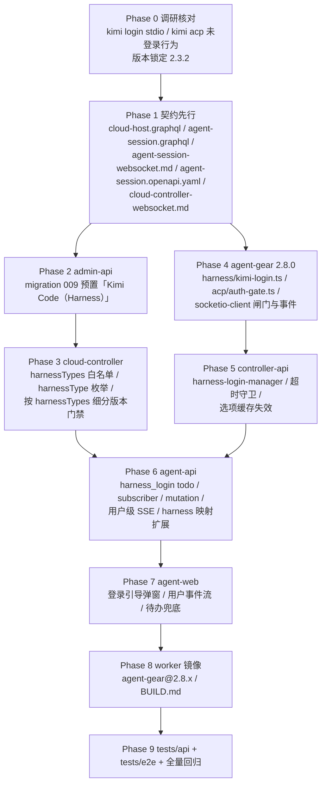
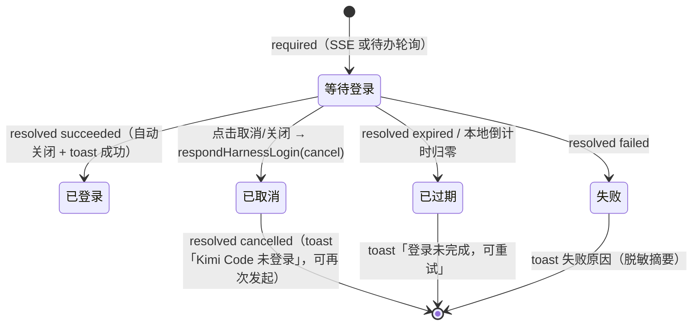

# 增加工作负载「Kimi Code」（Harness）：Kimi Code 接入与登录引导 - 实现计划

**关联 Proposal**: `docs/engineering/proposals/20261025-feat-kimi-code-harness.md`（v1.0）
**关联 PRD**: `docs/product/draft/20261025-kimi-code-harness.md`（v1.0）
**需求总分支（feat-branch）**: `feat/kimi-code-harness`（基于 `origin/main`，需求总 PR #281）
**计划提交分支**: `feat/kimi-code-harness`（本文件随需求总分支提交）
**创建日期**: 2026-10-25
**计划版本**: v1.0

**版本说明**：

- v1.0（2026-10-25）首版。对应 PRD/提案 v1.0。
- 计划期已完成 **Kimi Code CLI 实机核对**（`@moonshot-ai/kimi-code@2.3.2`），核对结论与提案的偏差见 §3；解析夹具、超时守卫、即时下发通道据此定稿（附录 B 为逐字核对记录）。

## 1. 实现顺序



依赖说明：

- **Phase 1 契约**是全部实现的输入，独立提交（`docs(contracts): ...`）；契约未合入前不写实现代码。
- **Phase 2（预置工作负载）**与 **Phase 4（agent-gear 登录闸门）**只依赖 Phase 1，可并行。
- **Phase 3（cloud-controller 白名单/门禁）**依赖 Phase 2（preset 存在性由 admin-api 迁移保证，但展开由 agent-api 读取 preset 完成）；**Phase 5（controller-api）**依赖 Phase 4 的事件语义；**Phase 6（agent-api）**依赖 Phase 5 的 Redis 频道；**Phase 7（agent-web）**依赖 Phase 6 的 GraphQL 与 SSE。
- **Phase 8** 依赖 Phase 4 的 `agent-gear@2.8.0` 产物；**Phase 9** 在各实现分支合并回需求总分支后切出。

### 1.1 开发分支与合并顺序

| 分支 | 范围 | 基于 | 合并目标 |
|------|------|------|---------|
| `feat/kimi-code-harness` | PRD / 提案 / 本计划 | `origin/main` | 需求总 PR #281 |
| `contracts/kimi-code-harness` | `contracts/` 5 份 | 需求总分支 | 需求总分支 |
| `packages/kimi-code-harness` | agent-gear 2.8.0 + worker 镜像 + BUILD.md | 需求总分支 | 需求总分支 |
| `servers/kimi-code-harness` | admin-api + cloud-controller + controller-api + agent-api | 需求总分支 | 需求总分支 |
| `apps/kimi-code-harness` | agent-web | 需求总分支 | 需求总分支 |
| `tests/kimi-code-harness` | tests/api + tests/e2e | 需求总分支（其余已合入） | 需求总分支 |

合并顺序：**契约 → packages（agent-gear）→ servers → apps → tests**。`servers` 内的落地顺序为 admin-api → cloud-controller → controller-api → agent-api（同分支内可分提交）。**禁止 rebase/squash，只允许 merge**（z-git 规范）。

### 1.2 开发模式与规范加载

- 全部 Phase 采用 TDD（红-绿-重构）：先写测试（RED）→ 最小实现（GREEN）→ 重构。
- 编码前加载：`docs/engineering/common-rules.md`、`docs/engineering/backend-rules.md`（后端）、`docs/engineering/frontend-rules.md`（agent-web）。
- 目录级 `AGENTS.md`：`servers/agent-api/AGENTS.md`、`servers/controller-api/AGENTS.md`、`servers/cloud-controller/AGENTS.md`、`packages/agent-controller/AGENTS.md`、`apps/agent-web/AGENTS.md`、`tests/api/AGENTS.md`、`tests/e2e/AGENTS.md`、`docs/engineering/plan/AGENTS.md`。
- `servers/admin-api` 无独立 `AGENTS.md`，沿用根 `AGENTS.md` 与 engineering 规范；**admin-web 本期零改动**。
- 跨服务协议（`harness:login` 事件族）必须**两端同批测试**：agent-gear 侧单测锁定出站形状，controller-api 侧单测锁定入站校验与出站 Redis 形状（吸取 `AGENTS.md` 中 Proxy 协议不一致的教训）。

## 2. 命令参考

```bash
# 服务编排（根目录；测试服务只用 Aspire，禁止直接 docker 命令）
aspire start
aspire wait agent-api cloud-controller controller-api agent-web
aspire describe agent-api
aspire describe controller-api
aspire stop

# 单服务单测 / 构建
cd servers/admin-api && npm ci && npm test && npm run build
cd servers/agent-api && npm ci && npm test && npm run build
cd servers/cloud-controller && npm ci && npm test && npm run build
cd servers/controller-api && npm ci && npm test && npm run build
cd packages/agent-controller && npm ci && npm test && npm run build
cd apps/agent-web && npm ci && npm test && npm run build && npm run lint

# 跨服务 API 测试（先 aspire start；地址按 aspire describe 替换）
cd tests/api
API_URL=http://localhost:10001/graphql \
ADMIN_API_URL=http://localhost:10003/graphql \
CONTROLLER_API_URL=http://localhost:<controller-api-port> \
CLOUD_CONTROLLER_URL=http://localhost:10004 \
CLOUD_CONTROLLER_INTERNAL_TOKEN=<与 internal-api-token 一致> \
INTERNAL_API_TOKEN=<同上> \
MONGODB_URI=<aspire describe mongodb> \
npm test

# E2E（串行；地址按 aspire describe 替换）
cd tests/e2e
BASE_URL=http://localhost:<agent-web-port> \
API_URL=http://localhost:10001/graphql \
ADMIN_API_URL=http://localhost:10003/graphql \
CONTROLLER_API_URL=http://localhost:<controller-api-port> \
CLOUD_CONTROLLER_URL=http://localhost:10004 \
MONGODB_URI=<aspire describe mongodb> \
npx playwright test

# worker 镜像（内网构建，不属于服务编排）
cd deploy/images/worker
docker build -t core.harbor.internal.fffdan.com/zero-tools/worker:kimi-local .
docker run --rm --entrypoint bash \
  core.harbor.internal.fffdan.com/zero-tools/worker:kimi-local -lc \
  'agent-gear --version && command -v kimi || echo "kimi not preinstalled (expected)"'

# Kimi Code CLI 核对（开发机/worker 内均可）
npm view @moonshot-ai/kimi-code@2.3.2 bin engines
kimi --version                      # 期望：2.3.2（独占一行）
kimi login --help                   # 期望：--region mainland-cn|global
timeout 25 kimi login               # 未登录：stderr 输出设备码四行后阻塞
```

> `HARNESS_ENABLED` 在 Aspire dev 模式由 `AppHost.cs` 显式置 `true` 便于联调；publish 默认 `false`。API/E2E 用例在开关关闭时按 `test.skip` 跳过并在验收报告登记。
> `K8S_ENABLED=false` 下无真实工作容器回连：云电脑在线、真实 `kimi login`、真实 ACP 会话由单测 + 部署侧手工验收覆盖（§7.4）。

## 3. 计划期裁决（提案与代码/实机事实偏差的落地口径）

> 以下裁决以**当前代码事实**与**计划期实机核对**为准。提案中与之不一致的描述在实现期按本节执行，**不回改提案**；验收报告逐条登记。

### 3.1 事实校正（提案描述与代码/实机不符）

| # | 提案描述 | 代码 / 实机事实 | 本计划口径 |
|---|---------|----------------|-----------|
| A1 | §4.2：登录检查结果缓存 `harness:auth:<controllerId>:kimi_code`（Redis，TTL 5 分钟） | agent-gear 是 CLI 客户端，**没有 Redis 依赖、容器内也不可达 Redis**（仅 Socket.IO 连接 controller-api） | 改为 **agent-gear 进程内 TTL 缓存**（`KIMI_AUTH_CACHE_TTL_MS`，默认 300000）+ 进程内 single-flight。登录流程本就只发生在控制器本机，进程内缓存即可满足「已登录秒级放行」；无需 Redis |
| A2 | §5.1.2：stdio 判定「`Logged in to {...}`」 | 实机：`runLoginFlow` 在 `hadToken` 时走 `ensureFresh()`，**不触发设备码**，成功后 stderr 打印 `Logged in to managed:kimi-code.` 并 `exit 0`；账号位是 **providerName（固定 `managed:kimi-code`）**，不是用户身份 | 判定保留「含 `Logged in to`」。**`account` 仅作日志/事件透出，前端不展示为账号**（无邮箱/用户名可展示）；成功文案统一「已登录」 |
| A3 | §3.1.2：登录等待「不计入」探测/启动既有超时 | 实机代码：controller-api `AcpOptionsProber` 探测超时 **30s**（超时 resolve `EMPTY_OPTIONS`）、`AcpSessionManager.registerPendingRequest` `acp:start`/`acp:resume` **30s**（超时 resolve `{success:false,'ACP start timeout'}`） | 新增**超时守卫**：登录流程进行中（`HarnessLoginRegistry.pendingFor(controllerId)` 命中）时，两处超时回调**不结算**，改为重新挂起（每 30s 复检）；登录结束（succeeded/failed）后由 agent-gear 的真实结果事件结算。绝对上限 = 登录等待上限 + 60s 兜底（防泄漏） |
| A4 | §5.1.2：未登录时 `kimi acp` 的 `session/new` 失败形态 | 实机：`kimi acp` 的 `initialize` **成功**（返回 `authMethods:[{id:'login',type:'terminal',name:'Login with Kimi account'}]`），`session/new` 返回 `{"code":-32000,"message":"Authentication required"}`，stderr `acp: auth readiness probe failed` | 闸门必要性成立（否则探测在 `session/new` 失败）。**不放宽**为「用 ACP `authMethods` 判定」：需求明确要求 `kimi login` stdio 判定且闸门位于拉起之前；`authMethods` 仅作为二期可观测补充，本期不改 ACP 链路 |
| A5 | §5.1.2：「进程 exit 0 → 登录成功」 | 实机源码：成功 `exit 0`；`SIGINT` → `Login cancelled.` + `exit 1`；OAuth 拒绝 → `Login cancelled: <msg>` + `exit 1`；其它 → `Login failed: <msg>` + `exit 1`。**SIGTERM 无优雅文案**（进程被直接终止） | 判定：①exit 0 → `logged-in`；②出现设备码后 exit 0 → `logged-in`；③exit 1 且 `Login cancelled*` → `cancelled`；④exit 1 且已过 `expiresAt` → `timeout`；⑤其余 exit≠0/被杀 → `failed('error')`。`cancel()` 发 **SIGTERM**（就其无优雅退出），由我方 `cancelled` 标志定 reason，不依赖文案 |
| A6 | §5.3 `<pin>` 待实现期固定 | 实机：`npm view @moonshot-ai/kimi-code` → `2.3.2`；`bin = { kimi: 'dist/main.mjs' }`；`engines.node = ">=22.19.0"`；worker 镜像 Node 24 满足；内网 npm 代理可解析（tarball 走 `nexus.internal.fffdan.com/repository/npm-proxy`） | 固定 **`KIMI_CODE_CLI_VERSION='2.3.2'`**（env 同名可覆盖，与 `OPENCODE_CLI_VERSION` 同口径）；`kimi --version` 输出独占一行 `2.3.2`，现有 `awk '{print $NF}'` 解析成立 |
| A7 | §5.1.3：`agentGearMinVersion = max(2.6.0, 含 kimi_code → 2.8.0)` | agent-api `CLOUD_HOST_AGENT_GEAR_MIN_VERSION='2.6.0'` **硬编码单一值**；cloud-controller `internal-api.ts:306` 只做 `max(请求值, MIN_HARNESS_WORKER_VERSION=2.6.0)`，**不理解 harnessTypes** | 双端都改为「按 harnessTypes 取最大」：agent-api 新增 `HARNESS_MIN_AGENT_GEAR_VERSION = {OPENCODE:'2.6.0', KIMI_CODE:'2.8.0'}`；cloud-controller 新增 `MIN_HARNESS_VERSION_BY_TYPE = {kimi_code:'2.8.0'}`，落库 = `max(请求值, 2.6.0, 按类型最大值)`。**仅 opencode 的运行仍为 2.6.0** |
| A8 | §5.2 实现点 7：agent-gear `2.7.1 → 2.8.0` | `packages/agent-controller/package.json` = `2.7.1`，但 `socketio-client.ts:26 CONTROLLER_VERSION = '2.6.0'`（注释自称「与 package.json 保持一致」，已漂移） | 升 `2.8.0`；`CONTROLLER_VERSION` 改为**从 `package.json` 读取**（`resolveJsonModule` 或 `createRequire`），消除双写漂移；register 上报值随之 2.8.0 |
| A9 | §3.1.2 `harness:login:required.controllerId` 由 controller 上报 | agent-gear 本地模式不持有 controllerId（`registered` ack 才有，且本地连接不强制缓存）；且**不能信任 CLI 上报的归属** | **契约保留 `controllerId` 字段，但由 controller-api 用 `socket.data.controllerId` 填充**（与 elicitation 的 `userId/controllerId` 注入同口径）。agent-gear 上行 payload：`{requestId, serverType, trigger, url, userCode, expiresInSeconds?, account?}`；`userId` 一律由 controller-api 从 socket 注入 |
| A10 | §3.2.3：取消经「Redis/命令通道 → controller-api」 | `session:command` 通道按 `sessionId` 路由，登录流程**没有 sessionId**（探测可发生在无会话时） | 新增专用 Redis 频道 `harness:login:cancel`，由 controller-api 新增 `HarnessLoginManager` 订阅（与 `elicitation:response` 同模式），按 `requestId` 找出发起 socket 下发 |
| A11 | §3.1.2：`acp:start:result success=false reason='auth'` | 现有 `acp:start:result` / `acp:resume:result` **无 `reason` 字段**（仅 `error`）；controller-api 的 dispatcher 只读固定字段 | 新增**可选** `reason?: 'auth'`（向后兼容：controller-api 忽略未知字段，旧前端不感知）；同时保留可读 `error: 'Kimi Code 未登录'` |
| A12 | §4.1 `todoitems.type` 追加 `harness_login_request` | 现有 `resolution` 枚举 `accepted\|declined\|cancelled\|expired\|failed` 已覆盖需求终态 | **不新增枚举值**：登录成功 → `accepted`、用户取消 → `cancelled`、授权过期/超时 → `expired`、检查失败 → `failed`；`isRead` 在收敛时置 true（铃铛计数归零） |
| A13 | §5.2 实现点 6：弹窗「未读 todo 自动打开」（隐式依赖 15s 轮询） | agent-web 唯一信息流是 `HOME_OVERVIEW` **15s 轮询**；`sessionSSEService.pushToUser` 只推给**已打开会话页**的连接。创建会话对话框/主机页触发的探测**没有会话 SSE** | 新增 **用户级 SSE** `GET /api/user/stream`（`contracts/agent-session.openapi.yaml` 增补）：agent-api 收到 `harness:login:required/resolved` 后同时推送用户级事件；agent-web `MainLayout` 全局订阅 → 弹窗**即时**呈现。`HOME_OVERVIEW` 的 todo 轮询保留为**兜底**（SSE 断线/漏事件时 ≤15s 内仍能打开） |
| A14 | §5.1.1 时序：`kimi login` 前先「已登录直接继续」 | 实机：`kimi login` 在已登录时仍会做一次 `ensureFresh()` 网络 refresh（秒级，无需设备码），并 `provisionConfig` 写 CLI 自身配置 | 接受该成本：缓存 5 分钟内直接放行；缓存过期后一次 `kimi login`（秒级）。`provisionConfig` 写的是 **CLI 自己的** `~/.kimi-code/config.toml`，**不是**平台模型注入（不违背 D6） |
| A15 | §5.3：`KIMI_CODE_HOME` 重定位 | 实机源码：`KIMI_CODE_HOME` 在部分路径仅在 `NODE_ENV=test` 生效，语义不完全统一；默认 `~/.kimi-code/`（credentials `*.json`, 0600） | **不设置 `KIMI_CODE_HOME`**，一律用默认 `~/.kimi-code/`（容器销毁即失效，符合 PRD 安全口径）；不读写、不解析凭证文件（D1） |
| A16 | §5.1.1 超时默认 15 分钟 | 实机设备码 `Code expires in 1800s.`（=30 分钟） | `KIMI_LOGIN_WAIT_MS` 默认 **1800000（30 分钟，与设备码有效期一致）**，可 env 覆盖；`expiresAt` 由 `expiresInSeconds` 解析值（缺省 1800）计算 |
| A17 | §1.3 `purpose=harness` 的 `agentGearMinVersion` | cloud-controller `socketio-gateway.ts:281` 用 `record.agentGearMinVersion ?? MIN_HARNESS_WORKER_VERSION` 门禁（**逐容器**），不需改注册门禁逻辑 | 只改 `internal-api.ts` 的落库计算（A7），gateway 不改；`MIN_HARNESS_WORKER_VERSION` 保持 `2.6.0` |
| A18 | §7 项目结构：`agent-api/src/migrations/009-todo-harness-login.ts` | admin-api 迁移已用到 `008`，agent-api 已用到 `008`（两套账本独立 `admin_migrations` / `migrations`） | 两侧都用 **`009`**：admin-api `009-preset-harness-kimi-code`、agent-api `009-todo-harness-login`；均在各自 `index.ts` 迁移数组登记 |
| A19 | §3.1.4 `SUPPORTED_HARNESS_TYPES: { opencode: 'harness-opencode', kimi_code: 'harness-kimi-code' }` | cloud-controller 的 `SUPPORTED_HARNESS_TYPES` 是 **数组**且只做白名单；preset 映射在 **agent-api** 的 `cloud-workload-reader.ts`（`PRESET_KEYS`/`HARNESS_SLUGS`）与 `HARNESS_ACP_TYPES` | 白名单（cloud-controller）与映射（agent-api）分别扩展，不合并成跨服务单一表；cloud-controller 不需要知道 presetKey |
| A20 | §8.2 E2E：登录引导弹窗全流程 | `K8S_ENABLED=false` 无真实 worker；`kimi login` 需真实浏览器授权（E2E 不可自动化） | E2E 用 **fake controller** 注入 `harness:login:required` 驱动弹窗（链接/验证码/取消/自动关闭）；真实 `kimi login` 授权链路走部署侧手工验收（§7.4），不引入测试后门 |

### 3.2 设计裁决（提案留白/含混处）

1. **闸门插入点**：`socketio-client.ts` 的 `acp:probe-options`（634 行）、`acp:start`（656 行）、`acp:resume`（803 行）三处 handler **最前** `await authGate.ensure(serverType, trigger)`；非 `kimi_code` 立即 resolve（零开销）。闸门**不进入** `prober.ts`/`spawner.ts`，保证本地/云主机、直接/经 controller-api 三条路径一致。
2. **单进程登录流程**：`AcpAuthGate` 内 `inflight: Map<serverType, Promise<Outcome>>` + `cache: Map<serverType, expiresAt>`（agent-gear 一个进程只服务一台主机，实际 key 恒为 `kimi_code`）。并发第二个使用动作 `await` 同一 Promise；`required` 只发一次。
3. **`kimi login` 子进程**：`spawn('kimi', ['login'], { stdio: ['ignore','pipe','pipe'], env: process.env })`（**关闭 stdin**，无 TTY；不传 `--region`，沿用 CLI 默认区域解析）；stdout+stderr **按行合并解析**（实机输出在 stderr）；行缓冲上限 8 KiB，超长截断不累积。
4. **超时守卫注册表**：controller-api 新增 `HarnessLoginRegistry`（进程内 `Map<controllerId, requestId>`），由 `AcpOptionsProber` 与 `AcpSessionManager` 的超时回调查询；命中则 `setTimeout` 重挂（30s），并在 `loginWaitDeadline = required 时刻 + KIMI_LOGIN_WAIT_MS + 60s` 之后强制结算（resolve 失败/EMPTY），避免僵尸挂起。
5. **缓存失效**：`harness:login:succeeded` 时 controller-api `redis.del('acp:options:<controllerId>:kimi_code')`（探测失败会写 60s 空结果缓存，不失效会导致「登录后仍拿不到模型」）。
6. **断开收敛**：控制器 socket `disconnect` 时，`HarnessLoginManager` 对归属该 socket 的登录请求：发布 `resolved{result:'failed', error:'controller disconnected'}` → 清 registry → 让挂起探测/启动按超时守卫的绝对上限结算（探测 30s / 启动 30s），不无限挂。
7. **重复 required**：同一 `controllerId` 已有进行中 `requestId` 时，不同 requestId 的 required **只告警并忽略**（agent-gear single-flight 下不应出现；防御旧版/异常）。
8. **todo 幂等**：`createHarnessLoginTodo` 按 `harnessLoginData.requestId + userId` upsert（重复 required 不重复建、不重复推送）；终态写入 filter 必须含 `userId` 与 `resolution: null`（沿用 elicitation 的终态单调不变量）。
9. **前端单例弹窗**：`stores/harnessLoginDialog.ts` 维护 `{ open: requestId, queue: LoginRequest[] }` 单实例；SSE 与待办轮询**共用**（幂等 open，同 requestId 只渲染一个）；关闭/取消 → `respondHarnessLogin(cancel)`；`resolved` 到达 → 自动关闭并 `toast` 对应结果。
10. **弹窗层级**：弹窗挂在 `MainLayout`（全站最高层级），不受 `NewSessionDialog` / 移动端 Sidebar 未挂载影响（PRD 要求「并发多动作只一个引导」「浏览器授权后自动继续」）。
11. **错误文案**：取消/失败后原动作失败文案统一 `Kimi Code 未登录`（`acp:start:result.error`、probe 失败 error），前端在会话状态与 toast 中原样展示；不新增错误码。
12. **不做平台模型注入**：Kimi 工作负载 init **不执行** `agent-gear harness prepare`；`ZAG_MODEL_*` 仍随 harness env 下发但 Kimi 不读取（OpenCode 路径不变），验收时确认 Kimi 会话不产生平台计费记录。

## 4. 关键约束（提案 §1.3/§6，实现期不得回退）

- **契约先行**：5 份契约先于实现独立提交；字段、事件名、错误文案与提案 §3 对齐，偏差以 §3 裁决为准。
- **登录只在使用前**：init 脚本只装环境（安装 + 硬校验 + `mkdir`），**绝不做登录**；登录只在闸门（探测/启动/恢复之前）。
- **凭证零托管**：平台不读、不存、不打印任何 Kimi 凭证；凭证仅在容器 `~/.kimi-code/`，随容器销毁。日志/事件/错误统一脱敏，`kimi login` 原始输出**不进日志**。
- **单飞与单弹窗**：同一主机 `kimi_code` 同时只有一个登录流程、一个弹窗；并发使用动作共享结果。
- **不改 OpenCode**：`harness prepare`、`opencode.jsonc`、ZAG 模型凭证、计费分流、`harnessTypes=['opencode']` 的展开/门禁**逐字不变**。
- **不上调全局门禁**：`MIN_WORKER_VERSION=2.2.0`、`MIN_HARNESS_WORKER_VERSION=2.6.0` 均不动；含 `kimi_code` 的运行按逐容器 `agentGearMinVersion=2.8.0`。
- **后台零改动**：`contracts/admin-cloud-container.graphql`、`contracts/admin-cloud-workload.graphql`、`contracts/billing-openai.openapi.yaml`、admin-web 页面均不改（admin-web 仅因预置项数量变化的既有断言同步）。
- **旧版本兼容**：旧 agent-gear（<2.8.0）无闸门：云电脑侧被 2.8.0 门禁拒绝（可读 `version_mismatch`），本地主机维持现状（未登录即失败）——登记为二期遗留。
- **测试纪律**：新增代码单测覆盖率 ≥ 80%；API 与 E2E **串行**执行；测试服务只用 Aspire 编排。

## 5. Phase 计划

### Phase 0：调研核对与版本锁定（0.5d）

**目标**：把 `kimi login` / `kimi acp` 的真实行为固化为可测试的夹具与常量，避免解析器与 CLI 一起漂移。

| 项 | 内容 |
|----|------|
| 产出 | 本计划 §3 A2–A6/A14–A16 与附录 B（逐字输出、exit code、npm 元数据） |
| 核对项（已完成） | ①`kimi --version` → `2.3.2`；②未登录 `kimi login` → stderr 四行（URL/验证码/1800s/等待）；③设备码 URL 含 `user_code=<code>`；④`kimi acp` `initialize` 成功且 `session/new` → `Authentication required`；⑤`npm view` bin/engines |
| 核对项（实现期，需真实账号） | ⑥已登录 `kimi login` → `Logged in to managed:kimi-code.` + exit 0 + 秒级；⑦授权完成 exit 0 且 `~/.kimi-code/credentials/*.json`（0600）；⑧登录后 `kimi acp` 会话可用 |
| 完成判据 | 附录 B 表格填满；如与 §3 冲突，先改计划再进 Phase 4 |

### Phase 1：契约先行（1d）

**目标**：5 份契约落地，后续 Phase 只依赖契约不依赖提案文字。

| 文件 | 变更 |
|------|------|
| `contracts/cloud-host.graphql` | `enum HarnessType { OPENCODE KIMI_CODE }`；错误文案沿用 `unsupported harness type: <type>`；`harnessType → acpServerType` 映射注明 `KIMI_CODE → kimi_code` |
| `contracts/agent-session.graphql` | `enum TodoType` + `harness_login_request`；`type HarnessLoginRequestData { requestId, controllerId, serverType, trigger, url, userCode, expiresAt }`；`TodoItem.harnessLoginData`；`enum HarnessLoginAction { cancel }`；`respondHarnessLogin(requestId: String!, action: HarnessLoginAction!): Boolean!` |
| `contracts/agent-session-websocket.md` | 新增 §2.35–2.38：`harness:login:required` / `succeeded` / `failed`（Controller→Server）与 `harness:login:cancel`（Server→Controller）；字段表、语义（挂起不失败、单飞、不占原有超时、取消=原动作失败） |
| `contracts/agent-session.openapi.yaml` | 新增 `GET /user/stream`（SSE，`?token=` 鉴权）：事件 `ready` / `heartbeat(30s)` / `harness_login_required` / `harness_login_resolved` |
| `contracts/cloud-controller-websocket.md` | 白名单与展开：`SUPPORTED_HARNESS_TYPES` 含 `kimi_code`、presetKey `harness-kimi-code`、`ZAG_HARNESS_TYPES` 语义不变、`agentGearMinVersion` 按 harnessTypes 取最大（含 `kimi_code` → 2.8.0） |

**事件字段（最终口径）**

```ts
// Controller → Server
'harness:login:required' {
  requestId: string;        // agent-gear 生成（single-flight 归并键）
  serverType: 'kimi_code';
  trigger: 'probe-options' | 'acp:start' | 'acp:resume';
  url: string;              // stdio 原文，http(s)，≤2048
  userCode: string;         // stdio 原文，≤64
  expiresInSeconds?: number;// stdio 解析，缺省 1800
}
// controller-api 注入后入 Redis：+ controllerId / userId / receivedAt
'harness:login:succeeded' { requestId, account?: string }   // account=providerName（不展示）
'harness:login:failed'    { requestId, reason: 'cancelled'|'timeout'|'error', error?: string }
// Server → Controller
'harness:login:cancel'    { requestId }
```

**完成判据**：契约评审通过；`contracts/` 单次提交；agent-api/agent-web schema 严格对齐（后续 Phase 用同一份字段名）。

### Phase 2：admin-api 预置工作负载（1d）

| 文件 | 变更 |
|------|------|
| `servers/admin-api/src/migrations/009-preset-harness-kimi-code.ts` | **新增**：`presetKey='harness-kimi-code'`、`name='Kimi Code（Harness）'`、`workloadKind='harness'`、`harnessType='kimi_code'`、`isPreset=true`、`paramSchema=[]`、`dependsOnWorkloadIds=[]`、`postScript=null`、`KIMI_CODE_CLI_VERSION='2.3.2'`；幂等（presetKey 或精确 name 命中即跳过，不覆盖管理员修改），与 006 同构 |
| `servers/admin-api/src/migrations/009-preset-harness-kimi-code.test.ts` | **新增**：脚本内容断言（含 `npm install -g "@moonshot-ai/kimi-code@2.3.2"`、`kimi --version` 硬校验、`mkdir -p "${ZAG_DEFAULT_WORKSPACE:-/root/workspace}"`、**不含** `agent-gear harness prepare`）；幂等（二次 run 不新增）；名称/presetKey 冲突跳过 |
| `servers/admin-api/src/index.ts` | 迁移数组追加 `migration009HarnessKimiCode`，注释补一行 |

**init 脚本（最终形态）**

```bash
#!/usr/bin/env bash
set -euo pipefail

export PATH="$HOME/.local/bin:$HOME/.npm-global/bin:$PATH"

# 1) 固定版本安装 / 版本收敛（缺失或版本不一致时重装，幂等）
export KIMI_CODE_CLI_VERSION="${KIMI_CODE_CLI_VERSION:-2.3.2}"
installed_version=""
if command -v kimi >/dev/null 2>&1; then
  installed_version="$(kimi --version 2>/dev/null | head -n 1 | awk '{print $NF}')" || installed_version=""
  installed_version="${installed_version#v}"
fi
if [ "${installed_version}" != "${KIMI_CODE_CLI_VERSION}" ]; then
  echo "Installing Kimi Code CLI ${KIMI_CODE_CLI_VERSION} (installed: ${installed_version:-none})"
  npm install -g "@moonshot-ai/kimi-code@${KIMI_CODE_CLI_VERSION}"
fi

# 2) 硬校验：命令不可用或版本不一致均视为失败（安装成功但不可用 = 启动失败）
actual_version="$(kimi --version | head -n 1 | awk '{print $NF}')"
actual_version="${actual_version#v}"
if [ "${actual_version}" != "${KIMI_CODE_CLI_VERSION}" ]; then
  echo "Kimi Code CLI version mismatch: expected ${KIMI_CODE_CLI_VERSION}, got ${actual_version:-unknown}" >&2
  exit 1
fi

# 3) 默认工作区（本期不注入平台模型配置、不做登录；登录在使用前闸门完成）
mkdir -p "${ZAG_DEFAULT_WORKSPACE:-/root/workspace}"
```

**完成判据**：单测全绿；`admin-api` 启动日志出现 `[Migration 009] preset workload "harness-kimi-code" created`；`cloudworkloads` 中 `workloadKind=harness, harnessType=kimi_code` 可查。

### Phase 3：cloud-controller 白名单与版本门禁（1d）

| 文件 | 变更 |
|------|------|
| `servers/cloud-controller/src/models/cloud-container.ts` | `SUPPORTED_HARNESS_TYPES = ['opencode','kimi_code'] as const`；注释更新 |
| `servers/cloud-controller/src/models/cloud-workload.ts` | `harnessType` 枚举 `['opencode','kimi_code', null]`；注释「本期 opencode / kimi_code」 |
| `servers/cloud-controller/src/services/worker-version.ts` | 新增 `MIN_KIMI_HARNESS_WORKER_VERSION='2.8.0'` 与 `MIN_HARNESS_VERSION_BY_TYPE: Record<string,string> = { kimi_code: '2.8.0' }`；新增纯函数 `harnessMinVersion(harnessTypes: string[]): string`（返回按类型最大值，缺省 `MIN_HARNESS_WORKER_VERSION`） |
| `servers/cloud-controller/src/routes/internal-api.ts` | `agentGearMinVersion: maxWorkerVersion(maxWorkerVersion(agentGearMinVersion, harnessMinVersion(harnessTypes)), MIN_HARNESS_WORKER_VERSION)` |
| `servers/cloud-controller/src/services/worker-version.test.ts` | 现有断言（`MIN_HARNESS_WORKER_VERSION==='2.6.0'`）保留；新增 `harnessMinVersion(['opencode'])==='2.6.0'`、`(['opencode','kimi_code'])==='2.8.0'`、`(['kimi_code'])==='2.8.0'`、未知类型回退 2.6.0 |
| `servers/cloud-controller/src/routes/internal-api.test.ts` | 新增：`harnessTypes:['kimi_code']` → 201 且落库 `agentGearMinVersion='2.8.0'`；`['opencode']` 维持 2.6.0；`['kimi_code','bogus']` → 400 `INVALID_HARNESS` |

**不改**：`socketio-gateway.ts`（读逐容器 `record.agentGearMinVersion`）、`workload-dispatcher.ts`、`container-service.ts`（`ZAG_HARNESS_TYPES` 已按 join 输出）。

**完成判据**：单测全绿；`SUPPORTED_HARNESS_TYPES` 之外的类型仍 400；`VERSION_MISMATCH` 报错含 `minimumVersion=2.8.0`（真实 2.7.x worker 连入时）。

### Phase 4：agent-gear 2.8.0 登录闸门（3d，核心）

| 文件 | 变更 |
|------|------|
| `packages/agent-controller/package.json` | `version` → `2.8.0` |
| `packages/agent-controller/src/socketio-client.ts` | `CONTROLLER_VERSION` 改为从 `package.json` 读取（单一来源）；`acp:probe-options`/`acp:start`/`acp:resume` 前置闸门；新增 `harness:login:required/succeeded/failed` 上行与 `harness:login:cancel` 下行 |
| `packages/agent-controller/src/harness/kimi-login.ts` | **新增**：`KimiLoginFlow`（`run(handlers)` / `cancel()`）、`parseKimiLoginLine()`、`classifyExit()`、常量 `KIMI_LOGIN_WAIT_MS` |
| `packages/agent-controller/src/harness/kimi-login.test.ts` | **新增**：夹具全分支（见 §6.1 T-KL*） |
| `packages/agent-controller/src/acp/auth-gate.ts` | **新增**：`AcpAuthGate`（`ensure(serverType, trigger)` / `cancel(requestId)` / `reset()`）、`AuthRequiredError` |
| `packages/agent-controller/src/acp/auth-gate.test.ts` | **新增**：见 §6.1 T-AG* |
| `packages/agent-controller/src/socketio-client.test.ts` | 新增：闸门在 `kimi_code` 生效 / 非 `kimi_code` 零调用；失败时 result 形状（`success:false, reason:'auth'`）；`harness:login:*` 出站形状；`cancel` 下行 |

**解析口径（最终）**

```ts
type KimiLoginOutcome =
  | { state: 'logged-in'; account?: string }
  | { state: 'device-flow'; url: string; userCode: string; expiresInSeconds: number }
  | { state: 'failed'; reason: 'cancelled' | 'timeout' | 'error'; error?: string };

// 逐行（stdout+stderr 合并，\r\n 归一）
/^Logged in to (.+?)\.?$/                      → logged-in, account = $1（不展示）
/^Opening browser for Kimi device login: (\S+)$/ → url
/enter code:\s*([A-Za-z0-9-]+)/                 → userCode
/^Code expires in (\d+)s\.$/                    → expiresInSeconds
/^Waiting for authorization to complete/        → 保持等待（不重复上报 required）
```

- 设备码行**首次**命中时 `onDeviceFlow` 上抛一次；`url` 必须 `http(s)` 且 ≤2048、`userCode` ≤64，否则归 `failed('error')`（不把不可信内容推给前端）。
- `exit 0` → `logged-in`；`cancelled` 标志（我方 `cancel()`）→ `cancelled`；`now >= expiresAt` → `timeout`；其余 → `error`（附脱敏摘要，≤200 字）。
- 原始输出**不进日志**；调试日志只打「匹配到的行类型」。

**闸门语义**

```ts
// 仅 kimi_code；其余 serverType 直接 resolve（零开销）
async ensure(serverType, trigger): Promise<void>
// 1) 缓存命中 → resolve
// 2) inflight 命中 → await 同一 Promise
// 3) 否则新建 flow：
//    emit harness:login:required（onDeviceFlow 首次）
//    run() → logged-in：写缓存 + emit succeeded；failed：emit failed + throw AuthRequiredError
// 4) 失败抛出 AuthRequiredError('Kimi Code 未登录') → handler 按既有失败语义发 result（含 reason:'auth'）
```

**完成判据**：单测覆盖 ≥80%；`agent-gear --version` = `2.8.0`；本地手工：未登录发起 `acp:probe-options`（kimi_code）→ 收到 `required`，`kimi login` 进程存活，取消后进程终止且 result 失败。

### Phase 5：controller-api 事件透传与超时守卫（2d）

| 文件 | 变更 |
|------|------|
| `servers/controller-api/src/services/harness-login-manager.ts` | **新增**：`HarnessLoginManager`（入站校验 → Redis publish → 注册表 → 取消订阅下发 → 断开收敛） |
| `servers/controller-api/src/services/harness-login-manager.test.ts` | **新增**：见 §6.1 T-HLM* |
| `servers/controller-api/src/services/harness-login-registry.ts` | **新增**：`HarnessLoginRegistry`（`mark(controllerId, requestId, deadlineMs)` / `pendingFor(controllerId)` / `clear`），供超时守卫查询 |
| `servers/controller-api/src/services/socketio.ts` | 注册 `harness:login:required` / `succeeded` / `failed` 三个 socket handler（转 `harnessLoginManager`）；`disconnect` 时 `harnessLoginManager.clearForSocket(socket.id)` |
| `servers/controller-api/src/services/acp-options-prober.ts` | `PendingRequest` 增加 `controllerId`；超时回调：`registry.pendingFor(controllerId)` 命中 → 重挂 30s（受 deadline 约束）；`invalidateCache` 复用 |
| `servers/controller-api/src/services/acp-session-manager.ts` | `PendingRequest` 增加 `controllerId`（`registerPendingRequest` 从 `socket.data.controllerId` 取）；超时回调同上 |
| `servers/controller-api/src/index.ts` | `harnessLoginManager.start(io)` |

**Redis 频道**

| 频道 | 方向 | 载荷 |
|------|------|------|
| `harness:login:required` | controller-api → agent-api | `{requestId, controllerId, userId, serverType, trigger, url, userCode, expiresInSeconds, receivedAt}` |
| `harness:login:resolved` | controller-api → agent-api | `{requestId, controllerId, userId, result:'succeeded'\|'failed'\|'cancelled'\|'expired', account?, error?}` |
| `harness:login:cancel` | agent-api → controller-api | `{requestId}` |

**校验口径（controller payload 不可信）**：`requestId` 非空 ≤200；`serverType==='kimi_code'`；`trigger ∈ {probe-options,acp:start,acp:resume}`；`url` `http(s)` ≤2048；`userCode` ≤64；`expiresInSeconds` 整数 60~3600（缺省 1800）；`reason ∈ {cancelled,timeout,error}`；`account` ≤200（脱敏不展示）。非法直接丢弃 + `console.warn`，不建 todo、不暂停超时。

**取消链路**：`respondHarnessLogin(cancel)` → Redis `harness:login:cancel` → `HarnessLoginManager` 查 `requestId → socketId` → 未连接则丢弃并 warn；连接则 `socket.emit('harness:login:cancel', {requestId})` → agent-gear `authGate.cancel(requestId)`。

**完成判据**：单测全绿（含 Redis 发布/订阅 mock）；手工：agent-gear 未登录时探测挂起 >30s **不再**被 30s 超时结算；登录成功后同一请求返回真实选项。

### Phase 6：agent-api todo / subscriber / 用户 SSE / harness 映射（3d）

| 文件 | 变更 |
|------|------|
| `servers/agent-api/src/models/todo-item.ts` | `type` 枚举 + `harness_login_request`；新增 `harnessLoginData { requestId, controllerId, sessionId?, serverType, trigger, url, userCode, expiresAt }`；索引 `{'harnessLoginData.requestId':1}` |
| `servers/agent-api/src/migrations/009-todo-harness-login.ts` | **新增**：创建 `harnessLoginData.requestId` 索引（重复创建容忍），幂等 |
| `servers/agent-api/src/migrations/009-todo-harness-login.test.ts` | **新增**：索引存在性 + 二次执行幂等 |
| `servers/agent-api/src/index.ts` | 迁移数组 + `harnessLoginSubscriberService.start()` |
| `servers/agent-api/src/services/todo-service.ts` | `createHarnessLoginTodo(data)`（requestId+userId 幂等 upsert，priority `immediate`，title `Kimi Code 需要登录`，`expiresAt = now + expiresInSeconds`）；`isRespondableTodo` 增加 `harness_login_request` 分支（filter `'harnessLoginData.requestId' + resolution:null`）；`markHarnessLoginResolved(requestId, resolution, {userId})`（复用终态单调写法）；`markTodoAsResponded` 的 `$or` 增加 `'harnessLoginData.requestId'` |
| `servers/agent-api/src/services/harness-login-subscriber.ts` | **新增**：订阅 required/resolved；required → 建 todo + `pushToUser`；resolved → 收敛 todo（`succeeded→accepted`、`cancelled→cancelled`、`expired→expired`、其它→`failed`）+ `markTodoAsResponded` + `pushToUser` |
| `servers/agent-api/src/services/harness-login-subscriber.test.ts` | **新增**：见 §6.1 T-HLS* |
| `servers/agent-api/src/services/session-sse.ts` | 新增用户级连接：`userConnections: Map<userId, Set<SSEConnection>>`、`addUserConnection(userId, res)`、`pushToUser` 同时写用户连接；`ready`/`heartbeat(30s)` 事件；关闭清理 |
| `servers/agent-api/src/routes/session-stream.ts` | 新增 `GET /user/stream`（复用 `authenticateExpressUser`，401 口径一致） |
| `servers/agent-api/src/graphql/schemas/todo.ts` | `TodoType` + `harness_login_request`；`HarnessLoginRequestData`、`TodoItem.harnessLoginData`、`HarnessLoginAction`、`respondHarnessLogin` |
| `servers/agent-api/src/graphql/resolvers/todo.ts` | `respondHarnessLogin`：`isRespondableTodo(...,'harness_login_request')` → publish `harness:login:cancel` → `markTodoAsResponded` → `markHarnessLoginResolved('cancelled')`；未命中抛 `Todo item not found or already handled` |
| `servers/agent-api/src/models/cloud-host.ts` | `HARNESS_TYPES = ['OPENCODE','KIMI_CODE'] as const` |
| `servers/agent-api/src/graphql/schemas/cloud-host.ts` | `enum HarnessType { OPENCODE KIMI_CODE }`（严格对齐契约） |
| `servers/agent-api/src/services/cloud-workload-reader.ts` | `PRESET_KEYS.KIMI_CODE='harness-kimi-code'`、`HARNESS_SLUGS.KIMI_CODE='kimi_code'` |
| `servers/agent-api/src/services/cloud-host-service.ts` | `HARNESS_ACP_TYPES += KIMI_CODE:'kimi_code'`；`HARNESS_MIN_AGENT_GEAR_VERSION={OPENCODE:'2.6.0',KIMI_CODE:'2.8.0'}` + `resolveAgentGearMinVersion(types)`；`getCapabilities()` 改为**遍历 `HARNESS_TYPES` 逐个探测 preset**（存在即列出，缺失跳过/空列表口径不变）；`create()` 用 `resolveAgentGearMinVersion(harnessTypes)` |
| `servers/agent-api/src/services/session.ts` | `harnessAcpTypes += KIMI_CODE:'kimi_code'`（云会话 ACP 白名单） |
| 测试 | `cloud-host-service.test.ts`（capabilities 含 KIMI_CODE / 仅 kimi 时 minVersion=2.8.0 / 多选取最大）、`todo-service.test.ts`（幂等/终态单调）、`graphql/resolvers/todo.test.ts`（cancel 归属与发布）、`session-sse.test.ts`（用户级连接/推送/清理）、`routes/session-stream`（401/200） |

**完成判据**：API 侧单测全绿；手工：`harness:login:required` 入 Redis → 5s 内 `HOME_OVERVIEW.todos` 出现 `harness_login_request` 且用户 SSE 收到 `harness_login_required`；`respondHarnessLogin(cancel)` → Redis 收到 `harness:login:cancel`。

### Phase 7：agent-web 登录引导弹窗（3d）

| 文件 | 变更 |
|------|------|
| `apps/agent-web/src/graphql/types.ts` | `HarnessType += 'KIMI_CODE'`；`HarnessLoginRequestDataFields`；`TodoItemData.harnessLoginData?`；`HarnessLoginAction`；`HomeOverviewQuery.todos` 字段 |
| `apps/agent-web/src/graphql/home.ts` | `todos` 选择集 + `harnessLoginData { requestId controllerId serverType trigger url userCode expiresAt }` |
| `apps/agent-web/src/graphql/mutations.ts` | `RESPOND_HARNESS_LOGIN` |
| `apps/agent-web/src/hooks/useUserEventStream.ts` | **新增**：`EventSource(`${apiBase}/api/user/stream?token=...`)`，处理 `harness_login_required` / `harness_login_resolved`；指数退避重连（1s→30s）；卸载关闭 |
| `apps/agent-web/src/hooks/useUserEventStream.test.ts` | **新增**：事件分发、断线重连、卸载清理 |
| `apps/agent-web/src/stores/harnessLoginDialog.ts` | **新增**：单例 `{ open: LoginRequest\|null, queue: LoginRequest[] }` + `openHarnessLoginDialog()`（幂等/排队）/ `closeHarnessLoginDialog()` / `resolveHarnessLoginDialog(requestId,result)` + `useHarnessLoginDialog()` |
| `apps/agent-web/src/stores/__tests__/harnessLoginDialog.test.ts` | **新增**：幂等 open、同 requestId 更新、队列出栈、resolved 自动关闭 |
| `apps/agent-web/src/components/harness/HarnessLoginDialog.tsx` | **新增**：说明文案、登录链接（只读 + 复制 + 「打开登录链接」`target=_blank rel=noreferrer`）、验证码（复制）、有效期倒计时（`expiresAt` 定时重渲染，不用 useState 冻结）、等待授权态、「取消」（关闭弹窗等同取消） |
| `apps/agent-web/src/components/harness/__tests__/HarnessLoginDialog.test.tsx` | **新增**：链接/验证码逐字展示、复制、打开链接、倒计时到期提示、取消调用 mutation、resolved 关闭 |
| `apps/agent-web/src/pages/MainLayout.tsx` | 挂载 `useUserEventStream()` + `<HarnessLoginDialog />`（全站单例，最高层级）；`resolved` → 关闭并 toast（成功「Kimi Code 已登录」/ 取消「Kimi Code 未登录」/ 超时「登录未完成，可重试」） |
| `apps/agent-web/src/components/TodoListPanel.tsx` | `isActionableHarnessLogin`；点击/自动 immediate 打开走 `openHarnessLoginDialog`（与 elicitation 互不抢占：harness 登录弹窗独立层级，不占用 elicitation owner） |
| `apps/agent-web/src/components/cloud-host/NewCloudHostDialog.tsx` | `HARNESS_LABELS += KIMI_CODE: 'Kimi Code'`（选项来自 `supportedHarnesses`，无需其他改动） |
| 测试 | `Sidebar.test.tsx` / `NewCloudHostDialog.test.tsx` 断言 Kimi Code 选项；`MainLayout.test.tsx` 断言全局弹窗挂载 |

**交互口径**



**完成判据**：前端单测全绿；`npm run build` + `npm run lint` 通过；移动端视口弹窗不横向溢出；`NewSessionDialog` 打开时弹窗可覆盖其上。

### Phase 8：worker 镜像与文档（0.5d）

| 文件 | 变更 |
|------|------|
| `deploy/images/worker/Dockerfile` | `agent-gear@2.7.x` → `agent-gear@2.8.x`；注释补「2.8.0 起 kimi_code 登录闸门（`kimi login` stdio 判定）」；**不预装** `kimi` |
| `deploy/images/worker/BUILD.md` | 版本门禁说明（harness 容器 2.6.0 基线 + 含 kimi_code 的运行要求 2.8.0）；校验清单补 `command -v kimi` 应为空 |

**完成判据**：镜像内 `agent-gear --version` 为 2.8.x；`kimi` 不存在（由工作负载安装）；BUILD.md 校验清单命令行可直接复制执行。

### Phase 9：集成测试与回归（3d）

| 文件 | 变更 |
|------|------|
| `tests/api/src/agent-api/harness-login.test.ts` | **新增**（需 agent-api + controller-api + Redis）：见 §6.2 T-HL-API* |
| `tests/api/src/agent-api/cloud-host.test.ts` | 新增：`cloudHostCapabilities.supportedHarnesses` 含 `KIMI_CODE`（preset 存在时）；`createCloudHost(harnessTypes:['KIMI_CODE'])` 通过校验；`unsupported harness type: FOO` 文案不变 |
| `tests/api/src/cloud-controller/internal-api.test.ts` | 新增：`harnessTypes:['kimi_code']` → 201 且 GET 回显；`agentGearMinVersion` 落库 2.8.0（需 `MONGODB_URI`） |
| `tests/api/src/admin-api/cloud-workload.test.ts` | 预制项计数 6 → 7；断言 `Kimi Code（Harness）` 的 `workloadKind=HARNESS` / `harnessType=kimi_code` |
| `tests/e2e/src/harness-login.spec.ts` | **新增**：fake controller 发 `harness:login:required` → 全局弹窗（链接/验证码逐字、复制、打开链接、倒计时）→ 发 `succeeded` → 自动关闭 + toast；取消（关闭）→ `respondHarnessLogin` + toast「Kimi Code 未登录」；过期 → 提示可重试；OpenCode 路径零弹窗 |
| `tests/e2e/src/cloud-host.spec.ts` | 新建对话框断言 `Kimi Code` 选项可见可勾选 |

**完成判据**：`tests/api` 全绿（含既有 OpenCode 用例零回归）；`tests/e2e` 串行全绿；`cloud-host.spec.ts` 不出现因新增弹窗导致的遮挡/断言失败。

## 6. 测试矩阵

### 6.1 单元测试（Vitest）

| 用例 | 文件 | 断言要点 |
|------|------|---------|
| T-KL1 已登录 | `kimi-login.test.ts` | 夹具 `Logged in to managed:kimi-code.` + exit 0 → `logged-in`，`account='managed:kimi-code'`，**不**触发 `onDeviceFlow` |
| T-KL2 设备码 | 同上 | 逐字四行（stderr）→ `device-flow`，url/userCode/expiresIn 正确；重复 `Waiting for...` 不重复上抛 |
| T-KL3 stdout 混排 | 同上 | stdout 与 stderr 交错行序仍能解析；`\r\n` 归一 |
| T-KL4 未知输出 | 同上 | 无特征 + exit 1 → `failed('error')`，error 摘要 ≤200 且脱敏 |
| T-KL5 取消 | 同上 | `cancel()` → 进程终止 + `failed('cancelled')`；不误判 error |
| T-KL6 超时 | 同上 | `KIMI_LOGIN_WAIT_MS` 到期 → 杀进程 + `failed('timeout')` |
| T-KL7 非法链接 | 同上 | `javascript:` / 超长 url / 超长 code → `failed('error')`，不产生 device-flow |
| T-KL8 行缓冲 | 同上 | 无换行超长输出不导致无界增长（8 KiB 截断） |
| T-AG1 仅 kimi 生效 | `auth-gate.test.ts` | `opencode` 不 spawn、不 emit、立即 resolve |
| T-AG2 缓存命中 | 同上 | 5 分钟内第二次 ensure 不 spawn |
| T-AG3 缓存过期 | 同上 | TTL 后重新 `kimi login` |
| T-AG4 single-flight | 同上 | 并发 3 次 ensure → 只 1 次 spawn、1 次 required、3 个 resolve |
| T-AG5 失败透传 | 同上 | 失败 → 三次均 reject `AuthRequiredError('Kimi Code 未登录')` |
| T-AG6 cancel 定向 | 同上 | cancel(其他 requestId) 无效；cancel(当前) 生效 |
| T-AG7 exit 0 无输出 | 同上 | 无 device-flow 且 exit 0 → logged-in（不误判） |
| T-HLM1 入站校验 | `harness-login-manager.test.ts` | 非法 requestId/trigger/url/code/serverType 丢弃并 warn，**不**发布 Redis |
| T-HLM2 发布形状 | 同上 | Redis `harness:login:required` 含 controllerId/userId（socket 注入）与全部字段 |
| T-HLM3 required 幂等 | 同上 | 同 controller 不同 requestId → 只发表一次，第二个忽略并 warn |
| T-HLM4 注册表 | 同上 | required 后 `pendingFor(controllerId)` 命中；resolved 后清除 |
| T-HLM5 缓存失效 | 同上 | succeeded → `redis.del('acp:options:<cid>:kimi_code')` 被调用 |
| T-HLM6 取消下发 | 同上 | `harness:login:cancel` → 定向 emit 到发起 socket；socket 不在 → 丢弃 + warn |
| T-HLM7 断开收敛 | 同上 | disconnect → 发布 resolved failed + 清注册表 |
| T-HLM8 超时守卫 | `acp-options-prober.test.ts` / `acp-session-manager.test.ts` | 注册表命中时 30s 超时**不结算**、重挂；绝对上限后强制结算 |
| T-HLS1 todo 创建 | `harness-login-subscriber.test.ts` | required → todo(type/priority/title/data/expiresAt) + 用户 SSE 推送 |
| T-HLS2 重复 required | 同上 | 同 requestId 不重复建、不重复推送 |
| T-HLS3 终态映射 | 同上 | succeeded→accepted、cancelled→cancelled、expired→expired、error→failed；isRead=true |
| T-HLS4 终态单调 | 同上 | 迟到 resolved 不覆盖已终态；缺 userId 拒绝写入 |
| T-HS1 用户 SSE | `session-sse.test.ts` | 用户连接建立/`ready`/心跳/关闭清理；`pushToUser` 同时到达会话与用户连接 |
| T-MIG9a 迁移幂等 | `009-preset-harness-kimi-code.test.ts` | 二次 run 不新增；脚本不含 `harness prepare` |
| T-MIG9b 索引 | `009-todo-harness-login.test.ts` | 索引存在；二次执行不报错 |
| T-TD1 mutation 归属 | `graphql/resolvers/todo.test.ts` | 他人 requestId → `Todo item not found or already handled`；本人 → 发布 cancel + 终态 cancelled |
| T-W1 store 幂等 | `stores/__tests__/harnessLoginDialog.test.ts` | 同 requestId 二次 open 不重复渲染；队列出栈 |
| T-W2 弹窗渲染 | `HarnessLoginDialog.test.tsx` | 链接/验证码逐字；复制 API 调用；打开链接 `noreferrer`；倒计时；取消 mutation |

### 6.2 API 测试（tests/api，fetch 风格 + fake controller）

| 用例 | 断言要点 |
|------|---------|
| T-HL-API1 未登录探测 → required | fake controller 收 `acp:probe-options` → 发 `harness:login:required`；轮询 `HOME_OVERVIEW.todos` 出现 `harness_login_request`（url/userCode 逐字、`expiresAt` 约 30 分钟后） |
| T-HL-API2 授权完成自动继续 | 发 `harness:login:succeeded` → todo `resolution=accepted`+`isRead=true`；fake controller 收到原 `acp:probe-options` 的 result 后 todo 收敛；无第二条 todo |
| T-HL-API3 取消 | `respondHarnessLogin(cancel)` → fake controller 收到 `harness:login:cancel` → 发 `failed{cancelled}` → todo `cancelled`；原探测返回失败/空选项 |
| T-HL-API4 并发单弹窗 | 同 controller 连续两个 `required`（不同 requestId）→ 仅 1 条 todo |
| T-HL-API5 超时 | `failed{timeout}` → todo `expired`；再次触发可新建 todo |
| T-HL-API6 归属隔离 | 他人 token 调 `respondHarnessLogin` → 报错；本人才成功 |
| T-HL-API7 无 auth | 未登录调 mutation → `Not authenticated` |
| T-HL-API8 用户 SSE | 用 `?token=` 建 `/api/user/stream` → 收到 `ready`；注入 required → 收到 `harness_login_required`；resolved → 收到 `harness_login_resolved` |
| T-HL-API9 版本门禁 | `harnessTypes:['KIMI_CODE']` 创建 → cloud-controller 落库 `agentGearMinVersion='2.8.0'`（需 `MONGODB_URI` 直读） |
| T-HL-API10 能力列表 | `cloudHostCapabilities.supportedHarnesses` 含 `KIMI_CODE`；preset 缺失场景返回空列表且 create 报 `harness workload preset not found: kimi_code` |

### 6.3 E2E 测试（tests/e2e，Playwright，串行）

| 用例 | 断言要点 |
|------|---------|
| T-E-HL1 弹窗即时呈现 | fake controller 注入 required → 全局弹窗出现（无需刷新/切页），链接与验证码逐字、可复制、可打开新标签 |
| T-E-HL2 成功自动关闭 | 注入 succeeded → 弹窗自动关闭 + toast「Kimi Code 已登录」 |
| T-E-HL3 取消 | 点击「取消」→ 关闭 + toast「Kimi Code 未登录」；再次注入 required 可重新弹出 |
| T-E-HL4 过期 | 注入 expired → 弹窗提示「登录未完成，可重试」，操作按钮隐藏 |
| T-E-HL5 移动端 | 移动视口（Sidebar 未挂载）弹窗仍可见、无横向溢出、按钮可点 |
| T-E-HL6 零回归 | OpenCode 探测/建会话不出现任何登录弹窗；既有 `cloud-host.spec.ts` 断言不因新弹窗失败 |
| T-E-HL7 新建对话框选项 | 新建云电脑对话框出现 `Kimi Code` 与 `OpenCode`，可多选 |

### 6.4 实机核对（部署侧手工验收，登记到验收报告）

- 真实云电脑 / 本地主机 + 真实 `kimi login`：未登录 → 弹窗 → 浏览器授权 → 弹窗关闭、探测返回账号可用模型、会话可对话。
- 云电脑停止后重建 → 首次使用重新引导（凭证随容器销毁）。
- 并发（打开新建会话对话框触发探测 + 云电脑就绪自动建会话）→ 只有一个弹窗，登录后两个动作均继续。
- 授权超时（等待 30 分钟）→ 提示可重试，不无限等待。
- 平台侧核查：日志/事件/todo 中无凭证与 `kimi login` 原始输出；Kimi 会话无平台计费记录。

## 7. 验收 checklist（分阶段）

**Phase 1**

- [ ] 5 份契约合入，字段/事件名与 §5 Phase 1 完全一致
- [ ] `agent-session.graphql` 与 agent-api schema 逐字对齐（含 `HarnessLoginAction`）

**Phase 2/3**

- [ ] migration 009 幂等；`cloudworkloads` 出现 `harness-kimi-code`（`harnessType='kimi_code'`）
- [ ] 云电脑创建可选 `KIMI_CODE`；`harnessTypes=['opencode']` 的运行 `agentGearMinVersion` 仍为 2.6.0；含 `kimi_code` 为 2.8.0
- [ ] 非白名单 harnessType 仍返回 `unsupported harness type: <type>`；非法请求 400 `INVALID_HARNESS`

**Phase 4/5**

- [ ] `kimi --version` 硬校验失败 → 云电脑启动失败并展示原因（必须失败语义）
- [ ] 未登录探测/启动挂起 >30s 不结算；登录成功后原动作自动继续并返回真实结果
- [ ] 取消 → `kimi login` 进程终止、原动作失败、`harness:login:failed{cancelled}`
- [ ] 缓存 5 分钟内不重复 spawn；过期后重新检查
- [ ] 登录成功后 `acp:options:<cid>:kimi_code` 缓存被清除

**Phase 6/7**

- [ ] required → todo 出现（immediate、未读）+ 用户 SSE 即时到达
- [ ] 弹窗链接/验证码与 stdio 逐字一致；取消/关闭 → `respondHarnessLogin(cancel)`
- [ ] succeeded → 弹窗自动关闭；原动作（探测/会话创建）自动继续，用户无需重试
- [ ] 过期/失败提示可重试；并发仅一个弹窗
- [ ] 移动端可达；弹窗可覆盖 `NewSessionDialog`

**Phase 8/9**

- [ ] 镜像内 agent-gear 2.8.x、无 `kimi` 预装
- [ ] 单测覆盖率 ≥80%；tests/api、tests/e2e 串行全绿
- [ ] OpenCode 全链路、普通主机、既有 todo（permission/elicitation/workflow_intervention）零回归
- [ ] 日志/事件/前端无凭证与原始 stdio；平台无 Kimi 计费记录

## 8. 风险与回滚

| 风险 | 影响 | 缓解 |
|------|------|------|
| `kimi login` 文案/行为随版本漂移 | 解析失败、无法引导登录 | 固定 `2.3.2` + 宽松关键词匹配 + 未知输出归 `failed('error')`（可读摘要）；夹具随附录 B 更新；升级版本走独立迁移与核对 |
| 登录挂起与既有超时冲突 | 探测空结果 / `ACP start timeout`，破坏「自动继续」 | §3 A3 超时守卫 + 绝对上限；单测 T-HLM8 锚定 |
| 弹窗不即时（仅 15s 轮询） | 用户看不到引导，动作像卡住 | 用户级 SSE（A13）+ 轮询兜底；E2E T-E-HL1 断言无需刷新 |
| 缓存导致已登出仍放行（≤5 分钟） | 使用动作失败一次 | 允许「宁可多查」口径的短窗口；失败后缓存不写入，再次使用重新检查 |
| 旧 agent-gear（<2.8.0）连 `kimi_code` 云电脑 | 注册被 `VERSION_MISMATCH` 拒绝 | 报错含 `minimumVersion=2.8.0`；前端原样展示；镜像随发布升级 |
| 旧 controller-api / 旧 agent-api 不识别新事件 | 事件被忽略，弹窗不出现 | 事件通道向前兼容（忽略未知事件）；要求同版本发布（本仓库单仓同时发布） |
| 单实例部署前提（`KeyedMutex`） | 多实例下每用户 1 实例约束失效 | 沿用既有部署约束，不新增依赖 |

**回滚策略**：

1. **前端/事件层**：关闭用户级 SSE 订阅与弹窗（前端开关）→ 仅保留 todo 轮询；`harness:login:*` 事件被忽略，Kimi 使用退化为「未登录即失败」。
2. **白名单层**：`SUPPORTED_HARNESS_TYPES` 移除 `kimi_code` → 新建不再可选（`cloudHostCapabilities.supportedHarnesses` 由 preset 探测结果决定，可同步返回空）。
3. **预置项层**：`harness-kimi-code` 保留不删（不覆盖管理员修改；删除会导致存量云电脑展开失败）。
4. **agent-gear**：回退到 2.7.x 镜像即无闸门；云电脑侧因逐容器 2.8.0 门禁会被拒绝，需同时回退新建入口（步骤 2）。

## 9. 相关文档

- [[../proposals/20261025-feat-kimi-code-harness.md]] — 本期技术提案
- [[../../product/draft/20261025-kimi-code-harness.md]] — 本期 PRD
- [[20261020-feat-container-harness-support.md]] — 容器启动任务支持 harness 类型（云电脑基线、预置 harness 展开、默认会话规则）
- [[20260721-feat-acp-mimo-kimi.md]] — ACP Server 支持 MiMo Code / Kimi Code CLI（`kimi_code` 探测/拉起基线）
- [[20261021-feat-acp-protocol-enhancement.md]] — ACP 协议增强（能力快照、模型来源分组）
- [[20261025-fix-opencode-model-context-length.md]] — 云电脑 OpenCode 模型上下文长度下发（`harness prepare` 参照，本期不改）
- 开发规范：[[../common-rules.md]]、[[../backend-rules.md]]、[[../frontend-rules.md]]

---

## 附录 A：文件变更总览

```text
contracts/
├── cloud-host.graphql                     # HarnessType += KIMI_CODE
├── agent-session.graphql                  # TodoType / HarnessLoginRequestData / respondHarnessLogin
├── agent-session-websocket.md             # §2.35–2.38 harness:login:required|succeeded|failed|cancel
├── agent-session.openapi.yaml             # GET /user/stream（用户级 SSE）
└── cloud-controller-websocket.md          # kimi_code 白名单 / preset 映射 / 按 harnessTypes 取最大版本

servers/admin-api/src/
├── migrations/009-preset-harness-kimi-code.ts        # 新增（init-only，含 2.3.2 固定版本 + 硬校验）
├── migrations/009-preset-harness-kimi-code.test.ts   # 新增
└── index.ts                                          # 迁移登记

servers/cloud-controller/src/
├── models/cloud-container.ts              # SUPPORTED_HARNESS_TYPES += 'kimi_code'
├── models/cloud-workload.ts               # harnessType enum += 'kimi_code'
├── services/worker-version.ts             # MIN_KIMI_HARNESS_WORKER_VERSION / harnessMinVersion()
└── routes/internal-api.ts                 # agentGearMinVersion 按 harnessTypes 取最大

packages/agent-controller/                 # agent-gear 2.8.0
├── package.json                           # 2.7.1 → 2.8.0
├── src/socketio-client.ts                 # CONTROLLER_VERSION 单一来源；闸门；harness:login:* 事件
├── src/harness/kimi-login.ts              # 新增：kimi login 编排 + stdio 解析
├── src/harness/kimi-login.test.ts         # 新增
├── src/acp/auth-gate.ts                   # 新增：使用前闸门（single-flight/缓存/取消/超时）
└── src/acp/auth-gate.test.ts              # 新增

servers/controller-api/src/
├── services/harness-login-manager.ts      # 新增：入站校验 → Redis → 取消下发 → 断开收敛
├── services/harness-login-registry.ts     # 新增：登录进行中注册表（超时守卫）
├── services/socketio.ts                   # harness:login:* handler + disconnect 清理
├── services/acp-options-prober.ts         # PendingRequest.controllerId + 超时守卫
├── services/acp-session-manager.ts        # PendingRequest.controllerId + 超时守卫
└── index.ts                               # manager.start(io)

servers/agent-api/src/
├── models/todo-item.ts                    # type += harness_login_request；harnessLoginData
├── models/cloud-host.ts                   # HARNESS_TYPES += KIMI_CODE
├── migrations/009-todo-harness-login.ts   # 新增（harnessLoginData.requestId 索引）
├── services/todo-service.ts               # harness login todo 生命周期（幂等/终态单调）
├── services/harness-login-subscriber.ts   # 新增：Redis → todo + 用户 SSE
├── services/session-sse.ts                # 用户级连接（addUserConnection / pushToUser）
├── services/cloud-workload-reader.ts      # PRESET_KEYS/HARNESS_SLUGS += KIMI_CODE
├── services/cloud-host-service.ts         # HARNESS_ACP_TYPES / 版本最大值 / capabilities 遍历
├── services/session.ts                    # harnessAcpTypes += KIMI_CODE
├── routes/session-stream.ts               # GET /user/stream
├── graphql/schemas/{todo,cloud-host}.ts   # todo 类型/枚举/mutation；HarnessType
├── graphql/resolvers/todo.ts              # respondHarnessLogin
└── index.ts                               # 迁移 + subscriber 启动

apps/agent-web/src/
├── graphql/{types.ts,home.ts,mutations.ts}                  # HarnessType/todo 字段/mutation
├── hooks/useUserEventStream.ts                              # 新增（SSE 订阅 + 重连）
├── stores/harnessLoginDialog.ts                             # 新增（单例 + 队列）
├── components/harness/HarnessLoginDialog.tsx                # 新增（链接/验证码/取消/倒计时）
├── components/cloud-host/NewCloudHostDialog.tsx             # Kimi Code 标签
├── components/TodoListPanel.tsx                             # 待办点击/兜底自动打开
└── pages/MainLayout.tsx                                     # 全局挂载 hook + 弹窗

deploy/images/worker/
├── Dockerfile                             # agent-gear@2.8.x
└── BUILD.md                               # 版本门禁与校验清单

tests/
├── api/src/agent-api/harness-login.test.ts                  # 新增
├── api/src/agent-api/cloud-host.test.ts                     # 能力/校验补充
├── api/src/cloud-controller/internal-api.test.ts            # kimi 用例
├── api/src/admin-api/cloud-workload.test.ts                 # 预置项计数/字段
├── e2e/src/harness-login.spec.ts                            # 新增
└── e2e/src/cloud-host.spec.ts                               # Kimi Code 选项
```

## 附录 B：计划期实机核对记录（`@moonshot-ai/kimi-code@2.3.2`）

环境：Linux，Node 24；安装 `npm install @moonshot-ai/kimi-code@2.3.2`（临时目录，未登录账号）。

| # | 命令 | 观测 | 结论 |
|---|------|------|------|
| B1 | `npm view @moonshot-ai/kimi-code version` | `2.3.2` | 固定版本取值 |
| B2 | `npm view @moonshot-ai/kimi-code@2.3.2 bin engines dist.tarball` | `bin={kimi:'dist/main.mjs'}`、`engines.node='>=22.19.0'`、tarball 走内网 npm-proxy | 命令名/Node 要求/安装源可用 |
| B3 | `kimi --version` | `2.3.2`（独占一行），exit 0 | init 脚本 `awk '{print $NF}'` 解析成立 |
| B4 | `kimi login --help` | `--region <mainland-cn\|global>`，无其它参数 | 不传 `--region`（沿用默认区域解析，默认 kimi.com） |
| B5 | `timeout 25 kimi login`（未登录） | **stderr**（stdout 为空）：空行 + `Opening browser for Kimi device login: https://www.kimi.com/code/authorize_device?user_code=4CQ4-0XIG` + `If the browser did not open, paste the URL above and enter code: 4CQ4-0XIG` + `Code expires in 1800s.` + `Waiting for authorization to complete…`；进程阻塞等待 | 四行与需求原文逐字一致；输出在 stderr；有效期 1800s |
| B6 | `kimi acp`（未登录，发 initialize + session/new） | `initialize` 成功：`agentInfo={name:'Kimi Code CLI',version:'2.3.2'}`、`authMethods=[{id:'login',type:'terminal',name:'Login with Kimi account',_meta.terminal-auth.command='kimi login'}]`；`session/new` → `{"code":-32000,"message":"Authentication required"}`；stderr `acp: auth readiness probe failed` | 闸门必须在拉起前；未登录探测失败点在 `session/new` |
| B7 | CLI 源码 `src/cli/sub/login-flow.ts` | 成功：`process.stderr.write('Logged in to <providerName>.')` + `exit 0`；`SIGINT`→`Login cancelled.` exit 1；OAuth 拒绝→`Login cancelled: <msg>` exit 1；其它→`Login failed: <msg>` exit 1 | 判定/取消语义见 §3 A2/A5 |
| B8 | CLI 源码 `toolkit.login` | `hadToken` → `ensureFresh()`（不触发设备码）→ 打印 `Logged in to managed:kimi-code.` | 「已登录」为快速路径；`account` 恒为 `managed:kimi-code`（不作账号展示） |
| B9 | CLI 源码凭证路径 | `~/.kimi-code/credentials/<name>.json`（0600）、`~/.kimi-code/config.toml`；`KIMI_CODE_HOME` 覆盖语义不完全统一（部分路径仅 `NODE_ENV=test`） | 不设置 `KIMI_CODE_HOME`，不解析凭证文件 |

**待真实账号核对（实现期补齐，不阻塞 Phase 1–3/5–8）**：

- [ ] 已登录时 `kimi login` 实际耗时（期望秒级）与 stderr 文案
- [ ] 授权完成后 exit 0、`~/.kimi-code/credentials/*.json` 生成（0600）
- [ ] 登录后 `kimi acp` 的 `session/new` 成功并返回 `availableModels`/`modes`
- [ ] 登录凭证在容器销毁后随重建消失（云电脑重建 → 重新引导）
