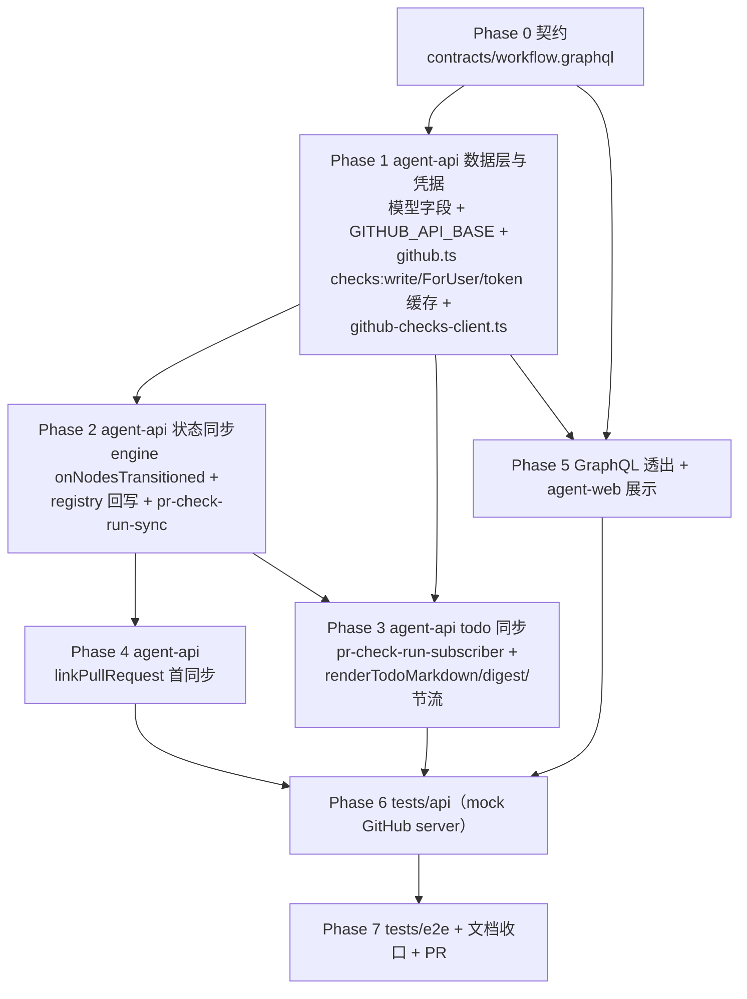
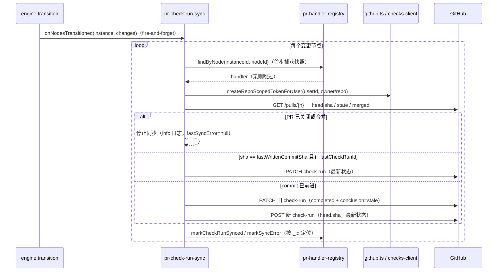

# 工作流节点状态通过 GitHub Check Runs 同步 - 实现计划

**关联 Proposal**: `docs/engineering/proposals/20261025-feat-workflow-check-runs-sync.md`（v1.0）
**关联 PRD**: `docs/product/draft/20261025-workflow-check-runs-sync.md`（v1.0）
**需求总分支（feat-branch）**: `feat/workflow-check-runs-sync`（需求总 PR #285）
**实现分支**: `feat/workflow-check-runs-sync-impl`（基于需求总分支）
**创建日期**: 2026-10-25
**计划版本**: v1.0

**版本说明**：

- v1.0 首版，与 PRD v1.0 / 提案 v1.0 对齐。把提案 §5.2 的四个实现点 + §3.1 契约拆成 8 个 Phase：契约 → 数据模型/凭据/Checks 客户端 → 引擎捕获与状态同步 → todo 订阅同步 → linkPullRequest 首同步 → GraphQL 透出与前端展示 → API 测试 → E2E 与收口。
- 本版给出「上游文档 × 代码现状差异」10 条与「计划期裁决」14 条，收敛提案与现有代码不一致或留白处（GraphQL 无 DateTime scalar、`createRepoScopedTokenForUser`/token 缓存不存在、`api.github.com` 硬编码、apply 级联中途 save、plan 消息 content 为 SessionUpdate 全对象串、E2E 无 mock GitHub server 等）。
- 本计划不改变 PRD 产品口径；对提案做 2 处口径收敛，需在实现 PR 描述中声明：①`WorkflowPullRequestLink.lastSyncAt` 用 `String`（ISO）而非 `DateTime`；②GitHub 出站行为的自动化验证落在 `tests/api`（本地 mock GitHub server），`tests/e2e` 只覆盖前端展示与回归。

## 实现顺序



依赖说明：

- **P0 是唯一事实源**：字段名、可空性与文案全部以 P0 与 PRD 附录 A 为准；契约未定稿前不写业务代码。
- **P1 是前置**：模型字段、token 权限/缓存与 Checks 客户端先落地，P2 / P3 才能并行开工。
- **P2 / P3 可并行**（都依赖 P1）：状态同步与 todo 同步互不依赖，共用 `pr-check-run-sync` 的渲染与回写；P3 的 `syncTodoPanel` 挂进 `pr-check-run-sync.ts`，与 P2 协调落文件（同文件并行时按函数分区合入）。
- **P4 依赖 P2**：首同步复用 `syncNodeStatus` 同一路径。
- **P5 依赖 P0 + P1**（读 handler 新字段），不等 P2/P3/P4。
- **P6 依赖 P2 + P3 + P4**：mock GitHub server 断言首同步 / stale / todo 子项全链路。
- **P7 串行收口**：E2E 与 API 共用 Aspire 服务与 Mongo/Redis，禁止并行执行。

开发模式采用 TDD（红-绿-重构）：每个 Phase 先落失败测试（RED）再写实现（GREEN），最后重构。编码前按目录加载 `docs/engineering/common-rules.md`、`backend-rules.md`、`frontend-rules.md`、`servers/agent-api/AGENTS.md`、`apps/agent-web/AGENTS.md`、`tests/api/AGENTS.md`、`tests/e2e/AGENTS.md`。

### 关键约束（实现期不得回退）

- **零回归**：未绑定 Pull Request 的节点/工作流行为与现状完全一致；既有 PR 联动（review 驱动完成/打回、生命周期注销）不受影响。
- **故障不回流**：check-run 同步链路（`pr-check-run-sync` / `pr-check-run-subscriber`）永不向引擎、会话链路抛出异常；GitHub I/O 不进 `transitionMutex`（fire-and-forget，`.catch` 仅 warn + 记 `lastSyncError`）。
- **只读投影**：节点状态唯一来源是 `workflow/engine.ts` 状态机；GitHub 侧不产生反向驱动语义（既有 review 联动除外）。
- **契约先行**：先改 `contracts/workflow.graphql`，再改 schema/resolver；前端 GraphQL 类型为**手写**（本仓库无 codegen），禁止臆造生成物。
- **凭据零泄露**：installation token 不落库、不进日志、不出现在错误文案与界面；GitHub 响应体不进日志。
- **幂等**：状态同步按「`lastSyncedNodeStatus` + `lastWrittenCommitSha`」跳过重复；todo 同步按 `lastTodoDigest` 跳过重复；重复 hook / 重复消息不产生重复写入。
- **单实例部署假设不变**：token 缓存、todo 节流状态、per-handler `KeyedMutex` 均为进程内（与 `pr-handler-registry.ts` 既有 `registerMutex` 同口径）。
- **禁止 rebase/squash**：遵循 z-git 规范，仅允许 merge。

## 上游文档 × 代码现状差异

| # | 提案口径 | 代码现状 | 收敛方向 |
|---|---------|---------|---------|
| 1 | §3.1 契约示例 `lastSyncAt: DateTime` | `contracts/workflow.graphql:176` 明确「本仓库无 DateTime scalar」，`registeredAt: String!`（ISO） | 契约用 `String`（ISO）（裁决 1） |
| 2 | §2.3/§5.2 `createRepoScopedTokenForUser` + token 缓存 | 均不存在；`services/github.ts:235-246` permissions 无 `checks`，每次调用现签 token（`github.ts:226-248`） | P1 新增 ForUser + 进程内缓存 + `checks: 'write'`（裁决 2/3） |
| 3 | §5.2 实现点 2「最终 save() 后」为唯一落库点 | `apply()` 在 complete/completeRework 级联中会中途 `instance.save()`（`engine.ts:250/296`） | hook 仍在 `transitionUnlocked` 末尾统一触发一次，变更集合以最终落库 diff 为准（裁决 4） |
| 4 | §5.2 实现点 3「`message.content` 为 ACP plan 原始 JSON」 | publisher 发的是 SessionUpdate 全对象串（`acp-session-manager.ts:389-397`），即 `{sessionUpdate:'plan', entries:[…]}`（前端 `PlanCard.tsx` parsePlan 同口径），不是裸 `{entries}` | 解析按 `sessionUpdate === 'plan'` 取 `entries`（裁决 6） |
| 5 | §5.2 实现点 2/3「实例活跃：deletedAt/archivedAt/finishedAt 均空」 | orchestrator 查询只滤 `deletedAt: null`（`orchestrator.ts:83-86`）；完成/归档/删除时 `unregisterByInstance` 已移除登记 | todo 路径收敛为「`deletedAt: null` + 登记在库」（等价，裁决 7） |
| 6 | §8.2 E2E「+ mock GitHub server」 | `tests/e2e` 无 mock GitHub server；GitHub 调用发生在 agent-api 服务端，浏览器层不可拦截；`api.github.com` 在 `github.ts:227/258/289/303/314` 硬编码 | 出站场景收敛到 `tests/api` + 本地 mock GitHub server（`GITHUB_API_BASE`），E2E 只覆盖展示与回归（裁决 2/13） |
| 7 | §5.2 实现点 4 前端只列 `WorkflowNodeTree.tsx` | PR 联动展示有两处：`WorkflowNodeTree.tsx:236-258`（徽标）、`WorkflowContextPanel.tsx:53-88`（详情） | 链接进 NodeTree 徽标区，同步详情进 ContextPanel（裁决 12） |
| 8 | §2.3 未指明 hook 注册位置与触发顺序 | hooks 由 `orchestrator.register()`（`index.ts:73`）与 `prHandlerRegistry.registerPrHandlerLifecycleHooks()`（`index.ts:75`）注册 | 新增 `registerPrCheckRunSyncHooks()` 在 `index.ts` 并列注册；`onNodesTransitioned` 先于 `onWorkflowFinished`（注销）触发（裁决 4/5） |
| 9 | §5.2 实现点 2 幂等条件「状态相同且 sha 未变跳过」 | todo 路径会 PATCH `output.text`（状态不变） | 幂等仅作用于状态同步路径；todo 路径以 `lastTodoDigest` 独立幂等（裁决 7） |
| 10 | §5.2 实现点 4「前端 fragment 字段」 | 本仓库无 codegen：`apps/agent-web/src/graphql/workflow.ts` 手写 TS 类型 + selection，且有 fragment 守卫测试（`graphql/__tests__/workflow.test.ts:12-16`） | P0 契约变更同步手写 schema/resolver/前端类型/selection/守卫测试 |

## 计划期裁决（提案留白 / 含混处的实现口径）

1. **`lastSyncAt` 类型**（差异 1）：契约用 `String`（ISO 字符串），与 `registeredAt` 同口径；resolver 侧统一 `toIso()`。
2. **GitHub API base URL**（差异 2/6）：`servers/agent-api/src/config/index.ts` 新增 `githubApiBaseUrl`（env `GITHUB_API_BASE`，默认 `https://api.github.com`）；`github-checks-client` 与 `createRepoScopedToken`/`createRepoScopedTokenForUser` 统一走该 base，测试指向本地 mock。
3. **token 缓存**：`Map<`${accountId}:${repoFullName}`, { token, expiresAt }>` 进程内缓存，到期前 5 分钟作废；`createRepoScopedToken` 既有调用（`routes/internal-cloud-host.ts:129`）行为不变，仅新增 `checks: 'write'` 权限与缓存（权限扩张与 App 安装授权对齐，提案 §5.2 风险点已接受）。
4. **hook 触发语义**（差异 3/8）：`transitionUnlocked` 在最终 `instance.save()` 之后、`onWorkflowFinished` 之前调用 `hooks.onNodesTransitioned?.(instance, changes)`；引擎侧 `void Promise.resolve(...).catch(console.warn)`（不 await、不进锁）；`changes: { node, event }[]` 为「apply 前状态快照 vs 最终落库状态」的 diff（含级联），`event` 取使该节点落到最终状态的转移事件。
5. **capture-then-execute**：hook 回调首步（首个 `await` 的 GitHub I/O 之前）经 `prHandlerRegistry.findByNode` 捕获 handler 快照（`_id`/`userId`/`pullRequestId`/`lastWrittenCommitSha`/`lastCheckRunId`），后续 GitHub I/O 与 `markCheckRunSynced`/`markSyncError` 全部基于快照（按 `_id` 定位，行已被注销删除时为 no-op）；API 测试断言「末节点 complete 触发注销后仍写入 DONE check-run」。todo 路径则以「登记在库」为条件（注销后不再刷新子项）。
6. **plan 消息解析**（差异 4）：`message.content` 为字符串时 `JSON.parse`，仅接受 `sessionUpdate === 'plan'` 的载荷并取 `entries: {content, status, priority?}[]`（status ∈ `pending|in_progress|completed`）；非法结构丢弃 + `console.warn`；`entries` 上限 100 条、单条 `content` 截断 500 字符（Agent 可控载荷不可信，参考 elicitation 截断口径）。
7. **todo 四条件与幂等**（差异 5/9）：`message.type === 'plan'` → `WorkflowInstance.findOne({ 'nodes.sessionId': sessionId, deletedAt: null })` → `nodes` 按 `sessionId` 命中节点 → `findByNode(instanceId, nodeId)` 命中 → `lastCheckRunId` 非空；四条件全满足才渲染写入；幂等走 `lastTodoDigest`（渲染文本 sha1）。
8. **清单渲染定稿**（PRD 附录 A.3）：

   ```text
   **任务清单**（2/5 完成 · 更新于 HH:mm:ss）
   - [x] 已完成任务
   - 🔄 进行中任务
   - [ ] 等待中任务
   ```

   三态映射：`completed → - [x]`（完成）、`in_progress → - 🔄`（进行中）、`pending → - [ ]`（等待中）；顶部汇总 `n/m 完成`；顺序与 entries 一致；空清单渲染为「（暂无任务）」。digest = sha1(渲染文本)。
9. **节流**：per check-run 最小间隔 3s，尾沿合并（窗口内多次更新只发最后一次）；节流状态进程内 `Map<checkRunId, { lastSentAt, pendingRender, timer }>`，进程重启后由 `lastTodoDigest` 落库兜底幂等（缓存丢失仅多一次 PATCH，可接受）。
10. **check-run 身份与文案**（PRD 附录 A.1/A.2）：`name = ZAG 工作流 · {节点名称}`；`external_id = {workflowInstanceId}:{nodeId}`；`output.title = {节点名称} · {状态文案}`；`output.summary = 工作流：{instance.name} · 阶段：{node.stage} · 同步于 {ISO}`（`instanceNodeSchema` 有 `stage` 字段）；`output.text = 任务清单 markdown`。状态映射全表见 Phase 2。
11. **PR 关闭/合并**（PRD 3.5）：`getPullRequestHead` 返回 `state !== 'open'` 或 `merged === true` 时停止同步——仅 info 日志，不写 `lastSyncError`（`lastSyncError` 置 null），后续 hook 直接短路。
12. **失败文案白名单**（提案 §5.2 实现点 4）：`FORBIDDEN`→「检查项写入权限不足」、`NOT_FOUND`→「仓库或 PR 不可见」、`RATE_LIMITED`→「GitHub 限流，稍后自动重试」、`UPSTREAM`/网络→「GitHub 暂不可用，稍后自动重试」、参数拒（422）→「检查项写入参数被拒」；`lastSyncError` 截断 200 字符，成功时清空；不透出上游原文。
13. **测试口径**（差异 6）：`tests/api` 新增进程内 mock GitHub server（node `http`，记录 create/update/getPulls 调用），API 测试经 env `GITHUB_API_BASE` 指向；`tests/e2e` 只覆盖前端展示与既有回归，不为 E2E 引入代理层。
14. **分支**：实现工作在 `feat/workflow-check-runs-sync-impl`（基于需求总分支切出），完成后 merge 回需求总分支 `feat/workflow-check-runs-sync`（仅 merge，禁止 rebase/squash）。

---

## Phase 0: 契约（Contracts）

### 文件修改

| 文件 | 变更 | 要点 |
|------|------|------|
| `contracts/workflow.graphql` | 改 | `type WorkflowPullRequestLink` 增 4 个可空字段（见下） |

### 契约增量

```graphql
type WorkflowPullRequestLink {
  pullRequestId: String!
  prUrl: String
  nodeId: String!
  nodeName: String
  registeredAt: String!        # ISO 字符串（本仓库无 DateTime scalar）
  # ---- 本期新增：check-run 同步状态（只读投影） ----
  checkRunUrl: String          # 最近写入的 check-run 页面地址
  lastSyncedCommitSha: String  # 上次写入 check-run 的 commit
  lastSyncAt: String           # 最近同步时间（ISO 字符串，与 registeredAt 同口径）
  lastSyncError: String        # 最近同步失败提示（白名单短文案，不含凭据）
}
```

本期**无新增自有 HTTP 端点**（同步方向为 agent-api → GitHub 出站调用）。GitHub Checks REST 消费口径（外部 API，错误收敛依据）：

| 用途 | 方法与路径 | 关键参数 |
|------|-----------|---------|
| 创建 check-run | `POST /repos/{owner}/{repo}/check-runs` | `name`、`head_sha`、`external_id`、`status`（queued/in_progress/completed）、`conclusion`、`started_at`、`completed_at`、`output{title,summary,text}` |
| 更新 check-run | `PATCH /repos/{owner}/{repo}/check-runs/{check_run_id}` | 同上可写子集；stale 收尾 = `status=completed` + `conclusion=stale` |
| 取 PR head | `GET /repos/{owner}/{repo}/pulls/{pull_number}` | 响应取 `head.sha`、`state`、`merged` |

约束：`Accept: application/vnd.github+json`、`X-GitHub-Api-Version: 2026-03-10`、`Authorization: Bearer {installation token}`；HTTP 403/404/422/429 与网络错误统一收敛为 `GitHubChecksError`（code + 白名单短文案，见裁决 12）。

### 验收 checklist

- [ ] `contracts/workflow.graphql` 字段名/可空性与本节逐字一致
- [ ] 字段注释注明 ISO 口径与「只读投影」语义

---

## Phase 1: agent-api — 数据模型 / 配置 / 凭据 / Checks 客户端

### 文件修改

| 文件 | 变更 | 要点 |
|------|------|------|
| `servers/agent-api/src/models/workflow-pr-handler.ts` | 改 | 7 个同步状态字段（见下）；不新增索引 |
| `servers/agent-api/src/config/index.ts` | 改 | `githubApiBaseUrl`（env `GITHUB_API_BASE`，默认 `https://api.github.com`） |
| `servers/agent-api/src/services/github.ts` | 改 | permissions + `checks: 'write'`；`createRepoScopedTokenForUser`；token 进程内缓存；base URL 走 config |
| `servers/agent-api/src/services/workflow/github-checks-client.ts` | 新 | Checks REST 封装 + `GitHubChecksError` |
| `servers/agent-api/src/services/workflow/github-checks-client.test.ts` | 新 | RED 先行 |
| `servers/agent-api/src/services/github.test.ts` | 改 | 扩展 ForUser / 缓存 / 权限断言 |

### 模型定义（落地口径，`workflowprhandlers`）

| 字段 | 类型 | 说明 |
|------|------|------|
| lastWrittenCommitSha | String，默认 null | 上次写入 check-run 的 commit（需求口径「记录上次写入的commit」） |
| lastCheckRunId | Number，默认 null | 当前有效 check-run id（PATCH 目标；非空 = 当前提交曾写入检查项） |
| lastCheckRunUrl | String，默认 null | 最近写入的 check-run 页面地址（GraphQL 透出） |
| lastSyncedNodeStatus | String，默认 null | 最近已同步的节点状态（幂等比对） |
| lastSyncAt | Date，默认 null | 最近同步时间 |
| lastSyncError | String，默认 null | 最近失败短文案（成功时清空；截断 200 字符） |
| lastTodoDigest | String，默认 null | 最近一次 todo 渲染内容的 sha1（内容未变跳过写入） |

不新增索引（查询路径仍是既有 `workflowInstanceId` / `pullRequestIdLower` / `uniq_workflow_pr_handler`）；存量行新字段为 null 等价「从未同步」，下次状态变化自然补齐，**无需迁移脚本**（`migrations/` 不新增）。

### 内部接口（签名）

| 接口 | 签名 | 说明 |
|------|------|------|
| token 供给 | `githubService.createRepoScopedTokenForUser(userId, repoFullName): Promise<{ token, expiresAt }>` | `GitHubAccount.find({ userId })` 逐帐号走既有 installation 命中逻辑（`github.ts:211-223`），首个命中授权 installation 的帐号胜出；全未命中抛 `'repository is not authorized'` |
| token 缓存 | 私有 `Map<`${accountId}:${repoFullName}`, { token, expiresAt }>` | 到期前 5 分钟作废；token 不落库/日志/错误文案 |
| Checks 客户端 | `createCheckRun(token, repo, payload)` / `updateCheckRun(token, repo, checkRunId, payload)` / `getPullRequestHead(token, repo, pullNumber): Promise<{ sha, state, merged }>` | 统一 `fetch` 封装（超时 10s + AbortController）；非 2xx 收敛 `GitHubChecksError(code)`，code ∈ `FORBIDDEN/NOT_FOUND/RATE_LIMITED/UPSTREAM/INVALID_PAYLOAD` |

### 测试（RED 先行）

- `github-checks-client.test.ts`：create/update 载荷与请求头（Accept / X-GitHub-Api-Version / Bearer）；`getPullRequestHead` 取 `head.sha/state/merged`；403/404/422/429/网络错误 → `GitHubChecksError` 对应 code；超时中止；错误文案不含 token 与响应体；base URL 走 `config.githubApiBaseUrl`（mock fetch 断言 URL 前缀）。
- `github.test.ts` 扩展：permissions 包含 `checks: 'write'`；`createRepoScopedTokenForUser` 多帐号命中/全未命中；缓存命中不重复签发、到期前 5 分钟作废后重签。

### 实现要点

- `createRepoScopedToken` 内部抽出 `mintRepoToken(account, installation, repoFullName)`，两条入口（accountId / userId）复用，权限集单一事实源。
- `GitHubChecksError` 仅携带 `code` 与英文短句；对用户可见文案由 `pr-check-run-sync` 按裁决 12 白名单映射。
- 响应体一律不进日志；错误日志只记 code + 路径 + check-run id。

### 验收 checklist

- [ ] 模型字段与上表逐字一致；无迁移脚本
- [ ] `createRepoScopedToken` 既有调用行为不回归（`internal-cloud-host` 云主机凭据端点测试全绿）
- [ ] token 全程不落库/日志/错误文案（grep 审查 + 测试断言）
- [ ] Checks 客户端错误收敛 code 齐全，超时可控

---

## Phase 2: agent-api — 引擎变更捕获与节点状态同步

### 文件修改

| 文件 | 变更 | 要点 |
|------|------|------|
| `servers/agent-api/src/services/workflow/engine.ts` | 改 | `EngineHooks` 增 `onNodesTransitioned`；`transitionUnlocked` 快照 diff |
| `servers/agent-api/src/services/workflow/engine.test.ts` | 改 | 变更集合断言（含级联） |
| `servers/agent-api/src/services/workflow/pr-handler-registry.ts` | 改 | `findByNode` / `markCheckRunSynced` / `markSyncError` |
| `servers/agent-api/src/services/workflow/pr-handler-registry.test.ts` | 改 | 新方法断言 |
| `servers/agent-api/src/services/workflow/pr-check-run-sync.ts` | 新 | 状态映射 + stale 编排 + 同步编排 |
| `servers/agent-api/src/services/workflow/pr-check-run-sync.test.ts` | 新 | RED 先行 |
| `servers/agent-api/src/index.ts` | 改 | `registerPrCheckRunSyncHooks()` 注册（与 `prHandlerRegistry.registerPrHandlerLifecycleHooks()` 并列，`index.ts:75` 附近） |

### 引擎 hook（落地口径）

```ts
export interface EngineHooks {
  // …既有 6 个 hook 不变…
  /** 一次 transition（含级联）最终 save() 后调用一次；实现方不得阻塞，不得抛出 */
  onNodesTransitioned?(
    instance: WorkflowInstanceDoc,
    changes: { node: WorkflowNodeDoc; event: WorkflowEvent }[],
  ): Promise<void> | void;
}
```

- `transitionUnlocked`（`engine.ts:178-210`）：`apply()` 前快照 `Map<nodeId, status>`；最终 `instance.save()`（:205）后 diff 出状态变化节点（含级联：complete 触发的下游 start/resume、reject 触发的上游 rework、FLAG 直通 DONE 的下游 start），组装 `changes`（`event` 取使该节点落到最终状态的转移事件，级联节点用其级联事件），调用 `hooks.onNodesTransitioned`（**不 await**，`void … .catch(console.warn)`），**先于** `hooks.onWorkflowFinished`（注销）触发。
- `apply()` 级联中途 save（`engine.ts:250/296`）不动；diff 以最终落库状态为准（差异 3 / 裁决 4）。

### 状态映射纯函数（PRD 附录 A.2 逐字）

`mapNodeStatusToCheckRun(status: WorkflowNodeStatus): { status: 'queued'|'in_progress'|'completed'; conclusion?: string; label: string }`

| 节点状态 | check status | conclusion | 状态文案（label） |
|------|------|------|------|
| INITIALIZING / READY | `queued` | — | 排队中 |
| RUNNING | `in_progress` | — | 执行中 |
| REWORK | `in_progress` | — | 返工中 |
| DONE | `completed` | `success` | 已完成 |
| REJECT | `completed` | `action_required` | 被打回，待处理 |
| FAILED | `completed` | `failure` | 执行失败 |
| —（旧提交上的检查项） | `completed` | `stale` | 已过期：PR 已有新提交 |

### 同步编排（`pr-check-run-sync.syncNodeStatus`）



- 幂等：`lastSyncedNodeStatus === 当前状态 && sha === lastWrittenCommitSha` 时跳过（状态同步路径专用）。
- capture-then-execute（裁决 5）；per-handler `KeyedMutex` 串行（复用 `services/keyed-mutex.ts`，key = handler `_id`），避免状态同步与 todo 同步交错写同一 check-run。
- 全函数 try/catch 收口，**永不抛出**；失败记 `markSyncError`（白名单文案）+ `console.warn`。

### 内部接口（签名）

| 接口 | 签名 |
|------|------|
| 按节点查登记 | `prHandlerRegistry.findByNode(workflowInstanceId, nodeId): Promise<HandlerDoc \| null>` |
| 同步回写 | `prHandlerRegistry.markCheckRunSynced(id, { commitSha, checkRunId, checkRunUrl, nodeStatus, at })` / `markSyncError(id, message)` |
| 状态同步 | `prCheckRunSync.syncNodeStatus(instance, node): Promise<void>`（永不抛出） |
| hook 注册 | `prCheckRunSync.registerPrCheckRunSyncHooks(): void` |

### 测试（RED 先行）

- `engine.test.ts` 回填：`onNodesTransitioned` 在 9 个事件（start/complete/reject/rework/completeRework/resume/fail/resumeFailed/restart）各触发一次且 `changes` 正确；complete 级联下游 start、reject 级联上游 rework、FLAG 直通 DONE 级联均进 `changes`；hook 抛错不影响 `transition` 返回值。
- `pr-check-run-sync.test.ts`（mock fetch + mock registry）：映射全表 7 行；同 sha PATCH；新 sha stale+create；无旧 id 直接 create；幂等跳过；PR 关闭/合并短路；403/404/网络失败记 `markSyncError` 不抛出；capture-then-execute（执行中登记被删仍完成写入）。
- `pr-handler-registry.test.ts` 扩展：`findByNode` 命中/未命中；`markCheckRunSynced` 逐字段回写；`markSyncError` 截断 200；成功回写清空 `lastSyncError`。

### 实现要点

- 变更集合以最终落库 diff 生成，`changes` 元素的 `node` 指向 `instance.nodes` 内同一子文档引用（保证读到最终状态）。
- `markCheckRunSynced` 成功路径同时写 `lastSyncError: null`。
- `output.title/summary/text` 组装按裁决 10。

### 验收 checklist

- [ ] 9 事件 × 级联的变更集合断言全绿
- [ ] stale 编排三分支（同 sha / 新 sha / 无旧 id）测试全绿
- [ ] 同步失败不影响 `transition` 返回与工作流流转
- [ ] hook 触发顺序：`onNodesTransitioned` 先于 `onWorkflowFinished`（API 测试覆盖）

---

## Phase 3: agent-api — todo panel 中央订阅与子项同步

### 文件修改

| 文件 | 变更 | 要点 |
|------|------|------|
| `servers/agent-api/src/services/workflow/pr-check-run-subscriber.ts` | 新 | `session:message` 中央订阅 + 四条件判定 |
| `servers/agent-api/src/services/workflow/pr-check-run-subscriber.test.ts` | 新 | RED 先行 |
| `servers/agent-api/src/services/workflow/pr-check-run-sync.ts` | 改 | `renderTodoMarkdown` / `syncTodoPanel` / digest / 节流 |
| `servers/agent-api/src/services/workflow/pr-check-run-sync.test.ts` | 改 | 渲染/节流/幂等用例 |
| `servers/agent-api/src/index.ts` | 改 | 启动注册（与 `sessionLifecycleSubscriber.start()` 并列，`index.ts:130` 附近） |

### 订阅器（落地口径）

- `start()`：`getRedisClient().duplicate()` → `subscribe('session:message')`（与 `session-sse.ts:66-82` 同口径）；`on('message')` 载荷 `{ sessionId, message }`，`message.type === 'plan'` 才处理（先类型过滤再查库，订阅器必须轻量）。
- 解析（裁决 6）：`message.content` 为字符串时 `JSON.parse`，仅接受 `sessionUpdate === 'plan'` 的载荷取 `entries`；`entries` 上限 100、单条 `content` 截断 500 字符；非法结构丢弃 + warn。
- 四条件判定（PRD 功能点 2）：

  ```mermaid
  flowchart TD
      M[Redis session:message] --> F{message.type == 'plan'?}
      F -->|否| X[忽略]
      F -->|是| P[解析 SessionUpdate.entries]
      P --> C1{WorkflowInstance 命中 nodes.sessionId<br/>且 deletedAt 为空?}
      C1 -->|否| X
      C1 -->|是| C2{findByNode 命中 handler?}
      C2 -->|否| X
      C2 -->|是| C3{handler.lastCheckRunId 非空?}
      C3 -->|否| X
      C3 -->|是| U[syncTodoPanel：渲染 → digest → 节流 → PATCH output.text]
  ```

- 渲染 `renderTodoMarkdown(entries)` 按裁决 8 定稿；digest = sha1(渲染文本)；与 `lastTodoDigest` 相同则跳过。
- 节流（裁决 9）：per check-run 3s 最小间隔 + 尾沿合并；到点后取 `pendingRender` 最新值 PATCH，回写 `lastTodoDigest`（按 handler `_id`）。
- 全链路 try/catch 收口，**永不抛出**；非工作流会话 / 未绑定 / 未写入过 check-run 的路径零写入、零查库放大（`type` 过滤前置）。

### 测试（RED 先行）

- `pr-check-run-subscriber.test.ts`（mock redis duplicate + mock sync 服务）：`type='plan'` 过滤；四条件各一条「不满足即零写入」；非法载荷丢弃；entries 截断/上限；`start()` 可重复调用不重复订阅。
- `pr-check-run-sync.test.ts` 扩展：`renderTodoMarkdown` 三态/汇总/空清单/截断；digest 去重；3s 尾沿合并（窗口内 3 次更新只发最后 1 次）；PATCH 失败记 `markSyncError` 不抛出。

### 实现要点

- 查库路径走 `nodes.sessionId`（与 `orchestrator.handleSessionIdled` 同口径，`orchestrator.ts:83-86`），但**不复用**其状态过滤（todo 同步不需要节点处于 RUNNING/REWORK）。
- `syncTodoPanel(sessionId, entries)` 放 `pr-check-run-sync.ts`，与 `syncNodeStatus` 共用 per-handler `KeyedMutex` 与回写方法。

### 验收 checklist

- [ ] 四条件判定逐条有「零写入」用例
- [ ] 渲染格式与 PRD 附录 A.3 逐字一致（含汇总行与三态标记）
- [ ] 高频更新合并节流生效，内容未变不重复写入
- [ ] 非工作流会话零查库放大（type 过滤前置）

---

## Phase 4: agent-api — `linkPullRequest` 注册后首同步

### 文件修改

| 文件 | 变更 | 要点 |
|------|------|------|
| `servers/agent-api/src/services/workflow/tool-handlers.ts` | 改 | `case 'linkPullRequest'`（:351-404）注册成功后 fire-and-forget 首同步 |
| `servers/agent-api/src/services/workflow/tool-handlers.test.ts` | 改 | 首同步触发断言 |

### 实现要点

- `prHandlerRegistry.register(...)` 返回后立即 `void prCheckRunSync.syncNodeStatus(instance, node).catch(console.warn)`（节点当前状态 → PR 最新提交 check-run），保证 PRD「绑定即同步」。
- 首同步失败不影响工具返回（`{registered: true, …}` 口径不变）；失败仅记 `lastSyncError`。
- 作用域校验（`workflowId`/`nodeId` 与 scope 一致）、实例状态校验（deleted/archived/finished 拒绝）等既有分支（`tool-handlers.ts:358-387`）不动。

### 测试（RED 先行）

- `tool-handlers.test.ts` 扩展：注册成功 → `syncNodeStatus` 被以 (instance, node) 调用一次；同步抛错 → 工具仍返回 `registered: true`；既有校验分支回归全绿。

### 验收 checklist

- [ ] 绑定即出现 check-run（API 测试断言 mock GitHub 收到 create）
- [ ] 首同步失败不影响工具结果
- [ ] linkPullRequest 既有校验与返回结构零回归

---

## Phase 5: GraphQL 透出与 agent-web 只读展示

### 文件修改

| 文件 | 变更 | 要点 |
|------|------|------|
| `servers/agent-api/src/graphql/schemas/workflow.ts` | 改 | `WorkflowPullRequestLink`（:151-158）增 4 字段 |
| `servers/agent-api/src/graphql/resolvers/workflow.ts` | 改 | `pullRequestLinks` 映射（:377-392）扩 4 字段 |
| `servers/agent-api/src/graphql/resolvers/index.ts` | 确认 | `WorkflowInstance` 类型级 resolver 已登记（:65-67），无需改 |
| `apps/agent-web/src/graphql/workflow.ts` | 改 | `WorkflowPullRequestLinkData`（:119-125）+ `GET_WORKFLOW_INSTANCE` selection（:395-401） |
| `apps/agent-web/src/graphql/__tests__/workflow.test.ts` | 改 | fragment 守卫同步 |
| `apps/agent-web/src/components/workflow/WorkflowNodeTree.tsx` | 改 | PR 徽标旁加「检查项」链接（`checkRunUrl`） |
| `apps/agent-web/src/components/workflow/WorkflowContextPanel.tsx` | 改 | 详情区展示最近同步时间 / 写入 commit / 失败提示 |

### 实现要点

- resolver 直接从 `prHandlerRegistry.listByInstance` 行映射（`lastSyncAt` 经 `toIso()` 转 ISO 字符串），不额外查库；`checkRunUrl`/`lastSyncedCommitSha`/`lastSyncError` 为 null 时前端不渲染对应元素（未同步 = 现状观感）。
- 前端分工（裁决 12）：`WorkflowNodeTree.tsx:236-258` 徽标区仅加「检查项」外链（title 带 `lastSyncedCommitSha` 短 sha）；`WorkflowContextPanel.tsx:53-88`「关联 Pull Request」详情区加「检查项：链接 · 最近同步：{ISO} · 写入提交：{短 sha}」，`lastSyncError` 以红色 tooltip/副行展示（纯只读，无新交互）。
- 失败文案直接展示白名单短文案（服务端已收敛），前端不再二次加工。

### 测试（RED 先行）

- `tests/api`（并入 Phase 6 用例）：`pullRequestLinks` 新 4 字段透出断言。
- 前端：fragment 守卫测试更新；`WorkflowNodeTree`/`WorkflowContextPanel` 组件测试覆盖「未同步不渲染」「同步信息渲染」「失败提示渲染」。

### 验收 checklist

- [ ] 契约 / schema / resolver / 前端类型 / selection 五处字段一致
- [ ] 未同步的既有 PR 联动展示零变化
- [ ] `npm run build` 类型检查通过

---

## Phase 6: tests/api（黑盒 GraphQL + mock GitHub server）

### 文件修改

| 文件 | 变更 | 要点 |
|------|------|------|
| `tests/api/src/mock-github-server.ts` | 新 | 进程内 mock GitHub（记录 create/update/getPulls 调用；可注入状态码） |
| `tests/api/src/agent-api/workflow-check-runs.test.ts` | 新 | 用例清单 `T-CR*` |
| `tests/api/AGENTS.md` | 改 | 用例表登记 |

### mock GitHub server（落地口径）

- node `http` 起本地端口，实现 `POST /repos/:owner/:repo/check-runs`、`PATCH …/check-runs/:id`、`GET …/pulls/:n` 三条路由；维护内存 check-run 列表与可变 `head.sha`/`state`/`merged`；支持按次注入 403/404/429/500 与延迟。
- agent-api 以 `GITHUB_API_BASE=http://127.0.0.1:{port}` 指向（裁决 2）；token 签发同样走该 base（mock 一并实现 `POST /app/installations/:id/access_tokens` 返回假 token）。

### 用例清单（`T-CR*`，文件内唯一）

| 用例 | 断言 |
|------|------|
| T-CR01 绑定即首同步 | `linkPullRequest` 后 mock GitHub 收到 create（name=`ZAG 工作流 · {节点名}`、external_id、head_sha=当前 head） |
| T-CR02 状态变化同 sha | complete → 同一 check-run 被 PATCH（status=completed、conclusion=success），无 create |
| T-CR03 commit 前进 | 推进 mock head.sha 后状态变化 → 旧 check-run PATCH(conclusion=stale) + 新 sha create；handler `lastWrittenCommitSha` 更新 |
| T-CR04 幂等 | 同状态同 sha 重复触发 → 零 GitHub 调用 |
| T-CR05 级联状态 | complete 级联下游 start：下游 check-run `in_progress`；reject 级联上游 rework：上游 `in_progress`（返工中） |
| T-CR06 todo 四条件 | plan 消息满足四条件 → `output.text` 刷新；缺任一条件（非工作流会话/未绑定/无 check-run）零写入 |
| T-CR07 todo 节流与去重 | 3s 窗口内 3 次 plan → 仅 1 次 PATCH；内容相同 → 零 PATCH |
| T-CR08 故障不回流 | mock 注入 403 → `lastSyncError=「检查项写入权限不足」`、实例详情透出、节点仍正常 complete |
| T-CR09 PR 关闭停止同步 | mock `state=closed` → 后续状态变化零写入、`lastSyncError=null` |
| T-CR10 注销竞态 | 末节点 complete（触发 `unregisterByInstance`）仍写入 DONE check-run（capture-then-execute）；归档后 todo 消息零写入 |
| T-CR11 GraphQL 透出 | `pullRequestLinks` 新 4 字段（含 ISO `lastSyncAt`）正确透出 |
| T-CR12 存量兼容 | 存量 handler 行（新字段 null）绑定后首次状态变化自然补齐，无迁移 |

### 实现要点

- 沿用 `workflow-pr-callback.test.ts` 的 fake controller（Socket.IO 自动应答 `acp:start`/`acp:resume`、捕获节点 scope token）与 `EVENT_CALLBACK_TOKEN` 环境变量口径。
- plan 消息注入：测试直接向 Redis `session:message` 频道 publish 与 `acp-session-manager.ts:389-397` 同构的载荷。
- `vitest.config.ts` `fileParallelism: false` 保持不变。

### 验收 checklist

- [ ] 12 条 `T-CR*` 全绿
- [ ] mock GitHub 断言覆盖 create/PATCH/stale 三类调用与请求头
- [ ] 403/404/429 三类失败文案与白名单一致

---

## Phase 7: tests/e2e 与收口

### 文件修改

| 文件 | 变更 | 要点 |
|------|------|------|
| `tests/e2e/src/workflow.spec.ts` | 改 | 新增 `E2E-CR*` 展示用例（或新建 `workflow-check-runs.spec.ts`） |
| `tests/e2e/AGENTS.md` | 改 | 用例表登记 |
| `docs/engineering/AGENTS.md` | 改 | plan 索引登记（本文件） |

### E2E 场景（按顺序）

| 用例 | 场景 |
|------|------|
| E2E-CR1 | 实例详情：绑定 PR 的节点显示「检查项」链接与最近同步信息（GraphQL mock 或真实服务数据） |
| E2E-CR2 | 同步失败提示展示（`lastSyncError` tooltip/副行），不影响页面其它操作 |
| E2E-CR3 | 回归：未绑定 PR 的工作流实例详情与既有 PR 联动展示零变化（对照 E2E-1..3 / E2E-31 口径） |

> 出站行为（create/stale/todo PATCH）的自动化验证在 Phase 6（`tests/api` + mock GitHub server）完成；E2E 不引入 GitHub 代理层（裁决 13）。

### 收口动作

- [ ] `docs/engineering/AGENTS.md` 实现计划索引补本文件
- [ ] `tests/api/AGENTS.md` / `tests/e2e/AGENTS.md` 用例表补 `T-CR*` / `E2E-CR*`
- [ ] 实现 PR 描述声明 2 项口径收敛（`lastSyncAt: String`；E2E 范围调整）
- [ ] 实现分支 merge 回需求总分支 `feat/workflow-check-runs-sync`（仅 merge）

### 验收 checklist

- [ ] 3 条 `E2E-CR*` 通过（或缺环境时明确跳过并记录原因）
- [ ] 回归：未绑定 PR 工作流、既有 PR 联动（review 驱动）全绿
- [ ] 文档索引与两份测试 AGENTS 用例表更新

---

## 命令参考

```bash
# 服务编排（默认方式）
aspire start
aspire describe                     # 查看 agent-api / agent-web / controller-api endpoint

# 后端单测（co-located *.test.ts）
cd servers/agent-api && npm test
cd servers/agent-api && npx vitest run src/services/workflow

# 前端组件测试
cd apps/agent-web && npm test -- --run
cd apps/agent-web && npm run build   # 类型检查 + 构建

# API 测试（需 Aspire 服务与 Mongo/Redis 就绪）
cd tests/api && npm test
cd tests/api && npx vitest run src/agent-api/workflow-check-runs.test.ts

# E2E（workers=1，禁止并行）
cd tests/e2e && npm test -- --grep "E2E-CR"

# 分支
git checkout feat/workflow-check-runs-sync
git checkout -b feat/workflow-check-runs-sync-impl
```

---

## 总体验收 checklist

- [ ] Phase 0 契约逐字落地，五处字段（契约/schema/resolver/前端类型/selection）一致
- [ ] 绑定 PR 即出现 check-run；状态变化秒级同步（PRD 1.3）
- [ ] commit 前进：旧 check-run=stale、新 commit 上为最新、handler 记录上次写入 commit
- [ ] todo panel 满足四条件时子项刷新（完成/进行中/等待中 + 汇总行），digest/节流生效
- [ ] 同步失败仅记 `lastSyncError` 并可见于实例详情，工作流流转零影响（T-CR08）
- [ ] 未绑定 PR 的工作流零回归；既有 PR review 联动零回归
- [ ] PR 关闭/合并停止同步；工作流完成/归档/删除后不再同步（末态 check-run 保持）
- [ ] 凭据零泄露（token 不落库/日志/错误；响应体不进日志）
- [ ] 单元测试覆盖率 ≥ 80%；`T-CR*`（12）与 `E2E-CR*`（3）全绿
- [ ] 文档索引与测试 AGENTS 用例表更新；实现 PR 声明 2 项口径收敛

## 相关文档

- 产品需求：`docs/product/draft/20261025-workflow-check-runs-sync.md`
- 技术提案：`docs/engineering/proposals/20261025-feat-workflow-check-runs-sync.md`
- 契约：`contracts/workflow.graphql`
- 规范：`docs/engineering/common-rules.md`、`docs/engineering/backend-rules.md`、`docs/engineering/frontend-rules.md`、`docs/engineering/plan/AGENTS.md`
- 既有计划：`docs/engineering/plan/20261023-feat-workflow-github-pr-callback.md`（PR 联动，本期强依赖）
- GitHub Checks API：<https://docs.github.com/en/rest/checks/runs?apiVersion=2026-03-10>
