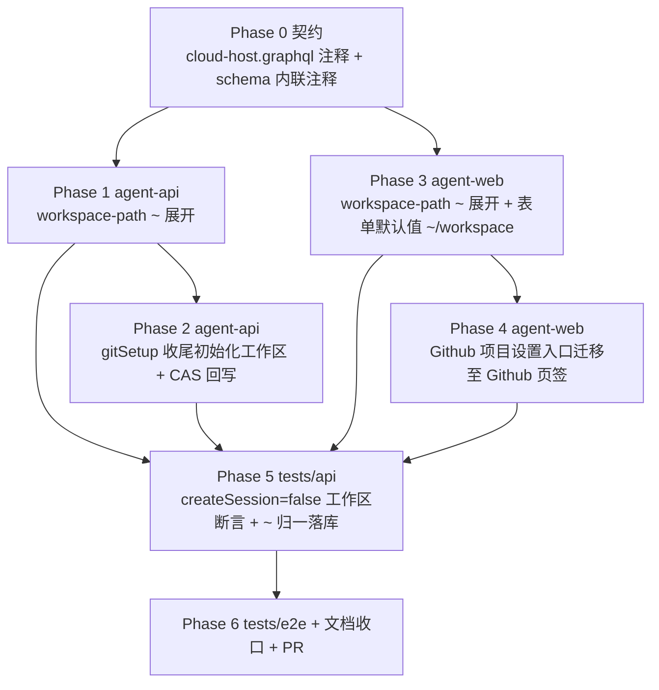

# 默认工作区优化 - 实现计划

**关联 Proposal**: `docs/engineering/proposals/20261026-fix-default-workspace-optimization.md`（v1.0）
**关联 PRD**: `docs/product/draft/20261026-default-workspace-optimization.md`（v1.0）
**需求总分支（feat-branch）**: `feat/default-workspace-optimization`（需求总 PR #305）
**实现分支**: `feat/default-workspace-optimization-impl`（基于需求总分支）
**创建日期**: 2026-10-26
**计划版本**: v1.0

**上游评审结论（PR #305）**：Deliay 于 2026-10-26T11:34:49Z APPROVED 产品文档与技术提案，评审无正文、无 inline comment、无修改要求，按原计划推进本实现计划。若后续复审提出修改，在对应 Phase 中落实并回评。

**版本说明**：

- v1.0 首版：与 PRD v1.0 / 提案 v1.0 对齐，把提案 §5.2 的 3 个实现点拆成 7 个 Phase；给出「上游文档 × 代码现状差异」6 条与「计划期裁决」8 条，收敛提案留白但会阻塞实现的口径（`~` 展开常量与非法形态、错误文案逐字、预填规则推翻二期空值口径、旧断言基线更新清单）。
- 不改变 PRD 产品口径；不新增/删除契约字段（仅注释修订），实现 PR 描述中声明「`~` 支持为纯增量、存量绝对路径行为不变」。

## 实现顺序



依赖说明：

- **P0 是口径基准**：契约只改注释不改字段，但 `targetPath` / `createSession` / `hasDefaultWorkspace` 三条注释是 P1~P4 行为的书面依据，先落契约再写代码。
- **P1 → P2**：`runGitSetupStep` 收尾的 `ensureWorkspace(targetPath)` 依赖 `normalizeWorkspacePrefix` 已支持 `~`（否则默认值 `~/workspace` 直接被服务端拒绝）。
- **P3 → P4**：入口迁移的测试需断言新预填默认值，先落表单默认值再迁入口，避免一次性大改导致 RED 无法定位。
- **P5 依赖 P1~P4**：API 集成断言覆盖契约点；**P6 依赖 P5 与全部前端 Phase**，E2E 串行执行。

开发模式采用 TDD（红-绿-重构）：每个 Phase 先落失败测试（RED）再写实现（GREEN），最后重构。编码前按目录加载 `docs/engineering/common-rules.md`、`backend-rules.md`、`frontend-rules.md`、`servers/agent-api/AGENTS.md`、`apps/agent-web/AGENTS.md`、`tests/api/AGENTS.md`、`tests/e2e/AGENTS.md`。

### 关键约束（实现期不得回退）

- **策略不变**：不改变「创建期不预置默认工作区」（`CloudHost.workspaceId` 创建期恒 `null`）；不改变多 Harness「不自动创建会话」；设置进度对话框保持三步（workload / gitSetup / session），不新增步骤 key。
- **契约零字段变更**：`contracts/cloud-host.graphql` 仅注释修订；`hasDefaultWorkspace` 语义随行为更新注释，但字段类型/可空性不动。
- **`~` 双端同规则**：展开目标固定 `/root`（与 `packages/agent-controller/src/cloud-host/supervisor.ts` 的 `DEFAULT_WORKSPACE = '/root/workspace'`、`ZAG_DEFAULT_WORKSPACE` 同源约定）；服务端权威展开，前端仅同规则预览；`~` 仅允许出现在首字符，禁止路径逃逸（`..` 拒绝规则不变）。
- **落库一律绝对路径**：operation.targetPath / binding.targetPath / 脚本参数 / `ensureWorkspace` 路径均为展开后的绝对路径，旧绑定记录保持原值。
- **工作区初始化幂等**：`ensureWorkspace` 为幂等 upsert 且不触发 10 个工作区上限；`CloudHost.workspaceId` 回写为 CAS（`{_id, workspaceId: null}`），不覆盖既有绑定（沿用 U-1 不变量）。
- **旧断言基线更新是预期变更**：下表「基线更新清单」中的断言随 PRD 行为调整同步改写，不视为回归；除此之外既有用例必须零失败。
- **禁止 rebase/squash**：遵循 z-git 规范，仅允许 merge。

### 代码探查关键事实（实现时以现状为准）

- `CloudHostGithubService.runGitSetupStep`（`servers/agent-api/src/services/cloud-host-github-service.ts`）clone 轮询成功后直接 `updateStep('gitSetup', SUCCEEDED)`，**不含** `ensureWorkspace`；`ensureWorkspace` + `CloudHost.updateOne({_id, workspaceId: null}, ...)` CAS 回写只存在于 `runSessionStep`——多 Harness（`createSession=false`）时 session 步骤初始即 `SKIPPED`，`run()` 直接把 operation 置 `SUCCEEDED`，`runSessionStep` 永不执行，这正是 Issue #304-1 的根因。
- `runSessionStep` 内 U-1 注释（「workspaceId 与 createSession 成败无关」）与 D2 `defaultSessionId` CAS 回写逻辑正确，初始化前移后仍保留为兜底，会话创建逻辑不动。
- `retry()` 将 FAILED 及其后续步骤重置 `PENDING`（保留 SUCCEEDED/SKIPPED），`GITHUB_SETUP_SCRIPT` 对已存在目录 `git pull --ff-only`，clone 侧已幂等；`ensureWorkspace` 亦幂等 upsert，重试不产生重复工作区。
- `servers/agent-api/src/services/workspace-path.ts`：`PREFIX_ERRORS.notAbsolute = '前缀地址必须是绝对路径'`，`normalizeWorkspacePrefix` 只接受 `/` 开头；`resolveClonePath` 用 `path.posix.join(prefix, owner/repo)`。该函数同时被 `services/workflow/issues-event-handler.ts` 复用（Issues 联动 clone 路径），`~` 支持会自然生效，需回归其既有用例。
- `apps/agent-web/src/lib/workspace-path.ts`：`normalizeWorkspacePrefixForPreview` / `previewClonePath` / `workspacePrefixError`（前端文案「前缀地址必须以 / 开头」），纯展示、容错返回 `null`，与服务端同序校验。
- `apps/agent-web/src/hooks/useGithubProjectForm.ts:125`：`setTargetPathState(hasDefaultWorkspace === false ? '' : (defaultWorkspace ?? '/root/workspace'))`——「无工作区不预填」是云容器优化二期的裁决口径，**被 PRD v1.0 推翻**（改预填 `~/workspace`）；新建云电脑流程（未传 `hasDefaultWorkspace`）当前兜底 `/root/workspace`。
- 提交报文：`GithubProjectSetupDialog` / `NewCloudHostDialog` 均提交 `targetPath: form.normalizedPrefix`（归一后的**前缀**，非最终目录），服务端 `createOperation` 再 `resolveClonePath` 权威拼接——`~` 展开后 `normalizedPrefix` 为绝对路径，此契约不变。
- `apps/agent-web/src/pages/ControllerConfigPage.tsx`：`workloadsSection` 顶部持有「Github 项目设置」按钮（`aria-label="Github 项目设置"`，禁用条件 `status !== 'RUNNING' || deletedAt`）；`githubSection` 直接渲染 `CloudHostIssuesLinkageSection`；桌面/移动两套布局共用这两个 section，`dialogs` 中 `GithubProjectSetupDialog` 挂载点不变。
- placeholder 现状不一致：`GithubProjectSetupDialog.tsx:265` 为「例如：/workspace」，`NewCloudHostDialog.tsx:463` 为「/root/workspace」，需统一为 `~/workspace`。
- `servers/agent-api/src/graphql/schemas/cloud-host.ts` 内联注释与 `contracts/cloud-host.graphql` 逐条对应；`hasDefaultWorkspace` 注释当前写「多 Harness（createSession=false）不执行会话步骤，workspaceId 保持 null」，新语义下不再成立，必须同步。
- `apps/agent-web/src/graphql/types.ts` 为手写类型（无 codegen）；本次无字段增删，仅注释/文档同步，不动类型文件。

## 上游文档 × 代码现状差异

| # | 上游表述 | 代码现状（证据） | 本计划处置 |
|---|----------|------------------|------------|
| D1 | PRD 功能点 3：无默认工作区时前缀预填 `~/workspace` | 云容器优化二期裁决为「无工作区不预填（空值 + placeholder）」，`useGithubProjectForm.ts:125` 与 3 处测试断言固化该行为 | 以 PRD v1.0 为准推翻空值口径；预填 `~/workspace`、placeholder 统一 `~/workspace`（裁决 3）；旧断言列入基线更新清单 |
| D2 | 提案 §5.2 实现点 3：服务端 `PREFIX_ERRORS.notAbsolute`「同步」前端新文案 | 服务端文案为「前缀地址必须是绝对路径」，前端为「前缀地址必须以 / 开头」，两者本就不同 | 双端统一为「前缀地址必须以 / 或 ~ 开头」（裁决 2），`workspace-path.test.ts` 既有 `toThrow` 断言随文案更新 |
| D3 | 提案 §5.2 实现点 3：`~` 展开为 `/root`，`~` 仅首字符 | 两端 `workspace-path` 均只接受 `/` 开头，未定义 `~abc`、`~` 单独、`/a/~` 的形态归属 | 裁决 1 给出完整展开/拒绝矩阵（含 `~abc` 拒绝），双端逐条实现并以同一组用例命名对齐 |
| D4 | 提案 §5.2 实现点 2：按钮置于 `CloudHostIssuesLinkageSection` 之上 | `githubSection` 当前为单组件表达式，无容器；按钮在 `workloadsSection` 的 flex 行内与说明文案并排 | `githubSection` 改为 `space-y-4` 容器：顶部按钮行（含可用条件与禁用提示）+ `CloudHostIssuesLinkageSection`；`workloadsSection` 移除按钮后说明文案独占一行（裁决 6） |
| D5 | 提案 §8 测试策略：新增用例为主 | 多处既有断言固化旧默认值/旧入口位置，新行为会使其失败 | 列出「基线更新清单」，RED 阶段区分「预期变更」与「真实回归」（裁决 7） |
| D6 | 提案 §3.1：`hasDefaultWorkspace` 注释「与 createSession 开关无关」 | 现契约注释写「多 Harness（createSession=false）workspaceId 保持 null」，与新行为矛盾 | Phase 0 一并修订契约与 `graphql/schemas/cloud-host.ts` 内联注释，避免文档与实现漂移 |

## 计划期裁决（提案留白 / 含混处的实现口径）

1. **`~` 展开矩阵（双端逐字一致）**：展开常量 `CONTAINER_HOME = '/root'`（`servers/agent-api/src/services/workspace-path.ts` 导出，前端 `apps/agent-web/src/lib/workspace-path.ts` 同值常量并注释「与服务端同源」）。规则：
   - `~` → `/root`；`~/` → `/root`；`~/workspace` → `/root/workspace`；`~/workspace/` → `/root/workspace`（去尾斜杠）；`~//a` → `/root/a`。
   - 仅首字符 `~` 触发展开；`/a/~`、`/a/~/b` 按普通分段处理（不展开、不拒绝）；`~abc`、`~x/y` 非法（走 `notAbsolute` 报错）。
   - 展开后继续走既有规则：非法字符（`\0`/反斜杠）→ `..` 段拒绝 → `path.posix.normalize` 归一；校验顺序保持「空 → 非法字符 → 起始字符 → `..`」不变（`/a/~` 含 `..` 仍拒绝）。
   - 安全性：展开仅是字符串前缀替换，不访问文件系统，不接受 `~user`，不可能逃逸出 `/root` 之外（`..` 拒绝前置），满足 PRD 4.2。
2. **错误文案逐字**：`PREFIX_ERRORS.notAbsolute` 改为 `前缀地址必须以 / 或 ~ 开头`；前端 `workspacePrefixError` 的「前缀地址必须以 / 开头」同步为同一文案。其余文案（空/非法字符/`..`/仓库格式）不动。
3. **前缀默认值规则**：`hasDefaultWorkspace === true` → 预填 `defaultWorkspace`（`String!`，服务端已回退）；`false` 或未传（新建云电脑流程）→ 预填 `~/workspace`。两处 placeholder 统一 `~/workspace`。`CloudHost.defaultWorkspace` 契约与 resolver 不改。
4. **工作区初始化落点**：`runGitSetupStep` 在 `pollBatch` 成功后、`gitSetup` 标记 `SUCCEEDED` 前执行 `ensureWorkspace(controllerId, userId, targetPath)` + `CloudHost.updateOne({_id, workspaceId: null}, {$set: {workspaceId}})`（失败仅 `console.warn`，与现状一致）。`ensureWorkspace` 抛错 → `gitSetup` FAILED → operation FAILED，可 `retry` 重试收敛；`runSessionStep` 内既有 ensureWorkspace + CAS 保留为兜底（幂等，CAS 未命中即 no-op），会话逻辑与 D2 `defaultSessionId` 回写不动。
5. **提交报文口径**：前端仍提交 `normalizedPrefix`（归一后的前缀）；`~` 输入经前端展开后提交绝对路径，服务端 `normalizeWorkspacePrefix` 同样支持 `~` 以兼容旧客户端/直接 API 调用；最终目录一律由服务端 `resolveClonePath` 权威拼接。
6. **入口迁移细节**：`workloadsSection` 移除按钮与触发后保留说明文案「安装后立即在云电脑内生效，不提供卸载。」独占一行；`githubSection` 改为容器（`<div className="min-w-0 space-y-4">`），顶部为「Github 项目设置」按钮行（`aria-label`、禁用条件、禁用提示与现状逐字一致），下方 `CloudHostIssuesLinkageSection`；`GithubProjectSetupDialog` 挂载点（`dialogs`）与侧边栏 TreeSection 快捷入口（`Sidebar`）均不动。
7. **基线更新清单（预期变更，非回归）**：
   - `apps/agent-web/src/components/cloud-host/__tests__/GithubProjectSetupDialog.test.tsx`：「无默认工作区时不预填 `/root/workspace`，且空值不可提交」改为「无默认工作区预填 `~/workspace` 且可直接提交」；placeholder 断言 `例如：/workspace` → `~/workspace`；「前缀地址必须以 / 开头」断言同步新文案。
   - `apps/agent-web/src/components/cloud-host/__tests__/NewCloudHostDialog.test.tsx`：`最终 clone 地址：/root/workspace/alice/repo-a` 相关默认值断言按 `~/workspace` 预填口径更新。
   - `apps/agent-web/src/pages/__tests__/ControllerConfigPage.test.tsx`：`T-AW-G1/G12`、`T-AW-G13` 的入口定位从「工作负载」页签改到「Github」页签。
   - `tests/e2e/src/cloud-host.spec.ts`（E2E-1 段 234-240 行附近）、`tests/e2e/src/github-workload.spec.ts`（T-EG1/T-EG4 段 111-115 行附近）：空值预填/placeholder 断言改为 `~/workspace` 预填。
   - `servers/agent-api/src/services/workspace-path.test.ts`：`T-PATH3` 相对路径拒绝断言文案随裁决 2 更新。
8. **文档收口清单**：`apps/agent-web/AGENTS.md`（入口位置、前缀默认值与 placeholder、`~` 展开）、`servers/agent-api/AGENTS.md`（`workspace-path` 规则、`runGitSetupStep` 收尾初始化工作区、`hasDefaultWorkspace` 语义）、`tests/e2e/AGENTS.md`（`github-workload.spec.ts` 默认前缀口径）、`tests/api/AGENTS.md`（前缀校验用例矩阵）、`docs/engineering/AGENTS.md`（本计划索引登记，随本 PR 提交）。

---

## Phase 0: 契约（注释修订，零字段变更）

| 文件 | 操作 | 说明 |
|------|------|------|
| `contracts/cloud-host.graphql` | 修改 | `SetupCloudHostGithubProjectInput.targetPath` 注释补「支持 `~` 或 `~/` 开头：服务端展开为容器用户主目录（/root）后再归一」；`createSession` 注释改为「false 时 session 步骤记 SKIPPED（多 Harness 不自动创建会话）；工作区初始化照常执行，缺省 true」；`CloudHost.hasDefaultWorkspace` 注释改为「是否已创建默认工作区（workspaceId != null）；创建期恒为 false，Git 项目设置 clone 成功后即创建默认工作区并回写 workspaceId（与 createSession 开关及会话创建成败无关）。用于区分「未创建工作区」与「默认会话创建失败」」 |
| `servers/agent-api/src/graphql/schemas/cloud-host.ts` | 修改 | 同步上述三处内联注释（逐字对齐契约），字段/类型零变更 |

验收：契约与 schema 注释逐字一致；`git diff` 确认无字段增删改；`hasDefaultWorkspace` 与 `defaultWorkspace` 语义不冲突。

## Phase 1: agent-api（`workspace-path` 支持 `~` 展开）

开发分支：`feat/default-workspace-optimization-impl`（基于需求总分支）。

### Step 1.1 服务端归一（先写失败测试）

| 文件 | 操作 | 说明 |
|------|------|------|
| `servers/agent-api/src/services/workspace-path.test.ts` | 修改 | 新增 `T-PATH8`（展开矩阵：`~`→`/root`、`~/`→`/root`、`~/workspace`→`/root/workspace`、`~/workspace/`→`/root/workspace`、`~//a`→`/root/a`、`~`+`..` 段仍拒绝、`~/a/../b` 拒绝）与 `T-PATH9`（`~abc`、`~x/y` 报 `notAbsolute`；`/a/~` 不展开不拒绝）；`T-PATH3` 相对路径断言文案更新为裁决 2 文案；`resolveClonePath` 新增 `~/workspace` 前缀拼接用例 |
| `servers/agent-api/src/services/workspace-path.ts` | 修改 | 导出 `CONTAINER_HOME = '/root'`（注释指向 `packages/agent-controller/src/cloud-host/supervisor.ts` 的 `DEFAULT_WORKSPACE`/`ZAG_DEFAULT_WORKSPACE` 约定）；`normalizeWorkspacePrefix` 开头做 `~` 展开（仅 `~`/`~/` 前缀，`~abc` 抛 `PREFIX_ERRORS.notAbsolute`），其余校验顺序不变；`PREFIX_ERRORS.notAbsolute` 文案按裁决 2；JSDoc 补展开规则 |

回归：`services/workflow/issues-event-handler.ts` 复用同一函数，`servers/agent-api/src/services/workflow/issues-event-handler.runner.test.ts` 既有用例必须零失败（mock 的 `normalizeWorkspacePrefix` 不受影响）。

### 命令参考

```bash
cd servers/agent-api && npm run build && npm test -- workspace-path
```

## Phase 2: agent-api（工作区初始化与会话创建解耦）

### Step 2.1 `gitSetup` 收尾初始化工作区

| 文件 | 操作 | 说明 |
|------|------|------|
| `servers/agent-api/src/services/cloud-host-github-service.test.ts` | 修改 | 新增 `T-CHG9`（`createSession=false`：`ensureWorkspace` 被调用一次且参数为 finalPath、`CloudHost.updateOne` CAS 回写被调用、session 步骤保持 `SKIPPED`、operation `SUCCEEDED`）；`T-CHG10`（`ensureWorkspace` 抛错 → `gitSetup` FAILED、operation FAILED、session 保持 `PENDING`/`SKIPPED`；`retry` 后 clone 幂等且工作区成功创建、不重复 upsert）；`T-CHG11`（`createSession=true`：`gitSetup` 收尾与 `runSessionStep` 兜底两次 `ensureWorkspace` 幂等、CAS 第二次未命中即 no-op、`defaultSessionId` 回写不变）；`U-1` 用例断言扩展为「`gitSetup` 收尾即回写，与 session 成败无关」 |
| `servers/agent-api/src/services/cloud-host-github-service.ts` | 修改 | `runGitSetupStep`：`pollBatch` 成功后调用 `this.ensureWorkspace(op.controllerId, op.userId, targetPath)` 并 `CloudHost.updateOne({_id: op.hostId, workspaceId: null}, {$set: {workspaceId: workspace.id}})`（`.catch` 仅 `console.warn`），再 `updateStep('gitSetup', SUCCEEDED)`；`runSessionStep` 保留既有 ensureWorkspace + CAS 作为兜底并更新 U-1 注释（「初始化已在 gitSetup 收尾执行，此处为幂等兜底」）；`run()` 三步结构与 SKIPPED 分支零改动 |

测试重点（提案实现点 1 三件套）：mock `ensureWorkspace` 断言调用与参数；mock `CloudHost.updateOne` 断言 CAS 条件 `{workspaceId: null}`；session 步骤状态断言 `SKIPPED`/`PENDING` 不受工作区初始化影响。

### 命令参考

```bash
cd servers/agent-api && npm run build && npm test -- cloud-host-github-service
```

## Phase 3: agent-web（`~` 展开与前缀默认值）

### Step 3.1 前端路径归一

| 文件 | 操作 | 说明 |
|------|------|------|
| `apps/agent-web/src/lib/workspace-path.test.ts` | 修改 | 新增 `~` 展开矩阵（与服务端 `T-PATH8/T-PATH9` 同名对齐）、`previewClonePath('~/workspace', 'alice/repo-a') === '/root/workspace/alice/repo-a'`、`workspacePrefixError('~abc')` 返回新文案；既有断言按裁决 2/7 更新 |
| `apps/agent-web/src/lib/workspace-path.ts` | 修改 | 同值常量 `CONTAINER_HOME = '/root'`（注释「与服务端同源」）；`normalizeSegments`/`normalizeWorkspacePrefixForPreview` 支持 `~` 展开（同裁决 1 矩阵）；`workspacePrefixError` 起始字符规则改 `~` 或 `/`，文案「前缀地址必须以 / 或 ~ 开头」 |

### Step 3.2 表单默认值与文案

| 文件 | 操作 | 说明 |
|------|------|------|
| `apps/agent-web/src/hooks/useGithubProjectForm.test.tsx` | 新增 | 打开重置默认值矩阵：`hasDefaultWorkspace=true` 预填 `defaultWorkspace`；`false` 预填 `~/workspace`；未传（新建流程）预填 `~/workspace`；`prefixError`/`finalClonePath` 对 `~/workspace` 的联动 |
| `apps/agent-web/src/hooks/useGithubProjectForm.ts` | 修改 | `setTargetPathState(hasDefaultWorkspace === true ? (defaultWorkspace ?? '~/workspace') : '~/workspace')`；类型注释与 JSDoc 同步（删除「不预填」旧口径） |
| `apps/agent-web/src/components/cloud-host/GithubProjectSetupDialog.tsx` | 修改 | placeholder `例如：/workspace` → `~/workspace`；如有「必须绝对路径」提示文案同步「/ 或 ~」口径 |
| `apps/agent-web/src/components/cloud-host/NewCloudHostDialog.tsx` | 修改 | placeholder `/root/workspace` → `~/workspace`；Github 项目区块提示文案同上 |
| `apps/agent-web/src/components/cloud-host/__tests__/GithubProjectSetupDialog.test.tsx` | 修改 | 按基线更新清单改写默认值/placeholder/文案断言；补「`~/workspace` 直接提交成功且预览展示展开后路径」用例 |
| `apps/agent-web/src/components/cloud-host/__tests__/NewCloudHostDialog.test.tsx` | 修改 | 新建流程前缀预填 `~/workspace`、最终地址预览展开断言 |

### 命令参考

```bash
cd apps/agent-web && npm run build && npm run lint && npm test -- workspace-path GithubProjectForm GithubProjectSetupDialog NewCloudHostDialog
```

## Phase 4: agent-web（Github 项目设置入口迁移）

| 文件 | 操作 | 说明 |
|------|------|------|
| `apps/agent-web/src/pages/ControllerConfigPage.tsx` | 修改 | `workloadsSection` 移除「Github 项目设置」按钮与 `setGithubSetupOpen` 触发（说明文案保留、独占一行）；`githubSection` 改为 `min-w-0 space-y-4` 容器：按钮行（`aria-label="Github 项目设置"`、`disabled = status !== 'RUNNING' \|\| deletedAt`、图标与文案不变）置顶，`CloudHostIssuesLinkageSection` 在下；`dialogs` 与侧边栏入口零改动 |
| `apps/agent-web/src/pages/__tests__/ControllerConfigPage.test.tsx` | 修改 | `T-AW-G1/G12` 改为「Github 页签展示入口并可打开 `github-setup-dialog`」；`T-AW-G13` 改为「Github 页签入口在非 RUNNING 禁用」；新增 `T-AW-G14`（工作负载页签不再出现入口；桌面/移动两套布局的 Github 页签均展示入口）；既有「普通主机不展示」用例保持 |

风险点：侧边栏 `Sidebar` 的 TreeSection 快捷入口不在迁移范围，`Sidebar.test.tsx` 既有断言不动（防回归）。

### 命令参考

```bash
cd apps/agent-web && npm run build && npm run lint && npm test -- ControllerConfigPage
```

## Phase 5: API 测试（tests/api）

> 先 `aspire start && aspire wait agent-api`，再按 `tests/api/AGENTS.md` 注入环境变量；API 与 E2E 不得并行。

| 文件 | 操作 | 覆盖 |
|------|------|------|
| `tests/api/src/agent-api/cloud-host.test.ts` | 修改 | 扩展 `T-CH-API-CS1`：`createSession=false` 全流程后 `controllerWorkspaces` 出现 finalPath 工作区、`myCloudHosts` 的 `hasDefaultWorkspace=true`、无默认会话；新增 `T-CH-API-WS1`：`targetPath: '~/workspace'` 经服务端归一落库为 `/root/workspace/<owner>/<repo>`（binding/operation/工作区路径一致为绝对路径）；`T-CH-API-CS2` 补「`createSession=true` 时同样初始化工作区」断言 |
| `tests/api/src/agent-api/cloud-host-workload.test.ts` | 修改 | `T-GH-API-P1~P3` 前缀校验补 `~` 矩阵：`T-GH-API-P4`（`~/workspace` 接受并归一、`~abc` 拒绝、`/a/~` 接受、`~/a/../b` 拒绝）；错误文案断言随裁决 2 更新 |
| `tests/api/src/agent-api/cloud-host-issues-linkage.test.ts` | 修改 | 回归：Issues 联动 clone 前缀走同一归一（如无 `~` 用例则补 1 条 `~/workspace` 归一断言） |

**实现偏差（复审返工补记）**：CS1 原拟的「全流程后 `controllerWorkspaces` 出现 finalPath 工作区、`myCloudHosts.hasDefaultWorkspace=true`、无默认会话」断言依赖真实 K8s 容器完成 clone；本地 API 环境 runner 在 workload 步即失败、不可达。该断言未在 CS1 落地，由单测 `T-CHG9`（工作区初始化三件套）+ 验收环境 E2E-1 覆盖；WS1 已按计划直连 `cloud_host_setup_operations` 断言归一后的 `targetPath`，binding/工作区最终路径同因容器不可达由上述替代口径覆盖。

验收：新增用例全绿；既有 `cloud-host`/`cloud-host-workload`/`cloud-host-issues-linkage` 用例零失败（基线更新清单除外）；测试结束无残留活跃云电脑。

## Phase 6: E2E + 文档收口 + PR

| # | 场景 | 验证点 | 落点 |
|---|------|--------|------|
| E2E-1 | 多 Harness 不建会话仍初始化工作区（Issue #304-1 复现） | 新建云电脑勾选「配置 Github 项目」+ 多 Harness → 进度三步完成后**不**创建会话、工作区列表出现项目工作区、无「未创建默认工作区」提示 | `tests/e2e/src/cloud-host.spec.ts` |
| E2E-2 | Github 页签发起设置（Issue #304-2） | 云电脑配置 Github 页签可发起「Github 项目设置」并完成设置；工作负载页签无该入口（桌面 + 移动） | `tests/e2e/src/cloud-host.spec.ts` |
| E2E-3 | 前缀默认 `~/workspace`（Issue #304-3） | 打开对话框前缀预填 `~/workspace`、placeholder `~/workspace`、最终地址预览展示展开后的绝对路径、直接提交成功；新建云电脑 Github 项目区块同样预填 | `tests/e2e/src/github-workload.spec.ts`（T-EG1/T-EG4 断言更新）+ `cloud-host.spec.ts` |
| E2E-4 | 运行中云电脑补充设置 | 对运行中云电脑发起 Git 项目设置成功后工作区初始化、`hasDefaultWorkspace` 翻转为 true | `tests/e2e/src/github-workload.spec.ts` |

### 文档收口

| 文件 | 操作 | 说明 |
|------|------|------|
| `apps/agent-web/AGENTS.md` | 修改 | 「Github 项目设置入口」位置改为云电脑配置「Github」页签（工作负载页签不再出现）；「Github 设置表单」默认值改为「有默认工作区预填 `defaultWorkspace`，否则预填 `~/workspace`（placeholder `~/workspace`）」并补 `~` 展开说明 |
| `servers/agent-api/AGENTS.md` | 修改 | `workspace-path` 段补 `~` 展开矩阵与新错误文案；`hasDefaultWorkspace` 段改为「Git 项目设置 clone 成功后即创建默认工作区（与 `createSession` 无关）」；`CloudHostGithubService` 段补「`gitSetup` 收尾 `ensureWorkspace` + CAS，session 内为幂等兜底」 |
| `tests/api/AGENTS.md` | 修改 | `cloud-host-workload.test.ts` 说明补 `~` 前缀校验矩阵 |
| `tests/e2e/AGENTS.md` | 修改 | `github-workload.spec.ts` 说明中「设置弹窗默认前缀地址（`/root/workspace`）」改为「默认前缀 `~/workspace`（预览展开为 `/root/workspace`）」 |
| `docs/engineering/AGENTS.md` | 修改 | 实现计划索引登记本文件（随本 PR 提交） |

### PR 收口

1. 实现分支 `feat/default-workspace-optimization-impl` 基于需求总分支拉起，完成后向需求总分支 `feat/default-workspace-optimization` 发起实现 PR（需求总 PR #305 保持长开，累计方案与实现）。
2. PR 描述声明：契约零字段变更（仅注释）；`~` 支持为纯增量、存量绝对路径行为不变；工作区初始化时点变更为「clone 成功即初始化」（Issue #304-1）。
3. 通过 `agent-workflow-tools.linkPullRequest` 把实现 PR 关联到工作流对应节点。

### 命令参考

```bash
cd servers/agent-api && npm run build && npm test
cd apps/agent-web && npm run build && npm run lint && npm test
# 集成（串行）
cd tests/api && npm test
cd tests/e2e && npx playwright test cloud-host.spec.ts github-workload.spec.ts
```

---

## 总体验收

- [ ] 契约评审通过（`contracts/cloud-host.graphql` 注释修订，零字段变更）
- [ ] 多 Harness + Github 项目场景设置完成后工作区出现且 `hasDefaultWorkspace=true`、不创建会话（PRD 功能点 1 / Issue #304-1）
- [ ] 运行中云电脑发起 Git 项目设置成功后同样初始化工作区；初始化失败明确报错、重试幂等不重复建工作区（PRD 功能点 1 验收 3/4）
- [ ] 云电脑配置「Github」页签可发起「Github 项目设置」，「工作负载」页签无入口，非 RUNNING 禁用提示不变；侧边栏入口与新建云电脑区块不受影响（PRD 功能点 2 / Issue #304-2）
- [ ] 前缀地址默认 `~/workspace`（有默认工作区仍预填既有路径），直接提交成功、预览展示展开后路径；`~` 解析限定 `/root` 内、无逃逸（PRD 功能点 3 与 4.2 / Issue #304-3）
- [ ] 存量绝对路径输入行为零变化；存量云电脑/工作区/绑定记录不受影响（PRD 4.3）
- [ ] 单测 / API 测试 / E2E 全绿，除基线更新清单外既有用例零回归
- [ ] 文档已同步（4 个 AGENTS.md + `docs/engineering/AGENTS.md` 索引 + 本计划）

## 风险与回滚

| 风险 | 影响 | 缓解 |
|------|------|------|
| `ensureWorkspace` 在 clone 成功后失败 | 「仓库已 clone 但无工作区」中间态 | 与现状一致且可重试收敛：`gitSetup` FAILED → `retry` 幂等重跑（clone `git pull --ff-only`、upsert 工作区）；PRD 3.5 已声明该边界 |
| 前端旧客户端/缓存仍提交绝对路径 | 展开规则被绕过 | 服务端权威归一，绝对路径走原逻辑，纯增量兼容 |
| `~` 支持影响 Issues 联动 clone 路径（同函数复用） | 意外行为变化 | 展开为纯增量；`issues-event-handler` 用例回归 + `cloud-host-issues-linkage` API 用例补 `~` 断言 |
| 入口迁移导致用户习惯路径变化 | 短期查找成本 | PRD 已声明为有意变更；侧边栏快捷入口保持不变作为兜底 |
| 基线更新清单误伤真实回归 | 缺陷被测试改写掩盖 | RED 阶段逐条核对清单与 PRD 验收点一一对应；清单外失败一律视为回归修复 |
