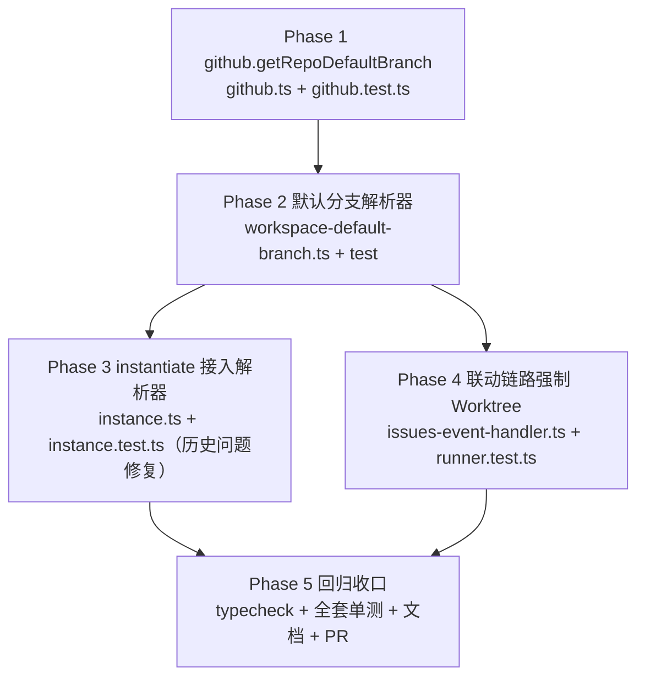

# GitHub Issues 联动工作流强制 Worktree 隔离 - 实现计划

**关联 Proposal**: `docs/engineering/proposals/20261026-fix-issues-workflow-force-worktree.md`（v1.1）
**关联 PRD**: `docs/product/draft/20261026-issues-workflow-force-worktree.md`（v1.1）
**需求总分支（feat-branch）**: `fix/issues-workflow-force-worktree`（需求总 PR #306，已评审通过）
**实现分支**: `fix/issues-workflow-force-worktree-impl`（基于需求总分支）
**创建日期**: 2026-10-26
**计划版本**: v1.0

**版本说明**：

- v1.0 首版，与 PRD v1.1 / 提案 v1.1 对齐（`defaultBranch` 缺失从「fast fail」改为「自动探测回填」：GitHub 项目经 GitHub API 优先获取，其他按 `main → master → release` 顺序探测存在的优先；Issues 联动实例化强制 `createWorkflowWorktree: true`）。PR #306 评审意见（默认分支自动识别回填、一并修复历史问题）已并入上游 v1.1 文档，2026-10-26 复审**通过且无新增修改要求**，本计划无产品口径变更。
- 把提案 §5.2 的 5 个实现点拆成 5 个 Phase：GitHub 默认分支 API → 默认分支解析器 → `instantiate` 接入（历史问题修复）→ 联动链路强制 Worktree → 回归收口。
- 本版给出「上游文档 × 代码现状差异」6 条与「计划期裁决」10 条，收敛提案与代码现状不一致或留白处（控制器 `GitCheckResult.defaultBranch` 启发式与候选清单口径不一致、`detectGitRepo` 超时/离线是抛错而非返回失败、联动 runner 用例实际落 `issues-event-handler.runner.test.ts`、手工路径「GitHub 优先」的验收落差、两处失败文案定稿等）。
- 对提案的 1 处解析顺序扩展（`repoFullName` 缺省时经 `CloudHostGithubBinding` 反查，满足 PRD 功能点 2「GitHub 项目优先获取」在手工路径的验收口径）与 2 处失败文案定稿做收敛，**需在实现 PR 描述中声明**。

## 实现顺序



依赖说明：

- **P1 是 P2 的前置**：解析器的 GitHub 优先通道依赖 `getRepoDefaultBranch`；P1 未完成前解析器只能写候选探测分支（TDD 上先落 P1 红测）。
- **P2 是 P3 / P4 的共同前置**；P3 与 P4 互不依赖，可并行（分别改 `instance.ts` 与 `issues-event-handler.ts`，共享的只有解析器签名）。
- **P5 串行收口**：全套单测 + `npm run typecheck` 全绿后才更新文档索引、提实现 PR。

开发模式采用 TDD（红-绿-重构）：每个 Phase 先落失败测试（RED）再写实现（GREEN），最后重构。编码前按目录加载 `docs/engineering/common-rules.md`、`docs/engineering/backend-rules.md`、`servers/agent-api/AGENTS.md`。

### 关键约束（实现期不得回退）

- **零回归**：手工实例化「为工作流创建独立 Worktree」勾选语义不变；节点级 `requiresWorktree` / `agentConfig.initNewWorktree` 语义与 `mapConfiguredNodes` 映射一字不动（提案实现点 5）；`pull_request_review`、issues 判定链、幂等闸均不触碰。
- **不静默降级**：主分支完全无法识别时联动触发 `FAILED`（原因可读）、手工路径显式报错，**绝不**出现「以为在隔离环境、实际跑了主分支」（PRD 4.2 硬约束）。
- **回填幂等**：`defaultBranch` 已存在的工作区直接复用，不重复探测、不覆盖用户手工设置的值。
- **无契约/无 schema 变更**：`contracts/`、Mongoose schema、GraphQL schema 均不改；仅新增 `ControllerWorkspace.defaultBranch` 的自动写入路径。
- **最小爆炸半径**：Worktree 强制仅作用于 Issues 联动调用点（`IssuesTriggerRunner.createInstance`），不改 `instantiate()` 对其他来源（模板/MCP admin-tools）的默认值。
- **控制器零改动**：不新增/不修改 `packages/agent-controller` 命令，探测与 Worktree 创建全部复用既有 `git:check` / `git:worktree:add` / `git:worktree:remove` 通道。
- **凭据零泄露**：`getRepoDefaultBranch` 复用 repo-scoped token，token 不落库、不进日志、不进错误响应（沿用 `sanitizeOperationError` 规约）。
- **禁止 rebase/squash**：遵循 z-git 规范，仅允许 merge。

## 上游文档 × 代码现状差异

实现前必须知道的事实偏差（在本计划内消化，无需打回上游；需在实现 PR 描述中声明）：

| # | 上游表述 | 代码现状（证据） | 本计划处置 |
|---|---|---|---|
| D1 | 提案 §8 用例 6-10「更新 `issues-event-handler.test.ts`」 | `issues-event-handler.test.ts` 仅含纯函数用例（`mapConfiguredNodes` / `resolveFirstHumanNode`）；`IssuesTriggerRunner` 状态机用例在 `issues-event-handler.runner.test.ts`（`describe('IssuesTriggerRunner PENDING_INSTANTIATE')` 等） | 用例 6-10 落 `issues-event-handler.runner.test.ts`（裁决 9）；`issues-event-handler.test.ts` 不动（本计划不改节点映射） |
| D2 | 提案 §5.2 实现点 2「仅取 `branches` 与候选清单的交集首个，不使用 `currentBranch` 臆测」 | `git:check` 返回的 `GitCheckResult`（`packages/agent-controller/src/git-handler.ts`）已含 `defaultBranch` 启发式（`main` → `master` → 字典序首个 → `currentBranch`），与 `[main, master, release]` 口径不一致（第三候选会取字典序最小分支，`release` 无优先级） | 解析器**不采用** `GitCheckResult.defaultBranch`，只用 `branches` × `DEFAULT_BRANCH_CANDIDATES` 求交（裁决 2）；agent-controller 零改动 |
| D3 | 提案 §5.2 实现点 2 风险点「控制器离线时探测返回失败」 | `controllerWorkspaceService.detectGitRepo` 在控制器离线/工作区不存在时**抛错**（`Controller is offline` / `Workspace not found`），30s 无响应抛 `Git detection timeout`，并非返回失败值 | 解析器 try/catch 探测调用，任何异常按「该步未命中」继续落空（裁决 2）；对外只暴露 `string \| null` |
| D4 | 提案 §3.2 解析顺序第 2 步「`repoFullName` 存在（GitHub 项目）→ GitHub API」；§5.2 实现点 4「手工路径无 `repoFullName`，走候选探测」 | PRD 3.2 功能点 2 验收标准「GitHub 项目工作区主分支信息缺失时，自动获取仓库主分支并记录」并不限联动路径；`cloud_host_github_bindings`（`controllerId` 唯一，含 `repoFullName`/`targetPath`）可把 GitHub clone 工作区映射回仓库 | 裁决 3：`repoFullName` 缺省时经 `CloudHostGithubBinding` 按路径严格匹配反查，命中走 GitHub 优先、未命中回落候选探测；提案 §3.2 接口签名不变 |
| D5 | 提案 §7「`github.ts` 改：新增 `getRepoDefaultBranch`」 | `github.ts` 已有私有 `repoToken(userId, repoFullName)`、`githubHeaders(token)` 与 `GITHUB_API` 常量；`github.test.ts` 用例按 `T-GH1..T-GH5` 编号 | 新方法复用三者（裁决 8）；用例续编 `T-GH6` |
| D6 | 提案 §3.2 联动失败文案给出原文，`instantiate` 失败场景文案留白 | `IssuesTriggerRunner.fail` 统一经 `sanitizeOperationError` 落 `failureReason`；既有文案混用 UPPER_SNAKE（`CLOUD_HOST_NOT_RUNNING`）与英文短语（`workflow not found`） | 联动路径沿用提案原文；`instantiate` 两场景文案定稿见裁决 6 |

## 计划期裁决（提案留白 / 含混处的实现口径）

1. **解析器形态与位置**：`servers/agent-api/src/services/workspace-default-branch.ts`，导出 `DEFAULT_BRANCH_CANDIDATES = ['main', 'master', 'release'] as const` 与提案 §3.2 逐字一致的 `resolveWorkspaceDefaultBranch(input: { userId: string; controllerId: string; workspaceId: string; repoFullName?: string | null }): Promise<string | null>`。纯服务函数：无定时器、无全局状态、不发 HTTP 之外的副作用（回填除外）。

2. **解析顺序（最终口径）**：
   1. `workspace.defaultBranch` 已存在 → 原样返回（不重复探测、不覆盖手工设置值）；
   2. `repoFullName`（入参，或经裁决 3 反查命中）→ `githubService.getRepoDefaultBranch`，命中即回填并返回；取不到（null）继续；
   3. `controllerWorkspaceService.detectGitRepo` 取 `branches`，按 `DEFAULT_BRANCH_CANDIDATES` 顺序取**第一个存在的**（交集首个），回填并返回；
   4. 全部落空（非 Git 仓库 / 候选均不存在）→ 返回 `null`。
   GitHub API 与探测两步的异常一律吞掉、按「该步未命中」继续；工作区读取失败才抛错（调用方既有错误链路）。

3. **`CloudHostGithubBinding` 反查（提案扩展，PRD 对齐；需在实现 PR 声明）**：仅当 `repoFullName` 未传时执行——`CloudHostGithubBinding.findOne({ controllerId })`，用 `resolveClonePath(normalizeWorkspacePrefix(binding.targetPath), binding.repoFullName)`（`services/workspace-path.ts` 既有纯函数）与 `workspace.path` **严格相等**才采用其 `repoFullName`；不相等 / 无绑定 / 反查异常 → 视为非 GitHub 项目直接回落候选探测。不写绑定、不修旧绑定记录。

4. **回填通道**：命中即 `ControllerWorkspace.findByIdAndUpdate(workspaceId, { defaultBranch: branch })` 持久化（与 `detectGitRepo` 回填 `isGitRepo` 同风格，不走 `setDefaultBranch` 的 GraphQL 语义）；返回解析值由调用方就地更新内存对象。并发双写同值幂等；不清理 `git:branches:*` Redis 缓存（分支列表缓存与 `defaultBranch` 无关）。回填后工作区详情即可见（PRD 功能点 2 验收第 3 条），后续实例化直接复用。

5. **`instantiate()` 接入点（历史问题修复，提案实现点 4）**：在「4. requiresWorktree git 校验」之前插入——当 `needsWorktree || input.createWorkflowWorktree` 且 `workspace.defaultBranch` 缺失时调用解析器（`repoFullName` 不传，手工/模板/联动全入口统一口径；联动路径已在前置解析并回填，此处命中第 1 步直接返回），成功则 `workspace.defaultBranch = 解析值` 继续原流程（后续校验与 Worktree 创建零改动）；失败按裁决 6 分流。`needsWorktree === false && !input.createWorkflowWorktree` 时**不**调用解析器（零开销、零行为变化，I5b 语义保持）。

6. **失败文案定稿（2 处，需在实现 PR 声明）**：
   - 联动路径（`IssuesTriggerRunner.instantiateWorkflow` 前置解析失败）：`cannot resolve workspace default branch (not a git repository?)`（提案 §3.2 原文），经既有 `fail()` 落 `failureReason`，触发记录 `FAILED` 且**不**调用 `instantiate()`（无 Worktree 残留）；
   - `instantiate` `needsWorktree` 场景解析失败：保留原错误文案「该工作流包含需要 Worktree 隔离的节点，但工作区不是 Git 仓库（未设置默认分支），无法实例化」；
   - `instantiate` `createWorkflowWorktree` 场景解析失败：新文案「无法创建独立 Worktree：未能识别工作区默认分支（非 Git 仓库或候选分支均不存在）」——从「静默跳过 Worktree 创建」改为显式报错（提案实现点 4 风险点既定收紧方向）。

7. **联动强制 Worktree（提案实现点 1）**：仅改 `IssuesTriggerRunner.createInstance` 的 `instantiate()` 入参，显式传 `createWorkflowWorktree: true`；实例名（`buildTriggerInstanceName`）、节点映射（`mapConfiguredNodes`）、幂等闸、Worktree 随机后缀去重与 `WorkflowInstance.create` 失败回滚（`removeWorkflowWorktree`）全部复用既有能力，零改动。

8. **`github.getRepoDefaultBranch`（提案实现点 3）**：`GitHubService` 公有方法 `getRepoDefaultBranch(userId: string, repoFullName: string): Promise<string | null>`，复用 `this.repoToken(userId, repoFullName)` + `githubHeaders` + `GITHUB_API`，`GET /repos/{owner}/{repo}` 取 `default_branch`；`!response.ok`、响应无 `default_branch`、`repoToken` 抛错（无绑定 / 仓库未授权 / 404）→ 一律返回 `null` **不抛出**，交候选探测兜底；token 不落日志。

9. **测试落点与编号**：解析器 `workspace-default-branch.test.ts` 新增（WDB1-WDB7）；`github.test.ts` 续编 `T-GH6`；`instance.test.ts` 新增 I7-I9，并调整 I5（mock 解析器失败仍抛原错误文案）、I5b 保持通过；`issues-event-handler.runner.test.ts` 新增 R-WT1-R-WT5。全部 Vitest 单测（mock 既有模块，风格沿用各文件现状）；无契约测试、无迁移、无 `tests/api` / `tests/e2e` 新增用例。

10. **文档与收口**：`docs/engineering/AGENTS.md`「实现计划（plan/）」索引补本计划（与本计划同 commit）；实现 PR 描述声明裁决 3（binding 反查）与裁决 6（两处文案）；验收环境回归 E2E-33 并手工核对「工作区主分支零改动」（提案 §9）。

---

## Phase 1: `github.getRepoDefaultBranch`（GitHub 项目优先通道）

开发分支：`fix/issues-workflow-force-worktree-impl`。RED 先行（T-GH6 红）→ GREEN。

### 文件修改

- `servers/agent-api/src/services/github.ts` — [改] `GitHubService` 新增 `getRepoDefaultBranch(userId, repoFullName)`（复用 `repoToken` / `githubHeaders` / `GITHUB_API`）。
- `servers/agent-api/src/services/github.test.ts` — [改] 新增 `describe('getRepoDefaultBranch')`（T-GH6）。

### 测试（RED 先行）

- T-GH6a 成功：`GET /repos/{owner}/{repo}` 2xx 返回 `{ default_branch: 'trunk' }` → 解析结果 `'trunk'`，请求头带 repo-scoped token。
- T-GH6b 非 2xx（404/403）→ `null`，不抛出。
- T-GH6c `repoToken` 抛错（无绑定 / 仓库未授权）→ `null`，不抛出、不发起后续 fetch。
- T-GH6d 响应缺 `default_branch` → `null`。

### 实现要点

- 方法体参照 `ensureIssueLabel` 的 fetch 风格（`GITHUB_API` 常量 + `githubHeaders(token)`）；异常全捕获返回 `null`（解析器语义：取不到即回落候选探测）。

### 验收 checklist

- [ ] T-GH6a-d 先红后绿；`github.test.ts` 既有 `T-GH1..T-GH5` 全绿。
- [ ] 无 token / 错误信息泄露（断言错误文案不含 token）。

---

## Phase 2: 默认分支解析器 `workspace-default-branch.ts`

### 文件修改

- `servers/agent-api/src/services/workspace-default-branch.ts` — [新] `DEFAULT_BRANCH_CANDIDATES` + `resolveWorkspaceDefaultBranch`（裁决 1/2/3/4）。
- `servers/agent-api/src/services/workspace-default-branch.test.ts` — [新] WDB1-WDB7。

### 测试（RED 先行）

- WDB1（提案用例 1）`defaultBranch` 已存在 → 直接返回，不调用 GitHub API 与 `detectGitRepo`、不回填。
- WDB2（用例 2）缺失 + 传 `repoFullName` + API 命中 → 返回 API 结果并回填 `ControllerWorkspace`。
- WDB3（用例 3）缺失 + API 失败 / 无 `repoFullName` → `detectGitRepo` 探测：`branches=['develop','master']` 返回 `master`（`main` 不存在则取 `master`）并回填。
- WDB4（用例 4）`branches=['release']` → `release`；`branches` 三者全无 / `isGitRepo=false` → `null` 且不回填。
- WDB5（用例 5）探测命中后再次调用 → 直接返回已回填值，不重复探测（WDB1 同语义的持久化版本）。
- WDB6（裁决 3）无 `repoFullName` + binding 路径严格匹配 → 经 GitHub API 优先解析并回填（手工路径 GitHub 优先）。
- WDB7（裁决 3）binding 存在但路径不匹配 / 无绑定 → 走候选探测，不调用 GitHub API；`detectGitRepo` 抛错（`Controller is offline` / `Git detection timeout`）→ 按未命中继续，最终 `null` 不抛出。

### 实现要点

- 顺序、异常吞掉、回填口径严格按裁决 2/3/4；`branches` 只与 `DEFAULT_BRANCH_CANDIDATES` 求交取首个，**不读** `GitCheckResult.defaultBranch`（D2）、不读 `currentBranch`。
- 反查用 `CloudHostGithubBinding` 模型 + `services/workspace-path.ts` 纯函数严格比对 `workspace.path`。

### 验收 checklist

- [ ] WDB1-WDB7 先红后绿。
- [ ] 解析器无定时器/无缓存/无全局状态；异常不出函数边界（除工作区读取失败）。

---

## Phase 3: `instantiate()` 接入解析器（历史问题修复）

### 文件修改

- `servers/agent-api/src/services/workflow/instance.ts` — [改] 「4. requiresWorktree git 校验」之前接入解析器，替代 `needsWorktree && !workspace.defaultBranch` 直接抛错与 `input.createWorkflowWorktree && workspace.defaultBranch` 静默跳过（裁决 5/6）。
- `servers/agent-api/src/services/workflow/instance.test.ts` — [改] 新增 I7-I9；调整 I5。

### 测试（RED 先行）

- I7（提案用例 11）`needsWorktree` 且 `defaultBranch` 缺失但可探测回填 → 实例化成功（不再抛错），Worktree 校验用解析结果。
- I8（用例 12）`createWorkflowWorktree: true` 且 `defaultBranch` 缺失 → 探测回填后创建实例级 Worktree（`git:worktree:add` 下发），不再静默跳过。
- I9（用例 13）探测失败分流：`needsWorktree` 场景抛原错误文案「…未设置默认分支，无法实例化」；`createWorkflowWorktree` 场景抛「无法创建独立 Worktree：…」（不静默）。
- I5 调整：解析器 mock 返回 `null` 时仍抛原错误文案（`/Git|git/` 断言保持）；I5b（无 `needsWorktree` 且不建实例 Worktree → 非 git 工作区可实例化）保持通过且**不**调用解析器。

### 实现要点

- `workspace` 为 `.lean()` 文档：解析成功后就地 `workspace.defaultBranch = 解析值`，后续 `createWorkflowWorktree(...)` 与校验零改动；`workspaceId` / `userId` / `controllerId` 从 `input` 与既有归属校验取（必存在）。
- Worktree 创建失败 / `WorkflowInstance.create` 失败回滚链路不改（既有 `removeWorkflowWorktree`）。

### 验收 checklist

- [ ] I7-I9 先红后绿；I5/I5b 及 I1-I6 既有用例全绿。
- [ ] `createWorkflowWorktree && defaultBranch` 的静默跳过分支已消失（代码审查确认）。

---

## Phase 4: 联动链路强制 Worktree + 前置解析

### 文件修改

- `servers/agent-api/src/services/workflow/issues-event-handler.ts` — [改] `instantiateWorkflow` 前置解析（失败 `fail(trigger._id, 'cannot resolve workspace default branch (not a git repository?)')`，不实例化）；`createInstance` 显式传 `createWorkflowWorktree: true`（裁决 6/7）。
- `servers/agent-api/src/services/workflow/issues-event-handler.runner.test.ts` — [改] 新增 R-WT1-R-WT5（D1：用例落点）。

### 测试（RED 先行）

- R-WT1（提案用例 6）`createInstance` 调用 `instantiate()` 时携带 `createWorkflowWorktree: true`。
- R-WT2（用例 7）工作区 `defaultBranch` 缺失 + GitHub 项目（`trigger.repoFullName`）→ 解析器回填后实例化成功，触发记录推进 `PENDING_HUMAN_NODE`。
- R-WT3（用例 8）解析器返回 `null` → 触发记录 `FAILED`、`failureReason` 可读（`cannot resolve workspace default branch (not a git repository?)`），且 `instantiate()` **未被调用**（无 Worktree 残留）。
- R-WT4（用例 9）`instantiate()` 抛错（Worktree 创建失败）→ 触发记录 `FAILED`（既有行为回归）。
- R-WT5（用例 10）既有用例全绿（无 HUMAN 节点直接 COMPLETED、ALREADY_TRIGGERED 幂等、PENDING_WORKSPACE/PENDING_HUMAN_NODE 全部既有分支）。

### 实现要点

- 解析器调用在 `instantiateWorkflow` 内、`createInstance` 之前，`repoFullName: String(trigger.repoFullName ?? '')`（空串按「无 repoFullName」处理，与解析器入参语义一致）。
- `mapConfiguredNodes` 不动（`requiresWorktree: Boolean(node.requiresWorktree)` 原样快照，实现点 5）；节点级隔离经 `orchestrator.startNodeSession` 既有优先级（节点级 > 实例级 > 根目录）自然生效。

### 验收 checklist

- [ ] R-WT1-R-WT5 先红后绿；`issues-event-handler.flow.test.ts` 判定链用例全绿（零回归）。
- [ ] 联动实例必落 `workflowWorktreePath` / `workflowWorktreeBranch`（用例断言 `instantiate` 入参与实例字段）。

---

## Phase 5: 回归收口（文档、PR、验收）

### 文件修改

- `docs/engineering/AGENTS.md` — [改] 「实现计划（plan/）」索引补本计划（裁决 10）。
- 实现 PR（目标分支 = 需求总分支 `fix/issues-workflow-force-worktree`）— [新] 描述声明裁决 3/6。

### 测试（回归）

- `cd servers/agent-api && npx vitest run`（全套单测）+ `npm run typecheck` 全绿。
- 验收环境：回归 `tests/e2e` E2E-33（Issues 联动配置与触发入口）；真实仓库打标触发一次，核对实例 `workflowWorktreePath/Branch`、节点会话 cwd 在副本内、**工作区主分支零新提交零未提交改动**。

### 验收 checklist

- [ ] 提案 §9 验收标准逐条勾对（含「手工实例化勾选语义不变」「节点级隔离仍生效」）。
- [ ] 实现 PR 描述含裁决 3/6 声明；分支仅 merge 提交，无 rebase/squash。

---

## 测试矩阵

| 类型 | 工具 | 覆盖范围 |
|------|------|---------|
| 单元（GitHub API） | Vitest | `getRepoDefaultBranch` 成功/404/token 失败/缺字段（T-GH6a-d） |
| 单元（解析器） | Vitest | 解析顺序、候选交集、binding 反查、回填幂等、异常吞掉（WDB1-WDB7） |
| 单元（实例化） | Vitest | 接入点语义、两场景失败文案、不触发场景零开销（I7-I9 + I5 调整） |
| 单元（联动状态机） | Vitest | 强制 `createWorkflowWorktree`、前置解析失败不实例化、失败可读（R-WT1-R-WT5） |
| 回归 | Vitest | `instance.test.ts` / `issues-event-handler.*.test.ts` / `github.test.ts` 既有用例全绿 |
| E2E | Playwright | E2E-33 回归（验收环境） |
| 实机核对 | 手工（登记验收报告） | 打标触发全链路：实例副本可见、主分支零改动、多 Issue 并发互不干扰 |

## 验收 checklist（分阶段）

- [ ] P1：T-GH6a-d 先红后绿，凭据零泄露。
- [ ] P2：WDB1-WDB7 先红后绿，回填持久化且幂等。
- [ ] P3：I7-I9 先红后绿，静默跳过分支消除，历史 fast fail 修复。
- [ ] P4：R-WT1-R-WT5 先红后绿，联动实例必持独立 Worktree，判定链零回归。
- [ ] P5：全套单测 + typecheck 全绿；文档索引与 PR 声明完成；验收环境实机核对通过。
- [ ] 总体验收对齐提案 §9 与 PRD 3.2 各功能点验收标准（含功能点 3「明确失败不降级」与功能点 4「既有入口行为保持」）。

## 风险与回滚

| 风险 | 影响 | 缓解 |
|------|------|------|
| `detectGitRepo` 30s 轮询拉长触发耗时 | 打标→启动变慢 | 仅 `defaultBranch` 缺失时触发一次，回填后复用（PRD 4.1）；GitHub API 优先短路多数 GitHub 项目 |
| GitHub App 授权被移除 / token 失效 | GitHub 优先通道返回 null | 候选探测兜底（裁决 2）；两步全落空才失败且原因可读 |
| binding 反查误匹配（旧绑定路径漂移） | 回填了远端默认分支但本地不存在 | 路径**严格相等**才采用（裁决 3）；后续 `git:worktree:add` 失败走既有失败链路，不留半成品 |
| 手工实例化行为变化（静默跳过→报错） | 勾选 Worktree 但无法识别默认分支时从静默变报错 | 属提案实现点 4 既定收紧方向；报错文案可读、可修复后重试（PRD 功能点 3） |
| 控制器离线 | 探测失败 → 触发 FAILED | 原因可读、可重试；不降级主分支（硬约束） |
| 回滚 | — | 全部为 `servers/agent-api` 内新增/局部改动（新文件 2 个 + 3 处调用点），无 schema/契约变更；回滚即 revert 实现分支 merge 提交，联动回到旧语义但无数据迁移负担 |

## 命令参考

```bash
# 单服务单测 / 类型检查
cd servers/agent-api && npx vitest run src/services/github.test.ts src/services/workspace-default-branch.test.ts
cd servers/agent-api && npx vitest run src/services/workflow
cd servers/agent-api && npx vitest run && npm run typecheck

# E2E 回归（串行；workers=1 不可覆盖；地址按 aspire describe 替换）
cd tests/e2e && npx playwright test src/cloud-host-issues-linkage.spec.ts

# 分支（z-git：仅 merge，禁 rebase/squash）
git checkout fix/issues-workflow-force-worktree        # 需求总分支
git checkout -b fix/issues-workflow-force-worktree-impl # 实现分支
```

## 相关文档

- [[../proposals/20261026-fix-issues-workflow-force-worktree.md|关联 Proposal：GitHub Issues 联动工作流强制 Worktree 隔离技术提案]]
- [[../../../../docs/product/draft/20261026-issues-workflow-force-worktree.md|关联 PRD：GitHub Issues 联动工作流强制 Worktree 隔离]]
- [[20261025-feat-github-issues-workflow.md]] — 云电脑 GitHub Issues 联动工作流实现计划（触发状态机/幂等闸先例）
- [[20260829-fix-workflow-worktree-session-start.md]] — 工作流 Worktree 节点会话启动失败修复实现计划（Worktree 创建/回滚先例）
- [[20261021-feat-github-workload.md]] — Github 工作负载与云主机 Git 项目设置实现计划（repo-scoped token 与 binding 先例）
- [[../common-rules.md]]、[[../backend-rules.md]] — 开发规范

## 附录 A：文件变更总览

| 文件 | 动作 | Phase |
|------|------|-------|
| `servers/agent-api/src/services/github.ts` | 改 | P1 |
| `servers/agent-api/src/services/github.test.ts` | 改 | P1 |
| `servers/agent-api/src/services/workspace-default-branch.ts` | 新 | P2 |
| `servers/agent-api/src/services/workspace-default-branch.test.ts` | 新 | P2 |
| `servers/agent-api/src/services/workflow/instance.ts` | 改 | P3 |
| `servers/agent-api/src/services/workflow/instance.test.ts` | 改 | P3 |
| `servers/agent-api/src/services/workflow/issues-event-handler.ts` | 改 | P4 |
| `servers/agent-api/src/services/workflow/issues-event-handler.runner.test.ts` | 改 | P4 |
| `docs/engineering/AGENTS.md` | 改 | P5 |
