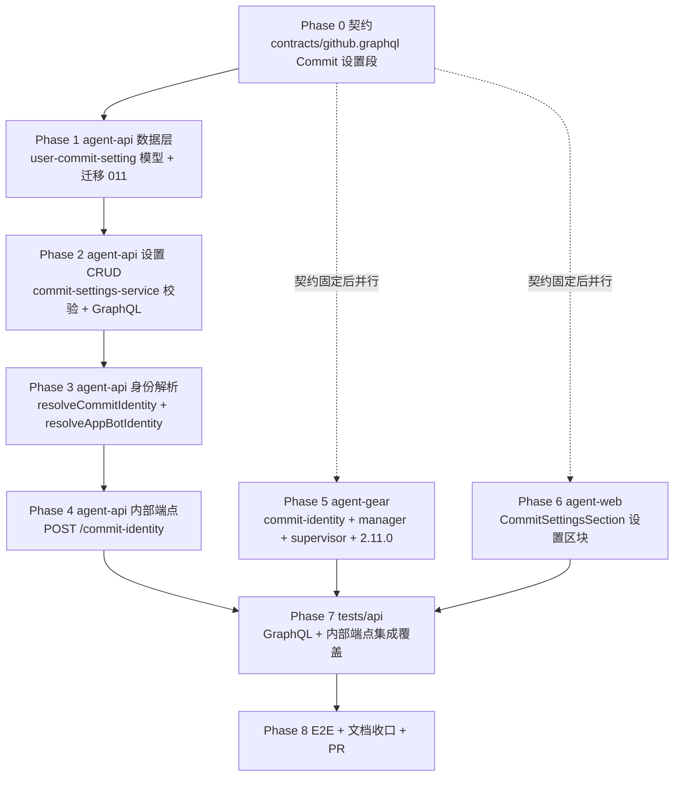

# 云容器 Commit 提交人设置 - 实现计划

**关联 Proposal**: `docs/engineering/proposals/20261027-feat-commit-author-settings.md`（v1.0）
**关联 PRD**: `docs/product/draft/20261027-commit-author-settings.md`（v1.0）
**需求总分支（feat-branch）**: `feat/commit-author-settings`（需求总 PR #321）
**实现分支**: `feat/commit-author-settings-impl`（基于需求总分支）
**创建日期**: 2026-10-27
**计划版本**: v1.0

**上游评审结论（PR #321）**：Deliay 于 2026-10-26T22:03:52Z APPROVED 产品文档与技术提案，评审无正文、无 inline comment、无修改要求，按原计划推进本实现计划。若后续复审提出修改，在对应 Phase 中落实并回评。

**版本说明**：

- v1.0 首版：与 PRD v1.0 / 提案 v1.0 对齐，把提案 §5.2 的 5 个实现点拆成 8 个 Phase；给出「上游文档 × 代码现状差异」5 条与「计划期裁决」9 条，收敛提案留白但会阻塞实现的口径（`committerMode=UNSET` 与已设提交人的归一关系、自定义邮箱校验规则逐字、错误文案双端映射逐字、内部端点 `unset` 响应字段缺省形态、bot 解析失败短缓存口径）。
- 不改变 PRD 产品口径；契约新增字段以提案 §3.1 为准，不删不改既有字段。本特性为纯增量：不触碰本地控制器链路，既有用例必须零失败（无基线更新清单）。

## 实现顺序



依赖说明：

- **P0 是口径基准**：`contracts/github.graphql` 先落（枚举 / 类型 / Query / Mutation + 校验白名单注释），P2~P7 均以其为书面依据。
- **P1 → P2 → P3 → P4 为后端串行轨**：CRUD 校验依赖模型与归一规则；`resolveCommitIdentity` 依赖 CRUD 层的归一校验与 bot 身份解析；内部端点只是 service 的 HTTP 壳，最后接线。
- **P5 / P6 为并行轨**：契约固定后，agent-gear（容器轨）与 agent-web（前端轨）可与后端轨并行开发（z-coding 编写实现阶段并行 subagent）；agent-gear 以契约定稿的端点请求/响应为 mock 依据，不依赖 agent-api 先行完成。
- **P7 依赖 P2~P6**：API 集成覆盖契约点与端点鉴权；**P8 依赖 P7 与全部前端 Phase**，E2E 串行执行。

开发模式采用 TDD（红-绿-重构）：每个 Phase 先落失败测试（RED）再写实现（GREEN），最后重构。编码前按目录加载 `docs/engineering/common-rules.md`、`backend-rules.md`、`frontend-rules.md`、`servers/agent-api/AGENTS.md`、`packages/agent-controller/AGENTS.md`、`apps/agent-web/AGENTS.md`、`tests/api/AGENTS.md`、`tests/e2e/AGENTS.md`。

### 关键约束（实现期不得回退）

- **未设置 = 零残留**：`mode = unset` 时容器内不得保留本功能写入的任何配置——`include.path` 仅当当前值**恰为**托管路径才 `--unset`，hook 仅删除带 `# zag-managed` 标记的文件；用户其他 git 配置零触碰。
- **内部端点永不 404**：`POST /internal/cloud-hosts/:controllerId/commit-identity` 任何无法下发有效身份的场景一律 `200 {"mode":"unset"}`（提案 §3.2）；鉴权失败仍 401/403。
- **服务端权威校验**：组合合法性以 `commit-settings-service` 白名单错误文案为准（提案 §3.1 表），前端拦截与文案映射不得替代服务端校验。
- **邮箱一律 noreply**：bot 与 Github 帐号提交人使用 `{id}+{login}@users.noreply.github.com` 形式，不暴露真实邮箱（用户主动自定义除外）。
- **无版本门禁**：不改 `MIN_HARNESS_WORKER_VERSION`；旧 worker 无 commit-identity 模块即「未设置」行为（提案决策表）。
- **本地控制器零影响**：只动云容器链路（agent-api + agent-gear + agent-web），不动 controller-api / agent-controller 本地会话链路。
- **禁止 rebase/squash**：遵循 z-git 规范，仅允许 merge。

## 代码探查关键事实（实现时以现状为准）

- `servers/agent-api/src/migrations/` 现有 001~010（含 `006-todo-elicitation-request-id-index.ts` + 同名 `.test.ts` 先例）——`011-user-commit-settings-index` 号位可用（「012」是 admin-api 口径，与 agent-api 迁移序号无关）。
- `servers/agent-api/src/models/github-account.ts`：`userId: String`（唯一索引 `{userId, githubUserId}`），`user_commit_settings.userId` 按同口径 String；`githubAccountId` ref `GitHubAccount` 为 ObjectId。
- `servers/agent-api/src/models/cloud-container.ts`：`installedWorkloads: Mixed[]`（agent_only 负载门控依据之一，另一路为 `cloud_host_github_bindings`）。
- `servers/agent-api/src/routes/internal-cloud-host.ts:92` 已挂 `/:controllerId/github-credential`（双鉴权：`INTERNAL_API_TOKEN` 或该云主机 Controller key，无绑定 404）——`commit-identity` 并列挂载、复用同一鉴权中间件，但行为永不 404。
- `servers/agent-api/src/services/github.ts:436` 已有 `createAppJwt()`（bot 身份解析复用）；Redis 经 `getRedisClient()`（`middleware/redis.js`，`services/key-cache.ts` 为用法先例）。
- `packages/agent-controller/src/github/`：`credential-manager.ts`（`start()` 立即申请 + 50 分钟自续期、`BACKOFF_MS` 1/2/4 分钟退避、定时器 `unref()`、并发合并单请求、错误不含 secret；测试 T-CM1~T-CM8）与 `gh-config.ts`；`commit-identity.ts` / `commit-identity-manager.ts` 同构落点。
- `packages/agent-controller/src/cloud-host/supervisor.ts:187`：`new GithubCredentialManager({ env: deps.env ?? process.env, log })`——commit-identity-manager 在同点接入 start / stop。
- `packages/agent-controller/package.json` 当前 `2.10.1` → 升 `2.11.0`。
- `apps/agent-web/src/pages/SettingsPage.tsx`：`github-section`（label「GitHub 绑定」）内 `164-165` 行渲染 `<GithubBindingSection />`——`CommitSettingsSection` 挂其下；`graphql/queries.ts:534` 有 `GET_GITHUB_ACCOUNTS`；`graphql/types.ts` 手写类型（无 codegen）；组件测试先例 `components/settings/__tests__/GithubBindingSection.test.tsx`。
- `tests/api/src/agent-api/github.test.ts`：`describe('GitHub Binding API')` 覆盖 `githubAppUrl` / `githubAccounts` / `unbindGitHubAccount`；`tests/api/src/mock-github-server.ts` 提供 GitHub API mock（bot 身份 `GET /app` / `GET /users/{slug}[bot]` 在此扩展）。
- `packages/agent-controller/src/github/credential-manager.test.ts` 测试命名 T-CM1~T-CM8——commit-identity-manager 测试编号对齐（T-CIM1 起）。

## 上游文档 × 代码现状差异

| # | 上游表述 | 代码现状（证据） | 本计划处置 |
|---|----------|------------------|------------|
| D1 | 提案 §4.1：唯一索引迁移 `011-user-commit-settings-index.ts` 沿用 006 先例 | agent-api 迁移 001~010 已占用、011 号位可用；006 先例为「迁移文件 + 同名 .test.ts」双文件 | 按提案执行：`011-user-commit-settings-index.ts` + `011-user-commit-settings-index.test.ts` |
| D2 | 提案 §5.2 实现点 4：`GET_GITHUB_ACCOUNTS` 天然不含 org 帐号 | `GitHubAccount` 即 OAuth 授权用户身份，org 仅为 `GitHubInstallation.accountType`，不在账号列表 | 下拉直接取 `githubAccounts` 过滤，无需额外查询；「非 org」由数据模型天然保证，测试断言该不变量即可 |
| D3 | 提案 §3.1 校验表「`committerMode = UNSET` 或 `committerType = UNSET` → 冗余字段归一清空」与 §4.1 归一规则（仅按 `committerType` 清理）口径不一致 | 尚无实现 | 裁决 1：`committerMode=UNSET` 不清空提交人字段（允许「先填提交人、后选模式」），归一仍仅按 `committerType` |
| D4 | 提案 §3.1 自定义提交人校验「邮箱格式非法」未给出规则 | 尚无实现 | 裁决 2 给出逐字校验规则与双端同源口径 |
| D5 | 提案 §3.1 错误文案白名单为英文、§5.2 实现点 4 只举一例中文映射 | 尚无实现 | 裁决 3 给出双端逐字映射表 |

## 计划期裁决（提案留白 / 含混处的实现口径）

1. **归一规则（对齐提案 §4.1，覆盖 D3）**：仅按 `committerType` 归一——`unset` 清空 `githubAccountId/customName/customEmail`；`github_account` 清空 `customName/customEmail`；`custom` 清空 `githubAccountId`。`committerMode=UNSET` **不清空**提交人字段，`mode=UNSET + type=github_account` 等组合合法（用户先填提交人后选模式，保存即预填）。保存按 `userId` upsert。
2. **自定义输入校验（双端同源、服务端权威）**：`customName` trim 后非空、≤100 字符、禁 `\n`/`\r`/`\0`；`customEmail` trim 后非空、≤254 字符、匹配 `/^[^\s@]+@[^\s@]+\.[^\s@]+$/`（无空格无 `@` 缺失，双端同一正则语义）。校验失败一律 `invalid custom committer`。
3. **错误文案双端逐字映射**（服务端 GraphQL error message → 前端展示文案，前端原样映射不改写）：

   | 白名单 message（服务端） | 前端文案 |
   |------|---------|
   | `committer is required for the selected mode` | `请先设置提交人` |
   | `invalid github account` | `Github 帐号无效，请重新选择` |
   | `invalid custom committer` | `提交人用户名或邮箱格式不正确` |

   前端联动拦截（Co-Author / 仅人类 + 提交人未设置禁用保存）使用与第一行一致的提示文案「请先设置提交人」。
4. **内部端点响应形态**：`unset` 时返回 `200 {"mode":"unset"}`（`name/email/coAuthorName/coAuthorEmail` 字段缺省）；`agent_only` / `human_only` 返回 `mode + name + email`；`co_author` 额外返回 `coAuthorName + coAuthorEmail`。不返回 `null` 字段，容器侧按字段存在性消费。
5. **bot 身份解析失败短缓存**：成功缓存 `github:app-bot-identity`（JSON：`{slug, botUserId, name, email}`，TTL 24h）；失败写同 key sentinel（如 `__fail__`，TTL 60s）防击穿，进程内 Map 兜底同口径。命中失败 sentinel 时 `resolveCommitIdentity` 直接按 `unset` 返回并 `console.warn`（不含 secret）。
6. **GitHub API 调用口径**：裸 `fetch`（不引 octokit，与提案一致），`Authorization: Bearer {appJwt}`、`Accept: application/vnd.github+json`；`GET /app` 取 `slug`，`GET /users/{slug}%5Bbot%5D` 取 `id`；超时 / 非 2xx / 解析失败一律走裁决 5。
7. **commit-identity-manager 与 credential-manager 的差异**：无 404 / token 续期语义（端点永不 404）；节奏固定「启动即拉 + 每 50 分钟」；401/403 按 1/2/4 分钟退避（≤3 次）后保留现状待下周期；网络 / 解析失败保留现状不崩溃；env 缺失仅 warn 列出变量名（对齐 T-CM6 口径）；日志与错误不含任何身份以外的敏感信息。测试编号 T-CIM1~T-CIM8 对齐 T-CM1~T-CM8 场景。
8. **前端 UI 细节**：区块标题「Commit 设置」，头部常驻提示「设置只对云容器环境生效」；「提交人模式」「提交人」各为单选组（四选一 / 三选一，默认未设置）；条件渲染（Github帐号 → 帐号下拉（头像 + 用户名）；自定义 → 用户名 + 邮箱输入）；保存按钮独立于 `GithubBindingSection` 的保存；保存成功 toast「对云容器环境生效，已运行的云电脑稍后自动更新」；未绑定任何 Github 帐号时下拉为空 + 引导文案「请先绑定 Github 帐号」且该组合不可保存；已选帐号被解绑后回显提示重新选择提交人（PRD 3.5）。
9. **纯增量、无基线更新清单**：本特性不改动任何既有行为与文案，既有单测 / API / 组件 / E2E 用例必须零失败；RED 阶段任何既有用例失败一律视为回归修复，不得改写断言掩盖。

---

## Phase 0: 契约（`contracts/github.graphql` 扩展）

| 文件 | 操作 | 说明 |
|------|------|------|
| `contracts/github.graphql` | 修改 | 新增「Commit 设置」段：`enum CommitterMode { AGENT_ONLY CO_AUTHOR HUMAN_ONLY UNSET }`、`enum CommitterType { GITHUB_ACCOUNT CUSTOM UNSET }`、`type CommitSettings`、`input CommitSettingsInput`（字段与提案 §3.1 逐字一致）、`extend type Query { commitSettings: CommitSettings! }`、`extend type Mutation { updateCommitSettings(input: CommitSettingsInput!): CommitSettings! }`；注释写明「仅对云容器环境生效」「从未保存返回双 UNSET」「服务端权威校验白名单（三行文案逐字）」「归一规则按 committerType 清理（裁决 1）」 |

验收：契约与提案 §3.1 字段逐字一致；`git diff` 确认零既有字段改动；校验白名单三条文案与裁决 3 表格一致。

### 命令参考

```bash
cd servers/agent-api && npm run build   # schema 校验随 Phase 2 引入，本阶段仅契约文本
```

## Phase 1: agent-api 数据层（模型 + 迁移 011）

开发分支：`feat/commit-author-settings-impl`（基于需求总分支）。

| 文件 | 操作 | 说明 |
|------|------|------|
| `servers/agent-api/src/models/user-commit-setting.ts` | 新增 | `UserCommitSetting` schema：`userId: String`（对齐 `GitHubAccount.userId` 口径）、`committerMode: enum('agent_only','co_author','human_only','unset')` default `unset`、`committerType: enum('github_account','custom','unset')` default `unset`、`githubAccountId: ObjectId?` ref `GitHubAccount`、`customName: String?`（≤100）、`customEmail: String?`（≤254）、timestamps；导出归一常量（枚举值数组）供 service 复用 |
| `servers/agent-api/src/models/models.ts` | 修改 | 注册 `UserCommitSetting`（对齐既有 model 注册口径） |
| `servers/agent-api/src/migrations/011-user-commit-settings-index.ts` | 新增 | `user_commit_settings.userId` 唯一索引显式创建（沿用 006 先例结构与幂等口径） |
| `servers/agent-api/src/migrations/011-user-commit-settings-index.test.ts` | 新增 | 迁移幂等执行两次不报错、索引存在且 unique、重复 userId 写入被拒 |

### 命令参考

```bash
cd servers/agent-api && npm run build && npm test -- user-commit-setting
```

## Phase 2: agent-api 设置 CRUD + 校验 + GraphQL

### Step 2.1 commit-settings-service（先写失败测试）

| 文件 | 操作 | 说明 |
|------|------|------|
| `servers/agent-api/src/services/commit-settings-service.test.ts` | 新增 | `T-CS1` 默认值：从未保存返回双 UNSET；`T-CS2` 校验矩阵（mode ∈ {CO_AUTHOR, HUMAN_ONLY} + type=UNSET → `committer is required for the selected mode`；GITHUB_ACCOUNT 缺失 / 越权帐号 → `invalid github account`；CUSTOM 空 / 超长 / 换行 / 非法邮箱 → `invalid custom committer`）；`T-CS3` 归一清空（裁决 1 矩阵：按 type 清理、mode=UNSET 不清理）；`T-CS4` upsert 幂等（同 userId 二次保存覆盖不重复建行） |
| `servers/agent-api/src/services/commit-settings-service.ts` | 新增 | `getCommitSettings(userId)` / `updateCommitSettings(userId, input)`：白名单校验（裁决 2/3 文案逐字）→ 归一（裁决 1）→ upsert；Github 帐号归属校验（`GitHubAccount` 存在且 `userId` 匹配）；错误抛 GraphQL 可消费的 `Error`（message 为白名单文案） |

### Step 2.2 GraphQL schema + resolver

| 文件 | 操作 | 说明 |
|------|------|------|
| `servers/agent-api/src/graphql/schemas/github.ts` | 修改 | 追加 `CommitSettings` / `CommitSettingsInput` / `CommitterMode` / `CommitterType` 与 `commitSettings` / `updateCommitSettings` 声明（内联注释与契约逐字一致） |
| `servers/agent-api/src/graphql/resolvers/github.ts` | 修改 | `Query.commitSettings` / `Mutation.updateCommitSettings` 接 service；鉴权沿用既有 resolver 用户上下文口径；错误 message 透传白名单文案 |
| `tests/api/src/agent-api/github.test.ts` | 修改 | 预留用例编号段说明（实测在 Phase 7 落） |

### 命令参考

```bash
cd servers/agent-api && npm run build && npm test -- commit-settings
```

## Phase 3: agent-api 身份解析（`resolveCommitIdentity` + bot 身份）

| 文件 | 操作 | 说明 |
|------|------|------|
| `servers/agent-api/src/services/github.ts` | 修改 | 新增 `resolveAppBotIdentity()`：`createAppJwt()` → `GET /app` 取 `slug` → `GET /users/{slug}[bot]` 取 `id` → 组装 `{slug, botUserId, name: '{slug}[bot]', email: '{botUserId}+{slug}[bot]@users.noreply.github.com'}`；Redis `github:app-bot-identity` TTL 24h + 失败 sentinel 60s（裁决 5/6）；进程内 Map 兜底 |
| `servers/agent-api/src/services/github.test.ts` | 修改 | `T-GB1` 解析成功与缓存命中（二次调用不再打 GitHub）；`T-GB2` 失败 sentinel 60s 内不重试外部调用；`T-GB3` 日志不含 JWT |
| `servers/agent-api/src/services/commit-settings-service.ts` | 修改 | 新增 `resolveCommitIdentity(controllerId)`（提案 §3.2 五步）：云主机（`CloudHost`，未删）→ userId → 设置（未保存 `unset`）→ 提交人归一（解绑 / 越权 / 非法一律 `unset`）→ 模式门控（`agent_only` 要求 `cloud_host_github_bindings` 存在或 `cloudcontainers.installedWorkloads[].name === 'Github'`，未命中 `unset`；`human_only` = 提交人；`co_author` = 提交人 + bot）→ bot 解析失败按 `unset` 告警降级；返回形态按裁决 4 |
| `servers/agent-api/src/services/commit-settings-service.test.ts` | 修改 | `T-CS5` 五步矩阵：主机缺失 / 软删、未保存、解绑降级、越权帐号、`agent_only` 门控命中与未命中（两路证据各一条）、`co_author` 附 bot 字段、bot 失败降级 `unset`；`T-CS6` 响应形态（unset 缺省字段、co_author 才含 coAuthor*） |

测试重点：门控与降级是本 Phase 核心——mock `CloudHost` / `CloudHostGithubBinding` / `CloudContainer` / `GitHubAccount` 与 `resolveAppBotIdentity`，逐条断言「任何异常 → `unset`」不变量（提案实现点 5）。

### 命令参考

```bash
cd servers/agent-api && npm run build && npm test -- commit-settings github
```

## Phase 4: agent-api 内部端点（`commit-identity`）

| 文件 | 操作 | 说明 |
|------|------|------|
| `servers/agent-api/src/routes/internal-cloud-host.ts` | 修改 | 新增 `POST /:controllerId/commit-identity`，与 `github-credential` 并列：复用同一双鉴权中间件；调用 `commitSettingsService.resolveCommitIdentity(controllerId)`；响应形态按裁决 4；永不 404（`unset` 兑底）；鉴权失败 401/403 不变 |
| `servers/agent-api/src/services/internal-cloud-host.test.ts` | 修改 | `T-IC1` 双鉴权：无凭据 401、错误 Controller key 403、`INTERNAL_API_TOKEN` 放行；`T-IC2` 正常返回 `co_author` 全字段；`T-IC3` 任意无效场景（主机不存在 / 未保存 / 解绑）均 200 `{"mode":"unset"}`；`T-IC4` 响应不含 null 字段（裁决 4） |

验收：与 `github-credential` 鉴权行为逐条对齐；`unset` 兑底路径全覆盖；无任何 404 分支。

### 命令参考

```bash
cd servers/agent-api && npm run build && npm test -- internal-cloud-host
```

## Phase 5: agent-gear（容器内提交身份托管，与后端轨并行）

| 文件 | 操作 | 说明 |
|------|------|------|
| `packages/agent-controller/src/github/commit-identity.ts` | 新增 | 应用 / 移除托管配置（提案实现点 1/2）：`apply(mode, identity)`——写 `~/.zag/commit-identity.gitconfig`（`[user] name/email`，0600）→ 幂等 `git config --global include.path ~/.zag/commit-identity.gitconfig`；`co_author` 写 `~/.zag/git-hooks/prepare-commit-msg`（0755，`# zag-managed` 标记，trailer 固化字面量，`grep -qF` exact-trailer 幂等 + `git interpret-trailers` 兑底）→ `git config --global core.hooksPath ~/.zag/git-hooks`；`remove()`——仅当当前值恰为托管路径才 `--unset`（include.path 与 core.hooksPath 各自独立判断），再删托管文件 / 标记 hook；`git` 子进程 spawn、失败抛可读错误、输出不含 secret |
| `packages/agent-controller/src/github/commit-identity.test.ts` | 新增 | `T-CI1` 应用写文件与 include.path 幂等；`T-CI2` 移除仅当值恰为托管路径（用户已改值则不触碰）+ 零残留；`T-CI3` co_author hook 写入 + trailer 幂等（重复 commit 不叠加、`--amend` 不叠加）；`T-CI4` 模式切换（co_author → human_only 移除 hook 保留 user、→ unset 全移除）；`T-CI5` spawn 失败可读错误、不含 secret |
| `packages/agent-controller/src/github/commit-identity-manager.ts` | 新增 | 与 `credential-manager.ts` 同构（裁决 7）：env 三件套（`ZAG_AGENT_API_ENDPOINT` / `ZAG_CONTROLLER_ID` / `ZAG_HOST_KEY`）缺失仅 warn 列变量名；`start()` 立即拉取 + 50 分钟周期（`unref()`）；并发合并单请求；401/403 1/2/4 分钟退避 ≤3 次；失败保留现状待下周期；响应按字段存在性消费并调用 `apply` / `remove` |
| `packages/agent-controller/src/github/commit-identity-manager.test.ts` | 新增 | T-CIM1~T-CIM8 对齐 T-CM 口径：首拉应用、unset 移除、50 分钟节奏、退避、并发合并、env 缺失 warn、网络 / JSON 失败不崩溃、日志无敏感信息 |
| `packages/agent-controller/src/cloud-host/supervisor.ts` | 修改 | 与 `GithubCredentialManager` 同点实例化 `CommitIdentityManager`（`deps.env ?? process.env`），start / stop 生命周期接入；与凭据管理器相互独立（不依赖 gh 凭据 / Git 项目绑定存在） |
| `packages/agent-controller/package.json` | 修改 | `version` `2.10.1` → `2.11.0`（提案 §9.2；不设版本门禁，旧 worker 降级为未设置行为） |

测试重点：「零残留」与「幂等」是本 Phase 核心——spawn 全 mock，断言命令序列（`--unset` 仅在 exact 值命中时出现）；hook 幂等用真实临时目录跑 `sh prepare-commit-msg` 断言 trailer 单份。

### 命令参考

```bash
cd packages/agent-controller && npm run build && npm test -- commit-identity
```

## Phase 6: agent-web 设置区块（与后端轨并行）

| 文件 | 操作 | 说明 |
|------|------|------|
| `apps/agent-web/src/graphql/queries.ts` | 修改 | 新增 `GET_COMMIT_SETTINGS`（返回 committerMode / committerType / githubAccountId / customName / customEmail） |
| `apps/agent-web/src/graphql/mutations.ts` | 修改 | 新增 `UPDATE_COMMIT_SETTINGS` |
| `apps/agent-web/src/graphql/types.ts` | 修改 | 手写 `CommitSettings` / `CommitSettingsInput` 类型与枚举字面量（无 codegen，对齐既有口径） |
| `apps/agent-web/src/components/settings/CommitSettingsSection.tsx` | 新增 | 裁决 8 全量 UI：头部常驻提示「设置只对云容器环境生效」；模式单选（仅Agent / Co-Author / 仅人类 / 未设置，默认未设置）；提交人单选（Github帐号 / 自定义 / 未设置）+ 条件渲染（下拉复用 `GET_GITHUB_ACCOUNTS`（数据天然不含 org，D2）/ 用户名 + 邮箱输入）；前端联动拦截（「请先设置提交人」）+ 服务端白名单文案映射（裁决 3 表）；自定义输入前端校验与裁决 2 同源；保存成功 toast「对云容器环境生效，已运行的云电脑稍后自动更新」；未绑定帐号引导文案、解绑后回显提示 |
| `apps/agent-web/src/pages/SettingsPage.tsx` | 修改 | `github-section` 内 `<GithubBindingSection />` 下方挂载 `<CommitSettingsSection />`（`SettingsPage.tsx:164-165` 处） |
| `apps/agent-web/src/components/settings/__tests__/CommitSettingsSection.test.tsx` | 新增 | 对齐 `GithubBindingSection.test.tsx` 风格：默认双 UNSET 渲染、四 / 三选一切换、联动拦截（禁用保存 + 提示）、帐号下拉（org 不出现、未绑定引导）、自定义校验（空 / 非法邮箱拦截）、保存成功反馈与回显、服务端错误映射逐字 |

### 命令参考

```bash
cd apps/agent-web && npm run build && npm run lint && npm test -- CommitSettingsSection
```

## Phase 7: API 测试（tests/api）

> 先 `aspire start && aspire wait agent-api`，再按 `tests/api/AGENTS.md` 注入环境变量；API 与 E2E 不得并行。

| 文件 | 操作 | 覆盖 |
|------|------|------|
| `tests/api/src/mock-github-server.ts` | 修改 | 扩展 bot 身份端点 mock：`GET /app` 返回 slug、`GET /users/{slug}[bot]` 返回 id（可注入失败以测降级与 60s 短缓存） |
| `tests/api/src/agent-api/github.test.ts` | 修改 | `describe('Commit Settings API')`：`T-CS-API1` `commitSettings` 默认双 UNSET；`T-CS-API2` `updateCommitSettings` 保存 / 回读全字段；`T-CS-API3` 白名单三行错误逐字 + 越权帐号；`T-CS-API4` 归一落库（mode=UNSET 不清提交人、按 type 清理）；`describe('Commit Identity Internal API')`：`T-CI-API1` 双鉴权失败 401/403；`T-CI-API2` `co_author` 全字段响应（mock GitHub bot 身份）；`T-CI-API3` `agent_only` 门控：无 Github 负载 / 无绑定 → `unset`、有绑定 → bot 身份；`T-CI-API4` 解绑降级 `unset`；`T-CI-API5` unset 响应缺省字段（裁决 4） |
| `tests/api/src/agent-api/github-issues-webhook.test.ts` | 修改 | 回归（不动断言，仅确认零失败） |

验收：新增用例全绿；`github.test.ts` / `github-webhook.test.ts` 既有用例零失败（裁决 9：无基线更新清单）；测试结束无残留数据。

### 命令参考

```bash
cd tests/api && npm test -- github
```

## Phase 8: E2E + 文档收口 + PR

| # | 场景 | 验证点 | 落点 |
|---|------|--------|------|
| E2E-1 | Commit 设置区块展示与保存 | 「GitHub 绑定」下方出现「Commit 设置」区块与常驻提示「设置只对云容器环境生效」；四种模式 / 三种提交人可切换并保存成功 toast | `tests/e2e/src/settings-commit-author.spec.ts`（新建，对齐 `settings-github-binding.spec.ts` 风格） |
| E2E-2 | 联动拦截与自定义校验 | Co-Author / 仅人类 + 提交人未设置 → 禁用保存并提示「请先设置提交人」；自定义空用户名 / 非法邮箱拦截 | 同上 |
| E2E-3 | 提交人条件渲染 | Github帐号 → 下拉展示已绑定帐号（org 不出现）；未绑定引导绑定；自定义 → 用户名 + 邮箱输入框 | 同上 |
| E2E-4 | 未设置零回归 | 双未设置保存 / 刷新回显一致；既有 `settings-github-binding.spec.ts` 全绿 | 同上 + 既有 spec 回归 |

> 容器内 commit 身份真实生效（四种模式的 git 行为、Co-Author trailer、零残留）依赖真实云电脑，列入「总体验收」人工验收项，由单测 T-CI* / T-CIM* 与 API T-CI-API* 提供前置保障。

### 文档收口

| 文件 | 操作 | 说明 |
|------|------|------|
| `packages/agent-controller/AGENTS.md` | 修改 | `github/` 目录结构补 `commit-identity.ts` / `commit-identity-manager.ts`；补「提交身份托管（include.path + prepare-commit-msg hook）」小节与 2.11.0 版本口径（旧 worker 降级） |
| `servers/agent-api/AGENTS.md` | 修改 | 补 `user_commit_settings` 模型 / 迁移 011、`commit-settings-service`（校验白名单 + `resolveCommitIdentity` 五步）、`POST /internal/cloud-hosts/:id/commit-identity`（永不 404）、bot 身份缓存（Redis 24h + 60s 失败 sentinel）说明 |
| `apps/agent-web/AGENTS.md` | 修改 | 设置页结构补「Commit 设置」区块（挂载位置、联动校验、错误文案映射） |
| `tests/api/AGENTS.md` | 修改 | `github.test.ts` 新增 describe 段与用例编号说明 |
| `tests/e2e/AGENTS.md` | 修改 | 新增 `settings-commit-author.spec.ts` 场景说明 |
| `docs/engineering/AGENTS.md` | 修改 | 实现计划索引登记本文件（随需求总 PR 提交） |

### PR 收口

1. 实现分支 `feat/commit-author-settings-impl` 基于需求总分支拉起，完成后向需求总分支 `feat/commit-author-settings` 发起实现 PR（需求总 PR #321 保持长开，累计方案与实现）。
2. PR 描述声明：纯增量、未设置零回归；无版本门禁（旧 worker 优雅降级）；生效延迟 ≤1 个同步周期（50 分钟）。
3. 通过 `agent-workflow-tools.linkPullRequest` 把实现 PR 关联到工作流对应节点。

### 命令参考

```bash
cd servers/agent-api && npm run build && npm test
cd packages/agent-controller && npm run build && npm test
cd apps/agent-web && npm run build && npm run lint && npm test
# 集成（串行）
cd tests/api && npm test
cd tests/e2e && npx playwright test settings-commit-author.spec.ts settings-github-binding.spec.ts
```

---

## 总体验收

- [ ] Contract 评审通过（`contracts/github.graphql`，提案 §3.1 字段逐字）
- [ ] 设置可保存 / 读取；非法组合（Co-Author / 仅人类 + 未设置提交人、越权帐号、非法自定义输入）服务端与前端双重拦截，错误文案逐字（裁决 3）（PRD 功能点 2/3）
- [ ] 云容器内 commit 身份按模式生效（人工验收：真实云电脑四种模式各提交一次并核对作者 / trailer）：`agent_only` = bot、`human_only` = 用户、`co_author` = 用户 + bot Co-Author trailer（PRD 功能点 2）
- [ ] `agent_only` 在未勾选 / 未安装 Github 负载的容器不配置身份（T-CI-API3 + 人工验收）
- [ ] 从未设置或切回「未设置」：容器内无托管配置残留（include.path / 托管文件 / hook 均移除或从未写入），行为与上线前一致（PRD 功能点 4 / 3.5）
- [ ] bot 与 Github 帐号提交人均使用 GitHub noreply 邮箱形式（PRD 4.2）
- [ ] 已运行容器在 1 个同步周期（≤50 分钟）内自动生效，无需重建（PRD 功能点 4）
- [ ] 旧版本 worker 不受影响（行为即未设置）（PRD 4.3）
- [ ] 单元 / API / 组件 / E2E 测试全绿，既有用例零回归（裁决 9）
- [ ] 文档已同步（5 个 AGENTS.md + `docs/engineering/AGENTS.md` 索引 + 本计划）

## 风险与回滚

| 风险 | 影响 | 缓解 |
|------|------|------|
| `core.hooksPath` 覆盖仓库本地 hooks 目录 | 仓库自带 hooks 失效 | 云容器为平台独占环境、无用户预置 hooks（提案实现点 2 已裁决可接受）；PRD / 文档明示仅云容器生效；移除仅当值恰为托管路径，不误删用户配置 |
| bot 身份解析失败（GitHub API 异常） | Co-Author / 仅Agent 模式本次不生效 | 一律 `unset` 兑底 + 60s 短缓存防击穿 + 下周期重试，不阻断其余链路（提案 §3.2 第 5 步） |
| include.path / hook 移除不净产生残留 | 「未设置 ≠ 上线前行为」回归 | exact-match 移除 + 标记文件删除；T-CI2/T-CI4 专测零残留；验收 checklist 人工核对 |
| 帐号解绑与设置保存竞态 | 下发越权身份 | `resolveCommitIdentity` 每次拉取时权威校验帐号归属，解绑一律 `unset`（T-CS5） |
| 旧 worker 不支持 | 报错 / 行为漂移 | 无模块即无操作 = 未设置行为；服务端不设门禁；E2E / 人工验收含旧 worker 降级路径 |
| 50 分钟生效延迟被用户感知 | 「保存了没生效」投诉 | PRD 4.1 已接受分钟级；保存成功 toast 明示「稍后自动更新」 |
