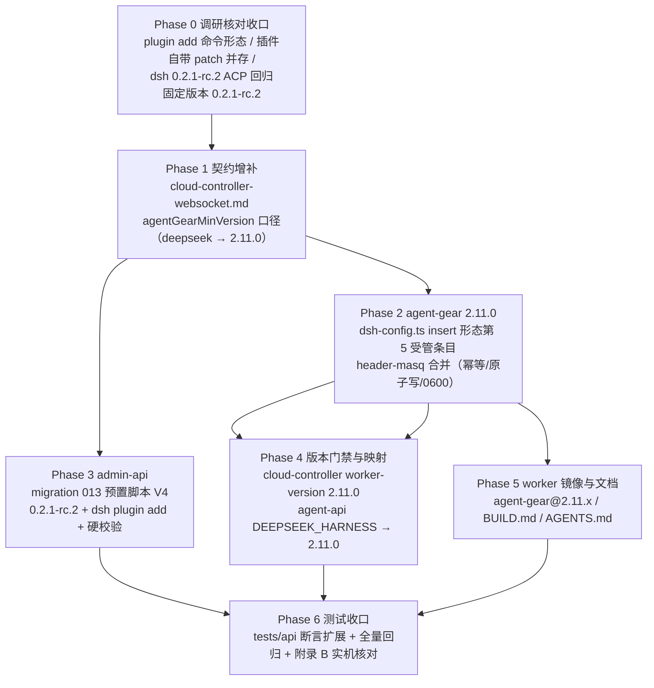

# DeepSeek Harness 会话标识请求头注入（dsh-header-masq 插件预置） - 实现计划

**关联 Proposal**: `docs/engineering/proposals/20261027-feat-dsh-header-masq.md`（v1.0）
**关联 PRD**: `docs/product/draft/20261027-dsh-header-masq.md`（v1.0）
**需求总分支（feat-branch）**: `prd/dsh-header-masq`（基于 `origin/main` ce0b3494，需求总 PR #320）
**计划提交分支**: `prd/dsh-header-masq`（本文件随需求总分支提交）
**创建日期**: 2026-10-27
**计划版本**: v1.1

**版本说明**：

- v1.0（2026-10-27）首版。对应 PRD / 提案 v1.0（PR #320 评审 APPROVED 无修改意见）。
- v1.1（2026-10-27）Phase 0 实机核对收口（dsh `0.2.1-rc.2` + `dsh-header-masq` 0.2.1 实测）：脚本 V4 补充
  pnpm 引导与 profile `.npmrc`（`ignore-workspace-root-check=true`）——`dsh plugin` 把参数转发给 pnpm，
  worker 镜像未预装 pnpm 且 profile 目录是 pnpm workspace root（否则 `ERR_PNPM_ADDING_TO_ROOT`）；
  简写 `Deliay/dsh-header-masq` 可解析、重跑幂等且退出码 0；插件自带 patch 与用户 insert 并存无启动失败，
  我方条目后挂载（配置以我方为准）。附录 B.2 核对结论同步。
- 提案附录 A 插件调研基于官方 README；附录 B 实机核对清单在 Phase 0 收口（见 §3、附录 B）。
- §3 计划期裁决以**当前需求总分支代码事实**为准（2026-10-27，9df819be）：重点校正 ① `MIN_HARNESS_WORKER_VERSION=2.10.0` 基线下 deepseek `2.9.0` 常量已被 max 收编、上调 `2.11.0` 后才真正构成门禁；② 预置脚本血缘常量名（`HARNESS_DEEPSEEK_SCRIPT_V3` = 内容 V4）与刷新矩阵精确清单；③ 预置脚本静态断言实际在 `tests/api`（非 tests/e2e）。

## 1. 实现顺序



依赖说明：

- **Phase 1 契约**是门禁口径的唯一裁决面，独立提交（`docs(contracts): ...`）；增补未合入前不上线门禁常量。
- **Phase 2（agent-gear）**与 **Phase 3（migration 013）**只依赖 Phase 0/1，可并行：插件安装在 init 脚本（Phase 3），配置注入在 prepare（Phase 2），互不阻塞。
- **Phase 4（门禁）**依赖 Phase 2 的 `agent-gear 2.11.0` 版本号定稿（发布顺序约束：先发 npm 版本，后上服务端门禁）；**Phase 5** 依赖 Phase 2 产物；**Phase 6** 在各实现合并回需求总分支后收口。
- 本期**无 GraphQL / OpenAPI 契约变更、无前端改动**（PRD 无新增界面）；工作量集中在 agent-gear（insert 合并）与 admin-api（脚本 V4 + 刷新矩阵）。

### 1.1 开发分支与合并顺序

| 分支 | 范围 | 基于 | 合并目标 |
|------|------|------|---------|
| `prd/dsh-header-masq` | PRD / 提案 / 本计划（需求总分支） | `origin/main` | 需求总 PR #320 |
| `feat/dsh-header-masq-impl` | 契约 + 全部实现 + 测试（主实现分支） | 需求总分支 | 需求总分支（评审通过后随需求总 PR 入 main） |
| `impl/dsh-header-masq-<子项目>`（可选） | 单子项目并行开发分支 | `feat/dsh-header-masq-impl` | `feat/dsh-header-masq-impl` |

- 主实现分支内按 Phase 顺序分提交：`docs(contracts)` → `feat(agent-gear)` → `feat(admin-api)` → `feat(cloud-controller/agent-api)` → `chore(worker)` → `test:`。
- 并行子项目分支（z-coding「编写实现并行 subagent」）：`packages/agent-controller`、`servers/admin-api`、`servers/cloud-controller` + `servers/agent-api` 可各自从主实现分支切出，完成后 merge 回主实现分支。
- **禁止 rebase/squash，只允许 merge**（z-git 规范）。合并顺序：**契约 → packages（agent-gear）→ servers → tests**；`servers` 内落地顺序 admin-api → cloud-controller → agent-api。

### 1.2 开发模式与规范加载

- 全部 Phase 采用 TDD（红-绿-重构）：先写测试（RED）→ 最小实现（GREEN）→ 重构。
- 编码前加载：`docs/engineering/common-rules.md`、`docs/engineering/backend-rules.md`。
- 目录级 `AGENTS.md`：`packages/agent-controller/AGENTS.md`、`servers/cloud-controller/AGENTS.md`、`servers/agent-api/AGENTS.md`、`tests/api/AGENTS.md`、`tests/e2e/AGENTS.md`、`docs/engineering/plan/AGENTS.md`。
- `servers/admin-api` 无独立 `AGENTS.md`，沿用根 `AGENTS.md` 与 engineering 规范；`apps/agent-web`、`apps/admin-web`、`servers/controller-api` **本期零改动**。
- `packages/agent-controller/src/harness/dsh-config.ts` 是 `~/.dsh` patch 文件**唯一写入口**（原子写/权限/AST 合并/脱敏单测均在其上）：insert 形态扩展不得绕过该模块写文件。

## 2. 命令参考

```bash
# 服务编排（根目录；测试服务只用 Aspire，禁止直接 docker 命令）
aspire start
aspire wait agent-api cloud-controller controller-api agent-web
aspire describe agent-api
aspire stop

# 单服务单测 / 构建
cd packages/agent-controller && npm ci && npm test && npm run build
cd servers/admin-api && npm ci && npm test && npm run build
cd servers/cloud-controller && npm ci && npm test && npm run build
cd servers/agent-api && npm ci && npm test && npm run build

# 跨服务 API 测试（先 aspire start；地址按 aspire describe 替换）
cd tests/api
API_URL=http://localhost:10001/graphql \
ADMIN_API_URL=http://localhost:10003/graphql \
CONTROLLER_API_URL=http://localhost:<controller-api-port> \
CLOUD_CONTROLLER_URL=http://localhost:10004 \
CLOUD_CONTROLLER_INTERNAL_TOKEN=<与 internal-api-token 一致> \
INTERNAL_API_TOKEN=<同上> \
MONGODB_URI=<aspire describe mongodb> \
npm test

# E2E（串行；地址按 aspire describe 替换）
cd tests/e2e
BASE_URL=http://localhost:<agent-web-port> \
API_URL=http://localhost:10001/graphql \
ADMIN_API_URL=http://localhost:10003/graphql \
CONTROLLER_API_URL=http://localhost:<controller-api-port> \
CLOUD_CONTROLLER_URL=http://localhost:10004 \
MONGODB_URI=<aspire describe mongodb> \
npx playwright test

# worker 镜像（内网构建，不属于服务编排）
cd deploy/images/worker
docker build -t core.harbor.internal.fffdan.com/zero-tools/worker:dsh-header-masq-local .
docker run --rm --entrypoint bash \
  core.harbor.internal.fffdan.com/zero-tools/worker:dsh-header-masq-local -lc \
  'agent-gear --version && command -v dsh || echo "dsh not preinstalled (expected)"'

# dsh 0.2.1-rc.2 与插件核对（开发机临时目录 / worker 内均可）
npm view @deepseek-ai/dsh@0.2.1-rc.2 bin engines
npm view @deepseek-ai/dsh-acp-app@0.2.1-rc.2 bin
npm install -g @deepseek-ai/dsh@0.2.1-rc.2 @deepseek-ai/dsh-acp-app@0.2.1-rc.2
dsh --version                       # 期望：0.2.1-rc.2（纯版本号，单行）
dsh plugin --profile acp add Deliay/dsh-header-masq   # 简写解析 / 幂等（附录 B 核对项 2）
dsh --dump-config                   # 期望：可见 profiles/acp 组合树与 patch 归属（核对项 3）

# 本地手工验证 insert 注入（临时 DSH_HOME）
DSH_HOME=/tmp/dsh-home ZAG_HARNESS_TYPES=deepseek_harness \
  ZAG_MODEL_BASE_URL=... ZAG_MODEL_IDS=... ZAG_MODEL_API_KEY=... \
  node packages/agent-controller/dist/commands/index.js harness prepare
```

> `K8S_ENABLED=false` 下无真实工作容器回连：云电脑在线、真实 `dsh --profile acp` 会话与请求头抓包由单测 + 部署侧手工验收覆盖（§6.4）。

## 3. 计划期裁决（提案与代码事实偏差的落地口径）

> 以下裁决以**当前需求总分支代码事实**（9df819be）为准。提案中与之不一致或含混的描述在实现期按本节执行，**不回改提案**；验收报告逐条登记。

### 3.1 事实校正（提案描述与代码事实的偏差）

| # | 提案描述 | 代码事实 | 本计划口径 |
|---|---------|----------|-----------|
| F1 | §3.2.1：`entryCount` 4 → 5（摘要口径同步） | `mergePatchDocument` 返回 `DSH_PATCH_ENTRY_IDS.length`；`dsh-config.test.ts:48` 断言 `entryCount: 4`；`prepare.ts` 摘要（`formatDeepseekSummary`）**不消费** entryCount | 实现返回 `DSH_PATCH_ENTRY_IDS.length + DSH_PATCH_INSERT_ENTRY_IDS.length`；断言同步改 5；prepare 摘要零改动 |
| F2 | §1.2/§2.1：门禁 `MIN_DEEPSEEK_HARNESS_WORKER_VERSION` 2.9.0 → 2.11.0，「旧版 prepare 不写 header-masq 的云电脑注册即被拒」 | `worker-version.ts`：`MIN_HARNESS_WORKER_VERSION='2.10.0'` 为底取 max，当前 `deepseek_harness:'2.9.0'` **被基线收编**（T-V6b 断言全组合恒 2.10.0）；`harnessMinVersion()` 注释明言「逐类型常量仅记录能力引入历史」 | 上调 `2.11.0` 后 deepseek 组合结果真正变为 2.11.0（高于基线），提案门禁语义成立；`worker-version.test.ts` T-V0b/T-V6b、`internal-api.test.ts` T-IC-HARNESS2、`cloud-host-service.test.ts` T-DS-API3 断言同步改写（见 §6.1） |
| F3 | §3.2.2：常量 `HARNESS_DEEPSEEK_SCRIPT_V3`；§1.2「存量脚本按 V1/V2/V3 精确匹配刷新」 | 常量血缘：010 `HARNESS_DEEPSEEK_INIT_SCRIPT_V1`（内容 V1，裸 prepare）→ 010 `HARNESS_DEEPSEEK_INIT_SCRIPT`（内容 V2，011 刷新为 `ZAG_HARNESS_TYPES=deepseek_harness` 限定）→ 012 `HARNESS_DEEPSEEK_SCRIPT_V2`（内容 V3，工作区 `/home/worker/workspace`，**live**） | 013 新常量 `HARNESS_DEEPSEEK_SCRIPT_V3`（内容 V4）；刷新匹配清单 = `[010 HARNESS_DEEPSEEK_INIT_SCRIPT_V1, 010 HARNESS_DEEPSEEK_INIT_SCRIPT, 012 HARNESS_DEEPSEEK_SCRIPT_V2]` → V4；`initScript === V4` 跳过；其余视为管理员定制告警跳过；预置项缺失按 V4 创建（012 `refresh()` 同构） |
| F4 | §8.2：E2E「预置脚本静态断言（含 `dsh plugin --profile acp add`…）」 | 预置脚本静态断言实际在 `tests/api/src/admin-api/cloud-workload.test.ts:713-722`（deepseek initScript 断言双包安装/`dsh --version`/`harness prepare`）；`tests/e2e/src/admin-cloud-workload.spec.ts` **无脚本内容断言** | 静态断言扩展落在 `tests/api`（追加 plugin add 行与 `0.2.1-rc.2` 版本断言）；tests/e2e 本期零改动（仅回归） |
| F5 | §3.1：契约「`deepseek_harness → 2.11.0`（原 2.9.0 口径替换）」 | `contracts/cloud-controller-websocket.md` 相关口径散于 5 处：`§2 register` 表（「恒 `>=2.10.0`」×2）、`§3.4`（`MIN_HARNESS_VERSION_BY_TYPE` 行、「仅 opencode 仍 2.10.0」句）、`§internal` 示例（`"agentGearMinVersion": "2.10.0"`）、落库口径句（「下限恒为 2.10.0」） | 契约增补精确到上述 5 处逐一修订（§5 Phase 1 列表）；示例值按「含 deepseek 的运行」场景改 2.11.0 并注明仅 opencode 组合仍 2.10.0 |
| F6 | §1.2：agent-api `DEEPSEEK_HARNESS → 2.11.0` 版本映射 | `cloud-host-service.ts:44` 现 `'2.9.0'`；`CLOUD_HOST_AGENT_GEAR_MIN_VERSION='2.10.0'` 基线取 max（`resolveAgentGearMinVersion`） | 只改 `HARNESS_MIN_AGENT_GEAR_VERSION.DEEPSEEK_HARNESS` 单常量为 `'2.11.0'`（max 逻辑零改动）；`cloud-host-service.test.ts` T-DS-API3 断言 2.10.0 → 2.11.0 |
| F7 | §7：migration `013-preset-harness-deepseek-header-masq` | admin-api 迁移账本已用至 `012`（存在 010 双占用先例：`010-clear-cloud-host-key-expiry` 与 `010-preset-harness-deepseek` 并存，runner 按数组顺序执行） | 采用 **`013`**（`013-preset-harness-deepseek-header-masq(.test).ts`）并在 `index.ts` 迁移数组登记；无编号冲突 |

### 3.2 设计裁决（提案留白/含混处）

1. **insert 块合并粒度**（D4 逐字执行）：顶层 map 中 `insert` 为 seq 且内层存在 `id === 'header-masq'` 的条目 → **整体替换该 insert 块**为我方单条目块（`- insert: [{id: header-masq, ...}]`）；未命中 → 在顶层数组**末尾追加**我方 insert 块。**不得**把 insert 块误判为扁平条目（顶层无 `id` 键，`findIndex` 天然不命中，保持现状即可），单测锚定「连续两次写入结果逐字一致」。
2. **多内层条目共块**（他插件与我方共用同一 insert 块）：按 D4 整体替换会丢弃其他内层条目——单测显式锚定该行为（记录于风险表）；若附录 B 核对项 3 实测该形态真实出现，按提案实现点 2 回退口径收敛（用户 patch 不写 insert 块、仅依赖插件自带激活 + 默认配置），**先修订本计划再实现**。
3. **代码结构**：`DSH_PATCH_INSERT_ENTRY_IDS = ['header-masq'] as const`（提案 §3.2.1 逐字）；新增 `buildInsertEntry(env)` 构造四键配置（`hosts` 缺省不写，D6）；`buildEntry` 扁平签名不动；`WriteDshConfigResult.entryCount` = 4 + 1 = 5。
4. **幂等定义**：同一 env 下连续两次 `writeDshConfig`，`cordis.patch.yml` 输出**逐字一致**（含条目顺序、缩进、注释保留）；`.credentials.yaml` 同口径。
5. **插件安装命令文本**：以需求原文 `dsh plugin --profile acp add Deliay/dsh-header-masq` 写入脚本 V4；Phase 0 核对简写解析（是否等价 `github:Deliay/dsh-header-masq`，核对项 2）。若简写不被 0.2.1-rc.2 识别，改写为带 `github:` 前缀的等价命令并在验收报告登记（需求语义不变，命令文本按实测定稿，提案 §5.3 已预留该口径）。
6. **插件安装失败语义**：依赖 `set -euo pipefail`（脚本 V4 继承），`dsh plugin add` 非零退出即 init 失败 → 必须工作负载失败 → 容器强制注销并展示原因（既有链路零改动）。不额外加成功标志文件校验（安装即激活，生效核对归附录 B）。
7. **版本常量命名**：013 内 `DSH_CLI_VERSION_V4 = DSH_ACP_APP_VERSION_V4 = '0.2.1-rc.2'`（提案 §3.2.2）；010/012 内旧常量（`0.1.2-alpha.2`）**保留不动**（历史刷新判定依赖逐字文本）。脚本 V4 内嵌默认值同步 `0.2.1-rc.2`。
8. **发布顺序**（D5 配套）：`agent-gear 2.11.0` npm 先发版 → 服务端（cloud-controller/agent-api 门禁 + admin-api 迁移）上线 → worker 镜像构建发布（`agent-gear@2.11.x`）。窗口期保护：门禁常量随服务端上线，旧镜像/旧 npm latest 由 entrypoint 每轮自更新收敛到 2.11.0（保活链路既有行为）。
9. **失败与回退**：`mergePatchDocument` 对非法 YAML 沿用「抛错、不写文件」口径；insert 构造不读取任何 secret（四键均为常量），脱敏面零新增。

## 4. 关键约束（提案 §1.3/§6，实现期不得回退）

- **契约先行**：`cloud-controller-websocket.md` 口径增补先于门禁常量上线；字段、枚举值、错误文案与提案 §3 对齐，偏差以 §3 裁决为准。
- **配置四键与需求逐项一致**：`source: x-deepseek-harness-session-id` / `targets: [x-opencode-session]` / `fallbackToSessionId: true` / `debug: false`；`hosts` 缺省不写（D6）；显式写入 patch（可审计、防插件缺省漂移）。
- **注入只在 init、不在使用前**：插件安装在 init 脚本（`dsh plugin add`），配置写入在 `agent-gear harness prepare`（`dsh-config.ts`）；无任何用户交互前置（D1/D2）。
- **幂等 + 硬校验**：脚本重放版本一致跳过安装；`dsh plugin add` 非零退出、prepare 写失败均视为云电脑启动失败（`required=true` 既有语义）；重复 prepare 输出逐字一致。
- **扁平 4 条目零回归**：`llm-deepseek` / `llm-pi-ai` / `agent-default-model` / `acp` 合并行为逐字保留；他条目与注释逐字保留；原子写（临时文件 + rename）、0600（文件）/0700（目录）不变。
- **OpenCode / Kimi Code 零改动**：`ZAG_HARNESS_TYPES` 分流、opencode 配置注入、Kimi 登录闸门与 `kimi_code` 门禁（2.8.0 常量）逐字不变；普通容器门禁 `MIN_WORKER_VERSION=2.2.0` 不动。
- **仅 `deepseek_harness` 上调门禁**：`MIN_HARNESS_WORKER_VERSION=2.10.0` 基线不动；`kimi_code` 常量不动；`agentGearMinVersion` max 逻辑与注册门禁（`socketio-gateway`）零改动。
- **013 不覆盖管理员定制**：精确匹配刷新矩阵（F3），定制脚本告警跳过（011/012 口径）；存量云电脑不下发补装（D7：创建期注入，重建获得）。
- **凭证与脱敏**：`.credentials.yaml` 写入口径不变（0600）；header-masq 配置不含任何凭证；注入过程无 secret 入日志。
- **测试纪律**：新增代码单测覆盖率 ≥ 80%；API 与 E2E 串行执行；测试服务只用 Aspire 编排。

## 5. Phase 计划

### Phase 0：调研核对收口（0.5d）

**目标**：把提案附录 B 的实机核对项收口到可实现的确定口径，锁定插件命令文本与固定版本。

| 项 | 内容 |
|----|------|
| 产出 | 附录 B 核对记录；插件安装命令文本定稿（§3.2 裁决 5）；`DSH_CLI_VERSION_V4` / `DSH_ACP_APP_VERSION_V4` 取值 `0.2.1-rc.2` |
| 核对项 | ① `dsh plugin --profile acp add Deliay/dsh-header-masq` 简写解析与重跑幂等/退出码（核对项 2）；② 插件自带 `cordis.patch.yml` 自动激活与用户 patch insert `header-masq` 并存的组合行为（核对项 3，冲突则触发 §3.2 裁决 2 回退口径）；③ dsh `0.2.1-rc.2` ACP 回归对照 `0.1.2-alpha.2`（核对项 1） |
| 完成判据 | 核对项 1/2/3 结论登记附录 B；若结论要求调整 insert 写入口径，先修订本计划（升版本 + 变更原因）再进 Phase 2 |

### Phase 1：契约增补（0.5d）

**目标**：`agentGearMinVersion` 口径修订完成，后续 Phase 只依赖契约不依赖提案文字。

| 文件 | 变更 |
|------|------|
| `contracts/cloud-controller-websocket.md` | ① §2 register 表两处「（恒 `>=2.10.0`，见 §3.4）」→ 补「含 `deepseek_harness` 的运行 `>=2.11.0`」；② §3.4 `MIN_HARNESS_VERSION_BY_TYPE = { kimi_code: '2.8.0', deepseek_harness: '2.11.0' }`；③ §3.4「仅 `opencode` 的运行仍为 2.10.0」句补「含 `deepseek_harness` 的运行取 2.11.0（原 2.9.0 口径替换）」；④ §internal 示例 `"agentGearMinVersion"` 按含 deepseek 场景改 `"2.11.0"`；⑤ 落库口径句「下限恒为 `2.10.0`」→「下限恒为 `2.10.0`，含 `deepseek_harness` 时为 `2.11.0`」；⑥ 预置脚本内容不入契约（既有口径不变） |

**完成判据**：契约 5 处口径一致、无残留 `deepseek_harness: '2.9.0'`；`contracts/` 单次提交（`docs(contracts): agentGearMinVersion deepseek_harness 门禁 2.11.0 口径增补`）。

### Phase 2：agent-gear 2.11.0 insert 合并（1.5d，核心）

| 文件 | 变更 |
|------|------|
| `packages/agent-controller/package.json` | `version` `2.10.1 → 2.11.0` |
| `packages/agent-controller/src/harness/dsh-config.ts` | 新增 `DSH_PATCH_INSERT_ENTRY_IDS = ['header-masq'] as const`；新增 `buildInsertEntry(env)`（四键配置，`hosts` 不写）；`mergePatchDocument` 扩展 insert 块定位/整体替换/末尾追加（§3.2 裁决 1）；`entryCount` 4 → 5（F1） |
| `packages/agent-controller/src/harness/dsh-config.test.ts` | 扩展：insert 新建/替换/幂等/他条目与注释保留/扁平 4 条目零回归/entryCount=5/非法 YAML；多内层条目共块行为锚定（§3.2 裁决 2） |
| `packages/agent-controller/src/harness/dsh-config.atomic-failure.test.ts` | 扩展：insert 条目写入路径原子写回归（写失败不破坏既有文件） |
| `packages/agent-controller/src/harness/prepare.ts` | 摘要口径联动（entryCount 消费面确认，无逻辑分叉则零改动） |
| `packages/agent-controller/AGENTS.md` | 「DeepSeek Harness 注入」段同步 insert 第 5 受管条目与 2.11.0 版本口径 |

**`cordis.patch.yml` 写入最终形态**（提案 §3.2.1 逐字；扁平 4 条目不变，末尾追加）：

```yaml
# ~/.dsh/profiles/acp/cordis.patch.yml（4 扁平条目 + insert header-masq，其他条目与注释逐字保留）
- id: llm-deepseek
  disabled: true
# … llm-pi-ai / agent-default-model / acp 三条目（既有形态逐字不变）…
- insert:
    - id: header-masq
      name: dsh-header-masq
      config:
        source: x-deepseek-harness-session-id
        targets:
          - x-opencode-session
        fallbackToSessionId: true
        debug: false
```

**完成判据**：单测覆盖率 ≥80%；`agent-gear --version` = `2.11.0`；本地手工（临时 `DSH_HOME`）：prepare 两次输出逐字一致、`dsh --dump-config` 显示 insert 条目且四键与需求一致、0600/0700 不变、摘要无 secret。

### Phase 3：admin-api migration 013 预置脚本 V4（1d）

| 文件 | 变更 |
|------|------|
| `servers/admin-api/src/migrations/013-preset-harness-deepseek-header-masq.ts` | **新增**：`name='013-preset-harness-deepseek-header-masq'`；`DSH_CLI_VERSION_V4 = DSH_ACP_APP_VERSION_V4 = '0.2.1-rc.2'`；`HARNESS_DEEPSEEK_SCRIPT_V3`（脚本 V4 全文，见下）；刷新矩阵（F3：`[010 HARNESS_DEEPSEEK_INIT_SCRIPT_V1, 010 HARNESS_DEEPSEEK_INIT_SCRIPT, 012 HARNESS_DEEPSEEK_SCRIPT_V2]` → V4；V4 跳过；定制告警跳过；缺失按 V4 创建） |
| `servers/admin-api/src/migrations/013-preset-harness-deepseek-header-masq.test.ts` | **新增**：刷新矩阵全分支（V1/V2/V3→V4、已 V4 跳过、定制告警跳过不覆盖、缺失创建）；脚本内容断言（固定版本 `0.2.1-rc.2` 双包、`dsh --version` 硬校验、**含** `dsh plugin --profile acp add Deliay/dsh-header-masq`、`ZAG_HARNESS_TYPES=deepseek_harness agent-gear harness prepare`、工作区 `/home/worker/workspace`）；幂等（二次 run 无变更） |
| `servers/admin-api/src/index.ts` | 迁移数组追加 `migration013PresetHarnessDeepseekHeaderMasq`，注释补一行 |

**init 脚本 V4（相对 012 `HARNESS_DEEPSEEK_SCRIPT_V2` 的两处变更：固定版本 + 插件步骤；最终文本以 Phase 0 实测定稿）**

```bash
#!/usr/bin/env bash
set -euo pipefail

SUDO=sudo; command -v sudo >/dev/null || SUDO=
export PATH="$HOME/.local/bin:$HOME/.npm-global/bin:$PATH"

# 1) 固定版本安装 / 版本收敛（0.1.2-alpha.2 → 0.2.1-rc.2：dsh-header-masq 兼容下限，附录 A.1）
export DSH_CLI_VERSION="${DSH_CLI_VERSION:-0.2.1-rc.2}"
export DSH_ACP_APP_VERSION="${DSH_ACP_APP_VERSION:-0.2.1-rc.2}"
# …安装/收敛逻辑与 012 V2 逐字一致（npm install -g 双包、版本收敛幂等）…

# 2) dsh --version 硬校验（与 012 V2 逐字一致）

# 3) 会话标识插件安装（本期新增；set -e 下非零退出即启动失败）
dsh plugin --profile acp add Deliay/dsh-header-masq

# 4) 默认工作区 + 平台渠道模型注入 + header-masq 配置注入（prepare 2.11.0）
mkdir -p "${ZAG_DEFAULT_WORKSPACE:-/home/worker/workspace}"
ZAG_HARNESS_TYPES=deepseek_harness agent-gear harness prepare
```

**完成判据**：单测全绿；admin-api 启动日志出现 `[Migration 013] ... script refreshed`（或 created）；`cloudworkloads` 中 `harness-deepseek-harness` 的 `initScript` 含插件命令与 `0.2.1-rc.2`；定制脚本场景不被覆盖。

> **Phase 0 实测补充（v1.1）**：`dsh plugin` 把参数转发给 pnpm——worker 镜像未预装 pnpm，脚本内固定版本引导安装
> `pnpm@9.15.9`；acp profile 目录是 pnpm workspace root，需预写 `~/.dsh/profiles/acp/.npmrc`
> （`ignore-workspace-root-check=true`），否则 `dsh plugin add` 以 `ERR_PNPM_ADDING_TO_ROOT` 失败。
> 插件安装命令文本仍取需求原文（简写 `Deliay/dsh-header-masq` 实测可解析），步骤顺序（安装 → 硬校验 → 插件 → prepare）不变。

### Phase 4：版本门禁与映射（0.5d）

| 文件 | 变更 |
|------|------|
| `servers/cloud-controller/src/services/worker-version.ts` | `MIN_DEEPSEEK_HARNESS_WORKER_VERSION` `2.9.0 → 2.11.0`；注释同步（「header-masq 配置注入自 2.11.0 起」）；`MIN_HARNESS_VERSION_BY_TYPE` 自动联动 |
| `servers/cloud-controller/src/services/worker-version.test.ts` | T-V0b 常量断言 → `2.11.0`；T-V6b 含 deepseek 组合 → `2.11.0`（混合取最大）；T-V6（仅 opencode/kimi 2.10.0）不变 |
| `servers/agent-api/src/services/cloud-host-service.ts` | `HARNESS_MIN_AGENT_GEAR_VERSION.DEEPSEEK_HARNESS` `'2.9.0' → '2.11.0'`（F6，max 逻辑零改动） |
| `servers/agent-api/src/services/cloud-host-service.test.ts` | T-DS-API3 断言 `agentGearMinVersion=2.11.0`（混合取最大含 2.11.0 场景） |

**不改**：`internal-api.ts` 落库计算、`socketio-gateway.ts` 注册门禁、`resolveAgentGearMinVersion` max 逻辑、`MIN_WORKER_VERSION` / `MIN_HARNESS_WORKER_VERSION` / `MIN_KIMI_HARNESS_WORKER_VERSION`。

**完成判据**：单测全绿；含 `deepseek_harness` 云电脑落库 `agentGearMinVersion='2.11.0'`；旧 worker（2.10.x）注册被拒且 `VERSION_MISMATCH` 载荷 `minimumVersion=2.11.0`；仅 opencode 组合仍 2.10.0。

### Phase 5：worker 镜像与文档（0.5d）

| 文件 | 变更 |
|------|------|
| `deploy/images/worker/Dockerfile` | `agent-gear@2.10.x` → `agent-gear@2.11.x`（下次镜像构建生效；存量容器由 entrypoint 每轮自更新兜底） |
| `deploy/images/worker/BUILD.md` | 门禁说明补「含 `deepseek_harness` ≥ `2.11.0`（header-masq 配置注入）」；校验清单同步 |
| `docs/engineering/AGENTS.md` | plan 索引追加本文件（随本提交完成）；实现期如口径变化同步提案索引行 |
| 各目录 `AGENTS.md` | `packages/agent-controller/AGENTS.md`（2.11.0 inject 口径）、`servers/cloud-controller/AGENTS.md` / `servers/agent-api/AGENTS.md`（版本门禁段）随实现同步 |

**完成判据**：镜像内 `agent-gear --version` 为 2.11.x；BUILD.md 校验命令可直接复制执行；AGENTS.md 索引/口径段无过期版本号。

### Phase 6：测试收口与回归（1.5d）

| 文件 | 变更 |
|------|------|
| `tests/api/src/admin-api/cloud-workload.test.ts` | deepseek initScript 断言扩展（F4）：含 `dsh plugin --profile acp add Deliay/dsh-header-masq`、含 `0.2.1-rc.2` 双包版本；既有断言（`dsh --version` / `harness prepare`）保留 |
| `tests/api/src/cloud-controller/internal-api.test.ts` | T-IC-HARNESS2：含 deepseek 组合期望 `2.11.0`（其余组合仍 `2.10.0`）；用例名同步 |
| `tests/api/src/agent-api/cloud-host.test.ts` | 零改动回归（capabilities / 创建校验）；如断言 minVersion 数值则同步 2.11.0 |
| `tests/e2e/src/admin-cloud-workload.spec.ts` 等 | 零改动（F4）；串行回归通过 |
| 附录 B 实机核对 | 端到端真实会话抓包/网关日志确认 `x-opencode-session` 同会话固定、新会话变化、重启续聊不变（核对项 5） |

**完成判据**：`tests/api`、`tests/e2e` 串行全绿；OpenCode / Kimi Code 既有用例零回归；附录 B 全清单填满并登记验收报告。

## 6. 测试矩阵

### 6.1 单元测试（Vitest）

| 用例 | 文件 | 断言要点 |
|------|------|---------|
| T-MASQ1 insert 新建 | `dsh-config.test.ts` | 无文件/无 insert 块 → 末尾追加 `- insert:` 块，四键与需求逐项一致（`hosts` 不出现） |
| T-MASQ2 insert 替换 | 同上 | 既有 insert 块含 `id: header-masq` → 整体替换为我方单条目块（config 全量覆盖） |
| T-MASQ3 幂等 | 同上 | 连续两次写入结果**逐字一致**（不产生重复块、条目顺序稳定） |
| T-MASQ4 他条目与注释保留 | 同上 | 扁平他条目、其他插件条目、注释逐字保留 |
| T-MASQ5 扁平零回归 | 同上 | 4 扁平条目合并行为与 2.10.1 逐字一致（`llm-deepseek.disabled` / `config` 整体替换 / `acp.name`） |
| T-MASQ6 多内层共块 | 同上 | insert 块含多个内层条目 → 按 §3.2 裁决 2 行为锚定（整体替换，风险表登记） |
| T-MASQ7 entryCount | 同上 | `entryCount: 5`（F1） |
| T-MASQ8 非法 YAML | 同上 | 解析失败抛错、不覆盖既有配置 |
| T-MASQ9 原子写 | `dsh-config.atomic-failure.test.ts` | insert 路径写失败不破坏既有文件（临时文件 + rename） |
| T-MASQ10 脱敏 | `dsh-config.test.ts` | 返回值/摘要/错误无 `ZAG_MODEL_API_KEY`（insert 配置为常量，零新增面） |
| T-MIG13a 刷新矩阵 | `013-...-header-masq.test.ts` | V1/V2/V3 三种存量文本 → V4；已 V4 跳过 |
| T-MIG13b 定制跳过 | 同上 | 非清单文本视为管理员定制：告警且不覆盖 |
| T-MIG13c 缺失创建 | 同上 | 预置项缺失按 V4 创建（012 `refresh()` 同构） |
| T-MIG13d 脚本内容 | 同上 | 含 `0.2.1-rc.2` 双包、`dsh --version` 硬校验、`dsh plugin --profile acp add Deliay/dsh-header-masq`、`ZAG_HARNESS_TYPES=deepseek_harness agent-gear harness prepare`、`/home/worker/workspace` |
| T-MIG13e 幂等 | 同上 | 二次 run 无变更、不重复创建 |
| T-V0b/T-V6b 门禁常量 | `worker-version.test.ts` | `MIN_DEEPSEEK_HARNESS_WORKER_VERSION='2.11.0'`；`harnessMinVersion(['deepseek_harness'])='2.11.0`、混合取最大；仅 opencode/kimi 仍 `2.10.0` |
| T-DS-API3 映射 | `cloud-host-service.test.ts` | `DEEPSEEK_HARNESS` → `agentGearMinVersion='2.11.0'`；混合取最大；kimi 2.10.0 不变 |

### 6.2 API 测试（tests/api，fetch 风格 + fake controller）

| 用例 | 断言要点 |
|------|---------|
| T-API-M1 预置脚本断言 | deepseek initScript 含插件命令与 `0.2.1-rc.2`（F4，扩展既有断言组） |
| T-API-M2 门禁落库 | `harnessTypes:['deepseek_harness']` → 落库 `agentGearMinVersion='2.11.0'`（`MONGODB_URI` 直读）；混合取最大 |
| T-API-M3 零回归 | 仅 opencode / 含 kimi 组合仍 `2.10.0`；OpenCode / Kimi Code 既有用例逐字通过 |

### 6.3 E2E 测试（tests/e2e，Playwright，串行）

| 用例 | 断言要点 |
|------|---------|
| T-E-M1 零回归 | 本期前端零改动：`admin-cloud-workload.spec.ts` 等既有用例串行通过（F4：无脚本内容断言新增） |

### 6.4 实机核对（部署侧手工验收，登记到验收报告）

- 新建 DeepSeek Harness 云电脑就绪后 `~/.dsh/profiles/acp/cordis.patch.yml` 含 insert `header-masq` 条目、四键与需求一致（`dsh --dump-config` 核对，附录 B 核对项 3/4）。
- 端到端：真实会话模型调用抓包/网关日志确认 `x-opencode-session` 同会话固定、新会话变化、重启续聊不变（核对项 5）。
- 幂等：环境准备重放/重试不产生重复安装、配置逐字不变；`dsh plugin add` 重跑退出码 0（核对项 2）。
- 失败演练：插件来源不可达 / 版本不兼容 → 云电脑启动失败并展示原因，删除后重建恢复。
- 容器到 github.com 出口可达性（核对项 6）；必要时复用 Aspire 下载代理口径。
- 回归：OpenCode / Kimi Code 云电脑与普通主机零回归；`~/.dsh` 两文件 0600 不变；日志无 secret。

## 7. 验收 checklist（分阶段）

**Phase 0/1**

- [ ] 附录 B 核对项 1/2/3 结论登记；插件命令文本定稿（简写或 `github:` 前缀）
- [ ] 契约 5 处口径增补合入，无残留 `deepseek_harness: '2.9.0'`

**Phase 2/3**

- [ ] `cordis.patch.yml` 含 insert `header-masq` 且四键与需求逐项一致（`hosts` 不写）
- [ ] 连续两次 prepare 输出逐字一致；扁平 4 条目与他条目/注释零回归；0600/0700/原子写不变
- [ ] 脚本 V4 落库：固定版本 `0.2.1-rc.2` + 插件安装步骤；013 刷新矩阵行为正确（定制不覆盖、缺失创建）

**Phase 4/5**

- [ ] 含 `deepseek_harness` 云电脑 `agentGearMinVersion=2.11.0`；仅 opencode / 含 kimi 组合仍 2.10.0
- [ ] 旧 worker（2.10.x）注册被拒且 `VERSION_MISMATCH` 含 `minimumVersion=2.11.0`
- [ ] 镜像内 agent-gear 2.11.x；BUILD.md / AGENTS.md 口径同步

**Phase 6**

- [ ] 单测覆盖率 ≥80%；tests/api、tests/e2e 串行全绿
- [ ] 实机核对：`x-opencode-session` 同会话固定、新会话变化、重启续聊不变
- [ ] 失败演练可见原因；重复初始化幂等；OpenCode / Kimi Code / 普通主机零回归
- [ ] 注入过程无 secret 入日志；`~/.dsh` 两文件 0600 口径不变

## 8. 风险与回滚

| 风险 | 影响 | 缓解 |
|------|------|------|
| 插件来源 GitHub 出口不可达 | 插件安装失败 → 云电脑启动失败 | 附录 B 核对项 6 实测；既有 Github 工作负载同依赖先例；必要时复用 Aspire 下载代理口径 |
| dsh 0.1.2-alpha.2 → 0.2.1-rc.2 跨版本回归（developer preview） | ACP 会话/configOptions/续聊行为异常 | 附录 B 核对项 1 全清单核对后才可合并；固定版本 + `dsh --version` 硬校验 |
| 插件自带 `cordis.patch.yml` 与用户 insert 并存冲突 | 重复 id / 配置被覆盖 / dsh 启动失败 | 核对项 3 实测；冲突时按 §3.2 裁决 2 回退口径（不写 insert、依赖插件缺省——恰与需求四键一致），先修订本计划再实现 |
| `dsh plugin add` 简写不识别 / 重跑非幂等 | 安装失败或重复安装噪音 | 核对项 2 实测定稿命令文本（`github:` 前缀兜底）；`set -e` 硬失败语义不变 |
| insert 整体替换丢弃共块他条目（D4） | 用户其他插件配置丢失 | T-MASQ6 锚定行为 + 风险登记；出现真实共块形态走裁决 2 回退 |
| 门禁窗口期（2.11.0 未发布即上线服务端） | 含 deepseek 云电脑注册被拒 | 发布顺序约束（§3.2 裁决 8）：agent-gear 先发 npm；entrypoint 自更新收敛存量 |
| migration 013 刷新误伤管理员定制 | 定制脚本被覆盖 | 精确匹配矩阵（F3）+ 定制告警跳过（011/012 口径）；T-MIG13b 锚定 |
| 预置项计数/脚本断言漂移 | tests/api 失败 | F4 断言扩展清单化；admin-web/admin-api 既有断言逐条核对 |

**回滚策略**：

1. **脚本层**：migration 014 将 `harness-deepseek-harness` 刷新回 V3 文本（保留 013 常量不删）；插件安装步骤移除即回到 2.10.x 行为。
2. **注入层**：`dsh-config.ts` 回退 insert 写入（`DSH_PATCH_INSERT_ENTRY_IDS = []` 或版本回退 2.10.1）；已写入的 insert 条目留置无害（插件缺省值恰与需求一致）。
3. **门禁层**：`MIN_DEEPSEEK_HARNESS_WORKER_VERSION` 回退 `2.9.0`（被 2.10.0 基线收编，等效于无逐类型约束）；agent-api 映射同步回退。
4. **镜像层**：回退 `agent-gear@2.10.x` 构建；存量容器由自更新到 latest 2.x 收敛（需与门禁层同步回退）。

## 9. 相关文档

- [[../proposals/20261027-feat-dsh-header-masq.md]] — 本期技术提案（含附录 A 插件调研、附录 B 实机核对清单）
- [[../../product/draft/20261027-dsh-header-masq.md]] — 本期 PRD
- [[20261025-feat-deepseek-harness.md]] — DeepSeek Harness 接入基线（预置 010 + prepare 注入；本期脚本/门禁的直接前置）
- [[20261025-feat-cloud-host-keepalive.md]] — 云电脑保活与 worker 用户（012 脚本 sudo 化、工作区 `/home/worker/workspace`）
- [[20261025-fix-opencode-model-context-length.md]] — 云电脑 OpenCode 模型上下文长度下发（harness prepare 参照）
- [[20261021-feat-acp-protocol-enhancement.md]] — ACP 协议增强（configOptions 能力透明化，本期回归面）
- [[20261026-fix-default-workspace-optimization.md]] — 默认工作区优化（`ZAG_DEFAULT_WORKSPACE` 口径）
- 插件仓库：[Deliay/dsh-header-masq](https://github.com/Deliay/dsh-header-masq)
- 开发规范：[[../common-rules.md]]、[[../backend-rules.md]]

---

## 附录 A：文件变更总览

```text
contracts/
└── cloud-controller-websocket.md          # agentGearMinVersion 口径 5 处增补（deepseek_harness → 2.11.0）

packages/agent-controller/                 # agent-gear 2.10.1 → 2.11.0
├── package.json                           # version 2.11.0
├── AGENTS.md                              # DeepSeek Harness 注入段同步（insert 第 5 受管条目）
└── src/harness/
    ├── dsh-config.ts                      # DSH_PATCH_INSERT_ENTRY_IDS + buildInsertEntry + insert 块合并（entryCount 5）
    ├── dsh-config.test.ts                 # T-MASQ1~8/10
    ├── dsh-config.atomic-failure.test.ts  # T-MASQ9
    └── prepare.ts                         # 摘要口径确认（预期零改动）

servers/admin-api/src/
├── migrations/013-preset-harness-deepseek-header-masq.ts        # 新增：脚本 V4 + 刷新矩阵
├── migrations/013-preset-harness-deepseek-header-masq.test.ts   # 新增：T-MIG13a~e
└── index.ts                               # 迁移登记

servers/cloud-controller/src/
└── services/worker-version.ts             # MIN_DEEPSEEK_HARNESS_WORKER_VERSION → 2.11.0（+ worker-version.test.ts）

servers/agent-api/src/
└── services/cloud-host-service.ts         # HARNESS_MIN_AGENT_GEAR_VERSION.DEEPSEEK_HARNESS → 2.11.0（+ cloud-host-service.test.ts）

deploy/images/worker/
├── Dockerfile                             # agent-gear@2.11.x
└── BUILD.md                               # 门禁说明与校验清单

tests/api/src/
├── admin-api/cloud-workload.test.ts       # 预置脚本断言扩展（插件命令 + 0.2.1-rc.2）
└── cloud-controller/internal-api.test.ts  # T-IC-HARNESS2 含 deepseek → 2.11.0

docs/engineering/AGENTS.md                 # plan 索引追加
```

## 附录 B：计划期核对记录

### B.1 代码事实核对（2026-10-27，需求总分支 9df819be）

| # | 核对点 | 观测 | 结论 |
|---|--------|------|------|
| B-1 | `harness/dsh-config.ts` | `DSH_PATCH_ENTRY_IDS` 4 扁平条目；`mergePatchDocument` 顶层 `findIndex(id)` 不命中 insert 块（无顶层 `id`）；`entryCount: DSH_PATCH_ENTRY_IDS.length` | insert 扩展独立定位逻辑；entryCount 5（§3 F1） |
| B-2 | `harness` 测试面 | `dsh-config.test.ts:48` 断言 `entryCount: 4`；`atomic-failure` 测试已存在 | 断言同步；insert 原子写扩展既有文件（§3 F1） |
| B-3 | `worker-version.ts` | `MIN_HARNESS_WORKER_VERSION='2.10.0'` 基线取 max；`MIN_DEEPSEEK_HARNESS_WORKER_VERSION='2.9.0'` 被收编；T-V6b 断言恒 2.10.0 | 上调 2.11.0 才真正构成门禁（§3 F2） |
| B-4 | `cloud-host-service.ts` | `CLOUD_HOST_AGENT_GEAR_MIN_VERSION='2.10.0'`；`DEEPSEEK_HARNESS:'2.9.0'`（line 44）；T-DS-API3 断言 2.10.0 | 单常量改动 + 断言同步（§3 F6） |
| B-5 | admin-api 迁移账本 | 已用至 `012`（010 双占用先例）；010 `HARNESS_DEEPSEEK_INIT_SCRIPT(_V1)`、012 `HARNESS_DEEPSEEK_SCRIPT_V2`（live，`/home/worker/workspace`） | 013 + 刷新矩阵三文本（§3 F3/F7） |
| B-6 | 预置脚本断言面 | `tests/api/src/admin-api/cloud-workload.test.ts:713-722` 断言 deepseek initScript；tests/e2e 无脚本内容断言 | 静态断言扩展在 tests/api（§3 F4） |
| B-7 | `contracts/cloud-controller-websocket.md` | 口径 5 处（§2 表 ×2、§3.4 ×2、示例、落库句） | 契约增补清单化（§3 F5、Phase 1） |
| B-8 | `deploy/images/worker/Dockerfile` | `agent-gear@2.10.x`（line 114） | → `2.11.x`（Phase 5） |
| B-9 | `packages/agent-controller/package.json` | `version=2.10.1` | → `2.11.0`（Phase 2） |

### B.2 提案附录 B 实机核对清单（实现期填满）

| # | 核对项 | 状态 | 结论 |
|---|--------|------|------|
| 1 | dsh `0.2.1-rc.2`（对照 0.1.2-alpha.2）ACP 回归：`session/new.configOptions` ZAG 组通告与 `currentValue`、`set_config_option` 切换、`session/resume`、`--dump-config` 可用性 | ✅ 已核对（2026-10-27，开发机） | 双包 `0.2.1-rc.2` 全局安装后 `dsh --version` = `0.2.1-rc.2`；`initialize` → `session/new` 通过，`configOptions` 通告唯一模型 `ZAG/model-a`（`currentModelId=["zag","model-a"]`），`modes` 为空（与 0.1.2-alpha.2 口径一致）；能力快照 `session.resume`/`session.close`/`session.list` = supported、`session.load` unsupported；`--dump-config` 正常输出组合树 |
| 2 | `dsh plugin --profile acp add Deliay/dsh-header-masq`：简写解析（是否等价 `github:` 前缀）、重跑幂等与退出码、acp profile 下插件加载 | ✅ 已核对 | 简写解析为 `github:Deliay/dsh-header-masq`（profile `package.json` 依赖即 `github:` 形态），安装 `dsh-header-masq@0.2.1` 成功；重跑输出 `Already up to date`、退出码 0、无重复条目。**前置**：`dsh plugin` 转发 pnpm——镜像未预装需引导安装（脚本固定 `pnpm@9.15.9`）；profile 目录为 pnpm workspace root，需 `ignore-workspace-root-check=true`（否则 `ERR_PNPM_ADDING_TO_ROOT`）。安装后插件进入 profile bundles，自带 `cordis.patch.yml` 自动激活 |
| 3 | 插件自带 `cordis.patch.yml` 自动激活 与 用户 patch insert `header-masq` 并存的组合行为（`--dump-config` 确认唯一条目且配置为我方值；冲突时按 §3.2 裁决 2 回退口径收敛） | ✅ 已核对（并存可用，不回退） | 插件 bundle 层与我方用户 patch 层**各产生一个 `id: header-masq` 条目**（`--dump-config` 共 2 处），无重复 id 报错、`dsh --profile acp` 启动退出码 0 且无告警；两层配置逐字一致（插件缺省 = 需求四键），用户 patch 层后挂载 → 配置以我方为准。**未触发** §3.2 裁决 2 回退口径（显式 insert 保留，满足需求「显式写入 patch」）。风险登记：插件被挂载两次（同值幂等、无功能差异） |
| 4 | 全局安装双包 `0.2.1-rc.2` 后 `dsh --profile acp` 的 bundle 解析（延续上期核对项） | ✅ 已核对 | `initialize` 返回 `agent=deepseek-harness-acp@0.0.1`，profile bundles = base + acp-app + dsh-header-masq 正常解析 |
| 5 | 端到端：真实会话模型调用抓包/网关日志确认 `x-opencode-session` 同会话固定、新会话变化、重启续聊不变 | ⏳ 部署侧手工验收 | 本地无真实网关/模型调用，待真实集群云电脑按 §6.4 核对（PR 已列 checklist） |
| 6 | 容器到 github.com 出口可达性（插件安装）；必要时复用 Aspire 下载代理口径 | ⚠️ 开发机可达，worker 出口待部署侧核对 | 开发机 `github.com` 可达、插件安装成功；worker 镜像内网口径声明 github.com 不可达（Dockerfile 头注释），**真实集群需按 §6.4 验证**；不可达时 init 硬失败并展示原因（`set -euo pipefail`），必要时评估 GitHub 代理口径 |

> 若 2/3 结论与 §3.2 裁决冲突：先修订本计划（升版本号 + 记录变更原因），再进入实现。
