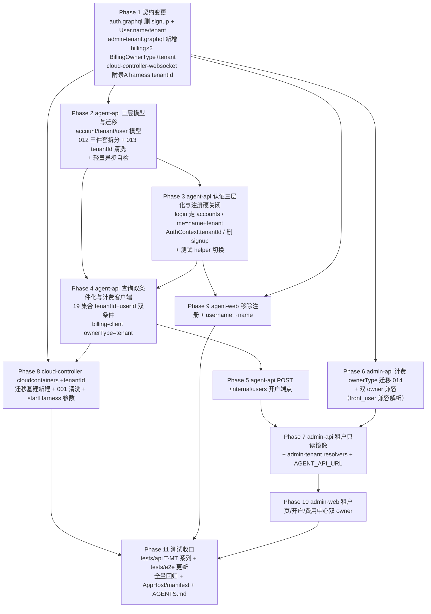

# 多租户一期（三层帐号体系与数据按租户隔离） - 实现计划

**关联 Proposal**: `docs/engineering/proposals/20261027-feat-multi-tenant-phase1.md`（v1.3，PR #330 APPROVED）
**关联 PRD**: `docs/product/draft/20261027-multi-tenant-phase1.md`（v1.3）
**需求总分支（feat-branch）**: `feat/multi-tenant-phase1`（基于 `origin/main`，需求总 PR #330）
**计划提交分支**: `feat/multi-tenant-phase1`（本文件随需求总分支提交）
**创建日期**: 2026-10-27
**计划版本**: v1.0

**版本说明**：

- v1.0（2026-10-27）首版。对应 PRD v1.3 / 提案 v1.3（PR #330 评审 APPROVED 无附加修改意见；前三轮 CHANGES_REQUESTED 已在 v1.1/v1.2/v1.3 逐条落实：三层帐号模型、关联方向反转 + 后台不做多租户与计费双 owner、复制新增 tenantId 保留 userId 筛选）。
- §3 计划期裁决以**当前需求总分支代码事实**为准（2026-10-27，0fe5f045）：重点校正 ① cloud-controller 无迁移基建（需新建）；② admin-api 无 AGENT_API_URL 配置项（提案「沿用既有配置项」不存在，需新增）；③ 提案 §4.1 唯一索引备注与决策 D6 不一致（按 D6 保留 userId 维度）；④ auth 契约现状暴露 `User.username` 且 agent-web 消费（切换 name 的前端面）；⑤ tests/api/tests/e2e 大量套件依赖 signup 造用户（测试引导切换）。

## 1. 实现顺序



依赖说明：

- **Phase 1 契约**是所有实现的唯一裁决面，独立提交（`docs(contracts): ...`）；契约未合入前不开始实现 Phase。
- **Phase 2（模型与迁移）**只依赖契约；**Phase 3（认证）**依赖 Phase 2 的 accounts/tenants 模型；**Phase 4（双条件化）**依赖 Phase 3 的 `AuthContext.tenantId` 与 `requireTenantId`，工作量最大，可按集合族拆并行子分支。
- **Phase 6（admin-api 计费）**与 Phase 2-5 并行（不同服务）；**Phase 7** 依赖 Phase 5（开户转发联调）与 Phase 6（余额聚合口径），镜像模型与只读查询可先并行开发。
- **Phase 8（cloud-controller）**依赖 Phase 1（附录 A 口径）与 Phase 4 的 `startHarness` 下发对齐；与 Phase 5-7 并行。
- **Phase 9（agent-web）**依赖 Phase 1 契约（编译期暴露 signup 残留引用）与 Phase 3（login/me 响应形态）；**Phase 10（admin-web）**依赖 Phase 7。
- **Phase 11** 在各实现合并回主实现分支后收口；测试 helper 切换（signup → 内部开户）前置在 Phase 3 同步完成（否则删 signup 即红）。
- 发布顺序约束（提案 §6.2）：**admin-api（front_user 兼容解析先行）→ agent-api → cloud-controller → 前端**。

### 1.1 开发分支与合并顺序

| 分支 | 范围 | 基于 | 合并目标 |
|------|------|------|---------|
| `feat/multi-tenant-phase1` | PRD / 提案 / 本计划（需求总分支） | `origin/main` | 需求总 PR #330 |
| `feat/multi-tenant-phase1-impl` | 契约 + 全部实现 + 测试（主实现分支） | 需求总分支 | 需求总分支（评审通过后随需求总 PR 入 main） |
| `impl/mt-<子项目>`（可选） | 单 Phase 并行开发分支 | `feat/multi-tenant-phase1-impl` | `feat/multi-tenant-phase1-impl` |

- 主实现分支内按 Phase 顺序分提交：`docs(contracts)` → `feat(agent-api)`（模型迁移 → 认证 → 双条件 → 开户）→ `feat(admin-api)` → `feat(cloud-controller)` → `feat(agent-web)` / `feat(admin-web)` → `test:`。
- 并行子项目分支（z-coding「编写实现并行 subagent」）：`servers/agent-api`（Phase 2-5）、`servers/admin-api`（Phase 6-7）、`servers/cloud-controller`（Phase 8）、`apps/*`（Phase 9-10）可各自从主实现分支切出，完成后 merge 回主实现分支。
- **禁止 rebase/squash，只允许 merge**（z-git 规范）。合并顺序：**契约 → agent-api → admin-api → cloud-controller → apps → tests**。

### 1.2 开发模式与规范加载

- 全部 Phase 采用 TDD（红-绿-重构）：先写测试（RED）→ 最小实现（GREEN）→ 重构。
- 编码前加载：`docs/engineering/common-rules.md`、`docs/engineering/backend-rules.md`（后端 Phase）、`docs/engineering/frontend-rules.md`（Phase 9/10）。
- 目录级 `AGENTS.md`：`servers/agent-api/AGENTS.md`、`servers/cloud-controller/AGENTS.md`、`apps/agent-web/AGENTS.md`、`apps/admin-web/AGENTS.md`、`tests/api/AGENTS.md`、`tests/e2e/AGENTS.md`、`docs/engineering/plan/AGENTS.md`。
- `servers/admin-api` 无独立 `AGENTS.md`，沿用根 `AGENTS.md` 与 engineering 规范；`packages/agent-controller`、`servers/controller-api`、`aspire/AgentGear.AppHost`（除 Phase 11 环境注入外）本期零改动。
- **写方单一纪律**：`accounts`/`users`/`tenants` 写方仅 agent-api（含 `/internal/users`）；`cloudcontainers` 写方仅 cloud-controller；`billing*` 写方仅 admin-api；admin-api / agent-api 的只读镜像模型 schema 注释标注「与写方同步演进」（沿用 `cloud-host.ts` 镜像惯例）。

## 2. 命令参考

```bash
# 服务编排（根目录；测试服务只用 Aspire，禁止直接 docker 命令）
aspire start
aspire wait agent-api admin-api cloud-controller
aspire describe agent-api
aspire stop

# 单服务单测 / 构建
cd servers/agent-api && npm ci && npm test && npm run build
cd servers/admin-api && npm ci && npm test && npm run build
cd servers/cloud-controller && npm ci && npm test && npm run build
cd apps/agent-web && npm ci && npm test && npm run build
cd apps/admin-web && npm ci && npm test && npm run lint && npm run build

# 跨服务 API 测试（先 aspire start；地址按 aspire describe 替换）
cd tests/api
API_URL=http://localhost:10001/graphql \
ADMIN_API_URL=http://localhost:10003/graphql \
CONTROLLER_API_URL=http://localhost:<controller-api-port> \
CLOUD_CONTROLLER_URL=http://localhost:10004 \
INTERNAL_API_TOKEN=<与 internal-api-token 一致> \
CLOUD_CONTROLLER_INTERNAL_TOKEN=<同上> \
ADMIN_INITIAL_PASSWORD=<aspire 启动日志或 Parameters 注入> \
MONGODB_URI=<aspire describe mongodb；自签 dev cert 追加 tlsAllowInvalidCertificates=true> \
npm test

# E2E（串行，workers=1 已写死；地址按 aspire describe 替换）
cd tests/e2e
BASE_URL=http://localhost:<agent-web-port> \
ADMIN_WEB_URL=http://localhost:<admin-web-port> \
API_URL=http://localhost:10001/graphql \
ADMIN_API_URL=http://localhost:10003/graphql \
INTERNAL_API_TOKEN=<与 internal-api-token 一致> \
MONGODB_URI=<aspire describe mongodb> \
npx playwright test

# 迁移手工核对（Aspire Mongo）
mongosh "<MONGODB_URI>" --eval '
  db.users.findOne({}, {username:1,name:1,tenantId:1,accountId:1,passwordHash:1});
  db.accounts.findOne(); db.tenants.findOne();
  db.sessions.findOne({}, {userId:1,tenantId:1});
  db.billingaccounts.findOne({}, {ownerType:1,ownerId:1,cashBalance:1,giftBalance:1});'
```

## 3. 计划期裁决（提案与代码事实偏差的落地口径）

> 以下裁决以**当前需求总分支代码事实**（0fe5f045）为准。提案中与之不一致或含混的描述在实现期按本节执行，**不回改提案**；验收报告逐条登记。

### 3.1 事实校正（提案描述与代码事实的偏差）

| # | 提案描述 | 代码事实 | 本计划口径 |
|---|---------|----------|-----------|
| F1 | §2.3：cloud-controller「迁移由 cloud-controller 侧执行」 | `servers/cloud-controller/src/` **无 migrations 目录与 runner**（既有迁移全在 agent-api / admin-api）；agent-api 账本为默认集合 `migrations`，admin-api 为独立集合 `admin_migrations`（含锁归属 `owner`，改进版） | cloud-controller **新建迁移基建**：`src/migrations/{runner.ts,models.ts}` 按 admin-api 改进版复刻（独立账本集合 `cloud_controller_migrations`、锁归属、5 分钟锁 TTL），迁移编号 001 起步：`001-cloudcontainers-tenant-id-backfill(.test).ts`；`index.ts` 启动时 `runMigrations` 后再 listen |
| F2 | §9.2：「admin-api 增加对 agent-api `/internal/users` 的调用地址配置，沿用既有 agent-api 内部地址配置项」 | admin-api `config/index.ts` **无 AGENT_API_URL 配置项**（grep 无结果；`AGENT_API_URL` 仅存在于 cloud-controller，AppHost.cs:214 注入） | admin-api `config/index.ts` **新增** `agentApiUrl`（env `AGENT_API_URL`，可空、不 fail-fast——与 `cloudControllerUrl` 同口径；未配置时 `adminCreateFrontUser` 返回明确错误 `AGENT_API_UNAVAILABLE`）；AppHost.cs adminApi 构建器追加 `.WithEnvironment("AGENT_API_URL", agentApi.GetEndpoint("http"))`；`aspire/manifest` 随 `aspire publish` 重新生成 |
| F3 | §3.1 契约 1：`User` 移除登录字段暴露、新增 `name`/`tenant`——「原本也未暴露」 | 现行 `contracts/auth.graphql` **`User.username` 已暴露**，且 agent-web 消费：`stores/auth.ts` `User{ id, username }`、`Sidebar.tsx:44/520` username prop、`SettingsPage.tsx:144`、`LoginPage`/`RegisterPage` 响应映射 | 契约按提案执行（`User.username` 移除、`name`+`tenant` 新增）；agent-web **同步切换 username→name**（auth store User 类型、login 响应映射、Sidebar/SettingsPage 展示名语义）；`me` resolver 改为查库返回 `{id,name,tenant,createdAt}`（现状直接返回 `currentUser`，`createdAt` 缺失，顺带修正）；`login` 的 `AuthPayload.user` 同形态 |
| F4 | §1.2/§3.1：契约删 signup | tests/api `src/admin-api/helpers.ts:122` **`signupUserToken()` 经 signup 造用户**；tests/e2e 多个 spec（auth/settings-controller/session 等）经 UI 或 API 注册造用户 | 测试引导切换：`tests/api/src/admin-api/helpers.ts` 新增 `createFrontUser(username,password)`——`POST {API_URL}/internal/users`（Bearer `INTERNAL_API_TOKEN`）创建 + `login` 取 token，**逐调用点替换 signup**；tests/e2e `helpers.ts` 同口径（经 admin-api `adminCreateFrontUser` + admin 登录，或 internal 端点）；agent-api auth 套件 signup 用例删除并新增「introspection 无 signup」断言；e2e `auth.spec.ts`「注册新用户」用例删除、新增「无注册入口」断言。**helper 切换与 Phase 3 删 signup 同提交** |
| F5 | §3.1 契约 3：`BillingOwnerType` 增 `tenant` | admin-api `models/billing-account.ts:3` `BILLING_OWNER_TYPES=['front_user','admin_user']`，而 `models/billing-api-key.ts:14` **内联枚举未复用常量**；`routes/internal-billing.ts` 4 处 ownerType 白名单校验（:83/:306/:319/:430） | 枚举统一收口 `BILLING_OWNER_TYPES`（billing-api-key.ts 改为引用）并增 `'tenant'`；internal-billing 白名单 4 处扩展 `tenant`；**front_user 兼容解析归一到 route 层**：`ownerType==='front_user'` 的读请求按同 ownerId 的 `tenant` 行解析（迁移 014 保证 ownerId 不变），写请求（充值/扣费）不接受 `front_user`（400 `INVALID_OWNER_TYPE`） |
| F6 | §4.1 表格备注：「唯一索引如 `mcp_servers.{userId,name}` 同步扩展为 `{tenantId,name}`」 | 与 v1.3 版本说明及决策 D6「唯一索引扩展**保留 userId 维度**（如 `{tenantId,userId,name}`）」**不一致**；全量核对后带 userId 的唯一索引共 3 个：`mcp_servers {userId,name}`、`githubaccounts {userId,githubUserId}`、`user_commit_settings {userId}`（field-level unique + 迁移命名索引 `uniq_user_commit_setting` 双声明） | 按 D6 与评审意见执行：唯一索引扩展为 `mcp_servers {tenantId,userId,name}`、`githubaccounts {tenantId,userId,githubUserId}`、`user_commit_settings {tenantId,userId}`；**013 只新增不删除**（既有索引零改动，personal 期 tenantId==userId 语义等价冗余，二期再收敛）；其余集合仅新增 `{tenantId:1}` 普通索引（不含 userId 的唯一索引不动：cloud_host_github_bindings.controllerId、cloud_host_issues_linkages、issue_workflow_triggers、workflow_pr_handlers 等）。§4.1 表格备注视为笔误，验收登记 |
| F7 | §2.3：「中间件直读 `user.tenantId` 入 AuthContext」 | `middleware/auth.ts` `authenticateUser` `.select('username')`，返回 `{id,username}`；`AuthContext.currentUser{ id, username }`；grep 全仓 `currentUser.username` **无消费面**（`me` 直接透传 currentUser） | `authenticateUser` 改 `.select('tenantId name')`，`currentUser` 改 `{ id, tenantId, name }`；`AuthContext` 增 `tenantId: string \| null`（一级回退：`user.tenantId ?? userId`，personal 恒等）；新增 `requireTenantId(context)` helper（缺失抛 `Not authenticated` 同族错误）；40+ 处 `currentUser.id` 消费面零改动 |
| F8 | §1.2/§1.3 contracts 范围：auth / admin-tenant / billing×2 / 内部 REST 说明 | `startHarness` 的 `POST /internal/containers` harness 参数面在 `contracts/cloud-controller-websocket.md` 附录 A——**提案 contracts 范围未列该文件**，但 cloudcontainers 写入口径（+tenantId）依赖它 | Phase 1 契约增补**包含 `contracts/cloud-controller-websocket.md`**：附录 A harness 参数表新增 `tenantId`（必填，与 userId 同值）与落库口径句；cloud-controller 兼容回退：harness 请求缺 `tenantId` 时回退 `=userId` 并 warn（一期恒等；发布顺序已保证新 agent-api 先上线，回退仅兜底） |
| F9 | §6.2：「迁移在各自服务启动时执行完成再对外服务」 | 既有 runner **逐迁移吞错**（失败仅 console.error、不记录账本、继续下一条），服务仍 listen | 012/013/014/001 迁移函数**逐记录幂等可重跑**（重跑只补齐缺失）；runner 既有语义零改动（失败不重跑当期、重启重试）；**启动后轻量异步自检**兜底：带索引 `countDocuments` + `find().limit(100)` 抽样（孤儿行/缺 account/缺 tenant/缺 tenantId/余额抽样），异常仅告警不阻断；资金零差错 = 014 仅枚举改写（金额字段不动）+ 自检余额抽样核对。全量核对走离线脚本而非启动自检（评审要求） |
| F10 | §4.1：agent-api 19 集合 + cloud-controller cloudcontainers | agent-api `models/cloud-container.ts` 是 **cloudcontainers 只读镜像**（写方 cloud-controller），其 schema 亦需同步 `tenantId` 字段否则读侧字段丢失 | Phase 8 同步改 agent-api `models/cloud-container.ts`（只读镜像 +tenantId，注释标注与 cloud-controller 同步演进）；19 集合清单与提案一致（grep 核对：session/controller/controller-key/controller-workspace/gateway/mcp-server/mcp-session-endpoint/cloud-host/cloud-host-github-binding/cloud-host-issues-linkage/cloud-host-setup-operation/configured-workflow/workflow-instance/workflow-pr-handler/workflow-template/issue-workflow-trigger/todo-item/user-commit-setting/github-account） |

### 3.2 设计裁决（提案留白/含混处）

1. **`me`/`login` 的 tenant 透出形态**：`User.tenant` 为字段级 resolver——按 `user.tenantId` 查 `tenants` 得 `{id,name,type,memberCount}`，`memberCount = User.countDocuments({tenantId})`（一期恒 1）；resolver 必须登记 `graphql/resolvers/index.ts` 的 `User` 键（backend-rules 陷阱：字段级 resolver 不登记线上不生效）。
2. **用户名/密码校验规则单一来源**：`accounts` 承载 username 2-20 / password ≥6 校验（原 signup 规则逐字）；`/internal/users` 复用同一校验函数（`services/auth.ts` 新增 `assertUsernamePasswordRules`），错误文案与既有一致（`Username already taken` / `Username must be between 2 and 20 characters` / `Password must be at least 6 characters`）。
3. **012 幂等判据**（逐 user 三步骤，重跑只补齐）：① `accounts` 按 `username` 存在性判缺（存在则取其 `_id` 回填 user.accountId）；② `users.tenantId`/`accountId` 已设置则跳过 $set；③ `tenants` 按 `_id == user._id` 存在性判缺。迁移完成校验：无 account 用户数=0、无 tenant 用户数=0、`user.tenantId != user._id` 数=0。
4. **013 清洗口径**：逐集合 `updateMany({ userId: { $exists: true }, tenantId: { $exists: false } }, { $set: { tenantId: '$userId' } })`——MongoDB 聚合管线更新或应用侧批处理（runner 环境用应用侧批量：`find` 分页 + `bulkWrite`，每批 500，进度日志）；userId 类型为 String 的集合直接同值复制，ObjectId 同理（personal 期值恒等）。
5. **双条件化写法**：查询 filter 由 `{ userId: <原取值> }` 改 `{ tenantId: requireTenantId(context), userId: <原取值> }`——原 userId 取值逻辑一字不动，tenantId 叠加；写入同时落 `userId` 与 `tenantId`（同值复制）；跨租户访问统一抛 `Not found`（不泄露存在性）；`respondPermission`/`respondElicitation` 终态写入不变量（filter 含 userId + resolution）**叠加 tenantId**；`TodoService` 既有「缺 userId 拒绝写入」防御保留，补「缺 tenantId 拒绝写入」。
6. **开户端点幂等**（按 username）：三件套已完整存在 → 200 返回既有视图；半完成按缺失步骤补齐（以 `accounts.username` / `users.accountId` / `tenants._id` 存在性判缺）；用户名唯一冲突 → 409 `USERNAME_TAKEN`；计费账户经 `/internal/billing/account` get-or-create（天然幂等）。错误体 `{ error: '<UPPER_CODE>' }`（与 `internal-cloud-host.ts` 口径一致）。
7. **计费兼容解析窗口**：发布顺序 admin-api → agent-api → cloud-controller；窗口内旧 agent-api 仍传 `front_user` 读 → F5 兼容解析兜底；旧 agent-api 不传 tenantId 的写入不会发生（写入双条件化与 billing-client 切换同 Phase 4 一次发布）。
8. **agent-web 展示名**：`Sidebar`/`SettingsPage` 展示 `user.name`（迁移后=原 username，用户无感知）；`AuthPayload.user`/`me` 消费点（auth store、LoginPage）同步；`RegisterPage.tsx`、`/register` 路由、`LoginPage` 注册链接一并删除，全仓 grep `signup|RegisterPage|/register` 清零（测试/mock 同步）。
9. **admin-web 费用中心**：保持计费账户视角——`BillingPage` 检索条件下拉扩展 `tenant`（`adminBillingAccounts(ownerType:)` 既有入参），充值 mutation 零改动；新增「按租户检索」入口：`adminTenants` 选租户 → 取其 tenant 计费账户 → 既有充值对话框。
10. **AGENTS.md 同步面**（随各 Phase 同提交，不留过期口径）：`servers/agent-api/AGENTS.md`（三层模型/AuthContext/双条件口径/开户端点）、`servers/cloud-controller/AGENTS.md`（cloudcontainers tenantId 与迁移基建）、`apps/agent-web/AGENTS.md`（注册移除、展示名）、`apps/admin-web/AGENTS.md`（租户页与开户）、`tests/api/AGENTS.md` + `tests/e2e/AGENTS.md`（auth 套件清单更新）、`docs/engineering/AGENTS.md`（plan 索引，随本文件提交完成）。

## 4. 关键约束（提案 §1.3/§5/§6，实现期不得回退）

- **契约先行**：全部 GraphQL/内部 REST 口径以 Phase 1 契约文件为准；实现期发现偏差按 §3 裁决登记，不回改提案。
- **userId 字段与筛选全保留**：会话/工作流/云电脑/待办通知等场景本期仍跟创建 userId 走；tenantId 为**复制新增**字段（非 rename）；全部查询 `tenantId + userId` 双条件；上线前行为不变（评审明确要求，D6）。
- **原登录字段暂保留**：`users.username/passwordHash` 与其唯一索引一期不下线；迁移 012 只复制不删除；运行时不再使用（login 走 accounts）。
- **写方各自单一**：accounts/users/tenants 写方仅 agent-api；admin-api 一律只读镜像 + `/internal/users` 转发；cloudcontainers 写方仅 cloud-controller；billing 写方仅 admin-api。
- **后台不做多租户设计**：admin_users 不建租户、管理面无租户隔离；费用中心保持计费账户视角，`tenant` 仅作为新增 owner 类型与 `admin_user` 并存；admin_user 计费链路（查询/充值/扣费/对账）零改动。
- **余额零改动即完成迁移**：014 仅 `front_user→tenant` 枚举改写；ownerId/余额/流水/冻结/`appliedLedgerIds`/`invoiceSeq` 全部不变；任何金额变化视为迁移失败。
- **注册硬关闭**：契约 + resolver + 前端三层同时移除，无 feature flag 软关闭、无运行时分支残留（D4）。
- **个人专属租户硬约束**：无删除/加成员 API（契约层即不存在入口）；`_id` 复用 userId（D1）；token 载荷仍为 userId，已发 token 不失效（D2）。
- **启动自检轻量化**：带索引计数 + 限量抽样 + 异步执行，耗时不随数据量线性增长；不阻塞服务就绪（评审要求）。
- **测试纪律**：新增代码单测覆盖率 ≥ 80%；API 与 E2E 串行执行；测试服务只用 Aspire 编排；每个带 tenantId 的集合至少一条隔离 API 用例。

## 5. Phase 计划

### Phase 1：契约变更（0.5d）

| 文件 | 变更 |
|------|------|
| `contracts/auth.graphql` | 删 `Mutation.signup`；`User` 移除 `username`、新增 `name: String!` / `tenant: Tenant!`；新增 `Tenant { id, name, type: TenantType!, memberCount: Int! }` 与 `enum TenantType { personal team }` |
| `contracts/admin-tenant.graphql` | **新增**（提案 §3.1 契约 2 逐字）：`AdminTenant`/`AdminTenantUser`/`AdminTenantDetail`、`adminTenants(keyword,page,pageSize)`、`adminTenant(id)`、`adminCreateFrontUser(username,password)`；头部注释写明后台不做多租户设计、模型口径（tenant→users / account→users 一对多）与 `POST /internal/users` 转发 |
| `contracts/billing.graphql` | `BillingOwnerType` 增 `tenant`；注释标明 `front_user` 已废弃（存量行由迁移转 tenant，仅历史兼容） |
| `contracts/admin-billing.graphql` | `BillingOwnerType` 增 `tenant`；`adminBillingAccounts(ownerType:)` 支持 `admin_user`/`tenant` 过滤；内部 REST 注释补 `GET /internal/billing/account` 的 `front_user` 兼容解析口径（读兼容、写拒绝） |
| `contracts/cloud-controller-websocket.md`（F8） | 附录 A `POST /internal/containers` harness 参数表新增 `tenantId`（必填，String，与 userId 同值）；落库口径句补 `cloudcontainers.tenantId`；兼容回退句（缺 tenantId 回退=userId + warn） |

**完成判据**：契约 5 文件口径与提案 §3 一致、无残留歧义；单次提交 `docs(contracts): multi-tenant phase1 auth/admin-tenant/billing/cloud-controller 契约变更`。

### Phase 2：agent-api 三层模型与迁移（2d，核心）

| 文件 | 变更 |
|------|------|
| `servers/agent-api/src/models/account.ts` | **新增** Account：`username`（String 唯一、2-20）、`passwordHash`（String，bcrypt）；**不含 userId**；timestamps |
| `servers/agent-api/src/models/tenant.ts` | **新增** Tenant：`_id`（personal 复用 user `_id`）、`name`（唯一索引）、`type`（`personal`/`team`）；**无成员列表**；timestamps |
| `servers/agent-api/src/models/user.ts` | 新增 `name`（String）、`tenantId`（ObjectId ref Tenant，index）、`accountId`（ObjectId ref Account，index）；**保留** `username/passwordHash` 原字段与唯一索引（D10） |
| `servers/agent-api/src/migrations/012-account-user-tenant.ts` | **新增**：逐 user 三步（复制建 account → $set user{name=username,tenantId=_id,accountId} → 建 personal tenant）；按 §3.2 裁决 3 幂等判据；批处理 500 + 进度日志；完成校验三项计数=0 |
| `servers/agent-api/src/migrations/012-account-user-tenant.test.ts` | **新增** T-MIG12a~f：三件套齐全（account 可验密、user.tenantId==userId、**原登录字段保留**）、幂等重跑、半完成补齐（缺 account/缺 tenant/缺 user 字段各一）、username 冲突计数、批处理多页 |
| `servers/agent-api/src/migrations/013-tenant-id-backfill.ts` | **新增**：19 集合逐集合清洗（§3.2 裁决 4）+ 索引扩展（F6：3 个唯一索引扩展 + 逐集合 `{tenantId:1}` 普通索引，createIndex 幂等） |
| `servers/agent-api/src/migrations/013-tenant-id-backfill.test.ts` | **新增** T-MIG13a~e：逐集合清洗（userId 保留、tenantId 同值）、幂等重跑零变更、唯一索引扩展清单断言（{tenantId,userId,name} / {tenantId,userId,githubUserId} / {tenantId,userId}）、缺 userId 行跳过 |
| `servers/agent-api/src/services/tenant-self-check.ts` | **新增**：启动后轻量异步自检（F9）——带索引 countDocuments（users 缺 account/缺 tenant、各集合缺 tenantId 行数）+ `find().limit(100)` 抽样（user.tenantId 与 userId 同值、billing 余额抽样由 admin-api 侧 014 自检分担）；异常仅 warn；`setImmediate` 挂起不阻塞 listen |
| `servers/agent-api/src/index.ts` | 迁移数组登记 012/013；自检在服务就绪后异步触发 |
| `servers/agent-api/AGENTS.md` | 新增「三层帐号模型与租户隔离」段（模型口径、AuthContext、双条件纪律、自检） |

**完成判据**：单测全绿；Aspire 冷启动（含存量数据夹具）后 `users` 三件套齐全、19 集合 tenantId 回填、索引清单就位；自检日志异步出现且无计数异常；`users.username` 唯一索引与原字段仍在。

### Phase 3：agent-api 认证三层化与注册硬关闭（1d）

| 文件 | 变更 |
|------|------|
| `servers/agent-api/src/services/auth.ts` | 新增 `assertUsernamePasswordRules(username,password)`（规则与文案同原 signup）；`signToken/verifyToken` 零改动（载荷 userId 不变，D2） |
| `servers/agent-api/src/middleware/auth.ts` | `authenticateUser` 改 `.select('tenantId name')`；返回 `{ id, tenantId, name }`（F7） |
| `servers/agent-api/src/graphql/resolvers/auth.ts` | `AuthContext.currentUser` 改 `{ id, tenantId, name }`；新增 `requireTenantId(context)`；`login` 走 `Account.findOne({username})` → bcrypt → `User.findOne({accountId})` → signToken；`me` 改查库（F3）；**删 `signup`** |
| `servers/agent-api/src/graphql/schemas/auth.ts` | 同步 Phase 1 契约（User.name/tenant、Tenant/TenantType、删 signup） |
| `servers/agent-api/src/graphql/resolvers/index.ts` | 登记 `User` 字段级 resolver（`tenant`：按 tenantId 查 Tenant + memberCount，§3.2 裁决 1） |
| `servers/agent-api/src/graphql/resolvers/auth.test.ts`（新建或扩展） | T-AUTH1~8：原用户名密码登录成功（account 路径）、错误密码/不存在用户文案不变、token 载荷 userId 不变、`me` 返回 name+tenant（personal 单成员）、未认证 me=null、introspection 无 signup、requireTenantId 回退 |
| `tests/api/src/admin-api/helpers.ts` + `tests/api/src/agent-api/auth.test.ts` | **同提交**切换测试引导（F4）：`createFrontUser` helper；signup 用例删除、新增「无 signup 契约」断言；login/me 用例改断言 name/tenant |
| `tests/e2e/src/helpers.ts` + `auth.spec.ts` | **同提交**：注册造用户改走后台开户 helper；「注册新用户」用例删除、新增「登录页无注册入口 + `/register` 直达不可用」 |

**完成判据**：单测 + tests/api auth 套件 + tests/e2e auth 套件全绿；存量 token（7d 有效期内）升级后仍可用（载荷不变）；`grep -rn "signup" contracts/ servers/agent-api/src apps/agent-web/src` 仅剩历史注释零引用。

### Phase 4：agent-api 查询双条件化与计费客户端（2.5d，核心）

| 文件 | 变更 |
|------|------|
| `servers/agent-api/src/models/*.ts`（19 集合 + `cloud-container.ts` 镜像在 Phase 8） | 逐集合新增 `tenantId: { type: <对齐 userId>, required: true, index: true }`（F6/F10） |
| `servers/agent-api/src/services/*.ts`（40 个含 userId 文件） | 逐集合 checklist 双条件化（§3.2 裁决 5）：session / controller / controller-key / controller-workspace / gateway / mcp-server / mcp-session-endpoint / cloud-host 族（host/github-binding/issues-linkage/setup-operation）/ configured-workflow / workflow-instance / workflow-pr-handler / workflow-template / issue-workflow-trigger / todo / user-commit-setting / github-account；写入同时落 userId+tenantId |
| `servers/agent-api/src/graphql/resolvers/*.ts`（8 个含 userId 文件 + home.ts） | resolver 层归属校验同步双条件；`homeOverview` 聚合各 service 入参透传 tenantId |
| `servers/agent-api/src/services/todo.ts` | 既有「缺 userId 拒绝写入」保留，补「缺 tenantId 拒绝写入」；`markElicitationResolved`/`markTodoAsResponded` 终态不变量叠加 tenantId |
| `servers/agent-api/src/services/billing-client.ts` | ownerType 联合类型 `'front_user' \| 'admin_user'` → `'tenant' \| 'admin_user'`；全部调用点 `'front_user'` → `'tenant'`（cloud-host-service getAccount/charges/refunds、resolvers/billing.ts 我的费用派生）；`ownerName` 传租户名 |
| `servers/agent-api/src/services/cloud-host-service.ts` | 创建/停止/删除/列表归属双条件；`startHarness` 下发 `tenantId`（与 userId 同值，对齐 Phase 8）；`billingClient.getAccount('tenant', tenantId)` |
| 各 `.test.ts` | 双条件化后行为回归：personal 期（tenantId==userId）结果集与改造前一致；跨租户访问 `Not found`；隔离单测逐集合至少一条（单元级 mock 断言 filter 含 tenantId+userId） |

**完成判据**：`grep -rn "userId" servers/agent-api/src/{services,graphql}` 过滤点逐一登记 checklist 并全部双条件化；既有单测零回归（行为不变即最强回归）；新增隔离单测全绿；单测覆盖率 ≥80%。

### Phase 5：agent-api `POST /internal/users` 开户端点（0.5d）

| 文件 | 变更 |
|------|------|
| `servers/agent-api/src/routes/internal-users.ts` | **新增**：Bearer `INTERNAL_API_TOKEN`；`assertUsernamePasswordRules` → Account（唯一冲突 409 `USERNAME_TAKEN`）→ User（tenantId=新 \_id）→ Tenant（\_id=userId, personal）→ `/internal/billing/account` get-or-create（`ownerType=tenant, ownerId=tenantId, ownerName=租户名`）；失败向前回滚已建文档；按 username 幂等（§3.2 裁决 6） |
| `servers/agent-api/src/index.ts` | 挂载 `app.use('/internal/users', internalUsersRouter)`（与 `/internal/cloud-hosts` 同位置） |
| `servers/agent-api/src/routes/internal-users.test.ts` | **新增** T-IU1~7：201 三件套+零余额计费账户、400 规则非法（逐文案）、409 重名、401 无 token、幂等重放 200 同视图、半完成补齐、计费账户不可达时回滚不留半套 |

**完成判据**：单测全绿；tests/api 经 helper 黑盒验证「开户 → login → me.tenant 同名 personal → 计费账户余额 0」。

### Phase 6：admin-api 计费 ownerType 迁移与双 owner 兼容（1d）

| 文件 | 变更 |
|------|------|
| `servers/admin-api/src/models/billing-account.ts` | `BILLING_OWNER_TYPES` 增 `'tenant'`（顺序 `[front_user, admin_user, tenant]`，front_user 标注废弃） |
| `servers/admin-api/src/models/billing-api-key.ts` | 内联枚举改引用 `BILLING_OWNER_TYPES`（F5） |
| `servers/admin-api/src/migrations/014-billing-owner-tenant.ts` | **新增**：`billingaccounts.updateMany({ownerType:'front_user'},{$set:{ownerType:'tenant'}})` + `billingapikeys` 同口径；幂等；断言 `admin_user` 行数零变化、金额字段抽样不变 |
| `servers/admin-api/src/migrations/014-billing-owner-tenant.test.ts` | **新增** T-MIG14a~c：仅 front_user 行改写、admin_user 行零改动（含余额/流水引用）、幂等重跑零变更 |
| `servers/admin-api/src/routes/internal-billing.ts` | 4 处白名单扩展 `tenant`；route 层 `front_user` 读兼容解析（F5）；写路径拒绝 `front_user`（400 `INVALID_OWNER_TYPE`） |
| `servers/admin-api/src/services/billing/*.ts` | ownerType 类型联合同步；**admin_user 链路零改动**（查询/充值/扣费/对账回归测试兜底） |
| `servers/admin-api/src/graphql/schemas/billing.ts` + `resolvers/billing.ts` | `BillingOwnerType` 枚举增 `tenant`；`adminBillingAccounts(ownerType:)` 过滤兼容并存 |

**完成判据**：迁移单测全绿；存量 admin_user 计费账户查询/充值/扣费/对账行为与升级前一致（回归用例）；front_user 读请求兼容解析到 tenant 行；写请求拒绝 front_user。

### Phase 7：admin-api 租户只读镜像与 admin-tenant resolvers（1d）

| 文件 | 变更 |
|------|------|
| `servers/admin-api/src/models/{account,user,tenant}.ts` | **新增**只读镜像（schema 注释「与 agent-api 同步演进」，沿用 `cloud-host.ts` 镜像惯例） |
| `servers/admin-api/src/config/index.ts` | 新增 `agentApiUrl`（F2，可空不 fail-fast） |
| `servers/admin-api/src/graphql/schemas/tenant.ts` | **新增**（admin-tenant 契约实现） |
| `servers/admin-api/src/graphql/resolvers/tenant.ts` | **新增**：`adminTenants`（keyword 名称检索 + 分页 + billingaccounts 聚合余额 + memberCount=`User.countDocuments({tenantId})`）、`adminTenant`（详情 + `User.find({tenantId})` 成员 + 经 `users.accountId` 关联 accounts 取登录名）、`adminCreateFrontUser`（转发 `POST {agentApiUrl}/internal/users`，Bearer `INTERNAL_API_TOKEN`；未配置 `AGENT_API_UNAVAILABLE`；409/400 透传映射）；全部经既有 admin JWT guard |
| `servers/admin-api/src/graphql/{schemas,resolvers}/index.ts` | 登记 tenant schema/resolver |
| `servers/admin-api/src/graphql/resolvers/tenant.test.ts` | **新增** T-AT1~8：未鉴权拒绝、列表检索/分页/余额聚合、详情成员（account 登录名关联）、开户成功/重名/非法/未配置 AGENT_API_URL、只读性（无 update/delete mutation） |

**完成判据**：单测全绿；tests/api 黑盒：admin 登录 → `adminTenants` 列出迁移后租户（余额与费用中心一致）→ `adminTenant` 成员恰 1 人 → `adminCreateFrontUser` 开户 → 新账户可 login。

### Phase 8：cloud-controller cloudcontainers +tenantId（1d）

| 文件 | 变更 |
|------|------|
| `servers/cloud-controller/src/migrations/{runner.ts,models.ts}` | **新建**（F1）：按 admin-api 改进版复刻，独立账本 `cloud_controller_migrations` |
| `servers/cloud-controller/src/migrations/001-cloudcontainers-tenant-id-backfill.ts(+test)` | **新增**：`updateMany({userId 存在, tenantId 缺失}, {$set: tenantId=userId})` + `{tenantId:1}` 索引；幂等 |
| `servers/cloud-controller/src/models/cloud-container.ts` | 新增 `tenantId: { type: String, default: null, index: true }`（对齐 userId String 类型；default null 兼容历史行至迁移完成） |
| `servers/cloud-controller/src/routes/internal-api.ts` | harness 参数校验：`tenantId` 缺省回退 `=userId` + warn（F8）；落库 tenantId |
| `servers/cloud-controller/src/index.ts` | 启动 `runMigrations` 后再 listen |
| `servers/agent-api/src/models/cloud-container.ts` | 只读镜像同步 +tenantId（F10） |
| `servers/cloud-controller/AGENTS.md` | 补迁移基建与 tenantId 口径段 |

**完成判据**：单测全绿；`POST /internal/containers{purpose:harness}` 落库 tenantId 与 userId 同值；缺 tenantId 回退 + warn；存量容器清洗完成；agent-api 读侧 `CloudContainer.tenantId` 可见。

### Phase 9：agent-web 移除注册与展示名切换（0.5d）

| 文件 | 变更 |
|------|------|
| `apps/agent-web/src/pages/RegisterPage.tsx` | **删除** |
| `apps/agent-web/src/App.tsx` | 删 `/register` 路由与 import |
| `apps/agent-web/src/pages/LoginPage.tsx` | 删注册链接；login 响应映射 `User{ id, name, tenant }` |
| `apps/agent-web/src/stores/auth.ts` | `User` 类型 `username` → `name`（F3） |
| `apps/agent-web/src/components/Sidebar.tsx`、`pages/SettingsPage.tsx` | 展示 `user.name`（展示名语义） |
| `apps/agent-web/src/graphql/*.ts` | auth 相关 query/mutation 选择集同步（me/login 返回 name + tenant）；billing 页面如展示 ownerType 则兼容 `tenant` 文案 |
| 相关 `__tests__` | 注册相关用例删除；登录/侧边栏/设置页断言 name；登录页「无注册入口」断言 |

**完成判据**：`npm run build` 编译期无 signup/RegisterPage 残留引用；单测全绿；E2E auth 套件通过。

### Phase 10：admin-web 租户管理与费用中心双 owner（1d）

| 文件 | 变更 |
|------|------|
| `apps/admin-web/src/pages/TenantsPage.tsx` | **新增**：租户列表（名称/类型/成员数/余额/创建时间）、名称检索、分页；行点击进入详情 |
| `apps/admin-web/src/pages/TenantDetailPage.tsx` | **新增**：租户概要 + 成员用户列表（用户名/创建时间）+「充值」入口（跳 BillingPage 预选该 tenant 计费账户）；**只读**：无编辑/删除/停用入口 |
| `apps/admin-web/src/pages/TenantsPage.tsx` 内开户对话框 | 用户名 + 初始密码表单（本地预校验 2-20 / ≥6）；调 `adminCreateFrontUser`；错误映射（重名/非法/AGENT_API_UNAVAILABLE） |
| `apps/admin-web/src/App.tsx` + `AdminLayout` | 路由 `/tenants`、`/tenants/:id`；侧边栏导航「租户管理」 |
| `apps/admin-web/src/pages/BillingPage.tsx` | 检索条件 ownerType 下拉扩展 `tenant`；充值入口保持计费账户视角（两类账户均可检索与充值） |
| `apps/admin-web/src/graphql/*.ts` | admin-tenant 查询/mutation 文档与类型 |
| `apps/admin-web/src/pages/__tests__/*` | TenantsPage/TenantDetailPage 渲染与只读断言、开户表单校验、BillingPage 双 owner 检索 |

**完成判据**：单测全绿；E2E 租户页/开户/充值链路通过；界面无任何租户/用户编辑删除入口。

### Phase 11：测试收口与回归（2d）

| 文件 | 变更 |
|------|------|
| `tests/api/src/agent-api/multi-tenant.test.ts` | **新增** T-MT 系列（核心验收）：T-MT1 升级登录无感知（fixtures 老用户 → login → me.tenant）；T-MT2 逐集合隔离（19 集合每集合至少一条：租户 A 写入 → 租户 B 列表/详情/修改/删除不可达，`Not found`）；T-MT3 行为回归（会话/工作流/云电脑/待办通知列表与上线前一致，仍按创建者 userId）；T-MT4 双用户同租户语义预留锚定（本期 personal 恒单成员，跳过）；T-MT5 迁移核对（MONGODB_URI 直读：三件套/余额/tenantId 回填抽样） |
| `tests/api/src/agent-api/auth.test.ts` | Phase 3 已改：login/me/无 signup |
| `tests/api/src/admin-api/tenant.test.ts` | **新增**：adminTenants/adminTenant/adminCreateFrontUser 黑盒（鉴权、检索、成员、开户 → 登录闭环、只读性 introspection 无 update/delete） |
| `tests/api/src/admin-api/billing.test.ts` | 扩展 T-B 系列：tenant 计费账户检索/充值到账；**admin_user 双 owner 回归**（查询/充值/扣费/对账与升级前一致、互不影响）；front_user 读兼容/写拒绝 |
| `tests/api/src/admin-api/helpers.ts` 等 | F4 helper 替换收尾（全仓 grep signup 清零） |
| `tests/e2e/src/auth.spec.ts`、`admin-tenant.spec.ts`（新增） | E2E-MT1 无注册入口；E2E-MT2 后台开户 → 新账户登录 → 同名租户可见；E2E-MT3 后台按租户充值 → 前台「我的费用」余额可见；E2E-MT4 双用户隔离（A 建会话 B 不可见） |
| `aspire/AgentGear.AppHost/AppHost.cs` | adminApi 注入 `AGENT_API_URL`（F2）；`aspire publish -o aspire/manifest` 重新生成 |
| `docs/engineering/AGENTS.md` + 各目录 AGENTS.md | §3.2 裁决 10 同步面收口 |

**完成判据**：`tests/api`、`tests/e2e` 串行全绿；既有套件零回归（行为不变要求）；T-MT 系列全绿；AGENTS.md 无过期口径。

## 6. 测试矩阵

### 6.1 单元测试（Vitest）

| 用例 | 文件 | 断言要点 |
|------|------|---------|
| T-MIG12a 三件套 | `012-account-user-tenant.test.ts` | account 可验密、user.name=原 username、tenantId==userId、accountId 关联、personal tenant \_id==userId、**原登录字段保留未删** |
| T-MIG12b 幂等 | 同上 | 二次 run 零变更、不重复建文档 |
| T-MIG12c 半完成补齐 | 同上 | 缺 account/缺 tenant/缺 user 字段三种半态各自补齐 |
| T-MIG12d 冲突计数 | 同上 | username 冲突数=0（accounts.username 唯一兜底） |
| T-MIG12e 批处理 | 同上 | 多页批处理全量覆盖、进度日志 |
| T-MIG13a 逐集合清洗 | `013-tenant-id-backfill.test.ts` | 19 集合逐集合：tenantId 同值复制、**userId 字段与值保留** |
| T-MIG13b 幂等 | 同上 | 二次 run 零变更 |
| T-MIG13c 唯一索引扩展 | 同上 | `{tenantId,userId,name}` / `{tenantId,userId,githubUserId}` / `{tenantId,userId}` 就位，既有索引零改动（F6） |
| T-MIG13d 普通索引 | 同上 | 其余集合 `{tenantId:1}` 就位；缺 userId 行跳过 |
| T-MIG14a 枚举改写 | `014-billing-owner-tenant.test.ts` | 仅 front_user 行 → tenant；admin_user 行零改动 |
| T-MIG14b 金额不变 | 同上 | 抽样行 cash/gift/frozen/ledger 引用不变 |
| T-MIG14c 幂等 | 同上 | 二次 run 零变更 |
| T-MIG-CC1 | `001-cloudcontainers-tenant-id-backfill.test.ts` | cloudcontainers 清洗 + 索引 + 幂等 |
| T-AUTH1~8 | `resolvers/auth.test.ts` | login 走 accounts / me=name+tenant / token 载荷不变 / 无 signup / requireTenantId |
| T-IU1~7 | `routes/internal-users.test.ts` | 开户成功/非法/重名/鉴权/幂等/半完成补齐/计费回滚 |
| T-AT1~8 | `admin-api resolvers/tenant.test.ts` | 鉴权/检索/分页/余额聚合/成员/开户转发/只读 |
| T-ISO-*（逐集合） | agent-api 各 service `.test.ts` | filter 含 tenantId+userId 双条件；跨租户 `Not found`；personal 期结果集与改造前一致 |
| T-SELF1~2 | `services/tenant-self-check.test.ts` | 自检异步不阻塞就绪；大数据量夹具下耗时有上界（带索引计数 + limit 抽样） |

### 6.2 API 测试（tests/api，Vitest + Aspire 编排）

| 用例 | 断言要点 |
|------|---------|
| T-MT1 升级登录无感知 | 存量用户（迁移产出）原密码 login → `me.name`=原用户名、`me.tenant` 同名 personal、memberCount=1 |
| T-MT2 逐集合隔离 | 19 集合每集合至少一条：跨租户列表/详情/修改/删除不可达，统一 `Not found` 不泄露存在性 |
| T-MT3 行为回归 | 会话/工作流/云电脑/待办通知的列表与操作结果与上线前一致（仍跟创建者 userId） |
| T-MT5 迁移核对 | `MONGODB_URI` 直读：三件套抽样、19 集合 tenantId 回填抽样、billing 余额抽样不变 |
| T-AT-API* admin-tenant | 列表/检索/分页/详情成员/开户 → 登录闭环/未鉴权/introspection 只读 |
| T-B 双 owner | tenant 账户检索/充值/账单/收据；admin_user 账户链路回归；front_user 读兼容/写拒绝 |
| T-IC-HARNESS 扩展 | harness 创建落库 tenantId（=userId）；缺 tenantId 回退 + warn |

### 6.3 E2E 测试（tests/e2e，Playwright，串行）

| 用例 | 断言要点 |
|------|---------|
| E2E-MT1 无注册入口 | 登录页无注册元素；`/register` 直达不可用 |
| E2E-MT2 开户闭环 | 后台开户 → 新账户登录前台 → 侧边栏展示名与同名租户上下文 |
| E2E-MT3 租户口径计费 | 后台为租户充值 → 前台「我的费用」余额/账单可见（租户口径） |
| E2E-MT4 双用户隔离 | 用户 A 建会话/工作区，用户 B 登录不可见 |
| E2E-MT5 后台租户只读 | 租户列表/详情可见且无编辑/删除/停用入口；余额与费用中心一致 |

### 6.4 实机/部署侧手工验收（登记验收报告）

- 存量库（生产快照脱敏）冷启动：012/013/014/001 迁移耗时与结果、自检异步无阻塞、余额抽样核对分文不差。
- 已签发 JWT（升级前登录态）升级后继续使用不失效；模型调用 API Key 按租户口径继续可用。
- 发布窗口演练：admin-api 新版 + agent-api 旧版（front_user 读兼容）；agent-api 新版 + admin-api 新版（tenant 全链路）。
- 欠费止损/冻结/额度检查在租户口径下行为与升级前一致。

## 7. 验收 checklist（分阶段）

**Phase 1**

- [ ] 契约 5 文件与提案 §3 口径一致；`signup` 从 auth 契约删除；`BillingOwnerType` 三值并存

**Phase 2/3**

- [ ] 012/013 幂等可重跑：三件套齐全、原登录字段保留、19 集合 tenantId 同值复制且 userId 保留、唯一索引保留 userId 维度（F6）
- [ ] 原用户名密码登录成功；token 载荷 userId 不变；`me` 返回 name+tenant；introspection 无 signup
- [ ] 自检轻量异步，耗时不随数据量线性增长
- [ ] 测试 helper 完成 signup → 内部开户切换，tests/api、tests/e2e 无 signup 依赖残留

**Phase 4/5**

- [ ] 19 集合双条件 checklist 全登记；跨租户访问统一 `Not found`；personal 期行为与上线前一致
- [ ] `billing-client` 全链路 `ownerType=tenant`；前台「我的费用」数值与升级前连续
- [ ] `/internal/users` 开户成功/幂等/回滚正确；开户 → 登录 → 同名租户 → 零余额计费账户闭环

**Phase 6/7/8**

- [ ] 014 仅枚举改写、金额零改动；admin_user 链路回归一致；front_user 读兼容/写拒绝
- [ ] adminTenants/adminTenant 只读可用、余额与费用中心一致；adminCreateFrontUser 转发正确
- [ ] cloudcontainers 落库 tenantId；cloud-controller 迁移基建就位且 001 幂等

**Phase 9/10/11**

- [ ] 前台无任何注册通道（页面/路由/契约三层）；展示名切换无残留 username
- [ ] admin-web 租户页只读、开户可用、费用中心双 owner 可检索可充值
- [ ] tests/api、tests/e2e 串行全绿；单测覆盖率 ≥80%；AGENTS.md 索引与口径无过期

## 8. 风险与回滚

| 风险 | 影响 | 缓解 |
|------|------|------|
| 双条件化遗漏过滤点 | 越权或串租户（安全红线） | 逐集合 checklist（19 集合）+ 每集合至少一条隔离 API 用例（T-MT2）+ `grep -rn "userId"` 审计收口；评审 PR 逐文件核对 |
| 迁移 012 半完成 | 用户无法登录/数据缺归属 | 逐 user 幂等判据（§3.2 裁决 3）可重跑补齐；自检异步告警；失败重跑直至校验三项计数=0 |
| 余额迁移差错 | 资金事故 | 014 仅枚举改写（金额字段不动）+ T-MIG14b 断言 + 自检抽样核对 + 部署侧全量核对脚本；`admin_user` 行零改动 |
| 发布窗口 ownerType 交错 | 计费读写 400 | 发布顺序 admin-api（兼容解析先行）→ agent-api → cloud-controller → 前端；front_user 读兼容写拒绝（F5） |
| 删 signup 破坏测试引导 | 测试大面积红 | helper 切换与 Phase 3 同提交（F4）；先改 helper 再删 resolver 的红-绿顺序 |
| 已发 token 失效 | 用户被登出 | token 载荷不变（D2）；E2E-MT1 与手工验收覆盖 |
| admin-api 镜像模型漂移 | 租户页数据失真 | schema 注释「与 agent-api 同步演进」+ PR review checklist；user/tenant 字段变更必须双服务同 PR |
| cloud-controller 新建迁移基建 | 启动链路变更风险 | 按 admin-api 改进版 runner 复刻（锁归属/独立账本）；失败吞错语义与既有服务一致；001 幂等可重跑 |
| `users.username` 与 `accounts.username` 双写不一致 | 登录口径混乱 | 运行时写方唯一（`/internal/users` 只写 accounts；users 原字段冻结）；一期不删原字段（D10），二期统一下线 |
| 自检拖慢启动 | 可用性回归 | 带索引计数 + limit 抽样 + `setImmediate` 异步；T-SELF2 大数据量夹具上界断言（评审要求） |

**回滚策略**：

1. **代码层**：迁移只新增文档与字段、不删除任何原数据（原登录字段原地保留、userId 字段保留）——回滚代码即回到单帐号模式，accounts/tenants 与 tenantId 字段闲置无副作用。
2. **计费层**：补偿迁移将 `tenant` 行改回 `front_user`（ownerId 不变、金额不动）；`admin_user` 行全程无关。
3. **契约层**：回滚需同步恢复 signup 契约与前端——按「契约 → 服务 → 前端」逆序执行；accounts/tenants 集合清理由后续期次评估。

## 9. 相关文档

- [[../proposals/20261027-feat-multi-tenant-phase1.md]] — 本期技术提案（v1.3，含决策 D1-D10）
- [[../../product/draft/20261027-multi-tenant-phase1.md]] — 本期 PRD（v1.3）
- [[20261018-feat-credits-billing.md]] — 费用中心实现计划（计费口径切换的直接前置）
- 需求来源：[GitHub Issue #329 — 多租户一期](https://github.com/Deliay/z-agent-gear/issues/329)
- 评审记录：[PR #330](https://github.com/Deliay/z-agent-gear/pull/330)（v1.0→v1.1 三层模型；v1.1→v1.2 关联方向反转 + 后台不做多租户与计费双 owner；v1.2→v1.3 复制新增 tenantId 保留 userId 筛选；v1.3 APPROVED）
- 开发规范：[[../common-rules.md]]、[[../backend-rules.md]]、[[../frontend-rules.md]]

---

## 附录 A：文件变更总览

```text
contracts/
├── auth.graphql                        # 删 signup；User.name/tenant；Tenant/TenantType
├── admin-tenant.graphql                # 新增（只读视图 + 开户转发）
├── billing.graphql                     # BillingOwnerType + tenant（front_user 废弃标注）
├── admin-billing.graphql               # BillingOwnerType + tenant；front_user 兼容解析口径
└── cloud-controller-websocket.md       # 附录 A harness 参数 +tenantId（F8）

servers/agent-api/src/
├── models/account.ts                   # 新增（username 唯一，不 ref User）
├── models/tenant.ts                    # 新增（personal _id 复用 userId，无成员列表）
├── models/user.ts                      # +name/tenantId/accountId；原登录字段暂保留
├── models/*.ts（19 集合）               # +tenantId（required + index；唯一索引扩展见 F6）
├── models/cloud-container.ts           # 只读镜像 +tenantId（F10）
├── middleware/auth.ts                  # select tenantId/name；currentUser{id,tenantId,name}
├── graphql/resolvers/auth.ts           # login 走 accounts；me 查库；删 signup；requireTenantId
├── graphql/resolvers/index.ts          # User.tenant 字段 resolver 登记
├── graphql/schemas/auth.ts             # 契约同步
├── routes/internal-users.ts            # 新增开户端点（+index.ts 挂载）
├── services/auth.ts                    # assertUsernamePasswordRules
├── services/billing-client.ts          # ownerType: front_user → tenant
├── services/cloud-host-service.ts      # 双条件 + startHarness 下发 tenantId
├── services/tenant-self-check.ts       # 新增轻量异步自检
├── services/*.ts + graphql/resolvers/*.ts  # 19 集合查询 tenantId+userId 双条件化
├── migrations/012-account-user-tenant.ts(+test)      # 三件套拆分（只复制不删除）
├── migrations/013-tenant-id-backfill.ts(+test)       # 19 集合清洗 + 索引扩展
├── index.ts                            # 迁移登记 + 自检异步触发
└── AGENTS.md                           # 三层模型与租户隔离口径段

servers/admin-api/src/
├── models/{account,user,tenant}.ts     # 只读镜像（新增）
├── models/billing-account.ts           # BILLING_OWNER_TYPES + tenant
├── models/billing-api-key.ts           # 枚举改引用 BILLING_OWNER_TYPES（F5）
├── config/index.ts                     # +agentApiUrl（F2）
├── graphql/schemas/tenant.ts           # 新增
├── graphql/resolvers/tenant.ts         # 新增（adminTenants/adminTenant/adminCreateFrontUser）
├── graphql/{schemas,resolvers}/index.ts # 登记
├── routes/internal-billing.ts          # 白名单 + tenant；front_user 读兼容/写拒绝
├── migrations/014-billing-owner-tenant.ts(+test)     # 仅 front_user→tenant
└── services/billing/*.ts               # ownerType 类型同步（admin_user 链路零改动）

servers/cloud-controller/src/
├── migrations/{runner,models}.ts       # 新建迁移基建（独立账本，F1）
├── migrations/001-cloudcontainers-tenant-id-backfill.ts(+test)
├── models/cloud-container.ts           # +tenantId
├── routes/internal-api.ts              # harness tenantId 校验与回退（F8）
├── index.ts                            # 启动 runMigrations
└── AGENTS.md                           # 迁移基建与 tenantId 口径段

apps/agent-web/src/
├── pages/RegisterPage.tsx              # 删除
├── App.tsx                             # 删 /register 路由
├── pages/LoginPage.tsx                 # 删注册链接；响应映射 name/tenant
├── stores/auth.ts                      # User{username→name}
├── components/Sidebar.tsx / pages/SettingsPage.tsx  # 展示名切换
└── graphql/*.ts + __tests__            # 选择集与断言同步

apps/admin-web/src/
├── pages/TenantsPage.tsx               # 新增（列表/检索/分页/开户对话框）
├── pages/TenantDetailPage.tsx          # 新增（概要/成员/充值入口；只读）
├── pages/BillingPage.tsx               # ownerType 下拉 + tenant（计费账户视角不变）
├── App.tsx / AdminLayout               # 路由与导航
└── graphql/*.ts + pages/__tests__/*    # admin-tenant 文档与测试

tests/api/src/
├── agent-api/multi-tenant.test.ts      # 新增 T-MT 系列（隔离/回归/迁移核对）
├── agent-api/auth.test.ts              # signup 用例删除；login/me 新形态
├── admin-api/tenant.test.ts            # 新增 admin-tenant 黑盒
├── admin-api/billing.test.ts           # 双 owner + 兼容解析扩展
├── admin-api/helpers.ts                # createFrontUser helper（F4）
└── cloud-controller/internal-api.test.ts # harness tenantId 落库/回退

tests/e2e/src/
├── helpers.ts                          # 造用户改后台开户（F4）
├── auth.spec.ts                        # 无用例注册；新增无注册入口断言
└── admin-tenant.spec.ts                # 新增 E2E-MT2/MT3/MT5

aspire/AgentGear.AppHost/AppHost.cs     # adminApi 注入 AGENT_API_URL（F2）
aspire/manifest/                        # aspire publish 重新生成
docs/engineering/AGENTS.md              # plan 索引追加（随本文件提交）
tests/api/AGENTS.md / tests/e2e/AGENTS.md  # auth 套件清单更新
```

## 附录 B：计划期核对记录

### B.1 代码事实核对（2026-10-27，需求总分支 0fe5f045）

| # | 核对点 | 观测 | 结论 |
|---|--------|------|------|
| B-1 | 迁移编号占用 | agent-api 001-011（011 双占用先例）；admin-api 至 013；cloud-controller 无 migrations 目录 | 012/013/014 无冲突；cloud-controller 新建基建（F1） |
| B-2 | `models/user.ts` | `username`（unique, 2-20）+ `passwordHash` + `globalPermissionTimeoutAction` | 增 name/tenantId/accountId，原字段暂保留（D10） |
| B-3 | `middleware/auth.ts` | `authenticateUser` select 仅 `username`，返回 `{id,username}`；`currentUser.username` 无消费面 | F7 改造安全 |
| B-4 | 带 userId 集合 | grep models/ 命中 20 文件 = 19 业务集合 + `cloud-container.ts`（cloudcontainers 只读镜像） | 与提案清单一致；镜像同步（F10） |
| B-5 | 带 userId 唯一索引 | `mcp_servers {userId,name}`、`githubaccounts {userId,githubUserId}`、`user_commit_settings {userId}`（field+命名双声明）；其余唯一索引不含 userId | F6 扩展清单定稿（只新增不删除） |
| B-6 | 计费 ownerType | `BILLING_OWNER_TYPES=['front_user','admin_user']`（billing-account.ts:3）；billing-api-key.ts:14 内联枚举；internal-billing.ts 4 处白名单 | F5 收口常量 + 兼容解析 |
| B-7 | agent-api billing 调用面 | `billing-client.ts` ownerType 联合 5 处；`cloud-host-service.ts:255` `getAccount('front_user', userId)`；resolvers/billing.ts、schemas/billing.ts | Phase 4 切换清单 |
| B-8 | 契约现状 | `auth.graphql` 暴露 `User.username` 且有 signup；`billing.graphql`/`admin-billing.graphql` BillingOwnerType 二值；无 admin-tenant.graphql | F3 + Phase 1 清单 |
| B-9 | 测试 signup 依赖 | `tests/api/src/admin-api/helpers.ts:122 signupUserToken()`；tests/api 8 文件、tests/e2e 10+ spec 引用 signup/register | F4 helper 切换（与 Phase 3 同提交） |
| B-10 | AppHost 配置 | cloud-controller 已有 `AGENT_API_URL` 注入（AppHost.cs:214）；admin-api 无 | F2 admin-api 新增配置 + AppHost 注入 |
| B-11 | cloudcontainers.userId | `models/cloud-container.ts:97` `userId: { type: String, default: null }` | tenantId 对齐 String；缺省回退=userId（F8） |
| B-12 | 迁移账本 | agent-api 默认集合 `migrations`；admin-api 独立 `admin_migrations`（含锁 owner） | cloud-controller 独立账本 `cloud_controller_migrations`（F1） |
