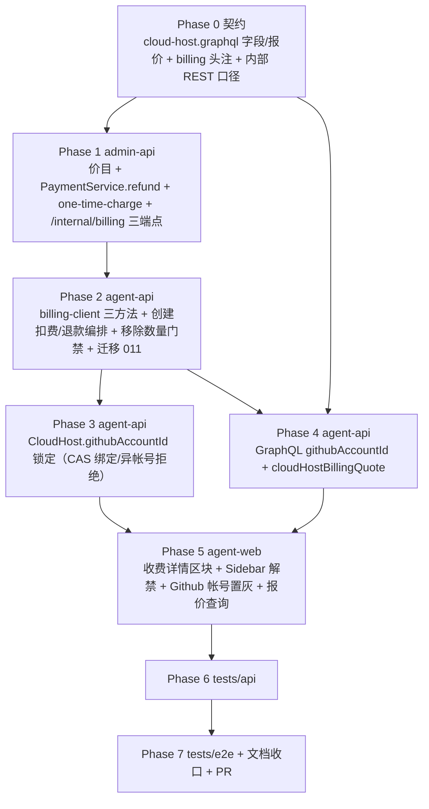

# 用户开放无限制云电脑支持 - 实现计划

**关联 Proposal**: `docs/engineering/proposals/20261027-feat-unlimited-cloud-hosts.md`（v1.0）
**关联 PRD**: `docs/product/draft/20261027-unlimited-cloud-hosts.md`（v1.0）
**需求总分支（feat-branch）**: `feat/unlimited-cloud-hosts`（需求总 PR #323）
**实现分支**: `feat/unlimited-cloud-hosts-impl`（基于需求总分支）
**创建日期**: 2026-10-27

**计划版本**: v1.0

**上游评审结论（PR #323）**：Deliay 于 2026-10-26T22:11:52Z APPROVED 产品文档与技术提案，评审无正文、无 inline comment、无修改要求，按原计划推进本实现计划。若后续复审提出修改，在对应 Phase 中落实并回评。

**版本说明**：

- v1.0 首版：与 PRD v1.0 / 提案 v1.0 对齐，把提案 §5.2 的 5 个实现点拆成 7 个 Phase；给出「上游文档 × 代码现状差异」7 条与「计划期裁决」10 条，收敛提案留白但会阻塞实现的口径（退款入账走 `PaymentService.refund` 新方法、`CreditCheckRef` 扩展 `cloud_host`、幂等键矩阵、内部 REST 错误体字段名统一 `error`、schema 索引声明与迁移双下线、基线更新清单）。
- 不改变 PRD 产品口径；契约新增 `githubAccountId`、`CloudHostBillingQuote`、`cloudHostBillingQuote`（提案已评审锁定的形状），实现 PR 描述中声明「数量放开与创建收费为行为变更，存量云电脑 githubAccountId 天然 null、创建费不补收」。

## 实现顺序



依赖说明：

- **P0 是口径基准**：`githubAccountId` / `CloudHostBillingQuote` 字段与内部 REST 错误口径先落契约（含 `contracts/billing.graphql` 头注修订），再写代码；`servers/agent-api/src/graphql/schemas/cloud-host.ts` 内联注释与契约逐字对齐。
- **P1 → P2**：agent-api 的 `createCharge/refundCharge/getPriceQuote` 依赖 admin-api 三端点先就绪（联调与 tests/api 均需两端同起）；P2 的创建编排与 terminal 退款依赖 P1 的幂等/退款语义。
- **P2 → P3**：`validateInput` 的 `githubAccountId` 归属校验（P2）先于 `createOperation` 的锁定判定（P3），同一批 `CloudHost` 字段变更一次落库。
- **P4 依赖 P2/P3**：`cloudHostBillingQuote` 聚合 `getPriceQuote`（P2 的 billing-client）与账户余额；`CloudHost.githubAccountId` resolver 透出依赖 P2 模型字段。
- **P5 依赖 P3/P4**：前端置灰读 `cloudHost.githubAccountId`、收费区块读 `cloudHostBillingQuote`，契约字段先就绪。
- **P6 依赖 P1~P5**：API 集成断言覆盖契约点；**P7 依赖 P6**，E2E 串行执行。

开发模式采用 TDD（红-绿-重构）：每个 Phase 先落失败测试（RED）再写实现（GREEN），最后重构。编码前按目录加载 `docs/engineering/common-rules.md`、`backend-rules.md`、`frontend-rules.md`、`servers/admin-api` 相关约定、`servers/agent-api/AGENTS.md`、`apps/agent-web/AGENTS.md`、`tests/api/AGENTS.md`、`tests/e2e/AGENTS.md`。

### 关键约束（实现期不得回退）

- **服务端权威扣费**：创建扣费/余额判定只信 `/internal/billing/charges`（creditCheck `reject-on-insufficient`）；前端余额/报价展示仅提示，不前置禁用创建（PRD 4.2）。
- **无机器不收费、有机器必收费**：先扣费（refId=预生成 hostId）→ 落库/拉起；拉起失败（`startHarness` 抛错或未 ready 即终态）自动退款留痕；已 ready 后销毁不退款（PRD 功能点 1 验收 5）。
- **幂等贯穿**：同一台云电脑只收一次创建费；退款幂等（`refundKey`）；重复回调/重复退款安全（裁决 1 键矩阵）。
- **数量无限制**：`activeCount` 门禁、`CLOUD_HOST_MAX_PER_USER` 配置、`uniq_active_cloud_host_per_user`（schema 声明 + DB 索引）与 `too many cloud hosts` 全部下线；保留 `userMutex` 创建串行化（防并发双击，语义从「限 1 台」退化为「创建串行」）。
- **Github 帐号锁定以服务层为准**：`cloudhosts.githubAccountId`（null=未选定）一经绑定不可改；CAS 首绑、异帐号拒绝、前端置灰仅为体验（D-5）；不提供解绑换绑（PRD 3.5 锁定关系不因解绑解除）。
- **运行期计费口径不动**：`container.minute`（1 credit/分钟）、保证金、欠费 10 分钟强拆、停止即销毁/会话只读语义全部保持不变。
- **金额整数分位**：5 credits = 500 分，跨 REST 边界经 `centsToCredits`，与既有 `money.ts` 一致。
- **旧断言基线更新是预期变更**：下表「基线更新清单」中的断言随 PRD 行为调整同步改写，不视为回归；除此之外既有用例必须零失败。
- **禁止 rebase/squash**：遵循 z-git 规范，仅允许 merge。

### 代码探查关键事实（实现时以现状为准）

- `servers/agent-api/src/services/cloud-host-service.ts` `create()`（:220-388）顺序：assertFeature → assertConfigured → validateInput → preset/负载计划 → `userMutex.runExclusive('user:'+userId)`（:234）→ **activeCount 门禁（:235-242，`this.maxPerUser` ← `config.cloudHostMaxPerUser`，默认 1）** → `billingClient.getAccount`（:244-249）→ 预生成 `cloudHostId/controllerId`（:251-253）→ ControllerKey/Controller/CloudHost 落库 → 模型快照 → `createCloudHostApiKey` → `startHarness`（:317-343，成功后 `containerStarted=true` 不再回滚）→ containerId CAS 回写（未命中 `reclaimStartedContainer`）→ `!containerStarted` 时 `rollback`（:391-413，revokeApiKeysByHost → workspace/controller/key/host 逆序清理，`Promise.allSettled` best-effort）。错误映射（:371-385）含 **11000 `uniq_active_cloud_host_per_user` 冲突 → `too many cloud hosts`（:377-384）**。
- `'too many cloud hosts'` 全量出现点：`cloud-host-service.ts:241`（主动抛）、:383（11000 映射）、:815（`CLOUD_HOST_PUBLIC_ERRORS` 白名单）；前端 `Sidebar.tsx:186`（title）、`NewCloudHostDialog.tsx:52`（`SERVER_ERROR_MESSAGES` 映射）、:485（静态提示「每用户同时最多 1 个云电脑实例」）。`Sidebar.tsx:74` `hasActiveCloudHost`（`isActiveCloudHost`，`cloud-host-status.ts:21-23`）驱动 :187 `disabled`。
- `handleTerminalLocked`（:695-733）：已终态早退分支（:701-708，幂等补 `endByController` + `revokeApiKeysByHost`）；CAS 置 FAILED/STOPPED（:711-722）；`readyAt` 字段名确认（`models/cloud-host.ts:52`，`handleReadyLocked` :639-649 置值）。**终态收尾不含任何退款逻辑**。
- `servers/agent-api/src/services/billing-client.ts`：`BillingClient`（:124）+ `request<T>`（:130，10s 超时 + Bearer `INTERNAL_API_TOKEN`）、`BillingServiceUnavailableError`（:97-108，`code='BILLING_SERVICE_UNAVAILABLE'`）、`stableErrorMessage(status)`（:111-117）状态码脱敏映射；现有方法 `getAccount/listInvoices/.../createCloudHostApiKey/revokeApiKeysByHost`（:167-294）。
- `servers/agent-api/src/models/cloud-host.ts`：`uniq_active_cloud_host_per_user` **schema 索引声明在 :63-73**（`{userId:1}` unique + `partialFilterExpression`，注释 A-5），迁移 `005-cloud-host-active-unique-index.ts` 另行 `createIndex` 双保险；**无 `githubAccountId` 字段**（全仓 grep 零命中）。`cloud_host_github_bindings.accountId`（`models/cloud-host-github-binding.ts:16`）已存在。
- `servers/agent-api/src/migrations/`：最新编号 **010，011 空闲**；`index.ts:96-108` 启动注册 `runMigrations([...])`，runner 抢锁 + `name` 去重、`run()` 失败不落记录下次重试、约定 `run()` 自身幂等；迁移测试断言 `migration.name`（`005-*.test.ts:11` 模式）。
- `servers/agent-api/src/services/cloud-host-github-service.ts` `createOperation`（:78-147）：requireCloudHost → RUNNING 检查 → `repoFullName` 正则 → `normalizeWorkspacePrefix/resolveClonePath` → **GitHubAccount 归属校验（:99-103，`findOne({_id: input.accountId, userId})`，文案「Github 账号不存在或不属于当前用户」）** → installation 授权校验 → mutex 内「已有 RUNNING operation」检查 → 三步 operation 落库。`runGitSetupStep`（:299-339）`CloudHostGithubBinding.findOneAndUpdate({controllerId}, {$set:{userId, accountId, repoFullName, targetPath}}, {upsert:true})`（:302-313，**accountId 覆盖式 `$set`，无锁定校验**）。
- `servers/agent-api/src/graphql/schemas/cloud-host.ts`（「严格对齐 contracts/cloud-host.graphql」）：`CreateCloudHostInput`（:136-143，4 字段）、`CloudHost`（:23-44）、Query（:164-176）；`resolvers/cloud-host.ts` `toCloudHostGraphQLError` 统一错误映射（`cloud-host-service.ts:851-861`）。
- `servers/admin-api/src/services/billing/`：`credit-check.ts` `CreditCheckService.check`（:83，`CreditCheckPolicy='reject-on-insufficient'|'accrue-and-track'`；**`CreditCheckRef` 仅 `'container_reservation'|'model_call'`**，:10-13）+ `verify(preCheck)`（:150-170，payment 必带凭证）；`payment.ts` `charge`（:419-490，`accountMutex` 串行、`allocatePools`、`BillingLedger.create` E11000 回读、`applyLedgerDelta`、`BillingPayment.create({idempotentKey})`）与 `recharge`（:493-539，正向 `bizType:'recharge'` + 清 `insufficientSince`）；`invoicing.ts` `createInvoice`（:55-120，`idempotentKey` 唯一部分索引 + `deterministicObjectId(invoiceKey)` 模式见 `billing-service.ts:954-1029` `chargeAndInvoice`）；`receipt.ts` `issueReceipt`（E11000 静默幂等）；`pricing.ts` `ensureDefaultPrices`（:38-54，`DEFAULT_CONTAINER_MINUTE_CENTS=100`，**`$setOnInsert` upsert 不覆盖**，`index.ts:185` 启动调用）；`money.ts` `centsToCredits/availableCents`；**`billingledgers.bizType` 枚举已含 `'adjust'`**（`models/billing-ledger.ts:6-13`，注释「更正只能新增 adjust 条目」），`billingpayments.idempotentKey` 唯一（`models/billing-payment.ts:20`）。
- admin-api 内部 REST：`routes/internal-billing.ts`（挂载 `index.ts:83`），`authorized(req)`（:21-29，`Bearer ${config.internalApiToken}` 恒定时间比较）；错误体统一 `{error: '<UPPER_CODE>'}`（400 `INVALID_BODY` / 401 `UNAUTHORIZED` / 404 `NOT_FOUND` / 500 `INTERNAL_ERROR`，脱敏只留服务端日志）。**无 charges/refunds/price-quote 端点**；一次性扣费样板仿 `billing-service.ts:880-926` `billLegacyContainer`（price → ensureMetering → check → chargeAndInvoice）。
- agent-web：`NewCloudHostDialog.tsx`（505 行，`SERVER_ERROR_MESSAGES` :50-70、`hasActiveCloudHost` prop :27-34、静态提示 :481-491、Github 项目区块 :386-479、无任何费用 UI）；`useCloudHostProvisioning.ts` `start()`（:60-86，报文 `name/harnessTypes/workloadIds?/createDefaultSession:false`，**无 githubAccountId**）、`beginProjectSetup()`（:89-116）；`useGithubProjectForm.ts` `accountId` 自由可选（:86、:142-155，**无锁定概念**）；`GithubProjectSetupDialog.tsx` 提交 :104-115；GraphQL 文档分居 `graphql/queries.ts`（`CLOUD_HOST_FIELDS` :223-237 等）/`mutations.ts`（`CREATE_CLOUD_HOST` :446）/`home.ts`，**无 `graphql/cloud-host.ts`**，`types.ts` 手写类型。
- contracts：`cloud-host.graphql`（226 行）头注 L6-9 生命周期（**无「每用户 1 实例」表述**，该表述在 `servers/agent-api/AGENTS.md:77`、`models/cloud-host.ts:21,62`、迁移 005 注释）；`billing.graphql` 头注 L6-7「agent-api 仅经 `/internal/billing/*` 做只读查询与 API Key 管理转发」；内部 REST 口径现状不在 contracts/（在 `20261018-feat-credits-billing.md` L433-442 与 `internal-billing.ts` 注释）。
- 测试编号约定：agent-api 单测 `T-CH-C*`/`T-CHG*`/`T-PATH*` 等（`*.test.ts` 与被测同目录）；agent-web `T-AW*`/`T-AW-G*`；tests/api `T-CH-API-*`/`T-GH-API-*`/`T-B*`；tests/e2e `E2E-<n>`（**已用至 38**）/`P10-CH*`/`T-EG*`。tests/api 只允许 Aspire 编排（`aspire start && aspire wait agent-api`，`fileParallelism:false`）；E2E 强制 `workers:1`。

## 上游文档 × 代码现状差异

| # | 上游表述 | 代码现状（证据） | 本计划处置 |
|---|----------|------------------|------------|
| D1 | 提案 §7 项目结构：`apps/agent-web/src/graphql/cloud-host.ts`「查询/变更同步」 | 无该文件；云电脑文档分居 `graphql/queries.ts`/`mutations.ts`/`home.ts`，类型在 `graphql/types.ts` 手写 | 按现状落点（queries.ts/mutations.ts/types.ts），不新建 `cloud-host.ts`（裁决 9） |
| D2 | 提案 §4.1：迁移 `011` 下线 `uniq_active_cloud_host_per_user`（「删除后不再有任何 DB 级每用户数量约束」） | 索引由 **schema 声明（`models/cloud-host.ts:63-73`）+ 迁移 005 双保险**；仅 dropIndex 会被 Mongoose autoIndex 重建 | Phase 2 同时移除 schema 索引声明（含 A-5 注释口径改写）+ 迁移 011 `dropIndex`（幂等）；迁移 005 不回改（历史只读，下线由 011 表达） |
| D3 | 提案 §3.2 `createCharge(refType:'cloud_host')` + creditCheck 准入 | `CreditCheckRef.type` 仅 `'container_reservation'\|'model_call'`（`credit-check.ts:10-13`），`PaymentService.charge` 的 `verify(preCheck)` 校验 ref 匹配 | `CreditCheckRef.type` 联合类型扩展 `'cloud_host'`（裁决 2） |
| D4 | 提案 §5.2 实现点 1：退款「`adjust` 正向账单 + 收据，`refundKey` 幂等」 | 未指明钱包回补路径；`PaymentService` 无退款方法（charge/recharge/freeze/unfreeze），`billingledgers.bizType` 枚举已含 `adjust` | 新增 `PaymentService.refund`（`bizType:'adjust'` 正向流水 + `applyLedgerDelta`，镜像 `recharge`；裁决 3），账单/收据在 `one-time-charge.ts` 组装 |
| D5 | 提案 §5.2 实现点 2：「`too many cloud hosts` 两处映射删除」 | 后端 3 处（`cloud-host-service.ts:241/383/815`）+ 前端 3 处（`Sidebar.tsx:186`、`NewCloudHostDialog.tsx:52/485`），另有 `Sidebar.tsx:74,187` 禁用逻辑与 `cloud-host-status.ts:20` 注释 | 完整 6+3 清单入 Phase 2/5 表（裁决 7 基线更新清单一并列出） |
| D6 | 提案 §3.1：内部 REST「补充进 `contracts/` 既有内部接口文档口径（`admin-billing.graphql` 头注）」 | 内部 REST 口径现状不在 contracts/；`contracts/billing.graphql` 头注「仅只读查询与 API Key 管理转发」将因 charges/refunds 写路径过时 | Phase 0：`contracts/admin-billing.graphql` 头注补 `/internal/billing/*` 端点表（既有 + 新增三端点）；`billing.graphql` 头注同步修订（裁决 8） |
| D7 | 提案 §3.1 错误口径「409 `{code:'INSUFFICIENT_BALANCE', available}`」 | 内部 REST 错误体现状统一 `{error: '<CODE>'}`（`internal-billing.ts` 各端点） | 统一沿用 `error` 字段名：`409 {error:'INSUFFICIENT_BALANCE', available}`（数值字段，裁决 8）；`ACCOUNT_FROZEN`→403、参数非法→400 `INVALID_BODY` |

## 计划期裁决（提案留白 / 含混处的实现口径）

1. **幂等键矩阵（逐字固定）**：
   | 用途 | 键 | 落点 |
   |------|-----|------|
   | 创建扣费（payment/ledger） | `cloud_host.create:<cloudHostId>` | `billingpayments.idempotentKey` / `billingledgers.idempotentKey` 唯一索引 |
   | 创建账单 | `invoice:cloud_host.create:<cloudHostId>`（`deterministicObjectId` 生成 invoiceId） | `billinginvoices.idempotentKey` 唯一部分索引 |
   | 创建收据 | `receipt:cloud_host.create:<cloudHostId>`（`deterministicObjectId` 生成 receiptId） | `billingreceipts` E11000 静默幂等 |
   | 创建计量 | `metering:cloud_host.create:<cloudHostId>`（`ensureMetering` E11000 回读） | `meteringrecords`（`productId:'cloud_host.create'`, quantity:1） |
   | 退款（ledger/payment） | `cloud_host.create.refund:<cloudHostId>`（即 `refundKey`） | 同上唯一索引 |
   | 退款账单/收据 | `invoice:cloud_host.create.refund:<cloudHostId>` / `receipt:cloud_host.create.refund:<cloudHostId>` | 同上 |
   重复请求命中既有 payment/invoice 直接回读返回首个结果（`POST /charges` 先按 `idempotentKey` 回读判定）。
2. **`CreditCheckRef` 扩展**：`type` 联合加 `'cloud_host'`；一次性扣费 `ref = {type:'cloud_host', id: cloudHostId}`；`PaymentService.charge` 的 `verify(preCheck)` 语义不变。
3. **`PaymentService.refund` 语义**：入参 `{accountId, amountCents, idempotentKey, bizId}`；镜像 `recharge`（`accountMutex` 串行、`BillingLedger.create({pool:'cash', bizType:'adjust', deltaBalance:+amount, allocations:[{pool:'cash',amount}], idempotentKey})`、E11000 回读、`applyLedgerDelta`），入账成功且 `availableCents>=0` 时清 `insufficientSince`；金额必须为正。账单（`type:'adjust'`，`amount:+500`，category `container`，refType `cloud_host`，description「创建云电脑费用退回（<hostId>）：<reason>」）与收据由 `one-time-charge.refundCharge` 组装。
4. **扣费与退款时机（提案 D-2 落地）**：`getAccount` 之后、ControllerKey/Controller/CloudHost 落库**之前**扣费（refId=预生成 `cloudHostId`，description `创建云电脑 <name>`）；`startHarness` 抛错或 catch 分支在既有 `rollback` **之前** `refundCharge`（best-effort，失败仅 `console.warn` 告警，由对账/人工兜底，不阻塞回滚）；`handleTerminalLocked` 终态收尾（含已终态早退分支）当 `readyAt == null` 时 `refundCharge`（best-effort 幂等）。`InsufficientBalanceError` 不产生任何落库/扣费记录（PRD：无云电脑、无账单）。
5. **`/internal/billing/charges` 准入与错误体**：先 `creditCheckService.check({policy:'reject-on-insufficient', estimatedCredits:500, ref})`——`NOT_FOUND`→404 `ACCOUNT_NOT_FOUND`、`ACCOUNT_FROZEN`→403 `ACCOUNT_FROZEN`、余额不足→`409 {error:'INSUFFICIENT_BALANCE', available}`（`available` 为 credits 数值，`centsToCredits`）；通过后按裁决 1 管线内联（`one-time-charge.ts` 复用 `payments.charge({preCheck,...})`，preCheck 必带）。agent-api 侧映射：409 → `InsufficientBalanceError`（含 `available`）→ 契约错误 `insufficient balance`；其余非 2xx → 既有 `BillingServiceUnavailableError` 脱敏文案。`insufficient balance`、`github account is locked` 加入 `CLOUD_HOST_PUBLIC_ERRORS`。
6. **Github 帐号锁定判定（逐字文案）**：`createOperation` 在 GitHubAccount 归属/仓库授权校验之后、mutex 内 RUNNING 检查之前执行：`host.githubAccountId` 已锁定且 ≠ `input.accountId` → 抛 `github account is locked`；已锁定且相等 → 照常执行；未锁定 → `CloudHost.updateOne({_id, githubAccountId: null}, {$set:{githubAccountId: input.accountId}})` CAS，未命中重读 host 按已锁定重新判定（并发首绑安全）。锁定后 `CloudHostGithubBinding` upsert 的 `accountId` 与锁定值恒定。**解绑边界（PRD 3.5）**：锁定帐号被解绑/删除时服务端仍走归属校验报既有文案「Github 账号不存在或不属于当前用户」，锁定关系不解除；前端检测「锁定帐号不在已绑定列表」时展示「该帐号授权已失效、仓库不可用」并保持置灰（不允许借此换绑）。
7. **前端收费区块文案与降级（逐字）**：区块标题「收费详情」；行项「创建花费：{createCredits} credits（一次性，确认创建即扣费）」「运行消费：{perMinuteCredits} credit/分钟（自云电脑就绪起按分钟计费，不足 1 分钟按 1 分钟计）」；提示「余额不足持续 10 分钟云电脑将被强制销毁」。`availableBalance < createCredits` 时展示「当前可用余额：{availableBalance} credits，余额不足，请联系管理员充值」但**不前置禁用**提交；报价查询失败降级为「创建与运行将产生费用，详见账单」，不阻断提交。错误提交后收到 `insufficient balance` 时重查报价刷新余额展示。
8. **内部 REST 错误体与报价单位**：沿用 `{error: '<CODE>'}` 字段名（D7）；`GET /internal/billing/price-quote?productIds=a,b` 返回 `[{productId, unitPrice(credits), currency:'credits'}]`（缺档回落默认常量 `cloud_host.create=5`、`container.minute=1` 并 `console.warn`）；`POST /refunds` 对原扣费不存在/已退款均幂等成功（服务端告警日志），返回 `{invoice, receipt}`（可空）。`CloudHostBillingQuote` 金额单位 credits（`centsToCredits`），`availableBalance` 计费不可用为 `null`。
9. **文件落点按现状**：前端 GraphQL 文档/类型落 `graphql/queries.ts`（`CLOUD_HOST_FIELDS` 加 `githubAccountId`、新增 `CLOUD_HOST_BILLING_QUOTE`）、`graphql/types.ts`（`CloudHostData.githubAccountId`、`CloudHostBillingQuoteData`）；`CREATE_CLOUD_HOST` mutation 文档形状不变（input 为变量对象，由 `useCloudHostProvisioning` 组装时按需携带 `githubAccountId`，未勾选 Github 项目不携带、保持旧报文形状）。agent-api 报价降级常量 `FALLBACK_CREATE_CREDITS = 5` / `FALLBACK_PER_MINUTE_CREDITS = 1`（`resolvers/cloud-host.ts` 顶部，注释指向 `pricing.ts` 价目档为准）。
10. **基线更新清单（预期变更，非回归）**：
    - `servers/agent-api/src/services/cloud-host-service.test.ts`：:294 附近「activeCount 超限抛 too many cloud hosts」与 :484-521「11000 `uniq_active_cloud_host_per_user` 映射」（R2-18）、:1012-1013 白名单断言改写为「无限制连续创建多台成功、不再有该文案」；`maxPerUser` mock 相关构造删除。
    - `apps/agent-web/src/components/cloud-host/__tests__/NewCloudHostDialog.test.tsx`：:189 `T-AW5 too many cloud hosts 映射` 用例删除（该错误不再产生）；:485 静态提示断言随文案删除。
    - `apps/agent-web/src/components/__tests__/Sidebar.test.tsx`：`hasActiveCloudHost` 禁用/title 断言改为「存在活跃云电脑时入口仍可点击」。
    - `servers/agent-api/src/graphql/resolvers/cloud-host.test.ts`：白名单相关断言同步（`too many cloud hosts` 移出、`insufficient balance`/`github account is locked` 加入）。
    RED 阶段逐条核对清单与 PRD 验收点一一对应；清单外失败一律视为回归修复。

---

## Phase 0: 契约

| 文件 | 操作 | 说明 |
|------|------|------|
| `contracts/cloud-host.graphql` | 修改 | `type CloudHost` 增加 `githubAccountId: ID`（注释「云电脑锁定的 Github 帐号；null = 未选定（可在首次 Git 项目设置时选定一次），一经绑定不可修改」）；`CreateCloudHostInput` 增加 `githubAccountId: ID`（注释「可选：创建时锁定 Github 帐号（勾选「配置 Github 项目」时前端必传）；必须是当前用户已绑定帐号；缺省 = 创建时未选定」）；新增 `type CloudHostBillingQuote`（`createCredits: Float!`、`perMinuteCredits: Float!`、`availableBalance: Float`，注释按提案 §3.1）；Query 增加 `cloudHostBillingQuote: CloudHostBillingQuote!`；`SetupCloudHostGithubProjectInput.accountId` 注释语义修订（「云电脑已锁定帐号时必须等于锁定帐号（否则 `github account is locked`）；未锁定时本次设置将其锁定」）；头注补「创建收取一次性创建费（余额不足拒绝、拉起失败退款）」「Github 帐号跟随云电脑、选定后不可修改」（L6-9 生命周期段现状无「每用户 1 实例」表述，无需删除，见 D6 事实） |
| `contracts/billing.graphql` | 修改 | 头注 L6-7 修订：「计费写路径全部在 admin-api；agent-api 仅经 `/internal/billing/*` 转发（只读查询、API Key 管理、云电脑创建一次性扣费/退款委托），不直接写计费库」 |
| `contracts/admin-billing.graphql` | 修改 | 头注补 `/internal/billing/*` 端点表：既有 `GET /account`、`GET /invoices|receipts|api-calls|rollups|api-keys`、`POST /api-keys*` 与新增 `POST /charges`、`POST /refunds`、`GET /price-quote`（入参/返回/错误码按裁决 5/8，注明 Bearer `INTERNAL_API_TOKEN`、错误体 `{error:'<CODE>'}`） |
| `servers/agent-api/src/graphql/schemas/cloud-host.ts` | 修改 | 同步上述内联注释与新增字段/类型（逐字对齐契约；resolver 实现在 Phase 4） |

验收：契约与 schema 注释逐字一致；`git diff` 确认新字段均可空/带默认（存量文档天然兼容）；`SetupCloudHostGithubProjectInput` 字段形状零变更（仅注释）。

## Phase 1: admin-api（一次性扣费 / 退款 / 报价）

### Step 1.1 价目与构件扩展（先写失败测试）

| 文件 | 操作 | 说明 |
|------|------|------|
| `servers/admin-api/src/services/billing/pricing.ts` | 修改 | 新增 `export const DEFAULT_CLOUD_HOST_CREATE_CENTS = 500`（注释「5 credits，价目档存在时不覆盖既有调价」）；`ensureDefaultPrices()` 增加 `cloud_host.create` 档 upsert（`$setOnInsert`，`pricingModel:'per_unit', unitPrice:500, isBillable:true, effectiveFrom: new Date(0)`，同 `container.minute` 模式）；补 `pricing.test.ts` 用例 `T-PRICE-C1`（初始化不覆盖已调价档） |
| `servers/admin-api/src/services/billing/credit-check.ts` | 修改 | `CreditCheckRef.type` 联合加 `'cloud_host'`（裁决 2）；`credit-check.test.ts` 补 ref 校验用例 |
| `servers/admin-api/src/services/billing/payment.ts` | 修改 | 新增 `refund(input: {accountId; amountCents; idempotentKey; bizId}): Promise<WalletMutationResult>`（裁决 3 语义）；`payment.test.ts` 补 `T-PAY-R1`（入账+余额恢复+清 insufficientSince）、`T-PAY-R2`（同 idempotentKey 幂等回读、不重复入账） |

### Step 1.2 `one-time-charge.ts`（资金路径，覆盖率 ≥ 90%）

| 文件 | 操作 | 说明 |
|------|------|------|
| `servers/admin-api/src/services/billing/one-time-charge.ts` | 新增 | `createOneTimeCharge(input: {accountId; productId:'cloud_host.create'; quantity:1; idempotentKey; refType:'cloud_host'; refId; description})`：按裁决 1 幂等回读 → `creditCheckService.check({policy:'reject-on-insufficient', estimatedCredits: unitPrice×quantity, ref:{type:'cloud_host', id:refId}})`（不足抛 `InsufficientBalanceError{available}`）→ `pricingService.getPrice`（缺档回落常量并 warn）→ `ensureMetering` → `payments.charge({preCheck, idempotentKey, bizId, invoiceId})` → `invoicings.createInvoice({type:'charge', category:'container', refType, refId, amount:-N, idempotentKey:'invoice:'+key, items:[{productId, quantity, unitPrice}]})` → `receipts.issueReceipt`。`refundCharge(input: {idempotentKey; refundKey; reason})`：原 payment 不存在 → `console.warn` + 幂等成功（返回 null）；存在则 `payments.refund({idempotentKey: refundKey, ...})` → `createInvoice({type:'adjust', amount:+N, refType:'cloud_host', refId, description:'创建云电脑费用退回…', idempotentKey:'invoice:'+refundKey})` → `issueReceipt`。导出 `InsufficientBalanceError`（含 `available`） |
| `servers/admin-api/src/services/billing/one-time-charge.test.ts` | 新增 | `T-OTC1` 扣费成功链路（metering/invoice/payment/receipt 可回溯）；`T-OTC2` 同 `idempotentKey` 重复请求返回首单、不重复出账；`T-OTC3` 余额不足 409 且**无任何记录**；`T-OTC4` 账户冻结 403；`T-OTC5` 退款成功（adjust 账单 + 收据 + 余额回升）；`T-OTC6` 退款幂等（同 refundKey 二次调用 no-op）；`T-OTC7` 原扣费不存在时告警幂等成功；`T-OTC8` MongoMemoryServer 集成：扣费→退款全程账实一致（ledger/wallet 对账不产生 diff） |

### Step 1.3 内部 REST 三端点

| 文件 | 操作 | 说明 |
|------|------|------|
| `servers/admin-api/src/routes/internal-billing.ts` | 修改 | 新增 `POST /charges`（body `{accountId, productId, quantity, idempotentKey, refType, refId, description}`；入参非法 400 `INVALID_BODY`；成功 `{invoice, receipt, charged:true}`；错误映射按裁决 5）、`POST /refunds`（body `{idempotentKey, refundKey, reason}`；成功 `{invoice, receipt}`）、`GET /price-quote?productIds=a,b`（返回 `[{productId, unitPrice, currency:'credits'}]`）；鉴权复用 `authorized()`；未捕获异常统一 500 `INTERNAL_ERROR`（脱敏口径不变） |
| `servers/admin-api/src/routes/internal-billing.test.ts` | 修改 | 延续既有编号风格补：401 未授权、`T-IB-CH1` 扣费成功、`T-IB-CH2` 409 `INSUFFICIENT_BALANCE` 带 `available`、`T-IB-RF1` 退款幂等、`T-IB-PQ1` price-quote 缺档回落 |

### 命令参考

```bash
cd servers/admin-api && npm run build && npm test -- one-time-charge internal-billing payment pricing credit-check
```

## Phase 2: agent-api（创建扣费/退款编排 + 数量放开 + 迁移 011）

### Step 2.1 billing-client 扩展

| 文件 | 操作 | 说明 |
|------|------|------|
| `servers/agent-api/src/services/billing-client.ts` | 修改 | 新增 `createCharge(input)`（`POST /internal/billing/charges`，返回 `{charged:true}`；409 抛 `InsufficientBalanceError`，含 `available`，从响应体 `error/available` 解析）、`refundCharge(input)`（`POST /internal/billing/refunds`，best-effort 语义由调用方 catch）、`getPriceQuote(productIds)`（`GET /internal/billing/price-quote`）；导出 `export class InsufficientBalanceError extends Error { code='INSUFFICIENT_BALANCE'; available?: number }`；409 之外非 2xx 沿用 `stableErrorMessage` 脱敏；`billing-client.test.ts`（如无则新增）补 409 解析与超时用例 |

### Step 2.2 创建编排 + 移除数量门禁（先写失败测试）

| 文件 | 操作 | 说明 |
|------|------|------|
| `servers/agent-api/src/services/cloud-host-service.test.ts` | 修改 | 新增 `T-CH-B1`（创建成功：扣费在落库/startHarness 之前、`createCharge` 参数含 `idempotentKey=cloud_host.create:<hostId>`/`refId=hostId`）；`T-CH-B2`（`InsufficientBalanceError` → 契约错误 `insufficient balance`，无 CloudHost/Controller/Key 落库、无 refund 调用）；`T-CH-B3`（`startHarness` 抛错 → `refundCharge` 先于 rollback、回滚照常、错误 `control plane unavailable`）；`T-CH-B4`（`handleTerminalLocked` 未 ready → `refundCharge`；已 ready 销毁 → 不退款；已终态早退分支补退款幂等）；`T-CH-C7`（连续创建 2 台均成功、无 `too many cloud hosts`）；基线更新清单改写（裁决 10） |
| `servers/agent-api/src/services/cloud-host-service.ts` | 修改 | ① 删除 activeCount 门禁（:235-242）与 `this.maxPerUser`（:160 构造器 deps 同步删）；② 删除 11000 映射分支（:377-384）；③ `CLOUD_HOST_PUBLIC_ERRORS` 移除 `'too many cloud hosts'`、新增 `'insufficient balance'`；④ `validateInput` 增加 `githubAccountId` 校验（可选；`mongoose.isValidObjectId` 且 `GitHubAccount.findOne({_id, userId})` 命中，否则沿用「Github 账号不存在或不属于当前用户」）；⑤ create 编排：预生成 `cloudHostId` 后调 `billingClient.createCharge({accountId: account.id, productId:'cloud_host.create', quantity:1, idempotentKey:\`cloud_host.create:${cloudHostId}\`, refType:'cloud_host', refId:cloudHostId, description:\`创建云电脑 ${name}\`})`（`InsufficientBalanceError` → `throw new Error('insufficient balance')`，直接外抛不走 rollback）；`catch`/rollback 分支前 `billingClient.refundCharge({idempotentKey, refundKey:\`cloud_host.create.refund:${cloudHostId}\`, reason})` best-effort（`.catch(console.warn)`）；`CloudHost.create` 带 `githubAccountId`；⑥ `handleTerminalLocked` 终态收尾（含早退分支）当 `readyAt == null` 时 best-effort `refundCharge`（幂等键保证重复回调安全）；`handleReady` 路径不动 |
| `servers/agent-api/src/models/cloud-host.ts` | 修改 | 增加 `githubAccountId: { type: mongoose.Schema.Types.ObjectId, ref: 'GitHubAccount', required: false, default: null }`（注释「锁定的 Github 帐号；null=未选定」）；**删除 `uniq_active_cloud_host_per_user` schema 索引声明（:63-73）**，A-5 注释改为「数量无限制（PRD v1.0），活跃唯一索引已由迁移 011 下线」 |
| `servers/agent-api/src/config/index.ts` | 修改 | 移除 `cloudHostMaxPerUser`（:39）及 `CLOUD_HOST_MAX_PER_USER` 环境变量读取 |
| `servers/agent-api/src/migrations/011-drop-cloud-host-active-unique-index.ts` | 新增 | `export const name = '011-drop-cloud-host-active-unique-index'`；`cloudhosts.dropIndex('uniq_active_cloud_host_per_user')`，捕获 `code:27 IndexNotFound` 跳过（幂等）；注释注明「迁移 005 只读不回改，下线由本迁移表达」 |
| `servers/agent-api/src/migrations/011-drop-cloud-host-active-unique-index.test.ts` | 新增 | 断言 `migration.name`、索引存在时删除、不存在时跳过（仿 `005-*.test.ts` 模式） |
| `servers/agent-api/src/index.ts` | 修改 | 注册 `migration011` 进 `runMigrations([...])` |

回归：`cloud-host-service.test.ts` 既有 create/rollback/callback 用例除基线清单外零失败；`userMutex` 串行化保持。

### 命令参考

```bash
cd servers/agent-api && npm run build && npm test -- cloud-host-service billing-client 011
```

## Phase 3: agent-api（Github 帐号锁定）

| 文件 | 操作 | 说明 |
|------|------|------|
| `servers/agent-api/src/services/cloud-host-github-service.test.ts` | 修改 | 新增 `T-CHG12`（未锁定首绑：CAS `{githubAccountId:null}` 命中、绑定 upsert accountId 一致）；`T-CHG13`（已锁定同帐号：照常执行三步）；`T-CHG14`（已锁定异帐号：抛 `github account is locked`、无 operation 落库）；`T-CHG15`（CAS 未命中：重读按已锁定重判，并发首绑只成功一个）；`T-CHG16`（存量 null 兼容 + 锁定帐号被删除时报归属错误且锁定不解除） |
| `servers/agent-api/src/services/cloud-host-github-service.ts` | 修改 | `createOperation` 在归属/授权校验后、mutex 内 RUNNING 检查前执行锁定判定（裁决 6 流程）：异帐号抛 `github account is locked`；未锁定 `CloudHost.updateOne({_id, githubAccountId: null}, {$set:{githubAccountId: input.accountId}})`，`matchedCount===0` 时重读 host 重新判定；锁定判定通过后绑定 upsert 的 `accountId` 与锁定值恒定（既有 :302-313 不改形状） |
| `servers/agent-api/src/services/cloud-host-service.ts` | 修改 | `CLOUD_HOST_PUBLIC_ERRORS` 加 `'github account is locked'`（与 Phase 2 同批提交） |

凭据接口 `/internal/cloud-hosts/:controllerId/github-credential` 无需变更（binding.accountId 天然单帐号）。

### 命令参考

```bash
cd servers/agent-api && npm run build && npm test -- cloud-host-github-service
```

## Phase 4: agent-api（GraphQL 字段与报价）

| 文件 | 操作 | 说明 |
|------|------|------|
| `servers/agent-api/src/graphql/schemas/cloud-host.ts` | 修改 | `CloudHost.githubAccountId: ID`、`CreateCloudHostInput.githubAccountId: ID`、`type CloudHostBillingQuote`、`Query.cloudHostBillingQuote: CloudHostBillingQuote!`（注释与 Phase 0 契约逐字一致） |
| `servers/agent-api/src/graphql/resolvers/cloud-host.ts` | 修改 | `mapCloudHost` 透出 `githubAccountId`（`String(host.githubAccountId ?? null)`）；`Query.cloudHostBillingQuote`：`billingClient.getPriceQuote(['cloud_host.create','container.minute'])` + `getAccount('front_user', userId)` 聚合（分位→credits 经 `centsToCredits` 口径换算）；计费不可用/查询失败 → `availableBalance: null`、价格回退 `FALLBACK_CREATE_CREDITS=5` / `FALLBACK_PER_MINUTE_CREDITS=1`（裁决 9）并 `console.warn`；`createCloudHost` resolver 输入透传 `githubAccountId` |
| `servers/agent-api/src/graphql/resolvers/cloud-host.test.ts` | 修改 | `T-CH-QL1`（quote 聚合与单位换算）、`T-CH-QL2`（计费不可用降级：`availableBalance=null`、价格回退 5/1）、`T-CH-QL3`（`githubAccountId` 透出，null/有值两态）；白名单断言按裁决 10 更新 |

### 命令参考

```bash
cd servers/agent-api && npm run build && npm test -- resolvers/cloud-host
```

## Phase 5: agent-web（收费详情 + 解禁 + 帐号置灰）

### Step 5.1 GraphQL 文档与类型

| 文件 | 操作 | 说明 |
|------|------|------|
| `apps/agent-web/src/graphql/queries.ts` | 修改 | `CLOUD_HOST_FIELDS` fragment 加 `githubAccountId`；新增 `CLOUD_HOST_BILLING_QUOTE`（`cloudHostBillingQuote { createCredits perMinuteCredits availableBalance }`） |
| `apps/agent-web/src/graphql/types.ts` | 修改 | `CloudHostData.githubAccountId: string \| null`；新增 `CloudHostBillingQuoteData` 与 Query result 接口 |

### Step 5.2 创建对话框收费详情 + 报文透传

| 文件 | 操作 | 说明 |
|------|------|------|
| `apps/agent-web/src/components/cloud-host/__tests__/NewCloudHostDialog.test.tsx` | 修改 | 新增 `T-AW16`（收费区块渲染：创建花费/运行消费/欠费提示三项，数值来自 mock quote）；`T-AW17`（quote 查询失败降级为「创建与运行将产生费用，详见账单」且仍可提交）；`T-AW18`（`availableBalance < createCredits` 时提示余额不足+充值引导、提交按钮**不**禁用）；基线更新（裁决 10：T-AW5 删除、静态提示断言改写） |
| `apps/agent-web/src/components/cloud-host/NewCloudHostDialog.tsx` | 修改 | 新增「收费详情」区块（`useQuery(CLOUD_HOST_BILLING_QUOTE, {skip: !open, fetchPolicy: 'cache-and-network'})`），文案逐字按裁决 7；`availableBalance < createCredits` 展示余额不足与「联系管理员充值」引导但不前置禁用；查询失败降级；移除 `hasActiveCloudHost` prop、:485 静态提示、`SERVER_ERROR_MESSAGES['too many cloud hosts']` 映射；`handleSubmit` 两条路径（含/不含项目）在勾选「配置 Github 项目」时把 `projectForm.accountId` 作为 `githubAccountId` 传入提交体 |
| `apps/agent-web/src/hooks/useCloudHostProvisioning.ts` | 修改 | `start()` 报文增加 `githubAccountId`（仅 `input.project` 存在时携带，未勾选保持旧报文形状）；`useCloudHostProvisioning.test.tsx` 补报文断言 |

### Step 5.3 Sidebar 解禁

| 文件 | 操作 | 说明 |
|------|------|------|
| `apps/agent-web/src/components/Sidebar.tsx` | 修改 | 移除 `hasActiveCloudHost` 计算（:74）与按钮 `disabled`/title 上限提示（:186-187）；入口恒可点（`capabilities?.enabled` 判定不变） |
| `apps/agent-web/src/components/__tests__/Sidebar.test.tsx` | 修改 | 基线更新（裁决 10）+ 新增「存在活跃云电脑时仍可打开新建对话框」断言 |

### Step 5.4 Git 项目设置帐号置灰

| 文件 | 操作 | 说明 |
|------|------|------|
| `apps/agent-web/src/hooks/useGithubProjectForm.ts` | 修改 | 新增入参 `lockedAccountId?: string \| null`（来自 `cloudHost.githubAccountId`）；非空时 `accountId` 固定为该值、`setAccountId` 忽略变更、仓库列表按锁定帐号派生（现有 `selectedAccount` 逻辑天然支持）；锁定帐号不在 accounts 列表时 `lockedAccountMissing = true`（供提示「该帐号授权已失效、仓库不可用」）；`useGithubProjectForm.test.tsx` 补锁定/未锁定/失效三态 |
| `apps/agent-web/src/components/cloud-host/GithubProjectSetupDialog.tsx` | 修改 | 传入 `lockedAccountId`（`cloudHost.githubAccountId`）；锁定时帐号下拉 `disabled` + 说明「帐号跟随云电脑，选定后不可修改」；`lockedAccountMissing` 时展示失效提示且仍置灰；提交报文不变（`accountId` 必为锁定值） |
| `apps/agent-web/src/components/cloud-host/__tests__/GithubProjectSetupDialog.test.tsx` | 修改 | 新增 `T-AW-G15`（锁定后置灰 + 说明文案 + 仓库列表仅该帐号）、`T-AW-G16`（未锁定可选、提交后再次打开置灰）、`T-AW-G17`（异帐号绕过提交被服务端拒绝文案透传——mock 错误 `github account is locked`） |

`NewCloudHostDialog` 的 Github 项目区块帐号下拉**不**置灰（创建时本就是首次选定，选定即锁定）。

### 命令参考

```bash
cd apps/agent-web && npm run build && npm run lint && npm test -- NewCloudHostDialog Sidebar GithubProjectSetupDialog useGithubProjectForm useCloudHostProvisioning
```

## Phase 6: API 测试（tests/api）

> 先 `aspire start && aspire wait agent-api && aspire wait admin-api`，再按 `tests/api/AGENTS.md` 注入环境变量（`MONGODB_URI`/`INTERNAL_API_TOKEN`/`HARNESS_ENABLED` 等）；API 与 E2E 不得并行。

| 文件 | 操作 | 覆盖 |
|------|------|------|
| `tests/api/src/agent-api/cloud-host.test.ts` | 修改 | `T-CH-API-B1`：余额充足创建成功 → 账单出现 5 credits `charge`（refType `cloud_host`、refId=hostId）+ 收据、`myCloudHosts` 正常；`T-CH-API-B2`：可用余额不足创建被拒（`insufficient balance`）、无云电脑记录无账单（MONGODB_URI 断言）；`T-CH-API-B3`：连续创建 2 台均成功、分钟计费各自独立（无「每用户 1 个」拦截）；`T-CH-API-B4`：`cloudHostBillingQuote` 数值与实际扣费一致（5 / 1） |
| `tests/api/src/agent-api/cloud-host-callback.test.ts` | 修改 | `T-CH-API-B5`：扣费后 terminal（failed，未 ready）→ 自动退款留痕（MONGODB_URI 断言 `adjust` 账单 + 收据 + 余额回升）；`T-CH-API-B6`：ready 后 terminal 不退款 |
| `tests/api/src/agent-api/cloud-host-workload.test.ts` | 修改 | `T-GH-API-L1`：未锁定首次设置绑定（host.githubAccountId 落库）；`T-GH-API-L2`：锁定后异帐号设置拒绝 `github account is locked`；`T-GH-API-L3`：锁定后同帐号换仓库放行 |
| `tests/api/src/admin-api/billing.test.ts` | 修改 | `T-B-CH1`：`/internal/billing/charges` 401（无 token）与成功链路；`T-B-CH2`：409 `INSUFFICIENT_BALANCE` 带 `available`；`T-B-CH3`：`/refunds` 幂等（同 refundKey 二次 200 不重复入账）；`T-B-CH4`：`/price-quote` 返回 `cloud_host.create=5`、`container.minute=1` |

验收：新增用例全绿；既有 cloud-host/billing 用例除基线清单外零失败；测试结束无残留活跃云电脑。

## Phase 7: E2E + 文档收口 + PR

| # | 场景 | 验证点 | 落点 |
|---|------|--------|------|
| E2E-39 | 全链路收费创建（PRD 1.3-1/2/3） | 充值 → 打开新建对话框可见「创建花费 5 credits / 运行消费 1 credit/分钟 / 欠费销毁提示」→ 创建成功账单见 5 credits 创建消费与收据 | `tests/e2e/src/cloud-host.spec.ts` |
| E2E-40 | 多台并行（PRD 功能点 3） | 第二台创建成功、列表各自展示状态、停止/删除互不影响、无「每用户同时最多 1 个云电脑实例」提示 | `tests/e2e/src/cloud-host.spec.ts` |
| E2E-41 | 余额不足拒绝（PRD 1.3-2） | 余额 < 5 credits 点击创建被拒，提示余额不足与当前余额、充值引导；对话框内可见余额不足提示 | `tests/e2e/src/cloud-host.spec.ts` |
| E2E-42 | Github 帐号跟随（PRD 功能点 4） | 创建时勾选 Github 项目选帐号 → 「Git 项目设置」帐号置灰为该帐号、仓库列表仅该帐号；未选帐号的机器首次设置可任选、完成后锁定置灰 | `tests/e2e/src/github-workload.spec.ts` + `cloud-host.spec.ts` |

### 文档收口

| 文件 | 操作 | 说明 |
|------|------|------|
| `servers/agent-api/AGENTS.md` | 修改 | 移除「每用户同时最多 1 个实例（:77）」与 `uniq_active_cloud_host_per_user` 描述；补创建扣费/退款口径、`githubAccountId` 锁定（CAS 首绑/异帐号拒绝）、`cloudHostBillingQuote` |
| `apps/agent-web/AGENTS.md` | 修改 | 新建入口不再禁用（删 `too many cloud hosts` 映射口径）；新建对话框收费详情区块说明；Github 设置表单帐号锁定置灰说明 |
| `tests/api/AGENTS.md` | 修改 | cloud-host/billing 用例矩阵补扣费/退款/锁定条目 |
| `tests/e2e/AGENTS.md` | 修改 | E2E-39~42 场景登记 |
| `docs/engineering/AGENTS.md` | 修改 | 实现计划索引登记本文件（随需求总 PR 提交） |

### PR 收口

1. 实现分支 `feat/unlimited-cloud-hosts-impl` 基于需求总分支拉起，完成后向需求总分支 `feat/unlimited-cloud-hosts` 发起实现 PR（需求总 PR #323 保持长开，累计方案与实现）。
2. PR 描述声明：行为变更「创建收费 5 credits（失败退款）+ 数量无限制 + Github 帐号锁定」；存量云电脑 `githubAccountId` 天然 null 走补选、创建费不补收；迁移 011 下线唯一索引（005 只读不回改）。
3. 通过 `agent-workflow-tools.linkPullRequest` 把实现 PR 关联到工作流对应节点。

### 命令参考

```bash
cd servers/admin-api && npm run build && npm test
cd servers/agent-api && npm run build && npm test
cd apps/agent-web && npm run build && npm run lint && npm test
# 集成（串行）
cd tests/api && npm test
cd tests/e2e && npx playwright test cloud-host.spec.ts github-workload.spec.ts billing.spec.ts
```

---

## 总体验收

- [ ] 契约评审通过（`cloud-host.graphql` 新增 `githubAccountId`/`CloudHostBillingQuote`/`cloudHostBillingQuote` + `SetupCloudHostGithubProjectInput.accountId` 注释修订 + billing/admin-billing 头注同步）
- [ ] 创建收费闭环：扣 5 credits 见账单与收据；余额不足拒绝（无云电脑、无账单）；同台只扣一次；拉起失败自动退款留痕；运行后销毁不退（PRD 功能点 1 逐条）
- [ ] 创建对话框收费详情三项展示、数值与实际扣费一致、余额不足提示与充值引导、加载失败降级不阻断（PRD 功能点 2）
- [ ] 数量无限制：可并行多台、各自独立计费与生命周期，无「每用户 1 个」拦截（PRD 功能点 3）
- [ ] Github 帐号跟随云电脑：创建选定/首次设置补选一次/选定后置灰不可改、绕过提交被拒、多机多帐号互不影响（PRD 功能点 4）
- [ ] 存量云电脑兼容：`githubAccountId=null` 走补选、创建费不补收；运行期计费口径不变（PRD 4.3）
- [ ] 单测覆盖率达标（`one-time-charge.ts` ≥ 90%、其余新增/变更 ≥ 85%），API/E2E 全绿，除基线更新清单外既有用例零回归
- [ ] 文档同步完成（2 个 AGENTS.md 口径 + tests 2 个 + `docs/engineering/AGENTS.md` 索引 + 本计划）

## 风险与回滚

| 风险 | 影响 | 缓解 |
|------|------|------|
| 扣费成功后 agent-api 崩溃（未落库未拉起未退款） | 用户被扣 5 credits 无机器 | refundCharge 幂等键 + 对账（`refType:'cloud_host'` 可按 hostId 核对）；`one-time-charge` 退款接口支持人工/对账补发；PRD 4.2 审计留痕 |
| terminal 回调重复/乱序 | 重复退款 | `refundKey` 幂等（`billingledgers.idempotentKey` 唯一）+ 已终态早退分支 best-effort 补做，T-OTC6/T-CH-B4 覆盖 |
| 迁移 011 dropIndex 与 schema 声明不同步 | autoIndex 重建唯一索引、多台创建被 11000 拦截 | Phase 2 同批移除 schema 声明 + dropIndex；`T-CH-C7` 与 MONGODB_URI 索引断言双重验证 |
| 并发首绑 Github 帐号 | 两台/两次设置绑定不同帐号 | CAS `{githubAccountId:null}` + 未命中重读重判（T-CHG15） |
| 报价与实际扣费漂移（价目调整） | 展示数值 ≠ 账单 | 展示与扣费同源 `productprices`（D-6/裁决 8），E2E-39 断言一致性 |
| 余额不足误放行 | 免费拉起 | 服务端 creditCheck `reject-on-insufficient` 权威判定，前端不前置禁用仅为体验；T-OTC3/T-CH-API-B2 |
| 基线更新清单误伤真实回归 | 缺陷被测试改写掩盖 | RED 阶段逐条核对清单与 PRD 验收点对应；清单外失败一律视为回归修复 |
