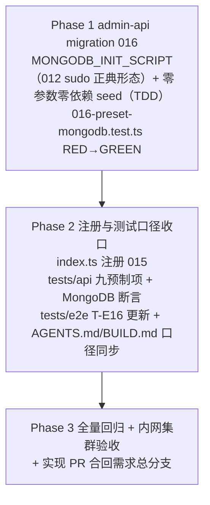

# 增加工作负载「MongoDB」- 实现计划

**关联 Proposal**: `docs/engineering/proposals/20261028-feat-mongodb-workload.md`（v1.1）
**关联 PRD**: `docs/product/draft/20261028-mongodb-workload.md`（v1.1，Issue #341）
**需求总分支（feat-branch）**: `feat/mongodb-workload`（基于 `main`，需求总 PR #343）
**实现分支**: `feat/mongodb-workload-impl`（基于 `feat/mongodb-workload`）
**创建日期**: 2026-10-29
**计划版本**: v1.0
**版本说明**:
- v1.0（2026-10-29）首版，与 PRD v1.1 / 提案 v1.1（返工口径：只安装 + `mongod --version` 硬校验、不拉起实例）对齐。

## 实现顺序



依赖说明：

- 本期**只有 admin-api 一个服务代码变更**（预置项与脚本均为库内数据），其余为 `tests/api` / `tests/e2e` 断言与文档口径更新；无跨服务/跨仓并行；
- Phase 1 内先写 `016-preset-mongodb.test.ts`（RED）再实现迁移（GREEN）；
- Phase 2 依赖 Phase 1 落定的常量名与脚本文案；
- Phase 3 在实现分支合并回需求总分支后收口（`feat/mongodb-workload`）。

开发模式采用 TDD（红-绿-重构）：编码前加载 `docs/engineering/common-rules.md`、`docs/engineering/backend-rules.md` 与 `servers/admin-api/AGENTS.md`；`tests/api` / `tests/e2e` 变更遵循各自 `AGENTS.md`（只用 Aspire 编排、禁止裸 docker）。

### 关键约束（提案 §1.3/§6，实现期不得回退）

- **无契约变更**：不动 `contracts/`；`paramSchema=[]`，零参数；`workload:run` 链路零改动。
- **无 worker 镜像变更**：不改 `deploy/images/worker/Dockerfile` / `entrypoint.sh`，无需重建镜像；不改 `MIN_WORKER_VERSION`。
- **不改既有预制工作负载**（Docker / Node.js / .NET / Aspire / Github / Harness 系），不改依赖展开与「必须」失败语义。
- **迁移只增不改**：presetKey / 精确 name 双查命中即跳过并告警，不覆盖管理员修改/删除。
- **不拉起 mongod 实例（返工口径）**：脚本无任何服务启动动作（无 `--fork` / `nohup` / `runuser` / `systemctl`）；成功判据只有 `mongod --version`；服务由用户按需自行启动。
- **安装源只走需求指定内网地址**：GPG `misc-cache/mongodb/server-8.0.asc` + apt `mongodb-apt-proxy`，不回退公网；地址在脚本内硬编码属需求口径（与 Playwright 的「下载地址参数化」不同——本需求无参数化要求，PRD 约束本期零参数）。
- **禁止 rebase/squash**：遵循 z-git 规范，仅允许 merge。

## 计划期裁决（提案留白/含混处的实现口径）

1. **迁移编号协调（与并行 Playwright 需求）**：并行需求「Playwright 工作负载」（Issue #342，PR #344）同样规划了 `015-preset-playwright`。实现启动前先核对主干 `servers/admin-api/src/migrations/` 实际占用编号（当时主干占用至 `014`，实现分支按 `015-preset-mongodb` 落地）；**merge 协调实际结果**：Playwright 需求（PR #344）先行合入主干占用 `015`，本需求按本裁决第三分支顺延为 `016-preset-mongodb`（文件名、`name`、`index.ts` 注册与测试引用同步改号），预制项计数断言按主干实际值合并（两需求均为 8→9，先后合入后为 10，名称清单取并集）。禁止用 rebase/squash 改写历史。
2. **零依赖、零参数确认**：提案 §4.1 `paramSchema=[]`、`dependsOnWorkloadIds=[]`——`run()` 内**无**依赖解析逻辑（对照 Playwright 的 Node.js 依赖解析）；`CloudWorkload.create` 直接落空数组。
3. **导出清单**（提案 §5.2 实现点 3，不额外新增）：`name = '016-preset-mongodb'`、`MONGODB_PRESET_KEY = 'mongodb'`、`MONGODB_PRESET_NAME = 'MongoDB'`、`MONGODB_INIT_SCRIPT`。导出不改变 runner 的 `Migration` 接口（`name` + `run`）。`GITHUB_PARAM_SCHEMA` 式的参数 schema 常量**不引入**（零参数）。
4. **TS 模板字符串转义**：`MONGODB_INIT_SCRIPT` 全文与提案 §5.2 实现点 1 逐字一致，模板字符串内 `${...}` 转义为 `\${...}`（同 001/007 写法）；`set -euo pipefail` + `SUDO=sudo; command -v sudo >/dev/null 2>&1 || SUDO=` 前导保留（012 正典形态）。
5. **幂等锚点顺序**：`command -v mongod` 命中 → `mongod --version` → `exit 0`，该锚点在 apt 源写入**之前**——已安装环境不触碰源文件、不跑 `apt-get update`（秒级返回、不动用户运行中的服务）。
6. **GPG 与源行形态**：armored `.asc` 经 `tee` 落 `/etc/apt/keyrings/mongodb-server-8.0.asc` + `chmod a+r`，`signed-by` 直接指向 `.asc`（apt 原生支持）；源行 codename 取自 `. /etc/os-release` 的 `${VERSION_CODENAME}`（Ubuntu 24.04 → `noble`），不写死。
7. **postinst 无 systemd 告警口径（实测裁决）**：`apt-get install mongodb-org` 的 postinst 在无 systemd 容器内可能打印 service 启动告警——以 `set -e` 不中断为准；若实测 postinst 返回非 0 导致失败，按实测裁决补 `RUNLEVEL=1` 前导并回写提案（不改变「不拉起实例」结论）。验收期确认安装结束后无 `mongod` 进程。
8. **创建字段口径**：`CloudWorkload.create({ name, initScript, postScript: null, paramSchema: [], dependsOnWorkloadIds: [], presetKey, isPreset: true, workloadKind: 'standard', harnessType: null })`（与 007 创建形态逐字段一致，仅 paramSchema/dependsOn 为空）。
9. **测试断言口径**：脚本断言含三个内网地址字样（`server-8.0.asc`、`mongodb-apt-proxy`）、`apt-get update`、`apt-get install -y mongodb-org`、结尾 `mongod --version` 硬校验、幂等锚点 `command -v mongod`；**断言不含**实例拉起动作（对脚本全文 `match(/--fork|nohup|runuser|systemctl|mongosh/)` 为空，锁死返工口径）。
10. **tests/api / tests/e2e 的 AGENTS.md 陈旧口径校正**：`tests/api/AGENTS.md` 用例表写「共 7 项」、`tests/e2e/AGENTS.md` 写「恰 7 个」（均为 DeepSeek 迁移 010 后未同步的历史陈旧值，测试实际断言 8 项）——本期一并校正为 10 项全清单（含 DeepSeek Harness（Harness）与 MongoDB）。
11. **写库与 mock 形态**：命中即跳过、未命中 `CloudWorkload.create`（与 007/009 一致）；单测 mock 沿用 `009-preset-harness-kimi-code.test.ts` 形态（`vi.mock('../models/cloud-workload.js')` + `findOne`/`create`）。
12. **超时口径**：不改 `WORKLOAD_INIT_TIMEOUT_MS` 默认 300s；内网 apt 安装 mongodb-org（百余 MB）量级满足；standard 负载 `required=false`，失败不注销容器、可重试。
13. **失败不阻断**：脚本失败仅使该工作负载记录失败并保留日志，容器继续后续初始化并上线（沿用一期失败策略）；迁移失败仅记日志、下轮启动重试（runner 语义）。
14. **文档生命周期**：PRD 与提案本期保持 `draft` / `proposals` 目录不移动，待实现验收后按既有流程归档。

---

## Phase 1: admin-api migration 016（脚本 + 零参数零依赖 seed）

开发分支：`feat/mongodb-workload-impl`。TDD 顺序：先写 `016-preset-mongodb.test.ts`（RED）→ 实现 `016-preset-mongodb.ts`（GREEN）→ 重构收口。

### 文件修改

| 文件 | 操作 | 说明 |
|------|------|------|
| `servers/admin-api/src/migrations/016-preset-mongodb.ts` | 新增 | `name` / `MONGODB_PRESET_KEY` / `MONGODB_PRESET_NAME` / `MONGODB_INIT_SCRIPT`（裁决 3/4）；`run()` 按裁决 2/8 实现双查防重与创建 |
| `servers/admin-api/src/migrations/016-preset-mongodb.test.ts` | 新增 | 覆盖 `T-MIG-MDB1`~`T-MIG-MDB5`（下表）；mock 形态沿用 009 单测（裁决 11） |
| `servers/admin-api/src/migrations/007-preset-github.ts` 等既有迁移 | 不变 | 只读参考；不改任何既有迁移源码 |

### 015 迁移逻辑（伪代码）

```ts
export const name = '016-preset-mongodb';
export const MONGODB_PRESET_KEY = 'mongodb';
export const MONGODB_PRESET_NAME = 'MongoDB';
export const MONGODB_INIT_SCRIPT = `#!/usr/bin/env bash\n...`;   // 提案 §5.2 实现点 1 全文（裁决 4 转义）

export async function run(): Promise<void> {
  const byKey = await CloudWorkload.findOne({ presetKey: MONGODB_PRESET_KEY });
  if (byKey) { console.warn('[Migration 015] preset workload "mongodb" already exists (by presetKey), skipping'); return; }
  const byName = await CloudWorkload.findOne({ name: MONGODB_PRESET_NAME });
  if (byName) { console.warn('[Migration 015] workload named "MongoDB" already exists, skipping'); return; }

  await CloudWorkload.create({
    name: MONGODB_PRESET_NAME,
    initScript: MONGODB_INIT_SCRIPT,
    postScript: null,
    paramSchema: [],
    dependsOnWorkloadIds: [],
    presetKey: MONGODB_PRESET_KEY,
    isPreset: true,
    workloadKind: 'standard',
    harnessType: null,
  });
  console.log('[Migration 015] preset workload "mongodb" created');
}
```

### 脚本落地要点（全文见提案 §5.2 实现点 1，逐字一致）

```bash
#!/usr/bin/env bash
set -euo pipefail
SUDO=sudo
command -v sudo >/dev/null 2>&1 || SUDO=

# 幂等锚点（裁决 5，在源写入之前）：已安装 → mongod --version → exit 0
if command -v mongod >/dev/null 2>&1; then
  mongod --version
  exit 0
fi

# 内网 apt 源（需求指定地址；GPG signed-by；不回退公网）
${SUDO} install -m 0755 -d /etc/apt/keyrings
curl -fsSL https://nexus.internal.fffdan.com/repository/misc-cache/mongodb/server-8.0.asc \
  | ${SUDO} tee /etc/apt/keyrings/mongodb-server-8.0.asc >/dev/null
${SUDO} chmod a+r /etc/apt/keyrings/mongodb-server-8.0.asc
. /etc/os-release
printf '%s\n' \
  "deb [ signed-by=/etc/apt/keyrings/mongodb-server-8.0.asc ] https://nexus.internal.fffdan.com/repository/mongodb-apt-proxy ${VERSION_CODENAME}/mongodb-org/8.0 multiverse" \
  | ${SUDO} tee /etc/apt/sources.list.d/mongodb-org-8.0.list >/dev/null

${SUDO} apt-get update
${SUDO} apt-get install -y mongodb-org

# 硬校验：版本通过即安装成功（不拉起 mongod 实例，返工口径）
mongod --version
```

> TS 模板字符串中 `${` 转义为 `\${`（同 001/007 写法）；脚本**不含**任何 `--fork` / `nohup` / `runuser` / `systemctl` / `mongosh` 字样（裁决 9）。

### 测试用例（对齐提案 §8.2）

| # | 用例 | 预期 |
|---|------|------|
| T-MIG-MDB1 | 播种字段全量断言 | `create()` 参数：`name='MongoDB'`、`presetKey='mongodb'`、`isPreset=true`、`workloadKind='standard'`、`harnessType=null`、`postScript=null`、`paramSchema=[]`、`dependsOnWorkloadIds=[]` |
| T-MIG-MDB2 | 已存在（presetKey 命中） | warn 跳过、不 `create()`、不覆盖（含管理员改过的字段） |
| T-MIG-MDB3 | 仅精确 name 命中 | warn 跳过、不 `create()`（不产生重名项） |
| T-MIG-MDB4 | 幂等重跑 | 第二次 `run()` 因 presetKey 命中跳过：`create()` 全程至多一次、无重复写入 |
| T-MIG-MDB5 | 脚本不变量 + `bash -n` | ① `bash -n` 退出 0；② 含 `command -v mongod` 幂等锚点、`server-8.0.asc`、`mongodb-apt-proxy`、`${VERSION_CODENAME}/mongodb-org/8.0`、`apt-get update`、`apt-get install -y mongodb-org`、结尾 `mongod --version` 硬校验、`SUDO` 前导与 `${SUDO} apt-get` / `${SUDO} tee` 形态；③ **不含**实例拉起动作（`--fork`/`nohup`/`runuser`/`systemctl`/`mongosh` 全文不匹配，裁决 9）；④ 不含公网源字样（`repo.mongodb.org` 等） |
| 回归 | 001~014 / runner 既有测试 | 全绿（不改既有迁移源码） |

### 命令参考

```bash
cd servers/admin-api
npx vitest run src/migrations        # 先跑 015 测试（RED→GREEN），再跑全目录
npm run build                        # strict TS 编译
```

### 验收 checklist

- [ ] `T-MIG-MDB1`~`T-MIG-MDB5` 全部通过；001~014 / runner 既有测试保持通过
- [ ] `npm run build` strict 通过；`Migration` 接口未变（`name` + `run`）
- [ ] 脚本全文与提案 §5.2 逐字一致（转义差异除外）；`bash -n` 通过
- [ ] 脚本不含任何实例拉起动作与公网源（T-MIG-MDB5 ③④ 锚定）
- [ ] 015 仅写入 `cloudworkloads` 一条预制文档，不产生其他集合写入；防御路径只告警不写库

---

## Phase 2: 注册与测试口径、文档收口

开发分支：`feat/mongodb-workload-impl`。

### 文件修改

| 文件 | 操作 | 说明 |
|------|------|------|
| `servers/admin-api/src/index.ts` | 修改 | 导入 `* as migration016PresetMongo from './migrations/016-preset-mongodb.js'`，在 `runMigrations([...])` 既有批次之后追加（顺序在 014 之后，注释行「016-preset-mongodb——写入 MongoDB 预制工作负载」） |
| `tests/api/src/admin-api/cloud-workload.test.ts` | 修改 | 见下方断言更新清单 |
| `tests/e2e/src/admin-cloud-workload.spec.ts` | 修改 | T-E16 更新（见下表） |
| `tests/api/AGENTS.md` | 修改 | 用例表更新（裁决 10）：预制项存在性行 7 项→10 项全清单（补 DeepSeek Harness 与 MongoDB），新增「T-IA 预制 MongoDB 原生 apt 安装」行 |
| `tests/e2e/AGENTS.md` | 修改 | T-E16 行「恰 7 个」→「恰 10 个」并补名称清单（裁决 10） |
| `deploy/images/worker/BUILD.md` | 修改 | 「预制工作负载脚本手工验收（真实集群）」补 MongoDB 逐项核对块（文档口径同步，**不改镜像**）：`mongod --version` 输出版本、安装结束后无 mongod 进程（不拉起实例）、已装环境重复执行幂等秒回、内网源写入（`/etc/apt/keyrings/mongodb-server-8.0.asc` + `/etc/apt/sources.list.d/mongodb-org-8.0.list`）、失败（源不可达）留痕可重试 |
| `docs/engineering/AGENTS.md` | 已完成 | 「实现计划（`plan/`）」索引已随本计划提交登记，无需在实现期重复改动 |

### tests/api 断言更新清单（`T-IA: exposes the eight preset workloads...`）

- 用例更名 `nine`；名称清单补 `'MongoDB'`（保持既有 8 项 + MongoDB）；`expect(presetIds(all)).toHaveLength(8)` → `9`；「同名预制项只应存在一个」「重复查询 ID 集合稳定」不变量保留。
- 新增断言（可并入该用例或独立新用例 `T-IA: preset MongoDB installs mongodb-org via internal Nexus apt`）：
  - `workloadKind === 'STANDARD'`、`harnessType === null`、`isPreset === true`；
  - `paramSchema` 为空数组、`dependsOnWorkloadIds` 为空数组（零参数零依赖）；
  - `initScript` 含 `command -v mongod` 幂等锚点、`server-8.0.asc`、`mongodb-apt-proxy`、`apt-get install -y mongodb-org`、结尾 `mongod --version`；**不含** `--fork`/`nohup`/`runuser`/`systemctl`/`mongosh`（返工口径锚定）。

### tests/e2e T-E16 更新

| # | 用例 | 预期 |
|---|------|------|
| T-E16 更新 | `lists the ten preset workloads with the preset badge` | 名称清单补 `'MongoDB'`（merge 协调后含 Playwright，共 10 项）；`toHaveText('预制')` 计数 `8 → 10`；API 侧 sorted 名称清单补 `'MongoDB'`（注意排序位置）；顺带修正注释陈旧计数（「七个/7 个」→ 10） |

### 命令参考

```bash
cd servers/admin-api && npm run build
grep -nE -- "--fork|nohup|runuser|systemctl|mongosh|repo.mongodb.org" servers/admin-api/src/migrations/016-preset-mongodb.ts   # 应无输出
```

### 验收 checklist

- [ ] `index.ts` 注册链含 015 且顺序在 014 之后，`npm run build` 通过
- [ ] tests/api 新旧断言与实现一致（10 项、零参数零依赖、脚本内容、无实例拉起动作）
- [ ] tests/e2e T-E16 计数 9、名称清单含 MongoDB
- [ ] `tests/api/AGENTS.md` / `tests/e2e/AGENTS.md` 用例表与实现一致（含 7→9 陈旧口径校正）
- [ ] BUILD.md MongoDB 手工验收块成文（仅文档，不涉及镜像）

---

## Phase 3: 全量回归 + 内网集群验收 + 实现 PR

### 命令参考

```bash
# admin-api 全量
cd servers/admin-api && npm run build && npx vitest run
# API 回归（Aspire 编排；端口以 aspire describe 输出为准）
aspire start && aspire wait admin-api agent-api cloud-controller controller-api
cd tests/api && API_URL=http://localhost:10001/graphql \
  ADMIN_API_URL=http://localhost:10003/graphql \
  CONTROLLER_API_URL=<aspire describe controller-api> npm test
# E2E（admin 套件）
cd tests/e2e && aspire wait admin-web admin-api && npx playwright test admin-cloud-workload.spec.ts --workers=1
```

> 测试运行遵循 `tests/api` / `tests/e2e` 的 AGENTS.md：只用 Aspire 编排、禁止裸 docker；重跑从 `aspire start` 重来。

### 内网 K8s 手工验收（对齐 PRD §1.3 成功标准 / 提案 §9）

前置：admin-api 已部署含 migration 016 的版本；内网 Nexus `misc-cache/mongodb/server-8.0.asc` 与 `mongodb-apt-proxy` 可达。

- [ ] 升级后工作负载列表自动出现「MongoDB」预制项（带预制标识、只出现一次）；重复执行迁移不重复写入
- [ ] 管理员修改/删除该预制项后再启动：不被系统覆盖或恢复（只告警）
- [ ] 启动挂载安装成功：容器内 `mongod --version` 输出版本信息；安装使用需求指定内网 GPG/apt 源，全程不访问公网
- [ ] 安装流程**不**拉起 mongod 实例：安装结束后 `pgrep -a mongod` 无输出；用户可按需自行启动服务并连接使用
- [ ] 重复安装幂等成功（已安装直接版本校验通过，不重复安装、不触碰既有源文件；用户已在运行的服务不受影响）
- [ ] 失败场景（Nexus 不可达）：失败原因可见、可重试恢复；必须项失败沿用既有「启动失败并展示原因」语义
- [ ] 三入口（启动挂载 / 界面运行期安装 / Agent `workload_install`）安装均成功，进度/日志/失败原因展示与既有工作负载一致；`workload_list` 可见且 `installed=true`
- [ ] 与其他工作负载组合安装互不影响（如 Node.js + MongoDB），按既有编排顺序执行
- [ ] 裁决 7 实测：postinst 告警不导致 `set -e` 中断；如触发 `RUNLEVEL=1` 补救口径，回写提案
- [ ] 实现分支 PR 合并回 `feat/mongodb-workload`，需求总 PR #343 自动更新；实现计划文档保留在需求总分支

### 总体验收 checklist（对齐提案 §9）

- [ ] `T-MIG-MDB1`~`T-MIG-MDB5` 全部通过，001~014 / runner 全绿
- [ ] API 测试通过（九预制项口径 + MongoDB 脚本回归）、E2E 通过（T-E16）
- [ ] 无契约变更（`git diff --stat` 不含 `contracts/`）、无镜像变更（不含 `deploy/images/worker/Dockerfile` / `entrypoint.sh`）、无 GraphQL schema 与前端变更
- [ ] 迁移只增不改：定制项不被覆盖、重复执行幂等
- [ ] 上述内网集群验收全项通过

## 风险与回滚

| 风险 | 缓解 |
|------|------|
| 迁移编号与并行 Playwright 需求（`015-preset-playwright`）撞号 | 实现启动前核对主干编号，占用则顺延 016（裁决 1）；后合入方 merge 协调，不 rebase |
| 预制计数断言与并行需求冲突（双方都改 8→9） | 后合入方按主干实际值合并名称清单与计数（并集 10 项，裁决 1） |
| mongodb-org 体积百余 MB，300s 默认超时偏紧 | 内网 Nexus 代理下载快；standard 负载 `required=false` 失败可重试；验收实测记录耗时，必要时运维按环境上调 `WORKLOAD_INIT_TIMEOUT_MS`（裁决 12） |
| postinst 在无 systemd 环境告警/非 0 退出 | 以 `set -e` 不中断为准；实测触发则补 `RUNLEVEL=1` 前导并回写提案（裁决 7） |
| Nexus `mongodb-apt-proxy` / `misc-cache` 不可达 | 失败留痕、原因可读、可重试；不回退公网 |
| 误覆盖管理员定制/删除 | presetKey / 精确 name 双查命中即跳过（T-MIG-MDB2/MDB3）；迁移只增不改 |
| 返工口径回潮（脚本偷偷拉起实例） | T-MIG-MDB5 ③ 全文不匹配 `--fork`/`nohup`/`runuser`/`systemctl`/`mongosh` 锁死；验收 `pgrep -a mongod` 无输出 |
| 手工安装过 mongod 的环境 | 幂等锚点短路成功，不接管不破坏（PRD 异常表口径） |
| 迁移失败阻断启动 | runner 语义：失败仅记日志、下轮启动重试，不阻断服务 |
| 脚本安装返回 0 但实际不可用 | 结尾硬校验 `mongod --version` 输出版本，不满足即 `set -e` 失败（T-MIG-MDB5） |

## 相关文档

- 关联 PRD：`docs/product/draft/20261028-mongodb-workload.md`（Issue #341）
- 关联 Proposal：`docs/engineering/proposals/20261028-feat-mongodb-workload.md`
- 同系列并行前例（计划期裁决协调）：`docs/engineering/plan/20261028-feat-playwright-workload.md`（PR #344，迁移编号/计数断言协调见双方裁决 1）
- 预制工作负载基线：`docs/engineering/plan/20261018-feat-workload-phase1.md`、`proposals/20261021-feat-github-workload.md`（内网 apt 代理直接前例）
- 既有实现：`servers/admin-api/src/migrations/001-preset-workloads.ts`、`007-preset-github.ts`（预制项创建形态与双查防重）、`009-preset-harness-kimi-code.ts`（单测 mock 形态）、`012-worker-user-scripts.ts`（sudo 正典形态）、`runner.ts`、`servers/admin-api/src/index.ts`
- 执行链路参考：`servers/cloud-controller/src/services/workload-dispatcher.ts`、`packages/agent-controller/src/workload-executor.ts`（零改动复用）
- 契约：`contracts/admin-cloud-workload.graphql`、`contracts/cloud-controller-websocket.md`（§2.9/§2.10 零变更）
- 镜像构建与自验：`deploy/images/worker/BUILD.md`
- 开发规范：`docs/engineering/common-rules.md`、`docs/engineering/backend-rules.md`
