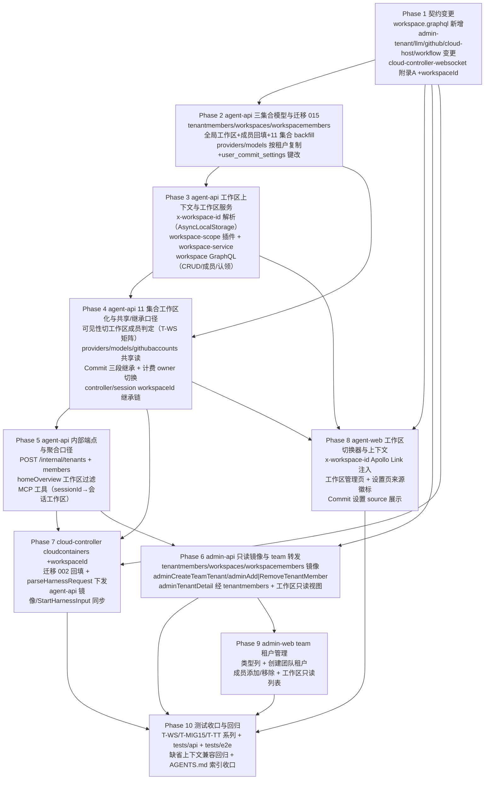

# 多租户二期（Team 租户与租户内工作区共享） - 实现计划

**关联 Proposal**: `docs/engineering/proposals/20261028-feat-multi-tenant-phase2.md`（v1.0，随需求总 PR #339 提交，review-design 审核通过）
**关联 PRD**: `docs/product/draft/20261028-multi-tenant-phase2.md`（v1.0）
**需求总分支（feat-branch）**: `feat/multi-tenant-phase2`（基于 `origin/main`，需求总 PR #339）
**计划提交分支**: `feat/multi-tenant-phase2`（本文件随需求总分支提交）
**创建日期**: 2026-10-28
**计划版本**: v1.0

**版本说明**：

- v1.0（2026-10-28）首版。对应 PRD v1.0 / 提案 v1.0（审核通过、无附加修改意见）。§3 计划期裁决以**当前需求总分支代码事实**为准（2026-10-28，88d104f1）：重点校正 ① `workflowinstances.workspaceId`（=ControllerWorkspace 项目工作区）与提案新增租户工作区维度 `workspaceId` 直接冲突（F1，工作流域改用 `resourceWorkspaceId`）；② 提案 §1.3 contracts 范围漏列 `contracts/cloud-controller-websocket.md` 附录 A（F2，与一期 F8 同型）；③ providers/models 现状**无 userId/tenantId**（仅 `scope` 区分）且 `providers.{scope,name}` 唯一索引与「先建后删」复制顺序冲突（F3）；④ `user_commit_settings` 存在**三处唯一索引声明**，键改 workspaceId 的切换口径（F4）；⑤ 计费调用面现状不一致（`cloud-host-service` 传 `userId`、`resolvers/billing.ts` 传 `user.tenantId`，F5）；⑥ tenantmembers/workspaces/workspacemembers **不可挂** tenant-scope/workspace-scope 插件（F6）；⑦ workspace-scope 插件需请求级上下文载体 AsyncLocalStorage（F7）；⑧ githubaccounts/user_commit_settings 为 String 口径（F8）；⑨ workflowtemplates 内置行可见性特例（F9）；⑩ admin-api 只读镜像同步声明 `providers.{scope,name}` 唯一索引，须与 agent-api 索引切换同发布（F10）；⑪ MCP 工具与 homeOverview 的工作区口径落点（F11）。

## 1. 实现顺序



依赖说明：

- **Phase 1 契约**是全部实现的唯一裁决面，独立提交（`docs(contracts): ...`）；契约未合入前不开始实现 Phase。
- **Phase 2（模型与迁移 015）**只依赖契约，是数据层地基；**Phase 3（上下文与工作区服务）**依赖 Phase 2 的三集合模型与全局工作区数据；**Phase 4（11 集合工作区化）**依赖 Phase 3 的 workspace-scope 插件与 `AuthContext.workspace`，工作量最大，可按集合族拆并行子分支。
- **Phase 5（内部端点/聚合/工具口径）**依赖 Phase 4（会话/工作流的工作区字段就位）与 Phase 3；**Phase 6（admin-api）**与 Phase 4/5 并行（不同服务），联调依赖 Phase 5 的 `/internal/tenants*`。
- **Phase 7（cloud-controller）**依赖 Phase 1（附录 A）与 Phase 4 的 `startHarness` 下发对齐；与 Phase 5/6 并行。
- **Phase 8（agent-web）**依赖 Phase 1 契约与 Phase 3（`myWorkspaces`/切换器）+ Phase 4（资源随工作区过滤）；**Phase 9（admin-web）**依赖 Phase 6。
- **Phase 10** 在各实现合并回主实现分支后收口；迁移 015/002 的 `.test.ts` 随 Phase 2/7 同提交（TDD 红-绿-重构），不推迟到收口。
- 发布顺序约束（提案 §9.1）：**admin-api（镜像先行，F10 索引声明同步）→ agent-api（迁移 015）→ cloud-controller（迁移 002）→ 前端**。

### 1.1 开发分支与合并顺序

| 分支 | 范围 | 基于 | 合并目标 |
|------|------|------|---------|
| `feat/multi-tenant-phase2` | PRD / 提案 / 本计划（需求总分支） | `origin/main` | 需求总 PR #339 |
| `feat/multi-tenant-phase2-impl` | 契约 + 全部实现 + 测试（主实现分支） | 需求总分支 | 需求总分支（评审通过后随需求总 PR 入 main） |
| `impl/mt2-<子项目>`（可选） | 单 Phase 并行开发分支 | `feat/multi-tenant-phase2-impl` | `feat/multi-tenant-phase2-impl` |

- 主实现分支内按 Phase 顺序分提交：`docs(contracts)` → `feat(agent-api)`（模型迁移 → 上下文 → 工作区化 → 内部端点）→ `feat(admin-api)` → `feat(cloud-controller)` → `feat(agent-web)` / `feat(admin-web)` → `test:`。
- 并行子项目分支（z-coding「编写实现并行 subagent」）：`servers/agent-api`（Phase 2-5）、`servers/admin-api`（Phase 6）、`servers/cloud-controller`（Phase 7）、`apps/*`（Phase 8-9）可各自从主实现分支切出，完成后 merge 回主实现分支。
- **禁止 rebase/squash，只允许 merge**（z-git 规范）。合并顺序：**契约 → agent-api → admin-api → cloud-controller → apps → tests**。

### 1.2 开发模式与规范加载

- 全部 Phase 采用 TDD（红-绿-重构）：先写测试（RED）→ 最小实现（GREEN）→ 重构；迁移 015/002 先落 `.test.ts`（幂等重跑、半完成补齐、计数门禁）再写迁移体。
- 编码前加载：`docs/engineering/common-rules.md`、`docs/engineering/backend-rules.md`（后端 Phase）、`docs/engineering/frontend-rules.md`（Phase 8/9）。
- 目录级 `AGENTS.md`：`servers/agent-api/AGENTS.md`、`servers/cloud-controller/AGENTS.md`、`apps/agent-web/AGENTS.md`、`apps/admin-web/AGENTS.md`、`tests/api/AGENTS.md`、`tests/e2e/AGENTS.md`、`docs/engineering/plan/AGENTS.md`。
- `servers/admin-api` 无独立 `AGENTS.md`，沿用根 `AGENTS.md` 与 engineering 规范；`servers/controller-api` 本期**零改动**（工作区边界在 agent-api 查询层承担，`controllers/sessions/controllerkeys` 的工作区归属由 agent-api 写方推导落库，controller-api 共写路径不新增字段——见 §3.2 裁决 10）；`packages/agent-controller`、`aspire/AgentGear.AppHost` 本期零改动（无新增环境变量，`INTERNAL_API_TOKEN`/`AGENT_API_URL` 复用一期配置）。
- **写方纪律**：`tenantmembers`/`workspaces`/`workspacemembers` 写方仅 agent-api（含 `/internal/tenants*`），admin-api 只读镜像；`cloudcontainers.workspaceId` 写方仅 cloud-controller（经 `startHarness` 下发）；`providers`/`models` 写方仅 agent-api（admin-api 镜像只读 + 管理后台既有全局域写操作不变）。
- **字段级 resolver 纪律**（backend-rules 陷阱）：`Workspace.tenant/memberCount/isMember` 等新增字段级 resolver **必须登记** `graphql/resolvers/index.ts`。

## 2. 命令参考

```bash
# 服务编排（根目录；测试服务只用 Aspire，禁止直接 docker 命令）
aspire start
aspire wait agent-api admin-api cloud-controller
aspire describe agent-api
aspire stop

# 单服务单测 / 构建
cd servers/agent-api && npm ci && npm test && npm run build
cd servers/admin-api && npm ci && npm test && npm run build
cd servers/cloud-controller && npm ci && npm test && npm run build
cd apps/agent-web && npm ci && npm test && npm run build
cd apps/admin-web && npm ci && npm test && npm run lint && npm run build

# 跨服务 API 测试（先 aspire start；地址按 aspire describe 替换）
cd tests/api
API_URL=http://localhost:10001/graphql \
ADMIN_API_URL=http://localhost:10003/graphql \
CONTROLLER_API_URL=http://localhost:<controller-api-port> \
CLOUD_CONTROLLER_URL=http://localhost:10004 \
INTERNAL_API_TOKEN=<与 internal-api-token 一致> \
CLOUD_CONTROLLER_INTERNAL_TOKEN=<同上> \
ADMIN_INITIAL_PASSWORD=<aspire 启动日志或 Parameters 注入> \
MONGODB_URI=<aspire describe mongodb；自签 dev cert 追加 tlsAllowInvalidCertificates=true> \
npm test

# E2E（串行，workers=1 已写死；地址按 aspire describe 替换）
cd tests/e2e
BASE_URL=http://localhost:<agent-web-port> \
ADMIN_WEB_URL=http://localhost:<admin-web-port> \
API_URL=http://localhost:10001/graphql \
ADMIN_API_URL=http://localhost:10003/graphql \
INTERNAL_API_TOKEN=<与 internal-api-token 一致> \
MONGODB_URI=<aspire describe mongodb> \
npx playwright test

# 迁移手工核对（Aspire Mongo）
mongosh "<MONGODB_URI>" --eval '
  db.workspaces.find({}, {tenantId:1,name:1,type:1}).limit(5);
  db.tenantmembers.countDocuments({}); db.workspacemembers.countDocuments({});
  db.cloudhosts.findOne({}, {userId:1,tenantId:1,workspaceId:1});
  db.providers.find({scope:"user"}, {tenantId:1,workspaceId:1,name:1}).limit(5);
  db.user_commit_settings.findOne({}, {userId:1,tenantId:1,workspaceId:1});
  db.workflowinstances.findOne({}, {resourceWorkspaceId:1,workspaceId:1});'
```

## 3. 计划期裁决（提案与代码事实偏差的落地口径）

> 以下裁决以**当前需求总分支代码事实**（88d104f1）为准。提案中与之不一致或含混的描述在实现期按本节执行，**不回改提案**；验收报告逐条登记。

### 3.1 事实校正（提案描述与代码事实的偏差）

| # | 提案描述 | 代码事实 | 本计划口径 |
|---|---------|----------|-----------|
| F1 | §3.1 契约 6 / §4.1：`workflowinstances` 等「复制新增 `workspaceId`」，`WorkflowInstance` 新增 `workspaceId: ID!` | `workflowinstances` **已有 `workspaceId`**（`models/workflow-instance.ts:77` `ref: 'ControllerWorkspace'`，required；索引 `{userId,workspaceId,createdAt:-1}`），且契约/前端/工具面已按「项目工作区」语义消费：`contracts/workflow.graphql:194`（`WorkflowInstance.workspaceId`）、`:287`（`InstantiateWorkflowInput.workspaceId`）、`:320`（`workflowInstances(workspaceId:…)` 入参）、`services/workflow/admin-tools.ts:135/150/165`（MCP 实例化入参 `workspaceId`）、`apps/agent-web/src/graphql/workflow.ts:315-340`、`home.ts:13`；`CreateSessionInput.workspaceId`、`controller-workspace.graphql` 一批入参亦为项目工作区语义 | **工作流域（`workflowtemplates`/`configuredworkflows`/`workflowinstances` 三集合与 `contracts/workflow.graphql` 三类型）的租户工作区维度统一命名 `resourceWorkspaceId`**，`workspaceId` 保留「项目工作区（ControllerWorkspace）」语义零改动；其余 8 集合（cloudhosts/sessions/controllers/controllerkeys/providers/models/githubaccounts/user_commit_settings）沿用提案 `workspaceId`。`applyWorkspaceScope(schema, { workspaceField })` 支持按集合指定字段名（默认 `workspaceId`）。**备选（重命名旧字段为 `controllerWorkspaceId`）弃用**：MCP 工具入参/存量工作流节点提示词与前端强消费，违反「零破坏/零感知」口径；跨域命名统一留待后续期次（登记验收报告） |
| F2 | §1.3 contracts 范围（workspace / admin-tenant / llm / github / cloud-host / workflow 六文件） | `startHarness` 的 harness 参数面在 `contracts/cloud-controller-websocket.md` 附录 A（一期 F8 同型遗漏）；`cloudcontainers` 写入口径 +workspaceId 依赖它 | Phase 1 契约增补**包含 `contracts/cloud-controller-websocket.md`**：附录 A harness 参数表新增 `workspaceId`（可选，String；缺失回退按 `tenantId` 查 `workspaces{type:'global'}` 解析、解析不到置 null + warn）与落库口径句 |
| F3 | §4.1：「providers/models 仅 `scope='user'` 行加 `tenantId+workspaceId`；唯一索引 `providers.{scope,name}` → user 域改为 `{tenantId,workspaceId,name}`」 | providers/models **现无 userId/tenantId**（仅 `scope: 'user'\|'global'`，`services/provider.ts:8-10` 按 `$or:[{scope:'user'},{scope:{$exists:false}}]` 过滤全体前台共享行）；`providers` 存在唯一索引 `{scope,name}`（`models/provider.ts:21`，迁移 004 命名 `scope_1_name_1`）；`models` 唯一索引 `{providerId,name}` + admin-api 迁移 005 `scope_global_name_unique`（partial `{scope:'global'}`） | 索引与复制的**执行顺序**固定为：① 建新索引（user 域 `{tenantId,workspaceId,name}` 唯一 + global 域 `{name}` partial `{scope:'global'}` 唯一）→ ② 删旧 `scope_1_name_1` → ③ 按租户复制 → ④ 计数核对 → ⑤ 删原共享行（复制行同名跨租户并存会撞旧唯一索引，旧索引必须先删）；`models.{providerId,name}` 不变（provider 已带工作区维度）；复制行显式 `scope:'user'` |
| F4 | §4.1：`user_commit_settings`「唯一索引 `{tenantId,userId}` → `{workspaceId}` 唯一」 | 该集合存在**三处唯一声明**：字段级 `userId: {unique:true}`（`models/user-commit-setting.ts:20`，autoIndex 生成 `userId_1`）、schema `index({tenantId,userId},{unique:true})`（:44）、迁移 011 命名 `uniq_user_commit_setting`（`{userId:1}` 唯一，防 autoIndex 关闭） | 键改切换口径：建 `{workspaceId:1}` 唯一（命名 `uniq_workspace_commit_setting`）→ 验证 → 删 `uniq_user_commit_setting`、`userId_1` 唯一、`{tenantId,userId}` 唯一；`userId` 降级为普通索引（最近编辑者审计，保留字段）；`tenantId` 保留。存量 personal 租户恒单行（一期单成员），键改无同 workspaceId 冲突（§3.2 裁决 5） |
| F5 | §5.2 实现点 3：「billing-client 签名由隐式 tenantId 改为显式 ownerTenantId 入参」 | 调用面现状不一致：`services/cloud-host-service.ts:255` `getAccount('tenant', userId)`（ownerId 传 **userId**，一期 tenantId==userId 恒等）、`:338-341` `createCloudHostApiKey({ownerType:'tenant', ownerId: userId})`；`graphql/resolvers/billing.ts:45/101/122/131` 传 `user.tenantId` | 全部收敛为**工作区所属租户**（`context.workspace.tenantId`；服务内部链路经「host → workspaceId → Workspace.tenantId」解析）；`billing-client` 各方法保持 `(ownerType, ownerId)` 形参名，语义注释标注 `ownerId=ownerTenantId`；「我的费用」随当前工作区所属租户口径（PRD 功能点 8） |
| F6 | §4.1：三集合建模与 11 集合统一「复制新增 workspaceId」 | `tenantmembers`/`workspacemembers` 自身带 `userId`+`tenantId` 字段，若挂 `applyTenantScope`（`services/tenant-scope.ts:126` guard：userId 与 tenantId 同在即生效）会在 `find({userId})` 类查询注入 `tenantId=userId`——与「用户可属个人租户+多团队」语义直接冲突 | **三集合一律不挂 `applyTenantScope`/`applyWorkspaceScope`**（§3.2 裁决 2）；成员关系/工作区自身查询一律显式条件（`accessibleWorkspaceIds` 等跨租户查询不受插件干扰） |
| F7 | §4.2/§5.2：workspace-scope 插件「读注入 workspaceId 可见集」 | 一期 `tenant-scope.ts` 无需请求级上下文（tenantId 由 filter 的 userId 推导）；工作区可见集**依赖当前请求的工作区**，Mongoose 插件无法直接拿到 GraphQL context；工作流引擎/内部调用不走 GraphQL 上下文 | 新增 `services/workspace-context.ts`（`AsyncLocalStorage<WorkspaceContext>`）：`middleware/auth.ts` 解析成功后 `als.run(...)` 包裹请求；插件 pre 钩子读 store，**无 store（引擎/内部/迁移）不注入、写校验跳过**，内部链路显式传 `workspaceId`（§3.2 裁决 1/10） |
| F8 | §4.1 表：`githubaccounts`/`user_commit_settings` 复制新增 workspaceId | 两集合 `userId`/`tenantId` 为 **String** 口径（`models/github-account.ts:5-6`、`models/user-commit-setting.ts:20-21`），其余集合为 ObjectId | `workspaceId` 类型**对齐各集合既有 tenantId 口径**：githubaccounts/user_commit_settings 用 String（= `workspace._id.toString()`），其余用 ObjectId ref 'Workspace'；写路径由 Mongoose 统一 cast |
| F9 | §3.1 契约 6：`WorkflowTemplate` 新增 `workspaceId`（内置行恒 null 全局可见） | `workflowtemplates.userId` 可空（内置模板 `userId=null`、`isBuiltin=true`，`models/workflow-template.ts:33-41`）；`services/workflow/template.ts:180-233` 现以 `$or:[{userId},{isBuiltin:true}]` 保证内置可见 | `resourceWorkspaceId` 可空（内置行恒 null）；workspace-scope 读过滤注入 `$or:[{resourceWorkspaceId:{$in:可见集}},{isBuiltin:true}]`（插件 `builtinVisible` 选项，仅 workflowtemplates 启用）；内置模板写操作仍拒绝 |
| F10 | §2.3：admin-api「provider/model 镜像模型补 workspaceId/tenantId 可选字段」 | admin-api `models/provider.ts:21` **镜像侧声明了同一 `providers` 集合的 `index({scope,name},{unique:true})`**；admin-api 迁移 005 亦管理 `models` 集合索引 | 镜像 schema 的**索引声明必须与 agent-api 索引切换同 PR 更新**（改声明 user 域 `{tenantId,workspaceId,name}` + global 域 partial，删 `{scope,name}`），否则 admin-api `autoIndex` 会复活旧唯一索引导致复制/写入失败；`models` 镜像同理核对 |
| F11 | §5.2 实现点 6：「MCP 工具经 sessionId 反查 Session.workspaceId」「homeOverview 改按当前工作区过滤」 | `services/mcp-dispatch.ts:95-112` 平台工具入口给 admin-tools `{userId,sessionId}`、给 node tools `{userId,workflow}`；`services/workflow/admin-tools.ts` 各列表按 `userId` 过滤（`template.ts:180`/`configured.ts:121`）；node tools 归属校验 `instance.userId !== scope.userId`（`tool-handlers.ts:180`）；`graphql/resolvers/home.ts:50` `const userId = context.currentUser.id` | MCP 工具过滤口径 = `sessionId → Session.workspaceId`（会话所属租户工作区）；node tools 归属校验改为「instance.resourceWorkspaceId === 会话工作区」（工作区成员可操作本工作区资源，PRD 功能点 3）；`homeOverview` 各聚合分支随 `context.workspace` 过滤（仍为薄 `Promise.all` 聚合，不新增 service 层） |

### 3.2 设计裁决（提案留白/含混处）

1. **工作区上下文载体**：`services/workspace-context.ts` 提供 `AsyncLocalStorage<{id, tenantId, type, visibleIds}>` + `runWithWorkspace(ctx, fn)`；`middleware/auth.ts` 解析 `x-workspace-id` 成功后包裹；同时回填 `AuthContext.workspace`（GraphQL resolver 显式取用）。`visibleIds` 请求级缓存一次（共享型读过滤用 `[当前, 本租户全局]` 二元集，切换器数据源 `accessibleWorkspaceIds(userId)` 挂 `AuthContext` 惰性 Promise，与 `modelLibraryPromise` 同模式）。
2. **三集合不挂作用域插件**（F6）：`tenantmembers`/`workspaces`/`workspacemembers` 查询一律显式 `{tenantId,userId}`/`{workspaceId,userId}` 条件；`workspace-service` 是唯一写方。
3. **workspaceId 类型口径**（F8）：对齐各集合既有 `tenantId` 类型；`Workspace._id` 独立 ObjectId 生成（global 行 `createdBy=null`）。
4. **providers/models 复制与索引顺序**（F3）：固定「建新索引 → 删旧唯一索引 → 按租户复制 → 每租户计数核对（复制数 == 原共享行数）→ 删原共享行」；计数不等即**中止不删**并抛错（迁移失败可重跑）；发布前对 `providers`/`models` mongodump 快照（提案 §9.2）。复制含 `models.providerId` 重映射；`scope='global'` 行全程不动。
5. **user_commit_settings 键改无冲突论证**（F4）：存量仅 personal 租户（一期单成员）⇒ 每租户至多 1 行，`workspaceId=本租户全局工作区` 后 `{workspaceId}` 唯一成立；team 租户上线后经 `updateCommitSettings` 按 `workspaceId` upsert（每工作区一行）。
6. **共享型/独占型读写口径**（提案 §5.2 实现点 1）：独占型（cloudhosts/sessions/controllers/controllerkeys/workflowinstances/configuredworkflows/workflowtemplates 自定义行）读=当前工作区、写强制归属当前工作区；共享型（providers/models/githubaccounts）读=`$in:[当前,本租户全局]`、写仅当前（改/删全局行在普通工作区上下文抛 `Not found`）；`user_commit_settings` 独占型 + service 层三段继承。跨工作区访问统一 `Not found`（不泄露存在性）。
7. **global 工作区上下文语义**：当前工作区=全局时，独占型资源=全局工作区自身；共享型 `$in:[global,global]` 等价只读全局自身——与「全局工作区资源的维护入口在全局上下文」（PRD 功能点 6）一致。
8. **工作流域命名**（F1）：`resourceWorkspaceId` 只出现在工作流域三集合/三类型与 `applyWorkspaceScope` 的 `workspaceField` 选项；`workspaceId` 在 workflow 契约与 `CreateSessionInput`/`controller-workspace` 入参保持「项目工作区」语义；`contracts/controller-workspace.graphql`、`agent-session.graphql` 补注释澄清，本期不改名。
9. **计费 owner 解析收敛**（F5）：GraphQL 链路 `context.workspace.tenantId`；服务内部链路（退款/Key 铸造/用量）经 `Workspace.findById(host.workspaceId).tenantId`，缓存于请求级上下文；缺省上下文（无头）= 个人租户全局工作区 ⇒ owner=个人租户，与一期口径完全等价。
10. **归属推导链**（提案 §5.2 实现点 4）：`controllerkeys.workspaceId`=创建 key 时当前工作区 → 控制器注册从 key 继承；云电脑类型控制器/云电脑=创建时当前工作区；`sessions.workspaceId`=其控制器/云电脑（落库前后各复查一次，对齐既有竞态口径）；工作流节点会话=instance.resourceWorkspaceId（引擎无 ALS，显式传值）。
11. **工作区服务权限口径**（提案 §5.2 实现点 5）：global 一切变更入口先判 `type==='global'` 抛 `global workspace is immutable`；normal 管理权限 = `isWorkspaceMember OR (memberCount===0 AND isTenantMember)`（认领即 `addWorkspaceMember` 自加入）；`createWorkspace` 要求调用者租户 `type==='team'` 并自动写创建者成员行；`deleteWorkspace` 并行计数 11 集合（含 workflow 三集合 `resourceWorkspaceId`）任一 >0 拒绝 `workspace is not empty`（接受 TOCTOU 窗口，与既有删除口径一致）。错误文案白名单沿用提案 §3.1（逐字，不新增变体）。
12. **工作区切换器数据源**：`myWorkspaces` 由 tenantmembers ⨝ workspaces ⨝ workspacemembers 展开（个人全局 + 各团队全局 + 我加入的 normal）；选择持久化 `localStorage['zag:current-workspace']`（按 userId 隔离存取），刷新/重登恢复；未加入任何团队的用户隐藏切换器（PRD 功能点 5 退化形态）。
13. **admin-api 镜像同步面**：`tenantmembers`/`workspaces`/`workspacemembers`/provider/model 镜像 schema 注释「与 agent-api 同步演进」（沿用 `cloud-host.ts` 镜像惯例）；F10 索引声明同发布。
14. **AGENTS.md 同步面**（随各 Phase 同提交）：`servers/agent-api/AGENTS.md`（三集合/工作区上下文/workspace-scope/T-WS 口径）、`servers/cloud-controller/AGENTS.md`（cloudcontainers workspaceId 与迁移 002）、`apps/agent-web/AGENTS.md`（切换器/工作区管理页/来源徽标）、`apps/admin-web/AGENTS.md`（team 租户管理）、`tests/api/AGENTS.md` + `tests/e2e/AGENTS.md`（新套件清单）、`docs/engineering/AGENTS.md`（plan 索引，随本文件提交完成）。

## 4. 关键约束（提案 §1.3/§5/§6 + PRD §5，实现期不得回退）

- **契约先行**：全部 GraphQL/内部 REST 口径以 Phase 1 契约文件为准；实现期发现偏差按 §3 裁决登记，不回改提案。
- **工作区可见性是安全红线**（PRD §4.2）：任何对普通工作区资源的访问以成员资格为前提；非成员访问一律 `Not found`，不泄露存在性；global 可见性以租户成员资格为前提，移出租户立即失效。
- **userId 保留为创建者**：11 集合 `userId` 字段与写入语义全部保留（展示/审计/创建者筛选）；可见性过滤切 `workspaceId`（D5）。`tenantId` 注入保留（与 tenant-scope 共存，冗余隔离维度与既有索引复用）。
- **每租户恰一个全局工作区**：部分唯一索引（`{tenantId}` partial `{type:'global'}`）+ 服务层硬约束双保险；名称恒为「全局工作区」，不可改名/删除/无成员行。
- **个人用户零感知**：personal 租户有且仅有全局工作区（无创建/改名/删除入口）；缺 `x-workspace-id` 头时行为与一期完全等价；已签发 JWT/API Key 继续有效。
- **系统内置工作流模板不属于工作区**：`isBuiltin=true` 行 `resourceWorkspaceId` 恒 null、全工作区可见可用、不可编辑删除。
- **迁移只增不删为例外管理**：仅 providers/models 原共享行删除 + 三处旧唯一索引删除，须计数门禁 + 快照兜底；其余步骤只增不删，代码回滚即安全。
- **后台不做多租户设计**：admin_users 无租户不隔离（同一期口径）；仅新增 team 租户创建与成员管理转发，操作留痕（`createdBy` 记 admin 用户 id）。
- **本期不做**：租户/工作区角色体系、资源跨工作区移动、租户删除、personal 租户多工作区、未列入清单集合（mcp_servers/gateways/controllerworkspaces/todoitems/acpmessages/cloud_host_* 族/workflowprhandlers/issueworkflowtriggers 等）的工作区化（维持一期 `tenantId+userId` 口径）。
- **测试纪律**：新增代码单测覆盖率 ≥ 80%；API 与 E2E 串行执行；测试服务只用 Aspire 编排；11 集合每集合至少一条工作区隔离 API 用例；缺省上下文兼容回归必过。

## 5. Phase 计划

### Phase 1：契约变更（0.5d）

| 文件 | 变更 |
|------|------|
| `contracts/workspace.graphql` | **新增**（提案 §3.1 契约 1 逐字）：`WorkspaceType`/`Workspace`/`WorkspaceMember`、`Query.myWorkspaces/workspaceMembers/tenantMembers`、`Mutation.createWorkspace/renameWorkspace/deleteWorkspace/addWorkspaceMember/removeWorkspaceMember`；错误口径白名单逐字（`workspace not found` 等 7 条）；头部注释写明「项目工作区（ControllerWorkspace）是另一概念」 |
| `contracts/admin-tenant.graphql` | 变更（提案契约 2）：`AdminWorkspace`、`AdminTenantDetail.workspaces`（users 口径改经 tenantmembers 展开，注释注明）；`Mutation.adminCreateTeamTenant/adminAddTenantMember/adminRemoveTenantMember`；错误口径 `tenant name already exists`/`account not found`/`already a member`/`not a member`/`personal tenant is immutable` |
| `contracts/llm.graphql` | 变更（提案契约 3）：`Provider`/`Model` 新增 `workspaceId: ID`（`scope=global` 恒 null）；注释写明读口径 = 当前 ∪ 本租户全局、写口径 = 仅当前；`(workspaceId,name)` 唯一、跨工作区同名并存以来源徽标区分 |
| `contracts/github.graphql` | 变更（提案契约 4）：`CommitSettingsSource` 枚举（WORKSPACE/GLOBAL/UNSET）+ `CommitSettings.source`；`GitHubAccount.workspaceId: ID!`；绑定列表读=当前 ∪ 全局、写仅当前 |
| `contracts/cloud-host.graphql` | 变更（提案契约 5）：`CloudHost.workspaceId: ID!`；`createCloudHost` 归属当前工作区（不入参）；列表/详情/停止/删除随当前工作区过滤 |
| `contracts/workflow.graphql` | 变更（提案契约 6 + F1 裁决）：`WorkflowTemplate.resourceWorkspaceId: ID`（内置恒 null）、`ConfiguredWorkflow.resourceWorkspaceId: ID!`（跟随其控制器的工作区）、`WorkflowInstance.resourceWorkspaceId: ID!`（继承自已配置工作流）；`WorkflowInstance.workspaceId`/`workspace: ControllerWorkspace`/`InstantiateWorkflowInput.workspaceId`/`workflowInstances(workspaceId:…)` **零改动**，注释标注「项目工作区（ControllerWorkspace）语义，勿与租户工作区混淆」；列表随当前工作区过滤、内置模板例外全局可见 |
| `contracts/cloud-controller-websocket.md`（F2） | 附录 A harness 参数表新增 `workspaceId`（可选，String；缺失回退按 tenantId 解析 global 工作区、解析不到 null+warn）；落库口径句补 `cloudcontainers.workspaceId` |
| `contracts/controller-workspace.graphql` / `contracts/agent-session.graphql` | 注释澄清（F1/裁决 8）：既有 `workspaceId` 入参为「项目工作区（ControllerWorkspace）」语义，本期不改名 |

**完成判据**：契约 8 文件口径与提案 §3 + §3 裁决一致、命名冲突零残留歧义；单次提交 `docs(contracts): multi-tenant phase2 workspace/admin-tenant/llm/github/cloud-host/workflow/cloud-controller 契约变更`。

### Phase 2：agent-api 三集合模型与迁移 015（2d，核心）

| 文件 | 变更 |
|------|------|
| `servers/agent-api/src/models/tenant-member.ts` | **新增** `tenantmembers`：`tenantId`（ObjectId ref Tenant，index）/`userId`（ObjectId ref User，index）/`createdBy`（String：admin 用户 id 或 `'migration'`）；唯一索引 `{tenantId,userId}`；timestamps；**不挂作用域插件**（裁决 2） |
| `servers/agent-api/src/models/workspace.ts` | **新增** `workspaces`：`tenantId`（index）/`name`（global 恒「全局工作区」）/`type`（`global\|normal`）/`createdBy`（ObjectId ref User，global 为 null）；索引 `{tenantId,name}` 唯一 + **`{tenantId:1}` 部分唯一（`partialFilterExpression:{type:'global'}`，命名 `uniq_global_workspace_per_tenant`）**；不挂插件 |
| `servers/agent-api/src/models/workspace-member.ts` | **新增** `workspacemembers`：`workspaceId`（index）/`tenantId`（冗余，index）/`userId`（index）；唯一索引 `{workspaceId,userId}`；**global 工作区恒无成员行**（语义=租户全员）；不挂插件 |
| `servers/agent-api/src/models/*.ts`（11 集合） | 复制新增工作区维度（required after migration，`userId` 保留）：cloudhosts/sessions/controllers/controllerkeys/githubaccounts/user_commit_settings/workflowinstances/configuredworkflows 为 `workspaceId`（workflow 三集合为 `resourceWorkspaceId`，F1）；providers/models/workflowtemplates 可空（global/builtin 行 null）；类型按 F8；新增 `{tenantId,workspaceId}`（workflow 域 `{tenantId,resourceWorkspaceId}`）复合索引；**本 Phase 只落字段与索引声明，插件挂载与过滤口径在 Phase 4** |
| `servers/agent-api/src/migrations/015-team-workspaces.ts` | **新增**步骤链（每步以目标状态存在性为幂等判据，批处理 500 + 进度日志，可重跑）：① 每租户建全局工作区（含存量 personal 与半完成补齐）→ ② `tenantmembers` 回填（逐 `users` 行 upsert `{tenantId:users.tenantId,userId:_id,createdBy:'migration'}`）→ ③ 11 集合 backfill 工作区维度 = 本租户全局工作区（缺字段行；workflow 域写 `resourceWorkspaceId`）→ ④ 索引切换（F3/F4/F8 顺序：providers 建新删旧、user_commit_settings 建 `{workspaceId}` 删三处旧唯一、githubaccounts 建 `{tenantId,workspaceId,githubUserId}` 删 `{tenantId,userId,githubUserId}`）→ ⑤ providers/models 按租户复制（含 `providerId` 重映射）+ 每租户计数核对 → 一致才删原共享行，不等即中止不删 → ⑥ 完成校验（缺工作区维度行数=0、每租户 global 数=1、tenantmembers 覆盖全部 user）。导出 `WORKSPACE_ID_COLLECTIONS`（`{collection, model, field, uniqueIndex?}`）供测试与自检互校（对照 013 `TENANT_ID_COLLECTIONS` 模式） |
| `servers/agent-api/src/migrations/015-team-workspaces.test.ts` | **新增** T-MIG15a~h：三集合建模与索引、tenantmembers 回填（personal 恒 1 行）、11 集合 backfill 无遗漏（workflow 域字段名正确）、索引切换清单断言（含旧索引已删）、providers/models 复制计数门禁（不等不删/一致删除/幂等重跑零变更）、user_commit_settings 键改后查询等价、半完成补齐、批处理多页 |
| `servers/agent-api/src/services/tenant-self-check.ts`（扩展） | 启动后轻量异步自检补工作区维度（沿用一期口径）：带索引 count（缺工作区维度行数=0、每租户 global 工作区数=1）+ `limit(100)` 抽样；异常仅 warn 不阻塞 |
| `servers/agent-api/src/index.ts` | 迁移数组登记 015（014 之后） |

**完成判据**：单测全绿；Aspire 冷启动（含存量数据夹具）后每租户恰一个「全局工作区」、11 集合工作区维度回填齐全、providers/models 复制计数一致且原件已删、`user_commit_settings` `{workspaceId}` 唯一生效且旧唯一已删；自检无计数异常。

### Phase 3：agent-api 工作区上下文与工作区服务（1.5d，核心）

| 文件 | 变更 |
|------|------|
| `servers/agent-api/src/services/workspace-context.ts` | **新增**（F7/裁决 1）：`AsyncLocalStorage<WorkspaceContext>`（`{id, tenantId, type, visibleIds, accessibleIds?}`）+ `runWithWorkspace`/`getWorkspaceContext`；`visibleIds` 共享型= `[当前,本租户全局]`，独占型= `[当前]` |
| `servers/agent-api/src/middleware/auth.ts` | 解析 `x-workspace-id`（F7）：`Workspace.findById` → 可访问性校验（global 需 `tenantmembers` 含 `{userId,tenantId}`；normal 需 `workspacemembers` 含 `{userId,workspaceId}`）→ `AuthContext.workspace={id,tenantId,type}` 并 `als.run` 包裹；缺省/缺头回退「个人租户全局工作区」（`users.tenantId → workspaces{type:'global'}` 一次查询）；非法/不可达 id 一律 `workspace not found`（不泄露存在性） |
| `servers/agent-api/src/services/workspace-scope.ts` | **新增** Mongoose 插件 `applyWorkspaceScope(schema, { workspaceField='workspaceId', shared=false, builtinVisible=false })`（对照 `tenant-scope.ts` 同步钩子写法，Mongoose v9 同步无 next）：读注入 `workspaceField ∈ visibleIds`（shared 型 `[当前,全局]`；`builtinVisible` 合并 `$or:[…,{isBuiltin:true}]`）；写（save/insertMany/`$set.workspaceField`）强制存在且 ∈ 当前工作区；无 ALS store 不注入/不校验（引擎与内部链路显式传值）；与 `applyTenantScope` 共存（tenantId 注入保留） |
| `servers/agent-api/src/services/workspace-service.ts` | **新增**：`accessibleWorkspaceIds(userId)`（tenantmembers ⨝ workspaces ⨝ workspacemembers，请求级缓存）；`createWorkspace`（team 租户限定 + 自动写创建者成员行 + `{tenantId,name}` 唯一冲突 `workspace name already exists`）；`renameWorkspace`/`deleteWorkspace`（global 硬约束 + 11 集合计数删除保护 + personal 拒绝）；`addWorkspaceMember`（成员须为本租户成员 `user is not a tenant member`；global 拒绝；0 成员放宽认领）/`removeWorkspaceMember`；错误文案白名单逐字（裁决 11） |
| `servers/agent-api/src/graphql/schemas/workspace.ts` | **新增**（同步 Phase 1 契约） |
| `servers/agent-api/src/graphql/resolvers/workspace.ts` + `resolvers/index.ts` | **新增** resolvers；**`Workspace.tenant/memberCount/isMember`、`WorkspaceMember.username` 等字段级 resolver 登记 `resolvers/index.ts`**（backend-rules 陷阱）；`workspaceMembers(global)` 恒返回 `[]` |
| `servers/agent-api/src/graphql/resolvers/auth.ts` | 新增 `requireWorkspace(context)`（对齐 `requireTenantId` 模式）；`Tenant.memberCount` 口径切 `tenantmembers` 计数（一期 `User.countDocuments({tenantId})` 等价，统一走单一事实源） |
| `servers/agent-api/src/models/workspace-isolation.test.ts`（新建骨架） | T-WS 矩阵载体（Phase 4 填满）：CASES 与 `WORKSPACE_ID_COLLECTIONS` 互校 |

**完成判据**：单测全绿（T-CTX*/T-WSP*/T-SCOPE*）；`x-workspace-id` 解析/回退/拒绝路径全绿；global 硬约束与 0 成员认领、删除保护行为与错误文案逐字一致。

### Phase 4：agent-api 11 集合工作区化与共享/继承口径（2.5d，核心）

| 文件 | 变更 |
|------|------|
| `servers/agent-api/src/models/*.ts`（11 集合） | 挂载 `applyWorkspaceScope`（cloudhosts/sessions/controllers/controllerkeys/workflowinstances/configuredworkflows 独占；workflowtemplates `builtinVisible`（F9）；providers/models/githubaccounts `shared`；user_commit_settings 独占） |
| `servers/agent-api/src/services/{session,controller,controller-key,cloud-host*}.ts` | 逐集合 checklist 过滤口径切换（`userId` 过滤 → 工作区过滤，写入保留 userId=创建者）；归属推导链落 `workspaceId`（裁决 10：key 创建 → 控制器注册继承 → 云电脑/会话继承，落库前后复查） |
| `servers/agent-api/src/services/{provider,model}.ts` | `scope='user'` 行读过滤 = 当前 ∪ 全局（合并展示来源可区分：`workspaceId===当前 ? 本工作区 : 全局`）；写（增删改/排序/启停/batch*）仅当前工作区行；唯一性按 `(workspaceId,name)`（迁移 015 已切索引） |
| `servers/agent-api/src/services/github.ts` | `getAccounts`/bind/unbind/refresh：读 = 当前 ∪ 全局；绑定/解绑写仅当前工作区；唯一性 `{tenantId,workspaceId,githubUserId}` |
| `servers/agent-api/src/services/commit-settings-service.ts` | 查询键 `userId`→`workspaceId`（upsert 当前工作区行，`userId` 留最近编辑者）；`resolveCommitIdentity` 链（提案 §3.2）：云电脑 → 其 `workspaceId` → 本工作区设置 →（unset/缺行）本租户全局工作区设置 → unset，`source` 三段透出；`resolveCommitter` 的 `GitHubAccount` 校验改共享读口径（account ∈ 当前 ∪ 全局）；既有五步门控/bot 降级/错误文案零改动 |
| `servers/agent-api/src/services/billing-client.ts` + `cloud-host-service.ts` + `graphql/resolvers/{billing,cloud-host}.ts` | 计费 owner 切换（F5/裁决 9）：`ownerId=workspace.tenantId`；云电脑创建扣费、`cloudHostBillingQuote`、API Key 铸造、退款全链路同口径；「我的费用」随当前工作区所属租户 |
| `servers/agent-api/src/services/cloud-controller-client.ts` + `cloud-host-service.ts` | `StartHarnessInput` 增 `workspaceId` 并随 `startHarness` 下发（与 tenantId 并列，对齐 Phase 7） |
| `servers/agent-api/src/services/workflow/{template,configured,instance,engine}.ts` | 工作流三集合过滤切 `resourceWorkspaceId`（`listForUser` → 工作区口径；`findOne({_id,resourceWorkspaceId})`）；内置模板例外（`$or:[…,{isBuiltin:true}]`）；实例化落 `resourceWorkspaceId`（自 configured/模板继承）；引擎建节点会话显式继承 instance.resourceWorkspaceId |
| `servers/agent-api/src/models/workspace-isolation.test.ts` + 各 `.test.ts` | T-WS 矩阵填满（11 集合 × 真实 Mongoose 查询中间件）：普通工作区非成员读/写 `Not found`、成员可达、global 租户全员可达、跨租户不可达；独占/共享读写口径；personal 期（缺头）结果集与改造前一致 |

**完成判据**：`grep -rn "userId" servers/agent-api/src/{services,graphql}` 过滤点逐一登记 checklist 并全部切换（userId 仅剩创建者写入/审计）；T-WS 全绿；既有单测零回归；Commit 三段矩阵通过；team 工作区扣 team 租户、个人余额不变（单测 + Phase 10 API 双覆盖）。

### Phase 5：agent-api 内部端点与聚合/工具口径（1d）

| 文件 | 变更 |
|------|------|
| `servers/agent-api/src/routes/internal-tenants.ts` | **新增**（错误体 `{ error: '<UPPER_CODE>' }` 沿用 `internal-users.ts` 口径）：`POST /internal/tenants`（创建 team 租户 + 全局工作区 + 零余额计费账户 get-or-create，失败向前回滚，按 name 幂等 200/201，409 `TENANT_NAME_TAKEN`）；`POST /internal/tenants/:tenantId/members`（`Account.findOne({username})` → `User.findOne({accountId})` → `tenantmembers` upsert；400 `PERSONAL_TENANT_IMMUTABLE`、404 `ACCOUNT_NOT_FOUND`/`TENANT_NOT_FOUND`、幂等 200）；`DELETE /internal/tenants/:tenantId/members/:userId`（删 tenantmembers 行 + 该用户本租户全部 workspacemembers 行；资源保留原工作区；404 `NOT_MEMBER`）；全部 Bearer `INTERNAL_API_TOKEN` |
| `servers/agent-api/src/index.ts` | 挂载 `app.use('/internal/tenants', internalTenantsRouter)`（与 `/internal/users` 同位置） |
| `servers/agent-api/src/graphql/resolvers/home.ts` | `homeOverview` 各聚合分支随 `context.workspace` 过滤（F11；仍薄 `Promise.all` 聚合、降级 helper 不动） |
| `servers/agent-api/src/services/mcp-dispatch.ts` + `services/workflow/admin-tools.ts` + `tool-handlers.ts` | MCP 口径（F11/裁决）：admin-tools 过滤 = `sessionId → Session.workspaceId`（模板/已配置/实例/控制器列表同步收敛，内置模板例外）；node tools 归属校验 `instance.resourceWorkspaceId === 会话工作区`；工具 schema 注释补「工作区上下文=会话所属工作区」 |
| `servers/agent-api/src/routes/internal-tenants.test.ts` | **新增** T-IT1~7：创建成功/重名 409/幂等、加成员（不存在账户 404、重复幂等、personal 400）、移成员（立即失去访问、资源保留、重新加入不自动恢复工作区成员）、鉴权 401 |

**完成判据**：单测全绿；tests/api 黑盒「后台转发口径」闭环在 Phase 6 联调验证；MCP 工具在普通工作区会话下只见本工作区 + 内置模板。

### Phase 6：admin-api 只读镜像与 team 转发（1d）

| 文件 | 变更 |
|------|------|
| `servers/admin-api/src/models/{tenant-member,workspace,workspace-member}.ts` | **新增**只读镜像（schema 注释「与 agent-api 同步演进」，沿用 `cloud-host.ts` 镜像惯例） |
| `servers/admin-api/src/models/{provider,model}.ts` | 镜像补 `workspaceId/tenantId` 可选字段；**索引声明同步 agent-api 切换后形态**（F10：user 域 `{tenantId,workspaceId,name}` + global 域 partial，删 `{scope,name}`） |
| `servers/admin-api/src/graphql/schemas/tenant.ts` | 同步 Phase 1 契约：`AdminWorkspace`、`adminCreateTeamTenant/adminAddTenantMember/adminRemoveTenantMember`、`AdminTenantDetail.workspaces` |
| `servers/admin-api/src/graphql/resolvers/tenant.ts` | 新增三个 mutation 转发 `POST /internal/tenants`、`POST/DELETE /internal/tenants/:id/members[/:userId]`（沿用 `forwardCreateFrontUser` 的 fetch/超时/错误映射模式，409→CONFLICT、400→INVALID_ARGUMENT、404→NOT_FOUND、`AGENT_API_UNAVAILABLE`）；`adminTenant` 成员列表改经 `tenantmembers` 展开（+ accounts 登录名）；`workspaces` 只读视图（memberCount 经 workspacemembers 计数、global 取租户成员数）；既有 `adminTenants` 列表补类型列数据（`type` 已有） |
| `servers/admin-api/src/graphql/resolvers/tenant.test.ts` | 扩展 T-TT1~8：创建 team（重名/非法/鉴权）、按登录名加成员（不存在账户/重复幂等）、移成员、personal 全部拒绝、详情成员经 tenantmembers、工作区只读（introspection 无编辑入口） |

**完成判据**：单测全绿；tests/api `admin-api/tenant-team.test.ts` 黑盒通过（含「adminCreateTeamTenant → 成员登录前台即见团队空间」闭环）；admin_user/既有租户只读链路零回归。

### Phase 7：cloud-controller cloudcontainers +workspaceId（0.5d）

| 文件 | 变更 |
|------|------|
| `servers/cloud-controller/src/models/cloud-container.ts` | 新增 `workspaceId: { type: String, default: null, index: true }`（F8 String 口径，与 tenantId 并列） |
| `servers/cloud-controller/src/routes/internal-api.ts` | `parseHarnessRequest` 增 `workspaceId`（F2/裁决）：缺失回退按 `tenantId` 查同库 `workspaces{type:'global'}` 解析、解析不到置 null + warn；`StartHarnessOptions` 落库 `workspaceId` |
| `servers/cloud-controller/src/migrations/002-cloudcontainers-workspace-id.ts(+test)` | **新增**：`workspaceId` 缺失行经同库 `workspaces` 解析 `tenantId→global 工作区` 回填（解析不到置 null + 日志）+ `{workspaceId:1}` 索引；幂等可重跑（T-MIG002a~c：回填/幂等/解析不到跳过） |
| `servers/agent-api/src/models/cloud-container.ts` | 只读镜像同步 +workspaceId（一期 F10 同款纪律） |
| `servers/agent-api/src/services/cloud-controller-client.ts` | `StartHarnessInput.workspaceId`（Phase 4 已接线，本 Phase 联调） |
| `servers/cloud-controller/AGENTS.md` | 补 workspaceId 口径段 |

**完成判据**：单测全绿；`POST /internal/containers{purpose:harness}` 落库 `workspaceId` 与下发一致；缺失回退解析生效；存量容器回填完成；agent-api 读侧 `CloudContainer.workspaceId` 可见。

### Phase 8：agent-web 工作区切换器与工作区上下文（1.5d）

| 文件 | 变更 |
|------|------|
| `apps/agent-web/src/stores/workspace.ts` | **新增**：当前工作区状态 + `myWorkspaces` 缓存；`localStorage['zag:current-workspace']` 按 userId 隔离持久化（裁决 12）；缺省=个人租户全局工作区；单工作区（未加入团队）隐藏切换器 |
| `apps/agent-web/src/lib/apollo.ts` | Apollo Link 注入 `x-workspace-id`（当前工作区 id；无选择时不发头→服务端回退） |
| `apps/agent-web/src/components/Sidebar.tsx` / `pages/MainLayout.tsx` | 工作区切换器（按租户分组：个人全局 / 各团队全局 / 我加入的 normal；当前项标识）；切换后 `HOME_OVERVIEW` 等 refetch（沿用单一 HOME_OVERVIEW 纪律，不新增组件级 info 查询） |
| `apps/agent-web/src/pages/WorkspacePage.tsx`（新增）+ `App.tsx` | 工作区管理页（列表：名称/类型/成员数、创建、改名、删除（非空拦截提示）、成员管理添加/移除、0 成员认领入口）；路由 `/workspaces` |
| `apps/agent-web/src/pages/SettingsPage.tsx` + `components/settings/*` | 供应商/模型/Github 绑定/Commit 设置随当前工作区；共享资源来源徽标（本工作区 / 全局工作区）；全局资源在普通上下文只读（编辑/删除入口隐藏）；`CommitSettingsSection` 展示 `source`（本工作区 / 继承自全局工作区 / 未设置） |
| `apps/agent-web/src/graphql/{queries,mutations,types,workflow}.ts` | `myWorkspaces/workspaceMembers/tenantMembers` 与工作区 CRUD 文档；`Provider/Model/GitHubAccount/CloudHost.workspaceId`、`WorkflowInstance/ConfiguredWorkflow/WorkflowTemplate.resourceWorkspaceId`、`CommitSettings.source` 类型同步；工作流模块注释澄清 `workspaceId`=项目工作区（零改动） |
| `apps/agent-web/src/**/__tests__` | 切换器/管理页/来源徽标/继承展示断言；个人用户单工作区无切换器断言 |

**完成判据**：`npm run build` 通过；单测全绿；E2E-WS 套件通过；刷新/重登当前工作区恢复；个人用户体验与升级前一致。

### Phase 9：admin-web team 租户管理（0.5d）

| 文件 | 变更 |
|------|------|
| `apps/admin-web/src/pages/TenantsPage.tsx` | 租户列表补类型列（personal/team）+「创建团队租户」对话框（`adminCreateTeamTenant`，重名/非法错误映射） |
| `apps/admin-web/src/pages/TenantDetailPage.tsx` | team 租户：成员列表（经 tenantmembers）、按登录名添加成员（`adminAddTenantMember`）、移除成员（`adminRemoveTenantMember`，二次确认）；工作区只读列表（名称/类型/成员数）；personal 租户维持只读、无成员管理入口 |
| `apps/admin-web/src/graphql/*.ts` | admin-tenant 文档与类型同步（AdminWorkspace、三 mutation） |
| `apps/admin-web/src/pages/__tests__/*` | 创建团队租户表单校验、成员管理交互、personal 无入口断言、工作区只读断言 |

**完成判据**：单测全绿（含 `npm run lint`）；E2E-TT 套件通过；界面无任何租户删除/编辑成员之外的越权入口。

### Phase 10：测试收口与回归（2d）

| 文件 | 变更 |
|------|------|
| `tests/api/src/agent-api/workspace.test.ts` | **新增** T-WS-API 系列（核心验收）：`x-workspace-id` 上下文解析/缺省回退（**无头行为与一期一致**）/非法 id `workspace not found`；11 集合每集合至少一条隔离用例（非成员 `Not found`、成员可达、global 全员可达、跨租户不可达）；共享读口径（普通上下文模型/绑定 = 本 ∪ 全局、写全局被拒）；Commit 三段继承矩阵（含 `source`）；删除保护/重名/0 成员认领；内置模板全工作区可用 |
| `tests/api/src/agent-api/multi-tenant.test.ts`（扩展） | T-MT3 系列：个人用户零感知回归（缺头全链路与一期一致）；移出租户立即失效、资源保留 |
| `tests/api/src/admin-api/tenant-team.test.ts` | **新增** T-TT 系列：adminCreateTeamTenant（含 409）→ 加成员 → 成员登录见团队空间 → 团队工作区消费扣 team 租户（与 `billing` 套件交叉断言：个人余额不变）→ 移成员失效；personal 全拒绝 |
| `tests/api/src/admin-api/billing.test.ts`（扩展） | T-B2：team 租户充值到账即消费、账单/收据按租户检索、余额不足拦截口径不变 |
| `tests/api/src/{agent-api,llm,github,cloud-host,workflow}*.test.ts`（扩展） | 契约字段（workspaceId/resourceWorkspaceId/source）与读写口径断言；`tests/api/src/cloud-controller/internal-api.test.ts` 扩展 harness workspaceId 落库/回退 |
| `tests/e2e/src/workspace.spec.ts`（新增） | E2E-WS1~5：切换器按租户分组与持久化、工作区管理（创建/改名/删除拦截/成员/认领）、设置页来源徽标与 Commit 来源、普通工作区用全局模型/绑定、个人用户无切换器零感知 |
| `tests/e2e/src/admin-team-tenant.spec.ts`（新增） | E2E-TT1~3：后台创建团队租户 + 加成员、成员登录协作可见、团队计费口径 |
| `docs/engineering/AGENTS.md` + 各目录 AGENTS.md | §3.2 裁决 14 同步面收口 |

**完成判据**：tests/api、tests/e2e 串行全绿；既有套件零回归；缺省上下文兼容回归必过；AGENTS.md 无过期口径。

## 6. 测试矩阵

### 6.1 单元测试（Vitest）

| 用例 | 文件 | 断言要点 |
|------|------|---------|
| T-MIG15a 三集合与索引 | `015-team-workspaces.test.ts` | 全局工作区每租户恰一个（部分唯一索引生效）、tenantmembers personal 恒 1 行、workspacemembers 空 |
| T-MIG15b 11 集合 backfill | 同上 | 工作区维度=本租户全局工作区；workflow 域字段名 `resourceWorkspaceId`；`userId` 保留 |
| T-MIG15c 索引切换 | 同上 | providers/user_commit_settings/githubaccounts 新索引就位、旧唯一索引已删（F3/F4） |
| T-MIG15d 复制计数门禁 | 同上 | 每租户复制数核对；不等中止不删原件；一致删除；`providerId` 重映射正确 |
| T-MIG15e 键改等价 | 同上 | user_commit_settings 查询等价（源字段保留）；`{workspaceId}` 唯一 |
| T-MIG15f 幂等/半完成 | 同上 | 二次 run 零变更；缺步骤各自补齐 |
| T-MIG002a~c | `002-cloudcontainers-workspace-id.test.ts` | 回填解析/幂等/解析不到跳过 + 索引 |
| T-CTX1~5 | `middleware/auth` 相关测试 | 头解析/可访问性校验（global 需租户成员、normal 需工作区成员）/缺省回退个人全局/非法与不可达 `workspace not found`/请求级缓存一次 |
| T-SCOPE1~6 | `services/workspace-scope.test.ts` | 读注入独占/共享两口径、写强制归属、builtinVisible 例外、无 ALS 不注入、与 tenant-scope 共存、跨工作区 `Not found` |
| T-WSP1~8 | `services/workspace-service.test.ts` | global 硬约束（改名/删除/成员）、personal 拒绝创建、重名、成员须租户成员、0 成员认领、删除保护 11 集合计数、移出租户级联删 workspacemembers |
| T-CSI2 三段矩阵 | `services/commit-settings-service.test.ts` | 本设/全局设/均未设 ×（云电脑归属 normal/global）；`source` 透出；GitHubAccount 共享读校验；五步门控零回归 |
| T-BILL2 | `services/billing-client.test.ts` + `cloud-host-service.test.ts` | owner=workspace.tenantId（创建扣费/退款/Key 铸造/报价）；缺省上下文=个人租户 |
| T-IT1~7 | `routes/internal-tenants.test.ts` | 见 Phase 5 |
| T-AT-TT1~8 | admin-api `resolvers/tenant.test.ts` | 见 Phase 6 |
| T-WS（互校） | `models/workspace-isolation.test.ts` | CASES 与 `WORKSPACE_ID_COLLECTIONS` 逐一相等（对照 T-ISO 模式） |

### 6.2 API 测试（tests/api，Vitest + Aspire 编排）

| 用例 | 断言要点 |
|------|---------|
| T-WS-API 上下文 | `x-workspace-id` 解析/切换/回退；**缺头全链路与一期一致**（兼容回归，必过） |
| T-WS-API 逐集合隔离 | 11 集合每集合至少一条：非成员列表/详情/修改/删除统一 `Not found`；成员可达（含他人创建资源）；global 租户全员可达 |
| T-WS-API 共享与继承 | 普通上下文模型/供应商/绑定 = 本 ∪ 全局（来源可区分）；写全局被拒；全局删除后入口随即不可用；Commit 三段矩阵 + `source` |
| T-WS-API 工作区管理 | 创建/重名/改名/删除保护/成员管理/0 成员认领/personal 拒绝/global 拒绝 |
| T-TT team 管理闭环 | 后台创建 → 加成员（不存在账户 404/重复幂等）→ 成员登录见团队空间 → 移除立即失效、资源保留、重加不自动恢复工作区成员 |
| T-B2 团队计费 | team 工作区消费扣 team 租户、个人余额不变；充值即时可用；余额不足拦截不变 |
| 契约字段 | workspaceId/resourceWorkspaceId/source 透出与默认值（global/builtin 行 null） |
| T-IC-HARNESS2 | harness 创建落库 workspaceId；缺失回退解析 + warn |

### 6.3 E2E 测试（tests/e2e，Playwright，串行）

| 用例 | 断言要点 |
|------|---------|
| E2E-WS1 切换器 | 按租户分组展示（个人 + 团队全局 + 加入的 normal）；切换后列表/设置/新建作用于新上下文；刷新恢复选择 |
| E2E-WS2 工作区管理 | 创建/改名/删除（非空拦截）/成员添加移除/0 成员认领 |
| E2E-WS3 共享与来源 | 普通工作区拉会话可选全局模型、Git 项目可选全局绑定（来源徽标）；普通上下文不可改全局资源 |
| E2E-WS4 继承展示 | Commit 设置生效来源三态展示（本工作区/继承自全局/未设置） |
| E2E-WS5 个人零感知 | 未加入团队用户无切换器，数据/余额/设置与升级前一致 |
| E2E-TT1~3 | 后台创建团队租户 + 加成员 → 成员协作可见 → 团队计费口径 |

### 6.4 实机/部署侧手工验收（登记验收报告）

- 存量库（生产快照脱敏）冷启动：015/002 迁移耗时与结果、providers/models 复制计数一致、原件删除、自检异步无阻塞。
- **mongodump 快照**（providers/models，迁移唯一删除步骤兜底）先行；回滚演练：代码回滚 + 快照恢复。
- 发布窗口演练：admin-api 新版（F10 索引声明）→ agent-api 新版（迁移 015）→ cloud-controller 新版（迁移 002）→ 前端；旧前端无 `x-workspace-id` 头全程可用（回退个人全局）。
- 团队场景实测：team 开通 → 成员协作 → 团队消费对账；已签发 JWT/模型 API Key 升级后继续有效。

## 7. 验收 checklist（分阶段）

**Phase 1**

- [ ] 契约 8 文件与提案 §3 + F1/F2 裁决一致；`resourceWorkspaceId` 与「项目工作区」`workspaceId` 注释边界清晰

**Phase 2/3**

- [ ] 迁移 015 幂等可重跑：每租户恰一个「全局工作区」、tenantmembers 回填齐全、11 集合工作区维度 100% 归入全局工作区、providers/models 复制计数一致且原件删除、user_commit_settings 键改等价
- [ ] 索引切换完成（F3/F4）：新唯一索引就位、旧唯一索引已删、admin-api 镜像声明同步（F10）
- [ ] `x-workspace-id` 解析/校验/回退全绿；workspace-scope 插件 T-SCOPE 全绿；global 硬约束与认领/删除保护错误文案逐字

**Phase 4/5**

- [ ] T-WS 逐集合矩阵通过；跨工作区统一 `Not found`；userId 仅剩创建者语义
- [ ] 共享读口径（本 ∪ 全局）与 Commit 三段继承按矩阵通过
- [ ] 计费 owner=workspace.tenantId 全链路；`/internal/tenants*` 全绿；MCP 工具与 homeOverview 口径切换

**Phase 6/7/8/9**

- [ ] 后台创建 team 租户/成员管理闭环；personal 租户一切成员/多工作区操作被拒绝
- [ ] cloudcontainers workspaceId 落库与回填；startHarness 下发一致
- [ ] 工作区切换器/管理页/来源徽标/继承展示就位；个人用户零感知（无切换器）
- [ ] admin-web team 管理入口正确、工作区只读

**Phase 10**

- [ ] tests/api、tests/e2e 串行全绿；缺省上下文兼容回归通过；单测覆盖率 ≥80%；AGENTS.md 无过期口径

## 8. 风险与回滚

| 风险 | 影响 | 缓解 |
|------|------|------|
| 工作区过滤遗漏/绕过 | 越权、跨工作区泄露（安全红线） | 逐集合 checklist + T-WS 真实查询中间件矩阵 + 每集合一条隔离 API 用例；跨工作区统一 `Not found`；评审 PR 逐文件核对 |
| providers/models 复制差错 | 供应商/模型丢失（唯一删除步骤） | 计数门禁（不等不删、中止可重跑）+ mongodump 快照 + 迁移日志计数；T-MIG15d 双向断言 |
| 索引切换顺序错误 | 迁移中途失败/写入撞唯一索引 | F3/F4 固定顺序（建新→删旧→复制）；先落 `.test.ts` 断言索引清单；admin-api 镜像声明同发布防复活（F10） |
| 命名冲突处理不当 | workflow 域数据错挂工作区 | F1 `resourceWorkspaceId` 单一命名 + 迁移断言 workflow 域字段名 + T-WS 矩阵单列；契约注释边界 |
| 共享资源被误改 | 全局配置被普通工作区破坏 | 共享型读写分离（写仅当前）+ API 用例「写全局被拒」+ 前端隐藏编辑入口 |
| 计费错扣 | 团队消费扣个人/个人扣团队 | owner 收敛 workspace.tenantId 一处 + T-BILL2/T-B2 双层断言 + 手工对账验收 |
| 缺省上下文破坏兼容 | 旧客户端/内部调用大面积红 | 缺头回退个人全局（与一期等价）+ 兼容回归用例必过 + 发布顺序约束 |
| 迁移窗口期写入 | 半完成数据 | 各步幂等判据可重跑补齐 + 启动自检异步告警（缺工作区维度计数）+ 迁移在 listen 前执行 |
| workspace-scope 无上下文误注入 | 引擎/内部链路查询被错误过滤 | 无 ALS store 不注入/不校验；引擎显式传值（裁决 10）；引擎建会话用例覆盖 |
| admin-api 镜像漂移 | 后台数据失真/索引打架 | schema 注释「同步演进」+ F10 索引声明同 PR + PR review checklist |

**回滚策略**：

1. **代码层**：迁移除 providers/models 复制与旧索引删除外只增不删——回滚代码即回到一期口径，新增集合/字段闲置无副作用。
2. **数据层**：providers/models 由快照恢复（唯一删除步骤）；user_commit_settings 键改保留原 `userId/tenantId` 字段，回滚可按 `userId` 重建旧索引。
3. **契约层**：按「前端 → 服务 → 契约」逆序回退；`x-workspace-id` 头为可选头，旧前端零感知。

## 9. 相关文档

- [[../proposals/20261028-feat-multi-tenant-phase2.md]] — 本期技术提案（v1.0，含决策 D1-D10）
- [[../../product/draft/20261028-multi-tenant-phase2.md]] — 本期 PRD（v1.0）
- [[20261027-feat-multi-tenant-phase1.md]] — 多租户一期实现计划（三层帐号模型、tenant-scope、迁移 012/013/014 的直接前置）
- [[20261027-feat-commit-author-settings.md]] — Commit 设置实现计划（三段继承的扩展基座）
- [[20261018-feat-credits-billing.md]] — 费用中心实现计划（团队计费基础）
- 需求来源：[GitHub Issue #338 — 多租户二期](https://github.com/Deliay/z-agent-gear/issues/338)
- 需求总 PR：[PR #339](https://github.com/Deliay/z-agent-gear/pull/339)（base: main，本计划随该 PR 提交）
- 开发规范：[[../common-rules.md]]、[[../backend-rules.md]]、[[../frontend-rules.md]]

---

## 附录 A：文件变更总览

```text
contracts/
├── workspace.graphql                   # 新增（Workspace/WorkspaceMember/CRUD/成员/认领）
├── admin-tenant.graphql                # AdminWorkspace + team 创建/成员管理
├── llm.graphql                         # Provider/Model +workspaceId（读写口径注释）
├── github.graphql                      # CommitSettingsSource + source；GitHubAccount +workspaceId
├── cloud-host.graphql                  # CloudHost +workspaceId
├── workflow.graphql                    # 三类型 +resourceWorkspaceId（F1）；项目工作区注释澄清
├── cloud-controller-websocket.md       # 附录 A harness 参数 +workspaceId（F2）
└── controller-workspace.graphql / agent-session.graphql  # 注释澄清（不改名）

servers/agent-api/src/
├── models/tenant-member.ts             # 新增 tenantmembers
├── models/workspace.ts                 # 新增 workspaces（global/normal + 部分唯一索引）
├── models/workspace-member.ts          # 新增 workspacemembers（global 恒无行）
├── models/*.ts（11 集合）               # +workspaceId（workflow 域 resourceWorkspaceId，F1/F8）
├── models/cloud-container.ts           # 只读镜像 +workspaceId
├── models/workspace-isolation.test.ts  # T-WS 矩阵（对照 tenant-isolation）
├── middleware/auth.ts                  # x-workspace-id 解析 + AuthContext.workspace + ALS
├── services/workspace-context.ts       # 新增 AsyncLocalStorage 上下文（F7）
├── services/workspace-scope.ts         # 新增 Mongoose 插件（独占/共享/builtinVisible/字段名选项）
├── services/workspace-service.ts       # 新增 CRUD/成员/认领/可见集/删除保护
├── services/commit-settings-service.ts # 键改 workspaceId + 三段继承 + source
├── services/billing-client.ts          # owner=workspace.tenantId（F5）
├── services/cloud-host-service.ts      # 归属推导链 + startHarness 下发 workspaceId
├── services/{provider,model,github}.ts # 共享读口径（本 ∪ 全局）、写仅当前
├── services/workflow/{template,configured,instance,engine}.ts  # resourceWorkspaceId 过滤
├── services/mcp-dispatch.ts / workflow/{admin-tools,tool-handlers}.ts  # 会话工作区口径（F11）
├── graphql/{schemas,resolvers}/workspace.ts  # 新增（字段级 resolver 登记 index.ts）
├── graphql/resolvers/{auth,home,billing,cloud-host,...}.ts  # 上下文过滤与 owner 切换
├── routes/internal-tenants.ts          # 新增（+index.ts 挂载）
├── migrations/015-team-workspaces.ts(+test)  # 工作区化迁移（含索引切换与复制门禁）
├── services/tenant-self-check.ts       # 自检扩展工作区维度
└── AGENTS.md                           # 工作区模型与隔离口径段

servers/admin-api/src/
├── models/{tenant-member,workspace,workspace-member}.ts  # 只读镜像（新增）
├── models/{provider,model}.ts          # 镜像补字段 + 索引声明同步（F10）
├── graphql/schemas/tenant.ts           # AdminWorkspace + 三 mutation
├── graphql/resolvers/tenant.ts         # team 创建/成员管理转发 + tenantmembers 展开 + 工作区只读
└── graphql/resolvers/tenant.test.ts    # T-TT 系列

servers/cloud-controller/src/
├── models/cloud-container.ts           # +workspaceId
├── migrations/002-cloudcontainers-workspace-id.ts(+test)
├── routes/internal-api.ts              # parseHarnessRequest +workspaceId 回退解析（F2）
└── AGENTS.md                           # workspaceId 口径段

apps/agent-web/src/
├── stores/workspace.ts                 # 新增（当前工作区 + zag:current-workspace 持久化）
├── lib/apollo.ts                       # x-workspace-id 注入
├── components/Sidebar.tsx / pages/MainLayout.tsx  # 工作区切换器
├── pages/WorkspacePage.tsx + App.tsx   # 工作区管理页与路由
├── pages/SettingsPage.tsx / components/settings/*  # 来源徽标 + Commit source
└── graphql/*.ts + __tests__            # 契约同步与断言

apps/admin-web/src/
├── pages/TenantsPage.tsx               # 类型列 + 创建团队租户
├── pages/TenantDetailPage.tsx          # 成员管理 + 工作区只读列表
└── graphql/*.ts + pages/__tests__/*

tests/api/src/
├── agent-api/workspace.test.ts         # 新增 T-WS-API 系列（核心验收）
├── agent-api/multi-tenant.test.ts      # 扩展 T-MT3 兼容回归
├── admin-api/tenant-team.test.ts       # 新增 T-TT 系列
├── admin-api/billing.test.ts           # T-B2 团队计费
└── cloud-controller/internal-api.test.ts  # harness workspaceId

tests/e2e/src/
├── workspace.spec.ts                   # 新增 E2E-WS1~5
└── admin-team-tenant.spec.ts           # 新增 E2E-TT1~3

docs/engineering/AGENTS.md              # plan 索引追加（随本文件提交）
各目录 AGENTS.md                         # 同步面收口（§3.2 裁决 14）
```

## 附录 B：计划期核对记录

### B.1 代码事实核对（2026-10-28，需求总分支 88d104f1）

| # | 核对点 | 观测 | 结论 |
|---|--------|------|------|
| B-1 | 迁移编号占用 | agent-api 001-014（011 双占用先例，最新 012/013/014）；cloud-controller 001 | 015 / 002 无冲突 |
| B-2 | `workflowinstances.workspaceId` | `models/workflow-instance.ts:77` ref 'ControllerWorkspace' required；契约/前端/MCP 工具强消费 | F1 命名冲突定稿（工作流域 `resourceWorkspaceId`） |
| B-3 | providers/models 现状 | 无 userId/tenantId，仅 `scope`；`services/provider.ts:8-10` 全体前台共享行；`models/provider.ts:21` `{scope,name}` 唯一 | F3 索引/复制顺序定稿 |
| B-4 | `user_commit_settings` 唯一声明 | 字段级 `userId unique` + schema `{tenantId,userId}` 唯一 + 迁移 011 `uniq_user_commit_setting` 三处 | F4 切换口径定稿 |
| B-5 | 计费调用面 | `cloud-host-service.ts:255/338` ownerId=userId；`resolvers/billing.ts:45/101/122/131` user.tenantId | F5 收敛 workspace.tenantId |
| B-6 | 作用域插件 guard | `tenant-scope.ts:126` userId+tenantId 同在即生效 | F6 三集合不挂插件 |
| B-7 | 工作流模板内置行 | `workflow-template.ts:33-41` userId 可空 + isBuiltin；`template.ts:180-233` `$or:[{userId},{isBuiltin:true}]` | F9 builtinVisible 特例 |
| B-8 | String 口径集合 | `github-account.ts:5-6`、`user-commit-setting.ts:20-21` userId/tenantId 为 String | F8 类型对齐 |
| B-9 | admin-api 镜像索引 | `admin-api models/provider.ts:21` 声明同集合 `{scope,name}` 唯一 | F10 同发布同步 |
| B-10 | MCP/首页口径 | `mcp-dispatch.ts:95-112`、`tool-handlers.ts:180` userId 归属校验、`home.ts:50` userId 聚合 | F11 切换落点 |
| B-11 | cloudcontainers | `cloud-container.ts:97/100` userId/tenantId 均 String default null；`internal-api.ts:242-264` parseHarnessRequest tenantId 回退=userId 先例 | Phase 7 回退解析同款口径 |
| B-12 | 三集合计数语义 | 现 `Tenant.memberCount`=`User.countDocuments({tenantId})`（`resolvers/auth.ts:89`） | 统一走 tenantmembers 单一事实源（等价） |
