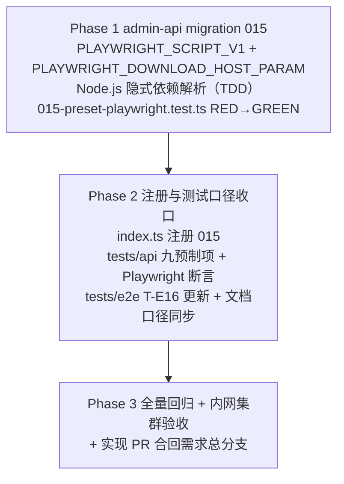

# 增加工作负载「Playwright」- 实现计划

**关联 Proposal**: `docs/engineering/proposals/20261028-feat-playwright-workload.md`（v1.0）
**关联 PRD**: `docs/product/draft/20261028-playwright-workload.md`（v1.0，Issue #342）
**需求总分支（feat-branch）**: `feat/playwright-workload`（基于 `main`，需求总 PR #344）
**实现分支**: `feat/playwright-workload-impl`（基于 `feat/playwright-workload`）
**创建日期**: 2026-10-28
**计划版本**: v1.0
**版本说明**:
- v1.0（2026-10-28）首版，与 PRD v1.0 / 提案 v1.0 对齐。

## 实现顺序



依赖说明：

- 本期**只有 admin-api 一个服务代码变更**（脚本与参数均为库内数据），其余为 `tests/api` / `tests/e2e` 断言与文档口径更新；无跨服务/跨仓并行；
- Phase 1 内先写 `015-preset-playwright.test.ts`（RED）再实现迁移（GREEN）；
- Phase 2 依赖 Phase 1 落定的常量名、参数默认值与脚本文案；
- Phase 3 在实现分支合并回需求总分支后收口（`feat/playwright-workload`）。

开发模式采用 TDD（红-绿-重构）：编码前加载 `docs/engineering/common-rules.md`、`docs/engineering/backend-rules.md` 与 `servers/admin-api/AGENTS.md`；`tests/api` / `tests/e2e` 变更遵循各自 `AGENTS.md`（只用 Aspire 编排、禁止裸 docker）。

### 关键约束（提案 §1.3/§6，实现期不得回退）

- **无契约变更**：不动 `contracts/`；`CloudWorkload.paramSchema`（TEXT）与 `contracts/cloud-controller-websocket.md` §2.9 `WORKLOAD_PARAM_<KEY_UPPER>` 注入约定直接承载 `playwright_download_host`。
- **无 worker 镜像变更**：不改 `deploy/images/worker/Dockerfile` / `entrypoint.sh`，本期**无需重建 worker 镜像**；不改 `MIN_WORKER_VERSION`（提案 §6.2）。
- **不改既有预制工作负载**（Docker / Node.js / .NET / Aspire / Github / Harness 系），不改依赖展开与「必须」失败语义。
- **迁移只增不改**：presetKey / 精确 name 双查命中即跳过并告警，不覆盖管理员修改/删除。
- **脚本内不内置浏览器下载地址**：默认值唯一来源是 `PLAYWRIGHT_DOWNLOAD_HOST_PARAM`（提案 决策 1）；npm 包来源沿用 `NPM_REGISTRY` 约定（默认内网 npm 代理）。
- **浏览器范围固定内置三件**（Chromium / Firefox / WebKit）、工具版本跟随上游最新（PRD §5.2 约束，不加子集/版本参数）。
- **禁止 rebase/squash**：遵循 z-git 规范，仅允许 merge。

## 计划期裁决（提案留白/含混处的实现口径）

1. **迁移编号协调（与并行 MongoDB 需求）**：并行需求「MongoDB 工作负载」（Issue #341）同样规划了 `015-preset-mongodb`。实现启动前先核对主干 `servers/admin-api/src/migrations/` 实际占用编号：
   - 若 `015` 仍空闲：采用 `015-preset-playwright`（文件名、`name`、测试引用同步）；
   - 若 `015` 已被占用：顺延 `016-preset-playwright`（提案 §5.2 实现点 1 口径）；
   - 若两条需求先后合入主干：**后合入方**在 rebase 时同步顺延迁移编号，并把预制项计数断言按主干实际值合并（两需求均为 8→9，先后合入后为 10，名称清单取并集）。禁止用 rebase/squash 改写历史，用 merge 协调。
2. **Node.js 隐式依赖解析**：`dependsOnNames: ['Node.js']` 的解析在 015 的 `run()` 内自实现（001 的 `findExistingId` 未导出）：先 `CloudWorkload.findOne({ presetKey: 'nodejs' })`，再 `findOne({ name: 'Node.js' })` 防御性回退，取 `_id` 写入 `dependsOnWorkloadIds`。两者都缺失时 `console.warn` 并以空依赖创建（脚本自带 node/npm 就绪检查兜底会给出可读失败；不阻断启动）。
3. **参数定义常量形状**（与 `CloudWorkload` 子文档 schema 及 004 先例对齐）：
   `export const PLAYWRIGHT_DOWNLOAD_HOST_PARAM = { key: 'playwright_download_host', label: 'Playwright 浏览器下载地址', type: 'text', options: [], defaultValue: 'https://nexus.internal.fffdan.com/repository/playwright-proxy/' }`；
   `key` 满足 `^[a-z][a-z0-9_]{0,31}$`，`defaultValue` < 1024 字符。**默认值唯一来源是该常量**（测试断言直接引用它）。
4. **导出清单**（提案 §3.2，不额外新增）：`name = '015-preset-playwright'`、`PLAYWRIGHT_PRESET_KEY = 'playwright'`、`PLAYWRIGHT_PRESET_NAME = 'Playwright'`、`PLAYWRIGHT_SCRIPT_V1`、`PLAYWRIGHT_DOWNLOAD_HOST_PARAM`。导出不改变 runner 的 `Migration` 接口（`name` + `run`）。
5. **TS 模板字符串转义**：`PLAYWRIGHT_SCRIPT_V1` 全文与提案 §5.2 逐字一致，模板字符串内 `${...}` 转义为 `\${...}`（同 001/004/007/009 写法）。注意：`NPM_REGISTRY:-https://nexus.internal.fffdan.com/repository/npm-proxy/` 默认值**允许保留**（沿用 `NODEJS_SCRIPT` 既有写法，属于 npm 代理约定而非「浏览器下载地址」）；「脚本内不内置下载地址」特指不含 `playwright-proxy` 字样（裁决 9）。
6. **幂等锚点顺序**（提案 §5.2 实现点 2）：「`playwright` 命令可用 + 浏览器缓存非空 → `playwright --version` 后 `exit 0`」锚点判定必须在下载地址取值**之前**——已安装但地址为空时直接成功（同 004 裁决 5 口径）。`BROWSERS_CACHE="${PLAYWRIGHT_BROWSERS_PATH:-$HOME/.cache/ms-playwright}"` 不写死路径。
7. **尾斜杠不做归一**：`playwright_download_host` 取值原样透传给 `PLAYWRIGHT_DOWNLOAD_HOST`（Issue 口径默认值自带尾斜杠）。若实现期实测因 `//` 拼接导致下载失败，按「实测裁决」通道在取值后补 `${VAR%/}` 归一并回写提案（对齐提案 §6.1 决策 7 的实测裁决机制）。
8. **创建字段口径**：`CloudWorkload.create({ name, initScript, postScript: null, paramSchema: [PLAYWRIGHT_DOWNLOAD_HOST_PARAM], dependsOnWorkloadIds, presetKey, isPreset: true, workloadKind: 'standard', harnessType: null })`（`workloadKind` 显式落 `standard`，MCP `workload_list` 因此自动可见；与 007/009 创建形态一致）。
9. **测试断言口径（澄清「不含硬编码下载地址」）**：以提案 §6.1 决策 1 为准——脚本不得出现 `playwright-proxy` 字样（浏览器来源只经参数/env 提供）；`npm-proxy` 默认值存在属既有约定、不判失败。API 新用例断言：`paramSchema` 含 `playwright_download_host`（TEXT，`defaultValue === PLAYWRIGHT_DOWNLOAD_HOST_PARAM.defaultValue`）；`initScript` 含 `npm install -g playwright`、`playwright install`、`WORKLOAD_PARAM_PLAYWRIGHT_DOWNLOAD_HOST` 三段取值、结尾 `playwright --version` 硬校验与浏览器就绪检查。
10. **tests/api / tests/e2e 的 AGENTS.md 口径校正**：两处用例表当前写「共 7 项 / 恰 7 个」（DeepSeek 迁移 010 后未同步，已落后于测试的 8 项断言）。本期一并校正为 9 项全清单（含 DeepSeek Harness（Harness）与 Playwright）。
11. **写库与 mock 形态**：命中即跳过、未命中 `CloudWorkload.create`（与 007/009 一致）；单测 mock 沿用 `009-preset-harness-kimi-code.test.ts` 形态（`vi.mock('../models/cloud-workload.js')` + `findOne`/`create`）。
12. **超时口径（提案 决策 6）**：不改 `WORKLOAD_INIT_TIMEOUT_MS` 默认 300s；standard 负载 `required=false`，失败不注销容器、可重试。验收期实测浏览器下载耗时，若持续偏紧由运维按环境上调该 env（不在本期代码内改）。
13. **系统依赖（提案 决策 7）**：一期按 Issue 口径仅 `playwright install`；实现期内网集群以「无头 Chromium 启动跑通一次」冒烟验证系统库，若缺失则在同一脚本内补 `playwright install-deps`（apt 走内网源）并回写提案，不预先引入。
14. **失败不阻断**：脚本失败仅使该工作负载记录失败并保留日志，容器继续后续初始化并上线（沿用一期失败策略）；迁移失败仅记日志、下轮启动重试（runner 语义）。
15. **文档生命周期**：PRD 与提案本期保持各自目录（`draft` / `proposals`）不移动，待实现验收后按既有流程归档。

---

## Phase 1: admin-api migration 015（脚本 + 参数 + 依赖解析）

开发分支：`feat/playwright-workload-impl`。TDD 顺序：先写 `015-preset-playwright.test.ts`（RED）→ 实现 `015-preset-playwright.ts`（GREEN）→ 重构收口。

### 文件修改

| 文件 | 操作 | 说明 |
|------|------|------|
| `servers/admin-api/src/migrations/015-preset-playwright.ts` | 新增 | `name` / `PLAYWRIGHT_PRESET_KEY` / `PLAYWRIGHT_PRESET_NAME` / `PLAYWRIGHT_SCRIPT_V1` / `PLAYWRIGHT_DOWNLOAD_HOST_PARAM`（裁决 3/4/5）；`run()` 按裁决 2/8 实现双查防重、Node.js 依赖解析与创建 |
| `servers/admin-api/src/migrations/015-preset-playwright.test.ts` | 新增 | 覆盖 `T-MIG-PW1`~`T-MIG-PW5`（下表）；mock 形态沿用 009 单测（裁决 11） |
| `servers/admin-api/src/migrations/001-preset-workloads.ts` 等既有迁移 | 不变 | 只读参考；不改任何既有迁移源码 |

### 015 迁移逻辑（伪代码）

```ts
export const name = '015-preset-playwright';
export const PLAYWRIGHT_PRESET_KEY = 'playwright';
export const PLAYWRIGHT_PRESET_NAME = 'Playwright';
export const PLAYWRIGHT_DOWNLOAD_HOST_PARAM = { /* 裁决 3 */ };
export const PLAYWRIGHT_SCRIPT_V1 = `#!/usr/bin/env bash\n...`;   // 提案 §5.2 全文（裁决 5 转义）

export async function run(): Promise<void> {
  const byKey = await CloudWorkload.findOne({ presetKey: PLAYWRIGHT_PRESET_KEY });
  if (byKey) { console.warn('[Migration 015] preset workload "playwright" already exists (by presetKey), skipping'); return; }
  const byName = await CloudWorkload.findOne({ name: PLAYWRIGHT_PRESET_NAME });
  if (byName) { console.warn('[Migration 015] workload named "Playwright" already exists, skipping'); return; }

  // Node.js 隐式依赖解析（裁决 2）
  const nodejs =
    (await CloudWorkload.findOne({ presetKey: 'nodejs' })) ??
    (await CloudWorkload.findOne({ name: 'Node.js' }));
  if (!nodejs) console.warn('[Migration 015] preset workload "nodejs" not found, creating without dependency');

  await CloudWorkload.create({
    name: PLAYWRIGHT_PRESET_NAME,
    initScript: PLAYWRIGHT_SCRIPT_V1,
    postScript: null,
    paramSchema: [PLAYWRIGHT_DOWNLOAD_HOST_PARAM],
    dependsOnWorkloadIds: nodejs ? [nodejs._id] : [],
    presetKey: PLAYWRIGHT_PRESET_KEY,
    isPreset: true,
    workloadKind: 'standard',
    harnessType: null,
  });
  console.log('[Migration 015] preset workload "playwright" created');
}
```

### 脚本落地要点（全文见提案 §5.2 实现点 2，逐字一致）

```bash
# 幂等锚点（取值之前，裁决 6）：工具可用 + 浏览器缓存非空 → playwright --version → exit 0
# 下载地址取值（裁决 7 原样透传）：env PLAYWRIGHT_DOWNLOAD_HOST（最高）
#   > WORKLOAD_PARAM_PLAYWRIGHT_DOWNLOAD_HOST > 空 → exit 2 + 含地址形态指引
PLAYWRIGHT_DOWNLOAD_HOST="${PLAYWRIGHT_DOWNLOAD_HOST:-${WORKLOAD_PARAM_PLAYWRIGHT_DOWNLOAD_HOST:-}}"
...
REGISTRY="${NPM_REGISTRY:-https://nexus.internal.fffdan.com/repository/npm-proxy/}"
npm config set registry "$REGISTRY"
npm install -g playwright
PLAYWRIGHT_DOWNLOAD_HOST="$PLAYWRIGHT_DOWNLOAD_HOST" playwright install
# 结尾硬校验：playwright --version + $BROWSERS_CACHE 非空，否则 exit 1
```

> TS 模板字符串中 `${` 转义为 `\${`（同 001/004 写法）；`set -euo pipefail` 头部保留。

### 测试用例（对齐提案 §8.2）

| # | 用例 | 预期 |
|---|------|------|
| T-MIG-PW1 | 播种字段全量断言 | `create()` 参数：`name='Playwright'`、`presetKey='playwright'`、`isPreset=true`、`workloadKind='standard'`、`harnessType=null`、`postScript=null`、`paramSchema=[PLAYWRIGHT_DOWNLOAD_HOST_PARAM]`（含默认值 = 内网 playwright-proxy 地址）、`dependsOnWorkloadIds=[<Node.js id>]`（裁决 2 解析） |
| T-MIG-PW1b | Node.js 预制项缺失防御 | `findOne` 均空：`console.warn` 且以 `dependsOnWorkloadIds: []` 创建（不抛错、不阻断） |
| T-MIG-PW2 | 已存在（presetKey 命中） | warn 跳过、不 `create()`、不覆盖（含管理员改过的字段） |
| T-MIG-PW3 | 仅精确 name 命中 | warn 跳过、不 `create()`（不产生重名项） |
| T-MIG-PW4 | 幂等重跑 | 第二次 `run()` 因 presetKey 命中跳过：`create()` 全程至多一次、无重复写入 |
| T-MIG-PW5 | 脚本不变量 + `bash -n` + 取值切片 | ① `bash -n` 退出 0；② 含 `npm install -g playwright`、`playwright install`、`WORKLOAD_PARAM_PLAYWRIGHT_DOWNLOAD_HOST` 三段取值、结尾 `playwright --version` 硬校验与 `$BROWSERS_CACHE` 就绪检查、`exit 2` 指引含地址形态 `https://<nexus-host>/repository/playwright-proxy/`；③ **不含** `playwright-proxy` 字样（裁决 5/9）；④ 取值切片 `bash -c` 三种组合断言：env 覆盖参数 / 仅参数生效 / 双空 `exit 2`（模式同 004 `T-MIG27`，不触发真实下载） |
| 回归 | 001~014 / runner 既有测试 | 全绿（不改既有迁移源码） |

### 命令参考

```bash
cd servers/admin-api
npx vitest run src/migrations        # 先跑 015 测试（RED→GREEN），再跑全目录
npm run build                        # strict TS 编译
```

### 验收 checklist

- [ ] `T-MIG-PW1`~`T-MIG-PW5` 全部通过；001~014 / runner 既有测试保持通过
- [ ] `npm run build` strict 通过；`Migration` 接口未变（`name` + `run`）
- [ ] 脚本全文与提案 §5.2 逐字一致（转义差异除外）；`bash -n` 通过
- [ ] 脚本内不含 `playwright-proxy` 字样（默认值只在 `PLAYWRIGHT_DOWNLOAD_HOST_PARAM` 里）
- [ ] 015 仅写入 `cloudworkloads` 一条预制文档，不产生其他集合写入；防御路径只告警不写库

---

## Phase 2: 注册与测试口径、文档收口

开发分支：`feat/playwright-workload-impl`。

### 文件修改

| 文件 | 操作 | 说明 |
|------|------|------|
| `servers/admin-api/src/index.ts` | 修改 | 导入 `* as migration015PresetPlaywright from './migrations/015-preset-playwright.js'`，在 `runMigrations([...])` 既有批次之后追加（顺序在 014 之后，注释行「015-preset-playwright——写入 Playwright 预制工作负载」） |
| `tests/api/src/admin-api/cloud-workload.test.ts` | 修改 | 见下方断言更新清单 |
| `tests/e2e/src/admin-cloud-workload.spec.ts` | 修改 | T-E16 更新（见下表） |
| `tests/api/AGENTS.md` | 修改 | 用例表更新（裁决 10）：预制项存在性行 7 项→9 项全清单（补 DeepSeek 与 Playwright），新增「T-IA 预制 Playwright 参数化下载」行 |
| `tests/e2e/AGENTS.md` | 修改 | T-E16 行「恰 7 个」→「恰 9 个」并补名称清单（裁决 10） |
| `deploy/images/worker/BUILD.md` | 修改 | 「预制工作负载脚本手工验收（真实集群）」补 Playwright 逐项核对块（文档口径同步，**不改镜像**）：`playwright --version`、浏览器就绪（`$HOME/.cache/ms-playwright` 非空）、参数默认值已填且可达、清空地址快速失败含地址形态、下载来源不可达留痕可重试、重复执行幂等 |
| `docs/engineering/AGENTS.md` | 已完成 | 「实现计划（`plan/`）」索引已随本计划提交登记，无需在实现期重复改动 |

### tests/api 断言更新清单（`T-IA: exposes the eight preset workloads...`）

- 用例更名 `nine`；名称清单补 `'Playwright'`（保持既有 8 项 + Playwright）；`expect(presetIds(all)).toHaveLength(8)` → `9`；「同名预制项只应存在一个」「重复查询 ID 集合稳定」不变量保留。
- 新增断言（可并入该用例或独立新用例 `T-IA: preset Playwright installs tool + browsers via parameterized download host`）：
  - `workloadKind === 'STANDARD'`、`harnessType === null`、`isPreset === true`；
  - `paramSchema` 仅一项：`{ key: 'playwright_download_host', type: 'TEXT', defaultValue: 'https://nexus.internal.fffdan.com/repository/playwright-proxy/' }`；
  - `dependsOnWorkloadIds` 等于 `[Node.js 预制项 id]`（与 Aspire 依赖断言同款）；
  - `initScript` 含 `npm install -g playwright`、`playwright install`、`WORKLOAD_PARAM_PLAYWRIGHT_DOWNLOAD_HOST`、结尾 `playwright --version`；**不含** `playwright-proxy` 字样（裁决 9）。

### tests/e2e T-E16 更新

| # | 用例 | 预期 |
|---|------|------|
| T-E16 更新 | `lists the nine preset workloads with the preset badge` | 名称清单补 `'Playwright'`；`toHaveText('预制')` 计数 `8 → 9`；API 侧 sorted 名称清单补 `'Playwright'`；顺带修正注释陈旧计数（「七个/7 个」→ 9）；Aspire 依赖行、Node.js 参数计数断言保留 |

### 命令参考

```bash
cd servers/admin-api && npm run build
grep -n "playwright-proxy" servers/admin-api/src/migrations/015-preset-playwright.ts   # 应无输出（除注释/指引占位形态外）
```

### 验收 checklist

- [ ] `index.ts` 注册链含 015 且顺序在 014 之后，`npm run build` 通过
- [ ] tests/api 新旧断言与实现一致（9 项、参数/依赖/脚本内容、不含 `playwright-proxy`）
- [ ] tests/e2e T-E16 计数 9、名称清单含 Playwright
- [ ] `tests/api/AGENTS.md` / `tests/e2e/AGENTS.md` 用例表与实现一致（含 7→9 陈旧口径校正）
- [ ] BUILD.md Playwright 手工验收块成文（仅文档，不涉及镜像）

---

## Phase 3: 全量回归 + 内网集群验收 + 实现 PR

### 命令参考

```bash
# admin-api 全量
cd servers/admin-api && npm run build && npx vitest run
# API 回归（Aspire 编排；端口以 aspire describe 输出为准）
aspire start && aspire wait admin-api agent-api cloud-controller controller-api
cd tests/api && API_URL=http://localhost:10001/graphql \
  ADMIN_API_URL=http://localhost:10003/graphql \
  CONTROLLER_API_URL=<aspire describe controller-api> npm test
# E2E（admin 套件）
cd tests/e2e && aspire wait admin-web admin-api && npx playwright test admin-cloud-workload.spec.ts --workers=1
```

> 测试运行遵循 `tests/api` / `tests/e2e` 的 AGENTS.md：只用 Aspire 编排、禁止裸 docker；重跑从 `aspire start` 重来。

### 内网 K8s 手工验收（对齐 PRD §1.3 成功标准 / 提案 §9）

前置：admin-api 已部署含 migration 015 的版本；内网 `npm-proxy` 与 `playwright-proxy` 可达。

- [ ] 升级后工作负载列表自动出现「Playwright」预制项（带预制标识、只出现一次）；重复执行迁移不重复写入
- [ ] 管理员修改/删除该预制项后再启动：不被系统覆盖或恢复（只告警）
- [ ] 启动挂载安装成功：容器内 `playwright --version` 可用，`$HOME/.cache/ms-playwright` 非空（Chromium / Firefox / WebKit），可直接运行 Playwright 测试
- [ ] 默认配置安装全程走内网代理（npm-proxy + playwright-proxy），不触公网
- [ ] 参数表单展示「浏览器下载地址」且默认值已填内网代理地址；按默认值安装成功
- [ ] 调整地址后安装按新地址下载浏览器；清空地址（且未提供 `PLAYWRIGHT_DOWNLOAD_HOST`）时快速失败，提示含地址形态
- [ ] 依赖 Node.js 自动补齐、进度中可见；未预装 Node.js 的主机可完成安装
- [ ] 重复安装幂等成功（已安装直接校验通过，不重复下载）；工具装好但浏览器下载失败时整体判失败、原因可读，重试对已成功部分幂等
- [ ] 三入口（启动挂载 / 拉起后安装 / Agent `workload_install`）安装均成功，进度/日志/失败原因展示与既有工作负载一致，执行记录可区分触发来源
- [ ] 已安装状态在列表标记为已安装，不提供卸载入口；云主机不在线时不允许发起安装
- [ ] 决策 7 冒烟：无头 Chromium 启动跑通一次；若缺系统库，同脚本补 `playwright install-deps` 并回写提案（连同尾斜杠归一裁决 7 如被触发）
- [ ] 实现分支 PR 合并回 `feat/playwright-workload`，需求总 PR #344 自动更新；实现计划文档保留在需求总分支

### 总体验收 checklist（对齐提案 §9）

- [ ] `T-MIG-PW1`~`T-MIG-PW5` 全部通过，001~014 / runner 全绿
- [ ] API 测试通过（九预制项口径 + Playwright 脚本/参数回归）、E2E 通过（T-E16）
- [ ] 无契约变更（`git diff --stat` 不含 `contracts/`）、无镜像变更（不含 `deploy/images/worker/Dockerfile` / `entrypoint.sh`）、无 GraphQL schema 与前端变更
- [ ] 迁移只增不改：定制项不被覆盖、重复执行幂等
- [ ] 上述内网集群验收全项通过

## 风险与回滚

| 风险 | 缓解 |
|------|------|
| 迁移编号与并行 MongoDB 需求（`015-preset-mongodb`）撞号 | 实现启动前核对主干编号，占用则顺延 016（裁决 1）；后合入方 merge 协调，不 rebase |
| 预制计数断言与并行需求冲突（双方都改 8→9） | 后合入方按主干实际值合并名称清单与计数（并集 10 项，裁决 1） |
| 浏览器体积大（三件数百 MB），300s 默认超时偏紧 | standard 负载 `required=false` 失败可重试；运维按环境上调 `WORKLOAD_INIT_TIMEOUT_MS`（裁决 12）；验收实测记录耗时 |
| 浏览器运行缺系统库 | 决策 7 实测裁决：无头 Chromium 冒烟，缺失则同脚本补 `playwright install-deps` 并回写提案（裁决 13） |
| playwright-proxy 不可达 / 尾斜杠拼 `//` | 失败留痕、原因可读、可重试；实测拼接问题时按裁决 7 归一并回写提案 |
| 误覆盖管理员定制/删除 | presetKey / 精确 name 双查命中即跳过（T-MIG-PW2/PW3）；迁移只增不改 |
| 浏览器下载地址写死回流 | T-MIG-PW5 / API 断言脚本不含 `playwright-proxy` 字样；默认值只在参数定义 |
| 极老 worker 不注入参数 | 取值为空 → 快速失败 + 指引，不静默回退公网；不提高 `MIN_WORKER_VERSION` |
| 迁移失败阻断启动 | runner 语义：失败仅记日志、下轮启动重试，不阻断服务 |
| 脚本安装返回 0 但实际不可用 | 结尾硬校验 `playwright --version` + 浏览器就绪检查，任一不满足 `exit 1`（T-MIG-PW5） |

## 相关文档

- 关联 PRD：`docs/product/draft/20261028-playwright-workload.md`（Issue #342）
- 关联 Proposal：`docs/engineering/proposals/20261028-feat-playwright-workload.md`
- 直接前例（下载源参数化模式）：`docs/engineering/plan/20261019-feat-aspire-workload-proxy.md`、`plan/20261018-fix-docker-ce-apt-source.md`
- 预制工作负载基线：`docs/engineering/plan/20261018-feat-workload-phase1.md`、`proposals/20261021-feat-github-workload.md`
- 既有实现：`servers/admin-api/src/migrations/001-preset-workloads.ts`（`PresetDefinition`/`findExistingId` 语义）、`004-aspire-cli-source.ts`（参数化下载源先例）、`007-preset-github.ts` / `009-preset-harness-kimi-code.ts`（预制项创建形态与单测 mock）、`runner.ts`、`servers/admin-api/src/index.ts`
- 参数链路参考：`servers/admin-api/src/services/workload-plan.ts`、`servers/cloud-controller/src/services/workload-dispatcher.ts`、`packages/agent-controller/src/workload-executor.ts`
- 契约：`contracts/admin-cloud-workload.graphql`、`contracts/cloud-controller-websocket.md`（§2.9 参数注入约定）
- 镜像构建与自验：`deploy/images/worker/BUILD.md`
- 开发规范：`docs/engineering/common-rules.md`、`docs/engineering/backend-rules.md`
