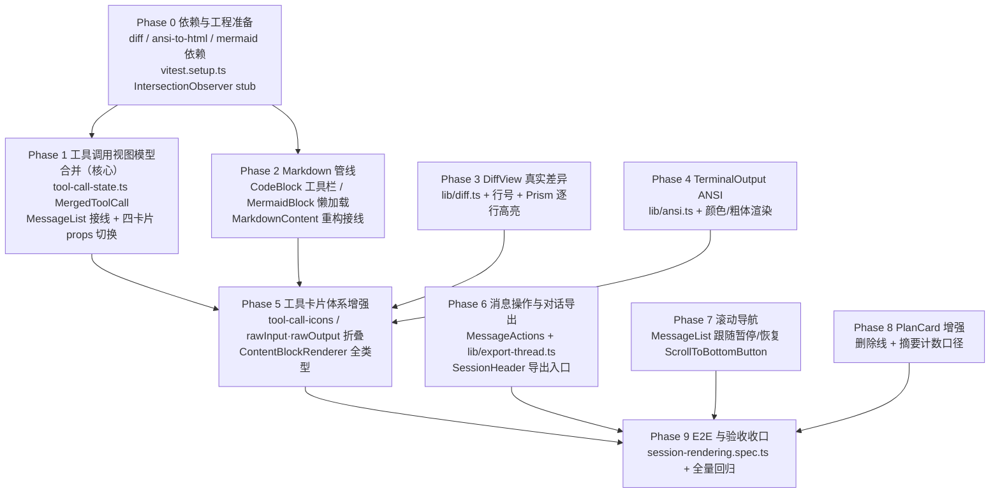

# 重构对话渲染 - 实现计划

**关联 Proposal**: `docs/engineering/proposals/20261028-refactor-conversation-rendering.md`（v1.1）
**关联 PRD**: `docs/product/draft/20261028-conversation-rendering.md`（v1.1）
**需求总分支（feat-branch）**: `prd/conversation-rendering`（基于 `origin/main` 12a18fd5，需求总 PR [#333](https://github.com/Deliay/z-agent-gear/pull/333)，评审 APPROVED）
**计划提交分支**: `prd/conversation-rendering`（本文件随需求总分支提交）
**创建日期**: 2026-10-28
**计划版本**: v1.0

**版本说明**：

- v1.0（2026-10-28）首版。对应 PRD / 提案 v1.1（PR #333 评审 APPROVED；评审提出的「工具调用完成后退化 Tool Call: other」缺陷已在 v1.1 修订中纳入根因与合并方案，无遗留修改项）。
- §3 计划期裁决以**当前需求总分支代码事实**为准（2026-10-28，74c85d36）：重点校正 ① Markdown 语言识别实际在 `components.code` 覆写且无语言围栏块当前无工具栏；② `cleanOutput` 第一正则剥离的正是 SGR 颜色序列；③ jsdom 无 IntersectionObserver 需测试基建 stub；④ 四卡片 props 签名的切换口径。

## 1. 实现顺序



依赖说明：

- **Phase 1（视图模型合并）是本期核心**：修复 PR #333 评审确认的缺陷，也是 Phase 5 的前置（卡片统一消费 `MergedToolCall`）。优先级最高，先行落地。
- **Phase 2/3/4（渲染管线三件套）** 只依赖 Phase 0，相互独立，可与 Phase 1 并行；其产物（CodeBlock / 新 DiffView / 新 TerminalOutput）被 Phase 5 消费。
- **Phase 6/7/8** 相互独立，依赖 Phase 0（Phase 7 另依赖 Phase 0 的 IntersectionObserver stub）；Phase 6 的「复制 Markdown」与 Phase 2 无代码耦合（复制的是原始文本，非渲染产物）。
- **Phase 9** 在全部实现合并回主实现分支后收口。
- 本期**纯前端、零契约变更、零后端改动**（提案 §3.1 已确认）；工作量集中在 `apps/agent-web` 单一子项目。

### 1.1 开发分支与合并顺序

| 分支 | 范围 | 基于 | 合并目标 |
|------|------|------|---------|
| `prd/conversation-rendering` | PRD / 提案 / 本计划（需求总分支） | `origin/main` | 需求总 PR #333 |
| `feat/conversation-rendering-impl` | 全部实现 + 测试（主实现分支） | 需求总分支 | 需求总分支（评审通过后随需求总 PR 入 main） |
| `impl/conversation-rendering-<track>`（可选） | 单轨道并行开发分支 | `feat/conversation-rendering-impl` | `feat/conversation-rendering-impl` |

- 主实现分支内按 Phase 顺序分提交：`chore(deps)` → `fix(agent-web): tool-call 合并` → `feat(agent-web): markdown 管线` → `refactor(agent-web): diff/terminal` → `feat(agent-web): 卡片体系` → `feat(agent-web): 消息操作/滚动/计划` → `test:`。
- 可选并行轨道（z-coding「编写实现并行 subagent」）：Track A = Phase 2/3/4（渲染管线），Track B = Phase 1/5（工具调用体系），二者文件交集仅限 `ToolCallCard.tsx`（Track B 主导），Track A 不动卡片；Phase 6/7/8 各自独立。
- **禁止 rebase/squash，只允许 merge**（z-git 规范）。合并顺序：**Phase 0/1 → Track A/B → Phase 6/7/8 → Phase 9**。

### 1.2 开发模式与规范加载

- 全部 Phase 采用 TDD（红-绿-重构）：先写测试（RED）→ 最小实现（GREEN）→ 重构。重构组件（DiffView/TerminalOutput/MessageList/ToolCallCard/ReadCard/FetchCard/SubAgentCard/PlanCard）**先更新既有测试至新行为（红），再替换实现（绿）**。
- 编码前加载：`docs/engineering/common-rules.md`、`docs/engineering/frontend-rules.md`；测试阶段加载 `z-test` skill。
- 目录级 `AGENTS.md`：`apps/agent-web/AGENTS.md`、`tests/e2e/AGENTS.md`、`docs/engineering/plan/AGENTS.md`。
- `servers/*`、`apps/admin-web`、`packages/*`、`contracts/` **本期零改动**。

## 2. 命令参考

```bash
# 服务编排（根目录；测试服务只用 Aspire，禁止直接 docker 命令）
aspire start
aspire wait agent-api agent-web
aspire describe agent-web
aspire stop

# agent-web 单测 / 构建 / lint
cd apps/agent-web
npm ci
npm test            # vitest run（单测 + 组件测试）
npm run build       # tsc -b && vite build（strict 类型检查 + 分包产物核对）
npm run lint

# E2E（串行；地址按 aspire describe 替换）
cd tests/e2e
BASE_URL=http://localhost:<agent-web-port> \
API_URL=http://localhost:10001/graphql \
CONTROLLER_API_URL=http://localhost:<controller-api-port> \
npx playwright test session-rendering.spec.ts --workers=1

# 全量 E2E 回归（串行，含既有 session-*.spec.ts）
npx playwright test --workers=1
```

## 3. 计划期裁决（提案与代码事实偏差的落地口径）

> 以下裁决以**当前需求总分支代码事实**（74c85d36）为准。提案中与之不一致或含混的描述在实现期按本节执行，**不回改提案**；验收报告逐条登记。

### 3.1 事实校正（提案描述与代码事实的偏差）

| # | 提案描述 | 代码事实 | 本计划口径 |
|---|---------|----------|-----------|
| F1 | §5.2 实现点 1：「`MarkdownContent` 的 `components.pre` 覆写中识别围栏代码块……`pre` 仅作透明容器」 | `MarkdownContent.tsx:15-39`：语言识别在 **`components.code` 覆写**（`language-(\w+)` 匹配后渲染 SyntaxHighlighter）；`pre` 覆写已是透明容器；**无语言围栏块**（无 className）走行内 `<code>` 样式，视觉上退化为行内代码、无工具栏 | `pre` 覆写承接**全部**围栏块并分流：`language-mermaid` → `MermaidBlock`，其余（含无语言）→ `CodeBlock`；`code` 覆写仅渲染行内代码（无 `pre` 祖先时）。无语言块语言标签显示 `text`（对齐 PRD 验收「不带语言标记的代码块均有工具栏」）。与提案意图（避免嵌套滚动、工具栏全覆盖）一致，覆写分工以代码事实为准 |
| F2 | §5.2 实现点 3：DiffView「双行号列」 | `DiffView.tsx:73-75`：行号列为 `w-8` **空白占位**（渲染 `' '`），无真实行号；`computeLineDiff` 为位置逐行对比（maxLen 循环），插入/删除即错位 | 新 `lib/diff.ts` `computeDiff` 输出带 `oldLineNumber`/`newLineNumber` 的 `DiffLine[]`；DiffView 渲染双行号列。既有 5 用例（新文件徽标/双文本/空文件非新文件/无伪删除行/长路径 break-all）语义**保留并迁移**到新实现，另新增行号与对齐断言 |
| F3 | §5.2 实现点 4：「预处理保留现有 `\r\n`→`\n` 归一与 OSC/光标序列剥离正则」 | `TerminalOutput.tsx:10`：第一正则 `\x1b\[[0-9;]*[a-zA-Z]` 剥离的正是 **SGR 颜色序列**（颜色丢失根因）；其后两条为 OSC 与残留转义 | ANSI 模式下 **SGR 序列保留**交 ansi-to-html 解析；预处理仅做 `\r\n`→`\n` 归一 + OSC/光标移动/清屏等非展示序列剥离（现有第二/三正则口径）；容器维持深色底（`bg-gray-950`），浅色主题下终端区仍深色 |
| F4 | §5.2 实现点 5/6：「四个工具类卡片统一消费合并结果」「卡片输入由 MergedToolCall 提供」 | 四卡片 props 均为 `messages: Array<{content, createdAt}>` 且各自只解析**最后一条**（`ToolCallCard.tsx:85`、`ReadCard.tsx:21`，FetchCard/SubAgentCard 同构）；`group-messages.ts` 按 `toolCallId` 全列表聚合，稀疏 update（无 kind）命中既有组且不降级组类型（升级逻辑单向） | 卡片 props 切换为 `{ toolCall: MergedToolCall, expanded?, onExpandedChange? }`；`MessageList` 渲染分支调用 `mergeToolCallMessages(group.messages)` 产出视图模型；**group-messages.ts 分组逻辑零改动**（提案口径经代码核实成立）；四卡片既有测试按新 props 重写（先红后绿） |
| F5 | §5.2 实现点 8：IntersectionObserver 观测底部锚点 | jsdom **不提供** IntersectionObserver；仓库现状无任何 IntersectionObserver 使用与 mock | Phase 0 在 `apps/agent-web/vitest.setup.ts` 增加全局 IntersectionObserver stub（可控触发 `isIntersecting`）；MessageList 跟随暂停/恢复的组件测试基于该 stub；真实浏览器行为由 E2E 覆盖 |
| F6 | §5.2 实现点 7 / §7：「`SessionHeader` 或消息列表工具区新增导出入口」「`pages/SessionPage.tsx` 增强：导出入口挂载」 | `SessionPage.tsx` 仅路由壳；会话主体为 `SessionView.tsx`（持有 `messages` 状态 line 84，挂载 `SessionHeader` line 510 与 `MessageList` line 543）；`SessionHeader` 已有操作区（继续/关闭/删除/能力清单） | 导出入口固定在 **SessionHeader 操作区**新增「导出」按钮；`SessionView` 经回调 prop 将 `messages` 提供給导出逻辑（`lib/export-thread.ts` 纯函数转换 + Blob 下载）；`SessionPage.tsx` 零改动 |
| F7 | 提案头：`feat-branch` 行引用 `[[../git.md]]` | `docs/engineering/` 下**无 git.md**（断裂链接） | 分支惯例以 z-git skill 与仓库现存 `prd/<slug>` + `feat/<slug>-impl` 分支事实为准（§1.1）；不回改提案，验收报告登记 |
| F8 | §6.2：新增 `diff`、`ansi-to-html`、`mermaid` 三依赖 | `apps/agent-web/package.json` 当前**均无**；`lucide-react`、`sonner`、`react-syntax-highlighter` 已存在 | Phase 0 安装 `diff` / `ansi-to-html` / `mermaid`（dependencies）；类型包以安装时核对为准（自带类型则不加 `@types/*`，否则补 `@types/diff` / `@types/ansi-to-html` 为 devDependencies）；mermaid 仅经 `import('mermaid')` 引用，确认 Vite 产物中其 chunk 与首屏分离 |
| F9 | §5.2 实现点 7：「复制 Markdown 得到原始 text」 | `MessageList.tsx:18-51` `mergeMessageChunks` 已将 agent/user 组多 chunk 合成为单条 JSON content（text 拼接）；`MessageItem` 解析后渲染 | 「复制 Markdown」取与展示**同源**的合成 text（非逐 chunk 原始 content），保证复制结果与所见一致；「复制纯文本」取渲染 DOM 的 `innerText`（提案口径不变） |
| F10 | §5.2 实现点 9：摘要口径「全部完成 / x/y / N 项任务」 | `PlanCard.tsx:57` 现状摘要为英文 `` `${completed}/${total} completed` ``；`PlanFloatingCard` 另有摘要展示 | 摘要口径按提案逐字落地为中文三态；`PlanCard` 与 `PlanFloatingCard` 同步；既有测试断言同步改写 |
| F11 | §5.2 实现点 6：状态体系「保留 AcpCard 的 active/completed/failed 语义色」 | `AcpCard.tsx` 已有语义键 `active/completed/failed`（恒高亮 info 系），legacy 键 `purple/yellow/gray/blue` 保留；`PlanCard` 用 `color="yellow"` | 新增 `pending` 弱化样式与「等待确认」提示位映射；legacy 键**逐字保留**（配色语义化规范要求保留旧键）；PlanCard 配色本期不动 |

### 3.2 设计裁决（提案留白/含混处）

1. **MergedToolCall 产生位置**：`MessageList` 的 `useMemo` 分组产物上按组调用 `mergeToolCallMessages`（与 `groupMessages` 同一 memo 链路），四个卡片分支（tool_call/read/fetch/sub_agent）统一传 `toolCall` prop；不在各卡片内部各自合并（提案口径），保证行为一致、单测只覆盖一处。
2. **合并函数输入**：`mergeToolCallMessages(messages: AcpMessage[])` 内部逐条 `parseSessionUpdate`，只消费 `sessionUpdate === 'tool_call' | 'tool_call_update'` 的消息（其余忽略）；三态语义：**字段未携带（`undefined`）保留原值、显式 `null` 清除、有值替换**；`status`/`content`/`rawOutput` 取最后一条携带该字段的值；`toolCallId` 取首条携带者。
3. **卡片 label 重建口径**：标题 = 合并后 `title ?? kindLabel(合并后 kind ?? 'other')`，执行中与完成后同一计算路径，消除「执行中有命令名、完成后变 other」；`kindLabel` 从 `ToolCallCard.tsx` 提升至 `tool-call-state.ts` 共享。
4. **CodeBlock 高亮下沉**：`SyntaxHighlighter` 渲染移入 `CodeBlock` 内部；`pre` 覆写不再直接渲染 `<pre>` 包裹高亮（避免嵌套滚动容器）；无语言块用纯文本渲染（不走 Prism）+ 工具栏。
5. **MermaidBlock 失败回退**：`mermaid.render` reject/parse 错误时回退渲染 `CodeBlock`（含工具栏与源码），不向列表抛错；主题切换以 `key` 含主题强制重渲染（提案口径）。
6. **rawInput/rawOutput 折叠区**：复用 `CodeBlock`（language=json，`JSON.stringify(value, null, 2)`）；美化后超 500 行截断并提示（提案风险点口径）；默认折叠，折叠状态不持久化。
7. **导出数据口径**：遍历 `SessionView` 持有的 `messages`（原始 `AcpMessage[]`，非分组产物），按 zed `to_markdown` 参考格式分节；tool_call 分组内经 `mergeToolCallMessages` 取合并后标题/状态/输入输出摘要，保证导出与展示一致。
8. **滚动跟随判定**：`IntersectionObserver`（threshold 0.9）观测 `messagesEndRef`；初始加载滚到底与 prepend 历史位置恢复（`scrollStateRef` 机制）**逐字保留**；仅「append 且不在底部」从强制 scrollToBottom 改为「保持视口 + 显示回到底底按钮（带新消息圆点）」。
9. **E2E 驱动机制**：复用 `session-chat.spec.ts` 既有 fake controller 模式（`registerController` + `socket.emit('acp:message', ...)` 注入 SessionUpdate JSON），会话创建后直接注入工具调用/稀疏更新/mermaid 块/diff/ANSI 文本，不依赖真实 Agent。

## 4. 关键约束（提案 §1.3/§6 与规范，实现期不得回退）

- **纯前端零契约**：不改 ACP 协议交互、消息存储、后端接口与 `contracts/` 任何文件；数据来源仍为 `GET_SESSION_MESSAGES` 分页 + SSE `session:message`。
- **分组逻辑零改动**：`group-messages.ts` 逐字保留；合并只发生在渲染分支（§3.2 裁决 1）。
- **TDD 纪律**：lib 纯函数（`diff.ts`/`ansi.ts`/`language-from-path.ts`/`export-thread.ts`）与 `tool-call-state.ts` 合并函数**分支覆盖率 100%**；新增组件 RTL 覆盖渲染与交互；重构组件先红后绿并保留记录。
- **XSS 面**：mermaid `securityLevel: 'strict'`；ansi-to-html `escapeXML: true`；react-markdown 默认不执行原始 HTML（维持）；外链 `target="_blank" rel="noreferrer"`（现有口径）；`dangerouslySetInnerHTML` 仅限 ansi-to-html 已转义输出与 mermaid SVG 两处。
- **包体积**：mermaid 必须动态导入（`import('mermaid')`），`npm run build` 产物核对 mermaid chunk 独立于首屏；Prism 维持现有全量引入（本期不做包体积治理）。
- **布局三件套**（frontend-rules）：新组件窄面板不横向溢出——工具栏 `shrink-0`、内容 `min-w-0`、长内容 `break-all`/`wrap-anywhere`；E2E 断言 `scrollWidth - clientWidth ≤ 1`。
- **既有行为保留**：DiffView「新建文件」徽标、TerminalOutput `maxHeight` 滚动与空行 `&nbsp;`、MessageList 初始滚底与 prepend 位置恢复、PlanFloatingCard 浮卡、卡片展开/折叠受控逻辑（`expandedOverrides`）。
- **z-git**：禁止 rebase/squash；实现 PR（`feat/conversation-rendering-impl` → `prd/conversation-rendering`）评审通过后合并；合并后删除实现分支（远端与本地），不删目标分支。
- **测试编排**：测试服务只用 Aspire；E2E `workers: 1` 串行。

## 5. Phase 计划

### Phase 0：依赖与工程准备（0.5d）

| 文件 | 变更 |
|------|------|
| `apps/agent-web/package.json` | dependencies 新增 `diff` / `ansi-to-html` / `mermaid`；类型包按 §3.1 F8 核对结果补 devDependencies |
| `apps/agent-web/vitest.setup.ts` | 新增 IntersectionObserver 全局 stub（可控触发，F5） |
| 工程核对 | `npm run build` 确认 mermaid 动态导入分包（首屏 chunk 不含 mermaid）；`ansi-to-html` 实例 API（`new AnsiToHtml({ escapeXML: true }).toHtml()`）与 `diffLines` 输出形态冒烟核对 |

**完成判据**：`npm ci && npm test && npm run build` 全绿；构建产物中 mermaid 为独立异步 chunk；IntersectionObserver stub 在组件测试中可用。

### Phase 1：工具调用视图模型合并（1.5d，核心）

**目标**：修复 PR #333 评审确认缺陷——工具完成后卡片标题/类型/参数不丢失。

| 文件 | 变更 |
|------|------|
| `apps/agent-web/src/components/session/tool-call-state.ts` | **新增**：`MergedToolCall` 接口与 `mergeToolCallMessages(messages)`（三态合并，§3.2 裁决 2）；`kindLabel` 迁入共享 |
| `apps/agent-web/src/components/session/__tests__/tool-call-state.test.ts` | **新增**：T-MERGE1~10（见 §6.1） |
| `apps/agent-web/src/components/session/MessageList.tsx` | 分组 memo 链路追加合并（§3.2 裁决 1）；tool_call/read/fetch/sub_agent 四分支改传 `toolCall` prop |
| `apps/agent-web/src/components/session/ToolCallCard.tsx` | props 切换为 `{ toolCall, expanded?, onExpandedChange? }`；渲染数据源改为合并结果（视觉行为本期不变） |
| `apps/agent-web/src/components/session/ReadCard.tsx` / `FetchCard.tsx` / `SubAgentCard.tsx` | 同上 props 切换；完成后文件列表/URL/prompt 保留 |
| `apps/agent-web/src/components/session/__tests__/ToolCallCard.test.tsx` 等四卡片测试 | 按新 props 重写（先红）；新增「完成态标题/参数与创建时一致」断言（后绿） |

**完成判据**：`mergeToolCallMessages` 分支覆盖率 100%；构造「创建（kind=execute + title + rawInput）→ 稀疏完成更新（仅 status + rawOutput）」序列，四卡片完成态标题/类型/参数与创建时一致，不再出现「Tool Call: other」「other — completed」；仅 update 无创建消息的兜底不渲染空白。

### Phase 2：Markdown 管线（1.5d）

| 文件 | 变更 |
|------|------|
| `apps/agent-web/src/components/session/markdown/CodeBlock.tsx` | **新增**：语言标签（无语言显示 `text`）+ hover「复制」「换行」按钮 + 默认横向滚动/换行态 `whitespace-pre-wrap break-all`；复制经 `navigator.clipboard.writeText`，成功/失败 toast（sonner） |
| `apps/agent-web/src/components/session/markdown/MermaidBlock.tsx` | **新增**：`import('mermaid')` 懒加载 + `securityLevel:'strict'` + 主题跟随（dark 判定与 ThemeToggle 一致，key 含主题）；缩放（0.5–3，步进 0.25）/重置/「查看源码」切换；失败回退 CodeBlock |
| `apps/agent-web/src/components/session/MarkdownContent.tsx` | 重构（F1）：`pre` 覆写承接围栏块分流（mermaid→MermaidBlock、其余→CodeBlock），`code` 覆写仅行内代码；表格/链接/列表等既有覆写逐字保留 |
| `apps/agent-web/src/components/session/markdown/__tests__/CodeBlock.test.tsx` / `MermaidBlock.test.tsx` | **新增**：T-CB1~6 / T-MM1~6（§6.2） |
| `apps/agent-web/src/components/session/MarkdownContent.test.tsx` | 更新：围栏块分流断言（含无语言块有工具栏、行内代码无工具栏） |

**完成判据**：PRD 功能点 1/2 验收标准逐项过；mermaid 语法错误回退代码块且不阻断同页其他内容；窄视口工具栏不撑破布局。

### Phase 3：DiffView 真实差异（1d）

| 文件 | 变更 |
|------|------|
| `apps/agent-web/src/lib/diff.ts` | **新增**：`computeDiff(oldText, newText): DiffLine[]`（jsdiff `diffLines` 展开 + 新旧行号计数）；超 2000 行截断标记 |
| `apps/agent-web/src/lib/language-from-path.ts` | **新增**：扩展名 → Prism 语言映射（ts/tsx/js/jsx/py/rs/go/java/css/json/md/yaml 等，未知回退纯文本） |
| `apps/agent-web/src/lib/__tests__/diff.test.ts` / `language-from-path.test.ts` | **新增**：T-DIFF1~8 / T-LANG1~3（§6.1），分支覆盖 100% |
| `apps/agent-web/src/components/session/DiffView.tsx` | 重构：双行号列 + `−`/`+` 标记 + 语义色（added=success、removed=destructive，适配双主题）+ added/same 行 Prism tokenize 高亮（removed 行纯文本）；文件头与「新建文件」徽标、最大高度滚动逐字保留；diff/tokenize 结果 `useMemo` |
| `apps/agent-web/src/components/session/__tests__/DiffView.test.tsx` | 既有 5 用例迁移（F2）+ 新增行号/对齐/截断断言（先红后绿） |

**完成判据**：插入多行/删除多行/连续修改场景对齐正确（与 jsdiff 口径一致）；每行行号正确；PRD 功能点 3 验收标准逐项过。

### Phase 4：TerminalOutput ANSI（0.5d）

| 文件 | 变更 |
|------|------|
| `apps/agent-web/src/lib/ansi.ts` | **新增**：`ansiToHtml(raw)`——预处理（F3：`\r\n`→`\n`、OSC/光标序列剥离、SGR 保留）+ ansi-to-html（`escapeXML: true`） |
| `apps/agent-web/src/lib/__tests__/ansi.test.ts` | **新增**：T-ANSI1~6（§6.1），分支覆盖 100% |
| `apps/agent-web/src/components/session/TerminalOutput.tsx` | 重构：`dangerouslySetInnerHTML` 注入已转义 HTML；容器深色底与 `maxHeight` 滚动、空行 `&nbsp;` 逐字保留 |
| `apps/agent-web/src/components/session/__tests__/TerminalOutput.test.tsx` | **新增**：颜色 span/粗体/控制序列不产生乱码/XSS 转义断言 |

**完成判据**：PRD 功能点 4 验收标准逐项过；无颜色输出可读性不回归。

### Phase 5：工具卡片体系增强（1.5d）

| 文件 | 变更 |
|------|------|
| `apps/agent-web/src/components/session/tool-call-icons.ts` | **新增**：ToolKind → lucide 图标映射（read=FileSearch、edit=FilePen、delete=Trash2、move=ArrowRightLeft、search=Search、execute=TerminalSquare、think=Brain、fetch=Globe、switch_mode=ArrowRightLeft、other=Hammer） |
| `apps/agent-web/src/components/session/AcpCard.tsx` | 新增 `pending` 弱化样式键（legacy 键逐字保留，F11） |
| `apps/agent-web/src/components/session/ContentBlockRenderer.tsx` | **新增**：ToolCallContent/ContentBlock 全类型——text（MarkdownContent）/image（`` 限高 + 加载失败占位）/audio（`<audio controls>`）/resource_link（新窗口 + noreferrer）/resource（text→markdown，blob→uri 占位）；diff→新 DiffView；terminal→新 TerminalOutput |
| `apps/agent-web/src/components/session/ToolCallCard.tsx` | 标题前置类型图标；状态覆盖 pending/active/completed/failed + 等待确认提示位；底部「查看原始输入/输出」折叠区（CodeBlock language=json，超 500 行截断，裁决 6）；content 全类型走 ContentBlockRenderer；kind 特化渲染（edit/execute/delete/move/search/think）保留 |
| `apps/agent-web/src/components/session/ReadCard.tsx` / `FetchCard.tsx` / `SubAgentCard.tsx` | 同步：图标 + raw 折叠区接入 |
| 对应 `__tests__/` | T-TC1~8 / T-CBR1~6 等（§6.2） |

**完成判据**：PRD 功能点 5 验收标准逐项过（图标/状态/生命周期一致性/原始数据可检视/全类型产出/未识别类型降级不空白）。

### Phase 6：消息操作与对话导出（1d）

| 文件 | 变更 |
|------|------|
| `apps/agent-web/src/components/session/MessageActions.tsx` | **新增**：agent 消息 hover 操作条——「复制 Markdown」（合成 text，F9）/「复制纯文本」（渲染 DOM innerText）；剪贴板不可用/reject 时 toast 失败提示 |
| `apps/agent-web/src/components/session/MessageItem.tsx` | 接入 MessageActions（agent 消息；用户消息维持现状） |
| `apps/agent-web/src/lib/export-thread.ts` | **新增**：`threadToMarkdown(messages)`（`## User` / `## Assistant` / 思考 `<thinking>` 注释块 / `### Tool: {title}` + 状态 + 代码块化输入输出，tool 分组经 mergeToolCallMessages 取合并口径，裁决 7；图片导出为占位说明）+ `downloadThreadMarkdown(filename, markdown)`（Blob 下载） |
| `apps/agent-web/src/lib/__tests__/export-thread.test.ts` | **新增**：T-EXP1~6，分支覆盖 100% |
| `apps/agent-web/src/components/session/SessionHeader.tsx` | 操作区新增「导出」按钮（F6） |
| `apps/agent-web/src/components/session/SessionView.tsx` | 导出入口接线（向 SessionHeader 传导出回调，内部消费 `messages` 状态） |

**完成判据**：PRD 功能点 6 验收标准逐项过；导出文件可被标准 Markdown 阅读器打开、时间有序。

### Phase 7：滚动导航（1d）

| 文件 | 变更 |
|------|------|
| `apps/agent-web/src/components/session/ScrollToBottomButton.tsx` | **新增**：fixed 于列表容器右下；不在底部时出现；暂停跟随期间有新消息显示圆点；点击平滑滚底并恢复跟随 |
| `apps/agent-web/src/components/session/MessageList.tsx` | 跟随策略改造（裁决 8）：IntersectionObserver 观测 `messagesEndRef`（threshold 0.9）；append 且不在底部 → 保持视口 + 按钮出现；初始滚底与 prepend 位置恢复逐字保留 |
| `apps/agent-web/src/components/session/MessageList.test.tsx` | 自动滚动断言更新（基于 Phase 0 的 IntersectionObserver stub，先红后绿）；新增暂停/恢复/圆点断言 |
| `apps/agent-web/src/components/session/__tests__/ScrollToBottomButton.test.tsx` | **新增**：T-SB1~3 |

**完成判据**：PRD 功能点 7 验收标准逐项过；`session-scroll-loading.spec.ts` 既有 E2E 不回归。

### Phase 8：PlanCard 增强（0.5d）

| 文件 | 变更 |
|------|------|
| `apps/agent-web/src/components/session/PlanCard.tsx` | 完成条目内容加删除线（`line-through text-muted-foreground`）；摘要三态口径（F10） |
| `apps/agent-web/src/components/session/PlanFloatingCard.tsx` | 摘要口径同步 |
| `apps/agent-web/src/components/session/__tests__/PlanCard.test.tsx`（或既有文件） | 删除线/摘要三态断言（先红后绿） |

**完成判据**：PRD 功能点 8 验收标准逐项过。

### Phase 9：E2E 与验收收口（1d）

| 文件 | 变更 |
|------|------|
| `tests/e2e/src/session-rendering.spec.ts` | **新增**：E2E-CR1~CR8（§6.3），fake controller 注入机制（裁决 9） |
| `tests/e2e/AGENTS.md` | 测试清单追加 session-rendering 套件说明 |
| `apps/agent-web/AGENTS.md` | 会话渲染层新模块口径登记（tool-call-state 合并、markdown 管线、滚动跟随策略） |
| 全量回归 | `apps/agent-web` 单测 + `tests/e2e` 串行全绿；PRD 八功能点验收标准逐项核对并登记验收报告 |

**完成判据**：§6 测试矩阵全绿；PRD 验收标准逐项核对通过；构建产物分包核对（mermaid 不入首屏）。

## 6. 测试矩阵

### 6.1 单元测试（Vitest，lib 纯函数与合并函数，分支覆盖率 100%）

| 用例 | 文件 | 断言要点 |
|------|------|---------|
| T-MERGE1 创建基线 | `tool-call-state.test.ts` | 单条 `tool_call` 创建消息 → title/kind/rawInput/locations/status 全取创建值 |
| T-MERGE2 稀疏更新保留 | 同上 | 创建（kind=execute+title+rawInput）+ 更新（仅 status=completed+rawOutput）→ title/kind/rawInput/locations **保留**，status/rawOutput 取最新 |
| T-MERGE3 undefined 保留 | 同上 | 更新未携带字段（undefined）→ 保留原值（逐字段：title/kind/name/locations/rawInput/content） |
| T-MERGE4 null 清除 | 同上 | 更新显式 `null` → 字段清除（渲染层回退 kindLabel） |
| T-MERGE5 有值替换 | 同上 | 更新携带新 title/content → 替换 |
| T-MERGE6 status/content 取最新 | 同上 | 多条更新 → status/content/rawOutput 取最后一条携带者 |
| T-MERGE7 仅 update 兜底 | 同上 | 无创建消息仅稀疏 update → 不抛错；title 回退 kindLabel(kind ?? 'other') |
| T-MERGE8 非工具消息忽略 | 同上 | 混入 plan/usage 等消息不影响合并结果 |
| T-MERGE9 toolCallId 取值 | 同上 | 取首条携带 toolCallId 的消息 |
| T-MERGE10 label 一致 | 同上 | 执行中与完成后标题计算同路径（合并后 title ?? kindLabel(合并后 kind)） |
| T-DIFF1~8 | `diff.test.ts` | 插入/删除/修改/空输入/新建（oldText null 由调用方处理）/相同文本/行号正确性/超 2000 行截断标记 |
| T-ANSI1~6 | `ansi.test.ts` | 前景色/背景色 span、粗体、光标控制序列剥离、OSC 剥离、`\r\n` 归一、HTML 特殊字符转义（XSS） |
| T-LANG1~3 | `language-from-path.test.ts` | 常见扩展名映射、大小写、未知扩展名回退纯文本 |
| T-EXP1~6 | `export-thread.test.ts` | User/Assistant 分节、思考块、工具调用（合并口径标题/状态/输入输出摘要）、时间序、图片占位、空列表 |

### 6.2 组件测试（Vitest + RTL）

| 用例 | 断言要点 |
|------|---------|
| T-CB1~6 CodeBlock | 语言标签（无语言 `text`）；复制成功/失败 toast；换行切换 class 变化且实例级独立；hover 显示按钮；窄容器 class 三件套 |
| T-MM1~6 MermaidBlock | 合法块渲染 SVG（mock mermaid）；语法错误回退 CodeBlock 不抛错；缩放步进与重置；查看源码切换；主题 key 重渲染；懒加载中骨架 |
| T-DV* DiffView | 既有 5 用例迁移 + 行号列数值、插入/删除对齐、语义色 class、截断提示 |
| T-TO* TerminalOutput | 颜色/粗体渲染、控制序列无乱码、maxHeight、空行占位 |
| T-TC1~8 ToolCallCard | 类型图标前置；pending/completed/failed 视觉；**完成态标题与创建时一致（不再退化 other）**；rawInput/rawOutput 折叠展开与 500 行截断；content 全类型分派 ContentBlockRenderer；未识别 kind 降级标题+状态+原始数据 |
| T-RC/FC/SA | ReadCard 完成后文件列表保留；FetchCard URL 保留；SubAgentCard prompt/description 保留 |
| T-CBR1~6 ContentBlockRenderer | text/image/audio/resource_link/resource 五类型 + 未知类型降级 |
| T-MA1~4 MessageActions | 复制 Markdown 文本一致；复制纯文本 innerText 口径；剪贴板失败提示；hover 可见性 |
| T-ML* MessageList | 在底部时 append 跟随滚底；不在底部时 append 视口不动 + 按钮出现；点击按钮恢复跟随；初始滚底与 prepend 恢复不回归（IntersectionObserver stub 驱动） |
| T-SB1~3 ScrollToBottomButton | 仅在不在底部时出现；新消息圆点；点击平滑滚动 |
| T-PC* PlanCard | 完成条目删除线 class；摘要三态（全部完成/x-y/N 项任务）；PlanFloatingCard 同步 |
| T-SH* SessionHeader | 导出按钮出现与点击回调；既有操作区零回归 |

### 6.3 E2E 测试（tests/e2e，Playwright，串行 workers=1）

新套件 `session-rendering.spec.ts`（fake controller 注入 SessionUpdate，裁决 9）：

| 用例 | 断言要点 |
|------|---------|
| E2E-CR1 代码块工具栏 | 注入含围栏代码块的 agent 消息 → 复制按钮出现且点击后剪贴板授权下可用；换行切换生效 |
| E2E-CR2 Mermaid 渲染 | 注入 ```mermaid 块 → 渲染出 SVG；注入语法错误块 → 回退代码块且页面其余内容正常 |
| E2E-CR3 差异渲染 | 注入含 diff content 的 tool_call → 行号列与 +/− 行可见、插入对齐不错位 |
| E2E-CR4 终端 ANSI | 注入含 ANSI 颜色码的输出 → 颜色 span 出现，非统一绿色 |
| E2E-CR5 工具生命周期一致 | 注入「创建（execute+title+rawInput）→ 稀疏完成更新」→ 完成后卡片标题仍为创建时命令名，**不出现「Tool Call: other」**；展开可见原始输入 |
| E2E-CR6 滚动导航 | 长列表上翻后注入新消息 → 视口保持原位 + 「回到底部」出现；点击回底后新消息恢复跟随 |
| E2E-CR7 窄视口溢出 | 375px 视口 + 超长无空格内容/代码块/差异 → `scrollWidth - clientWidth ≤ 1` |
| E2E-CR8 导出 | 点击导出 → download 事件触发且文件名 `session-*.md` |

既有套件回归：`session-chat.spec.ts` / `session-message.spec.ts` / `session-scroll-loading.spec.ts` / `session-mobile.spec.ts` 等串行通过。

## 7. 验收 checklist（分阶段）

**Phase 0/1**

- [ ] 三依赖安装且 mermaid 动态导入分包确认；IntersectionObserver stub 就位
- [ ] `mergeToolCallMessages` 三态用例全绿、分支覆盖 100%
- [ ] 四卡片完成态标题/类型/参数与创建时一致（「Tool Call: other」退化消除）

**Phase 2/3/4**

- [ ] 代码块工具栏（含无语言块）复制/换行/语言标签；mermaid 渲染/回退/缩放/主题
- [ ] 差异行号与对齐正确、新增/删除语义色、「新建文件」徽标不回归
- [ ] 终端 ANSI 颜色/粗体渲染、控制序列无乱码

**Phase 5/6/7/8**

- [ ] 工具图标/状态/raw 折叠/ContentBlock 全类型；未识别类型降级不空白
- [ ] 消息复制 Markdown/纯文本；导出文件结构完整可打开
- [ ] 上翻不打断 + 回到底部按钮；初始滚底与历史加载不回归
- [ ] 计划删除线与摘要三态

**Phase 9**

- [ ] E2E-CR1~CR8 全绿；既有 session 套件零回归
- [ ] PRD 八功能点验收标准逐项核对通过；窄视口无横向溢出
- [ ] `npm run build` 通过且 mermaid 不入首屏 chunk；lint 无新增告警

## 8. 风险与回滚

| 风险 | 影响 | 缓解 |
|------|------|------|
| mermaid 包体积（gzip ~500KB+） | 首屏变慢 | 动态导入隔离 + 构建产物核对（Phase 0/9 判据）；加载态骨架兜底 |
| ansi-to-html 维护停滞 | 依赖风险 | 应用广泛且输出稳定；备选自研 SGR 子集解析（提案 §6.1 决策口径），封装在 `lib/ansi.ts` 单点可替换 |
| 合并语义与真实 Agent 行为偏差（显式 null 清除极少见） | 字段误清除 | T-MERGE3/4/5 锚定三态；存量会话数据回归（Phase 9 用真实历史会话人工核对一轮） |
| 四卡片 props 切换漏改调用点 | 编译/运行错误 | TS strict 编译即暴露；`MessageList` 四分支为唯一调用面；E2E-CR5 兜底 |
| IntersectionObserver 兼容 | 旧浏览器失效 | 现代浏览器全覆盖；stub 驱动单测，真实行为 E2E 覆盖 |
| DiffView/TerminalOutput/MessageList 重构破坏既有行为 | 回归 | 既有测试迁移先行（红）+ 既有 E2E 套件回归；文件头徽标/maxHeight/初始滚底/prepend 恢复列入 checklist 逐项核对 |
| react-markdown `pre`/`code` 覆写分工误判行内/块级 | 行内代码误带工具栏 | F1 口径 + MarkdownContent 测试锚定（行内代码无工具栏、无语言围栏块有工具栏） |

**回滚策略**：纯前端改动，按 Phase 提交逐段 revert 即可；工具卡片体系与合并层可整体回退到「最后一条消息」口径（恢复原 props 与解析），不影响数据与协议；三依赖随 package.json 回退移除。

## 9. 相关文档

- [[../proposals/20261028-refactor-conversation-rendering.md]] — 本期技术提案（v1.1，含 zed 调研结论与根因分析）
- [[../../product/draft/20261028-conversation-rendering.md]] — 本期 PRD（v1.1）
- 需求来源：[GitHub Issue #332](https://github.com/Deliay/z-agent-gear/issues/332)；需求总 PR：[#333](https://github.com/Deliay/z-agent-gear/pull/333)
- 参考实现：[zed acp_thread](https://github.com/zed-industries/zed/blob/main/crates/acp_thread/src/acp_thread.rs)（`ToolCall.apply_patch` 三态合并）、[zed conversation_view](https://github.com/zed-industries/zed/blob/main/crates/agent_ui/src/conversation_view/thread_view.rs)
- 开发规范：[[../common-rules.md]]、[[../frontend-rules.md]]

---

## 附录 A：文件变更总览

```text
apps/agent-web/
├── package.json                           # +diff +ansi-to-html +mermaid（类型包按核对）
├── vitest.setup.ts                        # +IntersectionObserver 全局 stub
└── src/
    ├── lib/
    │   ├── diff.ts                        # 新增 computeDiff（jsdiff + 行号）
    │   ├── ansi.ts                        # 新增 ansiToHtml（预处理 + ansi-to-html）
    │   ├── language-from-path.ts          # 新增 扩展名→Prism 语言
    │   ├── export-thread.ts               # 新增 threadToMarkdown/downloadThreadMarkdown
    │   └── __tests__/                     # diff/ansi/language-from-path/export-thread（100% 分支）
    ├── components/session/
    │   ├── tool-call-state.ts             # 新增 MergedToolCall/mergeToolCallMessages（+kindLabel 迁入）
    │   ├── tool-call-icons.ts             # 新增 ToolKind→lucide 映射
    │   ├── ContentBlockRenderer.tsx       # 新增 ContentBlock 全类型渲染
    │   ├── MessageActions.tsx             # 新增 复制 Markdown/纯文本
    │   ├── ScrollToBottomButton.tsx       # 新增 回到底部按钮
    │   ├── markdown/
    │   │   ├── CodeBlock.tsx              # 新增 代码块工具栏
    │   │   ├── MermaidBlock.tsx           # 新增 Mermaid 懒加载渲染
    │   │   └── __tests__/                 # CodeBlock/MermaidBlock
    │   ├── MarkdownContent.tsx            # 重构 pre/code 覆写分流
    │   ├── DiffView.tsx                   # 重构 真实 diff+行号+高亮
    │   ├── TerminalOutput.tsx             # 重构 ANSI 颜色渲染
    │   ├── ToolCallCard.tsx               # 重构 props→MergedToolCall；增强 图标/raw 折叠/全类型
    │   ├── ReadCard.tsx                   # 重构 props→MergedToolCall；增强 图标/raw 折叠
    │   ├── FetchCard.tsx                  # 同上
    │   ├── SubAgentCard.tsx               # 同上
    │   ├── AcpCard.tsx                    # 增强 +pending 样式键（legacy 键保留）
    │   ├── MessageItem.tsx                # 增强 接入 MessageActions
    │   ├── MessageList.tsx                # 增强 合并接线 + 跟随暂停/恢复
    │   ├── PlanCard.tsx                   # 增强 删除线 + 摘要三态
    │   ├── PlanFloatingCard.tsx           # 增强 摘要口径同步
    │   ├── SessionHeader.tsx              # 增强 导出入口
    │   ├── SessionView.tsx                # 增强 导出接线
    │   └── __tests__/                     # 新增/更新对应测试（含 tool-call-state）
    └── pages/SessionPage.tsx              # 零改动（F6）

tests/e2e/
├── src/session-rendering.spec.ts          # 新增 E2E-CR1~CR8
└── AGENTS.md                              # 测试清单追加

docs/engineering/AGENTS.md                 # plan 索引追加本文件
apps/agent-web/AGENTS.md                   # 会话渲染层口径登记（Phase 9）
```

## 附录 B：计划期代码事实核对记录（2026-10-28，需求总分支 74c85d36）

| # | 核对点 | 观测 | 结论 |
|---|--------|------|------|
| B-1 | `MarkdownContent.tsx` | 语言识别在 `components.code` 覆写（line 15-39）；无语言围栏块走行内 `<code>` 样式；`pre` 为透明容器 | F1 覆写分工裁决 |
| B-2 | `DiffView.tsx` | `computeLineDiff` 位置逐行对比（错位根因）；行号列 `w-8` 渲染空白；既有测试 5 用例 | F2 行号与测试迁移 |
| B-3 | `TerminalOutput.tsx` | `cleanOutput` 第一正则剥离 SGR（颜色丢失根因）；统一 `text-green-400` | F3 SGR 保留口径 |
| B-4 | 四卡片 | `ToolCallCard.tsx:85` / `ReadCard.tsx:21` 均只解析最后一条消息；props 均为 `messages[]` | F4 props 切换口径 |
| B-5 | `group-messages.ts` | toolCallId 全列表聚合；稀疏 update（无 kind）命中既有组不新建不降级；升级为单向 | 分组零改动成立 |
| B-6 | `MessageList.tsx` | append 无条件 `scrollToBottom`（line 98-101）；初始滚底、prepend `scrollStateRef` 恢复；`messagesEndRef` 存在 | 裁决 8 保留面与改造点 |
| B-7 | jsdom 环境 | 仓库无 IntersectionObserver 使用/mock；`vitest.setup.ts` 为唯一 setupFiles | F5 stub 落点 |
| B-8 | `SessionView.tsx` / `SessionPage.tsx` | SessionView 持 `messages`（line 84）挂载 SessionHeader（510）/MessageList（543）；SessionPage 仅路由壳 | F6 导出入口落点 |
| B-9 | `package.json` | 无 diff/ansi-to-html/mermaid；lucide-react ^1.16.0、sonner、react-syntax-highlighter ^16 已在 | F8 依赖清单 |
| B-10 | `PlanCard.tsx` / `AcpCard.tsx` | 摘要英文 `${completed}/${total} completed`、`color="yellow"`；AcpCard 语义键 active/completed/failed 已存在 | F10/F11 口径 |
| B-11 | E2E 机制 | `session-chat.spec.ts`：`registerController` + `socket.emit('acp:message')` 注入 SessionUpdate | 裁决 9 驱动机制 |
| B-12 | `docs/engineering/git.md` | 不存在（提案断裂链接） | F7 登记，不回改提案 |
