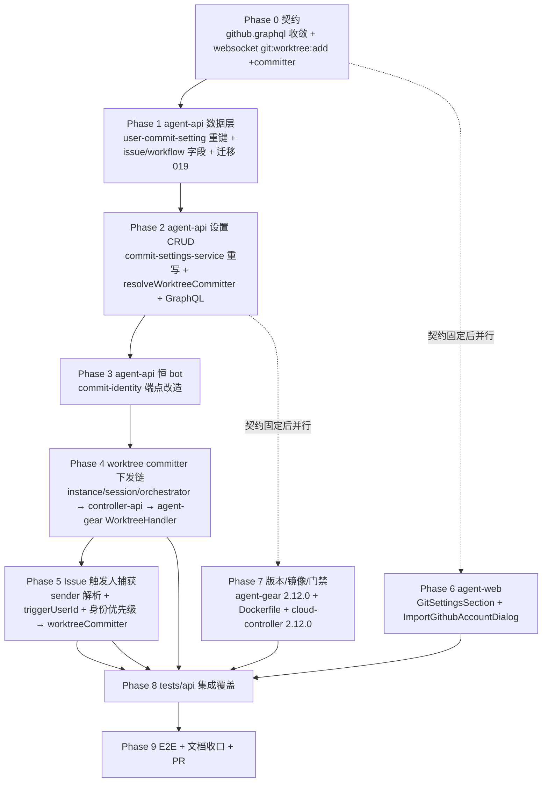

# Commit 作者设置优化 - 实现计划

**关联 Proposal**: `docs/engineering/proposals/20261029-feat-commit-author-settings-optimization.md`（v1.0）
**关联 PRD**: `docs/product/shipping/20261029-commit-author-settings-optimization.md`（v1.0）
**需求来源**: GitHub Issue Deliay/z-agent-gear#368
**需求总分支（feat-branch）**: `feat/commit-author-settings-optimization`（需求总 PR #374）
**实现分支**: `feat/commit-author-settings-optimization-impl`（基于需求总分支拉起）
**创建日期**: 2026-10-30
**计划版本**: v1.1

**上游评审结论（PR #374）**：Deliay 于 2026-10-30T04:39:52Z APPROVED 产品文档与技术提案，评审无正文、无 inline comment、无 issue comment、无修改要求，按原计划推进本实现计划。若后续复审提出修改，在对应 Phase 中落实并回评。

**版本说明**：

- v1.1（返工）：AI 代码审核阻断问题修复——`user_commit_settings` 豁免 `applyTenantScope`、读写一律 `userId` 点查、`tenantId` 恒取成员归属租户；补 `commit-settings-service.real.test.ts` 真库跨上下文用例（T-CS-R1~R4）与 tests/api 跨上下文回归（T-WS-API5 扩展）。
- v1.0 首版：与 PRD v1.0 / 提案 v1.0 对齐，把提案 §5.2 的 7 个实现点拆成 9 个 Phase；给出「上游文档 × 代码现状差异」5 条与「计划期裁决」8 条，收敛提案留白但会阻塞实现的口径（迁移编号、runner 文件落点、`applyTenantScope` 去留、`personalGithubAccounts` 的 workspaceId 维度、worktree user 写入的转义与幂等口径、committer 载荷缺省语义、旧 worker 降级边界、迁移 019 碰撞合并细则）。
- 不改变 PRD 产品口径；契约以提案 §3.1 为准（`CommitterMode` / `GITHUB_ACCOUNT` / `source` / `readOnly` 整体下线，`personalGithubAccounts` 新增）。本特性为「重写 + 迁移」型，非纯增量——`user_commit_settings` 键与语义变更、UI 区块替换、下发口径变化，既有 Commit 相关断言需按新口径改写（基线更新清单见各 Phase），但**本地控制器链路与非 Commit 域零改动、既有非 Commit 用例必须零失败**。

## 实现顺序



依赖说明：

- **P0 是口径基准**：`contracts/github.graphql`（Commit 段整体替换 + `personalGithubAccounts`）与 `contracts/agent-session-websocket.md`（`git:worktree:add` + `committer`）先落，P1~P8 均以其为书面依据。
- **P1 → P2 → P3 为后端串行轨**：模型/迁移定数据形态 → 成员级 CRUD + `resolveWorktreeCommitter`（P4/P5 的解析依赖它）→ 恒 bot 端点（独立于 worktree 链，但共享 `resolveAppBotIdentity`）。
- **P4 → P5 为下发主链轨**：P4 建立「快照字段 + committer 载荷 + WorktreeHandler 写 worktree user」的全链路（覆盖独立会话创建者、工作流创建者、节点会话复用）；P5 在其上叠加「Issue 触发人」这一来源，写入实例快照并传给 `instantiate`。
- **P6 / P7 为并行轨**：契约固定后，agent-web（前端轨）与版本/镜像/门禁可与后端轨并行（z-coding 并行 subagent）；agent-web 以契约定稿的 `commitSettings` / `personalGithubAccounts` 为 mock 依据。
- **P8 依赖 P4~P7**：API 集成覆盖契约点、端点鉴权、下发口径；**P9 依赖 P8 与全部前端 Phase**，E2E 串行执行。

开发模式采用 TDD（红-绿-重构）：每个 Phase 先落失败测试（RED）再写实现（GREEN），最后重构。编码前按目录加载 `docs/engineering/common-rules.md`、`backend-rules.md`、`frontend-rules.md`、`servers/agent-api/AGENTS.md`、`servers/controller-api/AGENTS.md`、`packages/agent-controller/AGENTS.md`、`apps/agent-web/AGENTS.md`、`tests/api/AGENTS.md`、`tests/e2e/AGENTS.md`。

### 关键约束（实现期不得回退）

- **成员独立、无共享/继承**：`user_commit_settings` 键回归 `userId`（唯一 `uniq_user_commit_setting`），移除 `applyWorkspaceScope` 与「本工作区→全局工作区→unset」三段继承；查询一律显式 `userId` 点查，不读 ALS 工作区上下文。
- **云电脑级恒 bot**：`POST /internal/cloud-hosts/:controllerId/commit-identity` 响应**恒为 bot**（`{mode:'agent_only', name, email}`），无视个人设置；bot 解析失败兜底 `{mode:'unset'}`；保留 `mode` 包络兼容 2.11.x 容器 `consume()`；双鉴权与「永不 404」不变。
- **Worktree 身份随初始化一次写入**：`git config extensions.worktreeConfig true` + `git config --worktree user.name/user.email`，仅对该 worktree 生效，主仓与兄弟 worktree 不受污染；committer 缺省则不写（沿用容器级 bot）；单条失败记 warn 不阻断 worktree 创建。
- **Issue 归属触发人**：触发人 = 为 Issue 加触发标签者（webhook `sender`）；优先级「触发人『提交人』→ 触发人 GitHub 身份（login + noreply）→ bot」；未识别触发人 → bot。
- **成员中途改设置不影响已建 Worktree**：实例化/会话创建时解析一次、快照落库（`WorkflowInstance.worktreeCommitterName/Email`），实例级与节点级 worktree 复用同一快照。
- **邮箱一律 noreply**：bot 与 GitHub 帐号身份用 `{id}+{login}@users.noreply.github.com`，不暴露真实邮箱（用户主动自定义除外）。
- **shell 注入防护**：`WorktreeHandler` 以 `execAsync` 拼接命令写入 user.name/user.email（用户可控），必须做 shell 转义（沿用 `commit-identity.ts` 的 `renderGitConfig` 值转义口径 + 拼接处引号包裹），禁止未转义插值；单测覆盖含空格/引号/`$` 的姓名。
- **本地控制器零影响**：只动云容器链路，不动本地 controller 会话/工作区 git 链路。
- **迁移可重入、先建后删索引**：沿用 015 的 `ensureIndex` + `dropIndexSafe` 纪律（迁移编号见裁决 1，用 **019**）。
- **禁止 rebase/squash**：遵循 z-git 规范，仅允许 merge。

## 代码探查关键事实（实现时以现状为准）

- **迁移编号**：agent-api 迁移现有 001~018（含两个 `011`），**最大编号 018**，注册表在 `src/index.ts:21-39` + `runMigrations([...])` `:165-184`。**提案写的「017」已被 `017-normalize-string-workspace-id` 占用**，新迁移须用 **019**（裁决 1）。「先建后删」先例 = `015-team-workspaces.ts:253-263`（`ensureIndex` 建 `uniq_workspace_commit_setting` + `dropIndexSafe` 删旧），`ensureIndex`/`dropIndexSafe` 在 `migrations/index-utils.ts`。
- `servers/agent-api/src/models/user-commit-setting.ts`（59 行）：`userId: String required`（注释称「最近编辑者」审计字段、不建索引）、`tenantId: String required index`、`workspaceId: String default null`、`committerMode` enum `COMMITTER_MODES=['agent_only','co_author','human_only','unset']`、`committerType` enum `COMMITTER_TYPES=['github_account','custom','unset']`、`githubAccountId: ObjectId ref GitHubAccount`、`customName ≤100`、`customEmail ≤254`、timestamps；唯一索引 `uniq_workspace_commit_setting` on `{workspaceId:1}`（`:53`）；**同时挂 `applyTenantScope` + `applyWorkspaceScope`**（`:55-56`）。
- `servers/agent-api/src/services/commit-settings-service.ts`（426 行）：`getCommitSettings(userId)`（三段继承读路径 `:148-154`）、`updateCommitSettings(userId,input)`（按 `workspaceId?{workspaceId}:{userId}` upsert `:173-174`）、`resolveCommitIdentity(controllerId)` 五步（`:203-247`，`agent_only` 需 `hasGithubWorkload`）、`private resolveEffectiveSetting` 三段继承（`:253-274`）、`private resolveCommitter`（`:358-404`，github_account → login + noreply）、`private hasGithubWorkload`（`:410-423`）；独立导出 `isValidCustomCommitter`（`:76`）、`COMMIT_SETTINGS_ERRORS` 三条白名单（`:51-55`）；`CommitIdentityResponse` 已含 `mode` 包络（`{mode:'unset'}`/`{mode,name,email}`/`+coAuthor*`）。**`resolveWorktreeCommitter` 尚不存在**（须新增）。
- `servers/agent-api/src/routes/internal-cloud-host.ts:157-177`：`POST /:controllerId/commit-identity`，`authenticateCredentialRequest` 双鉴权（`:162`），调 `commitSettingsService.resolveCommitIdentity`（`:170`），`res.json(identity)`（`:171`），异常兜底 `{mode:'unset'}`（`:174`）。改造为恒 bot 时保持路由/鉴权/包络形状不变。
- `servers/agent-api/src/services/github.ts:722` 已有 `resolveAppBotIdentity(): Promise<AppBotIdentity|null>`（`GET /app`→`GET /users/{slug}[bot]`，Redis `github:app-bot-identity` 成功 24h / 失败 sentinel 60s + 进程内 Map，`:818`），`createAppJwt()` `:656`——恒 bot 端点直接复用。
- `servers/agent-api/src/services/workflow/instance.ts`：`instantiate(userId,input)` `:109-238`（**无 committer 解析**）；`createWorkflowWorktree(controllerId,workspace,workflowName)` `:241-300`，`git:worktree:add` publish 载荷 `:269-279` = `{type,requestId,controllerId,repoPath,worktreePath,branch}`（**无 committer**）；`WorkflowInstance.create` 落库 `:206-221`（**无 worktreeCommitter\***）。
- `servers/agent-api/src/services/workflow/orchestrator.ts:172-222` `startNodeSession` → `sessionService.create(instance.userId.toString(), {...})`（`:194-214`，未传 committer）。
- `servers/agent-api/src/services/session.ts create()` 签名 `:137-155`（**无 committer 参数**）；worktree publish `:258-265`，30×1s 轮询 `:268-286`，失败抛 `WORKTREE_ADD_FAILED`。
- `servers/agent-api/src/services/workflow/github-issues-webhook-payload.ts`：`IssuesEventPayload` `:6-18` = `{action,repoFullName,issueId,issueNumber,title,body?,issueUrl,author?,labels}`（已解析 `issue.user.login→author` `:96-100`，**未解析 `sender`**）；`SUPPORTED_ISSUE_ACTIONS` `:4`。
- **runner 落点**：`issues-trigger-runner.ts` **不存在**，runner 是 `issues-event-handler.ts` 内 `export class IssuesTriggerRunner`（`:135`）+ `issuesTriggerRunner` 单例（`:564`）。`IssueWorkflowTrigger.create` `:94-108` 落库（**无 triggerSenderId/Login/UserId**），触发人现取 `linkage.userId`；`instantiateWorkflow` `:330-364`；`createInstance` `:366-396` 调 `workflowInstanceService.instantiate(ctx.userId, {..., createWorkflowWorktree:true})`（**不带身份**）。
- `servers/agent-api/src/models/issue-workflow-trigger.ts`（77 行）：字段 `:21-63`（无 triggerSender\*），索引 `uniq_issue_workflow_trigger` on `{controllerId,repoFullName,labelName,issueId}`、`{controllerId,status}`、`{status,updatedAt:-1}`，`applyTenantScope` `:74`。
- `servers/agent-api/src/models/workflow-instance.ts`：schema `:73-115`（`workflowWorktreePath :111`、`workflowWorktreeBranch :113`、`worktreeCleanupFailed :115`，**无 worktreeCommitterName/Email**）。
- `servers/agent-api/src/models/github-account.ts`：`userId/tenantId String`、`workspaceId String`、`githubUserId Number`、`githubLogin`、`githubAvatarUrl`、`accessToken`；唯一索引 `uniq_github_account_tenant_workspace_user` on `{tenantId,workspaceId,githubUserId}`；`applyTenantScope` + `applyWorkspaceScope(shared:true)`。`User.accountId → Account`、`User.tenantId → Tenant`；`tenants.type='personal'` 且 `_id` 复用 owner userId（`tenant.ts:10-17`）——`personalGithubAccounts` 数据链齐备（裁决 4）。
- `servers/controller-api/src/services/session-command.ts`：payload 类型 `:65-85`（**无 committer**）；分支 `:125-126` `worktreeService.handleAdd(requestId,controllerId,repoPath,worktreePath,branch)`（5 参）。`worktree-service.ts:25-26` `handleAdd(...)`→`emitToController(controllerId,'git:worktree:add',{requestId,repoPath,worktreePath,branch})`（`:49-51` 结果回写 Redis `git:worktree:add:<requestId>` TTL 60s）。
- `packages/agent-controller/src/worktree-handler.ts:58` `add(repoPath,worktreePath,branch): Promise<WorktreeAddResult>`（**3 参、无 committer**），实现 `:65-67` `execAsync(`git -C "${repoPath}" worktree add -b "${branch}" "${resolvedPath}"`)`；`WorktreeAddResult` `:22`。`socketio-client.ts:295-300` `GitWorktreeAddPayload`（无 committer）；`:1351-1356` `socket.on('git:worktree:add', ... worktreeHandler.add(...))` → `emit('git:worktree:add:result',...)`。
- `packages/agent-controller/src/github/commit-identity.ts`：`MANAGED_GITCONFIG_NAME`/`MANAGED_HOOK_NAME` `:36-38`，`apply()` 写 `~/.zag/commit-identity.gitconfig`（0600）+ 幂等 `include.path` `:154`，`renderGitConfig()` 值转义 `:175`（**worktree user 写入沿用此转义口径**，裁决 5）。
- `packages/agent-controller/package.json` `version: 2.11.1`（`name: agent-gear`）→ 升 **2.12.0**。`deploy/images/worker/Dockerfile:120` `agent-gear@2.11.x` → `2.12.x`。
- `servers/cloud-controller/src/services/worker-version.ts`：`MIN_HARNESS_WORKER_VERSION='2.10.0'`（`:18`）、`MIN_KIMI_HARNESS_WORKER_VERSION='2.8.0'`（`:21`）、`MIN_DEEPSEEK_HARNESS_WORKER_VERSION='2.11.0'`（`:27`）、`MIN_HARNESS_VERSION_BY_TYPE`（`:33-36`）——门禁提升 2.12.0 见裁决 8。
- `apps/agent-web/src/pages/SettingsPage.tsx`：`NAV_ITEMS` `:40-48`（含 `github-section GitHub 绑定`），分组 `:51-56`；`CommitSettingsSection` 挂 `github-section` 内 `:167-170`（`<GithubBindingSection /><CommitSettingsSection />`），import `:25-26`；**无 Git 区块**。
- `apps/agent-web/src/components/settings/CommitSettingsSection.tsx`：`MODE_OPTIONS` `:20-25`、`TYPE_OPTIONS` `:27-31`、`isValidCustomCommitter` `:36-43`、`mapCommitSettingsError` `:46-59`、Github 帐号下拉 `:247-283`（`GET_GITHUB_ACCOUNTS`）、CUSTOM 输入 `:285-315`；**无 `ImportGithubAccountDialog`/`GitSettingsSection`**。
- `contracts/github.graphql` Commit 段 `:40-107`：`CommitterMode`/`CommitterType`/`CommitSettings`（含 `source`/`readOnly`）/`CommitSettingsSource`/`CommitSettingsInput`/`commitSettings`/`updateCommitSettings`/`githubAccounts` 均已存在；**`personalGithubAccounts` 不存在**。
- `contracts/agent-session-websocket.md` §3.12 `git:worktree:add`（`:1214-1231`，字段 `repoPath/worktreePath/branch`）、§3.13 result（`:1233-1244`）、Redis relay 附录（`:1508-1530`）——**均无 committer**。

## 上游文档 × 代码现状差异

| # | 上游表述 | 代码现状（证据） | 本计划处置 |
|---|----------|------------------|------------|
| D1 | 提案 §5.2 实现点 6 / §7：迁移 `017-commit-settings-per-member.ts` | agent-api 迁移 017/018 已被 `017-normalize-string-workspace-id`、`018-drop-legacy-tenantless-unique-indexes` 占用，最大号 018 | 裁决 1：新迁移改用 **`019-commit-settings-per-member.ts`**，四步链与「先建后删」口径不变 |
| D2 | 提案 §5.2 实现点 4 / §7：`issues-trigger-runner.ts` 承载触发人身份优先级 | runner 实为 `issues-event-handler.ts` 内 `class IssuesTriggerRunner`（`:135`）+ 单例，无独立文件 | 裁决 2：触发人身份优先级落在 `issues-event-handler.ts` 的 `IssuesTriggerRunner.createInstance`；`issues-trigger-runner.ts` 不新建 |
| D3 | 提案 §4.1：`user_commit_settings`「移除 applyWorkspaceScope、查询按显式 userId」 | 模型现挂 `applyTenantScope` + `applyWorkspaceScope`（多租户隔离不变量 T-ISO 覆盖该集合） | 裁决 3：移除 `applyWorkspaceScope`（三段继承载体），**保留 `applyTenantScope`**（满足 T-ISO），service 点查以 `userId` 唯一键命中、`tenantId` 留档不作业务过滤 |
| D4 | 提案 §5.2 实现点 5：`personalGithubAccounts` = `User.accountId→同账户 users→tenants.type='personal'→GitHubAccount.find({tenantId in ...})` | `GitHubAccount` 现为 workspace 级（`{tenantId,workspaceId,githubUserId}` 唯一，`applyWorkspaceScope(shared)`） | 裁决 4：`personalGithubAccounts` 按 `tenantId ∈ {同账户 users 的 personal 租户 id}` 过滤，叠加 `workspaceId ∈ {null, 本租户全局工作区}` 以排除普通工作区副本（导入弹窗只取「个人租户绑定」帐号） |
| D5 | 提案 §5.2 实现点 3：`WorktreeHandler.add` 对 name/email「沿用 renderGitConfig 的转义口径」 | `renderGitConfig` 是 gitconfig **文件值**转义（`commit-identity.ts:175`）；worktree 侧用 `execAsync` **shell** 拼接 | 裁决 5：worktree user 写入走 `execAsync`，须做 **shell 转义**（值内 `'` 单引号包裹 + `\` 转义，或复用既有引号包裹口径），并单测覆盖空格/引号/`$`；不等同 `renderGitConfig` 的文件转义 |

## 计划期裁决（提案留白 / 含混处的实现口径）

1. **迁移编号 = 019（覆盖 D1）**：`019-commit-settings-per-member.ts` + `019-commit-settings-per-member.test.ts`。四步链（沿用 015 风格 + `index-utils.ts`）：
   - **github_account→custom 等价转换**：`committerType='github_account'` 行按 `githubAccountId` 取 `GitHubAccount`，写 `customName=githubLogin`、`customEmail=<githubUserId>+<githubLogin>@users.noreply.github.com`（与现行 `resolveCommitter` `:391-394` 生效值逐字一致）；帐号缺失/取值失败 → `committerType='unset'` 并清空 custom 字段。
   - **归属重键**：行 → workspace → tenant；`type='personal'` → owner=`tenantId`（personal 租户 `_id` 复用 owner userId）；`type='team'` → owner=行内 `userId`（最近编辑人）；`workspaceId` 为空的旧式行 owner 不变。同 owner 多行碰撞 → 保留 `updatedAt` 最新的非 unset 行，其余 `deleteOne` 并计数（复用「重构时断言所有关键副作用」教训，删除动作必须断言）。
   - **字段清洗**：`unset` 行清空 `customName/customEmail/githubAccountId`；`$unset` `committerMode`/`githubAccountId`/`workspaceId`；`tenantId` 按 owner 成员刷新（`users.tenantId`）。
   - **索引切换**：先 `ensureIndex(user_commit_settings, {userId:1}, {unique:true, name:'uniq_user_commit_setting'})`，后 `dropIndexSafe(..., 'uniq_workspace_commit_setting')`（及 Mongoose `autoIndex` 默认名 `userId_1`/`workspaceId_1`）。
   - **幂等**：`_migrations` 已执行记录 + 各步过滤（`committerType:'github_account'` 残留计数 0、`workspaceId` 残留计数 0）保障可重入。
2. **触发人身份优先级落点（覆盖 D2）**：`IssuesTriggerRunner.createInstance`（`issues-event-handler.ts`）内解析 `worktreeCommitter`：`triggerUserId` 的「提交人」（`resolveWorktreeCommitter(triggerUserId)`）→ sender 的 GitHub 身份（`<triggerSenderId>+<triggerSenderLogin>@users.noreply.github.com`）→ `null`（= bot）。结果写 `WorkflowInstance.worktreeCommitterName/Email` 并随 `instantiate(..., worktreeCommitter)` 透传。
3. **`user_commit_settings` 去留插件（覆盖 D3，v1.1 返工修正）**：移除 `applyWorkspaceScope` 与三段继承（`resolveEffectiveSetting` 删除）；**并同时移除 `applyTenantScope`**（v1.0 原拟保留）——ALS 注入会按「当前工作区租户」过滤/戳值，导致同一成员跨工作区读写不可见、二次保存撞唯一索引后回读落空而静默丢失、Issue 链路（无 ALS）解析不到。该集合 `userId` 为全局成员主键、`tenantId` 仅留档（恒写 `users.tenantId`，与迁移 019 `cleanFields` 一致），T-ISO 矩阵对该集合显式豁免并断言「不注入 tenantId」。`commit-settings-service` 点查以 `userId` 唯一键命中，`resolveWorktreeCommitter(userId)` **不读取 ALS 工作区上下文**；`tenantId` 由写入/插件补齐留档，不作业务过滤条件（区别于旧「按 workspaceId 三段过滤」）。新增唯一键 `uniq_user_commit_setting`（`{userId:1}`）。
4. **`personalGithubAccounts` 口径（覆盖 D4）**：`User.findById(me)` 取 `accountId` → `User.find({accountId})` 得同账户全部 userId → 各自 personal 租户 id（= userId，`tenants.type='personal'`）→ `GitHubAccount.find({ tenantId: { $in: personalTenantIds }, workspaceId: { $in: [null, globalWorkspaceId] } })`（导入弹窗仅取「个人租户绑定」帐号，排除普通工作区副本）。导入填充：`customName=githubLogin`、`customEmail=<githubUserId>+<githubLogin>@users.noreply.github.com`（可编辑）。
5. **worktree user 写入转义与幂等（覆盖 D5）**：`WorktreeHandler.add(repoPath, worktreePath, branch, committer?)` 在 `git worktree add` 成功后，若 `committer` 存在，以 `git -C <worktreePath>` 依次执行三条命令；name/email 值做 **shell 转义**（值含 `'`/`"`/`$`/空格 不破坏命令、不注入），沿用 `commit-identity.ts` 值安全口径（单引号包裹 + 内嵌 `'` 转义），并对 `git config` 值做引号包裹。`extensions.worktreeConfig true` 幂等（重复 set 同值无副作用）；单条失败 `console.warn` 不阻断（结果仍 `success`，身份缺失可接受）。
6. **committer 载荷缺省语义**：`git:worktree:add` 的 `committer` **可选**；缺省 = 不写 worktree 身份（沿用容器级 bot）。旧 worker（<2.12.0）忽略未知字段 → 优雅降级（不写身份、沿用 bot，不报错）。契约 `agent-session-websocket.md` §3.12 同步增补该可选字段 + 降级说明。
7. **`WorkflowInstance.worktreeCommitter` 快照**：`worktreeCommitterName`/`worktreeCommitterEmail`（String, default null；两者皆 null = 不下发、沿用 bot）。实例化（含 issue 触发实例化）时解析一次，实例级 `createWorkflowWorktree` 与节点级 `session.create` 复用同一快照；成员中途改设置不影响已建 Worktree。独立会话（非工作流）在 `session.create` 内实时解析会话创建者的 `resolveWorktreeCommitter`（不落实例快照）。
8. **版本与门禁**：`packages/agent-controller/package.json` `2.11.1 → 2.12.0`；`deploy/images/worker/Dockerfile` `agent-gear@2.11.x → 2.12.x`；`cloud-controller worker-version.ts` harness 门禁 `MIN_HARNESS_WORKER_VERSION='2.10.0' → '2.12.0'`、`MIN_DEEPSEEK_HARNESS_WORKER_VERSION='2.11.0' → '2.12.0'`、`MIN_HARNESS_VERSION_BY_TYPE` 同步（`kimi_code` 维持 `2.8.0`、`deepseek_harness → 2.12.0`），覆盖 `2.10.0/2.11.0` 现值，保证新拉起容器具备 worktree 身份能力；存量容器由保活自更新收敛，期间优雅降级。`HARNESS_MIN_AGENT_GEAR_VERSION`（agent-api `cloud-host` 域）同步对齐 `2.12.0`（裁决见 Phase 7）。

---

## Phase 0: 契约（`contracts/github.graphql` 收敛 + `agent-session-websocket.md` +committer）

| 文件 | 操作 | 说明 |
|------|------|------|
| `contracts/github.graphql` | 修改 | Commit 段整体替换（提案 §3.1）：`enum CommitterType { CUSTOM UNSET }`（删 `GITHUB_ACCOUNT`）；`type CommitSettings { committerType, customName, customEmail }`（删 `committerMode/githubAccountId/source/readOnly`）；`input CommitSettingsInput` 同步；`extend type Query { commitSettings: CommitSettings!, personalGithubAccounts: [GitHubAccount!]! }`；`extend type Mutation { updateCommitSettings(input: CommitSettingsInput!): CommitSettings! }`。删除 `CommitterMode`/`CommitSettingsSource`；注释收敛校验白名单为一条 `invalid custom committer`，写明「仅对云容器环境生效」「成员独立、无共享/继承」「导入弹窗数据源=个人租户绑定帐号」 |
| `contracts/agent-session-websocket.md` | 修改 | §3.12 `git:worktree:add` 载荷增可选 `committer { name, email }`（缺省=不写身份、沿用容器级 bot）；§3.13 result 不变；Redis relay 附录 `publish` JSON 增 `committer`（可选）+「旧 worker 忽略未知字段→优雅降级」注释 |

验收：契约与提案 §3.1 字段逐字一致；`git diff` 确认 `CommitterMode`/`GITHUB_ACCOUNT`/`source`/`readOnly` 已删、`personalGithubAccounts` 已增；`git:worktree:add` committer 标注可选 + 降级说明。

### 命令参考

```bash
cd servers/agent-api && npm run build   # schema 校验随 Phase 2 引入，本阶段仅契约文本
```

## Phase 1: agent-api 数据层（模型收敛 + 增补字段 + 迁移 019）

开发分支：`feat/commit-author-settings-optimization-impl`（基于需求总分支）。

| 文件 | 操作 | 说明 |
|------|------|------|
| `servers/agent-api/src/models/user-commit-setting.ts` | 修改 | 键回归 `userId`：`userId: String required`（改「成员归属」语义、建唯一键）、`committerType: enum ['custom','unset'] default 'unset'`（删 `github_account`）、`customName ≤100`、`customEmail ≤254`、`tenantId`（留档）；**删除** `committerMode`/`githubAccountId`/`workspaceId` 字段与 `COMMITTER_MODES` 常量；唯一索引改 `{userId:1}` name `uniq_user_commit_setting`（删 `uniq_workspace_commit_setting`）；**移除 `applyWorkspaceScope`、保留 `applyTenantScope`**（裁决 3） |
| `servers/agent-api/src/models/issue-workflow-trigger.ts` | 修改 | 增补 `triggerSenderId: Number default null`、`triggerSenderLogin: String default null`、`triggerUserId: ObjectId ref 'User' default null`（`issue_author` 旁） |
| `servers/agent-api/src/models/workflow-instance.ts` | 修改 | 增补 `worktreeCommitterName: String default null`、`worktreeCommitterEmail: String default null`（`workflowWorktreeBranch` 旁） |
| `servers/agent-api/src/migrations/019-commit-settings-per-member.ts` | 新增 | 裁决 1 四步链（github→custom 等价、归属重键、字段清洗、索引先建后删）；`export const name = '019-commit-settings-per-member'`；复用 `index-utils.ts` `ensureIndex`/`dropIndexSafe` |
| `servers/agent-api/src/migrations/019-commit-settings-per-member.test.ts` | 新增 | `T-MIG-CS1` github→custom 等价（署名逐字）；`T-MIG-CS2` 帐号缺失→unset；`T-MIG-CS3` personal/team 归属映射；`T-MIG-CS4` 同 owner 碰撞合并（保留最新非 unset，其余删除+计数）；`T-MIG-CS5` 索引先建后删（`uniq_user_commit_setting` 存在 unique、`uniq_workspace_commit_setting` 已删）；`T-MIG-CS6` 幂等重入（跑两次不报错、残留计数 0） |
| `servers/agent-api/src/migrations/models.ts` / `src/index.ts` | 修改 | 迁移注册：import 019 + `runMigrations([...])` 列表追加（`src/index.ts:181-184` 后） |

验收：模型字段/枚举/索引/插件与裁决 3 一致；迁移单测 T-MIG-CS1~CS6 全绿；重复执行迁移幂等。

### 命令参考

```bash
cd servers/agent-api && npm run build && npm test -- 019-commit-settings-per-member user-commit-setting
```

## Phase 2: agent-api 设置 CRUD + 校验 + resolveWorktreeCommitter + GraphQL

### Step 2.1 commit-settings-service 重写（先写失败测试）

| 文件 | 操作 | 说明 |
|------|------|------|
| `servers/agent-api/src/services/commit-settings-service.test.ts` | 重写 | `T-CS-P1` 成员级 `getCommitSettings(userId)` 默认 `UNSET`；`T-CS-P2` 校验白名单仅 `invalid custom committer`（`custom` trim/≤100/≤254/禁 `\n\r\0`/邮箱正则 `/^[^\s@]+@[^\s@]+\.[^\s@]+$/`，`unset` 清空 custom）；`T-CS-P3` upsert 幂等（同 userId 二次保存覆盖不重复建行）；`T-CS-P4` `resolveWorktreeCommitter` 三态（custom 合法→`{name,email}`、unset→null、非法→null）；`T-CS-P5` 成员独立隔离（A/B 互不影响） |
| `servers/agent-api/src/services/commit-settings-service.ts` | 重写 | `getCommitSettings(userId)` / `updateCommitSettings(userId,input)`：键 userId upsert，移除三段继承/`source`/`readOnly`/模式组合校验；`validateAndNormalize` 收敛为仅 `invalid custom committer`；**新增 `resolveWorktreeCommitter(userId): Promise<{name,email}|null>`**（点查设置→custom 且校验通过→返回，否则 null）；`resolveCommitIdentity`/`resolveEffectiveSetting`/`hasGithubWorkload`/`resolveCommitter`（github_account 分支）/`COMMIT_SETTINGS_ERRORS`（三行）按新口径删除或收敛 |

### Step 2.2 GraphQL schema + resolver + personalGithubAccounts

| 文件 | 操作 | 说明 |
|------|------|------|
| `servers/agent-api/src/graphql/schemas/github.ts` | 修改 | `CommitSettings`/`CommitSettingsInput`/`CommitterType` 收敛（删 `CommitterMode`/`CommitSettingsSource`/`githubAccountId`/`source`/`readOnly`）；`commitSettings`/`updateCommitSettings`；新增 `personalGithubAccounts: [GitHubAccount!]!` |
| `servers/agent-api/src/graphql/resolvers/github.ts` | 修改 | `Query.commitSettings`/`Mutation.updateCommitSettings` 接 service；新增 `Query.personalGithubAccounts`（裁决 4 口径）；错误 message 透传白名单 |
| `apps/agent-web/src/graphql/{queries,mutations,types}.ts` | 修改 | 预留（实测在 Phase 6 落） |
| `tests/api/src/agent-api/github.test.ts` | 修改 | 预留用例编号段说明（实测在 Phase 8 落） |

验收：GraphQL 契约形状与 `contracts/github.graphql` 一致；`personalGithubAccounts` 仅返回个人租户绑定帐号；成员级隔离正确；`resolveWorktreeCommitter` 三态正确。

### 命令参考

```bash
cd servers/agent-api && npm run build && npm test -- commit-settings github
```

## Phase 3: agent-api 恒 bot（commit-identity 端点改造）

| 文件 | 操作 | 说明 |
|------|------|------|
| `servers/agent-api/src/services/commit-settings-service.ts` | 修改 | 移除 `resolveCommitIdentity` 五步门控与 `hasGithubWorkload`，改为 `resolveCloudHostIdentity()` = **恒 bot**：`resolveAppBotIdentity()` → `{mode:'agent_only', name, email}`；bot 失败兜底 `{mode:'unset'}`（沿用响应包络，兼容 2.11.x 容器 `consume()`） |
| `servers/agent-api/src/routes/internal-cloud-host.ts` | 修改 | `POST /:controllerId/commit-identity` 改调 `resolveCloudHostIdentity()`；路由/双鉴权/「永不 404」/响应形状（`mode` 包络）**保持不变** |
| `servers/agent-api/src/routes/internal-cloud-host.test.ts` | 修改 | `T-IC-B1` 恒 bot（无视个人设置）；`T-IC-B2` bot 失败 `{mode:'unset'}` 兜底；`T-IC-B3` 双鉴权与永不 404 不变（无凭据 401、错 key 403、`INTERNAL_API_TOKEN` 放行、无效场景恒 200） |

验收：端点恒返回 bot 身份、包络形状兼容 2.11.x；bot 失败优雅降级 `unset`；鉴权与永不 404 行为与 `github-credential` 逐条对齐。

### 命令参考

```bash
cd servers/agent-api && npm run build && npm test -- commit-settings internal-cloud-host
```

## Phase 4: worktree committer 下发链（三段透传 + WorktreeHandler 写 worktree user）

| 文件 | 操作 | 说明 |
|------|------|------|
| `servers/agent-api/src/services/workflow/instance.ts` | 修改 | `instantiate` 解析 `worktreeCommitter`（issue 覆盖 > 创建者 `resolveWorktreeCommitter(userId)`），落 `WorkflowInstance.worktreeCommitterName/Email`（裁决 7）；`createWorkflowWorktree()` 读快照放入 `git:worktree:add` 载荷 `committer` |
| `servers/agent-api/src/services/workflow/orchestrator.ts` | 修改 | `startNodeSession` → `session.create` 显式传入实例快照 `worktreeCommitter`（节点级 worktree 复用实例快照） |
| `servers/agent-api/src/services/session.ts` | 修改 | `create()` 增可选 `worktreeCommitter?` 入参；独立会话解析会话创建者 `resolveWorktreeCommitter(userId)`（支持调用方显式传入，工作流节点场景优先用传入值）；worktree publish 载荷增 `committer` |
| `servers/agent-api/src/services/workflow/session.ts`（如存在 publish 封装）/ `session-command` publish 点 | 修改 | `git:worktree:add` publish 载荷增 `committer`（与 `instance.ts`/`session.ts` 同口径） |
| `servers/controller-api/src/services/session-command.ts` | 修改 | payload 类型增 `committer?: { name: string; email: string }`；`worktreeService.handleAdd(...)` 透传 committer（白名单不变，不引入任意 git 命令通道） |
| `servers/controller-api/src/services/worktree-service.ts` | 修改 | `handleAdd` 增 `committer?` 参数，`emitToController('git:worktree:add', {..., committer})` |
| `packages/agent-controller/src/socketio-client.ts` | 修改 | `GitWorktreeAddPayload` 增 `committer?`；`git:worktree:add` handler 透传给 `worktreeHandler.add(...)` |
| `packages/agent-controller/src/worktree-handler.ts` | 修改 | `add(repoPath, worktreePath, branch, committer?)`：`git worktree add` 成功后，committer 存在则 `git -C <worktreePath>` 依次 `git config extensions.worktreeConfig true` + `git config --worktree user.name/email`（裁决 5 shell 转义）；缺省不写；单条失败 warn 不阻断；返回 `WorktreeAddResult` 不变 |
| `packages/agent-controller/src/worktree-handler.test.ts` | 修改 | `T-WTC1` 三命令序列（committer 存在）；`T-WTC2` 缺省不写；`T-WTC3` 转义（含空格/引号/`$` 姓名不破坏命令、不注入）；`T-WTC4` 单条失败不阻断（结果仍 success） |

测试重点：三段透传字段一致（agent-api publish → controller-api → agent-gear）；shell 转义与幂等是本 Phase 核心——spawn 全 mock，断言命令序列与转义；旧 worker 忽略 `committer` 字段优雅降级（不写身份）。

### 命令参考

```bash
cd servers/agent-api && npm run build && npm test -- session workflow
cd servers/controller-api && npm run build && npm test -- worktree session-command
cd packages/agent-controller && npm run build && npm test -- worktree-handler
```

## Phase 5: Issue 触发人捕获与归属（sender → triggerUserId → worktreeCommitter）

| 文件 | 操作 | 说明 |
|------|------|------|
| `servers/agent-api/src/services/workflow/github-issues-webhook-payload.ts` | 修改 | `IssuesEventPayload` 增 `sender?: { id: number; login: string }`（`labeled` 的 sender 即加标签人；兼容缺失）；解析 `parsed.sender` |
| `servers/agent-api/src/services/workflow/issues-event-handler.ts` | 修改 | 命中触发标签时 `GitHubAccount.findOne({ githubUserId: sender.id })` → `triggerUserId`（其 `userId`），与 `triggerSenderId/Login` 一并落 `IssueWorkflowTrigger`；`IssuesTriggerRunner.createInstance` 身份优先级（裁决 2）解析 `worktreeCommitter`（`triggerUserId` 的「提交人」→ sender GitHub 身份 `login`+noreply → null）；写 `WorkflowInstance.worktreeCommitterName/Email` 并传 `instantiate(..., worktreeCommitter)` |
| `servers/agent-api/src/services/workflow/instance.ts` | 修改 | `instantiate` 支持 issue 覆盖入参（`worktreeCommitter` 显式传入优先于创建者解析） |
| `servers/agent-api/src/services/workflow/issues-event-handler.test.ts` | 修改 | `T-GH-S1` sender 解析（`labeled` sender.id/login）；`T-GH-S2` `triggerUserId` 匹配（GitHubAccount 命中）；`T-GH-S3` 未匹配回退 GitHub 身份（login+noreply）→ 再 bot；`T-GH-S4` issue 覆盖优先于创建者 |

验收：Issue 拉起的工作流 `worktreeCommitter` = 触发人（加标签者）；未设置回退 GitHub 身份；未识别 → bot；快照落库正确。

### 命令参考

```bash
cd servers/agent-api && npm run build && npm test -- issues
```

## Phase 6: agent-web（「Git」区块 + 导入Github帐号信息弹窗，与后端轨并行）

| 文件 | 操作 | 说明 |
|------|------|------|
| `apps/agent-web/src/graphql/queries.ts` | 修改 | 新增 `GET_PERSONAL_GITHUB_ACCOUNTS`（返回 `id/githubUserId/githubLogin/githubAvatarUrl`）；`GET_COMMIT_SETTINGS` 收敛（删 `committerMode/githubAccountId/source/readOnly`，仅 `committerType/customName/customEmail`） |
| `apps/agent-web/src/graphql/mutations.ts` | 修改 | `UPDATE_COMMIT_SETTINGS` 收敛 |
| `apps/agent-web/src/graphql/types.ts` | 修改 | 手写 `CommitSettings`/`CommitSettingsInput`/`CommitterType`（`CUSTOM`/`UNSET`）、`PersonalGithubAccount`；删 `CommitterMode`/`CommitSettingsSource` |
| `apps/agent-web/src/components/settings/GitSettingsSection.tsx` | 新增 | 替代 `CommitSettingsSection`：区块标题「Git」+ 头部提示「仅对云电脑环境生效」；「提交人」二选一（`自定义`/`未设置`）；`自定义` → 用户名 + 邮箱输入 + **「导入Github帐号信息」按钮**；成员级保存（`updateCommitSettings`）；自定义前端校验与服务端同源（裁决 3/白名单 `invalid custom committer` → 「提交人用户名或邮箱格式不正确」）；保存成功 toast「对成员的会话/工作流 Worktree 生效」 |
| `apps/agent-web/src/components/settings/ImportGithubAccountDialog.tsx` | 新增 | 复用 `WorkspaceMembersDialog` 式「列表 + 选择」结构；数据源 `personalGithubAccounts`（头像 + 帐号名）；选择后填充 `customName=githubLogin`、`customEmail=<githubUserId>+<login>@users.noreply.github.com`（可继续编辑）；空态引导「先到『GitHub 绑定』绑定帐号」 |
| `apps/agent-web/src/pages/SettingsPage.tsx` | 修改 | 新增 NAV_ITEM `git-section`（label「Git」，GitBranch 图标）+ 分组；`github-section` 内移除 `<CommitSettingsSection />`；新增 `<GitSettingsSection />` 挂 `git-section`；删 `CommitSettingsSection` import |
| `apps/agent-web/src/components/settings/CommitSettingsSection.tsx` | 删除 | 随「Git」区块替代下线（提交人模式/提交人类型三选一/Github帐号下拉整体移除） |
| `apps/agent-web/src/components/settings/__tests__/GitSettingsSection.test.tsx` | 新增 | `T-FE-G1` 保存/校验/未设置；`T-FE-G2` 自定义校验（空/非法邮箱拦截）；`T-FE-G3` 保存回显 |
| `apps/agent-web/src/components/settings/__tests__/ImportGithubAccountDialog.test.tsx` | 新增 | `T-FE-G4` 帐号列表；`T-FE-G5` 选择填充（login + noreply）且可编辑；`T-FE-G6` 空态引导 |
| `apps/agent-web/src/components/settings/__tests__/CommitSettingsSection.test.tsx` | 删除 | 随组件下线 |

### 命令参考

```bash
cd apps/agent-web && npm run build && npm run lint && npm test -- GitSettingsSection ImportGithubAccountDialog
```

## Phase 7: 版本 / 镜像 / 门禁（与后端轨并行）

| 文件 | 操作 | 说明 |
|------|------|------|
| `packages/agent-controller/package.json` | 修改 | `version` `2.11.1` → `2.12.0`（裁决 8） |
| `deploy/images/worker/Dockerfile` | 修改 | `agent-gear@2.11.x` → `agent-gear@2.12.x`（`:120`） |
| `servers/cloud-controller/src/services/worker-version.ts` | 修改 | `MIN_HARNESS_WORKER_VERSION` `2.10.0 → 2.12.0`；`MIN_DEEPSEEK_HARNESS_WORKER_VERSION` `2.11.0 → 2.12.0`；`MIN_HARNESS_VERSION_BY_TYPE` `deepseek_harness → 2.12.0`（`kimi_code` 维持 `2.8.0`）；`worker-version.test.ts` 断言同步 |
| `servers/agent-api/src/services/cloud-host-service.ts`（`HARNESS_MIN_AGENT_GEAR_VERSION` / `CLOUD_HOST_AGENT_GEAR_MIN_VERSION`） | 修改 | 与门禁对齐 `2.12.0`（基线 `CLOUD_HOST_AGENT_GEAR_MIN_VERSION` `2.10.0 → 2.12.0`，`HARNESS_MIN_AGENT_GEAR_VERSION` 各档取最大值口径不变） |

验收：新拉起容器具备 worktree 身份能力（门禁 2.12.0）；旧容器保活自更新收敛、期间优雅降级；版本断言测试全绿。

### 命令参考

```bash
cd packages/agent-controller && npm run build
cd servers/cloud-controller && npm run build && npm test -- worker-version
```

## Phase 8: API 测试（tests/api）

> 先 `aspire start && aspire wait agent-api`，再按 `tests/api/AGENTS.md` 注入环境变量；API 与 E2E 不得并行。

| 文件 | 操作 | 覆盖 |
|------|------|------|
| `tests/api/src/mock-github-server.ts` | 修改 | bot 身份端点 mock（`GET /app` slug、`GET /users/{slug}[bot]` id，可注入失败测降级） |
| `tests/api/src/agent-api/github.test.ts` | 修改 | `describe('Commit Settings API')`：`T-CS-API1` `commitSettings` 默认 UNSET；`T-CS-API2` `updateCommitSettings` 保存/回读；`T-CS-API3` `invalid custom committer` 白名单逐字 + 校验矩阵；`T-CS-API4` 成员级隔离（A/B 互不影响）；`T-CS-API5` `personalGithubAccounts` 仅返回个人租户绑定帐号（排除普通工作区副本）；`describe('Commit Identity Internal API')`：`T-IC-API1` 双鉴权 401/403 + 永不 404；`T-IC-API2` 恒 bot（无视个人设置，mock bot 身份）；`T-IC-API3` bot 失败 `{mode:'unset'}`；`T-IC-API4` 响应含 `mode` 包络（兼容 2.11.x） |
| `tests/api/src/agent-api/workflow-issues.test.ts`（或 `github-issues-webhook.test.ts`） | 修改 | `T-GH-API1` issue 触发 `worktreeCommitter`=触发人；`T-GH-API2` 未设置回退 GitHub 身份；`T-GH-API3` 未识别→bot |
| `tests/api/src/agent-api/multi-tenant.test.ts` | 修改 | 回归：移除共享口径后的成员独立隔离（Commit 相关断言按新口径改写） |
| `tests/api/src/agent-api/{workflow,session}.test.ts` | 修改 | `T-WF-API1` worktree committer 快照与 `git:worktree:add` 载荷 `committer`（mock 下发链）；`T-WF-API2` 节点会话复用实例快照 |

验收：新增用例全绿；非 Commit 域既有用例零失败；Commit 域断言按新口径改写（基线更新清单：`multi-tenant.test.ts` Commit 三段继承断言、`github.test.ts` 旧 CommitterMode/GITHUB_ACCOUNT 断言）；测试结束无残留数据。

### 命令参考

```bash
cd tests/api && npm test -- github workflow-issues multi-tenant
```

## Phase 9: E2E + 文档收口 + PR

| # | 场景 | 验证点 | 落点 |
|---|------|--------|------|
| E2E-GIT1 | 「Git」区块展示与保存 | 设置页出现「Git」区块 + 头部提示「仅对云电脑环境生效」；提交人「自定义/未设置」可切换并保存成功；不再出现「Commit 设置」与「提交人模式」 | `tests/e2e/src/settings-git.spec.ts`（新建，对齐 `settings-github-binding.spec.ts` 风格） |
| E2E-GIT2 | 导入Github帐号信息弹窗 | 「自定义」下点「导入Github帐号信息」→ 弹窗列出个人租户绑定帐号 → 选择后用户名/邮箱填充且可继续编辑 → 保存；空态引导绑定 | 同上 |
| E2E-GIT3 | 自定义校验 | 空用户名 / 非法邮箱 / 换行拦截保存 | 同上 |
| E2E-GIT4 | 存量转换等价（mock） | 迁移后「自定义」署名与转换前一致（人工验收为主，前端仅校验回显） | 同上 |

> 容器内 commit 身份真实生效（云电脑=bot、Worktree=创建者、Issue=触发人）依赖真实云电脑，列入「总体验收」人工验收项，由单测 T-WTC*/T-GH-S* 与 API T-IC-API*/T-GH-API* 提供前置保障。

### 文档收口

| 文件 | 操作 | 说明 |
|------|------|------|
| `packages/agent-controller/AGENTS.md` | 修改 | 补 `WorktreeHandler.add` committer 写 worktree 级 user（`extensions.worktreeConfig` + `--worktree`）、2.12.0 版本口径（旧 worker 降级） |
| `servers/agent-api/AGENTS.md` | 修改 | 「Commit 设置与提交身份」段改写：`user_commit_settings` 成员独立键（迁移 019）、`commit-settings-service`（成员级 + `resolveWorktreeCommitter`）、`commit-identity` 恒 bot、`personalGithubAccounts`、issues sender 捕获与 `worktreeCommitter` 快照 |
| `servers/controller-api/AGENTS.md` | 修改 | `git:worktree:add` 载荷 `committer` 透传说明 |
| `apps/agent-web/AGENTS.md` | 修改 | 设置页「Git」区块（挂载位置、导入弹窗、错误文案映射）替换「Commit 设置」 |
| `tests/api/AGENTS.md` | 修改 | `github.test.ts`/`workflow-issues.test.ts` 新增 describe 段与用例编号 |
| `tests/e2e/AGENTS.md` | 修改 | 新增 `settings-git.spec.ts` 场景说明 |
| `docs/engineering/AGENTS.md` | 修改 | 实现计划索引登记本文件（随需求总 PR 提交） |
| `docs/product/shipping/20261029-commit-author-settings-optimization.md` | 修改 | 生命周期 `draft/` → `shipping/`（实现中），随实现 PR 移动 |

### PR 收口

1. 实现分支 `feat/commit-author-settings-optimization-impl` 基于需求总分支拉起，完成后向需求总分支 `feat/commit-author-settings-optimization` 发起实现 PR（需求总 PR #374 保持长开，累计方案与实现）。
2. PR 描述声明：成员独立提交人、云电脑恒 bot、Worktree=创建者、Issue=触发人；迁移 019 无损（存量 Github 帐号署名逐字等价）；旧 worker（<2.12.0）优雅降级沿用 bot。
3. 通过 `agent-workflow-tools.linkPullRequest` 把实现 PR 关联到工作流对应节点。

### 命令参考

```bash
cd servers/agent-api && npm run build && npm test
cd servers/controller-api && npm run build && npm test
cd packages/agent-controller && npm run build && npm test
cd apps/agent-web && npm run build && npm run lint && npm test
# 集成（串行）
cd tests/api && npm test
cd tests/e2e && npx playwright test settings-git.spec.ts settings-github-binding.spec.ts
```

---

## 总体验收

- [ ] Contract 评审通过（`github.graphql` 收敛、`git:worktree:add` +committer，提案 §3.1 逐字）
- [ ] 成员独立：团队内两名成员各自保存提交人互不影响；同一成员在任何工作区用同一份设置；无共享/继承口径（PRD 功能点 1）
- [ ] 「Git」区块：含「提交人」设置 + 头部「仅对云电脑环境生效」提示；不再出现「Commit 设置」与「提交人模式」（PRD 功能点 2）
- [ ] 「自定义」支持「导入Github帐号信息」（弹窗列个人租户绑定帐号、选择填充 login+noreply 可编辑）；「Github帐号」类型移除；存量转换署名逐字一致（PRD 功能点 3）
- [ ] 提交身份下发（人工验收：真实云电脑）：云电脑自身（含未勾选 Worktree）=平台 bot（无视个人设置）；勾选 Worktree 的会话=会话创建者；勾选 Worktree 的工作流=工作流创建者；Issue 拉起的工作流=触发人（PRD 功能点 4）
- [ ] 创建者未设置 / 无法识别触发人 → 平台 bot；同一台云电脑不同成员的会话/工作流提交互不串扰（PRD 功能点 4 / 3.5）
- [ ] 迁移 019 通过单测与真库验证：存量 Github 帐号署名逐字等价、归属重键正确、索引切换（先建后删）无损、幂等可重入
- [ ] Worktree 提交人随初始化一次写入、仅对该 Worktree 生效；成员中途改设置不影响已建 Worktree；旧版本云电脑优雅降级沿用 bot 不报错（PRD 3.5 / 4.3）
- [ ] bot 与 GitHub 帐号身份均使用 noreply 邮箱形式；自定义输入校验拦截换行/非法邮箱（PRD 4.2）
- [ ] API 测试通过（成员级隔离、恒 bot 端点、personalGithubAccounts、issue 归属）；E2E 通过（Git 区块、导入弹窗、下发口径）
- [ ] 非 Commit 域与本地控制器链路零改动，既有非 Commit 用例零回归
- [ ] 文档已同步（5 个 AGENTS.md + `docs/engineering/AGENTS.md` 索引 + 本计划）

## 风险与回滚

| 风险 | 影响 | 缓解 |
|------|------|------|
| 迁移 019 归属重键映射错（personal/team 判定） | 成员设置归属错乱、署名张冠李戴 | 四步链单测 T-MIG-CS3/CS4 真库验证；`type='personal'` owner=tenantId（=userId）、`type='team'` owner=最近编辑人逐条断言；碰撞合并保留最新非 unset |
| 索引切换非「先建后删」导致写入窗口失败 | 迁移中途失败、设置不可写 | 沿用 015 `ensureIndex`+`dropIndexSafe`（先建 `uniq_user_commit_setting` 后删 `uniq_workspace_commit_setting`）；T-MIG-CS5/CS6 幂等重入 |
| shell 注入（committer name/email 用户可控 + `execAsync` 拼接） | 命令注入、容器被控 | 裁决 5 强制 shell 转义 + 引号包裹；T-WTC3 覆盖空格/引号/`$` 姓名；单条失败 warn 不阻断 |
| worktree user 写入污染主仓/兄弟 worktree | 身份串扰 | `extensions.worktreeConfig` + `--worktree` 仅作用该 worktree（需求给定命令序列已实测）；T-WTC1 断言作用域；人工验收多 worktree 互不污染 |
| Issue 触发人未绑定/未识别 | 归属不到人 | 优先级「提交人→GitHub 身份→bot」兜底（裁决 2）；T-GH-S3/4 专测回退链 |
| 旧 worker（<2.12.0）无 committer 能力 | Worktree 身份静默缺失 | `committer` 可选 + 忽略未知字段优雅降级沿用 bot（裁决 6）；门禁提升 2.12.0 + 保活自更新双保险（裁决 8）；E2E/人工验收含降级路径 |
| 恒 bot 改动破坏 2.11.x 容器兼容 | 存量容器 consume 分支异常 | 保留 `mode` 包络恒 `agent_only`（裁决见提案决策 5）；T-IC-API4 断言包络形状 |
| 成员中途改设置与 worktree 创建竞态 | 署名与预期不符 | 快照语义（裁决 7）：实例化/会话创建时解析一次、以创建时设置为准（PRD 3.5） |
