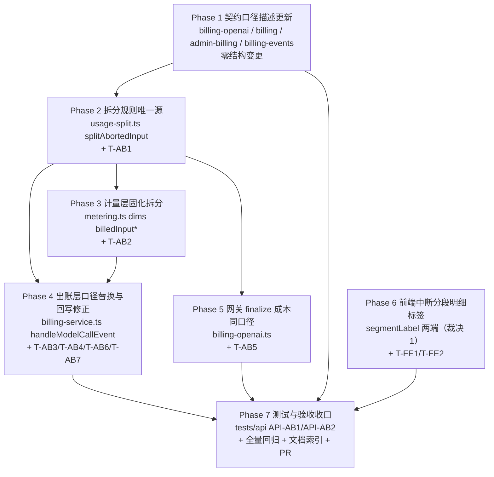

# 调用中断的 token 计费优化 - 实现计划

**关联 Proposal**: `docs/engineering/proposals/20261029-feat-interrupted-call-token-billing.md`（v1.0）
**关联 PRD**: `docs/product/draft/20261029-interrupted-call-token-billing.md`（v1.0）
**需求总分支（feat-branch）**: `feat/interrupted-call-token-billing`（需求总 PR：https://github.com/Deliay/z-agent-gear/pull/371）
**实现分支**: 基于 `feat/interrupted-call-token-billing` 创建实现分支（建议 `impl/interrupted-call-token-billing`），完成后 PR 合并回需求总分支
**创建日期**: 2026-10-30（文件名日期与对应 proposal 一致取 `20261029`）
**计划版本**: v1.0
**版本说明**:
- v1.0（2026-10-30，首版）承接评审通过的上游产物（`review-design` 节点经 PR #371 于 2026-10-30 APPROVED，无整改意见、无 inline comment），按 TDD（红-绿-重构）拆解为 7 个 Phase 的可执行实现计划；对提案留白/含混处给出「计划期裁决」11 项（其中裁决 1 修正提案 §1.3「前端零改动」口径以满足 PRD 功能点 3 验收标准，裁决 2 锁定「事实 vs 口径」回写风险）。

## 实现顺序



**依赖说明**：

- **Phase 1（契约）先行**：零结构变更、仅口径描述，但契约是口径的唯一对齐基准，先落契约再编码。
- **Phase 2（usage-split）** 是拆分规则唯一源，Phase 3/4/5 都依赖它，必须最先落地（TDD 起点，纯函数）。
- **Phase 3（metering 固化）** 先于 Phase 4：出账层从 `MeteringRecord.dims` 取拆分结果（裁决 4 回落判定依赖字段存在性）。
- **Phase 4（billing-service）与 Phase 5（网关）** 相互独立、可并行，均只依赖 Phase 2 的 `splitAbortedInput`。
- **Phase 6（前端）** 独立于后端各 Phase，仅依赖 Phase 4 产出的 `segment` 取值口径（契约 Phase 1 已锁定）。
- **Phase 7** 在各 Phase 绿灯后收口（API 测试需要 Aspire 全栈 + RabbitMQ 真实管线）。

开发模式统一采用 TDD（红-绿-重构）：每个 Phase 先写/改测试（RED）再写实现（GREEN），禁止 RED 状态重构。编码前无条件加载 `docs/engineering/common-rules.md`、`docs/engineering/backend-rules.md`（后端）、`docs/engineering/frontend-rules.md`（前端）及 `servers/admin-api/AGENTS.md`、`apps/*/AGENTS.md`。

### 关键约束（提案 §1.2/§1.3/§6，实现期不得回退）

- **实际用量（事实）与计费口径（解释）分离**：`BillingApiCall` / 事件 payload / `dims` 实际三段 token 保持实际用量；20/80 拆分结果仅用于计价并固化在计量记录（`dims.billedInput*`），保证「重放『事件 → 计量 → 定价』金额与历史一致」不变量。
- **拆分唯一源**：三处（计量固化 / 出账定价 / 网关成本）一律调用 `usage-split.ts` 的 `splitAbortedInput`，禁止各自内联拆分口径。
- **输出 token 全价不变**，不参与拆分；未产生输出不计输出明细。
- **不追溯历史账单**：存量记录（`dims` 无拆分字段）重放回落旧行为（按实际 `cachedInputTokens` 计价），金额与首次出账一致。
- **金额整数「分」运算**：沿用 `money.ts`（`tokenCostCents` / `allocateTokenCostCents`），禁止浮点参与资金计算；不足 0.01 credits 按 0.01 计的口径不变。
- **幂等不变**：`eventId` 唯一 + `idempotentKey` 防重复扣费；拆分只依赖事件 payload，天然幂等。
- **正常完成调用计费零回归**；预检 `estimateCost`（保守上界）不变——中断折算只会降低实付，不破坏上界性质。
- **禁止 rebase/squash**：遵循 z-git 规范，仅允许 merge。

## 计划期裁决（提案留白/含混处的实现口径）

1. **前端 `segmentLabel` 中断分段标签（修正提案 §1.3「前端零改动」）**：PRD 功能点 3 要求明细「未缓存输入 / 缓存输入 / 输出」三段**分别展示且均带「中断」标注**；而现状 `apps/agent-web` 与 `apps/admin-web` 的 `billing-format.ts` `segmentLabel` 对任意含 `aborted` 的 segment 一律优先返回「中断」（`segment.includes('aborted')` 先于段名匹配），20/80 拆分后 `input:aborted` 与 `cached_input:aborted` 两行会同名「中断」无法区分，无法满足 PRD 验收。**裁决：本期对两端 `segmentLabel` 做最小修正**——剥离 `:aborted` 后缀取基础段名后追加（中断）（`input:aborted`→「输入（中断）」、`cached_input:aborted`→「缓存输入（中断）」、`output:aborted`→「输出（中断）」，无后缀行为不变），推翻提案该条「前端零改动」；除该纯函数外前端结构/页面仍零改动。变更范围为一个纯函数 + 测试，不触发契约/架构变化，不打回提案。
2. **回写必须保持事实用量（本需求首要数据正确性风险）**：`billing-service.handleModelCallEvent` 现把传给 `priceModel` 的 `usage` 直接回写 `BillingApiCall`；拆分后若沿用会把口径值写成事实。**裁决：回写三段一律取 `MeteringRecord.dims` 实际三段**（`inputTokens`/`cachedInputTokens`/`outputTokens`），`cost` 写折后 `priced.amountCents`（现状语义不变）；供 `priceModel` 的替换后 usage 仅作计价入参（T-AB3/T-AB4 锁定）。
3. **描述折算口径注明条件**：描述文案仅在**拆分实际生效**（`dims.billedInput*` 存在）时追加折算口径——`模型调用（中断：<reason>，输入按 20% 未缓存 + 80% 缓存计价[，估算]） <modelId>`；回落记录（裁决 4）沿用现行文案 `模型调用（中断：<reason>[，估算]） <modelId>`，不虚标口径。
4. **存量/异常回落**：`model_call.aborted` 但 `dims` 无 `billedInputNonCachedTokens`/`billedInputCachedTokens`（存量记录重放、极端异常）时按现行口径（实际 `cachedInputTokens`）计价，描述不注明折算（裁决 3），金额与历史一致，符合不追溯。
5. **`estimated` × `aborted` 叠加**：拆分基数为计量归一（含估算兜底 `estimatedInputTokens`）后的 `inputTokens`；`estimated` 标注保留，估算出的输入同样按 20/80 拆分（PRD 3.5，T-AB6）。
6. **网关成本取整策略不变**：aborted 成本 = `tokenCostCents(nonCachedTokens)` + `tokenCostCents(billedCachedTokens)` + `tokenCostCents(outputTokens)` 逐段 `ceil`；与管线 `allocateTokenCostCents` 整单分配的 ±1 分差维持 reconciliation 既有容忍现状，本需求不改取整策略（提案 §5.2 实现点 4）。
7. **对账重放口径**：`reconciliation.repairEvent` 从 `BillingApiCall`（实际用量）重建 `model_call.*` 事件，重放经 `splitAbortedInput` 确定性复算得到同一金额；拆分固化在 `dims` 亦保证未来调整比例不影响历史重放金额。`cost_without_invoice` 等对账行为零改动。
8. **为 0 的段不产生明细**：`pricing.ts` 既有 `.filter((item) => item.quantity > 0 || item.amount > 0)` 处理（PRD 3.5：`inputTokens=1` → `cached=1, nonCached=0`，`input` 段不产生明细）；`inputTokens=0` 两段为 0。不新增过滤逻辑。
9. **事实口径不变项**：事件 payload（`billing-events.asyncapi.yaml` 结构）、`BillingApiCall` token 三段、`dims` 实际三段、`quantity = inputTokens + outputTokens`、`MeteringRecord.dims` 既有字段语义、预检 `estimateCost` 全部不变；`priceModel` 签名与三段计价逻辑零改动（拆分经 usage 参数传入）。
10. **tests/api 中断用例注入方式**：`tests/api` 现无中断用例且不打通真实上游供应商；API-AB1/API-AB2 采用「直写 `billingoutbox`（`producer='admin-api'`、`published=false`）注入 `model_call.aborted` / `model_call.completed` 事件」驱动真实 outbox→MQ→计量→出账管线，再经 `adminBillingInvoices` GraphQL 断言明细与金额（需 `MONGODB_URI` + RabbitMQ，Aspire 环境齐备；沿用「不允许静默 skip」惯例，依赖缺失时显式失败）。
11. **PRD 生命周期目录**：本期不移动产品文档生命周期目录（PRD 仍留 `docs/product/draft/`，同 `20261018-feat-credits-billing` 裁决 17 口径），待实现验收后按 `docs/product/AGENTS.md` 生命周期归档。

---

## Phase 1: 契约口径描述更新（Contracts）

契约先行、零结构变更，仅修订计价口径描述（提案 §3.1）。

### 文件修改

| 文件 | 操作 | 说明 |
|------|------|------|
| `contracts/billing-openai.openapi.yaml` | 修改 | `info.description` 计费条目修订：「中断调用按已产生用量出账（标注中断），**输入 token 按 20% 未缓存 + 80% 缓存计价、输出 token 全价**；用量缺失按兜底规则估算（标注估算，估算输入同样按 20/80 拆分计价）」；usage 形状（`prompt_tokens`/`completion_tokens`/`prompt_tokens_details.cached_tokens`）不变 |
| `contracts/billing.graphql` | 修改 | `InvoiceItem.segment` 注释修订为「`input \| cached_input \| output`（中断调用带 `:aborted` 后缀：`input:aborted`=20% 未缓存、`cached_input:aborted`=80% 缓存、`output:aborted`=输出全价）」；`BillingApiCall` 的 token 三段补注「实际用量」、`cost` 补注「按计价口径折算后的出账金额」；字段结构零变更 |
| `contracts/admin-billing.graphql` | 修改 | 同 `billing.graphql` 口径逐字同步（`InvoiceItem.segment` 注释、`BillingApiCall` token 三段与 `cost` 注释） |
| `contracts/billing-events.asyncapi.yaml` | 修改 | `ModelCallEvent` payload **结构不变**（保持实际用量），description 增补「`model_call.aborted` 的输入 token 在计量/定价侧按 20% 未缓存 + 80% 缓存拆分计价（输出全价），payload 保持实际用量」备注 |

### 验收 checklist

- [ ] 四份契约仅描述/注释变化，可被 OpenAPI / GraphQL / AsyncAPI 解析器解析（零结构变更）
- [ ] `billing.graphql` 与 `admin-billing.graphql` 的 `segment` / `BillingApiCall` 注释逐字一致
- [ ] `billing-events.asyncapi.yaml` payload schema 未增删字段，仅 description 增补
- [ ] 口径描述与 PRD 功能点 1/2、提案 §5.2 实现点 3 表述一致

---

## Phase 2: 拆分规则唯一源 `usage-split.ts`（TDD 起点）

纯函数模块，无 DB 依赖；先写测试（RED）再实现（GREEN）。

### 文件修改

| 文件 | 操作 | 说明 |
|------|------|------|
| `servers/admin-api/src/services/billing/usage-split.ts` | 新增 | 导出常量 `ABORTED_INPUT_CACHED_RATIO = 0.8` 与 `splitAbortedInput(inputTokens: number): { nonCachedTokens: number; cachedTokens: number }`；入参归一 `Math.max(0, Math.trunc(inputTokens))`（非有限数归 0）；`cachedTokens = Math.round(input × 0.8)`，`nonCachedTokens = input − cachedTokens`——**不重不漏**（两段和恰为输入总量），取整余量归未缓存段（贵的段，保守少让利）；边界 `input=0 → (0,0)`、`input=1 → nonCached=0, cached=1` |
| `servers/admin-api/src/services/billing/usage-split.test.ts` | 新增 | T-AB1（见测试矩阵） |

### 测试用例（增量，TDD）

| # | 用例 | 预期 |
|---|------|------|
| T-AB1 | `splitAbortedInput` 拆分不变量 | 0/1/2/5/大数（如 1_000_001）/小数/负数入参下：`cachedTokens = round(0.8×input)`、`nonCachedTokens = input − cachedTokens`、两段之和恰为归一后输入总量、余量归未缓存段 |

### 命令参考

```bash
cd servers/admin-api && npx vitest run src/services/billing/usage-split.test.ts
cd servers/admin-api && npm run build
```

### 验收 checklist

- [ ] T-AB1 绿灯；纯函数无外部依赖，`tsc` strict 通过
- [ ] 模块注释明确「拆分规则唯一源，计量/出账/网关三处共用，禁止内联复制口径」

---

## Phase 3: 计量层固化拆分（`metering.ts`）

「计量是事实、定价是解释」——拆分结果固化进 `dims`，保证重放金额与历史一致（提案 §5.2 实现点 2）。`dims` 为 `Mixed`，无迁移脚本。

### 文件修改

| 文件 | 操作 | 说明 |
|------|------|------|
| `servers/admin-api/src/services/billing/metering.ts` | 修改 | `buildRecord` 的 `model_call.*` 分支：`eventType === 'model_call.aborted'` 时在 `dims` 追加 `aborted: true` 与 `billedInputNonCachedTokens` / `billedInputCachedTokens`（取 `splitAbortedInput(inputTokens)` 结果，基数为**估算兜底归一后**的 `inputTokens`，裁决 5）；`model_call.completed` 不写这些字段；实际三段、`quantity = inputTokens + outputTokens`、`estimated` 语义全部不变（裁决 9） |
| `servers/admin-api/src/services/billing/metering.test.ts` | 修改 | 扩展 T-AB2（见测试矩阵） |

### 测试用例（增量，TDD）

| # | 用例 | 预期 |
|---|------|------|
| T-AB2 | aborted 计量固化拆分 | `model_call.aborted` 记录 `dims` 含 `aborted:true`、`billedInputNonCachedTokens`、`billedInputCachedTokens` 且两段和 = 实际 `inputTokens`；`dims` 实际三段为事件实际用量；`quantity` 口径不变；completed 记录**不写**拆分字段；`estimated` 兜底（缺用量）记录按估算后输入同样拆分 |

### 命令参考

```bash
cd servers/admin-api && npx vitest run src/services/billing/metering.test.ts
```

### 验收 checklist

- [ ] T-AB2 绿灯；既有 `metering.test.ts` 用例（T-B1/T-B9 等）全量保持通过
- [ ] `dims` 新增字段仅 aborted 记录携带，存量记录无字段不写迁移（Mixed 兼容）
- [ ] 重放同一事件得到同一 `dims`（拆分纯函数确定性）

---

## Phase 4: 出账层口径替换与回写修正（`billing-service.ts`）

提案 §5.2 实现点 3；回写事实 vs 口径混淆是本需求最主要数据正确性风险（裁决 2）。

### 文件修改

| 文件 | 操作 | 说明 |
|------|------|------|
| `servers/admin-api/src/services/billing/billing-service.ts` | 修改 | `handleModelCallEvent` 四点改造：① **定价口径替换**——`aborted && dims.billedInput*` 存在时，供 `priceModel` 的 usage 以 `billedInputCachedTokens` 替换 `cachedInputTokens`（`priceModel` 内 `nonCachedInput = input − cached` 自然得到 20% 段），否则维持现口径（裁决 4 回落）；② **回写修正**——`BillingApiCall` 三段回写取 `dims` 实际三段（不回写替换后 usage，裁决 2），`cost` 写 `priced.amountCents`（现状语义不变）；③ **描述文案**——拆分生效时 `模型调用（中断：<reason>，输入按 20% 未缓存 + 80% 缓存计价[，估算]） <modelId>`，回落沿用现文案（裁决 3）；④ `segment: aborted ? \`${item.segment}:aborted\` : item.segment` 保留不动（`input:aborted`/`cached_input:aborted`/`output:aborted` 三段明细自然产出） |
| `servers/admin-api/src/services/billing/billing-flow.test.ts` | 修改 | 扩展 T-AB3 / T-AB4 / T-AB6 / T-AB7（见测试矩阵） |
| `servers/admin-api/src/services/billing/pricing.test.ts` | 修改 | 扩展拆分输入的三段计价断言（T-AB8）：`cachedInputTokens` 传拆分值时 `input`/`cached_input` 两段数量与金额正确、`quantity=0` 段不产生明细 |

### 测试用例（增量，TDD）

| # | 用例 | 预期 |
|---|------|------|
| T-AB3 | aborted 出账口径 | 发票 items = `input:aborted`（数量=20% 段）+ `cached_input:aborted`（数量=80% 段）+ `output:aborted`（数量=输出全量），金额 = 折后合计；`BillingApiCall` 回写**实际三段** + `cost = priced.amountCents`；描述含「中断」/`reason`/「20% 未缓存 + 80% 缓存」 |
| T-AB4 | completed 回归 | 正常完成调用：金额、items、回写与拆分前完全一致（零回归） |
| T-AB6 | estimated × aborted | 估算输入同样按 20/80 拆分计价，`estimated` 标注保留（描述含「估算」） |
| T-AB7 | 回落与不计费 | `isBillable:false` 不出账、零用量、`dims` 无拆分字段（存量）回落旧行为且描述不虚标折算（裁决 3/4） |
| T-AB8 | pricing 拆分输入 | 三段计价数量/金额正确；为 0 的段不产生明细（`pricing.ts` 既有 filter） |

### 命令参考

```bash
cd servers/admin-api && npx vitest run src/services/billing/billing-flow.test.ts src/services/billing/pricing.test.ts
cd servers/admin-api && npm run build
```

### 验收 checklist

- [ ] T-AB3/T-AB4/T-AB6/T-AB7/T-AB8 绿灯；既有 `billing-flow.test.ts`（含 T-B14/T-B16/T-B26 断言「中断」+ segment 含 aborted）全量保持通过
- [ ] 回写三段与 `dims` 实际三段逐字一致（T-AB3 断言锁定），`cost` 为折后金额
- [ ] 描述文案条件分支（折算注明/回落不注明）均有断言

---

## Phase 5: 网关 `finalize` 成本同口径（`billing-openai.ts`）

提案 §5.2 实现点 4：`BillingApiCall.cost` 网关直算审计成本需与管线折后同口径，否则放大对账差异告警。

### 文件修改

| 文件 | 操作 | 说明 |
|------|------|------|
| `servers/admin-api/src/routes/billing-openai.ts` | 修改 | `finalize` 内成本直算：`status === 'aborted'` 时以 `splitAbortedInput(usage.inputTokens)` 结果替换实际缓存段，`cost = tokenCostCents(nonCachedTokens, inputPerMillion) + tokenCostCents(cachedTokens, cachedInputPerMillion) + tokenCostCents(outputTokens, outputPerMillion)`（逐段 `ceil` 策略不变，裁决 6）；`completed` 路径不动；`writeFinalize` 的事件 payload 与 `BillingApiCall` 三段**保持实际用量**（现状不变，裁决 9） |
| `servers/admin-api/src/routes/billing-openai.test.ts` | 修改 | 扩展 T-AB5：中断用例补成本断言 |

### 测试用例（增量，TDD）

| # | 用例 | 预期 |
|---|------|------|
| T-AB5 | 网关 aborted 成本同口径 | `finalize('aborted')` 落库 `cost` 按 20/80 拆分直算（与全价口径相比折低）；与管线折后金额差在既有 ±1 分取整容忍带内；事件 payload 仍为实际用量；completed 成本口径不变 |

### 命令参考

```bash
cd servers/admin-api && npx vitest run src/routes/billing-openai.test.ts
```

### 验收 checklist

- [ ] T-AB5 绿灯；既有「R6：客户端中断 → model_call.aborted」等网关用例保持通过
- [ ] aborted 成本三段口径与 Phase 4 出账口径一致（同 `splitAbortedInput` 唯一源）
- [ ] 事件 payload / `BillingApiCall` 落库三段保持实际用量

---

## Phase 6: 前端中断分段明细标签（裁决 1）

PRD 功能点 3：明细三段分别展示且均带「中断」标注。两端 `billing-format.ts` 同构逐字一致，同步修改。

### 文件修改

| 文件 | 操作 | 说明 |
|------|------|------|
| `apps/agent-web/src/lib/billing-format.ts` | 修改 | `segmentLabel`：剥离 `:aborted` 后缀按基础段名匹配（`input`→输入 / `cached_input`→缓存输入 / `output`→输出），带后缀时追加「（中断）」；无后缀行为不变（`segmentLabel('input') === '输入'`） |
| `apps/admin-web/src/lib/billing-format.ts` | 修改 | 与 agent-web 逐字同步（两端同构约定） |
| `apps/agent-web/src/lib/billing-format.test.ts` | 新增 | T-FE1（若项目惯例改为页面级测试则并入 BillingPage 测试） |
| `apps/admin-web/src/lib/billing-format.test.ts` | 新增 | T-FE1 同构断言 |
| `apps/agent-web/src/pages/__tests__/BillingPage.test.tsx` | 修改 | 扩展 T-FE2：中断调用收据明细三行（20% 段/80% 段/输出）区分展示且均带「中断」；既有「中断调用」可见性断言保持通过 |

### 测试用例（增量，TDD）

| # | 用例 | 预期 |
|---|------|------|
| T-FE1 | `segmentLabel` 映射 | `input:aborted`→「输入（中断）」、`cached_input:aborted`→「缓存输入（中断）」、`output:aborted`→「输出（中断）」；`input`/`cached_input`/`output`/空值行为与现状完全一致 |
| T-FE2 | 明细行展示 | 中断调用账单/收据明细出现两条输入段行（20% 数量与 80% 数量可区分）+ 输出行，三行均带「中断」标注 |

### 命令参考

```bash
cd apps/agent-web && npx vitest run && npm run build && npm run lint
cd apps/admin-web && npx vitest run && npm run build && npm run lint
```

### 验收 checklist

- [ ] T-FE1/T-FE2 绿灯；两端 `segmentLabel` 逐字一致
- [ ] 无后缀 segment 的既有展示零变化（回归）；页面结构/查询零改动（仅标签纯函数）

---

## Phase 7: 测试与验收收口（API + 回归 + 文档 + PR）

### 文件修改

| 文件 | 操作 | 说明 |
|------|------|------|
| `tests/api/src/admin-api/billing.test.ts` | 修改 | 扩展 API-AB1 / API-AB2（注入方式见裁决 10）；`INVOICES` 查询已含 `items { … segment }`，补 `description` 断言字段（如契约未透出则经 `adminBillingInvoices` 现有字段断言金额与 items） |
| `tests/api/src/admin-api/billing-gateway.test.ts` | 复用 | 网关错误码与预检口径回归（现有 T-B21~T-B29 用例），无需新增 |
| `docs/engineering/AGENTS.md` | 修改 | 「实现计划（`plan/`）」索引新增 `20261029-feat-interrupted-call-token-billing.md` 条目 |
| `docs/engineering/plan/20261029-feat-interrupted-call-token-billing.md` | 复用 | 本计划文档；开发期可按实际情况更新并追加「实现记录」 |
| `docs/product/draft/20261029-interrupted-call-token-billing.md` | 复用 | 目录不动（裁决 11） |

### 测试用例（增量）

| # | 用例 | 预期 |
|---|------|------|
| API-AB1 | 中断调用账单明细 | 注入 `model_call.aborted` 事件（实际用量 + `reason`）→ 账单明细两段输入（数量=20%/80%、和=输入总量）+ 输出全价、segment 带 `:aborted`、描述含「中断」与「20% 未缓存 + 80% 缓存」、金额低于全价口径 |
| API-AB2 | 正常调用金额回归 | 注入 `model_call.completed` 事件 → 金额与拆分前公式完全一致（三段实际用量计价） |

### 命令参考

```bash
# 各子项目全量回归
cd servers/admin-api && npm run build && npx vitest run
cd apps/agent-web && npm run build && npx vitest run && npm run lint
cd apps/admin-web && npm run build && npx vitest run && npm run lint
# 集成 API（Aspire 全栈 + RabbitMQ 真实管线）
aspire start
cd tests/api && npx vitest run src/admin-api/billing.test.ts src/admin-api/billing-gateway.test.ts
```

### 总体验收 checklist（对齐提案 §10 / PRD §1.3）

- [ ] 契约口径描述更新评审通过（零结构变更，提案 §10 第 2 条）
- [ ] 代码实现完成：拆分唯一源 / 计量固化 / 出账口径替换与回写修正 / 网关成本同口径 / 前端分段标签（裁决 1）
- [ ] 单元测试覆盖达标：T-AB1~T-AB8、T-FE1~T-FE2 全绿，拆分规则与出账口径分支 100% 覆盖
- [ ] API 测试通过：API-AB1/API-AB2
- [ ] 正常完成调用计费回归零变化（T-AB4 + API-AB2 + 既有用例全量）
- [ ] PRD §1.3 成功标准逐条演示：中断明细输入拆「未缓存输入（20%）/缓存输入（80%）」两条、输出全价、整体金额低于全价口径；明细三段均带「中断」且描述注明中断原因与折算口径；历史账单无变化
- [ ] 对账无新增差异告警（reconciliation 既有用例通过，重放金额一致 T-AB3/裁决 7）
- [ ] 实现分支 PR 合并回 `feat/interrupted-call-token-billing`，需求总 PR #371 自动更新；实现计划文档保留在需求总分支

## 测试矩阵汇总

| 层级 | 用例 | 覆盖点 |
|------|------|--------|
| 单元（`servers/admin-api`） | T-AB1 | `splitAbortedInput` 拆分不变量（取整/边界/归一） |
| 单元 | T-AB2 | metering aborted `dims` 固化拆分、completed 不写、quantity 不变 |
| 单元（真实 Mongo 集成） | T-AB3 | aborted 出账三段明细 + 回写事实用量 + 折后 cost + 描述 |
| 单元（回归） | T-AB4 | completed 零回归 |
| 单元 | T-AB5 | 网关 aborted 成本与管线折后同口径 |
| 单元 | T-AB6 | estimated × aborted 叠加 |
| 单元 | T-AB7 | isBillable:false / 零用量 / 存量 dims 回落 |
| 单元 | T-AB8 | pricing 拆分输入三段计价 + 零段过滤 |
| 前端单元 | T-FE1 / T-FE2 | segmentLabel 映射、明细三段区分展示 |
| 集成 API（`tests/api`） | API-AB1 / API-AB2 | 端到端出账口径与明细断言、正常调用金额回归 |
| 回归 | 既有全量 | `billing-flow`/`metering`/`pricing`/`billing-openai`/`mappers`/`reconciliation` 既有用例 |

## 风险与回滚

| 风险 | 缓解 |
|------|------|
| 回写口径值污染事实用量（数据正确性首要风险） | 裁决 2：回写取 `dims` 实际三段，T-AB3/T-AB4 双向锁定；`dims` 事实字段零改动 |
| 三处拆分口径漂移（计量/出账/网关） | 裁决：`usage-split.ts` 唯一源，三处共用 `splitAbortedInput`；T-AB5 断言网关与管线同口径 |
| 重放金额不一致 | 拆分固化在 `dims`（未来调比例不改变历史重放）；`splitAbortedInput` 纯函数确定性；裁决 7 对账重放口径 |
| 网关成本与出账金额取整差异放大对账告警 | 裁决 6：取整策略不变（逐段 ceil vs 整单分配 ±1 分），reconciliation 既有容忍；仅保证折算口径一致 |
| 存量/异常记录无拆分字段 | 裁决 4 回落旧行为（金额与历史一致，符合不追溯）；描述不虚标折算（裁决 3） |
| 前端拆分后两行同名「中断」不可区分 | 裁决 1：`segmentLabel` 分段标签修正 + T-FE1/T-FE2；无后缀行为零变化 |
| 输入极少（1 个）取整产生 0 段 | PRD 3.5 允许其中一段为 0；`pricing.ts` 既有零段过滤（裁决 8）；T-AB1/T-AB8 锁定 |
| tests/api 无中断用例、真实上游不可控 | 裁决 10：outbox 注入驱动真实管线，确定性复现出账口径；依赖缺失显式失败不静默 skip |
| 逃费风险（折算只降不升） | 输出全价、中断照常出账（幂等键不变）；预检保守上界不变（裁决 9）；T-AB3 断言金额>0 |

## 相关文档

- 关联 PRD：`docs/product/draft/20261029-interrupted-call-token-billing.md`（v1.0）
- 关联 Proposal：`docs/engineering/proposals/20261029-feat-interrupted-call-token-billing.md`（v1.0）
- 上游基线：`docs/engineering/proposals/20261018-feat-credits-billing.md`、`docs/engineering/plan/20261018-feat-credits-billing.md`（费用中心计费链路基线，实现点 2「计量是事实、定价是解释」）
- 开发规范：`docs/engineering/common-rules.md`、`docs/engineering/backend-rules.md`、`docs/engineering/frontend-rules.md`
- 关键实现参考：`servers/admin-api/src/services/billing/money.ts`（`tokenCostCents`/`allocateTokenCostCents`）、`servers/admin-api/src/services/billing/pricing.ts`（`priceModel` 三段计价与零段过滤）、`servers/admin-api/src/services/billing/metering.ts`（`buildRecord` dims 构造）、`servers/admin-api/src/services/billing/billing-service.ts`（`handleModelCallEvent`）、`servers/admin-api/src/routes/billing-openai.ts`（`finalize`/`resolveUsageFallback`）、`servers/admin-api/src/services/billing/reconciliation.ts`（`repairEvent` 重放）
- 工程文档规范：`docs/engineering/AGENTS.md`、`docs/engineering/plan/AGENTS.md`
- 需求来源：[GitHub Issue #355 调用中断的token计费优化](https://github.com/Deliay/z-agent-gear/issues/355)
