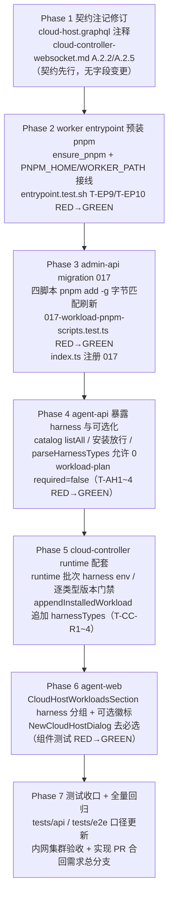

# 云电脑组件安装切换 pnpm 与工作负载 Harness 可选化 - 实现计划

**关联 Proposal**: `docs/engineering/proposals/20261029-feat-pnpm-workload-and-harness-optional.md`（v1.0）
**关联 PRD**: `docs/product/draft/20261029-pnpm-workload-and-harness-optional.md`（v1.0，Issue #369）
**需求总分支（feat-branch）**: `feat/pnpm-workload-and-harness-optional`（基于 `main`，需求总 PR #373）
**实现分支**: `feat/pnpm-workload-and-harness-optional-impl`（基于 `feat/pnpm-workload-and-harness-optional`）
**创建日期**: 2026-10-29
**计划版本**: v1.0

## 实现顺序



依赖说明：

- Phase 1 契约先行（z-coding 流程：技术方案 → 更新 Contract → 创建开发分支 → 编写实现）；注记修订不阻断后续编码，但须先落定口径文字；
- Phase 2（entrypoint）与 Phase 3（migration 017）相互独立可并行；两者共同构成「pnpm 安装口径」；Phase 3 脚本内的自举回退块（裁决 4）不依赖 Phase 2 就绪（双保险）；
- Phase 4 依赖 Phase 3 的脚本/常量落定（安装口径断言引用 `PNPM_VERSION` 形态），但服务层代码不依赖迁移执行；
- Phase 5 依赖 Phase 4 的安装放行语义（harness 负载经 runtime 批次下发才有 env/门禁/追加配套需求）；
- Phase 6 依赖 Phase 4 的列表/安装 GraphQL 口径（`workloadKind` 真实映射、harness 条目返回）；
- Phase 7 在实现分支合并回需求总分支后收口（`feat/pnpm-workload-and-harness-optional`）。

开发模式采用 TDD（红-绿-重构）：每个 Phase 内先写测试（RED）再实现（GREEN）再重构收口；编码前加载 `docs/engineering/common-rules.md`、`docs/engineering/backend-rules.md` / `frontend-rules.md` 与对应子项目 `AGENTS.md`；`tests/api` / `tests/e2e` 变更遵循各自 `AGENTS.md`（只用 Aspire 编排、禁止裸 docker，重跑从 `aspire start` 重来）。

### 关键约束（提案 §1.3/§6，实现期不得回退）

- **无 GraphQL 字段变更**：只改注释与口径文字（`cloud-host.graphql`）与契约注记（`cloud-controller-websocket.md` A.2.2 / A.2.5）；`contracts/admin-cloud-workload.graphql` 不动。
- **无数据模型 schema 变更**：`cloudworkloads` 仅脚本文本刷新（字节匹配）；`cloudcontainers.harnessTypes` 仅运行态追加。
- **npm 保留范围**（提案决策 3/4）：agent-gear 镜像预装（`Dockerfile:120`）与自更新（`entrypoint.sh:57`）保持 `npm install -g`；`001-preset-workloads.ts:66` 的 `pnpm|yarn|bun) npm install -g "$pm"` 包管理器自举通道不动；agent-web 前台「连接控制器」命令模板（`command-template.ts`）不动。**工作负载全局安装一律 `pnpm add -g`**。
- **harness 永远是可选工作负载**：`required=false`、不进「必须工作负载」语义、安装失败不销毁容器；已安装不提供卸载入口；不做 harness 版本选择参数。
- **创建期 catalog 维持 standard**（决策 10）：`cloudHostWorkloadCatalog` 不含 harness（创建走 `harnessTypes` 多选器，避免双入口）；`cloudHostWorkloads` 与 MCP `workload_list` 含 harness。
- **迁移只增不改**（决策 11）：字节匹配刷新，管理员定制/删除不覆盖（`console.warn` 跳过），重跑幂等。
- **MCP 协议形态不变**：`workload_list` / `workload_install` 入参出参不变，仅列表内容纳入 harness。
- **禁止 rebase/squash**：遵循 z-git 规范，仅允许 merge；跨需求冲突用 merge 协调。
- **实现计划文档提交到需求总分支**（本文件落 `feat/pnpm-workload-and-harness-optional`）；实现代码在 `feat/pnpm-workload-and-harness-optional-impl`，经实现 PR 合回需求总分支。

## 计划期裁决（提案留白/含混处的实现口径）

1. **迁移编号核对**：提案固定 `017-workload-pnpm-scripts`（决策 12）。计划期核对需求总分支：`servers/admin-api/src/migrations/` 最高为 `016-preset-mongodb`（MongoDB 已合入），**017 现时空闲**。实现启动前再次核对；若被并行需求占用则顺延 `018`（文件名、`name`、`index.ts` 注册、测试引用同步），后合入方 merge 协调并顺延编号，禁止 rebase 改写历史。
2. **旧版本常量与 oldScripts 全链**：012 的 `refresh()` helper 未导出，017 内自实现刷新（013 形态：`findWorkload` + 字节匹配 + warn 跳过）。`oldScripts` 含**全部已知历史版本常量**（与 012 `oldScripts` 数组先例一致，避免存量库停留在更早版本时漏刷新）：
   - OpenCode：`HARNESS_OPENCODE_INIT_SCRIPT` / `HARNESS_OPENCODE_INIT_SCRIPT_V1`（006 导出）/ `HARNESS_OPENCODE_SCRIPT_V2`（006→012 组合导出）→ `HARNESS_OPENCODE_SCRIPT_V3`；
   - Kimi Code：`HARNESS_KIMI_CODE_INIT_SCRIPT`（009 导出）/ `HARNESS_KIMI_CODE_SCRIPT_V2`（012 导出）→ `HARNESS_KIMI_CODE_SCRIPT_V3`；
   - DeepSeek Harness：`HARNESS_DEEPSEEK_INIT_SCRIPT_V1`（010 导出）/ `HARNESS_DEEPSEEK_SCRIPT_V2`（012 导出）/ `HARNESS_DEEPSEEK_SCRIPT_V3`（013 导出）→ `HARNESS_DEEPSEEK_SCRIPT_V4`；
   - Playwright：`PLAYWRIGHT_SCRIPT_V1`（015 导出）→ `PLAYWRIGHT_SCRIPT_V2`。
3. **导出清单**（提案 §3.2）：`name = '017-workload-pnpm-scripts'`、`HARNESS_OPENCODE_SCRIPT_V3` / `HARNESS_KIMI_CODE_SCRIPT_V3` / `HARNESS_DEEPSEEK_SCRIPT_V4` / `PLAYWRIGHT_SCRIPT_V2`、`export const PNPM_VERSION = '9.15.9'`（与 013 `PNPM_VERSION_V4` 同值，统一回退块与 entrypoint 共用口径）。导出不改变 runner 的 `Migration` 接口（`name` + `run`）。
4. **脚本内统一 pnpm 自举回退块**（插入于各安装行之前）：
   ```bash
   if ! command -v pnpm >/dev/null 2>&1; then
     echo "Installing pnpm ${PNPM_VERSION}"
     npm install -g "pnpm@${PNPM_VERSION}"
   fi
   ```
   TS 模板字符串中 `${` 转义为 `\${`（同 001/004/009 写法）；脚本文本内版本 pin 为固定 `9.15.9`。DeepSeek V4 中既有 pnpm 引导（013 的 `PNPM_VERSION_V4` TS 插值段）**收敛为该块**（行为等价，去掉「仅 dsh 场景」局部语义）。`pnpm add -g` 安装行的包名与版本 pin 全部不变（`@opencode/cli@2.1.1` / `@moonshot-ai/kimi-code@2.3.2` / `@deepseek-ai/dsh@0.2.1-rc.2` + `@deepseek-ai/dsh-acp-app@0.2.1-rc.2` / `playwright`）。
5. **`run_as_worker` 而非 `run_as_worker_exec`（提案笔误纠正）**：entrypoint 的 `run_as_worker_exec` 会 `exec` 替换当前 shell（仅用于后台子进程链路），`ensure_pnpm` 与 `pnpm setup` 必须用 `run_as_worker`。提案 §5.2 实现点 1 的 `run_as_worker_exec npm install -g pnpm@9.15.9` / `run_as_worker_exec pnpm setup` 按此纠正，实现后回写提案勘误（不影响方案结论）。
6. **`ensure_pnpm` 落点与失败语义**：在保活循环/自更新之前执行一次（入口段），`command -v pnpm >/dev/null 2>&1 || run_as_worker npm install -g "pnpm@${PNPM_VERSION}" || log "WARN: pnpm install failed…"`——失败**仅告警不阻断**（`set -euo pipefail` 下显式 `||` 容忍，与 agent-gear 自更新同口径）；`ZAG_SKIP_AGENT_GEAR_UPDATE=1` 不影响 pnpm 预装。
7. **PNPM_HOME / PATH 接线（决策 2）**：`PNPM_HOME="$WORKER_HOME/.local/share/pnpm"`；`WORKER_PATH="$WORKER_NVM_DIR/current/bin:$PNPM_HOME:/usr/local/sbin:…"`（既有顺序不变、仅追加目录）；`run_as_worker` / `run_as_worker_exec` 环境显式 `PNPM_HOME="$PNPM_HOME"`；`/etc/profile.d/pnpm.sh` 幂等标记块重写（`# >>> pnpm >>>` … `# <<< pnpm <<<`，先 `sed` 清旧块再追加，`sed` 失败 `|| true`）：`export PNPM_HOME=…` + PATH 追加（登录 shell 全局生效，同 015 `playwright.sh` 模式）；并执行 `run_as_worker pnpm setup || true`（交互 shell `~/.bashrc` 接线，双保险）。
8. **pnpm registry**：pnpm 读同一 `~/.npmrc`（脚本内既有 `npm config set registry "$REGISTRY"` / entrypoint `NPM_REGISTRY` 约定已写入该文件），一期**不加** `pnpm config set registry` 兜底；实现期实测若 pnpm 未继承 registry，再补同步兜底并回写提案（§6.1 决策 1 的实测裁决机制）。
9. **`parseHarnessTypes` 放宽两处**（`cloud-host-service.ts:107-110` 与 `:125` 两个 `at least one harness type is required` throw）：均改为「空/去重后空 → 返回 `[]`」（第二分支实际不可达，一并放宽防御）；白名单校验与去重逻辑不变；非字符串/白名单外仍报 `unsupported harness type: …`。
10. **`createInstallOperation` 白名单与大小写口径**：`workloadKind !== 'standard'` 拒绝改为白名单 `['standard','harness']`（DB 落库为小写），其余仍 `Workload not found`；GraphQL 侧 `list()` 映射真实 kind 为大写 `'STANDARD' | 'HARNESS'`（现硬编码 `'STANDARD'`）；已安装 → SKIPPED 幂等分支不变。
11. **runtime 版本门禁取版本失败**：无法获取在线 worker 版本（socketio-gateway 注册信息缺失）时**放行并 `console.warn` 留痕**（契约注记明示）；满足/不满足的判定：`max(MIN_HARNESS_VERSION_BY_TYPE[harnessType] ?? MIN_HARNESS_WORKER_VERSION, MIN_HARNESS_WORKER_VERSION)` 与 worker 版本对比，不满足 `400 INVALID_WORKLOAD` 可读原因（复用 `worker-version.ts` 的 `harnessMinVersion` / `maxWorkerVersion` 语义，不新造比较逻辑）。
12. **`harnessTypes` 追加条件**（决策 8）：`appendInstalledWorkload` 同点扩展——仅当负载 `harnessType` 非空**且该次执行成功**（现有「成功 + init + 非 system」谓词内）时对 `cloudcontainers.harnessTypes` `$addToSet`（去重）；standard 负载不动；失败结果不追加。
13. **entrypoint 测试桩形态**：T-EP9/T-EP10 沿用 `entrypoint.test.sh` 既有 PATH stub 模式（npm stub 记录 invocations、`setpriv` stub 直通），断言 pnpm 预装调用次数与告警容忍；`bash -n` 语法检查纳入。
14. **测试与文档口径**：预制项计数保持 **10**（本期不新增预制项，仅刷新脚本文本）；`tests/api` 断言脚本内容从 `npm install -g "@…` 形态切 `pnpm add -g`（含回退块、不含旧安装形态）；`tests/e2e` T-E16 计数 10 不变、顺带修正 `admin-cloud-workload.spec.ts:579` 陈旧注释（「恰 9 个」→ 10）；`tests/e2e/AGENTS.md` T-AW2 行「名称/harness 必填」口径改为「名称必填、harness 可选（0 个可提交）」；`tests/api/AGENTS.md` 用例表补「T-IA pnpm 脚本口径」行。
15. **前端文案与分组**：`NewCloudHostDialog` 删除 `harnessError` 必选校验（`NewCloudHostDialog.tsx:156`），harness 区块追加提示「可不选，之后在设置-工作负载中补装」（默认会话规则提示不变：恰好 1 个自动建会话）；`CloudHostWorkloadsSection` HARNESS 分组标题现为「云电脑」，改为「**云电脑（Harness）**」，harness 条目追加「**可选**」徽标（与「预制」「已安装」并列）；安装按钮沿用 `installed || !hostRunning` 禁用约束。
16. **ACP options 缓存**：`acp:options:<controllerId>:<type>`（5 分钟 TTL）新装 harness 首查自然未命中、实时探测；实现期核查 `acpCapabilities` 是否存在可用性缓存，若存在则在 harness 安装成功后主动 `DEL` 对应 key，不改 TTL 口径（提案 §4.2）。
17. **文档生命周期**：PRD 与提案本期保持各自目录（`draft` / `proposals`）不移动，待实现验收后按既有流程归档；`docs/engineering/AGENTS.md` 的「实现计划（`plan/`）」索引随本计划提交登记。
18. **实现 PR 口径**：实现代码完成后建 PR `feat/pnpm-workload-and-harness-optional-impl` → `feat/pnpm-workload-and-harness-optional`，合并后需求总 PR #373 自动更新；实现计划文档保留在需求总分支。

---

## Phase 1: 契约注记修订（contracts，契约先行）

开发分支：`feat/pnpm-workload-and-harness-optional-impl`。**无字段变更**，仅注释/口径文字。

### 文件修改

| 文件 | 操作 | 说明 |
|------|------|------|
| `contracts/cloud-host.graphql` | 修改 | `CreateCloudHostInput.harnessTypes` 注释修订：「**可为空数组**（harness 为可选工作负载，可在云电脑设置-工作负载中后期补装）；恰好 1 个时沿用默认会话规则」；`cloudHostWorkloads` 注释修订：「返回 standard **与 harness** 全量可安装工作负载；harness 条目为可选（非必须）工作负载，`installed` 口径一致」；`cloudHostWorkloadCatalog` 注释维持「standard 目录」并补「创建期 harness 选择走 `harnessTypes` 多选（决策 10）」；`installCloudHostWorkload` / `InstallCloudHostWorkloadInput` 注释修订：「支持 `workloadKind=HARNESS` 负载（可选、幂等、不提供卸载）」 |
| `contracts/cloud-controller-websocket.md` | 修改 | **A.2.2**：`harnessTypes` 允许空数组（0-harness 云电脑）；`workloadPlan` 允许为空（省略或空数组，0 harness + 0 standard 场景），放宽「harness 必填/显式非空」表述；**A.2.5** 增补三条：① `workloadId` 可为 harness 负载（`workloadKind=harness`），安装成功后读模型 `harnessTypes` **追加**该负载 `harnessType`（去重、仅成功结果）；② runtime 批次与 init 批次同口径注入云电脑初始化 env（`ZAG_HARNESS_TYPES`/`ZAG_MODEL_*`/`ZAG_DEFAULT_WORKSPACE` 等，purpose=harness 时），env 缺失时安装判失败并返回可读原因；③ harness 负载安装前逐类型版本门禁（`MIN_HARNESS_VERSION_BY_TYPE` 与 `MIN_HARNESS_WORKER_VERSION` 取 max 对比在线 worker 版本，不满足 `400 INVALID_WORKLOAD`；版本不可得放行并留痕，裁决 11）；附录读模型注记：`harnessTypes` =「创建时选定 ∪ 运行期成功安装的 harness 负载」 |
| `contracts/admin-cloud-workload.graphql` | 不变 | `workloadKind` / `harnessType` 字段已存在 |

### 验收 checklist

- [ ] A.2.2 / A.2.5 / 附录注记与提案 §3.1 逐条对应；`cloud-host.graphql` 四处注释修订落定
- [ ] `git diff --stat contracts/` 仅注释/文字，无 GraphQL 字段与类型变更
- [ ] 无代码依赖注记文字，Phase 2~6 不被本 Phase 阻断

---

## Phase 2: worker entrypoint 预装 pnpm（deploy/images/worker）

开发分支：`feat/pnpm-workload-and-harness-optional-impl`。TDD 顺序：先写 `entrypoint.test.sh` T-EP9/T-EP10（RED）→ 实现 `ensure_pnpm`（GREEN）→ 重构收口。

### 文件修改

| 文件 | 操作 | 说明 |
|------|------|------|
| `deploy/images/worker/entrypoint.sh` | 修改 | `PNPM_HOME="$WORKER_HOME/.local/share/pnpm"` 常量；`WORKER_PATH` 追加 `$PNPM_HOME`（`entrypoint.sh:24`，既有顺序不变）；`run_as_worker` / `run_as_worker_exec` 环境补 `PNPM_HOME`；新增 `ensure_pnpm()`（裁决 6/7）：幂等 `command -v pnpm` 判定、`run_as_worker npm install -g "pnpm@9.15.9"`、失败仅告警；`/etc/profile.d/pnpm.sh` 幂等标记块写入；`run_as_worker pnpm setup \|\| true`；在保活循环/首次自更新之前调用一次 |
| `deploy/images/worker/entrypoint.test.sh` | 修改 | 新增 T-EP9 / T-EP10（下表，裁决 13）；既有 T-EP0~T-EP8 断言（含 `npm_installs` 计数）随 `ensure_pnpm` 增加的 npm 调用**同步校准**（自更新计数断言区分 pnpm 预装与 agent-gear 自更新，stub 记录分桶） |
| `deploy/images/worker/BUILD.md` | 修改 | 「预制工作负载脚本手工验收」补 pnpm 核对块（文档口径）：`pnpm --version` = 9.15.9、`PNPM_HOME`/PATH 双入口生效、`pnpm add -g` 走内网代理、预装失败仅告警不阻断保活（**不改 Dockerfile**） |

### 测试用例（对齐提案 §8.2）

| # | 用例 | 预期 |
|---|------|------|
| T-EP9 | `ensure_pnpm` 幂等 | pnpm stub 已存在（`command -v pnpm` 命中）→ 不执行 `npm install -g pnpm`；未安装时恰好安装一次（`pnpm@9.15.9` pin）；`/etc/profile.d/pnpm.sh` 重跑幂等（标记块不重复追加） |
| T-EP10 | 预装失败仅告警 | npm stub 返回非 0 → 日志含 `WARN`、保活链路正常（agent-gear 照常拉起/重启/42 收敛）、入口不因 pnpm 失败退出；`ZAG_SKIP_AGENT_GEAR_UPDATE=1` 时 pnpm 预装仍执行 |

### 命令参考

```bash
bash -n deploy/images/worker/entrypoint.sh
bash deploy/images/worker/entrypoint.test.sh   # T-EP0~T-EP10 全绿
```

### 验收 checklist

- [ ] T-EP9/T-EP10 通过；T-EP0~T-EP8 断言校准后全绿
- [ ] `WORKER_PATH` 仅追加 `$PNPM_HOME`、既有顺序不变；`run_as_worker*` 均携带 `PNPM_HOME`
- [ ] `ensure_pnpm` 在任何工作负载脚本下发前执行；失败仅告警（`bash -n` + 测试桩断言）
- [ ] 不改 `Dockerfile:120` agent-gear npm 预装与 `entrypoint.sh:57` 自更新口径（`git diff` 确认）
- [ ] BUILD.md pnpm 手工验收块成文（仅文档）

---

## Phase 3: admin-api migration 017（四脚本 pnpm 刷新，字节匹配）

开发分支：`feat/pnpm-workload-and-harness-optional-impl`。TDD 顺序：先写 `017-workload-pnpm-scripts.test.ts`（RED）→ 实现迁移（GREEN）→ 重构收口。

### 文件修改

| 文件 | 操作 | 说明 |
|------|------|------|
| `servers/admin-api/src/migrations/017-workload-pnpm-scripts.ts` | 新增 | 导出清单见裁决 3；四条新脚本常量（安装行切 `pnpm add -g` + 统一回退块，其余逐字不动）；`run()` 按裁决 2 自实现字节匹配刷新（oldScripts 全链 → newScript，warn 跳过、幂等） |
| `servers/admin-api/src/migrations/017-workload-pnpm-scripts.test.ts` | 新增 | 覆盖 `T-MIG-PN1`~`T-MIG-PN5`（下表）；mock 形态沿用 `013-preset-harness-deepseek-header-masq.test.ts` / `009` 单测（`vi.mock` + `findOne`/`updateOne` 等） |
| `servers/admin-api/src/index.ts` | 修改 | `runMigrations([...])` 追加 `017-workload-pnpm-scripts`（顺序在 016 之后，注释行说明） |
| `servers/admin-api/src/migrations/001~016` 既有迁移 | 不变 | 只读参考（导入其导出常量），不改既有迁移源码 |

### 017 迁移逻辑（伪代码）

```ts
export const name = '017-workload-pnpm-scripts';
export const PNPM_VERSION = '9.15.9';
export const HARNESS_OPENCODE_SCRIPT_V3 = `#!/usr/bin/env bash\n...`;   // V2 基础上：安装行 pnpm add -g + 回退块
export const HARNESS_KIMI_CODE_SCRIPT_V3 = `...`;
export const HARNESS_DEEPSEEK_SCRIPT_V4 = `...`;                        // 双包 pnpm add -g；pnpm 引导收敛为统一回退块
export const PLAYWRIGHT_SCRIPT_V2 = `...`;

export async function run(): Promise<void> {
  await refresh({ presetKey: 'harness-opencode', name: 'OpenCode（Harness）',
    oldScripts: [HARNESS_OPENCODE_INIT_SCRIPT, HARNESS_OPENCODE_INIT_SCRIPT_V1, HARNESS_OPENCODE_SCRIPT_V2],
    newScript: HARNESS_OPENCODE_SCRIPT_V3 });
  await refresh({ presetKey: 'harness-kimi-code', name: 'Kimi Code（Harness）', /* …→ V3 */ });
  await refresh({ presetKey: 'harness-deepseek-harness', name: 'DeepSeek Harness（Harness）', /* V1/V2/V3 → V4 */ });
  await refresh({ presetKey: 'playwright', name: 'Playwright', oldScripts: [PLAYWRIGHT_SCRIPT_V1], newScript: PLAYWRIGHT_SCRIPT_V2 });
}

// refresh：presetKey/name 双查定位 → 库内 initScript 等于 newScript 则跳过 →
// 等于任一 oldScript 则替换 → 否则 console.warn「script modified, skipping」
```

### 脚本落地要点（逐字对齐提案 §5.2 实现点 2，仅安装行与回退块变更）

```bash
# 统一回退块（裁决 4，安装行之前；TS 模板串 \${ 转义）：
if ! command -v pnpm >/dev/null 2>&1; then
  echo "Installing pnpm ${PNPM_VERSION}"
  npm install -g "pnpm@${PNPM_VERSION}"
fi
# 安装行形态（包名/版本 pin 不变）：
pnpm add -g "@opencode/cli@${OPENCODE_CLI_VERSION}"
pnpm add -g "@moonshot-ai/kimi-code@${KIMI_CODE_CLI_VERSION}"
pnpm add -g "@deepseek-ai/dsh@${DSH_CLI_VERSION}" "@deepseek-ai/dsh-acp-app@${DSH_ACP_APP_VERSION}"
pnpm add -g playwright
# 硬校验、幂等锚点、harness prepare、dsh plugin、/etc/profile.d 注入等其余逻辑逐字不动
```

> pnpm registry 沿用脚本内 `npm config set registry "$REGISTRY"` 写入的 `~/.npmrc`（裁决 8）；`playwright install chromium` 与硬校验不变。

### 测试用例（对齐提案 §8.2）

| # | 用例 | 预期 |
|---|------|------|
| T-MIG-PN1 | 字节匹配刷新全分支 | 四条负载：库内文本 = 对应 oldScript 之一 → 更新为 newScript（断言 `pnpm add -g` 形态 + 回退块 + 版本 pin 不变 + 硬校验/幂等锚点保留） |
| T-MIG-PN2 | 已是新版本跳过 | 库内文本 = newScript → 无写入（幂等重跑） |
| T-MIG-PN3 | 管理员定制保留 | 库内文本 ≠ 任何 oldScript/newScript → `console.warn` 跳过、不覆盖 |
| T-MIG-PN4 | 幂等重跑 | 第二次 `run()` 无任何 update（T-MIG-PN1 之后再跑）；缺失负载（已被删除）静默跳过 |
| T-MIG-PN5 | 脚本不变量 + `bash -n` | ① 四条 newScript `bash -n` 退出 0；② 含统一回退块与 `pnpm add -g` 安装行、`NPM_REGISTRY` 约定、结尾硬校验（`--version` / `harness prepare` / `chromium-*`）；③ **不含**旧安装形态 `npm install -g "@opencode` / `npm install -g "@moonshot` / `npm install -g "@deepseek` / `npm install -g playwright`；④ DeepSeek V4 不再含「仅 dsh 场景」的局部 pnpm 引导（已收敛为统一回退块） |
| 回归 | 001~016 / runner 既有测试 | 全绿（不改既有迁移源码） |

### 命令参考

```bash
cd servers/admin-api
npx vitest run src/migrations        # 017 测试 RED→GREEN，再全目录
npm run build                        # strict TS 编译
```

### 验收 checklist

- [ ] `T-MIG-PN1`~`T-MIG-PN5` 全部通过；001~016 / runner 全绿
- [ ] `npm run build` strict 通过；`Migration` 接口未变（`name` + `run`）
- [ ] 安装行全部 `pnpm add -g`，回退块统一（`grep -n "npm install -g" 017*.ts` 仅命中回退块与注释）；`bash -n` 通过
- [ ] 字节匹配刷新：定制不覆盖、删除不恢复、重跑幂等（T-MIG-PN2/3/4）
- [ ] `index.ts` 注册 017 且顺序在 016 之后

---

## Phase 4: agent-api——设置-工作负载与 MCP 暴露 harness、harness 可选化

开发分支：`feat/pnpm-workload-and-harness-optional-impl`。TDD：先写/改 `cloud-host-workload-service.test.ts` 等（RED）→ 实现（GREEN）。

### 文件修改

| 文件 | 操作 | 说明 |
|------|------|------|
| `servers/agent-api/src/services/cloud-workload-catalog.ts` | 修改 | 新增 `listAll()`（`CloudWorkload.find({})` 含 harness）；`listStandard()` 保留（`cloudHostWorkloadCatalog` 继续使用，决策 10） |
| `servers/agent-api/src/services/cloud-host-workload-service.ts` | 修改 | `list()` 改用 `listAll()` 并映射真实 `workloadKind`（`'STANDARD' \| 'HARNESS'`，裁决 10）；`createInstallOperation`（`:197`）拒绝条件改白名单 `['standard','harness']`；已安装 SKIPPED 幂等分支不变 |
| `servers/agent-api/src/services/cloud-host-service.ts` | 修改 | `parseHarnessTypes` 允许 0 个（裁决 9：两处 throw → 返回 `[]`）；白名单/去重不变；`:879` 错误文案断言同步 |
| `servers/agent-api/src/services/cloud-host-workload-plan.ts` | 修改 | `resolveCreateWorkloadPlan`（`:120-125`）harness 预置 `required: true → false`（`implicit` 与固定在前顺序不变）；注释同步（`:27` 「required=true」、「显式非空 workloadPlan」表述随契约 A.2.2 放宽更新） |
| `servers/agent-api/src/services/cloud-host-tools.ts` | 不变（仅注释） | MCP `workload_list` / `workload_install` 经同一 `list()` / `createInstallOperation` 自动含 harness（决策 9），协议形态不变 |
| `servers/agent-api/src/services/*.test.ts` | 修改 | `cloud-host-workload-service.test.ts`（T-AH1/T-AH2）、`cloud-host-service.test.ts`（T-AH3）、`cloud-host-workload-plan.test.ts`（T-AH4）、`cloud-host-tools.test.ts`（workload_list 含 harness 断言） |

### 测试用例（对齐提案 §8.2）

| # | 用例 | 预期 |
|---|------|------|
| T-AH1 | `list()` 含 harness 且 kind 映射真实值 | standard + harness 全量返回；`workloadKind` 为 `'STANDARD' \| 'HARNESS'`（不再硬编码）；`installed` 口径不变；`listCatalog()` 仍仅 standard |
| T-AH2 | `createInstallOperation` 门调整 | harness 负载放行（创建安装操作）；未知 kind 仍 `Workload not found`；已安装 → SKIPPED 幂等；参数校验/执行记录口径不变 |
| T-AH3 | `parseHarnessTypes` 允许 0 个 | `[]` / 缺省 → 返回 `[]`（不抛错）；白名单外/非字符串仍报 `unsupported harness type`；去重保序不变 |
| T-AH4 | `resolveCreateWorkloadPlan` harness `required=false` | harness 预置项 `required: false`、`implicit` 与顺序（harness 固定在前）不变；standard 显式项 `required` 口径不变（`:144`） |
| 回归 | agent-api 既有单测 | `cloud-host.test.ts` / `session.test.ts`（A-11 门）等全绿；`:879` 文案断言随实现更新 |

### 命令参考

```bash
cd servers/agent-api
npx vitest run src/services/cloud-host-workload-service.test.ts src/services/cloud-host-service.test.ts src/services/cloud-host-workload-plan.test.ts src/services/cloud-host-tools.test.ts
npm run build && npx vitest run
```

### 验收 checklist

- [ ] T-AH1~T-AH4 全部通过；agent-api 全量单测与 `npm run build` 通过
- [ ] `cloudHostWorkloads` 含 harness、`cloudHostWorkloadCatalog` 仅 standard（决策 10 不回退）
- [ ] 创建允许 0 harness（不抛 `at least one harness type is required`）；harness 计划 `required=false`
- [ ] MCP `workload_list` 含 harness、`workload_install` 可装 harness（与界面同口径）
- [ ] 无 GraphQL 字段变更（仅 Phase 1 注释）

---

## Phase 5: cloud-controller——runtime 安装配套（env、门禁、harnessTypes 追加）

开发分支：`feat/pnpm-workload-and-harness-optional-impl`。TDD：先写 `workload-dispatcher.test.ts` / `internal-api.test.ts` 新分支（RED）→ 实现（GREEN）。

### 文件修改

| 文件 | 操作 | 说明 |
|------|------|------|
| `servers/cloud-controller/src/services/workload-dispatcher.ts` | 修改 | `startRuntimeBatch`（`:437`）：`emitRun(..., undefined, ...)` 改为与 init 同源 `resolveRunEnv(container)`（`:499`，purpose=harness 注入 `ZAG_HARNESS_TYPES`/`ZAG_MODEL_*`/`ZAG_DEFAULT_WORKSPACE` 等，`buildHarnessEnv`（`:210-219`）口径）；解析失败（secret 缺失/配置不完整）时判失败并返回可读原因，不下发 `undefined`/半套 env（T-CC13 口径沿用）；`appendInstalledWorkload`（`:677`）同点扩展：负载 `harnessType` 非空且成功时 `cloudcontainers.harnessTypes` `$addToSet`（裁决 12） |
| `servers/cloud-controller/src/routes/internal-api.ts` | 修改 | `POST /containers/:containerId/workloads`（`:630`）对 `workloadKind=harness` 负载做逐类型版本门禁（裁决 11：`max(MIN_HARNESS_VERSION_BY_TYPE[type], MIN_HARNESS_WORKER_VERSION)` 对比在线 worker 版本，不满足 `400 INVALID_WORKLOAD` 可读原因；版本不可得放行并 `console.warn` 留痕） |
| `servers/cloud-controller/src/services/worker-version.ts` | 不变（复用） | `MIN_HARNESS_VERSION_BY_TYPE` / `MIN_HARNESS_WORKER_VERSION` / `harnessMinVersion` / `maxWorkerVersion` 直接复用，不新造比较逻辑 |
| `servers/cloud-controller/src/services/workload-dispatcher.test.ts` | 修改 | T-CC-R1/R2/R3 |
| `servers/cloud-controller/src/routes/internal-api.test.ts` | 修改 | T-CC-R4 |

### 测试用例（对齐提案 §8.2）

| # | 用例 | 预期 |
|---|------|------|
| T-CC-R1 | runtime 批次 harness env 注入 | purpose=harness 容器的 runtime 批次 `emitRun` 携带与 init 同源 env（`ZAG_HARNESS_TYPES`/`ZAG_MODEL_*`/`ZAG_DEFAULT_WORKSPACE` 等）；standard 容器无 env 口径不变 |
| T-CC-R2 | env 解析失败判可读错误 | secret 缺失/配置不完整 → 批次判失败并返回可读原因，不下发 `undefined` env、不下发半套配置 |
| T-CC-R3 | `harnessTypes` 追加 | 负载 `harnessType` 非空且成功 → `cloudcontainers.harnessTypes` `$addToSet`（已含则去重不动）；失败结果不追加；standard 负载不动 |
| T-CC-R4 | runtime harness 版本门禁 | worker 版本 < `max(MIN_HARNESS_VERSION_BY_TYPE[type], 2.10.0)` → `400 INVALID_WORKLOAD` 可读原因；满足 → 放行；版本不可得 → 放行 + `console.warn` 留痕 |

### 命令参考

```bash
cd servers/cloud-controller
npx vitest run src/services/workload-dispatcher.test.ts src/routes/internal-api.test.ts src/services/worker-version.test.ts
npm run build && npx vitest run
```

### 验收 checklist

- [ ] T-CC-R1~R4 全部通过；cloud-controller 全量单测与 `npm run build` 通过
- [ ] runtime 批次与 init 批次 env 同源（`resolveRunEnv` 单一来源，决策 7）；失败可读可重试
- [ ] `harnessTypes` 追加在 cloud-controller 唯一回填点（决策 8）：成功 + `harnessType` 非空 + `$addToSet`
- [ ] 版本门禁复用 `worker-version.ts` 常量（决策 13）；契约 A.2.5 注记与实现一致
- [ ] ACP options 缓存核查（裁决 16）：如存在可用性缓存，安装成功后主动失效对应 key

---

## Phase 6: agent-web——设置-工作负载 harness 展示、创建可选

开发分支：`feat/pnpm-workload-and-harness-optional-impl`。TDD：先改组件测试（RED）→ 实现（GREEN）。

### 文件修改

| 文件 | 操作 | 说明 |
|------|------|------|
| `apps/agent-web/src/components/cloud-host/CloudHostWorkloadsSection.tsx` | 修改 | HARNESS 分组渲染激活（`:196-202` 现有代码，数据面放开后自动出组）；组标题「云电脑」→「云电脑（Harness）」（裁决 15）；harness 条目追加「可选」徽标（与「预制」`:294`「已安装」`:299` 并列）；安装按钮/参数表单/进度弹窗复用现状（`installed \|\| !hostRunning` 禁用约束不变） |
| `apps/agent-web/src/components/cloud-host/NewCloudHostDialog.tsx` | 修改 | 删除 `harnessError` 必选校验（`:156` 与 `:163` 提交禁用联动）；harness 区块追加提示「可不选，之后在设置-工作负载中补装」；默认会话规则提示不变；`useCloudHostProvisioning` 的 `createSession: harnessTypes.length === 1`（`useCloudHostProvisioning.ts:109`）**不动** |
| `apps/agent-web/src/components/cloud-host/__tests__/CloudHostWorkloadsSection.test.tsx` | 修改 | 分组/「可选」徽标/安装禁用断言 |
| `apps/agent-web/src/components/cloud-host/__tests__/NewCloudHostDialog.test.tsx` | 修改 | 0-harness 提交通过、提示文案、恰好 1 个自动建会话提示不变 |

### 测试用例

| # | 用例 | 预期 |
|---|------|------|
| T-WEB1 | harness 分组与徽标 | standard/harness 分组渲染（组标题「云电脑（Harness）」）；harness 条目含「可选」徽标，与「预制」「已安装」并列；已安装项禁用安装按钮、无卸载入口 |
| T-WEB2 | 安装按钮禁用口径 | `installed \|\| !hostRunning` → 禁用；未安装且运行中 → 可发起安装（参数表单/进度/失败原因复用现状） |
| T-WEB3 | 创建 0-harness 通过 | 不选 harness 可提交（无「请至少选择一种 Harness」拦截）；提示文案「可不选，之后在设置-工作负载中补装」；恰好 1 个时自动建会话提示不变；`harnessTypes: []` 随 `createCloudHost` 提交 |

### 命令参考

```bash
cd apps/agent-web
npx vitest run src/components/cloud-host/__tests__/CloudHostWorkloadsSection.test.tsx src/components/cloud-host/__tests__/NewCloudHostDialog.test.tsx
npm run build && npx vitest run
```

### 验收 checklist

- [ ] T-WEB1~T-WEB3 全部通过；agent-web 全量单测与 `npm run build` 通过
- [ ] harness 条目与普通工作负载并列展示、「可选」标识清晰（PRD 功能点 2）
- [ ] 创建表单不再因未选 harness 阻止提交；`useCloudHostProvisioning` 默认会话规则逻辑零改动
- [ ] 前端无 GraphQL 新字段依赖（仅消费 `workloadKind` 真实映射）

---

## Phase 7: 测试收口 + 全量回归 + 实现 PR

开发分支：`feat/pnpm-workload-and-harness-optional-impl`。

### 文件修改

| 文件 | 操作 | 说明 |
|------|------|------|
| `tests/api/src/admin-api/cloud-workload.test.ts` | 修改 | 脚本内容断言切 pnpm 口径：四条预制项 `initScript` 含 `pnpm add -g` 与统一回退块、**不含**旧 `npm install -g "@…` / `npm install -g playwright` 安装形态（回退块内 `npm install -g "pnpm@` 除外）；预制项计数 **10 不变**、名称清单不变；版本 pin 断言不变 |
| `tests/api/src/agent-api/cloud-host-workload.test.ts` | 修改 | 新增：`cloudHostWorkloads` 含 harness 条目（kind 真实映射、`installed` 标记）；`installCloudHostWorkload` 对 harness 安装放行 → SUCCEEDED → 重复发起幂等 SKIPPED；安装失败原因可读可重试 |
| `tests/api/src/agent-api/cloud-host.test.ts` | 修改 | 新增：创建 0-harness 云电脑成功（不再 `at least one harness type is required`）；harness 计划 `required=false` 口径；`workload_list` 含 harness |
| `tests/e2e/src/cloud-host.spec.ts` | 修改 | 设置-工作负载 HARNESS 分组 + 「可选」徽标；创建 0-harness 云电脑就绪、不默认创建会话；补装 harness 后 ACP 可见并可创建会话（T-AW 系列口径更新：harness 可选） |
| `tests/e2e/src/admin-cloud-workload.spec.ts` | 修改 | T-E16 计数 **10 不变**、名称清单不变；修正 `:579` 陈旧注释（「恰 9 个」→ 10）；脚本 pnpm 口径如涉及断言同步 |
| `tests/api/AGENTS.md` | 修改 | 用例表补「T-IA pnpm 脚本口径」行与 harness 列表/安装行（裁决 14） |
| `tests/e2e/AGENTS.md` | 修改 | T-AW2 行「名称/harness 必填」→「名称必填、harness 可选（0 个可提交）」；设置-工作负载 harness 展示口径（裁决 14） |
| `docs/engineering/AGENTS.md` | 已完成 | 「实现计划（`plan/`）」索引已随本计划提交登记，无需在实现期重复改动 |

### 测试收口清单（对齐提案 §8.2）

| 类型 | 范围 |
|------|------|
| API 集成 | `cloudHostWorkloads` 含 harness（含 `installed`）；`installCloudHostWorkload` harness 安装 → SUCCEEDED → 幂等 SKIPPED；`workload_list` 含 harness；创建 0-harness 成功；预制脚本 pnpm 断言（10 项计数不变） |
| E2E | 设置-工作负载 HARNESS 分组 + 可选徽标；创建 0-harness 云电脑就绪（不默认建会话）；补装 harness 后 ACP 可见并创建会话；T-E16 计数不变 |

### 命令参考

```bash
# 各服务全量
cd servers/admin-api && npm run build && npx vitest run
cd servers/agent-api && npm run build && npx vitest run
cd servers/cloud-controller && npm run build && npx vitest run
cd apps/agent-web && npm run build && npx vitest run
# API 回归（Aspire 编排；端口以 aspire describe 输出为准）
aspire start && aspire wait admin-api agent-api cloud-controller controller-api
cd tests/api && API_URL=http://localhost:10001/graphql \
  ADMIN_API_URL=http://localhost:10003/graphql \
  CONTROLLER_API_URL=<aspire describe controller-api> npm test
# E2E
cd tests/e2e && aspire wait agent-web admin-web && npx playwright test cloud-host.spec.ts admin-cloud-workload.spec.ts --workers=1
```

> 测试运行遵循 `tests/api` / `tests/e2e` 的 AGENTS.md：只用 Aspire 编排、禁止裸 docker；重跑从 `aspire start` 重来。

### 内网 K8s 手工验收（对齐 PRD §1.3 / 提案 §9）

前置：admin-api（含 migration 017）/ agent-api / cloud-controller / agent-web 新版部署；内网 npm 代理可达；worker 镜像含 `ensure_pnpm`（或存量镜像验证脚本自举回退）。

- [ ] 新容器就绪后 `pnpm --version` = 9.15.9 可直接使用；`PNPM_HOME`/PATH 双入口（登录 shell 与 `run_as_worker`）生效
- [ ] OpenCode / Kimi Code / DeepSeek Harness / Playwright 安装经 `pnpm add -g` 完成，工具硬校验通过、来源走内网代理；过程无 npm 全局安装形态（agent-gear/001 自举除外）
- [ ] 存量容器（无 pnpm）经脚本自举回退安装成功
- [ ] 预装 pnpm 失败仅告警：保活/agent-gear 链路正常，工作负载脚本自举回退兜底
- [ ] 设置-工作负载显示 harness 条目（「云电脑（Harness）」分组 + 「可选」标识），安装进度/失败原因可读、已安装幂等 SKIPPED、无卸载入口
- [ ] MCP `workload_list` 与界面一致（含 harness），`workload_install` 可安装 harness
- [ ] 运行期补装 harness 成功后：`harnessTypes` 追加、ACP 列表可见、可创建该类型会话（Kimi 登录引导、DeepSeek 模型注入等既有体验不变）
- [ ] runtime harness 版本门禁生效（低版本 worker 安装新类型 harness → 可读拒绝）
- [ ] 创建云电脑 0-harness 成功就绪、不默认建会话；harness 预置安装失败不再销毁容器（required=false），可事后补装
- [ ] 恰好选 1 个 harness 的默认会话规则不变；重复安装幂等；云电脑不在线时不允许发起安装
- [ ] 默认配置全程内网代理（npm-proxy），不触公网
- [ ] 实现分支 PR 合并回 `feat/pnpm-workload-and-harness-optional`，需求总 PR #373 自动更新；实现计划文档保留在需求总分支

### 总体验收 checklist（对齐提案 §9）

- [ ] 契约注记修订评审口径落定（A.2.2 / A.2.5、cloud-host.graphql 注释；无字段变更）
- [ ] T-MIG-PN1~PN5、T-EP9/10、T-AH1~4、T-CC-R1~4、T-WEB1~3 全部通过，各服务回归全绿
- [ ] API 测试通过（harness 列表/安装/0-harness 创建 + pnpm 脚本口径）、E2E 通过（T-E16 计数 10 不变 + harness 展示/补装）
- [ ] 无 GraphQL 字段变更、无数据模型 schema 变更；`git diff` 确认 agent-gear/001 自举/命令模板未动
- [ ] 迁移只增不改：定制不覆盖、删除不恢复、重跑幂等
- [ ] 上述内网集群验收全项通过
- [ ] 实测裁决如有触发（裁决 8 registry 兜底、裁决 16 缓存失效）已回写提案

## 风险与回滚

| 风险 | 缓解 |
|------|------|
| 迁移编号 017 与并行需求撞号 | 计划期已核对空闲；实现启动前复核，占用则顺延 018（裁决 1）；后合入方 merge 协调，不 rebase |
| `pnpm add -g` bin 链接形态与 npm 有差异（工具装了但命令不可用） | 决策 2 的 PNPM_HOME/PATH 接线（entrypoint + profile.d + `pnpm setup` 三入口）；脚本结尾硬校验（`--version`）覆盖「装了但不可用」 |
| pnpm 未继承 `~/.npmrc` registry（走公网/失败） | 脚本内 `npm config set registry` 写同一文件；实测触发则补 `pnpm config set registry` 兜底并回写提案（裁决 8） |
| 存量容器无 pnpm | 脚本内统一自举回退块 `npm install -g pnpm@9.15.9`（裁决 4）；新预装仅对新容器生效（提案 §6.2 约束） |
| pnpm 预装失败阻断容器启动 | 仅告警不阻断（`||` 容忍，T-EP10）；脚本侧自举双保险 |
| `required=false` 口径变更（创建期 harness 安装失败不再销毁容器） | 本需求明确的口径变更（提案决策 5，PRD 5.2 约束「harness 永远可选」）；验收专项核对；回滚 = 恢复 `required: true` 一行 |
| runtime 批次 env 解析失败下发半套配置 | `resolveRunEnv` 失败判失败 + 可读原因，不下发 `undefined`（T-CC-R2） |
| 0-harness 云电脑会话门行为 | A-11 `allowed.length > 0` 不生效（不限制）；补装后收窄为该类型集合（提案 §5.2 实现点 4 边界口径），E2E 核对 |
| Job env `ZAG_HARNESS_TYPES` 为创建期快照（补装不更新） | 已核对仅 `harness prepare` 消费该变量、ACP 动态探测、会话门走读模型；实现期以「补装后创建该类型会话 + ACP 列表可见」实测收口（提案 §5.2 实现点 4 风险点） |
| 迁移失败阻断启动 | runner 语义：失败仅记日志、下轮启动重试 |
| 误覆盖管理员定制/删除 | 字节匹配刷新 + warn 跳过（T-MIG-PN3）；只增不改 |
| 既有测试计数/口径冲突（并行需求） | 预制计数 10 不变（本期零新增）；T-E16/AGENTS.md 口径更新如与并行需求冲突，后合入方按主干实际值 merge 协调 |
| entrypoint `WORKER_PATH` 变更影响 `run_as_worker` 调用 | 仅追加 `$PNPM_HOME` 目录、既有顺序不变（T-EP 全量回归覆盖） |

## 相关文档

- 关联 PRD：`docs/product/draft/20261029-pnpm-workload-and-harness-optional.md`（Issue #369）
- 关联 Proposal：`docs/engineering/proposals/20261029-feat-pnpm-workload-and-harness-optional.md`
- 口径来源：`docs/product/draft/20261020-container-harness-support.md`（harness 口径，本期放宽必选/硬失败）、`20261025-kimi-code-harness.md` / `20261025-deepseek-harness.md`（harness 预置脚本与 `harness prepare`）
- 直接前例：`docs/engineering/plan/20261027-feat-dsh-header-masq.md`（脚本字节匹配刷新 + pnpm 引导 `PNPM_VERSION_V4`）、`plan/20261028-feat-playwright-workload.md`（015 脚本 V1 / profile.d 持久化先例）、`plan/20261025-feat-cloud-host-keepalive.md`（entrypoint / `run_as_worker` 口径）、`plan/20261018-feat-workload-phase3.md`（必须工作负载语义）
- 既有实现：`servers/admin-api/src/migrations/006/009/010/012/013/015`（脚本版本链与字节匹配先例）、`runner.ts`、`servers/admin-api/src/index.ts`；`servers/agent-api/src/services/cloud-workload-catalog.ts` / `cloud-host-workload-service.ts` / `cloud-host-service.ts` / `cloud-host-workload-plan.ts` / `cloud-host-tools.ts`；`servers/cloud-controller/src/services/workload-dispatcher.ts` / `worker-version.ts` / `routes/internal-api.ts`；`apps/agent-web/src/components/cloud-host/`
- 契约：`contracts/cloud-host.graphql`、`contracts/cloud-controller-websocket.md`（§2.9 / A.2.2 / A.2.5）、`contracts/admin-cloud-workload.graphql`
- 镜像构建与自验：`deploy/images/worker/BUILD.md`、`deploy/images/worker/entrypoint.sh` / `entrypoint.test.sh`
- 开发规范：`docs/engineering/common-rules.md`、`docs/engineering/backend-rules.md`、`docs/engineering/frontend-rules.md`、`servers/admin-api` 迁移约定（`migrations/runner.ts`）
